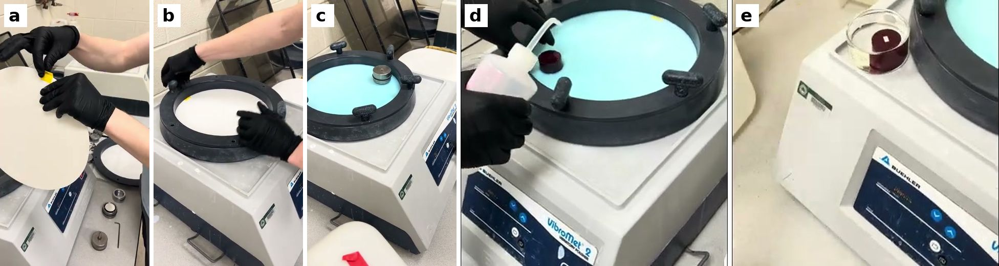

# Polishing SOP

*Steps 1-6 are copied word for word from [Ronnie's Google Doc](https://docs.google.com/document/d/1XJjOSDlwKRht6PhplwmZmqG202qoPPqnPQxjfCyigtU/edit) on 2026-10-05. Steps 7-11 are a draft that fills in the Doc's Step 7 ("Use a vibrating polisher"), with 0.1 µm diamond instead of colloidal silica.*

### Step 1

* Go to the Project Support Center and check out a diamond-edged saw blade. They should give you a bag with a couple blades in a cardboard container, a couple wrenches, and some metal pieces.
* Go back to the polishing lab to the saw machine. Lift up the platform to connect the saw blade to the machine.
* Locate the bolt directly under and to the right of the slit on the platform where the saw blade goes. Put the widest ring on the bolt, then the blade, then the other wide ring. The flat side of the wide rings should be touching the blade. Find the piece that fits into the divet of the wide ring, then screw the nut into the end of the bolt to hold everything in place. Tighten using the two wrenches.
* Make sure the water valve in the back is closed, and should be parallel to the back of the machine.
* Fill up the water bucket with water from the fume hood and fill up the machine until about 1/4-1/2" of the blade is sitting in the water.
* Lower the table back down.
* Place the sample against the two stabilizing rods, then clamp in place. Make sure the blade cover is down and the saw is not touching the sample. Make sure clamps are not in the way of the blade.
* Turn the machine on using the switch on the right side towards the back, then press the green button on the side, then the green button in front.
* Get RPM's to around 1400. The sample should be about 1cm^3, just a size where it can fit on an SEM stub and won't spill over the edges of the stub. Slowly rotate the handle to move the saw, slowly cutting the sample and keeping RPMs around 1000-1100. Listen to make sure there are no weird noises. A little bit of water should be spraying up. If it is not, then check to make sure the blade is touching the water, since not having water could cause the blade to melt.
* Disassemble saw, open water valve, dry off the machine and saw pieces. Return bag to PSC.

### Step 2

* Turn on the Bakelite compressor with a switch in the back and open the water valve to the left of the machine.
* Place a sample with the face you want to polish facing downwards. Lower the chamber using the arrows on the screen.
* Fill the chamber with 3/4 scoop of Bakelite.
* Place the cap piece on top with metal facing down and green marble facing up and flush with the top of the machine. It should be an airtight fit, so it will take some wiggling around to get in completely. You may need to hit it lightly with a hammer or wipe off any excess Bakelite from the cap or chamber to get it in.
* Cover the chamber with the lock bar.
* Press operate. Configure settings according to the laminated sheet hanging above the machine. Press play.
* Once complete, remove the lock bar, use the up arrow to push the piece out of the chamber, and pull it off the cap. It should come off pretty easily. Wipe off excess Bakelite from the cap and inside of the chamber.
* Turn off the Bakelite oven.

### Step 3

* Turn on the sanding belt and open the water valve on top to get water flowing down the belt.
* Sand the puck by moving it side to side across the belt until the sample is completely exposed and all Bakelite has been removed from its surface. Be careful with fingers.
* Turn off the sander and shut the water valve on top of the sander as well as the big, yellow-handled water valve to the left of the machine.

### Step 4

* Initial polisher testing: Turn on the machine and open water valve. Gentle settings (from top down) are 35, 30, 150. Set the clock to 30 seconds. Press the "link" button in the top right corner well and "H2O" button simultaneously to turn on the water, then the "link" and "play" buttons simultaneously to start it spinning. If nothing is wrong, press the stop button.
* Rinse off all parts of the puck, the metal puck holder, metal sand paper ring, and table the sandpaper sits on to get all previous particles off.
* **Wear gloves when handling the sample, do not contaminate the surface.**
* Press "link" and "up" arrow simultaneously to pull up the puck holder.
* Take off the splash guard ring and metal sand paper holding ring, then place 320-grit sandpaper. Replace the two rings. Place the puck in the metal holder with the sample on the sand paper.
* Turn on the water and start the sander as described above. Sand while continuously checking the surface, moving on to the next grit only when all scratches are the same size. Water should be positioned so the water is washing the sanded-off particles away from the sample. If not, the particles could scratch the sample. The timer can be set for a certain amount of time.
* Go through grits 320, 400, 600, 800, 1200 (verify these values, they could be off). Between every grit change, use the water to thoroughly clean gloves, the puck, the metal puck holder, metal sand paper ring, and table the sandpaper sits on to get all previous particles off. There is a 1200 plain and 1200 fine, the only difference is texture, would be worth checking with claude to see if we actually need to do the 1200 fine. The guy helping us said the 1200 plain is usually sufficient.

### Step 5

Switch out sandpaper for a polishing pad. Polishing pads can be used multiple times if they are used for the exact same alloy, be careful as not following this rule can cause cross-contamination. Peel off the back to expose the sticky side of the pad, making sure to keep the back part so you can re-attach it to the sticky side and store it later. Cut a small square of electroplated tape to form a tab that can be used to remove the polishing pad by sticking it on the back and wrapping around the side up to the top. Then place it on the table.

* Make sure the puck is completely dry using compressed air from the fume hood, and wipe off excess water from the sides and bottom of the puck using a paper towel. DO NOT WIPE THE SAMPLE WITH THE PAPER TOWEL! The puck can only touch cleaned surfaces from now on to prevent foreign particles from entering the polishing space and scratching it. Before starting, get a clean paper towel to place the puck onto after polishing, as well as a deep glass container and squirt bottle full of deionized water.
* Once the pad is in place and the puck is clean, move the puck holder over the top of the polishing pad. Use 1micron alumina suspension (Allide high-tech products, de-agglomerated) for the first polishing step. Apply 6-7 generous circles of alumina, focusing on the center and moving outwards since the alumina will slowly move to the outside of the pad as it spins.
* Use link+down to lower the puck onto the polishing pad.  Set time to 3 minutes and press start. Don't use water on the polishing pad. Regularly apply alumina to the pad to keep well lubricated. You will be able to see the alumina moving towards the edges of the pad. The alumina is what is doing the polishing at this point.
* Every couple minutes, remove from the puck holder and wash with DI water, letting excess water drain into the deep glass container, checking for any scratches, then drying with compressed air. Repeat until there are no more visible scratches (verify this piece of info). Never set the polished side facing down.
* Wash alumina off of the polishing pad in the fume hood, as well as all of the polishing machine. Dry off the pad with compressed air before putting it in the bag. Put the sticky-side cover on the sticky side of the pad, then place in a bag labeled with the polishing material (such as suspended alumina) and what metal was polished on it.
* NOTES: All sand paper pads are single use, and if a pad starts to rip while polishing, replace it. The machine has to be reserved, there's a QR code to get to the website.

### Step 6

* Take the puck, polished side up, to the fume hood in the deep glass container. Spray with ethanol to clean off the surface and dry with compressed air. Clean out the glass container twice by rinsing it out with ethanol and dumping it into the chemical waste. Now, the glass container and puck are both considered "clean".
* Place the puck faceup in the glass container and submerge the puck completely in methanol so the polished surface is not exposed to air.
* Clean out the ultrasonicator with deionized water, then fill with 1/4-1/2 inch of deionized water.
* Place the glass container into the water with a lid on top so no water gets into the glass container or touches the sample. Put the lid on top of the ultrasonicator and turn it on, cleaning for however long is needed.
* Bring it back to the fume hood. Remove the lid carefully so no water drips into methanol. Dry with compressed air. There may be a haze over the sample, and if there is, repeat ultrasonication until haze is no longer present.

> **Steps 7-11 are a draft.** Step 7 is the vibrating polisher the Doc planned, with 0.1 µm
> diamond suspension in place of colloidal silica. It is Gage's May colloidal silica procedure
> with the abrasive swapped, plus what came out of the discussion on
> [#258](https://github.com/vertical-cloud-lab/byu-vcl/pull/258) and
> [#110](https://github.com/vertical-cloud-lab/byu-vcl/issues/110). Nobody has run diamond on the
> VibroMet yet, so expect to change these steps after the first sample. EBSD samples still need
> colloidal silica, which isn't written up yet.

### Step 7

Final polish with 0.1 µm diamond on the vibrating polisher (Buehler VibroMet 2). Aluminum needs about a 0.1 µm finish for accurate EDS, but not the 4-6 hour colloidal silica polish, which is for EBSD. Diamond polishes mechanically, adds no Si, Al or Mg, and any left in the face reads as C.

This is Gage's colloidal silica procedure with the silica swapped for diamond. His procedure comes from his two videos of the May AlSi10Mg sample ([setup](https://youtu.be/OvVvYESOxqw) and [removal and cleaning](https://youtu.be/kcyESipwU8Y)) and his [cleaning sheet](https://github.com/vertical-cloud-lab/byu-vcl/issues/110#issuecomment-4513325105). The diamond changes come from the VibroMet 2 manual, PACE's guides and two Edison literature searches, listed under Sources.

> **Diamond doesn't need the constant spray.** Colloidal silica had to stay wet because it sets as it dries: the particles bond to each other and to the face, and the layer won't wash off. Drying causes it, not oxygen. Diamond doesn't set. `WPC-0110` is 94-98% water, with at most 0.1% PEG and 0.2% surfactant, both water-soluble, so dried suspension leaves loose diamond and a film, and both wash off. Edison found no study of dried diamond residue on aluminum, so this rests on the chemistry. Its advice: "Prompt but not frantic: aim to begin the water rinse within roughly a minute and never let a thick slurry puddle dry." You can also take the puck out partway to check it, which you couldn't do with silica.

> **The water doesn't add oxide that matters.** The diamond grinds oxide off as fast as it forms, so only the oxide that grows after the last pass reaches the SEM, and about 1.7 nm of that forms in air within 10 minutes, whatever was on the face. An alcohol-based liquid wouldn't keep oxygen away either: IPA dissolves about 8 times as much oxygen as water. What matters is keeping water contact short once the polish stops: rinse, push the water off with alcohol, and dry (Step 8).

> **The risk to watch for is embedded diamond.** Buehler polished cast Al-Si alloys with 9 and 1 µm diamond suspensions and found the surfaces "heavily embedded with diamond abrasive", mostly in the aluminum. Diamond paste didn't embed, and Buehler concluded "embedment is mainly a problem with fine diamond particles". Edison found no published run of a water-based diamond suspension on a vibratory polisher for aluminum or Al-Si; the literature uses colloidal silica for this step. Embedded diamond reads as C in EDS. So keep the load light and the run short, and check the first sample for it at the SEM (see [Checking the first sample](#checking-the-first-sample)).

*Frames from Gage's videos of the colloidal silica run: (a) tape pull-tab on the back of a new cloth, (b) clamp ring going on, (c) the specimen holder with one weight, running, (d) spraying the puck as it comes off the cloth, which diamond doesn't need, (e) the puck face up under ethanol.*

#### What you need

| Item | Notes |
|---|---|
| 0.1 µm polycrystalline diamond, water-based (PACE DIAMAT `WPC-0110`) | PACE confirmed it has no silica or alumina |
| A new 12" adhesive-back final polishing cloth | Allied Red Final C (`90-150-355`, on hand) until the Mark V pad arrives (see 7b). Never one that has had colloidal silica or alumina on it |
| DI water squirt bottle | DI only. Tap water dries to Ca and Mg spots, and Mg is one of the elements EDS is measuring |
| Alcohol squirt bottle | 200-proof ethanol (what Gage sprayed) or IPA of at least 99%. Not 70% IPA: it carries enough water to leave spots |
| Two clean glass dishes, with lids or parafilm | Deep enough to cover the puck, as in Gage's sheet |
| Electroplated tape | For the pull tab on the cloth |
| Lint-free wipes, paper towels, powder-free gloves, pH strips | |
| Clean, dry gas | Nitrogen, or a can of non-flammable duster (PACE `AIR-1000`), if the lab has either. Otherwise the fume hood's compressed air (see Open questions) |
| Ultrasonicator, optical microscope, timer | |

#### 7a. Clean the VibroMet

Other people use it with colloidal silica, and titanium runs add hydrogen peroxide. Any silica left in the bowl ends up on your sample as Si.

* If someone else's cloth is in the bowl, don't touch it. Ask them, or wait.
* Clean the bowl with water and paper towels until all loose material is out. Look hard at the rim, the clamp ring and under the ring, where silica dries into a white crust. Then wipe it all down with ethanol. Gage did water, then ethanol.
* The bowl has to be clean and **dry** before an adhesive cloth goes in (VibroMet 2 manual, p. 9).
* Clean the specimen holder and the weight the same way, water then ethanol, including the bottom face that sits on the cloth.

#### 7b. Put in a new cloth

* **Which cloth.** Use Allied Red Final C (`90-150-355`) until the Mark V pad arrives. Allied rates it for "diamond (3-0.02 micron)" and calls it "especially effective when preparing materials for SEM or TEM evaluation". It has more nap than the low-nap cloths the literature prefers for aluminum. The fibers bend around the hard Si and keep polishing the soft aluminum next to it, which leaves the Si standing proud. That's one more reason to keep the run short (7e).
* **When the Mark V pad arrives,** check its part number. Black Chem (`CPS-12A`) is a low-nap polymer sheet with no fibers, so it is flatter than Red Final C: switch to it if the SEM shows relief. Black velvet (`VC12`) is the same nap class as Red Final C, so it makes no real difference, and its back is plain, so only the clamp ring holds it down.
* Keep new cloths in their bag until you use them, and open the bag at the polisher, away from the belt sander and the SiC papers.
* Peel the backing off and keep it, so it can go back on for storage. Stick a tab of electroplated tape to the back near the edge, so the cloth can be pulled out later (photo a).
* Lay the cloth in the bowl and press it flat from the center out, so no air is trapped under it.
* Put the clamp ring on and tighten its knobs (photo b).
* Write on the backing and the bag: "0.1 µm diamond, AlSi10Mg only", the cloth's name and the date. One cloth per abrasive and alloy, like the pads in Step 5. Write the cloth into the sample record too (Step 10), so samples polished on different cloths never get pooled without anyone knowing.

#### 7c. Charge the cloth with diamond

* Look at the bottle first. Gage found dried crust around the colloidal silica cap ("those chunks are bigger than 0.05"). Wipe the cap and the neck with a damp lint-free wipe, pulling away from the opening.
* If there's sediment at the bottom of the bottle, turn the closed bottle over gently a few times to mix it back in. Diamond can settle out; colloidal silica doesn't.
* The first time a bottle is opened, pour a few drops into a clean dish and check them with a pH strip. Never dip the strip in the bottle. The safety data sheet gives both "7~9" and "9-11". Aluminum's oxide is only stable between about pH 4.5 and 8.5, so above that the suspension slowly etches the face. Write the pH on the bottle. If it's 9 or more, keep runs as short as possible and rinse promptly.
* Wet the cloth thoroughly with DI water first (manual, p. 12).
* Pour the diamond on and spread it with a clean gloved finger until the whole cloth is covered with a film of liquid (manual, p. 12). Gage used 200 mL of silica, "the amount to cover the bottom". Diamond costs more, so start with **about 50 mL** poured over the wet cloth, spread it, and add more diamond until the whole cloth has a film of liquid. Write down how much it took.
* Use the suspension as it comes. PACE sells it ready to use, so don't thin it; only add DI water later to replace what evaporates. Don't add any lubricant or extender. PACE's own diamond lapping film lube (PACE LUBE) lists 5-10% amorphous silica, which is exactly the Si this procedure keeps off the face.
* If the first check shows little progress, add more diamond. PACE's fix for a slow polish is to "recharge pad with diamond".

#### 7d. Load the puck and start

* The puck has to go through all of Step 6, ultrasonic included, before it goes in. One grain of 1 µm alumina carried onto the cloth can scratch every sample polished on it afterwards.
* Slide the puck into the specimen holder, face down, and tighten the hex screw.
* Wet the bottom of the holder with DI water before you set it on the cloth. The manual says this prevents chatter (p. 11).
* Put the weight on the holder. Gage used one weight and never needed more ("you can actually screw in a post and add more weights, but I've never felt like I needed to"). Keep it at one for aluminum, since more force presses more diamond into the metal.
* Put the lid on. Press the power button, then raise the amplitude. Gage starts at 50% and watches: the holder should travel smoothly around the bowl in a circle. If it hits the wall, turn the amplitude down.
* Set a timer for 30 minutes.

#### 7e. Check every 30 minutes, and stop when the alumina scratches are gone

* Plan on 1-2 hours, and never more than 4. The manual says to check every 15-30 minutes and that "some polishing times will exceed one hour" (p. 13). Gage ran silica for 4 hours, and 6 on a slow day. Edison found no published time for diamond and suggests a first trial of 1-2 hours, checked every 30 minutes. Check rather than guess, and write down how long it took.
* To check: stop the machine and lift the holder out. Rinse the face with DI water, then right away with alcohol to push the water off, and dry it. Look at it under the optical microscope at the highest magnification. Never set the polished side face down. Before putting it back, rinse the bottom of the holder with DI water. Keep the lid on the bowl while you're away.
* Stop when the scratches from the 1 µm alumina are gone, and don't keep going after that. PACE: "Over-polishing is the most common operator error: it rounds edges, pulls inclusions, and produces relief between phases of different hardness." On a napped cloth, extra time polishes the soft aluminum away from the hard Si, and at the SEM that relief reads as low Si.
* If scratches are still there after 4 hours, they're deeper than the alumina leaves, probably from the 1200 paper. Go back to Step 5 instead of running longer.
* If the cloth starts to look dry, add DI water. Never let it turn tacky or dry in patches. Keep the lid on so it evaporates slowly.
* **Don't leave it running overnight,** or alone past the next check. Overnight runs are a colloidal silica habit, for EBSD. Here the extra hours only add relief around the Si. By a rough estimate, an uncovered bowl loses 5-10 mL of water an hour, so the cloth can dry out before morning. And if the machine stops, the puck sits face down in the slurry.
* **If you can't stay until it's done,** stop at a check, clean the puck as in Step 8, put it in the vacuum jar (Step 11), and finish another day. With diamond you can stop and restart; with silica you couldn't. Leave the cloth in the bowl, still charged, with the lid on. If it has dried out by the time you come back, re-wet it with DI water and spread it as in 7c.
* Once you know how long a sample takes, you can leave it alone for that long with the lid on, but no longer.

### Step 8

Take the puck out and clean it, then clean up the VibroMet.

#### 8a. Clean the puck

* Set up before you stop the machine: the DI water and alcohol squirt bottles, two clean glass dishes deep enough to cover the puck (one with DI water, one with alcohol), and the ultrasonicator, cleaned and filled with DI water as in Step 6.
* Stop the machine and lift the holder off. Rinse the face generously with DI water within about a minute. Water is what dissolves the suspension's additives; alcohol only pushes the water off afterwards. There's no need for the non-stop stream the silica needed.
* Take the puck out of the holder and put it face up in the dish of DI water. Cover the dish (lid or parafilm, as Gage did) and stand it in the ultrasonicator for 2 minutes. PACE's cleaning guide gives 1-3 minutes. Don't go much longer, because pores and the gap between the metal and the Bakelite can hold liquid and debris.
* Move the puck to the dish of alcohol, cover it, and give it 2 more minutes. Methanol works too, as in Step 6, but Edison found nothing that needs methanol in particular, and ethanol is less toxic. Alcohol always stays in the covered dish, never straight in the tank, because it's flammable.
* Dry it right away, sweeping the gas across the face. Gage: "I always just blow right along the sample, and the sides just have to dry slow." No heat: PACE's aluminum guide says "no heated drying". Dry the edges of the face completely too. The tape in Step 9 won't seal on a wet surface, and it would trap whatever is under it. Never leave the puck sitting in water, and never let water dry on the face.
* Look at it under the optical microscope. If there's haze or specks, repeat both baths. If they're still there, add a drop of neutral lab detergent to the water bath for one more round, then rinse with DI water and finish with the alcohol bath. Detergent isn't routine because it leaves its own residue.
* Then go straight on to Step 9. If you have to stop, this is the place to do it (see Step 11).

#### 8b. Clean up the VibroMet

* Soak up the free liquid in the bowl with paper towels. PACE's safety data sheet lists no hazardous ingredients but says to dispose of it according to local rules, so ask the lab manager before pouring larger amounts down the sink.
* Rinse the cloth with DI water. If nobody else needs the bowl, leave the cloth in it with the lid on. Otherwise pull it out by the tab, put the backing back on and bag it. Allied says each removal weakens the adhesive, and slurry gets under a cloth that lifts, so replace a cloth that no longer lies flat. When the Mark V pad goes in, throw the Red Final C disc away rather than sticking it back in later.
* Wash the bowl, the clamp ring, the holder and the weight with water, then wipe them with ethanol, as in 7a.

### Step 9

Tape the face and cut the sample out of the puck. The tape keeps the saw's water and grit off the polished face. What matters is that its edges stay sealed: in May the tape lifted at the edges during the cut and left a film along them ([#77](https://github.com/vertical-cloud-lab/byu-vcl/issues/77#issuecomment-4522583203)).

* Cover the whole face with Kapton tape: the metal plus 2-3 mm of Bakelite on every side. The roll in the cabinet is 1/4" (6 mm) wide, narrower than a ~1 cm sample, so lay strips side by side in the same direction, each overlapping the one before by a couple of millimeters.
* Press every edge and seam down firmly with a clean gloved finger, working out any bubbles. The edges and seams are where water gets in.
* Set up the diamond saw as in Step 1. Clamp the puck by the Bakelite, never across the taped face.
* Cut through the Bakelite 1-2 mm outside the metal on all four sides. That way, if the tape lifts at a cut edge, it lifts over Bakelite instead of over the polished metal.
* Then cut parallel to the face, a few millimeters less deep than the sample is tall, so the cut goes through the metal. The piece then has a bare metal back, which is what conducts to the SEM stub (Bakelite doesn't conduct), and it is no taller than about 1 cm, as in Step 1.
* Do the four side cuts first, while there's plenty of Bakelite to clamp, and the parallel cut last. Slow down at the end of each cut. If the piece drops into the water, only reach for it after the blade has stopped.
* With the tape still on, rinse the piece with DI water and dry it, so saw slurry on the sides can't run onto the face when the tape comes off.
* Peel the tape off slowly, starting from a Bakelite corner. If the tape stayed down, just blow the face off with the dry gas from Step 8; it doesn't need another solvent clean. If an edge lifted and left a film or stain, cleaning won't rescue that strip, so keep EDS away from it.
* Disassemble the saw and return the bag to the PSC, as at the end of Step 1.

### Step 10

Mount the sample on an SEM stub.

* Wear gloves, and handle the piece only by its sides with clean tweezers.
* Stick a 12 mm carbon tab (Ted Pella `16084-1`) on a clean pin stub and peel off the tab's top liner.
* Set the piece on the tab with the bare metal back down and the polished face up, centered so nothing hangs over the edge of the stub. Press it down by its sides, never on the face.
* If Bakelite ended up between the metal and the tab, the sample isn't grounded. Run a strip of carbon tape, or a thin line of the silver paint, from the edge of the metal over the Bakelite and down to the stub, well away from where you'll take EDS. Let silver paint dry completely before the stub goes into the vacuum jar or the SEM.
* Write down which stub is which: sample, alloy, date, "0.1 µm diamond, VibroMet", the cloth (Red Final C or the Mark V pad) and how long the polish took. Its position in the vacuum jar is one way to keep track.

### Step 11

Store the stub under vacuum until the SEM ([caliber#16](https://github.com/vertical-cloud-lab/caliber/issues/16)).

* From the moment the puck comes off the cloth, its face should be in one of two places: being worked on (Steps 8-10) or in this jar. Never on the bench or in an open dish.
* Do Steps 8-10 in one sitting if you can. If you have to stop, stop after Step 8: put the dry puck in the jar, face up in a covered dish, and come back for Steps 9-10. Don't stop with the Kapton on, since its silicone adhesive is touching the face.
* The jar doesn't keep oxide off. About 1.7 nm forms within 10 minutes of the polish, whatever you do. The jar keeps the face clean and dry, and keeps that oxide from growing much past 3 nm while the stub waits.
* Stand the stub by its pin in one of the holes in the vacuum jar's blue stub plate. Keep the desiccant pack from touching any stub.
* Close the lid, connect the pump hose to the jar, open the jar's valve (the black knob), and run the pump for about 45 seconds.
* Close the jar's valve before you switch the pump off. An oil-sealed pump that stops while it is still open to the jar can draw oil back up the hose toward the samples.
* Wait a few minutes and check that the lid is held down before putting the pump away. The seal has failed in the first few minutes once before.
* To open the jar, turn the valve slowly so the air comes back in gently. A rush of air blows dust around and can knock stubs over.
* Re-pump about once a month. The seal was still holding after 16 days.
* If the O-ring ever needs grease, use a thin film of Apiezon (hydrocarbon) grease, never silicone grease. Silicone shows up as Si in EDS.

### Checking the first sample

* At the SEM, take SE and BSE images at 50,000x or more before trusting any numbers.
    * BSE: embedded diamond is carbon, so it shows as dark specks, mostly in the aluminum between the Si.
    * SE: bright, raised Si walls and rounded pore edges mean relief, from too long a run or too much nap. Relief reads as low Si. In the [Oct 22 estimate](https://github.com/vertical-cloud-lab/caliber/pull/6#issuecomment-6352466860), a facet tilted 10° away from the detector read Si 4.5% low.
    * Scratches left over from the alumina.
* Run EDS at 5 kV with C and O left in the element list. About 1 wt% O at 5 kV is the native oxide, and on its own doesn't mean anything went wrong ([10-08 estimate](https://github.com/vertical-cloud-lab/byu-vcl/pull/258#issuecomment-6067927580)).
* If you can, put the pure Al pellet through Steps 7-11 with it: same cloth, same day, same jar and same SEM session, so both oxides are the same age. Pure Al has no Si and no O inside, so any Si it shows came from the process, and its O is the oxide plus any residue. Compare its C with the sample's.
* If BSE shows a lot of embedded diamond, don't polish longer or harder. Tell the thread, and ask Mike what he does (see Open questions). The other options:
    * The 0.1 µm diamond film on the rotary polisher, which was this SOP's Step 7 until 2026-11-04 ([that version](https://github.com/vertical-cloud-lab/byu-vcl/blob/5ae088c/SOP/sem-eds-polishing-sop.md#step-7)). Its diamond is bonded to the backing, so less of it is loose to press into the aluminum, but nobody has tested that on this alloy either. Clean new film before using it ([10-21](https://github.com/vertical-cloud-lab/byu-vcl/pull/258#issuecomment-6305783302)).
    * Colloidal silica, which is what the literature uses for this step, at the risk of Si residue.
* If SE shows relief, shorten the run, or switch to the low-nap Black Chem pad.

### Colloidal silica and diamond, side by side

| | Gage's colloidal silica run (May) | Step 7 (0.1 µm diamond) |
|---|---|---|
| Abrasive | 0.05 µm colloidal silica, 200 mL | 0.1 µm water-based polycrystalline diamond (`WPC-0110`), about 50 mL to start |
| How it polishes | Chemical and mechanical: the alkaline silica also attacks the metal | Mechanical only |
| Time | 4 h, 6 h that day. Overnight is common for EBSD | Until the alumina scratches are gone: plan on 1-2 h, never more than 4, never overnight |
| Checking partway | Not practical: every check means the full clean | Rinse, dry, look, put it back |
| Taking it out | Never let air reach the face: a non-stop ethanol stream, straight into a bowl of ethanol | Rinse with DI water within about a minute, then alcohol |
| Cleaning | Acetone 10 min, ethanol 8 min, methanol 5 min, all ultrasonic | 2 min ultrasonic in DI water, then 2 min in alcohol |
| What can go wrong | Dried silica, which reads as Si and O in EDS | Embedded diamond, which reads as C. Buehler found fine diamond suspensions embed in Al-Si |

### Open questions

* Ask Mike what he runs on the vibratory polisher for aluminum with his 0.1 µm diamond: time, weight, cloth, and whether he has seen embedded diamond. He suggested the slurry, and Edison found no published procedure to compare against.
* Which Mark V pad was ordered, black `CPS-12A` or `VC12`? See 7b and the [11-02 comparison](https://github.com/vertical-cloud-lab/byu-vcl/pull/258#issuecomment-6591394154).
* How much suspension does a charge take? Write down what the first run used. If the bottle is the 250 mL size, that may only be a few charges.
* What is the suspension's pH? PACE's safety data sheet gives both "7~9" and "9-11" (Section 9). The pH strip in 7c answers it.
* Where should used diamond suspension go? Gage poured silica down the sink. PACE's safety data sheet says to follow local regulations (Section 13).
* Does the VibroMet's cycle control stop the machine after a set time? If it does, it can time the 30-minute checks. The manual doesn't make this clear.
* How fast does the cloth dry with the lid on? This only matters if runs turn out to need more than 2 hours. To find out, run the machine with only DI water on the cloth and the lid on, and look at it every hour.
* Which of Step 4's gentle settings (35, 30, 150) is the force, the head speed and the table speed. See the [comparison of Steps 1-6 with PACE](../docs/sem-eds-polishing-sop-steps-1-6-vs-pace.md).
* Does the SEM have a holder for 1 1/4" mounts? If it does, Steps 9 and 10 can be skipped: a strip of carbon tape from the edge of the metal face to the holder grounds the sample. Worth asking Mike.
* The Kapton roll is 1/4" wide. A 1" roll would cover the face in one piece, with no seams.
* Is the fume hood's compressed air filtered and oil-free? The ASTM E1078 notes in [#77](https://github.com/vertical-cloud-lab/byu-vcl/issues/77#issuecomment-4400486364) say not to spray the specimen with compressed air, and PACE agrees: "shop air carries oil and moisture that will recontaminate the specimen". If nobody knows, get nitrogen or a can of PACE `AIR-1000` ($14) for Steps 7-9. Steps 1-6 still say compressed air, along with the rest of the PACE comparison.

### Sources for Steps 7-11

* Gage's videos: [Setting up the vibrator polisher](https://youtu.be/OvVvYESOxqw) (posted 05-18) and [Vibrator polishing + final cleaning + SEM stub mounting](https://youtu.be/kcyESipwU8Y) (05-21), from [digital-alloy-lab#138](https://github.com/vertical-cloud-lab/digital-alloy-lab/issues/138#issuecomment-6353375812). His cleaning sheet is in [#110](https://github.com/vertical-cloud-lab/byu-vcl/issues/110#issuecomment-4513325105).
* Buehler, VibroMet 2 manual MA671635_13.1 (2012), pp. 9-14, [ManualsLib](https://www.manualslib.com/manual/1839673/Buehler-Vibromet-2.html). The page numbers are ManualsLib's.
* G. Vander Voort, "Preparation of Cast Aluminum-Silicon Alloys," [Buehler Tech-Notes 3(2)](https://www.buehler.com/assets/solutions/technotes/vol3_issue2.pdf): diamond embedding from fine suspensions.
* PACE Technologies:
    * Guides: [Cleaning](https://www.metallographic.com/metallographic-consumables/cleaning), [Polishing methods](https://metallographic.com/guides/polishing-methods) (over-polishing, overnight vibratory runs), [Polycrystalline diamond](https://metallographic.com/metallographic-consumables/polishing/polycrystalline-diamond), [Aluminum](https://www.metallographic.com/guides/aluminum-sample-preparation) (no heated drying).
    * Safety data sheets: [DIAMAT water-based diamond](https://www.metallographic.com/sds/DIAMAT-Water-based-DIAMOND.pdf) (revised 07-15-2024), [PACE LUBE](https://www.metallographic.com/sds/PACE-LUBE.pdf).
* Allied High Tech: [Red Final C](https://consumables.alliedhightech.com/Red-Final-C-p/rfc.htm), and the [Polishing Cloths product guide v1.6](https://www.alliedhightech.com/Media/Default/images/PG%20-%20Polishing%20Cloths%20v1.6.pdf), p. 1, on removing and re-applying adhesive cloths.
* Mark V: [Black Chem `CPS-12A`](https://markvlab.com/polishing-cloths-home/product/1118-12-psa-polytech-supreme-chem-cloth-10-pkg) and [black velvet `VC12`](https://markvlab.com/polishing-cloths/product/1183-ray-vel-cloth-f-12-wheel-10-pkg).
* Aluminum needs a 0.1 µm finish: Geller & Engle, NIST, [doi:10.6028/jres.107.051](https://doi.org/10.6028/jres.107.051) ("Aluminum and copper: these metals scratch easily, requiring 0.1 µm to finish").
* Oxide and water:
    * Oxide growth in air: E. Hedrick et al., [arXiv:2603.13183](https://arxiv.org/abs/2603.13183) (2026), Fig. 4; R. K. Hart, Proc. R. Soc. A 236, 68-88 (1956), [doi:10.1098/rspa.1956.0113](https://doi.org/10.1098/rspa.1956.0113).
    * Oxide stable from pH 4.5 to 8.5: W. J. Fullen and J. Deheck, "[Aluminum Surface Finishing Corrosion Causes and Troubleshooting](https://pfonline.com/articles/aluminum-surface-finishing-corrosion-causes-and-troubleshooting)," Products Finishing.
    * Oxygen dissolved in IPA and in water: R. Battino et al., J. Phys. Chem. Ref. Data 12, 163 (1983), [doi:10.1063/1.555680](https://doi.org/10.1063/1.555680).
* Edison `LITERATURE_HIGH` searches, 2026-11-03: [keep-wet and cleaning](../outputs/edison-vibratory-diamond-2026-11-03/keep_wet-answer.md) and [diamond on a vibratory polisher](../outputs/edison-vibratory-diamond-2026-11-03/vibratory_diamond-answer.md), with full trajectories in the same folder.
* Why not colloidal silica or SiC for the EDS finish: the [09-28 write-up](https://github.com/vertical-cloud-lab/byu-vcl/blob/cc9b9cb/docs/sem-eds-polishing-lapping-film.md).
* The #258 discussion behind these steps: [Steps 1-6 against PACE](https://github.com/vertical-cloud-lab/byu-vcl/pull/258#issuecomment-6025484258) (10-06), [the vacuum jar and oxide](https://github.com/vertical-cloud-lab/byu-vcl/pull/258#issuecomment-6067927580) (10-08), [water or IPA](https://github.com/vertical-cloud-lab/byu-vcl/pull/258#issuecomment-6305531421) and [particles on new film](https://github.com/vertical-cloud-lab/byu-vcl/pull/258#issuecomment-6305783302) (10-21), [Red Final C and the black pads](https://github.com/vertical-cloud-lab/byu-vcl/pull/258#issuecomment-6591394154) (11-02), [the vibratory procedure](https://github.com/vertical-cloud-lab/byu-vcl/pull/258#issuecomment-6616908377) and [overnight runs](https://github.com/vertical-cloud-lab/byu-vcl/pull/258#issuecomment-6618127160) (11-03).
