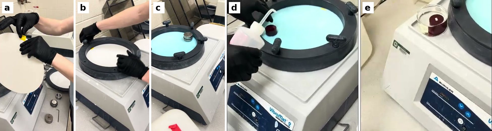

# Vibratory Polisher SOP: 0.1 µm Diamond (Buehler VibroMet 2)

*Draft, 2026-11-03. Nobody has run the VibroMet with diamond yet, so expect to change this after the first sample.*

This is Gage's colloidal silica procedure with the silica swapped for 0.1 µm diamond. His procedure comes from two videos of the May AlSi10Mg sample ([setup](https://youtu.be/OvVvYESOxqw) and [removal and cleaning](https://youtu.be/kcyESipwU8Y)) and his [cleaning sheet](https://github.com/vertical-cloud-lab/byu-vcl/issues/110#issuecomment-4513325105). The diamond changes come from the VibroMet 2 manual, PACE's guides and two Edison literature searches, listed under Sources.

It replaces Steps 7 and 8 of the [polishing SOP](sem-eds-polishing-sop.md), the diamond film and the clean after it. Start with a puck that has been through Step 6 (1 µm alumina, then the methanol ultrasonic). When you're done here, go on to Step 9 (Kapton tape and the saw).

> **No constant spray with diamond.** Colloidal silica had to stay wet because it sets as it dries: the water leaves, the silica particles bond to each other and to the face, and the layer won't wash off. Oxygen isn't what does it, drying is. Diamond doesn't set. Dried diamond suspension leaves loose diamond and a trace of soap-like additive, both of which wash off. So rinse the face within about a minute of lifting it out, and don't let it dry with suspension on it, but there's no race against the clock. You can also take the puck out partway through to check it, which you couldn't do with silica.

*Frames from Gage's videos of the colloidal silica run: (a) tape pull-tab on the back of a new cloth, (b) clamp ring going on, (c) the specimen holder with one weight, running, (d) spraying the puck as it comes off the cloth, (e) the puck face up under ethanol.*

### What you need

| Item | Notes |
|---|---|
| 0.1 µm polycrystalline diamond, water-based (PACE DIAMAT `WPC-0110`) | PACE confirmed it has no silica or alumina. Water based, so it rinses off with water |
| A new 12" adhesive final polishing cloth | Allied Red Final C (`90-150-355`, on hand) until the Mark V pad arrives. Never one that has had colloidal silica or alumina on it |
| DI water squirt bottle | DI only; tap water dries to Ca and Mg spots |
| Ethanol squirt bottle | 200 proof. This is what Gage sprayed |
| Two clean glass dishes | Deep enough to cover the puck, as in Gage's sheet |
| Electroplated tape | For the pull tab on the cloth |
| Lint-free wipes, paper towels, gloves | |
| Ultrasonic cleaner, optical microscope | |

### Step 1

Clean the VibroMet. Other people use it with colloidal silica, and titanium runs add hydrogen peroxide. Any silica left in the bowl ends up on your sample as Si.

* If someone else's cloth is in the bowl, don't touch it. Ask them, or wait.
* Clean the bowl with water and paper towels until all loose material is out. Look hard at the rim, the clamp ring and under the ring, where silica dries into a white crust. Then wipe it all down with ethanol. Gage did water, then ethanol.
* The bowl has to be clean and **dry** before an adhesive cloth goes in (VibroMet 2 manual, p. 9).
* Clean the specimen holder and the weight the same way, water then ethanol, including the bottom face that sits on the cloth.

### Step 2

Put in a new cloth.

* Peel the backing off and keep it, so it can go back on for storage. Stick a tab of electroplated tape to the back near the edge, so the cloth can be pulled out later (photo a).
* Lay the cloth in the bowl and press it flat from the center out, so no air is trapped under it.
* Put the clamp ring on and tighten its knobs (photo b).
* Write on the backing and the bag: "0.1 µm diamond, AlSi10Mg only" and the date. One cloth per abrasive and alloy, like the pads in Step 5 of the polishing SOP.

### Step 3

Charge the cloth with diamond.

* Look at the bottle first. Gage found dried crust around the colloidal silica cap ("those chunks are bigger than 0.05"). Wipe the cap and the neck with a damp lint-free wipe, pulling away from the opening.
* If there's sediment at the bottom of the bottle, turn the closed bottle over gently a few times to mix it back in. Diamond can settle out; colloidal silica doesn't.
* Wet the cloth thoroughly with DI water first (manual, p. 12).
* Pour the diamond on and spread it with a clean gloved finger until the whole cloth is covered with a film of liquid (manual, p. 12). Gage used 200 mL of silica, "the amount to cover the bottom". Diamond costs more, so start with **about 50 mL** of diamond, then add DI water until the whole cloth is covered. Write down how much of each you used. If the first check shows little progress, add more diamond; PACE's fix for a slow polish is to "recharge pad with diamond".

### Step 4

Load the puck and start.

* Slide the puck into the specimen holder, face down, and tighten the hex screw.
* Wet the bottom of the holder with DI water before you set it on the cloth. The manual says this prevents chatter (p. 11).
* Put the weight on the holder. Gage used one weight and never needed more ("you can actually screw in a post and add more weights, but I've never felt like I needed to"). Keep it at one for aluminum, since more force means more diamond pressed into the metal.
* Put the lid on. Press the power button, then raise the amplitude. Gage starts at 50% and watches: the holder should travel smoothly around the bowl in a circle. If it hits the wall, turn the amplitude down.

### Step 5

Check it every 30 minutes, and stop when the alumina scratches are gone.

* The manual says to check every 15-30 minutes and that "some polishing times will exceed one hour" (p. 13). Gage ran silica for 4 hours, and 6 on a slow day. Diamond won't need the same time, so check rather than guess.
* To check: stop the machine and lift the holder out. Rinse the face with DI water, then ethanol, and dry it. Look at it under the optical microscope at the highest magnification. Before putting it back, rinse the bottom of the holder with DI water. Keep the lid on the bowl while you're away.
* Stop when the scratches from the 1 µm alumina are gone. Don't keep going after that. On a napped cloth, extra time polishes the soft aluminum away from the hard Si, which leaves the Si standing proud.
* If scratches are still there after 4 hours, they're deeper than the alumina leaves, probably from the 1200 paper. Go back to Step 5 of the polishing SOP instead of running longer.
* If the cloth starts to look dry on a long run, add DI water. Keep the lid on so it evaporates slowly.

### Step 6

Take the puck out and clean it.

* Set up before you stop the machine: the DI water and ethanol squirt bottles, one glass dish with enough ethanol to cover the puck, and the ultrasonic, cleaned and filled with DI water.
* Stop the machine and lift the holder off. Rinse the face with DI water, then with ethanol to push the water off. Do it within about a minute, but there's no need for the non-stop stream the silica needed.
* Take the puck out of the holder and put it face up in the dish of ethanol.
* Put the lid or parafilm on the dish and stand it in the ultrasonic for 2-3 minutes. Then move the puck to a second clean dish of fresh ethanol (or methanol, as in Step 6 of the polishing SOP) and give it 2 more minutes. The alcohol always stays in the covered dish, never straight in the tank, because it's flammable.
* Dry it with compressed air, sweeping across the face. Gage: "I always just blow right along the sample, and the sides just have to dry slow."
* Look at it under the optical microscope. If there's haze or specks, repeat the ultrasonic.

### Step 7

Clean up.

* Soak up the free liquid in the bowl with paper towels. PACE's safety data sheet lists no hazardous ingredients but says to dispose of it according to local rules, so ask the lab manager before pouring larger amounts down the sink.
* Rinse the cloth with DI water. If nobody else needs the bowl, leave the cloth in it with the lid on. Otherwise pull it out by the tab, put the backing back on and bag it. Allied says each removal weakens the adhesive, so replace a cloth that no longer lies flat.
* Wash the bowl, the clamp ring, the holder and the weight with water, then wipe them with ethanol, as in Step 1.

### Colloidal silica and diamond, side by side

| | Gage's colloidal silica run (May) | This SOP (0.1 µm diamond) |
|---|---|---|
| Abrasive | 0.05 µm colloidal silica, 200 mL | 0.1 µm water-based polycrystalline diamond, `WPC-0110` |
| Why it polishes | Chemical and mechanical: the alkaline silica also attacks the metal | Mechanical only |
| Time | 4 h, 6 h that day | Until the alumina scratches are gone, checked every 30 min |
| Checking partway | Not practical: every check means the full clean | Rinse, dry, look, put it back |
| Taking it out | Never let air reach the face: a non-stop ethanol stream, straight into a bowl of ethanol | Rinse with DI water, then ethanol, within about a minute |
| Cleaning | Acetone 10 min, ethanol 8 min, methanol 5 min, all ultrasonic | DI water and ethanol rinse, then two ultrasonic baths of 2-3 min in alcohol |
| What's left behind if it goes wrong | A silica layer, which reads as Si and O in EDS | Diamond, which reads as C, which we don't quantify |

### Open questions

* How much suspension does a charge take? Write down what the first run used.
* Which Mark V pad was ordered (black `CPS-12A` or `VC12`)? See the [11-02 comparison](https://github.com/vertical-cloud-lab/byu-vcl/pull/258#issuecomment-6591394154).
* PACE's safety data sheet gives the pH as both "7~9" and "9-11" (Section 9). Check it with a pH strip when the bottle is opened. Above about 9, the liquid slowly etches aluminum, as colloidal silica does, so keep runs short and rinse promptly.
* Where should used diamond suspension go? Gage poured silica down the sink. PACE's safety data sheet says to follow local regulations (Section 13).

### Sources

* Gage's videos: [Setting up the vibrator polisher](https://youtu.be/OvVvYESOxqw) (posted 05-18) and [Vibrator polishing + final cleaning + SEM stub mounting](https://youtu.be/kcyESipwU8Y) (05-21), from [digital-alloy-lab#138](https://github.com/vertical-cloud-lab/digital-alloy-lab/issues/138#issuecomment-6353375812). His cleaning sheet is in [#110](https://github.com/vertical-cloud-lab/byu-vcl/issues/110#issuecomment-4513325105).
* Buehler, VibroMet 2 manual MA671635_13.1 (2012), pp. 9-14, [ManualsLib](https://www.manualslib.com/manual/1839673/Buehler-Vibromet-2.html).
* PACE Technologies: [Cleaning](https://www.metallographic.com/metallographic-consumables/cleaning), [Polycrystalline diamond](https://metallographic.com/metallographic-consumables/polishing/polycrystalline-diamond), and the [DIAMAT water-based diamond safety data sheet](https://www.metallographic.com/sds/DIAMAT-Water-based-DIAMOND.pdf) (revised 07-15-2024).
* Allied High Tech, [Polishing Cloths product guide v1.6](https://www.alliedhightech.com/Media/Default/images/PG%20-%20Polishing%20Cloths%20v1.6.pdf), p. 1, on removing and re-applying adhesive cloths.
* Edison literature searches, 2026-11-03: questions, answers and full trajectories in [`outputs/edison-vibratory-diamond-2026-11-03/`](../outputs/edison-vibratory-diamond-2026-11-03/).
