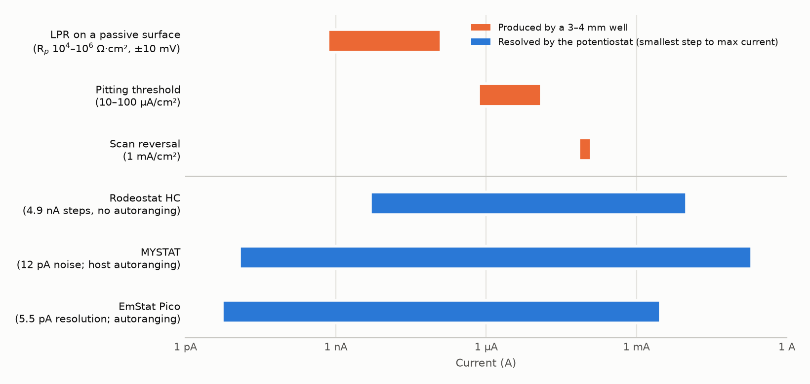

# Corrosion and electrochemistry of our own Al alloys on the CubXL

Written 2026-10-13 for [#213](https://github.com/vertical-cloud-lab/byu-vcl/issues/213). Sterling
asked for a PR "much more focused" on use-case 3 of
[PR #270](https://github.com/vertical-cloud-lab/byu-vcl/blob/441e2c1/docs/cubxl-electrochem-first-use-cases.md#4-use-case-3-corrosion-of-the-labs-own-alsi10mg)
(droplet-cell corrosion of AlSi10Mg), connecting the CubXL's electrochemistry to the alloy work,
"especially in terms of chemistry or electrochemistry".

This folder is self-contained, like
[`atomizer-runs/plan-adv-mater/`](https://github.com/vertical-cloud-lab/byu-vcl/blob/cad4e6d/atomizer-runs/plan-adv-mater/README.md),
so it can be copied into `digital-alloy-lab-private`. Links out of it are absolute and pinned to
commits. Nothing in it has been bought, built or tested.

| File | What it is |
| --- | --- |
| this README | Why corrosion connects to the alloy program, what to test, hardware, what's new, timeline |
| [`protocol.md`](protocol.md) | One corrosion spot, step by step: specimen, cell, electrolyte, sequence, validity checks |
| [`test-matrix.csv`](test-matrix.csv) | One row per specimen set: where it comes from, what it answers, what it waits on |
| [`record-template.yaml`](record-template.yaml) | The per-spot record, keyed to the atomizer run ID |
| [`corrosion_numbers.py`](corrosion_numbers.py) → [`corrosion_numbers.json`](corrosion_numbers.json) | Every computed number here: currents, charges, volumes, times, the spread's excess Si |
| [`plot_current_ranges.py`](plot_current_ranges.py) → [`current-ranges.png`](current-ranges.png) | The chart in §5 |
| [`references.md`](references.md) | Every reference, what it supports, and what was read (abstract, full text or metadata) |
| [`copper-ded-edison/`](copper-ded-edison/README.md) | Ten follow-up Edison questions for the copper version: naval Cu–Ni and NAB made by blown-powder DED. Run 2026-10-18; answers, trajectories and a synthesis with corrections |
| [`copper/`](copper/README.md) | The copper version: protocol, specimens, BOM delta, a simulation of oxygen and copper transport in the well against a bulk cell, the copper deck check, and a 3D animation of one spot on the CubXL |
| [`cubxl-setup.md`](cubxl-setup.md) | What it looks like on the CubXL: head, deck layout, a night step by step, electronics, the powder doser's (non-)role |
| [`plot_deck_layout.py`](plot_deck_layout.py) → [`deck-layout.png`](deck-layout.png), [`deck-layout-check.json`](deck-layout-check.json) | The deck and head figure, and a static tool-shadow check of every planned tool-down event |
| [`bom.csv`](bom.csv) | Bill of materials by phase, with price, source and date seen (the 2026-10-17 plan) |
| [`bom/`](bom/README.md) | **What to print and buy to build it**, for both alloys: a STEP file for every printed part, a checked link for every bought part, and the v2 well lid |

## In short

- **What:** small-area corrosion tests on every form of metal the atomizer program makes, keyed to
  its run IDs: open-circuit potential (OCP), linear polarization resistance (LPR), then cyclic
  polarization in NaCl. That gives E_corr, R_p, the pitting potential E_pit and the
  repassivation potential E_rp for each piece.
- **Why it belongs to the alloy work:** the atomizer plan's claims are judged by composition,
  particle size, shape and (in 2027) a print. None of those says how the metal behaves in
  service. Corrosion of Al–Si alloys in chloride depends on what the plan varies: how Si is
  distributed, how much Si is left over after Mg₂Si, and cathodic impurities picked up along the
  way (§1).
- **Specimens already exist.** Each run leaves splats, a puddle in the cup or a crucible skull, and
  the plan already weighs them. Keeping one piece per run, labelled with its ID, turns every run
  into a corrosion sample at no cost. Ronnie's polishing SOP already cuts pieces out with a bare
  metal back, which is the electrical contact the cell needs (§3).
- **The CubXL's part is the liquid and the bookkeeping:** it fills each well from stocks (a
  chloride series is 8–9 P20 transfers per well), runs the potentiostat, photographs each spot,
  and pipettes each used electrolyte into a tube for ICP. That last step is the chemistry link:
  which elements actually leave the surface. It covers Mg, which the plan notes EDS can't resolve.
- **Novelty, checked today:** no automated or robotic corrosion study of AlSi10Mg, cast Al–Si, or
  powder-to-powder comparisons turned up. Droplet cells *have* been used by hand on AlSi10Mg
  (Prüßner et al. 2026, coatings work), and MAP-E automated pitting tests on 304 stainless steel.
- **The one purchase that matters is the potentiostat, and corrosion changes the spec.** It needs
  sub-nA resolution, current autoranging and OCP, not more maximum current. The Rodeostat HC's
  lowest range steps in 4.9 nA with no autoranging. The MYSTAT and the EmStat Pico can do it; the
  Pico does it all in vendor firmware and runs from the Pi. CubOS needs a linear-sweep technique
  and has to drop its 1 mV/s minimum scan rate either way (§5).
- **2026, with no ME Orders:** keep the pieces, print the clamp, write the CubOS changes against
  its simulation driver, and borrow a potentiostat for a bench shakedown. Buy in January (§8).
- **On the CubXL** ([`cubxl-setup.md`](cubxl-setup.md)): the electrodes travel in a magnetic cap
  that the existing capper moves between a park cup and four tray stations, so no new tool goes on
  the head and the head is free during each measurement. A head-mounted probe failed the tool-shadow
  check against Ben's tip racks.

## 1. How the electrochemistry connects to the alloy work

| Alloy-program question ([runs plan](https://github.com/vertical-cloud-lab/byu-vcl/blob/cad4e6d/atomizer-runs/plan-adv-mater/README.md)) | What the CubXL measures | Specimens | When |
| --- | --- | --- | --- |
| **C3, composition set by the charge.** Does measured Si follow the charge across the 4047-in-6063 spread? | Corrosion against *measured* Si and excess Si across Block B | one leftover piece per Block B run | late 2026 runs, tested 2027 |
| **Does melting in the atomizer change the alloy?** The plan notes that remelted metal loses Mg and gains oxide. | 6063 bar against the leftovers of Block A runs; run-to-run spread of those leftovers | feedstock slice, Block A pieces | runs now, test 2027 |
| **C4, printability.** One MIDI print from in-house powder, compared with commercial AlSi10Mg | Corrosion of the print against a print from purchased powder, on XY and XZ faces | Block C prints | 2027 |
| **Block D.** Does in-house powder of a known-good alloy match purchased powder? | Corrosion alongside the tensile comparison already planned | Block D prints | 2027 |
| **What dissolves?** | ICP-OES/MS of each used electrolyte: Mg/Al and Si/Al against the bulk | the collected tubes | with the 2027 ICP batch |
| **Finishing.** Will the alloys anodize? | Galvanostatic anodizing: the voltage–time response and film quality against Si content and morphology | leftovers, prints | later; needs a different power source |

### 1.1 The composition spread crosses two chemical boundaries

From the plan's spec limits ([`corrosion_numbers.json`](corrosion_numbers.json), `spread`):

| 4047 in the charge | Si, wt% | Mg, wt% | Mg/Si | Si left after Mg₂Si, wt% |
| --- | --- | --- | --- | --- |
| 0 % (6063) | 0.40 | 0.68 | 1.69 | +0.01 (−0.32 to +0.34) |
| 7.5 % | 1.27 | 0.63 | 0.49 | +0.91 (+0.52 to +1.29) |
| 15 % | 2.14 | 0.58 | 0.27 | +1.80 (+1.37 to +2.24) |
| 22.5 % | 3.01 | 0.53 | 0.18 | +2.70 (+2.21 to +3.19) |
| 30 % | 3.88 | 0.49 | 0.13 | +3.60 (+3.06 to +4.14) |

Values are spec midpoints, with the range from the spec limits in brackets. Mg₂Si binds Mg and Si
at 1.73:1 by mass.

- **Balanced to Si-excess.** 6063 sits almost exactly at the Mg₂Si ratio. Every step of the spread
  adds Si that Mg can't bind. In heat-treated 6xxx alloys, excess Si is a known variable for
  intergranular corrosion. [Zheng et al. 2017](https://doi.org/10.3390/met7100387) found that
  "Excess Si improved the IGC susceptibility" (meaning it increased it) through more grain-boundary
  MgSi precipitates. [Larsen et al. 2010](https://doi.org/10.1149/1.3261804) made a Cu-free
  excess-Si alloy fully resistant by removing cathodic intermetallic particles from the surface, or
  by purging the oxygen. Both studies concern wrought, aged alloys, not as-solidified metal, so
  this is a reason to look, not a prediction.
- **Past silicon's solubility limit.** From the 15 % point onward, the Si left over (1.4–2.2 wt%)
  reaches Si's maximum solubility in solid Al, about 1.5 wt% at the eutectic temperature
  ([Murray & McAlister 1984](https://doi.org/10.1007/BF02868729), as quoted by
  [Cabrini et al. 2018](https://doi.org/10.3390/ma11071051)). Past that point, eutectic Si forms
  even under slow, near-equilibrium cooling.
- **Why that matters for corrosion.** In AlSi10Mg, how connected the Si network is decides how
  corrosion proceeds: the "silicon content… affected the level of connectivity of the Si network,
  and this, consequently, influenced the formation of micro-cracks during corrosion"
  ([Revilla & De Graeve 2018](https://doi.org/10.1149/2.0101814jes), AlSi7Mg to AlSi12). Our
  spread (0.4–3.9 wt% Si) sits below all three. So it should show how corrosion changes as a Si
  network first appears. That is our inference; it hasn't been measured.
- **Measure, don't assume.** Each piece's own Si comes from EDS on the polished face. Mg (the
  ~0.05 wt% steps are below EDS) comes from ICP on a chip, as the plan already says for Mg.

### 1.2 Same melt, different solidification

Every run gives one composition in up to four forms: the feedstock it came from, splats and
puddles that froze on the plate or in the cup, the powder, and (in 2027) the print.

- **LPBF versus cast is not settled.** Laser-melted AlSi10Mg was "2–3 times" more
  corrosion-resistant than cast in 0.1 M NaCl ([Tiwari et al. 2023](https://doi.org/10.3390/coatings13020225)).
  [Leon et al. 2016](https://doi.org/10.3390/met6070148) found them "relatively similar, with a
  minor advantage to the printed alloy".
- **What controls it is the Si network at melt-pool borders.** The attack is selective, along the
  borders, in untreated and stress-relieved material
  ([Cabrini et al. 2016](https://doi.org/10.1016/j.electacta.2016.04.157)). The coarser eutectic
  Si there controls the electrochemical behaviour more than surface roughness does
  ([Fathi et al. 2019](https://doi.org/10.1016/j.corsci.2019.05.032)). Heat treatment breaks the
  network into separate particles. Stress-relieved material showed penetrating attack, where
  untreated and artificially aged material showed superficial attack
  ([Rubben et al. 2019](https://doi.org/10.1016/j.corsci.2018.11.038)).
- **The native oxide differs too.** On LPBF AlSi10Mg it "presented faster growth and superior
  passive behavior than those of the cast alloy"
  ([Revilla et al. 2022](https://doi.org/10.1016/j.corsci.2022.110352)).

So comparing a run's leftovers with its print separates solidification from composition. The
leftovers aren't a stand-in for the print. They are the cheap, every-run point that the 2027 print
is compared against.

### 1.3 What dissolves: the chemistry link

After each cyclic polarization the CubXL pipettes the well's liquid, plus one rinse, into a capped
polypropylene tube.

- **What's in it.** 10 mC of anodic charge dissolves 0.93 µg of Al, 6.2 mg/L in a 150 µL cell. Even
  after diluting the NaCl 17.5-fold for ICP, that is about 350 µg/L.
- **What it tells us.** Mg/Al and Si/Al in the liquid, against the same ratios in the bulk, show
  whether the attack is congruent. How MgSi particles react and dissolve during corrosion of Al–Mg–Si
  alloys is the subject of [Eckermann et al. 2008](https://doi.org/10.1016/j.electacta.2008.05.078)
  (only its title and metadata were read). Selective dissolution of Al from AA2024, leaving Cu behind, has been measured
  element by element ([Gharbi et al. 2016](https://doi.org/10.1149/2.1121605jes)).
- **Precedent.** The online version is a scanning flow cell coupled to ICP-MS
  ([Klemm et al. 2011](https://doi.org/10.1016/j.elecom.2011.10.017)) or atomic emission
  spectroelectrochemistry ([Ogle 2019](https://doi.org/10.5006/3336) reviews it). Ours is offline and
  much cheaper. It gives one number per spot, not a time trace. No AESEC or ICP dissolution study of
  AlSi10Mg or Al–Si turned up.
- **Limits.** Dissolved Al hydrolyses in neutral NaCl, and some corrosion product stays in or over
  the pit. Ratios are therefore more trustworthy than absolute recovery, and the tube has to be
  acidified before ICP (the ICP lab's job). Use polypropylene, not glass, because glass is a
  silicon source.
- **Where it goes.** The plan already sends retained samples out for ICP-OES in 2027, and #128 is
  training on the Agilent 8900 ICP-MS on campus. The tubes join that batch.

### 1.4 Impurities: a sensitive check on what the atomizer picks up

- "Pits in Al alloys are typically associated with intermetallic particles", and "Cu- or Fe-rich
  particles are noble to the Al matrix, and exhibit enhanced cathodic kinetics"
  ([Frankel 1998](https://doi.org/10.1149/1.1838615)).
  In pure Al, trace Cu²⁺ deposits as Cu that "acts as an efficient cathode"
  ([Böhni & Uhlig 1969](https://doi.org/10.1149/1.2412167)).
- The runs plan already has EDS look for Mo and W from the plate and sonotrode. Corrosion can't
  identify a contaminant. What it can show is a piece whose cathodic activity or E_pit stands out
  from its run's neighbours, which says where to point the EDS and ICP.

### 1.5 Anodizing, later

Anodizing is a common finish for Al parts, and Al–Si alloys are hard to anodize. "Al foundry
alloys are more difficult to be anodized", since "the high content of alloying elements prevents
the uniform growth of the Al oxide layer" ([Scampone & Timelli 2022](https://doi.org/10.1002/adem.202101480)).
In LPBF AlSi10Mg, Si morphology "determines the fraction of silicon that is oxidized during
anodizing", and that sets anodizing efficiency and uniformity
([Rubben et al. 2019](https://doi.org/10.1149/2.0371902jes)). The spread and the
leftover/print comparison vary exactly those two things. But it needs sulfuric acid on the deck
and a constant-current source with more compliance than either shortlisted potentiostat
(the MYSTAT reaches ±12 V; the EmStat Pico about −2 to +2.3 V between working and counter
electrode). So it comes after the corrosion baseline (row N1 of the matrix).

### 1.6 Where Porter's sensors come in, honestly

Not much, which is why this is a separate PR from the Porter work.

- The potentiostat could be shared, but only if it has EIS. His four-electrode conductivity cell
  needs AC ([#231, 5 Oct](https://github.com/vertical-cloud-lab/byu-vcl/issues/231)), which the
  EmStat Pico has and the DC-only options don't.
- The conductivity and pH probes from the #213 thread check the electrolyte stocks.
- Spectroscopy has no part here.

## 2. What's already known

Everything below was resolved on Crossref on 2026-10-13. [`references.md`](references.md) says,
for each paper, whether the abstract, the full text or only the metadata was read.

- **Mechanism.**
  - In LPBF AlSi10Mg, α-Al dissolves preferentially at the borders of the scan tracks
    ([Cabrini et al. 2016b](https://doi.org/10.1016/j.jmatprotec.2015.12.033)), with
    "crystallographic pitting… in the aluminum grains inside the melt pool borders"
    ([Revilla et al. 2017](https://doi.org/10.1149/2.0461702jes)).
  - Note that both Cabrini 2016 papers used dilute Harrison solution, not NaCl.
- **Orientation.** XY versus XZ results are "various and contradictory"
  ([Revilla et al. 2020 review](https://doi.org/10.3390/ma13214804)). Test both faces of a print
  rather than assume either.
- **Heat treatment.** Stress relieving at 200–300 °C made the alloy susceptible to selective attack
  ([Cabrini et al. 2018](https://doi.org/10.3390/ma11071051)). Treatment at 400 °C reduced it
  ([Cabrini et al. 2021](https://doi.org/10.3390/ma14195602)).
- **Numbers to compare against.** In aerated 3.5 wt% NaCl at 0.1 mV/s, against a saturated calomel
  electrode (SCE), as-built LPBF AlSi10Mg gave i_corr 3.39 × 10⁻⁷ A/cm² and E_corr −0.81 V. After
  500 °C for 5 h it gave 5.01 × 10⁻⁶ A/cm² and −0.91 V
  ([Wu et al. 2022](https://doi.org/10.3390/ma15248786), full text). It gives no numeric E_pit.
- **Powder condition matters for prints.**
  - Oxide on reused powder grew from about 4 nm to about 38 nm over about 30 months
    ([Raza et al. 2021](https://doi.org/10.1016/j.matdes.2020.109358)).
  - Moisture lowers the density that can be reached
    ([Lubkowitz et al. 2024](https://doi.org/10.1016/j.procir.2024.08.086)).
  - Both suggest the atomizer's "low oxide" goal could show up in a print. Fresh versus aged
    powder is a 2027+ question.
- **Automation.**
  - **MAP-E** ([Persaud et al. 2026](https://doi.org/10.1038/s41529-026-00822-8)) is the closest
    precedent. It used eight O-ring flat cells of 1 cm² with 25 mL each, a Bio-Logic VMP-3,
    Ag/AgCl references moved between cells by a retrofitted 3D-printer gantry, and dosing pumps.
    - On 304 stainless steel in aerated 3.56 wt% NaCl it measured E_pit 392 ± 75 mV over 32
      measurements (4 runs × 8 cells).
    - It also built a pH–chloride map of 80 conditions in a Britton–Robinson buffer, and its E_pit
      came out about 400 mV above literature values, which the authors put down to the buffer.
  - Scanning droplet cells date to [Hassel & Lohrengel 1997](https://doi.org/10.1016/S0013-4686%2897%2900184-9),
    on oxide films on aluminium. They have mapped Al–Fe composition spreads
    ([Mardare et al. 2008](https://doi.org/10.1088/1468-6996/9/3/035009)) and complex-alloy
    libraries ([Sur et al. 2023](https://doi.org/10.1149/1945-7111/aceeb8)).
  - **Correction to PR #270.** [DeCost et al. 2022](https://doi.org/10.1007/s11837-022-05367-0)'s
    corrosion case was simulated on an existing dataset, not run on the instrument.
- **The gap.** On 2026-10-13, OpenAlex and Europe PMC returned no automated, robotic, droplet-cell
  or high-throughput corrosion campaign on LPBF AlSi10Mg, cast Al–Si, or powders compared with each
  other (queries in [`references.md`](references.md)).
  - The nearest work is manual droplet-cell EIS and LSV on as-built AlSi10Mg in two 2026 coatings
    papers ([Prüßner et al., Mater. Chem. Phys.](https://doi.org/10.1016/j.matchemphys.2025.131758);
    [Prüßner et al., Mater. Corros.](https://doi.org/10.1002/maco.70163)).
  - There is also SKPFM work on melt pools (Revilla 2017 and 2022).

## 3. Specimens we already have, or will have

| Specimen | From | Form | Available |
| --- | --- | --- | --- |
| Training-run leftovers, **jz31op** | [#249](https://github.com/vertical-cloud-lab/byu-vcl/issues/249#issuecomment-5939830474) | remelted, mixed provenance | **now**: shakedown only, as the plan keeps it out of Blocks A and B |
| Oct 6 splats (**4yghtr**) and Oct 8 cup puddle (**kj0461**) | [runs so far](https://github.com/vertical-cloud-lab/byu-vcl/blob/cad4e6d/atomizer-runs/plan-adv-mater/runs-so-far.md) | remelted 6063 (Oct 6); Oct 8's rods aren't recorded | **now**: shakedown |
| Oct 2 leftovers (**u23y78**), if kept | [#249](https://github.com/vertical-cloud-lab/byu-vcl/issues/249) | remelted 4047-in-6063, the spread's pilot | now, if the leftovers weren't remelted |
| 6063 bar (Block A lot), 4047 rod, high-purity Al rod ([#222](https://github.com/vertical-cloud-lab/byu-vcl/issues/222)) | stock | wrought feedstock | **now** |
| One piece per Block A and Block B run | runs plan | remelted, at known charge composition | as the runs happen (Nov–Dec 2026) |
| Arc-melted AlSi10Mg button | [#223](https://github.com/vertical-cloud-lab/byu-vcl/issues/223) | cast, in-house AlSi10Mg | if the arc-melt happens |
| MIDI prints from in-house powder and from purchased AlSi10Mg (the lot already in the lab, whose SDS is from Heeger Materials, or Valimet's, as [#223](https://github.com/vertical-cloud-lab/byu-vcl/issues/223) planned) | Block C/D, [#77](https://github.com/vertical-cloud-lab/byu-vcl/issues/77) | LPBF as-built, XY and XZ faces | 2027 |

**The one ask of the atomizer runs.** After the mass balance is weighed, put one piece of at least
5 mm in the run's bag with its ID. Prefer a splat, then the cup puddle, then a piece of skull:
splats froze fastest, so they are closest to the powder, and the skull sat in the crucible
longest. Add `corrosion_piece_kept` to the run record. Nothing else changes.

**Not the powder itself.** Particles in Bakelite are insulated from each other, so they can't be
one working electrode. Carbon-filled conductive mounts would couple a graphite cathode to the Al. The
powder's corrosion is measured after consolidation: as leftovers now, as prints in 2027.

## 4. The measurement

Details and settings are in [`protocol.md`](protocol.md).

- **Specimen.** Ronnie's SOP ([PR #258](https://github.com/vertical-cloud-lab/byu-vcl/blob/157ab1e/SOP/sem-eds-polishing-sop.md))
  as written: section, mount in Bakelite, polish to 0.1 µm diamond, cut out with a bare metal
  back.
  - The same piece then goes through EDS (composition, away from the wells), corrosion, and SEM of
    the attacked spots.
  - Keep silicone off it, since Si is the element being varied: the SOP already bans silicone
    grease, and the O-rings are FKM.
- **Cell.**
  - A printed clamp with 2–4 FKM O-ring wells per piece: 3 mm ID gives 0.071 cm², 4 mm gives
    0.126 cm². About 150 µL of liquid per well, with a pogo pin on the bare back.
  - A **leak-free** Ag/AgCl mini-reference and a Pt-wire counter on the CubXL head, the
    arrangement PANDA-film uses ([Quinn et al. 2026](https://arxiv.org/abs/2601.07043)).
  - **Not PANDA-film's Ag pseudo-reference:** in NaCl its potential moves with the electrolyte's
    chloride by about 59 mV per decade, which would swamp a chloride series.
- **Electrolyte.**
  - 0.6 M NaCl (3.5 wt%), open to air, for comparison with work like Wu 2022.
  - 0.1 M is the other common choice (Tiwari 2023; Rubben 2019), and a 0.006–0.6 M series covers
    both. Pitting severity "tends to vary with the logarithm of the bulk chloride concentration"
    ([Frankel 1998](https://doi.org/10.1149/1.1838615)). For pure Al, E_pit is "more active the
    higher the Cl− concentration" ([Böhni & Uhlig 1969](https://doi.org/10.1149/1.2412167)). So a
    series gives each material a slope as well as a point.
  - The CubXL mixes each well from three stocks; the stocks are checked by conductivity and pH.
- **Sequence.**
  - OCP for 30 min; LPR at ±10 mV and 0.167 mV/s (0.6 V/h); then cyclic polarization that
    reverses at 1 mA/cm².
  - This is "G61-style": ASTM G61 is written for Fe-, Ni- and Co-based alloys, and MAP-E describes
    its own test the same way.
  - Outputs: E_corr, R_p, E_pit (at 10 and 100 µA/cm²), E_rp and anodic charge, plus before and
    after images of every spot.
- **Throughput.** 107 min per spot at G61's 0.6 V/h, or 44 min at 1 mV/s: 6 or 16 spots in a 12 h
  night.
- **Repeatability first.** At least 8 spots over 2 nights on one reference coupon before any
  comparison. Comparisons are then sized with the atomizer plan's table: 6 spots per material
  detect a 2σ difference, 4 detect 3σ.

**Things that will bite:**

1. **Area changes E_pit.** In stainless steel, "the pitting potential was found to increase by
   almost 700 mV as the area of study was decreased from a diameter of 1000 to 50 µm"
   ([Frankel 1998](https://doi.org/10.1149/1.1838615)). Compare only at one well size, and treat
   comparisons with 1 cm² literature values as qualitative.
2. **Crevice attack under the O-ring** is the classic flat-cell artifact. Image every spot
   afterwards and discard spots with attack at the edge. MAP-E also used Viton O-rings.
3. **A small well magnifies leaks.** 1 µL of 3 M KCl from a standard reference adds 20 mM chloride
   to a 150 µL well. That doubles a 0.02 M electrolyte, hence the leak-free reference.
4. **The counter electrode makes OH⁻** while the sample is anodic: 0.69 mM in 150 µL per 10 mC, if
   nothing neutralised it. The dissolving Al³⁺ largely does, but not near the counter. This is one
   more reason to reverse early and keep the counter high in the well.
5. **Polishing is manual.** That's why each piece carries 2–4 wells and the same piece feeds the
   SEM.
6. **Time since polishing changes the oxide.** Fix the delay and record it.

## 5. Which potentiostat: what corrosion needs (input for #231)

Corrosion of Al in a small well runs from about 1 nA (LPR on a passive surface) to about 0.1 mA
(the reversal current). Maximum current, the thing #231 has been optimising, barely matters here.

| | Rodeostat HC | MYSTAT | EmStat Pico |
| --- | --- | --- | --- |
| Smallest current range, step | ±10 µA, 12-bit: **about 4.9 nA per step** ([firmware](https://github.com/iorodeo/potentiostat/blob/86e4708fea84f8fc33bcbfc9a706b06f4b770efd/firmware/libraries/potentiostat/ps_analog_subsystem.h#L26-L34)) | ±2 µA, 22-bit ADC; 12 pA noise (paper §7.1) | 100 nA range, 5.5 pA resolution ([PalmSens](https://www.palmsens.com/product/oem-emstat-pico-module/)) |
| Autoranging within a scan | no | host software, CV only ([`mystat.py`](https://github.com/matthew-yates/MYSTAT/blob/5c8a36aa38bda79d87c49ae699b373e716798ebf/control_software/Python_source_code/mystat.py#L333-L365)) | yes, on the device (MethodSCRIPT `set_autoranging`) |
| OCP | by polling with the cell switched off ([IO Rodeo's example](https://github.com/iorodeo/potentiostat/blob/86e4708fea84f8fc33bcbfc9a706b06f4b770efd/software/python/potentiostat/examples/run_sinusoid_ocp_init.py#L29-L44)) | cell off, or 0 A galvanostatic | `meas_loop_ocp` |
| Slow linear sweep (0.167 mV/s) | yes, 0.49 mV steps | yes | yes |
| Reverse on a current threshold | host stops and restarts | host software | `if`/`breakloop` in a script (in the manual, not tried on hardware) |
| EIS | no | no | 0.016 Hz–200 kHz |
| Potential window | ±1 to ±10 V ranges | ±12 V | −1.2 to +2 V (WE vs RE) in its low-speed mode |
| CubOS driver | none | none | the EmStat driver names it, but defaults to the EmStat4 and shows no Pico test ([`emstat.py`](https://github.com/Ursa-Laboratories/CubOS/blob/38ccd0e7109926ac54cc90b018ff674161f87031/packages/core/src/cubos/instruments/potentiostat/vendors/emstat.py#L62-L75)) |
| Price | $240 ([IO Rodeo](https://iorodeo.com/products/rodeostat-hc), sold out on 2026-10-13) | about $340 to build (#231) | about $580 in #231 on 2026-09-28; not re-checked, as Digi-Key blocks the runner |

**For corrosion:**

- **The Rodeostat HC's low end is the problem.** At 4.9 nA per step, a 3 mm well's LPR current on
  a passive surface (0.7–71 nA for R_p of 10⁶ down to 10⁴ Ω·cm²) is a handful of steps or fewer.
  The original Rodeostat has a ±1 µA range, with 10× finer steps. Neither model autoranges.
- **The MYSTAT can do it.** Its software would need extending, and it has to be built.
- **The EmStat Pico covers it in vendor firmware**, adds EIS, and runs from the Pi. Threshold
  reversal would be a script, which the manual allows but nobody here has tried. And it isn't
  driven by CubOS yet in practice.
- **Its window is the thing to check.** Al in NaCl sits near −0.8 V against SCE (Wu 2022), which is
  inside −1.2 V. A scan that starts well below OCP may need the Pico's −1.7 V range.

**CubOS needs three changes whichever is chosen.** Its interface has only CV, OCP, CA and CP
([`interface.py`](https://github.com/Ursa-Laboratories/CubOS/blob/38ccd0e7109926ac54cc90b018ff674161f87031/packages/core/src/cubos/instruments/potentiostat/interface.py#L21-L35)).

1. A linear-sweep (LPR) technique.
2. Scan rates below 1 mV/s. The EmStat driver rejects them ([`emstat.py` L389](https://github.com/Ursa-Laboratories/CubOS/blob/38ccd0e7109926ac54cc90b018ff674161f87031/packages/core/src/cubos/instruments/potentiostat/vendors/emstat.py#L389)).
3. A current-threshold reversal, plus current-range control.

CubOS has a simulation driver, so all three can be written and tested before any hardware
arrives.

## 6. What to buy, borrow or print

The deck and head layout, and the full bill of materials by phase, are in
[`cubxl-setup.md`](cubxl-setup.md) and [`bom.csv`](bom.csv). To build it, use [`bom/`](bom/README.md):
STEP files for every printed part and checked links for every bought part. The short version:

| Item | Source and price (2026-10-13) | Note |
| --- | --- | --- |
| Potentiostat | §5 | the only item that blocks automated tests |
| Leak-free Ag/AgCl mini-reference, ≤ 2 mm | **price not verified**: eDAQ blocks the runner, BASi and Pine need a login | ask Porter's lab which they use |
| Pt wire, 0.5 mm | [Advent PT5414](https://www.advent-rm.com/en-GB/Products/Pure-Metals/Platinum/Form/Wire/Line/PT5414), $207 for 5 cm | thinner wire costs less; Porter's lab may have some |
| FKM O-rings, 3–4 mm ID | theoringstore.com: AS568-006 (1/8 in ID) $0.047 each, metric 4 × 1.5 mm $0.06 each; $10 minimum order | not silicone |
| Pogo pins | [Adafruit P75-B1](https://www.adafruit.com/product/2430), $4.95 per 10 | |
| Clamp, lid, electrode holder | printed in-house (H2D or A1 mini) | no order needed |
| NaCl, DI water | Chem Stores | |
| Conductivity and pH probes | the #213 and #148 threads | check the stocks; a borrowed meter works too |

## 7. What's new, and what isn't

**New:**

- An automated corrosion campaign on AlSi10Mg-family alloys. None was found.
- Corrosion read across an atomizer composition spread, from the same runs' leftovers through to
  their print. The spread crosses the Mg₂Si balance and the Si solubility limit.
- A Pi-driven, low-cost potentiostat validated for Al corrosion.
- Offline element-resolved dissolution of these alloys, from the cell's own liquid.

**Not new:**

- Droplet and O-ring cells.
- Automated pitting tests and pH–chloride maps (MAP-E).
- AlSi10Mg corrosion mechanisms, which are well studied by hand.

## 8. Where results would go, and when

- **The Advanced Materials collection article** (early 2028). A corrosion panel fits beside
  figures 3–4 (the spread), and figure 5 already compares the print with commercial AlSi10Mg.
  Whether corrosion belongs in that article or a separate one is Sterling's call.
- **TMS 2027.** Abstracts closed on 2026-07-01. If one of the lab's TMS 2027 papers wanted a
  corrosion result, the gates in [#273](https://github.com/vertical-cloud-lab/byu-vcl/issues/273)
  (draft to co-authors 29 Jan) leave room only for a bench result from a borrowed potentiostat.

| When | What | Orders? |
| --- | --- | --- |
| Oct–Dec 2026 | Keep one piece per run. Print the clamp. Write the CubOS changes against its simulation driver. Borrow a potentiostat (Porter's lab, or #26's "borrow one from someone at BYU") for S0 and a bench version of R0. Polish 6063, 4047 and high-purity Al alongside the SOP training already going on in #110. | none |
| Jan 2027 | Buy the potentiostat, reference and Pt; FKM O-rings and pogo pins if the lab has none. R0 on the CubXL, then R1, R2, and the Block A and B pieces that have accumulated. | ME Orders |
| 2027 | Prints (C1, C2, D). pH–chloride map (M1). Tubes into the ICP batch (X1). Anodizing only after all of these (N1). | ICP batch, anodizing supply |

## 9. Questions to settle

**Sterling**

1. Corrosion in the Advanced Materials article, or separately?
2. Does this use-case shift #231 toward the EmStat Pico, or the MYSTAT? It should push it away from
   the Rodeostat HC.

**Gage and Ronnie**

1. Can one piece per run go into the run bag?
2. Were the u23y78 leftovers kept?
3. What alloy were the Oct 8 rods?

**Porter**

1. Could we borrow his potentiostat and a leak-free reference for a few nights?

**Jarrett (#231)**

1. Add the corrosion row to the requirements: sub-nA resolution, autoranging, OCP, ≤ 1 mA.
