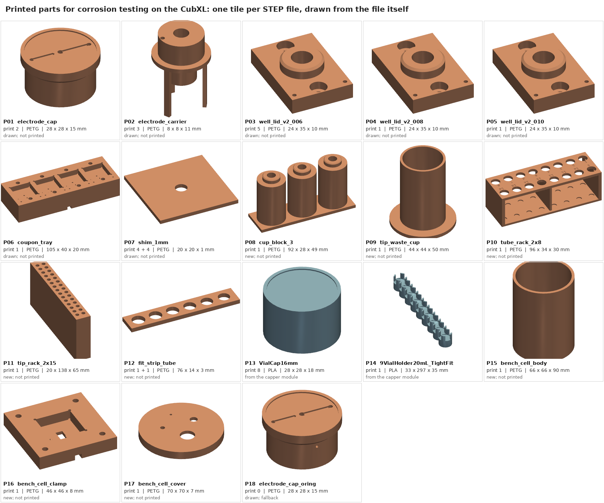

# Corrosion testing on the CubXL: what to print and what to buy

Ben asked on [PR #278](https://github.com/vertical-cloud-lab/byu-vcl/pull/278#issuecomment-6277925306)
(2026-10-19) for a BOM with STEP files for the printed parts and links to the parts to buy. This is
one list for the aluminium plan ([`../cubxl-setup.md`](../cubxl-setup.md)) and the copper plan
([`../copper/`](../copper/README.md)). The **For** column says which plan needs each row. [`bom.csv`](bom.csv) is the same list, one
row per line, for sorting and ordering. **Nothing in it has been printed, bought or tested.**

*Every printed part, rendered from the STEP file linked below ([`cad/plot_print_sheet.py`](cad/plot_print_sheet.py)).*

## Read this before printing

1. **Print the v2 well lid, not `copper/cad/well_lid.step`.** In the earlier lid the AS568-006
   seals against a 0.2 mm printed ledge, between the counterbore (z 0–1.40) and the 8 mm bore
   (from z 1.60). Treat that ledge as an annular plate, clamped at r 3.8 mm and free at the 2.9 mm
   throat. At the O-ring's nominal 23.6 N it sees **about 200 MPa**, against PETG's yield of about
   50 MPa, and it would lift 0.66 mm, more than the ring's whole 0.38 mm squeeze. Across the load
   range (10–51 N) the stress is 84–430 MPa.
   [`well_lid_v2_006.step`](cad/well_lid_v2_006.step) fills the bottom 0.4 mm of the bore back
   in outside a 4.0 mm neck, so the ceiling is 0.6 mm thick from r 2.0 outward. That gives
   **about 24 MPa and 0.03 mm of lift** at the nominal load. It reaches yield only at the
   worst-case 51 N: 80 A rubber, the thickest ring and the shallowest counterbore.
   - The step clears the seated cap's carrier legs by 0.2 mm and the Pt coil by 0.28 mm. I checked
     this by intersecting every cap part with the v2 lid: zero overlap, except the pogo
     plungers, which are drawn uncompressed (as on the old lid).
   - The cost: the liquid now reaches the spot through a 0.2 mm throat plus a 0.4 mm neck, and
     the well holds 15 µL less below the bore. So [`../copper/sim_well_hf.py`](../copper/sim_well_hf.py)
     no longer matches the lid exactly. Rerun it with the neck before quoting its bias numbers
     for this lid. I didn't rerun it.

   The numbers are in [`cad/build_parts.json`](cad/build_parts.json) under `ledge_check`, from
   `ledge_stress()` in [`cad/cad_build_parts.py`](cad/cad_build_parts.py).
2. **Print the two fit strips before the racks.** The racks' holes are only as good as the
   tip and tube diameters behind them:
   - The **tube rack** is drawn to Eppendorf's drawing of the 0.5 mL Safe-Lock tube (B36): 7.8 mm
     under a 2 mm rim, 30 mm long. With 8.2 mm holes and the plate at z 30, the rims sit at
     z 32, the tube-rack height the deck checks use.
   - The **tip rack** is a guess. Opentrons publishes the 20 µL tip's length (39.2 mm) and its
     inside diameter at the top (3.27 mm), but not the outside of the body or of the collar.
   - [`fit_strip_tip`](cad/fit_strip_tip.step) has holes from 4.2 to 5.4 mm, and
     [`fit_strip_tube`](cad/fit_strip_tube.step) from 7.8 to 8.8 mm, in 0.2 mm steps. Pick the hole
     that holds a real tip or tube by its collar without play, set `TIP["hole_d"]` or
     `TUBE["hole_d"]` in [`cad/cad_build_parts.py`](cad/cad_build_parts.py), rerun it, then print
     the rack.
   - If Ben's own tip rack file exists, a second print of it beats mine: it already fits.
   - **Open each tube's lid fully, so it hangs over the rack's edge**: front row forward, back row
     back. A lid standing at 90° reaches about z 50, above the 43 mm the capper rides at over the
     rack during tip pickup.
3. **Each lid has one well.** The 16 mm boss that centres the cap leaves no room for a second
   well 9 mm away. So the aluminium plan's "two wells per station" and the copper protocol's
   companion well on each piece both need a second tray load, with the lids moved by hand, until
   someone draws an offset lid. The quantities below assume one well per lid.
4. **Deck parts have flat bottoms.** The deck positions are still the plan's proposal, not jogged
   ([`../cubxl-setup.md` §9](../cubxl-setup.md#9-what-to-do-first)). Hold the parts down with
   double-sided tape until the PandaDeck slot mapping is pinned, then add pins or PANDA-BEAR "pill"
   mounts.

## What it costs

Sums of [`bom.csv`](bom.csv) by [`bom_totals.py`](bom_totals.py) → [`totals.json`](totals.json).
Prices were seen on 2026-10-19 and exclude shipping and tax. Rows marked *estimate*, or priced
only from a search snippet, are flagged in the CSV's `link_check` column.

| To start | Cost | What it covers |
| --- | --- | --- |
| **Aluminium shakedown, with a borrowed potentiostat** | **$372** | cell and deck hardware, wire, filament and tubes ($288), plus NaCl ($84) |
| 20 µL tips, if Ben's stock has run out | $530 | Opentrons' smallest pack is 9,600 tips |
| Electrodes, both alloys | $642 | leak-free reference (a $261 budget until quoted), master reference, 0.2 m of Pt wire |
| Potentiostat, option 1: EmStat Pico module | $593 | module, shielded box, dummy cell; $608 with a USB-serial adapter |
| Potentiostat, option 2: EmStat Pico dev kit | $1,921 | two channels, cable and dummy cell included; the copper plan's choice |
| Potentiostat, option 3: MYSTAT build | $228 | parts only; student time; no EIS |
| **Aluminium, running, with option 1** | **$1,607** | the shakedown row, the electrodes and option 1; not the tips |
| Copper adds | $1,123 | calibration O-rings and bench cell, seawater, sulfide and its test kit, trace-metal acid, polishing film, two reference bars. Not counted: the C95800 bar (quote) and the PTFE rod (McMaster's price couldn't be read) |
| Copper, optional | $788 | c1-05's 1 µm diamond and colloidal-silica polish ($269), and metal-free 15 mL tubes if the ICP lab won't dilute into its own ($519) |

There are 18 printed parts: about 0.48 kg of PETG even at 100 % infill, so one 1 kg spool.

## 1. What to print

PETG for anything that touches liquid, at 100 % infill or with four walls around every wetted bore;
0.12–0.16 mm layers. Print orientation, magnet pauses and post-processing for the cell parts are in
[`../copper/cad/README.md`](../copper/cad/README.md#printing-and-assembly); the new parts follow the
same rules. The cup block pauses at z 44.6 for its six magnets, same pole up as the lids.

| ID | Part | Files | Qty | For | Notes |
| --- | --- | --- | --- | --- | --- |
| P01 | Electrode cap (recommended: 0.12 mm clearance skirt; no O-ring) | [STEP](../copper/cad/electrode_cap.step) · [STL](../copper/cad/electrode_cap.stl) | 2 | both | PETG 100% infill. skirt down on the bed, one in use plus a spare, calibrate the printer's hole and boss diameters first: the 0.12 mm clearance depends on it |
| P02 | Electrode carrier (reference guide; three legs for the Pt coil) | [STEP](../copper/cad/electrode_carrier.step) · [STL](../copper/cad/electrode_carrier.stl) | 3 | both | PETG 100% infill. flange down, press-fits into the cap, one per alloy family so the coil is never shared between Al and Cu, plus a spare |
| P03 | Well lid v2 for AS568-006 (main wells) | [STEP](cad/well_lid_v2_006.step) · [STL](cad/well_lid_v2_006.stl) | 5 | both | PETG 100% infill. USE THIS NOT copper/cad/well_lid (0.2 mm ceiling, see README), bottom face on the bed, pause at z 5.6 for the two magnets, four stations plus a spare |
| P04 | Well lid v2 for AS568-008 (calibration well; 0.157 cm2) | [STEP](cad/well_lid_v2_008.step) · [STL](cad/well_lid_v2_008.stl) | 1 | Cu | PETG 100% infill. copper calibration only (copper/protocol.md section 5) |
| P05 | Well lid v2 for AS568-010 (calibration well; 0.289 cm2) | [STEP](cad/well_lid_v2_010.step) · [STL](cad/well_lid_v2_010.stl) | 1 | Cu | PETG 100% infill. copper calibration only |
| P06 | Coupon tray: 4 stations; WE and pad spring pins; M3 inserts; bus channels | [STEP](../copper/cad/coupon_tray.step) · [STL](../copper/cad/coupon_tray.stl) | 1 | both | PETG. 105 x 40 x 19.5 mm at deck x 170-275, y 220-260, pocket faces must be flat (they set the coupon face height z 20) |
| P07 | Shims 1 mm and 3 mm (under thinner pieces) | [1 mm STEP](../copper/cad/shim_1mm.step) · [3 mm STEP](../copper/cad/shim_3mm.step) | 4 + 4 | both | PETG. keeps every coupon face at deck z 20 |
| P08 | Cup block: rinse 2 (ASW); rinse 1 (DI); park cup; each with the lid's 16 mm boss | [STEP](cad/cup_block_3.step) · [STL](cad/cup_block_3.stl) | 1 | both | PETG (4 walls around the bores). cups at deck (30/60/90, 245), seat z 45 as in the deck check, pause at z 44.6 for six magnets (same pole up), the aluminium plan uses the 60 and 90 … |
| P09 | Tip waste cup (30 mm; top z 50) | [STEP](cad/tip_waste_cup.step) · [STL](cad/tip_waste_cup.stl) | 1 | both | PETG or PLA. copper deck (385, 150), aluminium deck (335, 40) |
| P10 | Tube rack 2 x 8 for open 0.5 mL tubes | [STEP](cad/tube_rack_2x8.step) · [STL](cad/tube_rack_2x8.stl) | 1 | both | PETG or PLA. deck x 170-266, y 20-54, tubes at x 176 + 12k, y 28 / 46, set hole_d from the fit strip (P12) first |
| P11 | Second 2 x 15 tip rack (138 x 20 mm) | [STEP](cad/tip_rack_2x15.step) · [STL](cad/tip_rack_2x15.stl) | 1 | both | PETG or PLA. or print another of Ben's rack 1 if its file exists (preferred: same fit), A1 (108, 89), A2 (99.5, 89) |
| P12 | Fit-test strips for the tube rack and tip rack holes | [tube STEP](cad/fit_strip_tube.step) · [tip STEP](cad/fit_strip_tip.step) | 1 + 1 | both | PETG or PLA. print on the printer and filament the racks will use |
| P13 | Magnetic vial cap 16 mm (PANDA-BEAR) | [STEP](https://github.com/vertical-cloud-lab/byu-vcl/blob/f1b4666/modules/electromagnetic-capper/cad/VialCap16mm.step) | 8 | both | PLA + Sylgard 184 fill. 4 stocks for aluminium, 6 for copper (acid, ASW, two sulfide, DI, spare), PDMS fill and steel disc as modules/electromagnetic-capper/BOM.md |
| P14 | 9-position 20 mL vial holder (PANDA-BEAR) | [STEP](https://github.com/vertical-cloud-lab/byu-vcl/blob/f1b4666/modules/electromagnetic-capper/cad/9VialHolder20mL_TightFit.step) | 1 | Cu | PLA. only if the deck has no full 9-position holder yet, the copper deck uses all of it at x 318 |
| P15 | Bench flat cell body: 250 mL; AS568-013 window (0.92 cm2) in the floor | [STEP](cad/bench_cell_body.step) · [STL](cad/bench_cell_body.stl) | 1 | Cu | PETG 100% infill. the bulk cell of the copper calibration (c1-01), floor down, leak-test with DI water overnight before use |
| P16 | Bench cell clamp plate: coupon pocket; WE spring pin; 4 x M3 x 8 in 5 mm counterbores | [STEP](cad/bench_cell_clamp.step) · [STL](cad/bench_cell_clamp.stl) | 1 | Cu | PETG.  |
| P17 | Bench cell loose cover: holes for a 10 mm graphite counter and a 6 mm reference; a spare; a vent | [STEP](cad/bench_cell_cover.step) · [STL](cad/bench_cell_cover.stl) | 1 | Cu | PETG or PLA.  |
| P18 | Electrode cap with the AS568-016 radial seal (fallback only) | [STEP](../copper/cad/electrode_cap_oring.step) · [STL](../copper/cad/electrode_cap_oring.stl) | 0 | both | PETG 100% infill. print only if the clearance cap loses too much water on the bench (copper/cad/README.md finding 1) |

## 2. What to buy

One table per group. **For** says which plan needs the row; *option*, *optional* and *fallback* rows
are not in the totals unless chosen. Two parts substitute for what the CAD draws:
- **The cap's spring pins.** B06 replaces the drawn P75 pins. Those are about 1 N each, more than
  twice the cap's 0.4 N limit. Its barrel is 1.25 mm, so open the bottom 2.2 mm of the cap's two pin holes
  to 1.3 mm. Set the pin 0.2 mm recessed, so it sits at mid-stroke when the cap is seated.
- **The lid's brass eyelets** are 6 mm pins cut from B12 rod. No 1.6 mm rivet long enough for a 6 mm
  lid turned up.

### Cell and deck hardware

| ID | Item | Qty | Buy | Price, USD | For | Notes |
| --- | --- | --- | --- | --- | --- | --- |
| B01 | FKM O-ring AS568-006 (2.90 ID x 1.78); FDA brown Viton 75 | 100 | [The O-Ring Store FDABV75006](https://www.theoringstore.com/store/index.php?main_page=product_info&cPath=367_2040_2039&products_id=38308) ([alt](https://www.theoringstore.com/store/index.php?main_page=product_info&cPath=367_72_77&products_id=3342)) | 9.00 | both | the main wells, $10 order minimum for the store, 3164 in stock |
| B02 | FKM O-ring AS568-008 (4.47 ID); FDA brown Viton 75 | 100 | [The O-Ring Store FDABV75008](https://www.theoringstore.com/store/index.php?main_page=product_info&cPath=367_2040_2039&products_id=38310) | 10.00 | Cu | calibration wells (lid P04), only 261 in stock |
| B03 | FKM O-ring AS568-010 (6.07 ID); FDA brown Viton 75 | 100 | [The O-Ring Store FDABV75010](https://www.theoringstore.com/store/index.php?main_page=product_info&cPath=367_2040_2039&products_id=38312) | 13.00 | Cu | calibration wells (lid P05) |
| B04 | FKM O-ring AS568-013 (10.82 ID); FDA brown Viton 75 | 100 | [The O-Ring Store FDABV75013](https://www.theoringstore.com/store/index.php?main_page=product_info&cPath=367_2040_2039&products_id=38315) ([alt](https://www.theoringstore.com/store/index.php?main_page=product_info&cPath=367_86_91&products_id=4016)) | 20.00 | Cu | bench cell face seal (P15): same rubber as the wells, CV75013 (min 2, $1.10 each) if 100 is too many |
| B05 | FKM O-ring AS568-016; Viton Extreme 75 | 2 | [The O-Ring Store CV75016](https://www.theoringstore.com/store/index.php?main_page=product_info&cPath=367_86_91&products_id=4019) | 2.72 (fallback) | both | only for the O-ring cap (P18) |
| B06 | Low-force spring pin for the electrode cap: 30 gf at mid-stroke; 0.9 mm stroke; 1.25 mm barrel | 10 | [Digi-Key CPG-37-TH-TR (Same Sky)](https://www.digikey.com/en/products/detail/same-sky-formerly-cui-devices/CPG-37-TH-TR/25666017) ([alt](https://www.sameskydevices.com/product/interconnect/connectors/pogo-pins/cpg-37-th-tr)) | 8.21 | both | the cap needs <= 0.4 N per pin (copper/cad/README.md), P75 pins are about 1 N. Barrel 1.25 mm: open the bottom 2.2 mm of the cap's two 1.0 mm pin holes to 1.3 mm and set … |
| B07 | Pogo pins P75-B1; 1.0 mm body; 10-pack | 2 | [Adafruit 2430](https://www.adafruit.com/product/2430) | 9.90 | both | tray: one WE pin per pocket and two pad pins per station (12), one in the bench cell clamp, spring force not stated (about 1 N for P75s): fine here, not on the cap, back … |
| B08 | NdFeB disc magnets 4 x 2 mm N52; 250-pack | 1 | [totalElement D4X2MMN52-250PK](https://totalelement.com/products/4mm-x-2mm-neodymium-rare-earth-permanent-disc-magnets-n52-250-pack) ([alt](https://www.supermagnete.de/eng/disc-magnets-neodymium/disc-magnet-4mm-2mm_S-04-02-N)) | 24.99 | both | two per lid and two per cup: 20, N52 is about 15% stronger than the N45 cad_check assumed: the cap still lifts with a wide margin, supermagnete does not ship outside … |
| B09 | Steel discs 1 in x 1 mm with 3M adhesive; 50-pack | 1 | [totalElement SP13M-50PK](https://totalelement.com/products/1-inch-steel-disc-with-3m-adhesive-blank-metal-strike-plates-50-pack) ([alt](https://totalelement.com/products/1-inch-steel-disc-blank-metal-strike-plates-250-pack)) | 27.79 | both | the electrode cap's magnet target (1.0 mm: 22.8 N of pull at contact) and the vial caps' discs, plain 250-pack is $37.99 |
| B10 | Drill rod 3 mm O1 tool steel; 3 ft | 1 | [McMaster-Carr 88625K62](https://www.mcmaster.com/88625K62/) | not read (to buy or lab stock) | both | cut into 2 mm slugs: two per electrode cap (hold-down targets), any 3 mm steel pin works |
| B11 | Copper foil tape 3M 1181; 1/4 in x 18 yd; conductive adhesive | 1 | [Digi-Key 3M1181A-ND (1181 X 1/4")](https://www.digikey.com/en/products/detail/3m/1181-X-1-4/30708) | 33.93 | both | the reference and counter pads on each lid (lid_pads in copper/cad) |
| B12 | Brass rod 1/16 in (1.59 mm) x 12 in; 3-pack | 1 | [Ace Hardware K&S 8162](https://www.acehardware.com/departments/hardware/metal-sheets-and-rods/brass-rods/5172754) | 1.99 | both | replaces the drawn 1.6 mm eyelets: cut 6 mm pins and press them through the lid's 1.6 mm holes, solder the pad tail to the top, no 6 mm long 1.6 mm rivet was found |
| B13 | Heat-set inserts M3 x 5.7 (for a 4.0 mm hole); 100 | 1 | [3DJake ruthex RX-M3x5.7](https://www.3djake.com/ruthex/threaded-insert-m3-100-pieces) ([alt](https://www.amazon.com/dp/B08BCRZZS3)) | 8.43 | both | 2 per station in the tray and 4 in the bench cell, ships from Austria: check US shipping, same part on Amazon B08BCRZZS3 |
| B14 | Socket head cap screws M3 x 8; 18-8 stainless; 100 | 1 | [McMaster-Carr 91292A112](https://www.mcmaster.com/91292A112/) | 5.45 | both | 2 per lid, 4 for the bench cell (the clamp's 5 mm counterbores make M3 x 8 right for both) |
| B15 | Wire-wrap wire 30 AWG; 200 m | 1 | [Adafruit 1446](https://www.adafruit.com/product/1446) | 7.50 | both | inside the cap: reference and coil leads to the pin tails, Adafruit does not say Kynar |
| B16 | Silicone hookup wire 26 AWG; 25 ft | 1 | [Adafruit 2517](https://www.adafruit.com/product/2517) | 4.95 | both | the tray's bus channels |
| B17 | Shielded cable 4 x 24 AWG with foil and drain (Belden 9534); per foot | 3 | [ShowMeCables Belden 9534](https://www.showmecables.com/belden-9534-4-conductors-24-awg-shielded-pvc-computer-cable-for-eia-rs-232) | 14.19 | both | tray to potentiostat: WE, RE, CE plus a spare, shield to the potentiostat ground only |
| B18 | JST-XH compatible 4-pin plug and socket pair | 2 | [Adafruit 4874](https://www.adafruit.com/product/4874) | 1.90 | both | a keyed disconnect at the tray's back edge |

### Electrodes

| ID | Item | Qty | Buy | Price, USD | For | Notes |
| --- | --- | --- | --- | --- | --- | --- |
| B19 | Leak-free Ag/AgCl reference 2.0 mm OD; custom length (16.6 mm overall in the cap) | 1 | [Innovative Instruments LF-2 (custom length)](https://www.2in.com/products/reference/reference.html) ([alt](https://wpiinc.com/products/sdr2-super-dri-ref-reference-electrode)) | 261.00 (quote) | both | the cap fixes its length: tip 3.0 mm above the metal, top 13.6 mm above the skirt (copper/cad), ask for a side lead under the steel disc, budget from the equivalent 2 x … |
| B20 | Master reference: fritted Ag/AgCl; 6 mm glass body | 1 | [Ossila C2015B1](https://www.ossila.com/products/ag-agcl-reference-electrode) | 165.00 | both | checks the working reference before every night, also the bench cell's reference, KCl fill not included, GBP 110 on the UK store |
| B21 | Platinum wire 0.25 mm; 99.95%; 0.2 m | 1 | [Advent Research Materials PT543404](https://www.advent-rm.com/en-gb/products/pure-metals/platinum/form/wire/line/pt5434) ([alt](https://www.sigmaaldrich.com/US/en/product/aldrich/349402)) | 216.00 | both | one 10 cm coil per alloy family (five turns at r 2.6 mm plus the lead), 0.1 m is $184 (PT543403), Sigma 349402 is the same wire (login for price) |
| B22 | Graphite rod 10 x 100 mm (bench cell counter) | 2 | [ChemicalStore (MiniScience) GR4BAR10X100](https://us.chemicalstore.com/carbon-electrode-graphite-rod-high-purity-density-and-conductivity-10-mm-x-100-mm) | 8.00 | Cu | purity not stated: fine for the bench cell, never used in a deck well |

### Potentiostat: pick one option

| ID | Item | Qty | Buy | Price, USD | For | Notes |
| --- | --- | --- | --- | --- | --- | --- |
| B23 | Option 1: EmStat Pico module (ESPICO-ALL); runs from the Pi over UART | 1 | [Digi-Key ESPICO-ALL](https://www.digikey.com/en/products/detail/palmsens-bv/ESPICO-ALL/12817917) ([alt](https://www.palmsens.com/product/oem-emstat-pico-module/)) | 580.00 (option) | both | 46 in stock, needs the box B24 and a dummy cell B26, a reseller listed $522 |
| B24 | Die-cast aluminium box for option 1 (Hammond 1590B; 112 x 61 x 31 mm) | 1 | [Digi-Key 1590B](https://www.digikey.com/en/products/detail/hammond-manufacturing/1590B/131015) | 11.64 (option 1 only) | both | a shield: LPR on a passive spot is nanoamps, the USB-serial adapter B28 is only needed if the module is not on the Pi's own UART |
| B25 | Option 2: EmStat Pico development kit (ESPICO-DK): USB board; two channels; cell cable; dummy cell | 1 | [Digi-Key ESPICO-DK](https://www.digikey.com/en/products/detail/palmsens-bv/ESPICO-DK/12817919) ([alt](https://www.palmsens.com/product/oem-emstat-pico-development-kit/)) | 1,921.36 (option) | both | the copper plan's pick (a second channel for the ZRA couple), ships with 2 mm banana/croc cable, dummy cell, SD card |
| B26 | Dummy cell for options 1 and 3: 10 kohm 0.1% resistor + 1 uF film capacitor | 1 + 1 | [Digi-Key MFP-25BRD52-10K; ECQ-E1105KF](https://www.digikey.com/en/products/detail/yageo/MFP-25BRD52-10K/2058797) ([alt](https://www.digikey.com/en/products/detail/panasonic-industry/ECQ-E1105KF/56380)) | 1.81 | both | test on the deck with the steppers energised before trusting a nanoamp |
| B27 | Option 3: MYSTAT open-source potentiostat (build) | 1 | [GitHub: matthew-yates/MYSTAT MYSTAT](https://github.com/matthew-yates/MYSTAT) ([alt](https://zenodo.org/records/4252476)) | 226.00 (option) | both | parts cost from the HardwareX paper, no EIS, 2 uA lowest range, a CubOS driver to write |
| B28 | USB-serial adapter, 3.3 V (FTDI Friend v3) | 1 | [Adafruit 284](https://www.adafruit.com/product/284) | 14.75 (optional) | both | option 1 only, and only if the module is not wired to the Pi's own UART (GPIO 14/15) |

### Specimen prep

| ID | Item | Qty | Buy | Price, USD | For | Notes |
| --- | --- | --- | --- | --- | --- | --- |
| B29 | Diamond lapping film 0.1 um; 12 in PSA; 3/pack (the polishing SOP's final step) | 1 | [PACE Technologies PDAA-01P12](https://shop.metallographic.com/products/pdaa-01p12) | 265.00 | Cu | the SOP (#258) says one film per alloy: copper needs its own, aluminium's are on hand (H07) |
| B30 | DIAMAT 1 um diamond suspension; water based; 250 mL | 1 | [PACE Technologies WMA-1001](https://shop.metallographic.com/products/wma-1001) | 35.00 (optional) | Cu | only if copper's final polish follows c1-05's baseline: 1 um diamond then colloidal silica (copper/protocol.md section 1, a 'choose') |
| B31 | ATLANTIS polishing pad 12 in PSA; 5/pack (for the 1 um diamond) | 1 | [PACE Technologies ATL-3012](https://shop.metallographic.com/products/atl-3012) | 95.00 (optional) | Cu |  |
| B32 | SIAMAT colloidal silica 0.06 um; 16 oz | 1 | [PACE Technologies SI-100A](https://shop.metallographic.com/products/si-100a) | 29.00 (optional) | Cu | c1-05 names 0.04-0.05 um, 0.06 um is PACE's nearest |
| B33 | NAPPAD polishing pad 12 in PSA; 10/pack (for the colloidal silica) | 1 | [PACE Technologies NP-7012](https://shop.metallographic.com/products/np-7012) | 110.00 (optional) | Cu |  |

### Consumables

| ID | Item | Qty | Buy | Price, USD | For | Notes |
| --- | --- | --- | --- | --- | --- | --- |
| B34 | PETG filament 1.75 mm; 1 kg (Bambu PETG HF) | 1 | [Bambu Lab US store PETG HF](https://us.store.bambulab.com/products/petg-hf) ([alt](https://www.prusa3d.com/product/prusament-petg-jet-black-1kg/)) | 18.99 | both | the printed parts come to about 0.48 kg even at 100% infill, $15.99 as a refill, many spool colours sold out on 2026-10-19 |
| B35 | Opentrons OT-2 20 uL tips; refills (9,600 tips: the smallest pack) | 1 | [Opentrons 999-00011](https://opentrons.com/products/opentrons-20-l-tips-160-racks-800-refills) | 530.00 (check stock first) | both | Ben's pipette tests already use these: count what is left first, a night uses about 17-50, loaded by hand into the printed 2 x 15 racks, racked 999-00007 is $850 |
| B36 | 0.5 mL PP tubes with Safe-Lock caps; 500 (Eppendorf 022363611) | 1 | [Fisher Scientific 05-402-18](https://www.fishersci.com/shop/products/snap-cap-microcentrifuge-safe-lock-tubes/p-194501) | 108.90 | both | one per spot, 7.8 mm under a 2 mm rim (the rack fits these), no trace-metal-certified 0.5 mL tube exists: acid-rinse and run blanks, PCR clean grade 022363719 is the … |
| B42 | Metal-free 15 mL PP tubes; 500 (VWR 89049-170) | 1 | [Government Scientific Source 89049-170](https://www.govsci.com/product-detail/VWR--Scientific/89049-170/CS/) ([alt](https://www.vwr.com/us/en/product/4648943/vwr-sterile-metal-free-centrifuge-tubes-pp)) | 519.00 (only if needed) | Cu | only if the ICP lab does not dilute into its own tubes: ask first |

### Electrolytes and their checks

| ID | Item | Qty | Buy | Price, USD | For | Notes |
| --- | --- | --- | --- | --- | --- | --- |
| B37 | Sodium chloride; ACS; 500 g | 1 | [Fisher Scientific S271-500](https://www.fishersci.com/shop/products/sodium-chloride-crystalline-certified-acs-fisher-chemical-6/S271500) ([alt](https://www.sigmaaldrich.com/US/en/product/sigald/s9888)) | 83.65 | Al | 0.6 / 0.06 / 0.006 M stocks, list $116.90, Chem Stores may be cheaper |
| B38 | ASTM D1141 substitute ocean water WITHOUT heavy metals; 4 L (Ricca 8363-1) | 1 | [Government Scientific Source 8363-1](https://www.govsci.com/product-detail/Ricca--Chemical/8363-1/EA) ([alt](https://www.calpaclab.com/synthetic-seawater-4-liter/rcc-r8363000-4a)) | 135.00 | Cu | D1141's heavy-metal stock adds copper, CP Lab Safety has the same Ricca 4 L at $140.84, Lake Products 1 gal is $99 |
| B39 | Sodium sulfide nonahydrate; ACS >= 98%; 100 g | 1 | [Sigma-Aldrich 208043-100G](https://www.sigmaaldrich.com/US/en/product/sigald/208043) | 60.00 (estimate) | Cu | the sulfide master stock: fume hood, its own SOP entry before the deck (copper/protocol.md) |
| B40 | CHEMets sulfide kit K-9510 (methylene blue; 0-1 and 1-10 mg/L; 30 tests) | 1 | [AquaPhoenix Scientific K-9510](https://catalog.aquaphoenixsci.com/products/testing-supplies/test-kits/k-9510-sulfide-total-soluble) | 92.43 | Cu | refill R-9510 is $39.55, Ward's lists the kit at $141.13 |
| B41 | Nitric acid; TraceMetal grade; 500 mL | 1 | [Government Scientific Source A509P500](https://www.govsci.com/product-detail/Fisher--Scientific/A509P500/EA/) ([alt](https://www.fishersci.com/shop/products/nitric-acid-tracemetal-grade-fisher-chemical-3/A509P500)) | 193.00 | Cu | 1 M acid into every tube at collection, hazmat shipping, Fisher list $238 |

### Copper reference alloys

| ID | Item | Qty | Buy | Price, USD | For | Notes |
| --- | --- | --- | --- | --- | --- | --- |
| B43 | C71500 (70/30 Cu-Ni) round bar 1 in; 12 in | 1 | [OnlineMetals mp-00059842](https://www.onlinemetals.com/en/buy/copper/1-inch-od-copper-nickel-round-bar-715/pid/mp-00059842) ([alt](https://www.farmerscopper.com/copper-nickel-715-c715-c71500.html)) | 121.34 | Cu | calibration alloy R1, confirm the mill test report at checkout |
| B44 | C70600 (90/10 Cu-Ni) round bar 1 in | 1 | [OnlineMetals mp-00068387](https://www.onlinemetals.com/en/buy/copper-nickel-round-bar) ([alt](https://www.farmerscopper.com/copper-nickel-706-c706-c70600.html)) | 205.16 | Cu | calibration alloy R3 (the alloy of the Navy release rates), the length behind the price was not shown |
| B45 | C95800 nickel-aluminium bronze; continuous-cast bar about 1 in (ASTM B505) | 1 | [Atlas Bronze C95800](https://www.atlasbronze.com/C95800-Product-Sheet-s/473874.htm) ([alt](https://www.anchorbronze.com/c95800)) | quote | Cu | calibration alloy R2, not C63000 or C95400, ask for the mill cert |
| B46 | PTFE rod 3/4 in; 1 ft (the S4 blank: cut 6 mm discs) | 1 | [McMaster-Carr 8546K15](https://www.mcmaster.com/8546K15/) | not read | Cu | 19.05 mm fits the tray's 20.6 mm pocket, the CAD blank is 20 mm |

### Tools

| ID | Item | Qty | Buy | Price, USD | For | Notes |
| --- | --- | --- | --- | --- | --- | --- |
| B47 | Drill #46 (2.06 mm), HSS jobber | 1 | [Zoro Chicago-Latrobe 45716](https://www.zoro.com/chicago-latrobe-135-degree-heavy-duty-jobber-length-drill-chicago-latrobe-150asp-steam-oxide-hss-rhsrhc-no-46-45716/i/G1828906/) | 1.99 | both | opens the cap's reference bore to 2.05 mm by hand in a pin vise, no 2.05 mm reamer is sold in the US |
| B48 | 7 mm flat-bottom drill or 7 mm 2-flute flat end mill | 1 | [Protool (UK) OSG 3332700](https://www.protool-ltd.co.uk/products/3332700) | not read (optional) | both | faces the lid's 7.3 mm counterbore ceiling flat if the bridged layer is rough, any 7 mm flat end mill in a drill press does it |

## 3. Already on hand, borrowed or shared

| ID | What | Status | Notes |
| --- | --- | --- | --- |
| H01 | [Electromagnetic capper: PAW-V2 mount; 5 V 50 N electromagnet; IR break-beam; Arduino](https://github.com/vertical-cloud-lab/byu-vcl/blob/f1b4666/modules/electromagnetic-capper/BOM.md) | on the head | built, the electrode cap is picked up exactly like a vial cap |
| H02 | P20 single-channel pipette with its TMC2209 driver; head camera | on the head |  |
| H03 | [20 mL VOA vials with septa caps (Fisher 12-100-112; 72)](https://www.fishersci.com/shop/products/clear-voa-glass-vials-0-125in-septa/12-100-112) | on hand | the stocks, about $221 a case if more are needed (unverified) |
| H04 | [Sylgard 184 (vial-cap fill) and steel discs for the vial caps](https://github.com/vertical-cloud-lab/byu-vcl/blob/f1b4666/modules/electromagnetic-capper/BOM.md) | on hand (capper module) |  |
| H05 | [Cyanoacrylate; neutral-cure RTV silicone; solder; 3M 468MP](https://www.testequity.com/product/388CH155-19-155) | lab stock | RTV seals the reference's top in the cap, if none: GC Electronics 19-155 (neutral cure, 3 oz, about $6-9) |
| H06 | DI water; vacuum jar or desiccator for ageing pieces | on hand |  |
| H07 | [Polishing consumables for aluminium (SOP #258: SiC papers to 1200; alumina; 0.1 um diamond film)](https://github.com/vertical-cloud-lab/byu-vcl/blob/157ab1e/SOP/sem-eds-polishing-sop.md) | on hand |  |
| H08 | A potentiostat and a leak-free reference for the shakedown (S0) | ask Porter's lab | 2026 shakedown, before the potentiostat buy (README section 9) |
| H09 | [Atlas Scientific conductivity kit K 1.0 (checks each stock batch)](https://atlas-scientific.com/kits/conductivity-k-1-0-kit/) | shared with #213 | in stock 2026-10-19 |
| H10 | pH probe | shared with #148 |  |
| H11 | ICP-MS (copper; ICP-OES or MS for aluminium) of each tube | quote | no BYU rate found, ASU's METAL lab charges academic users $37 a sample plus $120 a session, ask the Agilent 8900 group (#128) |

## How this was checked, and what wasn't

- **Links.** [`check_links.py`](check_links.py) fetched every URL in the CSV from the GitHub runner
  and wrote [`link-check.json`](link-check.json). **54 of 73 returned 200.** I refetched the other 19
  from the CubXL Pi's residential IP, and only the Innovative Instruments page (rate-limited from
  the runner) came back 200. Digi-Key, Fisher, OnlineMetals, Ace and Zoro return 403 to any script,
  and Sigma times out. That is bot protection, not a broken link. For the Digi-Key rows, a fetch
  tool read the product page itself: part, price and stock. For the Fisher, Sigma, OnlineMetals, Ace
  and Zoro rows, the price is from a search-engine snippet, and the CSV's `link_check` column says
  so. Open those in a browser before ordering.
- **Parts.** The research turned up several corrections to the earlier BOMs:
  - Adafruit's P75-B1 pins are back in stock, but no P75 pin states a force under the cap's 0.4 N
    limit. B06 does, at 30 gf.
  - supermagnete doesn't ship outside Europe.
  - The EmStat Pico dev kit is now $1,921, not about $1,800.
  - Sigma 267201 is 0.5 mm Pt wire; the 0.25 mm wire is Sigma 349402.
  - No 0.5 mL tube with a trace-metal certificate turned up.
  - C95800 is sold only by quote. Don't substitute C63000 or C95400.
- **CAD.** [`cad/cad_build_parts.py`](cad/cad_build_parts.py) builds every new part from the copper cell's own
  parameters, so the boss, bore and magnet layout match. I checked by intersecting each seated
  cap part with each v2 lid and with the cup block: zero overlap, apart from the pogo plungers,
  which are drawn uncompressed. **Nothing has been printed.** Fits, the bench cell's water-tightness
  and the cap-on-cup seating all need a first print.
- **Not done:**
  - I didn't rerun the copper well simulation for the v2 lid's neck.
  - There's no offset lid for a second well per piece.
  - The deck check ([`../copper/deck_cu.py`](../copper/deck_cu.py)) still draws the cups as 15 mm
    circles. The printed towers are 26 mm, and nothing comes near them.

## Files

| File | What it is |
| --- | --- |
| this README | The BOM, readable |
| [`bom.csv`](bom.csv) | The same, one row per line: kind, phase, which alloy, part number, vendor, link, price, date, link status, STEP and STL paths |
| [`print-sheet.png`](print-sheet.png) ← [`cad/plot_print_sheet.py`](cad/plot_print_sheet.py) | Every printed part, rendered from its STEP file |
| [`cad/cad_build_parts.py`](cad/cad_build_parts.py) → `cad/*.step`, `cad/*.stl`, [`cad/build_parts.json`](cad/build_parts.json) | The new printed parts, and the ledge check behind the v2 lid |
| [`check_links.py`](check_links.py) → [`link-check.json`](link-check.json) | Every link fetched, with its HTTP status |
| [`bom_totals.py`](bom_totals.py) → [`totals.json`](totals.json) | The cost table above |

The other printed parts live where they were drawn: the electrode cap, carrier, tray and shims in
[`../copper/cad/`](../copper/cad/README.md), and the vial cap and vial holder in the capper module
(PANDA-BEAR's files, GPL-2.0).
