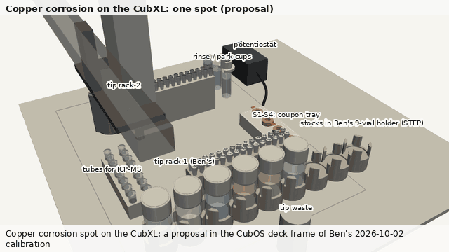
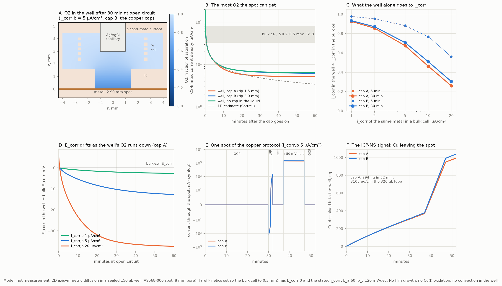
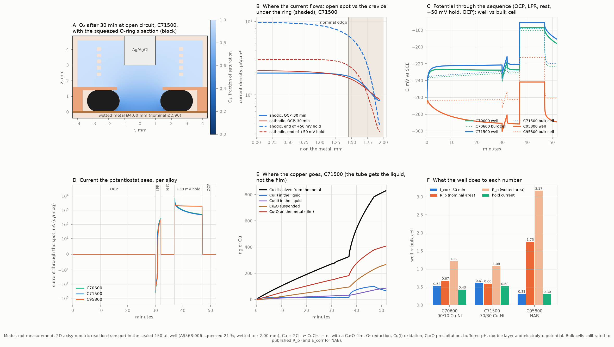

# Corrosion of naval copper alloys on the CubXL

Written 2026-10-18 for Sterling's request on [PR #278](https://github.com/vertical-cloud-lab/byu-vcl/pull/278):
a copper version of the corrosion plan, built from the list of changes that the
[copper Edison batch](../copper-ded-edison/README.md#what-changes-in-the-plan-for-copper) produced,
with a video at real dimensions where they exist, printable CAD of the cell, and simulations to
go with it. The
targets are naval Cu–Ni (C70600, C71500) and nickel–aluminium bronze (C95800), as wrought or cast
references and as single-feed blown-powder laser DED deposits and repairs. It builds on the
aluminum plan ([`../README.md`](../README.md), [`../protocol.md`](../protocol.md),
[`../cubxl-setup.md`](../cubxl-setup.md)) and changes only what copper changes.

**Nothing here has been bought, built or run.** The video is a proposal drawn at the CubXL's
real coordinates. The CAD has not been printed. The simulations are models with stated
assumptions, not measurements.



**[The video on YouTube](https://youtu.be/CTQMzOfOmBI)** (2 min 22 s): the real CubXL, the model, every module and tool
placed with its name, the prep done by hand, one spot, and what happens after the night. The file
is [`cubxl-cu-spot.mp4`](cubxl-cu-spot.mp4) (1280 × 720, 30 fps); the GIF above is its run chapter
at 640 × 360. Chapters and sources are in §1.

| File | What it is |
| --- | --- |
| [`protocol.md`](protocol.md) | One copper spot, step by step: specimen, sealed cell, seawater and sulfide series, sequence, calibration, ICP-MS and blanks, repair coupons and the galvanic test, later modules, safety |
| [`test-matrix.csv`](test-matrix.csv) | Specimen sets: the C71500 / C95800 / C70600 calibration, finish arms, DED pads, a repair coupon, the galvanic couple, stand-ins, the sulfide and cathodic-protection series |
| [`record-template.yaml`](record-template.yaml) | The per-spot record, with tube masses, acid lot, sulfide checks and ICP-MS results |
| [`bom-delta.csv`](bom-delta.csv) | What copper adds to [`../bom.csv`](../bom.csv), with prices seen 2026-10-18 |
| [`copper_numbers.py`](copper_numbers.py) → [`copper_numbers.json`](copper_numbers.json) | Every computed number in the protocol |
| [`cad/`](cad/README.md) | CadQuery CAD of the electrode cap, carrier, well lid, squeezed O-ring, pads and coupon tray (STEP and STL), and the O-ring, magnet, vapour and fit checks |
| [`sim_well_hf.py`](sim_well_hf.py) → [`sim_well_hf.json`](sim_well_hf.json), [`sim_well_hf.png`](sim_well_hf.png), [`sim_well_hf_fields.npz`](sim_well_hf_fields.npz); write-up [`sim_well_hf.md`](sim_well_hf.md) | The well simulated with copper's own chemistry, per alloy, with the squeezed O-ring's crevice (§2.7). The fields the video draws |
| [`sim_well.py`](sim_well.py) → [`sim_well.json`](sim_well.json), [`sim_well.png`](sim_well.png), [`sim_well_fields.npz`](sim_well_fields.npz) | The first-order well simulation: oxygen transport only, placeholder kinetics (§2.1–2.6) |
| [`deck_cu.py`](deck_cu.py) → [`deck-check-cu.json`](deck-check-cu.json) | The copper deck, and the aluminum plan's tool-shadow check rerun on it (§3) |
| [`render_cubxl_cu.py`](render_cubxl_cu.py) → [`cubxl-cu-spot.mp4`](cubxl-cu-spot.mp4), [`cubxl-cu-spot.gif`](cubxl-cu-spot.gif), stills | The video (§1) |
| [`media/cubxl-empty-ben-2026-06-26.jpg`](media/cubxl-empty-ben-2026-06-26.jpg) | Ben's photo of the empty CubXL from [#133](https://github.com/vertical-cloud-lab/byu-vcl/issues/133), which opens the video |

## In short

- **What changes from aluminum.** Copper alloys corrode actively under a film rather than pitting,
  so the headline results are OCP, the LPR slope, the charge of a potential hold, and ICP-MS of
  every spot's liquid, acidified in its tube at once. Cyclic polarization moves to spare spots.
  The electrolyte axis becomes sulfide dose in fixed substitute ocean water. The electrode cap now
  nearly seals the well. The first experiment is the well against a bulk cell on C71500 and C95800
  ([protocol](protocol.md)).
- **The CAD changed the cap** ([`cad/`](cad/README.md)). The first draft's radial AS568-016 seal
  needs 2.3–85 N to pull off, against about 23 N of electromagnet pull on a 1 mm steel disc, so it
  would not reliably come off. The recommended cap has no O-ring: a 0.12 mm clearance skirt over
  the lid's 16 mm boss loses 1.6 µL of water an hour (1.1 % of the well per spot), and two
  4 × 2 mm magnets in the lid hold it down. The electromagnet lifts it against about 2.4 N, a
  margin of 9, if the decap height is jogged to ±0.15 mm. The cap weighs 13.5 g and fits the
  capper as a vial cap does.
- **The squeezed O-ring wets almost twice its nominal area.** It touches the metal only from
  r ≈ 2.0 mm, so 0.126 cm² is wet, not 0.0661, and a thin crevice under the ring carries 35 % of
  the anodic current at open circuit (45 % on NAB). On C71500, R_p normalised by the nominal area
  reads 0.60 of the bulk cell's, and by the wetted area 1.08: the area choice is a bigger error than
  anything the well does to the chemistry. Report on the wetted area, measured from the attack ring
  ([`sim_well_hf.md`](sim_well_hf.md), [`cad/README.md`](cad/README.md)).
- **With copper's own chemistry, the well's bias depends on the alloy** ([`sim_well_hf.md`](sim_well_hf.md),
  each alloy's bulk cell calibrated to published R_p, decay times and, for NAB, E_corr). On Cu–Ni the
  copper that piles up near the metal outweighs the slower oxygen supply: E_corr reads 4–8 mV *more
  positive* than in the bulk cell, not 9 mV more negative as the first-order model had it. On NAB
  the oxygen supply wins: −28 mV, and R_p 1.75 times the bulk cell's even on the nominal area. After
  30 min the well's i_corr is 0.53, 0.61 and 0.31 of the bulk cell's for C70600, C71500 and C95800,
  and the +50 mV hold passes 0.30–0.53 of its current. So NAB against Cu–Ni in the well needs the
  bulk-cell calibration first.
- **About half the copper oxidised reaches the tube**, 0.51–0.52 on Cu–Ni, and the rest stays as
  Cu₂O film. The split rests on an assumed film share (0.32–0.62 for 60 % and 10 %), so ICP-MS is a
  lower bound and the measured charge-to-copper balance is a result. The anodic hold acidifies the
  spot to pH 7.2–7.3 on Cu–Ni and 5.8 on NAB, which is why the companion OCP-only well matters.
- **A cathodic step replates 18.5 % of the dissolved copper** on C71500 in 10 min at −300 mV, since by
  then most of it is Cu(II) or suspended Cu₂O. The first-order model said 51 %. Either way, cathodic
  holds go on separate spots (§2.4, §2.7).
- **The first-order model's oxygen findings still stand as bounds** (§2.2–2.3): after 30 min the most
  oxygen the spot can get is 6.6 µA/cm², against 32–81 µA/cm² in a bulk cell. Changing the O-ring
  size will not reveal the oxygen bias, because the 4 mm column of liquid sets the supply, and the
  sulfide series will look flattened at its top. Hold at a fixed potential and read ICP-MS.
- **The reference tip moves up**, from 1.5 mm above the metal in the O-ring's throat to 3.0 mm in
  the bore. That gives 22 % more oxygen at 30 min and a current density uniform to 1.4 %, for an
  uncompensated resistance of 60 Ω: 4 mV at a 1 mA/cm² reversal and under 0.3 mV in LPR and holds
  (§2.5). With the electrolyte potential solved every step, the ohmic non-uniformity on the metal is
  under 0.04 mV on Cu–Ni and 0.2 mV on NAB.
- **The deck** keeps the aluminum layout, puts the stocks in Ben's real 9-position holder, adds an
  acid vial, a seawater rinse cup and a PTFE blank station, and moves the tip waste. The
  tool-shadow check, rerun with the CAD cap (35.8 mm hang, 28 mm flange), passes 118 tool-down
  events with no collision (§3).

## 1. The video

**[Watch it on YouTube](https://youtu.be/CTQMzOfOmBI)** (unlisted, 2 min 22 s), or the file:
[`cubxl-cu-spot.mp4`](cubxl-cu-spot.mp4) (1280 × 720, 30 fps). The GIF above is the run
alone, at 640 × 360 and about three times the video's speed.

| Time | Chapter |
| --- | --- |
| 0:00 | **The real CubXL, empty**: Ben's photo from [#133](https://github.com/vertical-cloud-lab/byu-vcl/issues/133) (2026-06-26) |
| 0:04 | **The same machine as a model**, from the photo's side, turning to the working view |
| 0:09 | **Deck modules, one at a time**, each with a short name: coupon tray, specimens, PTFE blank, well lids, stock holder, stocks, two tip racks, ICP-MS tubes, rinse and park cups, electrode cap, tip waste, potentiostat, electrode bus |
| 0:33 | **Tools on the gantry head**: electromagnetic capper, P20 pipette, head camera, the Arduino + TMC2209 pipette driver |
| 0:42 | **Before the night, off the deck**: stock alloys and DED pads, specimen prep, seawater, sulfide and acid, tubes and the reference check |
| 1:06 | **One spot**: tip, seawater, sulfide last, tip off, leak check, electrode cap on, the measurement in section, cap off and rinsed, collection, acid, image |
| 2:11 | **After the night**: ICP-MS of the tubes, SEM/EDS of the spots |
| 2:17 | Summary |

**Which tool is working.** The CubXL's head is rigid: the capper, the pipette and the camera ride
together, 55 mm apart, so every tool goes down whenever one does. In the run the tool doing the
work is outlined in orange and lit in the "working now" panel at the top left, its target on the
deck is ringed, and a label says what it is doing. During the measurement the potentiostat is lit
and the head is shown free.

| | Where it comes from |
| --- | --- |
| **Real** | The opening photo. Frame proportions checked against frames of the channel's [setup](https://youtu.be/XUobYYZ1vzQ) and [calibration](https://youtu.be/Kr37dRIVfqo) videos, pulled through the stream-cam Pi |
| **Exact models** | Ben's 9-position 20 mL holder, the magnetic vial cap and the PAW-V2 electromagnet mount (the STEP files in [`modules/electromagnetic-capper/cad/`](../../modules/electromagnetic-capper/cad/), meshed by gmsh), and the new electrode cap, carrier, electrodes, well lids, squeezed O-ring, pads and coupon tray from [`cad/`](cad/README.md) |
| **Exact numbers** | Deck positions, tool offsets (pipette +55, +11; camera −40, +10), the magnet face 16 mm below the carriage, the 35 mm tip, travel at z 122, the working volume 361 × 278 × 122 mm: Ben's 2026-10-02 gantry and deck files, through [`deck_cu.py`](deck_cu.py) |
| **Computed** | The O₂ field (left cut face), the dissolved-Cu field (right cut face) and the current trace in the close-up: [`sim_well_hf.py`](sim_well_hf.md), C71500 on S1 |
| **Schematic** | The PROVerXL 4030 V2 frame, gantry, carriage and tool plate, the P20 body, the camera and the driver boards: right proportions, not measured |

Motion is eased between real waypoints at real carriage heights, but the timing is compressed: a
gantry move takes about a second, a fill is shown as one transfer for seven, and the 52 min
measurement takes 10 s.

To render it again (about 15 min on the runner's four cores, in two parallel halves):

```bash
pip install numpy scipy matplotlib pyvista vtk gmsh imageio imageio-ffmpeg pillow cadquery
python cad/cad_cu_cell.py               # the CAD parts the render reads
python sim_well_hf.py                   # writes sim_well_hf_fields.npz (else sim_well_fields.npz is used)
for i in 0 1; do xvfb-run -a python render_cubxl_cu.py --part $i/2 & done; wait
python render_cubxl_cu.py --assemble 2  # joins the halves, builds the GIF
xvfb-run -a python render_cubxl_cu.py --stills 12,95   # or just stills, at these seconds
```

Stills: [real CubXL](cubxl-cu-photo.png), [placing the lids](cubxl-cu-placement.png),
[deck](cubxl-cu-overview.png), [tools](cubxl-cu-tools.png), [a prep card](cubxl-cu-prep.png),
[filling](cubxl-cu-fill.png), [close-up](cubxl-cu-closeup.png), [acid](cubxl-cu-acid.png).

## 2. What the simulations say

Two models. §2.1–2.6 are the first-order [`sim_well.py`](sim_well.py): oxygen transport with
placeholder Tafel kinetics, one generic metal. §2.7 is [`sim_well_hf.py`](sim_well_hf.md), which
adds copper's own chemistry, calibrates each alloy and resolves the O-ring's crevice. Where they
disagree, the second one's numbers are the ones to plan with; the first-order oxygen limits still
bound what the well can supply.



### 2.1 The model

[`sim_well.py`](sim_well.py) is a 2D axisymmetric finite-volume model of the well on a 0.05 mm
grid, stepped implicitly at 1 s. The geometry is the aluminum plan's well with the copper cap: a
2.90 mm spot under an AS568-006 O-ring, the 1.6 mm throat, an 8 mm bore, 150 µL, a 2 mm reference
capillary on the axis and a five-turn Pt coil at r 2.5–2.75 mm. The cap seals the headspace, so the
liquid's surface stays air-saturated and nothing evaporates.

- **Oxygen** diffuses from the surface (0.21 mM, seawater at 25 °C) to the spot, where it is
  reduced with Tafel kinetics.
- **Dissolved copper**, as Cu(I), leaves the spot at the anodic current (n = 1, as in chloride) and
  diffuses into the well. It is a tracer: it does not feed back on the kinetics.
- **At open circuit** the net current is zero, so the mixed potential is solved at every step.
- **The bulk cell** it is compared with is a spot under a natural-convection layer of 0.3 mm
  (0.2–0.5 mm as a range), with its dissolved copper carried away.
- **The kinetics are set relative to the bulk cell**, since nobody has measured them for these
  deposits: each case puts the bulk cell's E_corr at 0 with a chosen i_corr from 1 to 20 µA/cm²,
  anodic and cathodic Tafel slopes of 60 and 120 mV/decade. The well then holds the same metal
  with less oxygen. The output is the bias the well adds, which is the quantity the calibration
  (§5 of the protocol) has to measure.
- **Checked** against the Cottrell solution, for a spot as wide as its well: within 1.6 % at 30 s
  and 0.1 % at 10 min (`validation_vs_cottrell`).

### 2.2 How much oxygen the spot can get

With the spot held at zero oxygen (panel B), the supply falls from 26.6 µA/cm² at 1 min to 8.7 at
10 min and 6.6 at 30 min, then levels off near 6 µA/cm² as the depleted layer reaches the
surface. A bulk cell holds 54 µA/cm² (32–81 over δ 0.5–0.2 mm). The one-dimensional estimate in
[`../copper-ded-edison/check_numbers.py`](../copper-ded-edison/check_numbers.py) (6 µA/cm² at
30 min) was close; it keeps falling where the real well levels off.

| Cap | 5 min | 30 min | 60 min |
| --- | --- | --- | --- |
| A: the aluminum cap, reference tip 1.5 mm up, in the throat | 11.6 | 5.4 | 5.1 |
| B: tip 3.0 mm up, in the bore (copper) | 11.9 | 6.6 | 6.2 |
| no cap in the liquid | 11.9 | 6.7 | 6.4 |

µA/cm², oxygen-limited, `O2_limited_uA_cm2`. The aluminum cap's capillary sits in the throat and
blocks part of the only path to the metal. Raising it recovers almost all of the open well's supply.

### 2.3 The same metal in the well and in a bulk cell

| i_corr in the bulk cell, µA/cm² | 1 | 2 | 5 | 10 | 20 |
| --- | --- | --- | --- | --- | --- |
| i_corr in the well ÷ bulk, 5 min | 0.98 | 0.95 | 0.88 | 0.77 | 0.56 |
| i_corr in the well ÷ bulk, 30 min | 0.93 | 0.87 | 0.71 | 0.51 | 0.31 |
| E_corr in the well − bulk, 30 min, mV | −1.8 | −3.6 | −9.0 | −17.5 | −30.9 |

Cap B, `ocp_in_well`. Fresh Cu–Ni and NAB sit at 1–11 µA/cm² in the Edison answers, so a spot
on a fresh surface reads 7–50 % low on i_corr and 2–19 mV negative on E_corr.

- **R_p reads 1.37 times high** at 5 µA/cm²: 4,912 against 3,585 Ω·cm² from a simulated ±10 mV
  sweep (`sequence`). Use R_p to rank spots measured the same way, and the bulk cell to anchor it.
- **E_corr settles by 30 min**: about 2 mV more drift over the next 30 min (panel D). Thirty
  minutes of OCP stays.
- **O-ring size does not reveal the bias.** At 5 µA/cm² after 30 min the -006, -008 and -010 wells
  give 0.71, 0.70 and 0.69 of the bulk value, because all three hold a 4 mm column of still liquid.
  c1-01's advice to calibrate at two or three O-ring sizes is still worth following for other
  artifacts (crevice, area), but a flat size trend does not clear the well. Only the bulk cell can.
- **Higher corrosion rates are compressed.** A metal at 20 µA/cm² in a bulk cell reads 0.31 of
  that in the well. In bulk cells sulfide raised i_corr to 30 µA/cm² on cast NAB at 2 mg/L and to
  87 µA/cm² on fresh 70/30 Cu–Ni at 10 ppm (Nady 2017, Yuan 2007, via c1-06), so the well's
  sulfide series will look flatter than the bulk cell's at its top.
- **A potential hold relative to the well's OCP inherits the bias.** The +50 mV hold passes 0.69
  of the bulk cell's current at its own OCP + 50 mV, because the well's OCP is 9 mV lower
  (`anodic_hold_well_over_bulk`). Held at a fixed potential against the reference, the anodic
  current depends on the metal, not on the oxygen. The protocol now says so.

### 2.4 Dissolved copper and the ICP-MS sample

One main spot at 5 µA/cm² releases about 1.0 µg of Cu: 6.9 mg/L in the well and 3.2 mg/L in the
320 µL tube after the rinse and the acid, of which the +50 mV hold contributes about half
(`sequence`). That is far above ICP-MS limits; a 10× dilution is for the salt, not the signal.
The counter used 2.3 nmol of the well's 31 nmol of oxygen during the hold, so at these currents it
does not starve the well; it does at a 1 mA/cm² reversal, as
[`../copper-ded-edison/README.md`](../copper-ded-edison/README.md#corrections-to-edison) worked out.

- **A cathodic step after the anodic one replated 51 % of the dissolved Cu in 10 min** at −300 mV
  (`cathodic_hold_after_anodic`), with all Cu(I) that reaches the spot taken as reduced. That is
  why cathodic holds are separate spots, collected on their own.
- **The film will form differently in the well.** With nothing removing it, the model's Cu(I) at
  the metal reaches 2.7 mM by the end of the hold, against 0.14 mM in the bulk cell at the same
  i_corr. Both exceed what Cu₂O allows in seawater at pH 8.2, about 22 µM by standard free energies
  (`cu2o_solubility_as_CuCl2_uM_pH8p2_Cl0p55M`, a marker, not a measured solubility). So the real
  surface precipitates oxide in both, but from a much more supersaturated layer in the well. That
  is one more reason the well needs the bulk-cell anchor, and the SEM of each spot.

### 2.5 Ohmic drop, and why the reference tip moved

A Laplace solve over the same geometry, in seawater (5.3 S/m), with the spot and the Pt coil as
electrodes (`ohmic`):

| | Cap A, tip 1.5 mm | Cap B, tip 3.0 mm |
| --- | --- | --- |
| Uncompensated resistance at the tip | 34 Ω | 60 Ω |
| Spot to counter | 85 Ω | 71 Ω |
| Current density, edge ÷ mean, centre ÷ mean | 1.03, 0.93 | 1.006, 0.986 |
| iR at a 1 mA/cm² reversal (66 µA) | 2.3 mV | 4.0 mV |
| iR at 10 mA/cm² | 23 mV | 40 mV |
| iR in LPR or the +50 mV hold | < 0.2 mV | < 0.3 mV |

The raised tip costs 2 mV at the protocol's largest current and buys a fifth more oxygen and a
more even current. The protocol takes it.

### 2.6 What the model leaves out

Double-layer charging (it matters for the LPR sweep's first seconds, not its slope); the growth of
the Cu₂O film and its effect on the kinetics; oxidation of Cu(I) to Cu(II) and precipitation;
migration; the counter's own products beyond its oxygen demand; and any convection in the well.
A still, sealed 150 µL well should have little convection, but a warm deck could add some, which
would make the real bias smaller than §2.3. The kinetics are placeholders until the bulk cell
measures them, which is the point of measuring them.

### 2.7 Copper's own chemistry, per alloy

[`sim_well_hf.py`](sim_well_hf.py) (write-up: [`sim_well_hf.md`](sim_well_hf.md)) solves the same
well with Cu + 2Cl⁻ ⇌ CuCl₂⁻ + e⁻ nearly reversible, so copper that accumulates throttles
dissolution; a Cu₂O film fitted to each alloy's published decay of i_corr; Cu(I) oxidised by O₂
(t½ 152 s) and Cu(II) reduced back at the metal; Cu₂O precipitating in the liquid; a carbonate and
borate buffer for pH; a 30 µF/cm² double layer; the electrolyte potential every step; NAB's second
anodic path through its Al- and Fe-rich phases; and the squeezed AS568-006 with its crevice resolved
to 4 µm. Each alloy's bulk cell is calibrated first (R_p within 0.5 % of each target; C70600's
E_corr, not fitted, comes out at −220 mV SCE against −220 to −233 mV measured).



| | C70600 | C71500 | C95800 (NAB) |
| --- | --- | --- | --- |
| E_corr at 30 min, well − bulk | +4.0 mV | +7.9 mV | −28.1 mV |
| i_corr at 30 min, well ÷ bulk | 0.53 | 0.61 | 0.31 |
| R_p, well ÷ bulk: nominal / wetted area | 0.67 / 1.22 | 0.60 / 1.08 | 1.75 / 3.17 |
| +50 mV hold current, well ÷ bulk | 0.43 | 0.53 | 0.30 |
| Crevice share of the anodic current, OCP | 34 % | 35 % | 45 % |
| pH at the spot centre after the hold | 7.2 | 7.3 | 5.8 |
| Share of the oxidised Cu reaching the tube | 0.52 | 0.51 | 0.60 (plus 0.69 mg/L of Al) |

Checks: Cottrell within 1.3 % at 30 s and 0.1 % at 600 s; copper mass balance closed to below 0.001 %; h
against h/2 changes E_corr by under 0.1 mV and R_p by 0.6 %. Natural convection is subcritical
unless the deck heats the tray by about 1 K from below, so log the deck temperature. What it
leaves out (Ni, Fe and Mn films, CuCl and Cu₂(OH)₃Cl, the counter's chlorine, sulfide) is listed in
[`sim_well_hf.md`](sim_well_hf.md#what-it-still-leaves-out).

## 3. The deck for copper

Same frame and stations as [`../cubxl-setup.md` §4](../cubxl-setup.md#4-the-deck). What changes,
all in [`deck_cu.py`](deck_cu.py):

| Item | Where (CubOS x, y) | Change |
| --- | --- | --- |
| Ben's 9-position 20 mL holder (the STEP) | x 318, y 35 + 33k | the full holder, so the four stock positions of the aluminum plan stay where they were |
| Stocks | y 68: 1 M trace-metal HNO₃; 101: ASW; 134: ASW + 10 mg/L S; 167: ASW + 0.1 mg/L S; 200: DI water; 35: spare | **y 233 and 266 stay empty** |
| Cups | rinse 2, ASW (30, 245); rinse 1, DI (60, 245); park (90, 245) | the ASW rinse is new |
| Station S4 | (260, 240) | a PTFE blank disk: fixture and carry-over blanks |
| Tip waste | (385, 150) | moved: the full holder now covers (335, 40) |
| Electrode cap | park cup | electrodes 3.0 mm below the skirt, not 4.5, so it hangs 35 mm below the carriage |

The check reruns the aluminum plan's rigid-head rule (whenever one tool is lowered, the other is at
the same carriage height 55 mm away) on 118 tool-down events, including the acid tip over every
tube: **0 collisions** ([`deck-check-cu.json`](deck-check-cu.json)). The first draft put a spare
vial at y 233; the check found the bare pipette nozzle at z 58 over its 71 mm cap whenever the
capper set the electrode cap on S4, and the vial moved to y 35. The tightest pass is 8 mm, the
capper over the 10 mg/L sulfide stock while the pipette drops a tip. The same limits as before
apply: this is a plan check, not CubOS `validate_setup`, and the slot mapping is still to be
jogged.

## 4. Protocol, specimens and what to buy

The full procedure is [`protocol.md`](protocol.md). One main spot is about 67 min of deck time:
fill (ASW first, sulfide last) → leak check → cap on → OCP 30 min → LPR ±10 mV → rest 5 min →
+50 mV hold 10 min → OCP 5 min → cap off and rinse → collect 150 µL plus a 150 µL rinse → 20 µL of
1 M HNO₃ at once. Each piece's second well is an OCP-only companion. A night holds eight wells, two
of them the fixture and carry-over blanks on S4, plus a stock blank: nine tubes.

Specimens ([`test-matrix.csv`](test-matrix.csv)) start with purchased C71500, C95800 and C70600
for the calibration, then DED Cu–Ni and NAB pads (XY and XZ faces), a DED NAB repair on cast
C95800 with wide pads, the bench galvanic couple, stand-ins validated against the pad, the sulfide
× history series and the cathodic-protection series, where ICP-MS of Al finds the potential that
stops NAB's selective-phase loss.

What copper adds to the aluminum BOM ([`bom-delta.csv`](bom-delta.csv), prices seen 2026-10-18):
D1141 seawater without heavy metals ($176 a unit), Na₂S·9H₂O (about $60), a methylene-blue sulfide
kit ($141), trace-metal HNO₃ ($238), FKM O-rings in three sizes plus the cap seal (about $38),
and three alloy bars on quote. Priced items come to about $650. ICP-MS has no BYU rate found yet;
ASU's $37 a sample is the benchmark. The potentiostat question is unchanged, except that the
copper plan wants a galvanostatic mode (oxide coulometry) and a second channel for the ZRA, which
points at the EmStat Pico dev kit over the bare module. The build list for both alloys, with a STEP file
for every printed part and a checked link for every bought part, is [`../bom/`](../bom/README.md).

## 5. What to do first

1. Everything in [`../cubxl-setup.md` §9](../cubxl-setup.md#9-what-to-do-first) still comes first:
   jog the slot mapping, print the tray and cap, `validate_setup`, the dummy cell.
2. Print the cap, carrier, lids and tray from [`cad/`](cad/README.md). On the bench, measure the
   force to lift the clearance cap off a lid and the electromagnet's pull on the real disc at
   shimmed gaps, weigh a capped well's water loss over 2 h, and dye-check the wetted area under the
   squeezed O-ring (the list in [`cad/README.md`](cad/README.md#still-needs-a-bench-test)).
3. Buy the D1141 seawater and the C71500 and C95800 bars, and run the calibration: three well sizes
   on the CubXL against the 1 cm² bench cell, at least 8 spots each over 2 nights. The simulation
   predicts what the bias should look like; the data decide whether it is real.
4. Only then the sulfide series, the DED pads and the repair coupons.
