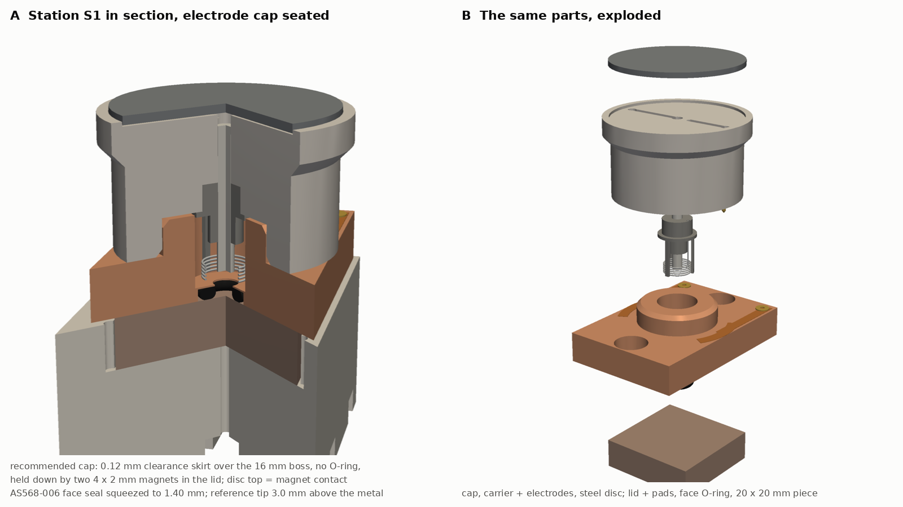
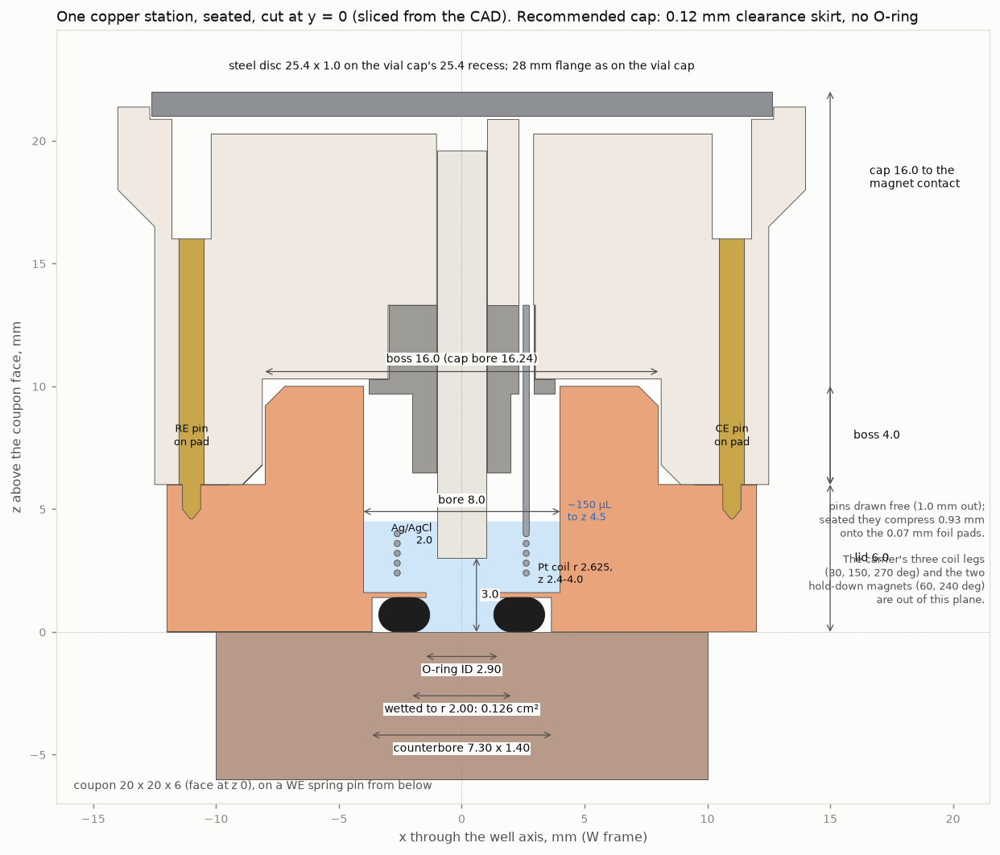

# CAD: the copper electrode cap, well lid and coupon tray

Printable CAD for one copper corrosion station on the CubXL, and the force and fit checks that
the [copper protocol](../protocol.md) §2 asked for before anything is built. Nothing here has
been printed or bench-tested. Every number below comes from [`cad_check.py`](cad_check.py) →
[`cad_check.json`](cad_check.json); every dimension from [`cad_cu_cell.py`](cad_cu_cell.py).

**Print the v2 well lid, not `well_lid.step`** (found 2026-10-19, making the [BOM](../../bom/README.md)).
Here the AS568-006 seals against a 0.2 mm printed ledge between the counterbore and the 8 mm
bore. As an annular plate that ledge sees about 200 MPa at the nominal 23.6 N, four times PETG's
yield, and would lift 0.66 mm, more than the ring's 0.38 mm squeeze.
[`well_lid_v2_006.step`](../../bom/cad/well_lid_v2_006.step) adds a 0.4 mm step under the bore,
so the ceiling is 0.6 mm thick (about 24 MPa). It still clears the carrier's legs, by 0.2 mm. The files in this
folder are unchanged, so the simulations and the animation still match them.





| File | What it is |
| --- | --- |
| [`cad_cu_cell.py`](cad_cu_cell.py) | Parametric CadQuery 2.8 model of every part. Writes the STEP and STL files, `assembly.step` and [`cad_parts.json`](cad_parts.json) |
| [`cad_check.py`](cad_check.py) → [`cad_check.json`](cad_check.json) | O-ring loads, friction, magnet pull, vapour loss, press-on pressure, masses, clearances |
| [`plot_cad_preview.py`](plot_cad_preview.py), [`plot_cad_section.py`](plot_cad_section.py) | The two figures above |
| `*.step`, `*.stl` | One per part. `*_section.stl` is the same part with the 90° wedge facing −y cut away, for section views |
| `assembly.step` | The tray with all four stations, S1 with the cap seated |

```bash
pip install cadquery            # 2.8.0
python cad_cu_cell.py           # parts, about 10 s
python cad_check.py             # numbers
xvfb-run -a python plot_cad_preview.py && python plot_cad_section.py
```

## Two findings to act on first

**1. Drop the radial O-ring from the cap. Seal by clearance and hold the cap down with two
small magnets.** The protocol's cap sealed with an AS568-016 O-ring on a 16 mm boss, pressed on
by the gantry and pulled off by the electromagnet. The extraction force is too close to what the
magnet can pull:

- The ring's radial load at the nominal 12.9 % squeeze is 36.8 N (75 A FKM, Lindley's formula).
  With the AS568 cross-section tolerance and ±0.05 mm on the printed gland, it is 11–71 N.
  Friction at µ 0.2–0.6, with up to 2× breakaway after an hour's dwell, gives **2.3–85 N to pull
  the cap off**, and 7–22 N for the gantry to push it on (nominal squeeze).
- The P25/20 electromagnet is rated "5 kg minimum" holding force, which needs a thick armature
  and full contact. The same-size Eclipse M52172 loses two thirds of its pull at a 0.09 mm gap.
  A thin disc saturates: a 0.5 mm disc carries at most 11 % of the rated flux² (5.7 N), a 1.0 mm
  disc 46 % (22.8 N), and only ≥ 1.5 mm reaches the full 50 N.
- So the pull margin (available ÷ needed, at µ 0.4 and 1.5× breakaway) is **1.03 with a 1.0 mm
  disc at full contact, 0.77 at a 0.09 mm gap**, and 0.07–0.59 at the worst case. Not usable.

The recommended cap (`electrode_cap`) instead slides over the boss with **0.12 mm radial
clearance** and no O-ring. Over the 3.2 mm land, water vapour escapes at **1.6 µL/h** (1.0–2.5 µL/h
for 0.07–0.22 mm clearance): **1.1 % of the 150 µL in a 63 min spot**, against 6.1 µL/h with no
cap. The headspace sits at about 89 % RH, and the liquid surface stays in contact with room air,
so it stays air-saturated as [`sim_well.py`](../sim_well.py) assumes. Air escapes through the gap
as the cap goes on at 8–33 Pa, so no vent is needed.

With no friction, something must keep the cap down against its two pogo pins. Two 4 × 2 mm N45
magnets sit in the lid under a 0.4 mm printed skin and pull on two 3 × 2 mm steel slugs in the
skirt: an estimated **1.6–2.3 N** (4.12 N each at contact per the supplier, derated for the skin
and the small slug; the derating is a guess until measured). That sets the rule for the pins:
**at most 0.4 N each at the seated stroke**. P75-class pins can be 1 N or more, so measure them.
The electromagnet then has to lift about 2.4 N: a margin of 9.4 at contact, 7.0 at 0.09 mm and
3.0 at 0.18 mm with a 1.0 mm disc. The two magnets also clock the cap, so its pins land on the
±30° pads. Both 0° and 180° are stable, and 180° swaps the reference and counter pads, so set
the cap's index mark by hand at the park cup; the protocol's OCP window at cap-on (step 3)
catches a cap put down backwards. The cost is approach tolerance:
the decap height has to be jogged to the disc top within about ±0.15 mm, not PANDA-film's ±3 mm,
which works because its vial caps rest almost free on their vials.

The O-ring cap is still built (`electrode_cap_oring`), if a bench test shows the clearance cap
loses too much water. If it is used: it **must have its 0.3 mm vent**. Without it, the
headspace trapped once the ring meets the boss (877 µL squeezed to 261 µL) rises 2.4 bar,
which is 49 N on the cap: the cap springs back off. With the vent, the rise is 0.57 kPa at
5 mm/s and 3.8 kPa at 20 mm/s. To make it workable, use a PTFE-encapsulated or lubricated ring
(µ near 0.1), a disc of at least 1.5 mm, and full contact.

**2. The wetted spot is 1.5–1.9 times the area the O-ring's ID suggests.** Squeezed 21 % in the
counterbore, the AS568-006 touches the metal only from **r ≈ 1.8–2.0 mm** outward (the ring's
centre radius is 2.34 mm; the contact half-width is 0.34–0.55 mm by three estimates). Inside
that, the liquid reaches the metal everywhere, including a thin crevice under the ring's curved
inner face. The wetted area is **0.101–0.126 cm², not 0.0661 cm²**. The ring can also sit up
to 0.27 mm off the bore's axis. The protocol already says to measure the real area from the
attack ring after the test. This makes that step essential, and it changes the current
densities in the protocol and in `sim_well.py` by the same factor. If a well-defined area
matters more than the O-ring's simplicity, use a punched flat FKM or PTFE gasket instead. Its
hole edge, not a curved face, then sets the area. An FEA of the squeeze would narrow the range; it was not done.

## The parts

| Part | Material | Key dimensions |
| --- | --- | --- |
| `well_lid` | PETG, one per station | 24 × 35 × 6 mm plate on the coupon face. Face-seal counterbore Ø7.30 × 1.40 underneath for the AS568-006; Ø2.90 throat to z 1.60; Ø8.0 bore. Ø16.0 boss, 4.0 tall, 0.8 mm lead-in chamfer. M3 clamp holes at y ±14 with Ø6.5 head counterbores. Ø1.6 eyelet holes at (±10, 15). Two Ø4.1 × 2.1 magnet pockets at r 10.3, 60° and 240°, under a 0.4 mm skin |
| `lid_pads`, `lid_eyelets` | copper foil (3M 1181), brass eyelets | Pads at r 10–12, ±30° about +x (counter) and −x (reference), 0.07 mm. A tail along y to an eyelet, which carries the pad through the lid to a spring pin in the tray |
| `face_oring_006` | FKM 75 A, AS568-006 | Drawn squeezed to 1.40 mm, area conserved |
| `electrode_cap` (recommended) | PETG | Ø25 body; Ø28 flange from z 12 with a 45° underside; disc recess Ø25.4 × 0.5 and rim as on `VialCap16mm.step`. Skirt bore Ø16.24 × 4.3 with a 0.8 mm chamfer. Ø6.0 socket for the carrier. Ø2.05 reference bore and a Ø0.6 coil-lead hole up to the recess floor. Pogo pins at (±11, 0); 0.6 mm wire grooves in the recess floor, under the disc. Two Ø3.05 × 2 mm pockets for steel slugs in the skirt underside, at r 10.3 |
| `electrode_cap_oring` | PETG | As above, without the steel slugs, plus an internal groove for the AS568-016: Ø19.10 bottom (1.55 mm gland depth, 12.9 % squeeze on Ø16.00), 2.40 mm wide, z 0.9–3.3, 45° roof. 0.3 mm vent through the ceiling into a 1 mm side channel |
| `electrode_carrier` | PETG | Press-fit plug Ø5.95 × 3.0 with a Ø7.6 flange. A Ø4.0 sleeve guides the reference. Three 0.8 × 0.5 mm legs at r 2.75–3.25 (30°, 150°, 270°) hold the coil, down to 2.2 mm above the metal. Replaceable, so the Pt coil can be cleaned or swapped between alloys (protocol §2) |
| `steel_disc` | low-carbon steel | Ø25.3 × 1.0 on 0.13 mm 3M 468MP. Its top is the magnet contact, 16.0 mm above the skirt underside |
| `ag_agcl_ref` | leak-free Ag/AgCl | Ø2.0, tip 3.0 mm above the metal, top 13.6 mm above the skirt underside: **16.6 mm long overall**. Most catalogue leak-free references are longer, so this is a custom length; ask the vendor when quoting (`../bom-delta.csv`) |
| `pt_coil` | Pt, 0.25 mm | Five turns at r 2.625, 2.4–4.0 mm above the metal, as in `sim_well.py` |
| `cap_pogo_pins` | spring pins | Ø1.02 barrel, 1.0 mm stroke out when free; ≤ 0.5 N each at the seated stroke |
| `coupon_tray` | PETG | 105 × 40 × 19.5 mm, deck x 170–275, y 220–260. Four 20.6 mm square pockets, floor at deck z 14.0, corner reliefs, pry slots. A WE spring pin up through each floor. Ø4.0 × 6 holes for M3 heat-set inserts at y ±14. Pad spring pins at (±10, 15). Bus channels 4 × 3 mm in the underside, out at the back edge at x 222.5 |
| `ptfe_blank` | PTFE | Ø20 × 6 disc for S4 |
| `shim_1mm`, `shim_3mm` | PETG | Under thinner pieces, so the face stays at deck z 20 |

**Heights, for placing the parts** (all in [`cad_parts.json`](cad_parts.json)): coupon face deck
z 20; lid top 26; boss top 30; cap seated: skirt underside 26, flange 38, disc top (magnet contact)
42. Carried, the cap's lowest points are the carrier legs at 35.8 mm below the carriage, the coil
at 35.7 and the reference tip at 35.0, with the magnet face 16 below the carriage.
`../deck_cu.py` uses 35.0, so the copper deck check should add 0.8 mm. Its margin is 14.5 mm.

**It fits as a vial cap does.** The flange is the vial cap's 28 mm, which clears the PAW-V2
mount's IR housings by 3.0 mm a side, the same as a vial cap. The cap's body is solid where the
break beam crosses below the magnet face (PANDA-film Fig. 2B), so the beam sees it as a cap.
The 25 mm body clears the next station's lid and pads by 0.5 mm at the 25 mm pitch. The
reference tip sits 3.0 mm above the metal. The cap weighs 13.5 g: 8.5 g of PETG and a 3.95 g disc.

## The face seal and the clamp

- AS568-006 in the 1.40 mm counterbore: **21.3 % squeeze** (14.9–27.3 % with tolerances), gland
  fill 80.8 %, no stretch (the ring is free inside the Ø7.30 counterbore).
- Load (Lindley; E from Shore A by Gent's relation, 5.5 / 7.1 / 9.4 MPa at 70 / 75 / 80 A):
  **23.6 N** nominal at 75 A, 10–51 N across hardness and tolerances.
- Two M3 screws into heat-set inserts: 51 N preload each covers twice the worst case. That is
  about 30 mN·m at K = 0.2, finger-tight with a hex key.
- The lid bows at most 0.09 mm under that load (0.18 mm if the PETG creeps to half its modulus
  overnight), against 0.38 mm of squeeze. This is a simply supported upper bound; the lid also
  bears on the coupon face around the counterbore.

## Printing and assembly

- **PETG**, 0.12–0.16 mm layers, 100 % infill for the lid and the cap (no porous infill near
  the liquid), slow outer walls. Calibrate the printer's hole and boss diameters on a test
  coupon first; the cap's 0.12 mm clearance depends on it.
- **Lid: bottom face on the bed.** That face and the coupon must be flat: it is the face seal's
  hard stop. The counterbore's ceiling is a short bridge, and the O-ring seals against it, so
  inspect it and face it flat with a 7 mm counterbore tool if it is rough. Pause the print at
  the top of the magnet pockets (z 5.6), drop in the two magnets with the same pole up, and resume.
  The boss's outside is the cap's guide: no seam on it.
- **Cap: skirt down on the bed.** The ceiling bridges 16 mm. Press the two steel slugs (3 mm
  drill rod cut to 2 mm) into the skirt underside with a drop of cyanoacrylate.
- **Carrier: flange down.** Its legs print upright.
- **Post-process:** ream the reference bore to 2.05 mm. Drill the 0.3 mm vent (O-ring cap only).
  Melt in the M3 inserts. Set the brass eyelets and lay the copper-foil pads over them.
- **Assemble the cap:** wind five turns of 0.25 mm Pt on a 5.0 mm mandrel and tie it to the
  carrier's legs. Take the lead up through the carrier's 0.6 mm hole. Press in the carrier. Push
  in the reference to its 3.0 mm protrusion and seal its top with a dab of silicone. Solder the
  reference and coil leads to the pins' tops, routed in the floor grooves. Glue the steel disc
  on last.
- **Load a station:** piece face up in the pocket (shims under thin pieces), O-ring in the lid's
  counterbore, lid on, two M3 screws.

## Still needs a bench test

1. The pull needed to lift the clearance cap off a lid against its pins and hold-down magnets, and the
   electromagnet's pull on the real disc, measured at shimmed gaps of 0–0.4 mm with a force gauge. These two
   numbers replace the derated estimates above.
2. The clearance cap's water loss: weigh a filled, capped well over 2 h.
3. The real spring force of the chosen pogo pins at a 0.93 mm stroke, and their contact
   resistance on the foil pads.
4. The wetted area: a dye or an attack ring under the squeezed AS568-006 on a polished coupon.
5. Leak check of the face seal on each alloy's finish, with the printed counterbore.
6. Whether the IR beam sees the electrode cap, and the decap height that touches the disc.

Sources: Lindley's load formula and Gent's E–Shore relation are standard O-ring and rubber
references; the electromagnet's specification is from Adafruit's product 3873 page (P25/20,
5 kg minimum, 0.3 A at 5 V, 12 mm centre pole); the gap curve shape is from Eclipse Magnetics'
electromagnet datasheet, M52172 (25 × 20 mm, 15 kg at zero gap on a 3 mm armature); the
hold-down magnet's pull is supermagnete's S-04-02-N page (4.12 N); the vial cap's top and the
mount's geometry are measured from the STEP files in
[`modules/electromagnetic-capper/cad/`](../../../modules/electromagnetic-capper/cad/).
