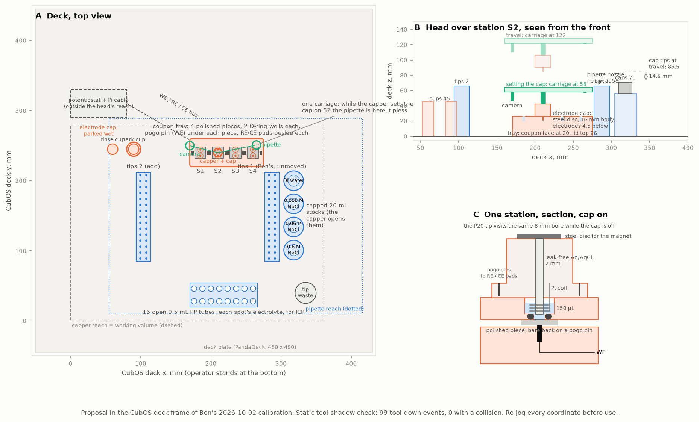

# What corrosion testing looks like on the CubXL

Written 2026-10-17 for Ben's question on [PR #278](https://github.com/vertical-cloud-lab/byu-vcl/pull/278#issuecomment-6238186960):
a vision of the deck and head, a starter bill of materials, and whether the powder doser plays a
part. It builds on the [README](README.md) and [`protocol.md`](protocol.md), and on the CubXL as
Ben calibrated it on 2026-10-02
([`cub_xl_ben_3_instrument.yaml`](https://github.com/vertical-cloud-lab/byu-vcl/blob/3445dc7/cubos/results/pipette_test_20261007/configs/cub_xl_ben_3_instrument.yaml)).
Every coordinate below is in that file's CubOS deck frame (origin front-left-bottom, +X right,
+Y away from the operator, +Z up, mm) and is a proposal to be re-jogged, not a measurement.
Nothing here has been printed, wired or run.

| File | What it is |
| --- | --- |
| [`plot_deck_layout.py`](plot_deck_layout.py) → [`deck-layout.png`](deck-layout.png) | The figure below, and the static tool-shadow check |
| [`deck-layout-check.json`](deck-layout-check.json) | The check's result: every planned tool-down event, where the other tool ends up, what it would hit |
| [`bom.csv`](bom.csv) | The bill of materials, one row per item, with phase, price, source and the date the price was seen |

## 1. The picture



**A** is the deck from above. **B** is the head over station S2, seen from the front, at travel
height and while setting the electrode cap. **C** is one station in section with the cap on.

## 2. The idea in one paragraph

Four polished pieces sit in a printed tray at the back of the deck. Each is pressed face-up onto a
pogo pin (the working-electrode contact to its bare back) by a lid with one or two FKM O-ring wells.
The reference and counter electrodes travel in a **magnetic electrode cap**: a leak-free 2 mm
Ag/AgCl capillary with a Pt coil around it, in a 16 mm printed body with a steel disc on top and
two pogo pins underneath. The existing capper picks it up and sets it down exactly as it handles
vial caps, and the pogo pins land on reference and counter pads beside each station, so the only
wiring on the deck is a static three-wire bus to a potentiostat parked beyond the head's reach.
The P20 fills each well from three capped NaCl stocks and a water vial (the capper opens them),
the cap goes on, the potentiostat runs OCP, LPR and cyclic polarization while the head is free,
and afterwards the pipette moves the well's liquid plus one rinse into an open polypropylene
tube for ICP. The head camera and the two Pi cameras image each spot before and after.

## 3. The head: what is on it, and why nothing is added

| Tool (gantry file) | Offset from the capper, mm | Lowest point below the carriage, mm |
| --- | --- | --- |
| capper, `pawduino` electromagnet | (0, 0) | 16 (`depth: -16`); 36.5 while carrying the electrode cap |
| pipette, P20 single Gen2 | (+55, +11) | 35 with a tip on; 0 bare |
| `camera_3`, mount only | (−40, +10) | not modelled (its `depth: -110` reads as a working distance) |

**A head-mounted electrode probe was the first idea, and the check killed it.** The pipette and
capper are rigidly coupled, so whenever one is lowered the other is at the same carriage height
55 mm away. A probe adds a third shadow. Placed 50 mm in front of the pipette, as PANDA-film puts
its electrodes beside the pipette, it lands on the 138 mm tip racks during tip pickup (the first
run of the check failed 44 of 103 events, all of them that). Placed beside the pipette in X, it
puts the pipette nozzle on the tray lid whenever the probe is in a well, because the tray is 105 mm
long. Either way the fix is to move Ben's labware or shrink the tray.

**The capper-carried cap avoids a third offset altogether.** It is the module Ben already built
([`modules/electromagnetic-capper/`](https://github.com/vertical-cloud-lab/byu-vcl/tree/3445dc7/modules/electromagnetic-capper)):
a 50 N magnet, a steel disc, and an IR break-beam that confirms pickup, validated upstream to
±3 mm of approach height. CubOS's `decap a` / `cap b` pair already moves one cap from one vial to
another, which is the whole primitive needed: `decap park_cup`, `cap S1`, measure, `decap S1`,
`cap rinse_cup`. Two things fall out of it:

- **The head is free during the measurement.** A spot is 44 min at 1 mV/s or 107 min at the G61
  rate, and the head can collect the previous spot's liquid, image it and prepare tips meanwhile.
- **Only one reference and one counter are bought**, not one per station.

The cap: Ø 20 mm, 16 mm tall, a chamfered skirt that self-centres on each station's lid boss, the
2 mm reference through the middle, five turns of 0.25 mm Pt wire around it, electrodes protruding
4.5 mm so they sit 1.5 mm above the coupon face in a 6 mm lid, two pogo pins at ±11 mm. About 15 g
in PETG. The pads are brass or stainless strips let into the lid. The reference's own cable is the
one thing that cannot be static: route it as a short coiled lead from the cap to a pad, or accept a
third pad and a wet contact. That is the first thing to prototype.

Rules the check assumes, which become lines in the protocol: cap moves happen with **no tip on the
pipette**; the cap is on at most one station; while S_k is measured the pipette works only at
S_(k−1), the vials, the tubes or the racks.

## 4. The deck

| Item | Where (CubOS x, y) | Top, mm | Notes |
| --- | --- | --- | --- |
| Coupon tray, 4 stations S1–S4 | x 185 / 210 / 235 / 260, y 240; tray 170–275 × 220–260 | lid 26, 42 with the cap on | coupon face at z 20; two 3 mm wells per station 9 mm apart for pieces ≥ 15 mm, one for the SOP's 10 mm cut |
| Stocks: 0.6, 0.06, 0.006 M NaCl, DI water | (318, 101 / 134 / 167 / 200) | caps 71 | 20 mL vials with magnetic caps in Ben's 28 mm holder, 7 mm right of his tip rack |
| Rinse cup, park cup | (60, 245), (90, 245) | 45; 61 with the cap on | 4 mL vials; the cap parks in the reference's storage solution between nights |
| Tube rack, 2 × 8 open 0.5 mL PP tubes | 170–266 × 20–54; tubes at x 176 + 12k, y 28 / 46 | 32 | must stay under 43 mm, where the capper rides during tip pickup |
| Tip rack 1 | **Ben's, unmoved**: A1 (291.3, 89) | 66 | 30 tips |
| Tip rack 2 | A1 (108, 89), A2 (99.5, 89) | 66 | printed `panda_2x15_tip_rack`; 30 more tips |
| Tip waste | (335, 40), Ø 30 | 50 | tips drop from travel height |
| Potentiostat | x 0–80, y 290–330 | 40 | **outside the working volume**; three-wire bus to the tray's edge |

**What changes on Ben's deck:** the two vials at x 137 go. Their column sits exactly where the
capper rides while the pipette works at the tray. The tip rack does not move, which is why the
tray is at the back and the stocks are to the right of the rack rather than behind it.

**The check** ([`deck-layout-check.json`](deck-layout-check.json)): 99 tool-down events (8 well
fills, 4 cap placements, 4 draws, 4 decaps, 2 cup placements, 16 tube fills, 60 tip pickups, 1 tip
drop); every one inside the working volume; **0 collisions**. At travel height the tip end is at
87 mm and the cap's electrodes at 85.5 mm, over caps that top out at 71 mm. Its limits: it is a
plan check in this file's own geometry, not CubOS's `validate_setup`; the pipette body is a 6 mm
radius cylinder; the camera is not modelled; and the CubOS-to-PandaDeck slot mapping is still the
[OpenRAMAN branch's assumption](https://github.com/vertical-cloud-lab/byu-vcl/blob/claude/issue-213-20261010-1538/modules/openraman-cubxl/README.md),
to be pinned by jogging the pipette over two slot centres.

## 5. A night, step by step

**Before (a person, about 45 min).** Polish and age the pieces ([`protocol.md` §1](protocol.md#1-specimen)),
measure their composition by EDS away from the well positions, seat four in the tray and clip the
lids on. Check the working reference against the master reference and log the offset. Fill the
three stocks and the water vial (20 mL each lasts weeks), fresh water in the rinse cup, storage
solution in the park cup, 16 labelled open tubes in the rack, tips in both racks, tip waste empty.
Start the protocol from the Pi with `cubxl_run.py`, which keeps the camera frames and logs.

**During (the CubXL, one spot):**

| Step | Tool | Time | Notes |
| --- | --- | --- | --- |
| Pick up a tip; build the well's liquid from two stocks, dilute first; drop the tip | capper opens and closes each stock; P20, 8–9 transfers | 4 min | the mixing table is in [`protocol.md` §3](protocol.md#3-electrolyte) |
| Image the well; confirm no liquid outside the O-ring after 2 min | head camera | 2 min | the leak check |
| `decap park_cup` or `rinse_cup`, `cap S_k` | capper | 1 min | tipless |
| OCP 30 min, LPR 2 min, rest 5 min, cyclic polarization 12.5 min (1 mV/s) or 75 min (G61 rate) | potentiostat | 50 or 112 min | head free: it collects S_(k−1) (next row) |
| `decap S_k`, `cap rinse_cup`; dip twice | capper | 1 min | the second rinse is a second cup if carry-over shows in the data |
| Pick up a tip; move 150 µL plus one 150 µL water rinse into tube k; drop the tip | P20, 16 transfers | 5 min | overlaps the next spot's measurement |
| Image the spot | head camera | 1 min | SEM later |

Eight spots (four pieces, two wells each) fill one tray load. That is one night at the G61 rate
(6 spots) or half a screening night (16). For a full screening night a second tray load is needed,
or a second tray in front of the first at y 190, which the check has not been extended to. Tips:
3 per spot, so 16 spots use 48 of the 60 in two racks. Tubes: one per spot.

**After.** Cap and label the tubes, photograph the pieces with the lids off, and send them to the
vacuum jar and the SEM queue. The record for each spot is [`record-template.yaml`](record-template.yaml).

## 6. Electronics and software

- **Potentiostat.** The README's §5 case stands: the EmStat Pico module (100 nA range at 5.5 pA,
  autoranging, OCP, EIS, runs from the Pi over UART) or a MYSTAT build; not the Rodeostat HC. It
  sits in a shielded box behind the working volume, with the three-wire bus (about 40 cm,
  shielded) to a connector on the tray's back edge. LPR on a passive 3 mm spot is a few nA, so
  test with a dummy cell on the deck **with the steppers energised**, which is how they will be
  during a measurement, before trusting a nanoamp.
- **The working electrode bus is shared by the four pogo pins.** That is fine while only the well
  being measured is wet. If wells are ever pre-filled, a 4-channel relay board on the Pi's GPIO
  selects the station; it is in the BOM as optional.
- **CubOS.** The deck file declares each station and cup as a `vial` with a magnetic cap, so
  `decap`/`cap` work unchanged (draft below). Three potentiostat changes are still needed whichever
  instrument is chosen ([README §5](README.md#5-which-potentiostat-what-corrosion-needs-input-for-231)):
  a linear-sweep technique, scan rates below 1 mV/s, and reversal on a current threshold. All three
  can be written against CubOS's simulation driver now. The camera harness
  ([`run_with_camera_capture.py`](https://github.com/vertical-cloud-lab/byu-vcl/blob/3445dc7/cubos/tools/run_with_camera_capture.py))
  already grabs frames at step boundaries.
- **Safety interlock.** No unattended night until the potentiostat has a firmware or host timeout
  that opens the cell, and the protocol switches the cell off before every cap move (#231).

Draft deck entries (CubOS syntax as in Ben's files; heights are the proposal's):

```yaml
labware:
  S1:   {type: vial, name: S1, height: 26, diameter: 20, location: {x: 185, y: 240, z: 26}, capacity_ul: 150, working_volume_ul: 150}
  # S2..S4 at x 210, 235, 260
  park_cup:  {type: vial, name: park_cup,  height: 45, diameter: 15, location: {x: 90, y: 245, z: 45}, capacity_ul: 3000}
  rinse_cup: {type: vial, name: rinse_cup, height: 45, diameter: 15, location: {x: 60, y: 245, z: 45}, capacity_ul: 3000}
  nacl_0p6:  {type: vial, name: nacl_0p6, role: stock, solution: nacl_0.6M, height: 83, diameter: 28, location: {x: 318, y: 101, z: 56}, capacity_ul: 20000}
  # nacl_0p06, nacl_0p006, water at y 134, 167, 200
  tubes:     # 2 x 8 open 0.5 mL tubes: a vial_grid once the pitch is measured
  tip_rack:  # Ben's, unchanged
  tip_rack_2: {type: tip_rack, model_name: panda_2x15_tip_rack, calibration: {a1: {x: 108.0, y: 89.0}, a2: {x: 99.5, y: 89.0}}, pickup_z: 59}
```

## 7. Bill of materials

**To build it, use [`bom/README.md`](bom/README.md)** (2026-10-19). It is one list for both alloys,
with a STEP file for every printed part and a checked link for every bought part. The electrode
cap there is the CAD version: its reference sits 3.0 mm above the metal, not 1.5 mm, and each lid
has one well. The tables below are the original plan.

The full list with sources and dates is [`bom.csv`](bom.csv). Prices seen on 2026-10-17 from the
runner unless noted; several vendor pages (Innovative Instruments, WPI, Digi-Key, McMaster) are
price-on-request or block the runner, so those rows are estimates to confirm from the Pi or by
quote.

**Phase A, shakedown in 2026, no potentiostat purchase: about $140 plus prints.**

| Item | Qty | Cost | Status |
| --- | --- | --- | --- |
| Coupon tray with 4 stations and lids; electrode cap body; 2 × 8 tube rack; second tip rack; tip waste cup; two cups | 1 set | filament | print in-house |
| FKM O-rings AS568-006 (2.9 mm ID) | 50 | $2.35 + $10 minimum order | theoringstore.com |
| Pogo pins P75-B1, 10-pack | 1 | $4.95 | Adafruit, out of stock 2026-10-17; any 1 mm spring pin |
| Shielded cable, plugs, pad strip | 1 | about $15 | lab stock or Digi-Key |
| 0.5 mL polypropylene tubes, 500 | 1 | about $25 | Fisher or VWR |
| NaCl, ACS, 500 g | 1 | about $30 | Chem Stores |
| Opentrons 20 µL tips, box | 1 | about $60 | Opentrons |
| Dummy cell (10 kΩ + 1 µF) | 1 | $5 | |
| 20 mL vials with magnetic caps, 4 mL vials | 4 + 2 | on hand | capper module |
| Potentiostat and a leak-free reference, **borrowed** | 1 | $0 | ask Porter's lab (README §9) |

**Phase B, the buy in January 2027 (ME Orders): $1,000 to $2,500 depending on the potentiostat.**

| Item | Cost | Source |
| --- | --- | --- |
| EmStat Pico module ESPICO-ALL + UART-USB bridge | $580 (Digi-Key, 2026-09-28 in #231; $522 at a reseller on 2026-10-17) | option B1 |
| or EmStat Pico development kit ESPICO-DK (USB board, cables, two channels) | about $1,800 (Digi-Key, 2026-10-17) | option B2 |
| or MYSTAT build | about $340 (#231) | option B3; no EIS, student time |
| Leak-free Ag/AgCl mini-reference, 1–2 mm (Innovative Instruments LF-1/LF-2, or WPI Dri-Ref 2 mm) | about $250, quote needed | the one part no substitute covers |
| Master reference, fritted Ag/AgCl, for the nightly check | £110 (Ossila C2015B1) | or borrow |
| Pt wire 0.25 mm, 0.1 m | $184 (Advent PT5434); a finished Pt counter is $247 at Ossila | Porter's lab may have offcuts |
| Second box of tips; optional 4-channel relay board | about $70 | |

**Phase C, shared with other threads:** the Atlas K 1.0 conductivity kit ($229.99, #213) and the
pH probe (#148) to check the stocks; a constant-current source with ≥ 20 V compliance only when
anodizing (row N1) comes up.

## 8. Does the powder doser play a role?

Not in the baseline, and probably not in 2027 either; later, in one specific place.

- **What the corrosion tests consume is bulk, polished metal and liquid electrolyte.** The powder
  doser ([`vertical-cloud-lab/powder-doser`](https://github.com/vertical-cloud-lab/powder-doser))
  meters loose powder: a gantry-carried trough and an auger with a vibration motor and solenoid,
  driven from a Pi Zero. Nothing in the per-spot sequence above needs a solid dosed.
- **Making electrolyte from solid NaCl on the deck is possible but pointless here.** PR #270's
  placeholder makes the case for solid dosing when stock concentration is a ceiling. For this plan
  three 20 mL stocks cover 0.006 to 0.6 M for weeks, each batch is checked by conductivity, and
  every well is mixed from them by pipette. Dosing salt would add a balance, a dissolution step
  and a stirrer for no gain in the measurement.
- **The powder itself cannot be a working electrode** (README §3): particles in a mount are
  insulated from one another. The doser cannot change that.
- **Where it could matter: a powder reactivity test, as chemistry rather than electrochemistry.**
  Dose a weighed 10–50 mg of each run's powder into a tube, add 0.6 M NaCl (or, under its own SOP,
  dilute NaOH, which evolves hydrogen), hold for a fixed time, and send the liquid to ICP with the
  corrosion tubes. Dissolved Al and Mg per gram of powder would track the oxide and surface
  condition the atomizer program is trying to control, run by run, and it is a direct link between
  the doser's gravimetric dosing and the plan's claim about low-oxide powder. The doser's mg-scale
  resolution and balance-in-the-loop requirements from PR #270 §5 are exactly what this needs. It
  belongs after the corrosion baseline exists and after the doser has dosed anything at all; it is
  not in the BOM.

## 9. What to do first

1. Jog the pipette over two PandaDeck slot centres and pin the CubOS-to-slot mapping; then re-run
   `plot_deck_layout.py` with the real numbers.
2. Print the tray, one lid, the electrode cap body and the two cups. Fit a steel disc and try the
   cap in the capper on the bench: pickup, placement on a station, pogo-pin contact resistance.
3. Write the deck file from the draft above and run CubOS `validate_setup` on a protocol that moves
   the cap park → S1 → rinse → park and fills S1 from two stocks. That is the real version of the
   check in this folder.
4. Dummy cell on the deck, steppers energised, with whichever potentiostat is borrowed.
5. S0 on the jz31op leftovers ([`test-matrix.csv`](test-matrix.csv)).
