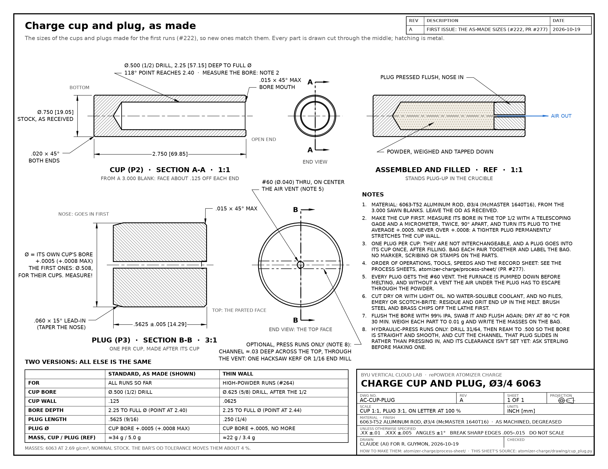

# Shop drawing: charge cup and plug, as made



[PDF](cup_plug.pdf) (one US-Letter sheet; printed at 100 % the cup is 1:1 and the plug 3:1) · built by
[`cup_plug.py`](cup_plug.py)

This drawing is for the cups and plugs as they were made for the first runs, so that new ones match them. How to make
them (order of operations, tools, speeds, and a record sheet that carries each cup's bore to its plug) is in the
[process sheets](../process-sheet/), and the two agree on every size. The drawing on
PR [#232](https://github.com/vertical-cloud-lab/byu-vcl/pull/232) (`cad/drawings/charge_parts.pdf`) is the earlier
design: a 2.500" cup 1.875" deep and a .375" plug.

## Where each number comes from

| | Value | Source |
| --- | --- | --- |
| Bar | 3/4" 6063-T52, McMaster [1640T16](https://www.mcmaster.com/1640T16/), OD as received | #222, #232 |
| Blank | 3.000" | the sawn blanks, #277 |
| Cup length | 2.750", both ends faced | Gage, [#222](https://github.com/vertical-cloud-lab/byu-vcl/issues/222) |
| Cup bore | 1/2" drill, 2.25" deep to full diameter, so the 118° point reaches 2.40" | Gage, #222; depth convention below |
| Plug length | .5625" (9/16") | Ronnie, #222 |
| Plug diameter | its own cup's measured bore + .0005" (+.0008" max); the first ones were .508" for their cups | #222; "aim for .0005" from #232's Oct 7 composition-spread notes |
| Vent | #60 (.040") through, on center | #222 |
| Nose lead-in, top break, bore-mouth break, outside chamfers | .060" × 15°, .015" × 45° max, .015" × 45° max, .020" × 45° | #232's design (`charge_cad.py`), process sheets |
| Optional channel (press runs) | about .03" deep across the top, through the vent: one hacksaw kerf or a 1/16" end mill | #248, `../presentation/clips.py`, process sheets |
| Thin-wall version | 5/8" drill, same depth, .250" plug, +.0005" only | #232, `composition_spread.py`; #264 |
| Cleaning and contamination notes | cut dry or with light oil, no files or abrasives, IPA flush, dry at 80 °C | #232 README (Edison, Oct 7) |

## Assumed, or still open

- **The 2.25" depth is to full diameter**, so the drill point reaches 2.40" (2.44" for the 5/8" drill). That's the
  drawing convention, #232's CAD, and what the process sheets drill to. Gage's note says "2.25 in (cone-shaped end)"
  without saying which way he measured. If his depth was to the point, the first cups are .15" shallower, with about
  0.8 g less room for powder. Cups are filled by weight, so a run isn't affected, but keep a run's cups from one batch.
- **The press-run (sliding) plug has no clearance yet**, so the drawing gives only the bore finish and the channel
  for that version, and says to ask before making one.
- **Masses** in the table are for nominal stock. The bar's OD tolerance (±.014") moves them by about 4 %.

## Rebuilding

```bash
pip install matplotlib
python cup_plug.py      # writes cup_plug.pdf and cup_plug.png
```
