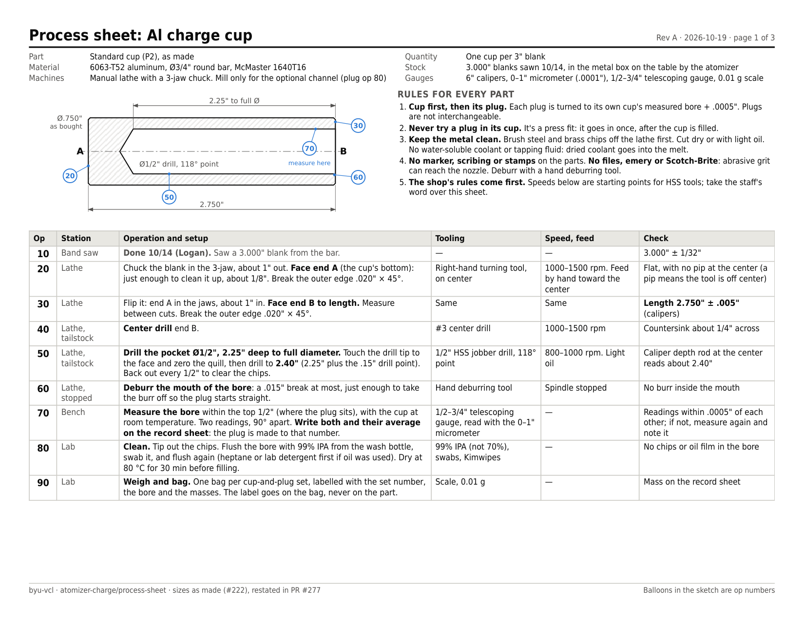
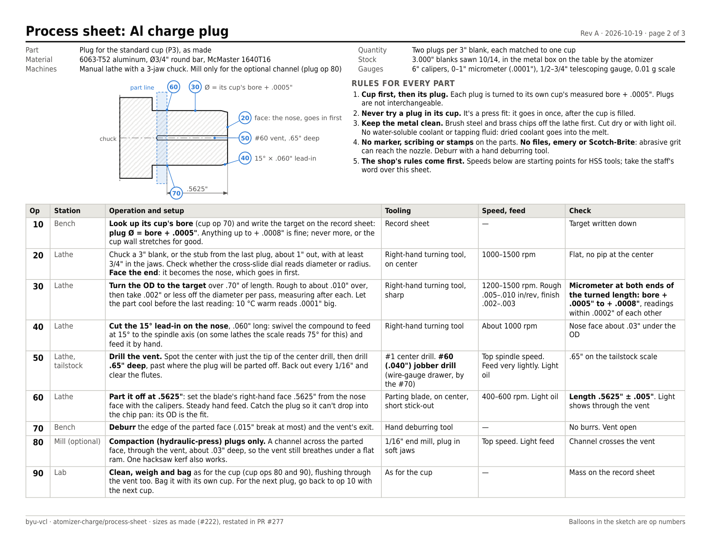

# Process sheets: Al charge cup and plug

Generated by [`process_sheet.py`](process_sheet.py), rev A, 2026-10-19. Print [`process_sheet.pdf`](process_sheet.pdf) (Letter, landscape) for the shop; this page is the same content for reading on a phone.

- **Material:** 6063-T52 aluminum, Ø3/4" round bar, McMaster 1640T16
- **Stock:** 3.000" blanks sawn 10/14, in the metal box on the table by the atomizer
- **Machines:** Manual lathe with a 3-jaw chuck. Mill only for the optional channel (plug op 80)
- **Gauges:** 6" calipers, 0–1" micrometer (.0001"), 1/2–3/4" telescoping gauge, 0.01 g scale

## Rules for every part

1. **Cup first, then its plug.** Each plug is turned to its own cup's measured bore + .0005". Plugs are not interchangeable.
2. **Never try a plug in its cup.** It's a press fit: it goes in once, after the cup is filled.
3. **Keep the metal clean.** Brush steel and brass chips off the lathe first. Cut dry or with light oil. No water-soluble coolant or tapping fluid: dried coolant goes into the melt.
4. **No marker, scribing or stamps** on the parts. **No files, emery or Scotch-Brite**: abrasive grit can reach the nozzle. Deburr with a hand deburring tool.
5. **The shop's rules come first.** Speeds below are starting points for HSS tools; take the staff's word over this sheet.

## Cup (P2, as made): one per 3" blank

| Op | Station | Operation and setup | Tooling | Speed, feed | Check |
|---|---|---|---|---|---|
| 10 | Band saw | **Done 10/14 (Logan).** Saw a 3.000" blank from the bar. | — | — | 3.000" ± 1/32" |
| 20 | Lathe | Chuck the blank in the 3-jaw, about 1" out. **Face end A** (the cup's bottom): just enough to clean it up, about 1/8". Break the outer edge .020" × 45°. | Right-hand turning tool, on center | 1000–1500 rpm. Feed by hand toward the center | Flat, with no pip at the center (a pip means the tool is off center) |
| 30 | Lathe | Flip it: end A in the jaws, about 1" in. **Face end B to length.** Measure between cuts. Break the outer edge .020" × 45°. | Same | Same | **Length 2.750" ± .005"** (calipers) |
| 40 | Lathe, tailstock | **Center drill** end B. | #3 center drill | 1000–1500 rpm | Countersink about 1/4" across |
| 50 | Lathe, tailstock | **Drill the pocket Ø1/2", 2.25" deep to full diameter.** Touch the drill tip to the face and zero the quill, then drill to **2.40"** (2.25" plus the .15" drill point). Back out every 1/2" to clear the chips. | 1/2" HSS jobber drill, 118° point | 800–1000 rpm. Light oil | Caliper depth rod at the center reads about 2.40" |
| 60 | Lathe, stopped | **Deburr the mouth of the bore**: a .015" break at most, just enough to take the burr off so the plug starts straight. | Hand deburring tool | Spindle stopped | No burr inside the mouth |
| 70 | Bench | **Measure the bore** within the top 1/2" (where the plug sits), with the cup at room temperature. Two readings, 90° apart. **Write both and their average on the record sheet**: the plug is made to that number. | 1/2–3/4" telescoping gauge, read with the 0–1" micrometer | — | Readings within .0005" of each other; if not, measure again and note it |
| 80 | Lab | **Clean.** Tip out the chips. Flush the bore with 99% IPA from the wash bottle, swab it, and flush again (heptane or lab detergent first if oil was used). Dry at 80 °C for 30 min before filling. | 99% IPA (not 70%), swabs, Kimwipes | — | No chips or oil film in the bore |
| 90 | Lab | **Weigh and bag.** One bag per cup-and-plug set, labelled with the set number, the bore and the masses. The label goes on the bag, never on the part. | Scale, 0.01 g | — | Mass on the record sheet |

## Plug (P3, as made): two per 3" blank

| Op | Station | Operation and setup | Tooling | Speed, feed | Check |
|---|---|---|---|---|---|
| 10 | Bench | **Look up its cup's bore** (cup op 70) and write the target on the record sheet: **plug Ø = bore + .0005"**. Anything up to + .0008" is fine; never more, or the cup wall stretches for good. | Record sheet | — | Target written down |
| 20 | Lathe | Chuck a 3" blank, or the stub from the last plug, about 1" out, with at least 3/4" in the jaws. Check whether the cross-slide dial reads diameter or radius. **Face the end**: it becomes the nose, which goes in first. | Right-hand turning tool, on center | 1000–1500 rpm | Flat, no pip at the center |
| 30 | Lathe | **Turn the OD to the target** over .70" of length. Rough to about .010" over, then take .002" or less off the diameter per pass, measuring after each. Let the part cool before the last reading: 10 °C warm reads .0001" big. | Right-hand turning tool, sharp | 1200–1500 rpm. Rough .005–.010 in/rev, finish .002–.003 | **Micrometer at both ends of the turned length: bore + .0005" to + .0008"**, readings within .0002" of each other |
| 40 | Lathe | **Cut the 15° lead-in on the nose**, .060" long: swivel the compound to feed at 15° to the spindle axis (on some lathes the scale reads 75° for this) and feed it by hand. | Right-hand turning tool | About 1000 rpm | Nose face about .03" under the OD |
| 50 | Lathe, tailstock | **Drill the vent.** Spot the center with just the tip of the center drill, then drill **.65" deep**, past where the plug will be parted off. Back out every 1/16" and clear the flutes. | #1 center drill. **#60 (.040") jobber drill** (wire-gauge drawer, by the #70) | Top spindle speed. Feed very lightly. Light oil | .65" on the tailstock scale |
| 60 | Lathe | **Part it off at .5625"**: set the blade's right-hand face .5625" from the nose face with the calipers. Steady hand feed. Catch the plug so it can't drop into the chip pan: its OD is the fit. | Parting blade, on center, short stick-out | 400–600 rpm. Light oil | **Length .5625" ± .005"**. Light shows through the vent |
| 70 | Bench | **Deburr** the edge of the parted face (.015" break at most) and the vent's exit. | Hand deburring tool | — | No burrs. Vent open |
| 80 | Mill (optional) | **Compaction (hydraulic-press) plugs only.** A channel across the parted face, through the vent, about .03" deep, so the vent still breathes under a flat ram. One hacksaw kerf also works. | 1/16" end mill, plug in soft jaws | Top speed. Light feed | Channel crosses the vent |
| 90 | Lab | **Clean, weigh and bag** as for the cup (cup ops 80 and 90), flushing through the vent too. Bag it with its own cup. For the next plug, go back to op 10 with the next cup. | As for the cup | — | Mass on the record sheet |

## Record sheet

Page 3 of the PDF: one row per set, carrying each cup's bore over to its plug. Columns: Set; Cup length (2.750 ± .005); Bore depth at center (2.40); Bore Ø reading 1; Bore Ø reading 2; Bore Ø average; Plug target Ø (average + .0005); Plug Ø as turned (both ends); Plug length (.5625 ± .005); Cup mass, g; Plug mass, g; Made by, date.

## Variants: change only these ops

- **Thin-wall cup.** For the 22.5 and 30 wt% points of the 4047 spread. Cup op 50 with a **5/8" drill** (1/2" first as a pilot), same 2.25" depth (2.44" on the quill): a .060" wall that holds about 16 g. Its plug is **.250" long**, not .5625", with the same + .0005" fit.
- **Compaction set.** For the hydraulic-press runs. Cup op 50 with a **31/64" drill, then a 1/2" chucking reamer** to full depth (300–500 rpm, steady feed, light oil; never turn a reamer backwards), so the bore is smooth and straight. Its plug is a **sliding fit**, not a press fit, and the clearance isn't decided yet: ask Sterling before turning one. Then plug op 80.
