# 2026-10-08 run: what the videos show

Three phone videos of one run, uploaded unlisted to the BYU Vertical Cloud Lab channel
on 2026-10-08 around 17:25 MDT and posted on
[#261](https://github.com/vertical-cloud-lab/byu-vcl/issues/261). The operator narrates
throughout, and says at the start that this is their first run on the atomizer alone.

| Video | Length | What it covers |
| --- | --- | --- |
| [pt1 `bWkP5YcsJTc`](https://youtu.be/bWkP5YcsJTc) | 26:08 | Start-up, from the ultrasonic check through purges at room temperature, 250 °C and 500 °C, following Gage's checklist on a phone. The recording was paused during waits, so video time is not elapsed time. |
| [pt2 `dTyuZmqYxHA`](https://youtu.be/dTyuZmqYxHA) | 4:30 | The pour, already under way when the video starts: the viewport, an ultrasonic re-scan and restart, draining the rest of the melt, and shutdown. |
| [results `KTJzug0D0mA`](https://youtube.com/shorts/KTJzug0D0mA) | 0:28 | The chamber, opened after the run. |

Where they come from and how they were read: [`../README.md`](../README.md). The narration
is in [`transcript.md`](transcript.md), with every line linked to its moment in the video.

## Summary

- **The melt dripped but didn't atomize.** pt2 opens with *"it's dripping perfect, but it's
  not atomizing at all"* ([0:00](https://youtu.be/dTyuZmqYxHA?t=0)). Gage, reached by phone,
  wasn't sure why either.
- **The stream landed at the plate's tip or fell past it.** Through the viewport, a thin,
  broken stream falls past the tip of the ultrasonic plate, where a lump of aluminium had
  already frozen, and carries on down into the white cup below.
- **The only spray comes off that lump.** At [2:08–2:10](https://youtu.be/dTyuZmqYxHA?t=128)
  the stream lands on the lump and a fan of droplets leaves its underside. That is the only
  spray in about 75 s of viewport footage.
- **The ultrasonic panel reads POWER 0 W throughout**, at 92 % and at 100 % amplitude. The
  operator saw 0 W at the cold check too and treated it as normal. The footage can't say
  whether that readout ever rises above 0 W.
- **Oxygen was slow to come down.** It took at least three gas washes at 500 °C. The
  narration gives 60–70 ppm, then about 45, then 25–26 ppm, against a target in the low
  20s. What the O2 was when the pour started isn't recorded.
- **After the run**, a solid puddle of aluminium sits in the white cup, and a little fine
  powder is spread over the cone and the collection port. Most of the charge likely froze
  rather than atomized, but only weighing the puddle, the lump and the powder will say.
- **This is the third run in a row where the pour failed at the plate.** On Oct 2 the
  pour pressure was too high and the plate too far away, and on Oct 6 the stream hit the
  upper sonotrode. The trainer's advice is to put a slow stream high on the plate's face and to
  check where it will land before heating. See [Compared with earlier
  runs](#compared-with-earlier-runs).
- **Why it pooled instead of atomizing: too little amplitude for a plate the melt had not
  yet wetted.** Ronnie's notes give the set-up: carbon-fibre plate, 1.5:1 (reverse) booster,
  0.19 bar. The reverse booster leaves the plate about two thirds of the 1:1 amplitude; the
  trainer warned that this is where atomization can stop altogether, and a carbon-fibre
  plate, unlike molybdenum, only wets once it is hot and vibrating hard enough to break the
  melt's oxide skin. Every 1.5:1 run so far has dripped. Bartosz has since put it as two
  rules: CF plates "only work with 1:1,5 booster" and "require high initial flow to heat
  up". See [Why it didn't atomize: amplitude and plate
  material](#why-it-didnt-atomize-amplitude-and-plate-material).

## The pour (pt2)

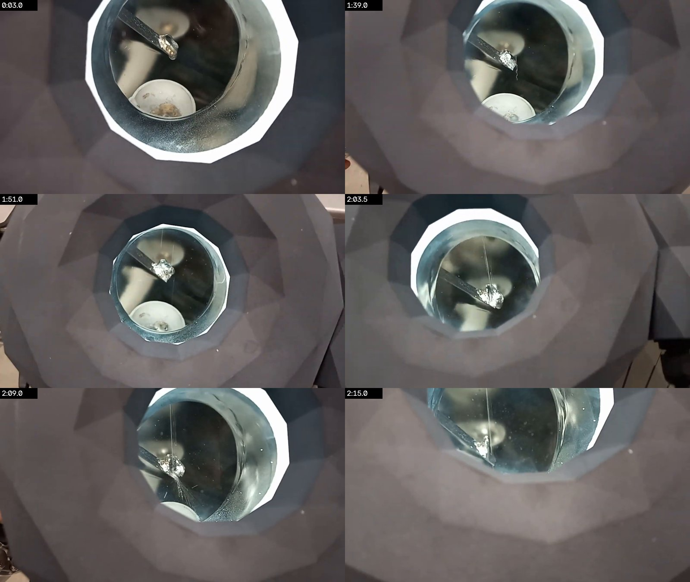

*Viewport frames from pt2 at 0:03, 1:39, 1:51, 2:03.5, 2:09 and 2:15. The dark bar from
the upper left is the plate. The bright crumpled lump is aluminium frozen onto its
tip. The thin vertical line is the melt stream. The white cup below catches what falls past.*

**The lump was there before the footage starts.** At [0:03](https://youtu.be/dTyuZmqYxHA?t=3) it
already sits on the plate's tip. It is still there at the end, and every view of the
stream shows it landing on or beside the lump, never on the plate's open face.

**The stream falls past the plate.** At 1:50–1:52 the stream comes and goes from frame to
frame, which is the dripping the operator describes. When it shows, it passes just to the
right of the lump and carries on below it toward the cup, with no spray:

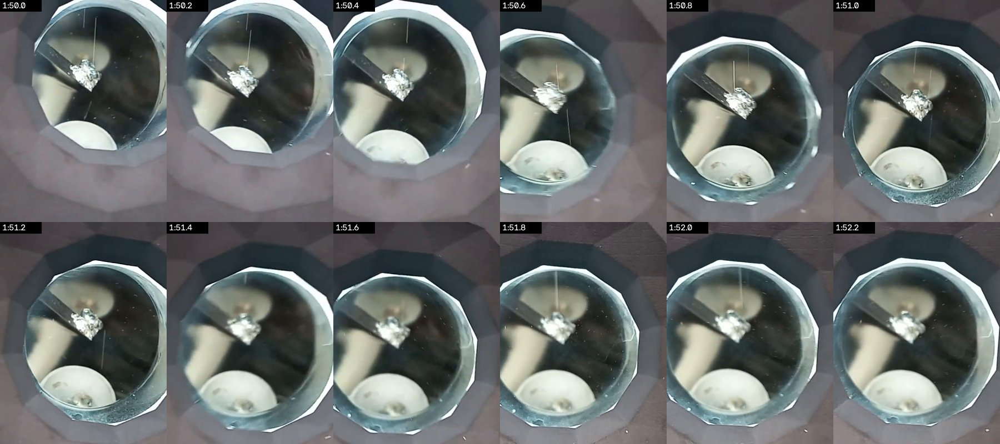

**When it lands on the lump, there is spray.** At 2:08–2:10 the stream is continuous and hits
the lump. A fan of fine streaks, droplets thrown off and drawn into lines by the exposure,
leaves the lump's underside and lower edge. The narration segment that starts at
[1:33](https://youtu.be/dTyuZmqYxHA?t=93) includes *"Oh, that's kind of cool"*:

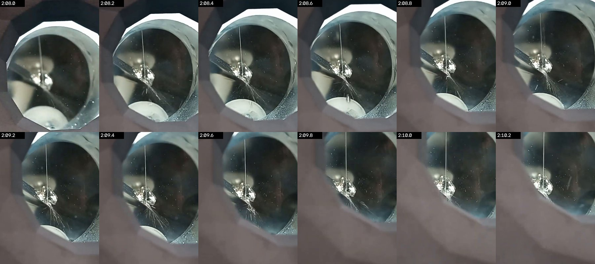

The footage can't tell whether that spray is the plate atomizing melt through the lump
or just the stream splashing off it. Either way, what it shows going wrong is delivery: the
stream was thin and intermittent, and it landed at or beyond the plate's tip rather than
on its face. The checklist (below) covers this in its step *"Check plate if it is in the
right position to catch the aluminum stream"*. A stream that misses the plate's face is
also what went wrong in run 1, where it landed on the upper sonotrode.

**Ultrasonic settings, read off the panel** ([0:36–1:27](https://youtu.be/dTyuZmqYxHA?t=36)):

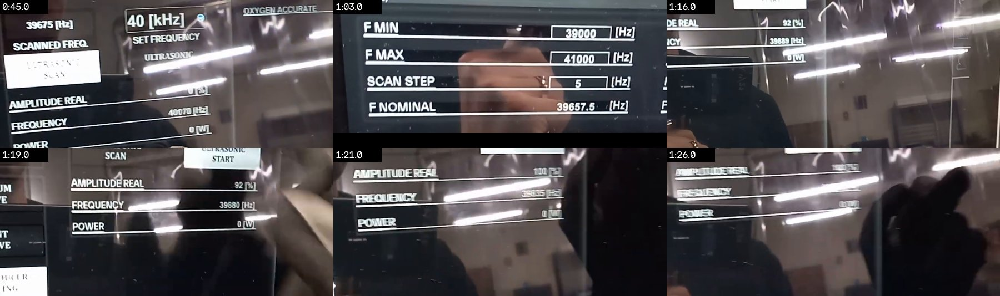

| Reading | Value | Video time |
| --- | --- | --- |
| Ultrasonic scan, done with Transducer Cooling on | scanned 39 675 Hz, set 40 kHz | 0:45 |
| Scan window | 39 000–41 000 Hz in 5 Hz steps, F nominal 39 657.5 Hz | 1:03 |
| After Ultrasonic Start | amplitude real 92 %, 39 889 then 39 880 Hz, **0 W** | 1:16, 1:19 |
| Amplitude raised to 100 % (*"instead of 92"*) | amplitude real 100 %, about 39.6–39.9 kHz (blurred), **0 W** | 1:21, 1:26 |

Before the start, the panel showed 40 070 Hz at 0 % amplitude (0:45). The running
frequency, 39.88 kHz at 92 %, is about 200 Hz above the scanned resonance.

## Start-up (pt1)

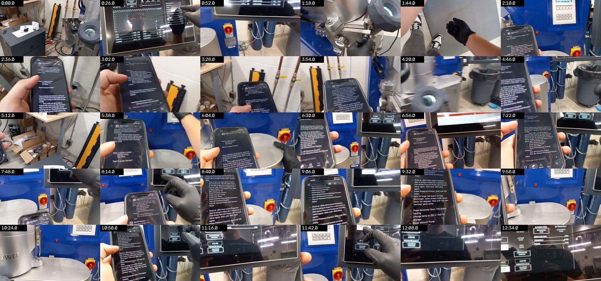
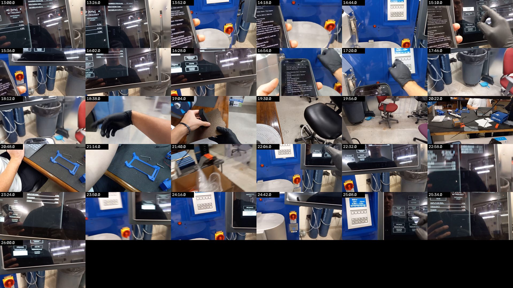

| Video time | What happens |
| --- | --- |
| [0:00](https://youtu.be/bWkP5YcsJTc?t=0) | Ultrasonic scan, *"one peak, one valley"*, then Ultrasonic Start: 0 W both times. |
| [0:39](https://youtu.be/bWkP5YcsJTc?t=39) | The aluminium was already loaded by Gage. Booster chosen and sonotrode assembled before the video ([2:13](https://youtu.be/bWkP5YcsJTc?t=133)). Chamber closed, plate oriented. |
| [2:52](https://youtu.be/bWkP5YcsJTc?t=172) | Chilled water opened about 20°. Compressed air already open. |
| [4:47](https://youtu.be/bWkP5YcsJTc?t=287) | The red switch at the back turned on, and the green light is on. |
| [5:31](https://youtu.be/bWkP5YcsJTc?t=331) | First purge at room temperature: vacuum pump and gas wash. |
| [5:45](https://youtu.be/bWkP5YcsJTc?t=345) | **W081 "pressure crucible" warning.** Gage, by phone, said it was all right. |
| [7:48–10:38](https://youtu.be/bWkP5YcsJTc?t=468) | Unsure of the step order until the right note turns up. Then Pressure Control, Vacuum Pump, Gas Wash, Melting Pressure, Pressure Control off, Vacuum Pump and Vacuum Valve. |
| [10:52–12:37](https://youtu.be/bWkP5YcsJTc?t=652) | Down to −850 mbar, argon (Protective Gas) for a couple of seconds, back to −850 mbar, then Pressure Control to 150 mbar. |
| [13:00, 13:26](https://youtu.be/bWkP5YcsJTc?t=780) | Panel: 141 then 151 mbar, 32 °C, **O2 1000 then 816 ppm** (below). |
| [13:31](https://youtu.be/bWkP5YcsJTc?t=811) | Generator Start, setpoint 250 °C, then the second purge (recording paused during the gas wash). |
| [16:49](https://youtu.be/bWkP5YcsJTc?t=1009) | Setpoint 500 °C, then the third purge. At 17:20 the phone's clock reads 4:38. |
| [21:44–22:55](https://youtu.be/bWkP5YcsJTc?t=1304) | Vacuum, back at −850 mbar, Pressure Control. |
| [23:10](https://youtu.be/bWkP5YcsJTc?t=1390) | *"It is dropping a lot again, so I think just needed to do one more gas wash"*, then the setpoint goes to 850 °C. Waiting for O2 to reach 20: *"it's chilling at 25, that's not low 20"*. |
| [24:10](https://youtu.be/bWkP5YcsJTc?t=1450) | *"This is my third gas wash on 500 degrees C, because the oxygen PPM was stuck at 60, so it was at 70, I did it again, it was at like 45, and now it's on 26, but I guess we need low 20."* The operator notes that in past runs one cycle was enough. |
| [24:56–26:08](https://youtu.be/bWkP5YcsJTc?t=1496) | Last gas wash, Melting Pressure, vacuum, Pressure Control. *"We'll come back once it's getting close."* |

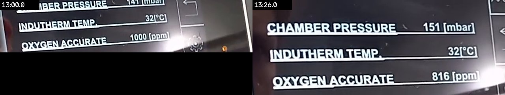

The 1000 ppm at 13:00 is the display's maximum (trainer, Video 1 25:03 in the
[#255 notes](https://github.com/vertical-cloud-lab/byu-vcl/blob/88eeace/atomizer-training/notes/groupA.md)), not a measurement. For comparison, run 1 (Oct 6)
logged 19 ppm at the start and 140 ppm at the end.

## After the run (results short)

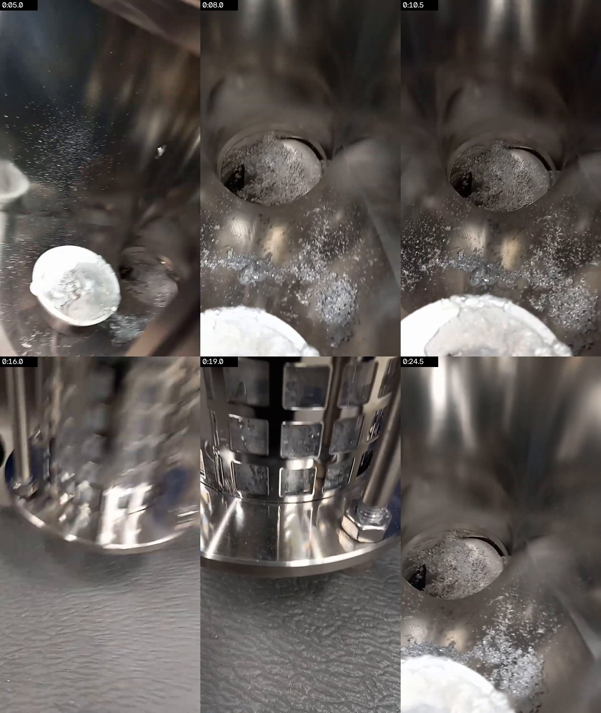

*"Look how weird it looks inside… it looks like there's a little [bit] that was atomized.
And even down here, it happened."* The white cup holds a solid puddle of aluminium
(0:05), presumably the stream that fell past the plate. Fine bright powder is
spread over the cone and around the collection port (0:08–0:11, 0:24), and deposits sit
on the windows of a slotted cylinder (0:19). The training SOP in
[#255](https://github.com/vertical-cloud-lab/byu-vcl/pull/255) has a step to *"collect,
bag, and mark metal splashes"*, and doing the same here, weighing each part separately,
gives a mass balance for this run.

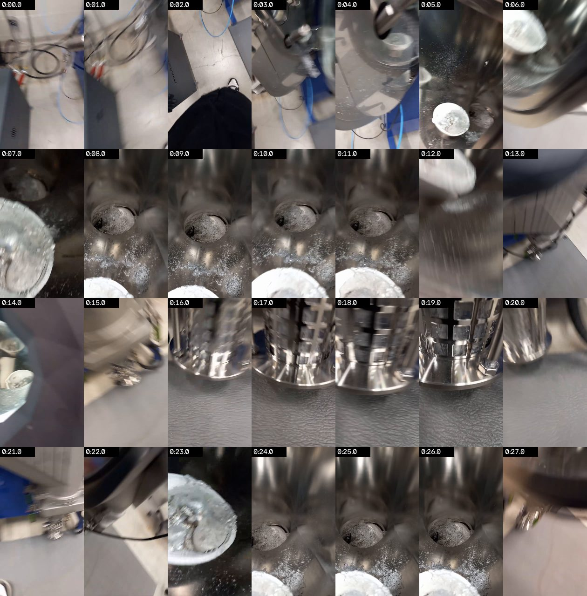

## The checklist on the phone

The operator works from Gage's notes in a Slack message. Transcribed from the frames
(pt1 8:40 and 9:32, pt2 4:22); words in brackets were too blurred to read with confidence.

> Once material and ultrasonic system are prepared and loaded: Do 1 purge at room temp,
> then 1 purge at 250, then 1 purge at 500.
> - First, make sure green light in bottom left corner is on. Flip red switch that is to
>   the left of light gray control panel to turn on. May need to be flipped twice. (Triple
>   check, if red switch is up, green light should be on)
> - Press Pressure Control
> - Press Vacuum Pump
> - Press Gas Wash
> - Once finished press Melting Pressure
> - Turn off Pressure Control
> - Turn on Vacuum Pump and Vacuum Valve
> - Once at -850 mbar press Protective Gas to bring in argon for a second or 2, then press
>   Vacuum Pump and Vacuum Valve again. Wait until -850 mbar again.
> - Press Pressure Control. Wait until 150 mbar.
> - Turn on large red switch on heat exchanger. Open chilled water valves about 20 degrees.
>   Wait until "low flow warning" goes away.
> - Press Generator Start. This begins heating
> - Change temp to 250 C. Wait for change.
> - Press Vacuum Pump
> - Press Gas Wash
> - Once gas wash is finished press Melting Pressure
> - Then turn off Pressure Control
> - Press Vacuum Pump and Vacuum Valve to purge chamber. Wait until -850 mbar
> - Once finished press Pressure Control, wait for 150 mbar
> - Change temp to 500 C, wait for […]
>
> […] Check plate if it is in the right position to catch the aluminum stream. Use
> [Turbo Pump, which the training videos call turbo pressure] as needed to 1. Increase flow onto the plate to initiate atomizing,
> 2. Correct stream direction, 3. Push out nozzle in case of clog (especially when at the
> end of the atomizing run). Once finished, press Sealing Rod, Melting Pressure, Generator
> Stop, and Ultrasonic Start (to turn off ultrasonic). Then also turn off Transducer
> Cooling. Then turn temperature down to 250 C (the Generator Stop button turns it off,
> changing the temp is just prep for the next run.) Wait until ~400 C, then safe for
> graphite to be exposed to oxygen. (Above 500 C causes higher oxidation to graphite)
> Turn off […]

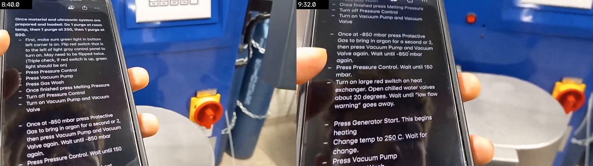
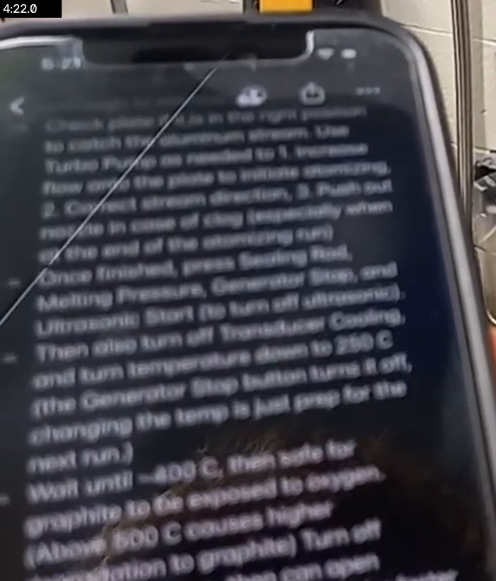

The steps between *"wait for"* at 500 °C and *"Check plate"* (the melt and the pour
itself, including the 850 °C setpoint, the graining pressure and when to start the
ultrasonics) aren't legible in any frame.

## Compared with earlier runs

The transcript notes for the training and Oct 2 videos, in
[#255](https://github.com/vertical-cloud-lab/byu-vcl/pull/255) at `88eeace`, show the same
kind of failure before:

| Run | What went wrong with the pour | Source |
| --- | --- | --- |
| Sep 30, training video 9 | *"Nice atomization on the top of the plate, but at the bottom the material gathers and stops the atomization, so it drips un-atomized"* (21:07) | [groupC.md](https://github.com/vertical-cloud-lab/byu-vcl/blob/88eeace/atomizer-training/notes/groupC.md) |
| Oct 2, part 2 | *"Most of it did not get atomized."* The 0.17 bar pour pressure *"was definitely too high"*, and *"the plate needed to be a lot closer so [it] had more time to run down it"* (27:00–27:33) | [groupD.md](https://github.com/vertical-cloud-lab/byu-vcl/blob/88eeace/atomizer-training/notes/groupD.md) |
| Oct 6, run 1 | The stream landed on the upper sonotrode; little powder | [#261](https://github.com/vertical-cloud-lab/byu-vcl/issues/261#issuecomment-6025960787) |
| Oct 8 | The stream landed on a frozen lump at the plate's tip, or fell past it, and dripped without atomizing | this page |

In each of the last three runs, the most visible problem was where and how the melt met
the plate. The trainer's guidance in the same notes:

- **A thin stream is fine.** *"A very thin stream or single droplets would atomize stably"*,
  and the ideal is a slow drip or slow stream (Video 9, 20:51 and 24:12). So the dripping
  on Oct 8 wasn't the problem in itself; where it landed was.
- **Pour high on the plate.** In Video 3 the follow-up to *"some of it is dropping"* is to
  pour higher on the plate (43:05), and wider or longer Mo plates are recommended for
  aluminium (47:28).
- **Check the landing point before heating**, for example with a laser pointer down the pour
  path (Video 8, 09:53, an idea raised in training).
- **0 W is the normal idle reading** (Oct 2 pt1, 21:09). None of the notes say what POWER
  reads during a pour.
- **Oxygen**: don't work above 100 ppm, and 40–50 ppm is best (Video 1, 25:03). On Oct 2 a
  single wash at 500 °C reached the low 20s.

For the repeatability runs in #261 this argues for fixing the landing point first: the
same spot on the plate's face, checked before heating. In a run where the melt misses the
plate, the spread between runs measures the alignment, not the process.

## Why it didn't atomize: amplitude and plate material

Ronnie's notes on the run
([#261](https://github.com/vertical-cloud-lab/byu-vcl/issues/261#issuecomment-6088484430))
fill in what the footage can't: a **carbon-fibre plate**, the **1.5:1 booster** (the
1:1.5 booster mounted the other way round, which lowers the amplitude), a graining
pressure of **0.19 bar**, three Al rods of about 5 in, and powder bag `kj0461`. The melt
"just landed on the plate, building up and dripping off", and Bartosz told the team
afterwards that "atomizing with the 1.5:1 booster and carbon fiber plates doesn't work".
On 2026-10-13 he gave it as two rules, by WhatsApp
([relayed on #268](https://github.com/vertical-cloud-lab/byu-vcl/pull/268#issuecomment-6157392044)):
"the carbon fiber plates only work with 1:1,5 booster. Otherwise the amplitude is too low.
They also require high initial flow to heat up." Both match what he did in training, and
what the literature has to say about each is in [Bartosz's two rules, and the articles
behind them](#bartoszs-two-rules-and-the-articles-behind-them).
The training videos, AMAZEMET's own papers and patents, and the literature say why, and
they say the two causes are coupled: the reverse booster cut the vibration below what
this delivery needed, and a carbon-fibre plate depends on that vibration (and on heat)
to be wetted at all.

### The combination was new, but the dripping was not

| Run | Charge | Plate | Booster | Slider | Pour | What happened | Source |
| --- | --- | --- | --- | --- | --- | --- | --- |
| Sep 29, T5 | Al 4047 rod | bare CF | 1:1.5 | not recorded | stream | first drops lost heating the plate, then "every single piece is getting atomized"; large uniform powder | [T5 61:12](https://youtu.be/58wJ_Khwgyk?t=3672) |
| Sep 29, T2 | Al 4047 rod | CF (inferred) | 1:1.5 (inferred) | not recorded | stream | at first "it's gathering, it's not atomizing, the plate cannot heat up"; Bartosz poured more and it recovered | [T2 20:29](https://youtu.be/naePD8o9_Gk?t=1229) |
| Sep 29, T3 | Al 4047 rod | Mo alloy | 1:1 | ~90 | stream, pressure lowered | plate cracked; "some of it is dropping"; better after a piece broke off | [T3 43:05](https://youtu.be/txH397FGTAU?t=2585) |
| Sep 30, T9 (`8rthq2`) | AlSi10Mg in a 6063 cup | "bad Mo" / W–Ni–Fe | **1.5:1** | not recorded | stream, "too fast" | "the flow is actually too much for this low amplitude"; atomized at the top of the plate, gathered at the bottom and dripped | [T9 20:33](https://youtu.be/9kn-HhXCr1o?t=1233) |
| Oct 2 (`u23y78`) | Al 4047 powder in a 6063 cup | pure Mo | **1.5:1** | 90 | 0.17 bar, shot out | "most of it did not get atomized"; pressure too high, plate too far | [pt2 27:11](https://youtu.be/of5-LhkX_VQ?t=1631) |
| Oct 6, run 1 | 180 g Al 6063 | small CF | 1:1 | 50 (not set) | 0.2 bar | stream hit the upper sonotrode; vibration started late; little powder | [#261](https://github.com/vertical-cloud-lab/byu-vcl/issues/261#issuecomment-6028651764) |
| Oct 8 (`kj0461`) | 3 Al rods | CF | **1.5:1** | 92 → 100 | 0.19 bar, slow drips | froze on the tip, built up, dripped; a little fine powder | this page |

Plate and booster for the trainer's runs are from the [#255](https://github.com/vertical-cloud-lab/byu-vcl/pull/255)
SOP's *Known runs* table at `88eeace`; the team's runs from
[#249](https://github.com/vertical-cloud-lab/byu-vcl/issues/249) and #261. Oct 8 was the
first run on CF with the reverse booster, so "1.5:1 + CF doesn't work" had not been tested
before. But the table also shows that **no 1.5:1 run has atomized most of its melt yet**,
on any plate, including the one Bartosz ran himself. By his 2026-10-13 rule, Oct 6 run 1
(CF at 1:1, slider 50) was under-amplitude too, although its stream also hit the upper
sonotrode. The two CF runs on the amplifying booster atomized (T2's set-up is inferred),
and the two CF runs without it did not.

### Amplitude: the reverse booster took the plate below what this delivery needed

- **What the booster does.** The one physical booster gives 150 % of the transducer's
  amplitude one way up and, reversed, "1.5 to 1 … 75 % of the normal amplitude" as said
  ([T7 23:23](https://youtu.be/FDRTt68Vfvo?t=1403)); 1/1.5 is 67 %. The slider on the panel is
  a separate, electrical control, "percentage of the set power from the generator … how much
  current you're actually giving to the transducer" ([T7 23:41](https://youtu.be/FDRTt68Vfvo?t=1421)).
  On Oct 8 the slider was already at 92 % and went to 100 % at
  [pt2 1:17](https://youtu.be/dTyuZmqYxHA?t=77); a 9 % current step does not recover a 33 %
  mechanical cut, and there was no headroom left.
- **What the trainer said about low amplitude.** Lower amplitude "means smaller particles
  but the atomization is slower, more sensitive, more fragile"
  ([T3 39:27](https://youtu.be/txH397FGTAU?t=2367)); 80–90 on the slider "is like the best.
  Lower means that there is a chance that there will be like no atomization suddenly because
  the vibrations could be too weak" ([T3 40:15](https://youtu.be/txH397FGTAU?t=2415)); and
  "if you go like all the way down, there may be like too little atomization that the
  material will be flowing through" ([T3 39:06](https://youtu.be/txH397FGTAU?t=2346)).
  "Not every material can be atomized with really no amplitude"
  ([T5 09:25](https://youtu.be/58wJ_Khwgyk?t=565)). The reverse booster is the fine-powder
  recipe, and it comes with conditions: "you need to have good pouring … slow enough that
  there is not too much material" ([T5 08:57](https://youtu.be/58wJ_Khwgyk?t=537)); "if you
  want to go with the reverse booster you want to know your material"
  ([T9 21:27](https://youtu.be/9kn-HhXCr1o?t=1287)); his best reverse-booster run reached
  90 % conversion only "with a very well controlled pouring"
  ([T9 23:08](https://youtu.be/9kn-HhXCr1o?t=1388)). And the remedy when it is not atomizing
  is the opposite of what the booster does: "you will need to go higher amplitude just even
  by the slider" ([T9 45:20](https://youtu.be/9kn-HhXCr1o?t=2720)).
- **His own reverse-booster run showed the Oct 8 picture in a milder form.** On the wide Mo
  plate on Sep 30: "The flow is actually too much for this low amplitude, that's why we are
  losing some. Because the atomization is very very slow … we have nice atomization
  especially on the top part, but in the bottom the material gathers and stops the
  atomization, so nothing at the bottom gets atomized, that's why it is dropping down"
  ([T9 20:33](https://youtu.be/9kn-HhXCr1o?t=1233)). He chose the wider Mo plate for that run
  precisely because at the lowest amplitude "we definitely need more time to wet"
  ([T3 49:35](https://youtu.be/txH397FGTAU?t=2975)). The Oct 8 lump sat at the plate's tip,
  the end with the least plate below it.
- **The physics behind the warning.** AMAZEMET's own description of the process: "the main
  principles of this technology are based on amplitude and surface wettability. When the
  threshold vibrational amplitude in the liquid layer wetted to the sonotrode is exceeded,
  standing capillary waves are generated (Lierke et al., 1967). Further increasing the
  amplitude disrupts the internal forces of the liquid, thereby ejecting small droplets"
  ([amazemet.com/repowder](https://amazemet.com/repowder/), read on the Pi 2026-10-13).
  Below that threshold a melt film just sits, spreads or runs off. Priyadarshi, Choma,
  Żrodowski and co-workers, in the 2024 mechanism paper written with AMAZEMET's CF plate,
  state that "the continuous ultrasonic atomization of Al melts needs sufficient ultrasonic
  vibration amplitude owing to its low density and rapid oxidation", and measured how
  uneven the plate's amplitude is: at 20 kHz, 6–16 µm null-to-peak at the antinodes and
  2–8 µm at the nodes along the plate; glycerol could not be atomized on the plate at all
  and needed a horn with three times the amplitude "effectively surpassing the atomization
  threshold" ([Additive Manufacturing 83, 104033](https://doi.org/10.1016/j.addma.2024.104033),
  open-access copy via [Brunel](https://bura.brunel.ac.uk/handle/2438/28349)). So an
  amplitude cut of a third is not a small change: it can take the melt from above the
  threshold to below it, and where on the plate the stream lands moves it further.
- **A side effect to keep in view.** With the reverse booster "the frequency tends to be
  lower, so it gets under 40" ([T7 41:47](https://youtu.be/FDRTt68Vfvo?t=2507)). On Oct 8 the
  scan found 39 675 Hz and the stack ran at about 39.88 kHz, within the normal spread. The
  panel's 0 W is still unexplained; logging the generator's power output
  ([#221](https://github.com/vertical-cloud-lab/byu-vcl/issues/221)) would say whether the
  plate was loaded at all.

### Material: a carbon-fibre plate has to be wetted, and that takes heat and vibration

- **Wetting is the mechanism, not a detail.** "You need the specific conditions to get the
  wetting. Wetting means that the material is having kind of connection to the plate so that
  the vibrations can go through. If it's just like a droplet sitting on it, it will bounce.
  If it's wetting, the vibrations will go through … it ends up in the droplets being released
  from the surface" ([T2 24:16](https://youtu.be/naePD8o9_Gk?t=1456)). "You lose a droplet,
  but the plate heats up, the material wets it, and everything else is atomizing very
  quickly" ([T2 23:39](https://youtu.be/naePD8o9_Gk?t=1419)).
- **CF versus Mo for aluminium, in the trainer's words.** Bare carbon fibre is "good for
  aluminum" ([T9 38:43](https://youtu.be/9kn-HhXCr1o?t=2323)): "aluminium sticks to it very
  well, it wets it, like penetrates it a little bit, and atomization is perfect"
  ([T5 11:53](https://youtu.be/58wJ_Khwgyk?t=713)). Molybdenum is "right now … the best
  option for aluminium", because "Molybdenum and aluminium, they will react at some point …
  the same reactivity that helps us to get a good wetting and good atomization start"
  ([T3 10:18](https://youtu.be/txH397FGTAU?t=618)); the "golden standard for most trials"
  ([T9 40:48](https://youtu.be/9kn-HhXCr1o?t=2448)). And on heat: "Metal plates will heat up
  faster. They are very thin. They will heat up in one spot"
  ([T2 24:00](https://youtu.be/naePD8o9_Gk?t=1440)); the first droplets are "needed to heat up
  the plates" ([T5 61:24](https://youtu.be/58wJ_Khwgyk?t=3684)). So the two plates reach the
  wetted state by different routes: Mo by a chemical reaction that starts as soon as melt
  touches it, CF by a reaction that needs a hot plate and a vibrating, oxide-free interface.
- **AMAZEMET's patent says the same, more bluntly.** EP4192985B1, on composite waveguides
  for atomization: a sonotrode surface must be kept "above the melting temperature of the
  alloy, otherwise the crystallization of the alloy progresses on its surface"; a carbon or
  SiC matrix "is characterized by the low wettability by a majority of non-carbide forming
  metals … however it does not suit for ultrasound atomization, when the wettability of the
  waveguide surface is a determining factor of correctness of a process"; and metallic
  coatings (Ti, Nb, Ta, Re, W, Mo, Ir) are there because "increasing wettability of the
  waveguide to liquid metals … is critical in a case of ultrasound atomization"
  ([EP4192985B1](https://patents.google.com/patent/EP4192985B1/en)). Aluminium *is* a
  carbide former (it makes Al₄C₃ at the interface), which is the only reason a bare CF plate
  works for it; that reaction is what the trainer calls "penetrates it a little bit", and it
  is slow and thermally activated.
- **Where CF has worked for aluminium, the feed was strong and continuous.** Singh et al.
  (Johns Hopkins, AMAZEMET system, CFC plate, 60 kHz, 800 °C) opened the sealing rod and
  ramped the furnace from 150 to 850 mbar over 50 s: "In the initial moments, spattering was
  observed due to insufficient wetting of the CFC surface; however, stable atomization was
  quickly established once proper wetting was achieved", with 80–90 % yield
  ([arXiv:2510.06446](https://arxiv.org/abs/2510.06446)). Priyadarshi et al. poured pure Al at
  800 °C onto a CF plate at 60 kHz with a 200 mbar differential (about 50 cm³/min) and got
  "atomization started instantly … all material was atomized", finer at 60 % input power
  (8.55 µm) than at 100 % (9.9 µm). So a modest amplitude on CF can work once the plate is
  wetted and fed steadily, at least at 60 kHz; the paper doesn't say which booster the stack
  had. On Oct 8 the feed was "slow
  steady drips" at 0.19 bar: too little melt, too slowly, to warm the plate's tip, which the
  trainer's remedy for a gathering stream anticipates: "pour more"
  ([T2 20:29](https://youtu.be/naePD8o9_Gk?t=1229)), and use the turbo at the start, which
  "helps to heat up the plate more at the very beginning"
  ([T2 19:44](https://youtu.be/naePD8o9_Gk?t=1184)).
- **Why amplitude and wetting are the same problem.** Molten aluminium carries an oxide
  skin, and it is cavitation in the vibrating film that strips it and lets the melt spread
  on a non-wetting surface. In ultrasonic-assisted soldering, where that effect is used on
  purpose, the liquid spreads only where the acoustic pressure is above the cavitation
  threshold, and a non-cavitating rim at the spreading front keeps its oxide and stops
  spreading ([Li et al. 2022](https://doi.org/10.1016/j.ultsonch.2021.105893), read on the Pi
  from [PMC](https://www.ncbi.nlm.nih.gov/pmc/articles/PMC8799618/)). Cutting the amplitude by a third therefore does two things at once on a
  CF plate: it lowers the chance of atomizing a film that is wetted, and it lowers the
  chance of the film becoming wetted in the first place. On Mo the reaction supplies the
  wetting without that help, which is why the trainer's 1.5:1 runs went on Mo, and why the
  same booster that merely slowed atomization on Mo stopped it on CF.

### The sequence on Oct 8, as the evidence reads

1. The reverse booster set the plate to about two thirds of the 1:1 amplitude, with the
   slider already near its top.
2. The first drips landed at the plate's tip, cold, and froze there: the lump is in place
   before the footage starts ([pt2 0:03](https://youtu.be/dTyuZmqYxHA?t=3)). The patent's
   "crystallization progresses on its surface" and the trainer's "lost to heating the plate".
3. Slow drips at 0.19 bar carried too little heat to warm a CF plate that, unlike thin Mo,
   does not "heat up in one spot", so the lump grew instead of melting back: Ronnie's
   "building up and dripping off".
4. Without wetting there was no coupling, and the melt that did touch the plate's face at
   the reduced amplitude sat below the threshold, gathered and ran off: the T9 picture
   ("the material gathers and stops the atomization … dropping down"), without the
   atomizing top half.
5. 92 → 100 % on the slider ([pt2 1:17](https://youtu.be/dTyuZmqYxHA?t=77)) could not make up
   the difference. The only spray in the footage comes off the lump at
   [2:08](https://youtu.be/dTyuZmqYxHA?t=128).

### Bartosz's two rules, and the articles behind them

No published paper states either rule, and none compares CF with Mo plates, or one booster
with another (the Edison precedent search below found no such comparison either). The
rules are a practitioner's knowledge of this machine. What the literature gives is the
mechanism behind each rule, and one paper that partly cuts against both. Quotes were
checked in each source's full text, except one marked as abstract-only (2026-10-13).

**"The carbon fiber plates only work with 1:1,5 booster. Otherwise the amplitude is too
low."**

- **Aluminium needs amplitude to begin with.** "The continuous ultrasonic atomization of Al
  melts needs sufficient ultrasonic vibration amplitude owing to its low density and rapid
  oxidation of Al droplets" (Priyadarshi et al. 2024, above). An AlSi12 study on a 35 kHz
  ATO Lab+ adds that "higher amplitudes improve efficiency, while lower values can halt the
  atomization process entirely" ([Yankin et al. 2025, Sci. Rep. 15, 20524](https://doi.org/10.1038/s41598-025-06086-7)).
  That is a general statement: they tested only 75–80 % and report no failed run.
- **A carbon-composite plate absorbs vibration that a metal plate passes on.** AMAZEMET's
  patent application on composite waveguides: composites are normally avoided for
  sonotrodes "due to a high damping resulting from an interaction between the fiber and
  the matrix", and theirs "is also characterized by relatively high loss … at an expense of
  a higher loss power - dissipated during an elastic strain during the work"
  ([WO2022034517A1 ¶0021](https://patents.google.com/patent/WO2022034517A1/en), the
  application behind EP4192985B1). So for the same stack, expect less amplitude at a CF
  plate's surface than at a metal one's.
- **A bare carbon plate needs that vibration to be wetted at all.** AMAZEMET's 2026 paper on
  C/C plates for a 40 kHz rePowder: "as-fabricated C/C is typically ill suited to prolonged
  contact with molten metals: (i) it is weakly wettable by many alloys"
  ([Choma et al., Materials 19, 2803](https://doi.org/10.3390/ma19132803)); in the patent,
  a niobium coating on a composite plate doubled atomization efficiency by making it
  wettable. For aluminium on carbon fibre, "the infiltratability of the alloys was
  proportional to the maximum intensity of the acoustic cavitation"
  ([Matsunaga et al. 2006, J. JILM 56, 226](https://doi.org/10.2464/jilm.56.226),
  abstract-only). Cavitation has a threshold (Li et al. 2022, above), so a weaker plate
  wets less, or not at all.
- **The slider can't make up for the booster.** Priyadarshi et al. measured their CF plate
  at 60 kHz: 9.9 µm at 100 % input power, 9 µm at 75 %, 8.55 µm at 60 %. Cutting power by
  40 % cut the amplitude by 14 %, so the 92 → 100 % step on Oct 8 bought a few percent
  against the reversed booster's 33 % cut.
- **Against it:** that same CF plate atomized pure Al completely at 8.55 µm. But that was at
  60 kHz, where capillary-wave break-up needs less amplitude than at 40 kHz, and the paper
  doesn't name the booster. Nobody has measured what our CF plate reaches in µm at 1:1.5,
  1:1 and 1.5:1. That measurement, or AMAZEMET's figure for it, is what would turn the rule
  into a number.

**"They also require high initial flow to heat up."**

- **A cold plate freezes the melt.** "It is required to maintain a temperature of a
  sonotrode surface above the melting temperature of the alloy, otherwise the
  crystallization of the alloy progresses on its surface"
  ([EP4192985B1](https://patents.google.com/patent/EP4192985B1/en) ¶0003). That is the
  lump on the Oct 8 tip.
- **Aluminium doesn't wet carbon under ordinary conditions.** "Under the temperature and
  atmosphere conditions normally used in practice, liquid metals (Cu, Al, etc.) do not wet
  ionocovalent ceramics such as alumina, silicon carbide or graphite"
  ([Eustathopoulos 2015, Metals 5, 350](https://doi.org/10.3390/met5010350), §4.1). Bare CF
  is wetted only through the reaction that heat and cavitation drive, so it needs both.
- **Published CF start-ups lose material until the plate wets.** Singh et al. (AMAZEMET
  system, CFC plate, 60 kHz): "In the initial moments, spattering was observed due to
  insufficient wetting of the CFC surface; however, stable atomization was quickly
  established once proper wetting was achieved", and flakes over 300 µm "are commonly
  generated during the initial stages of ultrasonic atomization due to incomplete droplet
  breakup or wetting of the sonotrode surface"
  ([arXiv:2510.06446](https://arxiv.org/abs/2510.06446)). Their flow was continuous and
  rising: the melt-side pressure went from 150 to 850 mbar over 50 s.
- **AMAZEMET's own published start-up uses a burst.** Choma et al. (rePowder, 40 kHz, coated
  C/C plates, CuSn8): "a short 'turbo' boost of 1.5 bar was applied at initiation to ensure
  a clean, stable metal outflow before reverting to the 0.6 bar set-point". The reason
  given is the nozzle, not the plate, but it is the practice Bartosz describes: the turbo
  "helps to heat up the plate more at the very beginning"
  ([T2 19:44](https://youtu.be/naePD8o9_Gk?t=1184)).
- **Against it:** Priyadarshi et al. got atomization that "started instantly (to the naked
  eye)" on a CF plate at 200 mbar (a "slow pouring" of about 50 cm³/min), close to Oct 8's
  0.19 bar. But their melt was pure Al at 800 °C, 140 °C above its melting point, as a
  continuous stream from a 0.5 mm nozzle at 60 kHz; Oct 8 delivered drips. What that run
  shares with Bartosz's rule is a steady supply of heat to the plate from the first second.
- **Not published:** how fast a CF plate heats compared with a thin Mo one. Bartosz's reason,
  that metal plates "are very thin, they will heat up in one spot"
  ([T2 24:00](https://youtu.be/naePD8o9_Gk?t=1440)), turns on plate thickness, and no paper
  reports these plates' heat-up.

### What it means for the repeatability runs

- **Fix the amplitude before varying anything else, and pick it by plate.** The
  low-amplitude recipe is the fragile one, and it has not yet worked for this team on any
  plate. Bartosz's rule is that CF works only with the amplifying 1:1.5 booster, and in
  training he kept that booster off metal plates because "they crack"
  ([T5 9:39](https://youtu.be/58wJ_Khwgyk?t=579)). So for the fixed-settings runs in #261,
  run CF at 1:1.5 or Mo at 1:1, slider 80–90, the configurations the trainer ran reliably.
  Go to 1.5:1 for fine powder only on Mo, and only once the pour is repeatable.
- **Treat the plate's first seconds as a heating step.** Start with a strong flow high on
  the face (CF plates "require high initial flow to heat up"), let the first drops go, and
  use the turbo at the start. A drip-fed CF plate never gets there.
- **Two measurements would turn this from argument into data:** the generator's power
  output during the pour (0 W or not), and a mass balance (lump, puddle, powder, crucible).
- **The test that would settle "CF versus Mo"** is the one nobody has published (see the
  Edison precedent search below): same charge, nozzle and pressure, CF at 1:1.5 against Mo
  at 1:1 (each on the booster Bartosz runs it with), then Mo at 1.5:1.

### Literature search (Edison Scientific)

Four queries, submitted 2026-10-13 19:48 UTC; answers and full trajectories in
[`edison/`](edison/), task ids in [`edison/_task_ids.json`](edison/_task_ids.json).

| Query | Job | Answer |
| --- | --- | --- |
| What decides atomize-versus-pool for a melt on a vibrating plate: amplitude threshold, feed rate, wetting of CF versus Mo, plate temperature; numbers for aluminium | `LITERATURE_HIGH` | [q1](edison/q1-amplitude-threshold-and-wetting-al-ultrasonic-atomization-answer.md) |
| Does molten aluminium wet carbon? Contact angle versus temperature and time, Al₄C₃, oxide skin; compared with molybdenum and the Mo–Al intermetallics | `LITERATURE` | [q2](edison/q2-molten-aluminium-wetting-carbon-vs-molybdenum-answer.md) |
| Minimum amplitude or acceleration for ultrasonic atomization and what a film does below it; amplitude versus throughput and the flooding regime | `LITERATURE` | [q3](edison/q3-minimum-amplitude-for-ultrasonic-atomization-of-liquid-metals-answer.md) |
| Has anyone reported aluminium pooling or dripping off a sonotrode, or compared carbon and Mo plates? | `PRECEDENT` | [q4](edison/q4-precedent-carbon-vs-mo-sonotrode-aluminium-answer.md) |

What came back before the Edison platform went down (every endpoint has answered 503 since
about 20:15 UTC on 2026-10-13, and still did at 23:36 UTC; q1 and q2 had reported `success`
by then, q3 was still running) is the precedent search, kept as a [partial copy](edison/q4-precedent-carbon-vs-mo-sonotrode-aluminium-answer.md):

- **Nobody has published a controlled carbon-versus-Mo (or Ti) plate comparison for
  aluminium**, on an ATO, a rePowder or a research rig.
- **The nearest published "it dripped instead of atomizing"** is Jedynak et al. 2024
  (AlSi9Mg–SiC on a rePowder and an ATOLab+): too much melt for the ultrasonic system, so
  "much of the melt fell off in large drops without atomizing"; 40 kHz gave about twice the
  efficiency of 60 kHz because it allowed "higher ultrasonic parameters".
- **Lierke and Griesshammer 1967**, the paper AMAZEMET cites for the threshold, found droplet
  rupture at roughly 3–6 times the amplitude at which surface waves first appear, and that a
  poorly wettable cover on the resonator lets melt drop off it instead of atomizing; they
  prescribed a preheated atomizing surface.
- Singh et al. 2026 and the AMAZEMET patent, as quoted above.

To finish the search once the API is back: `python atomizer-runs/edison_tools.py fetch
atomizer-runs/2026-10-08/edison` writes the four answers and their full trajectories; the
task ids are in `_task_ids.json`.

### Sources read with the Pi browser

The CubXL Pi now has Chromium (installed for this; see `CLAUDE.md`). Run headless over
SSH it found, through DuckDuckGo, the AMAZEMET page and patent, the 2024 mechanism paper,
the AlSi12 parameter study ([Sci. Rep. 2025](https://www.nature.com/articles/s41598-025-06086-7),
where amplitude was the least influential of three parameters over 75–80 %), the Singh
et al. preprint and the ultrasonic-soldering paper above, and fetched the Nature, arXiv,
PMC, patent-office and AMAZEMET pages. Google Scholar and ScienceDirect both answered it
with a CAPTCHA: the Pi's address is BYU campus, not residential, and a headless browser is
easy to detect. MDPI blocks the runner but not Europe PMC, which is where the 2021
cold-crucible paper came from. Nothing from the Pi's fetches is committed beyond what is
quoted here; the pages are reproducible from the links.

## Not in the footage

Nothing shows the pour starting. Ronnie's notes
([#261](https://github.com/vertical-cloud-lab/byu-vcl/issues/261#issuecomment-6088484430))
supply the booster (1.5:1), the plate (carbon fibre), the graining pressure (0.19 bar), the
charge (three Al rods, about 5 in each) and the powder ID (`kj0461`). Still unknown for
this run: when the sealing rod opened, the O2 and melt temperature at that moment, the
charge mass, and what the ultrasonic panel's POWER read with melt on the plate.

## What would make the next run's video more useful

- **Film the viewport from before the sealing rod opens until the stream stops**, with the
  phone held still or clamped, so the stream's landing point and the start of atomization
  can be timed.
- **Point the camera at the panel's POWER readout while melt is on the plate.** If it stays
  at 0 W even while powder is being made, the readout means nothing. If it rises, then 0 W
  during this pour says no melt was loading the plate.
- **Say the O2, temperature, graining pressure and amplitude out loud when the pour
  starts**, or show them on the panel, so they're in the record.
- **Weigh the lump on the plate, the puddle in the cup, the powder and what is left in the
  crucible**, so each run has a mass balance and a yield.
