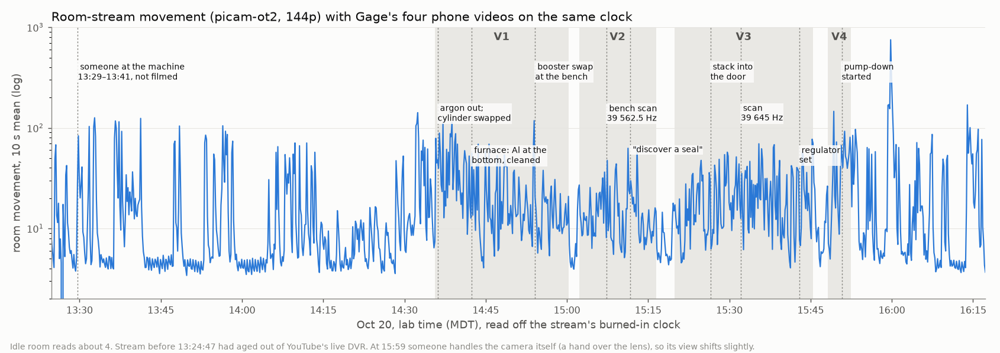
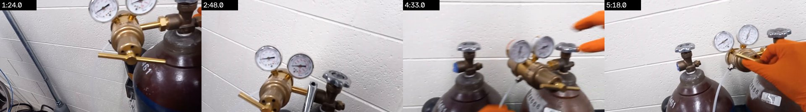
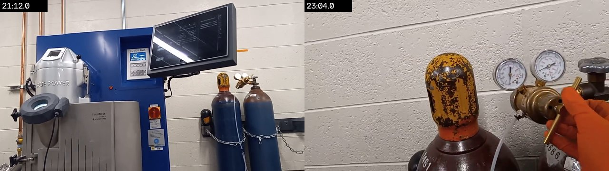
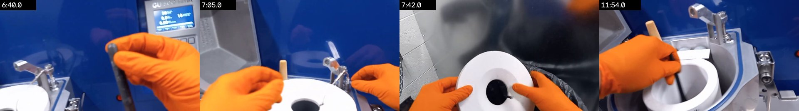
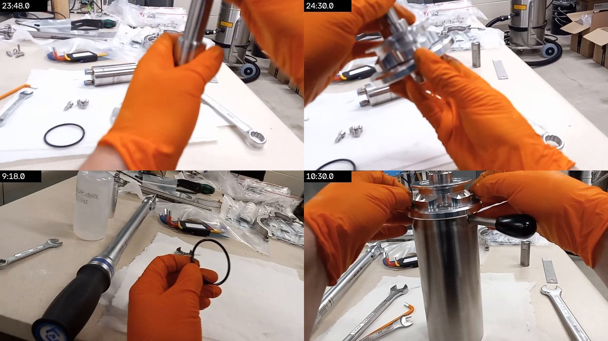
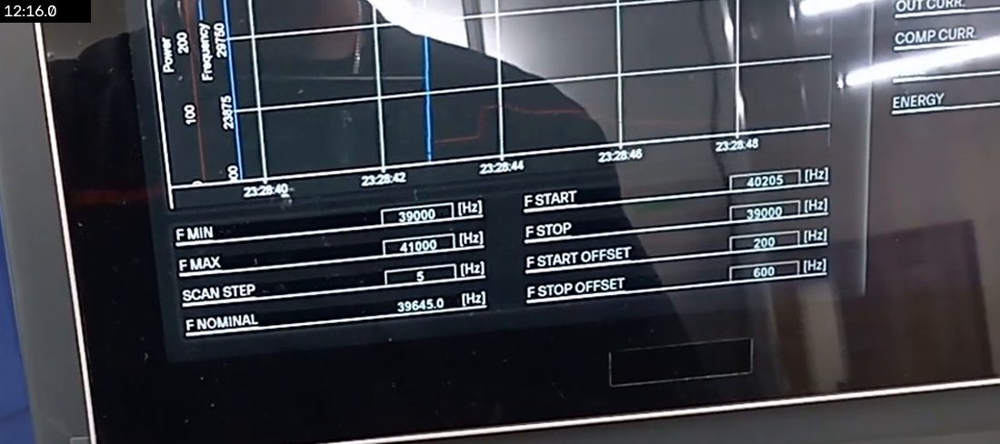
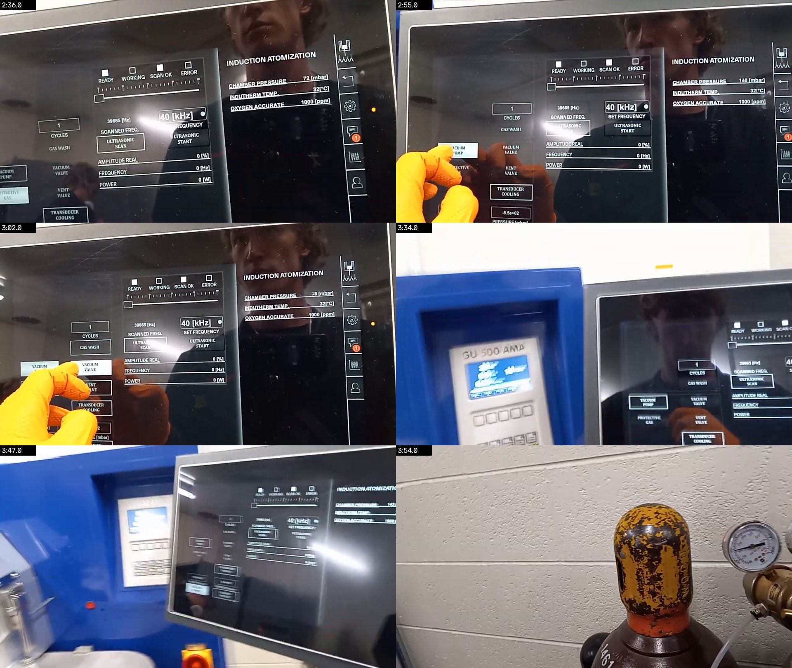

# 2026-10-20: set-up only, run deferred to Oct 21

Gage spent the afternoon setting the atomizer up and ran out of time before a run. By
15:51 MDT it was loaded and ready for Oct 21
([#261](https://github.com/vertical-cloud-lab/byu-vcl/issues/261)). He filmed it on a
collar phone in four videos, uploaded unlisted to the lab channel at 15:56–15:59 MDT. This
page places them on the wall clock using the room stream (`picam-ot2`, pixelated 144p),
and checks the set-up against the trainer-derived SOP and Gage's daily SOP. Both are on
[PR #276](https://github.com/vertical-cloud-lab/byu-vcl/pull/276):
[`sop.md`](https://github.com/vertical-cloud-lab/byu-vcl/blob/8981f5c/atomizer-training/sop.md) and
[`daily-sop.md`](https://github.com/vertical-cloud-lab/byu-vcl/blob/8981f5c/atomizer-training/daily-sop.md).
The method is the one used for Oct 6 in
[`runs/2026-10-06.md`](https://github.com/vertical-cloud-lab/byu-vcl/blob/8981f5c/atomizer-training/runs/2026-10-06.md).

Times are lab time (MDT), read off the stream's burned-in clock, to about ±1 s. Video
links open YouTube at that second. The narration is sparse (Gage mostly works without
talking; all of it is in [`transcript.md`](transcript.md)), so most of the timeline is read
off the frames.



## Sources

| | Video | Length | Recorded, MDT | What it shows |
| --- | --- | --- | --- | --- |
| V1 | [10/20/2026 Atomizer set up Video 1](https://youtu.be/7c8iHQInI_A) | 24:46 | 14:35:35–15:00:21 | Argon found empty and the cylinder swapped; furnace inspected and cleaned; stack taken out; booster swap started at the bench |
| V2 | [10/20/2026 Atomizer Set Up Video 2](https://youtu.be/vPhZTvfIu7s) | 14:13 | 15:02:16–15:16:28 | Booster swap continued; bench scan; a housing O-ring found off and refitted |
| V3 | [10/20/2026 Atomizer Set Up Video 3](https://youtu.be/OFS_PLxoV94) | 25:41 | 15:19:50–15:45:30 | Stack torqued, put into the door, plate on, rescanned; rods and furnace; regulator set; powder container wiped and clamped |
| V4 | [10/20/2026 Atomizer Set Up Video 4](https://youtu.be/Ev9WMscAetw) | 4:21 | 15:48:09–15:52:29 | Container valve; argon; the storage closet; cold purge started on the HMI |
| | [`z13xp1AcKag`](https://www.youtube.com/watch?v=z13xp1AcKag), *atomizer stream picam-ot2, 2026-10-20 UTC 19:02* | live until 21:00 | 13:02:47 on | The room from the ceiling, 144p at 2 fps, 128 × 72 blocks ([`docs/stream-cams.md`](../../docs/stream-cams.md#pixelation)). Pulled every 2 s from 13:24:47 to 16:17:33 |
| | [`VSM60ulrHVM`](https://www.youtube.com/watch?v=VSM60ulrHVM), *… 2026-10-20 UTC 11:00* | 7:58:46 | 05:01–13:02 | The same; sampled once a minute from 07:56. The room is empty in every sample |

Before 13:24:47 the afternoon broadcast had already aged out of YouTube's live DVR (about
4 h 50 min deep) when it was pulled at 00:20 UTC, so 13:02–13:24 is missing. It will be in
the archive once the broadcast ends at 21:00 MDT.

## How the times were found

1. **The stream's clock.** The overlay was cropped every 30 s and read with tesseract
   ([`stream_clock.csv`](stream_clock.csv)): 280 of 346 crops are legible and every one gives
   offset 0 = 13:24:46–13:24:47, so there is no step in this stretch.
2. **The phone videos.** The movement of each phone picture was cross-correlated with the
   movement the ceiling camera sees, every 0.5 s (`stream_sync.py align` from PR #276;
   [`alignment.json`](alignment.json)):

   | | Start, MDT | Correlation | Next best | First half / second half alone |
   | --- | --- | --- | --- | --- |
   | V1 | 14:35:35 | 0.46 | 0.23 | same offset ±0.5 s |
   | V2 | 15:02:16 | 0.72 | 0.32 | same |
   | V3 | 15:19:50 | 0.79 | 0.23 | same ±0.5 s |
   | V4 | 15:48:09 | 0.59 | 0.48 | the second half alone prefers 15:40, which falls inside V3, so 15:48:09 is the only consistent start |

3. **Checked against the picture.** At 15:12:58 a second person appears beside the bench
   on the stream, the same second V2 has *"Hey Wesley, how are you?"*
   ([V2 10:42](https://youtu.be/vPhZTvfIu7s?t=642)). Someone is crouched at the argon
   cylinders on the stream from 14:36:58 to 14:42:58, while V1 shows the swap, and seated at
   the bench from 14:54 to 15:22, while V1–V3 show the booster work there.

Review sheets put a phone frame every 15–60 s beside the stream frame of the same instant,
whose burned-in clock can be read in the inset: [V1](review/v1.jpg), [V2](review/v2.jpg),
[V3](review/v3.jpg), [V4](review/v4.jpg).

The HMI's own clock is not usable as-is: its scan plot is stamped 23:28:40–23:28:48 at
[V3 12:16](https://youtu.be/OFS_PLxoV94?t=736) (15:32 MDT), so it reads roughly Central
European time and runs about 3 minutes slow.

## What the footage shows

- **The four steps in Gage's note are all on camera**, in this order: argon (14:36–14:41),
  furnace (14:42–14:50), stack out (14:50–14:53), booster swap (14:54–15:16, then 15:20–15:25),
  stack into the door and plate on (15:27–15:36), rods into the furnace (15:38), and the leak
  (15:43).
- **The leak was found at start-up and chased to the powder container.** After setting the
  regulator, the HMI reads a chamber pressure of 8 then 5 mbar with the −850 mbar *chamber
  prepare* setpoint showing ([V3 23:52](https://youtu.be/OFS_PLxoV94?t=1432)), and Gage says
  *"Definitely a leak in here somewhere"* ([V3 23:58](https://youtu.be/OFS_PLxoV94?t=1438),
  15:43:49). He goes straight under the machine to the powder container's lower valve, wets a
  paper towel from the squeeze bottle on the bench, wipes the container's flange and fittings and clamps them
  ([V3 24:08–25:20](https://youtu.be/OFS_PLxoV94?t=1448)), and tightens the lower clamp again
  at [V4 0:08](https://youtu.be/Ev9WMscAetw?t=8). That points at the container's flange or valve
  seal, but he doesn't say what he found. Whether the chamber then held vacuum is not filmed:
  V4 ends with it at −35 mbar and falling (15:51:11).
- **The argon really was empty.** *"Might be out of argon … I think we're definitely out"*
  ([V1 0:33](https://youtu.be/7c8iHQInI_A?t=33)). The regulator moves from cylinder
  …461 to …866 ([V1 5:18](https://youtu.be/7c8iHQInI_A?t=318)), and the empty one is capped
  and left chained beside it, two cylinders in the booth in all
  ([V3 21:12](https://youtu.be/OFS_PLxoV94?t=1272)). Gage's estimate: *"probably done 10 runs
  … around 10 runs for one argon tank"* ([V1 5:37](https://youtu.be/7c8iHQInI_A?t=337)).
  [`argon.md`](argon.md) reads the cylinder gauge across Sep 30, Oct 6 and Oct 20 and finds the
  runs account for only about two thirds of the cylinder.
- **A seal was left out of the booster housing, and caught.** A black O-ring sits on the bench
  while the housing goes onto the booster ([V1 23:48](https://youtu.be/7c8iHQInI_A?t=1428),
  [24:30](https://youtu.be/7c8iHQInI_A?t=1470)). After the bench scan Gage finds it: *"You know
  what's not good is when you discover a seal. It's supposed to be inside this after you put it
  together"* ([V2 9:27](https://youtu.be/vPhZTvfIu7s?t=567)), and refits it (V2 10:12–13:48).
  That was 15:11–15:16, before the stack went into the door, so it is not the start-up leak,
  but it is the kind of miss that would be one.
- **Something was left stuck in the furnace.** *"Looks like there's some aluminum down at the
  bottom of that thing"*, tweezers did not get it ([V1 6:51](https://youtu.be/7c8iHQInI_A?t=411)),
  then *"Well, that's kind of stuck for now … We'll get it out eventually when we need to"*
  ([V1 11:20](https://youtu.be/7c8iHQInI_A?t=680)), while probing the bottom of the open furnace's
  insulation sleeve with a rod. The frames don't show what is stuck.
- **Something is cracking.** At the open chamber door, just before the plate is torqued:
  *"This one is cracking. I think that means we should get a new one"*
  ([V3 14:06](https://youtu.be/OFS_PLxoV94?t=846), 15:33:56). In frame are the stack, the
  plate and the white catch bowl inside the chamber; which one he means is not clear. If it is
  the Mo plate, the SOP notes a cracked plate may not run twice
  ([T5 72:18](https://www.youtube.com/embed/58wJ_Khwgyk?start=4338)).
- **Three scans, all just under 40 kHz:** F nominal 39 562.5 Hz on the bench
  ([V2 6:36](https://youtu.be/vPhZTvfIu7s?t=396)), 39 645.0 Hz once installed
  ([V3 12:16](https://youtu.be/OFS_PLxoV94?t=736)), scanned 39 665 Hz before the purge
  ([V4 2:36](https://youtu.be/Ev9WMscAetw?t=156)). The SOP says the reverse (1.5:1) booster
  reads under 40 kHz and that this is acceptable for short runs ([T7 41:40](https://www.youtube.com/embed/FDRTt68Vfvo?start=2500)).
- **The charge is not identified on camera.** *"I think we're ready for these rods"*
  ([V3 17:08](https://youtu.be/OFS_PLxoV94?t=1028)); the rods are wiped with a paper towel and
  go into the furnace at [V3 19:00](https://youtu.be/OFS_PLxoV94?t=1140). Their label, number
  and mass are not shown. The repeatability plan is 6063. (In V4, at the storage closet, someone
  asks which jar to take from: *"All 40-47?" — "Yeah, I believe most of them are. It says exactly
  on it if it is or not"* ([V4 2:13](https://youtu.be/Ev9WMscAetw?t=133)). That reads as being
  about the powder jars from the earlier 4047 runs, not the charge.)
  *Update, Oct 21:* Gage's run note gives the charge as 169 g of Al 4047
  ([#261](https://github.com/vertical-cloud-lab/byu-vcl/issues/261#issuecomment-6326014905)), so the
  exchange may have been about the charge after all. See [`../2026-10-21/`](../2026-10-21/README.md).
- **The purge was started at the end, then the room was left.** HMI at
  [V4 2:36–3:02](https://youtu.be/Ev9WMscAetw?t=156): chamber 72 then 140 mbar, then vacuum pump and
  vacuum valve, −35 mbar and falling toward the −850 mbar setpoint; O2 1000 ppm, the display's
  ceiling (air). The stream shows the room empty from 15:53. At 15:59 someone handles the camera
  itself (a hand over the lens), and its view shifts slightly.
- **Before the first video**, someone is at the machine from 13:29 to 13:41. The room is then
  mostly empty until 14:35, with brief movement at 13:56, 14:04 and 14:13–14:30. The morning is
  empty and unchanged in every once-a-minute sample from 07:56 to 13:02.













## The afternoon, minute by minute

| MDT | Where | What |
| --- | --- | --- |
| 13:29–13:41 | stream | Someone at the machine, not filmed |
| 14:35:35 | [V1 0:00](https://youtu.be/7c8iHQInI_A?t=0) | V1 starts, walking into the booth |
| 14:36:08 | [V1 0:33](https://youtu.be/7c8iHQInI_A?t=33) | *"Turn on my air pressure … might be out of argon"* |
| 14:38:02–14:41:19 | [V1 2:27](https://youtu.be/7c8iHQInI_A?t=147) · stream | Cylinder swap, with help from someone who *"used to deliver them"* ([V1 3:03](https://youtu.be/7c8iHQInI_A?t=183)); crouched at the cylinders on the stream |
| 14:41:12 | [V1 5:37](https://youtu.be/7c8iHQInI_A?t=337) | *"around 10 runs for one argon tank"* |
| 14:42:15–14:43:17 | [V1 6:40](https://youtu.be/7c8iHQInI_A?t=400) | Sealing rod out; aluminium at the bottom; insulation off |
| 14:46:54–14:48:30 | [V1 11:19](https://youtu.be/7c8iHQInI_A?t=679) | Brushing out the crucible; *"kind of stuck for now"* |
| 14:50:21 | [V1 14:46](https://youtu.be/7c8iHQInI_A?t=886) | *"17, let's see if this is right … that's going to fit there"*, at the chamber door |
| 14:50:38–14:51:20 | [V1 15:03](https://youtu.be/7c8iHQInI_A?t=903) | At the chamber door, stack coming out |
| 14:54:08–15:00:21 | [V1 18:33](https://youtu.be/7c8iHQInI_A?t=1113) · stream | Booster swap at the bench, seated; O-ring loose on the bench at 14:59:23 |
| 15:02:18 | [V2 0:02](https://youtu.be/vPhZTvfIu7s?t=2) | *"I've got 45 minutes worth of video time"* (phone storage) |
| 15:04:40–15:05:52 | [V2 2:24](https://youtu.be/vPhZTvfIu7s?t=144) | Stack on the floor mat, a wrench on it |
| 15:07:32–15:08:52 | [V2 5:16](https://youtu.be/vPhZTvfIu7s?t=316) | HMI login and bench scan, F nominal 39 562.5 Hz |
| 15:11:34–15:11:46 | [V2 9:18](https://youtu.be/vPhZTvfIu7s?t=558) | The O-ring found: *"discover a seal"* |
| 15:12:58 | [V2 10:42](https://youtu.be/vPhZTvfIu7s?t=642) · stream | A visitor (Wesley); second person on the stream |
| 15:12:28–15:16:04 | [V2 10:12](https://youtu.be/vPhZTvfIu7s?t=612) | Housing refitted on the transducer |
| 15:19:50–15:24:54 | [V3 0:00](https://youtu.be/OFS_PLxoV94?t=0) | Torque wrench at the bench; checks the phone at 15:20:54 |
| 15:26:30–15:30:14 | [V3 6:40](https://youtu.be/OFS_PLxoV94?t=400) · stream | Stack carried in, into the door, clamps and hoses, plate on |
| 15:31:18–15:32:06 | [V3 11:28](https://youtu.be/OFS_PLxoV94?t=688) | Rescan, F nominal 39 645.0 Hz |
| 15:33:56 | [V3 14:06](https://youtu.be/OFS_PLxoV94?t=846) | *"This one is cracking. I think that means we should get a new one"* |
| 15:34:02–15:34:26 | [V3 14:12](https://youtu.be/OFS_PLxoV94?t=852) | Torque wrench on the plate |
| 15:35:50 | [V3 16:00](https://youtu.be/OFS_PLxoV94?t=960) | Torque wrench and an open-end wrench (counter-hold) at the plate |
| 15:36:58 | [V3 17:08](https://youtu.be/OFS_PLxoV94?t=1028) | *"I think we're ready for these rods"* |
| 15:37:50–15:38:50 | [V3 18:00](https://youtu.be/OFS_PLxoV94?t=1080) | Consumables box; rods wiped with a paper towel and into the furnace |
| 15:41:50 | [V3 22:00](https://youtu.be/OFS_PLxoV94?t=1320) | Reads the checklist on the phone |
| 15:42:54–15:43:10 | [V3 23:04](https://youtu.be/OFS_PLxoV94?t=1384) · stream | Regulator and cylinder valve set; crouched at the cylinders on the stream |
| 15:43:42–15:43:44 | [V3 23:52](https://youtu.be/OFS_PLxoV94?t=1432) | HMI: chamber 8, then 5 mbar; O2 1000 ppm (display ceiling) |
| 15:43:49 | [V3 23:58](https://youtu.be/OFS_PLxoV94?t=1438) | *"Definitely a leak in here somewhere"* |
| 15:43:58–15:45:10 | [V3 24:08](https://youtu.be/OFS_PLxoV94?t=1448) | Under the machine at the powder container: towel wetted from the squeeze bottle, flange and fittings wiped, clamped |
| 15:48:09–15:48:54 | [V4 0:00](https://youtu.be/Ev9WMscAetw?t=0) | Seated at the container's lower valve, tightening a clamp |
| 15:50:02–15:50:32 | [V4 1:53](https://youtu.be/Ev9WMscAetw?t=113) | At the storage closet with someone taking material: *"Do you know which jar it's from?" … "All 40-47?" — "Yeah, I believe most of them are"* |
| 15:50:45–15:51:11 | [V4 2:36](https://youtu.be/Ev9WMscAetw?t=156) | HMI: 72 → 140 mbar, vacuum pump, −35 mbar |
| 15:52:29 | | V4 ends; room empty on the stream from 15:53 |
| 15:56–15:59 | YouTube | V1–V4 uploaded |
| 15:59 | stream | Someone handles the camera; view shifts slightly |
| 16:07 | [#261](https://github.com/vertical-cloud-lab/byu-vcl/issues/261#issuecomment-6302852576) | Gage's note posted |

## Spot check against the SOPs

✔ seen on video · ◐ partly, or seen only as shapes on the stream · ✘ not done as written · – not filmed.
Steps are from the trainer-derived [operator checklist](https://github.com/vertical-cloud-lab/byu-vcl/blob/8981f5c/atomizer-training/sop.md#operator-checklist)
and Gage's [daily SOP](https://github.com/vertical-cloud-lab/byu-vcl/blob/8981f5c/atomizer-training/daily-sop.md).

| Step | | Evidence |
| --- | --- | --- |
| Turn on recording cameras | ◐ | 69 min of phone video between 14:35 and 15:52. Not filmed: 13:29–13:41, 15:00–15:02, 15:16–15:19, 15:45–15:48, and whether the chamber held vacuum after the leak fix. The phone was short of space again ([V2 0:02](https://youtu.be/vPhZTvfIu7s?t=2)) |
| Argon on, 5N, regulator at 8 bar; at most two cylinders, not manifolded | ◐ | Empty cylinder found and swapped ✔; two cylinders in the booth, the empty one capped ✔. Purity and the delivery pressure are not legible in any frame. The 8 bar (116 psi) setting needs checking on Oct 21 |
| Water, vacuum pump oil, filters | – | Not filmed |
| Compressed air, power, HMI login | ✔ | *"Turn on my air pressure"* [V1 0:33](https://youtu.be/7c8iHQInI_A?t=33); login [V2 5:30](https://youtu.be/vPhZTvfIu7s?t=330) |
| Furnace: clean, nozzle clear, crucible snug | ◐ | Inspected and brushed out (14:42–14:53). Aluminium at the bottom that tweezers could not reach, and something left *"stuck for now"*. Light through the nozzle not seen. BN coat not seen |
| Booster swap: threads cleaned with IPA, housing seals seated, 65 / 60 N·m in a soft-jawed vise ([T7](https://www.youtube.com/embed/FDRTt68Vfvo?start=1983), [T5 13:30](https://www.youtube.com/embed/58wJ_Khwgyk?start=810)) | ◐ | IPA bottle and a torque wrench on the bench throughout ([V3 1:00](https://youtu.be/OFS_PLxoV94?t=60)). The housing O-ring was left off, then caught and refitted ✔ (above). No vise is in any frame: the transducer stands on the bench, held by hand, and the joints torqued to 65 / 60 are not clearly in frame. Torque values are not said |
| Transducer cover, cable locked, air on | ◐ | Hoses and cable connected at [V3 9:04](https://youtu.be/OFS_PLxoV94?t=544); the cover is not clearly visible |
| Bench scan: one peak, a little over 40 kHz (under 40 is normal with the reverse booster) | ✔ | 39 562.5 Hz on the bench, 39 645.0 Hz installed, 39 665 Hz before the purge |
| Splash disc, door O-ring checked, stack in, both clamps | ◐ | Stack in and clamped (15:27–15:30); the door O-ring check is not seen |
| Plate on at 50 N·m with a counter-hold | ◐ | Plate on at [V3 10:08](https://youtu.be/OFS_PLxoV94?t=608); torque wrench on it at [V3 14:12](https://youtu.be/OFS_PLxoV94?t=852), with an open-end wrench as counter-hold at [V3 16:00](https://youtu.be/OFS_PLxoV94?t=960). The setting is not said or legible |
| Rescan, then wet test over the whole plate | ◐ | Rescan ✔; no wet test seen |
| Plate positioned so the melt lands high, mid-plate | – | Not checked on camera. This is the step that failed on Oct 2, 6 and 8 |
| Clean feedstock, ≤20 mm, 250–300 g, 6063 for the baseline | ◐ | Rods wiped with a paper towel before loading ([V3 19:00](https://youtu.be/OFS_PLxoV94?t=1140)); their alloy, number and mass are not on camera |
| Furnace lid closed, no hiss | – | Not seen clearly |
| Container and seals wiped (with IPA per the SOP), clamped | ✔ | Done in response to the leak, [V3 24:08](https://youtu.be/OFS_PLxoV94?t=1448), [V4 0:08](https://youtu.be/Ev9WMscAetw?t=8) |
| Leak found and fixed before the washes | ◐ | Found from the HMI at 15:43 (*"definitely a leak"*); container seals cleaned and reclamped; the re-test is not filmed |
| Cold wash started | ✔ | [V4 2:36](https://youtu.be/Ev9WMscAetw?t=156), then not filmed |
| Upload videos titled *M/D/YYYY …*, post the parameters in #261 | ✔ | Uploaded 15:56–15:59; note posted 16:07 |

## Why this matters for the repeatability study

- **Set-up variation is run-to-run variation.** Oct 20 changed the tank, the booster, the
  furnace and at least one seal. If Oct 21 is run 1 of the baseline, write down the state of
  each, or the spread across runs will be partly a spread in set-up.
- **The leak goes straight into O2.** O2 has been the slowest thing to bring down (Oct 6
  went from 19 to 140 ppm during the run; Oct 8 needed three gas washes at 500 °C to reach
  25–26 ppm). On Oct 20 the leak showed on the HMI at start-up, before any wash. Record the O2
  after each wash, and at the start and end of the pour.
- **The stack was rebuilt, so the landing point has to be checked again.** Three runs in a
  row (Oct 2, 6, 8) failed where the melt meets the plate, and no landing check is on the
  Oct 20 footage. Before heating, check where the stream will land: high on the plate's face
  and clear of the upper sonotrode (Ø0.785 in × 2.23 in). A laser pointer on the sealing-rod
  line was a trainee's idea that Bartosz called "not very hard"
  ([T5 63:28](https://www.youtube.com/embed/58wJ_Khwgyk?start=3808)).
- **Set-up is eating the run days.** From the first video to the purge was 1 h 15 min, and
  the afternoon started earlier. Bartosz budgets about 1 h per aluminium run including prep
  and cleaning ([T5 21:50](https://www.youtube.com/embed/58wJ_Khwgyk?start=1310)). The
  biggest single block on Oct 20 was the booster swap, 14:54–15:25 including the O-ring redo.

## For the Oct 21 run

Settings to hold, from the plan and the Oct 8 notes:

| Setting | Value |
| --- | --- |
| Alloy | Al 6063: confirm the label on the rods already loaded (not shown on Oct 20) |
| Plate | small Mo |
| Booster | 1.5:1 (reverse) |
| Amplitude | 90 (set it; on Oct 6 it was left at 50) |
| Charge | 250–350 g, weighed |
| Graining pressure | 0.19 bar, as on Oct 8, to see if the slow drip repeats |
| Melt temperature, melt time | 840 °C, 2 min, as on Oct 6, unless changed on purpose. Bartosz's practice on a metal plate is 780–800 °C once the charge has slumped ([T3 38:38](https://www.youtube.com/embed/txH397FGTAU?start=2318)) |

Before the pour:

- [ ] Confirm the loaded rods are 6063, and record their number and mass.
- [ ] Check the nozzle exit for frozen globs, and get out whatever was left stuck in the
      furnace on Oct 20.
- [ ] Wet test the plate, then check the stream's landing point on it.
- [ ] Argon regulator at 8 bar; note the cylinder pressure.
- [ ] Start the ultrasonic system **before** opening the sealing pin (missed on Oct 6).
- [ ] Before the first wash, pump down and check the chamber holds −850 mbar (the Oct 20 leak
      fix was not re-tested on camera). [`argon.md`](argon.md) has a leak-down check for the gas side.
- [ ] Look at whatever was "cracking" on Oct 20 (V3 14:06) and replace it if needed.

During and after:

- [ ] O2 after each wash, and at pour start and end.
- [ ] Film the ultrasonic panel during the pour. On Oct 8 it read POWER 0 W throughout,
      and nobody knows yet whether it reads above 0 W while atomizing.
- [ ] Weigh the powder, any lump on the plate and anything in the cup, to get yield.
- [ ] Then PSD (sieves, #262), SEM sphericity and composition per the plan.

## Open questions for Gage

- The leak at 15:43: was it the powder container's flange or its lower valve, and did the
  chamber hold −850 mbar after reclamping?
- What was stuck in the furnace (V1 11:20), and is it still there?
- What was cracking at V3 14:06: the plate, the catch bowl, or something else?
- Which rods went in (alloy, how many, total mass)?
- What did the regulator read after the swap, and what is the cylinder's purity?
- Who was at the machine at 13:29–13:41, and was the stack torqued in the vise?
- Was the chamber left under vacuum, under argon, or vented overnight?

## Reproducing

Videos: as for Oct 8 ([`../README.md`](../README.md#getting-the-videos) on PR #268), on the
CubXL Pi into `~/ytframes/atomizer-2026-10-20/`, 871 MB. The stream segments are kept beside
them in `~/ytframes/oct20/` (124 MB), with the fetch script as `~/ytframes/live_dvr_fetch.py`.
Nothing else on that Pi was changed: no sudo, no services, the existing `~/.venvs/ytframes`.

Stream: the live broadcast's 144p HLS segments were fetched by media-sequence number on
the same Pi with [`tools/live_dvr_fetch.py`](tools/live_dvr_fetch.py), since a live
broadcast has no archive playlist yet; offset 0 of the joined file is 13:24:47. Once
`z13xp1AcKag` has ended, `wireless-color-sensor/ot2/stream_grab_pi.py`-style archive fetching
works instead and should recover 13:02–13:24.

```bash
cat z13xp1AcKag_sq*.ts > stream.ts           # in sequence order
python stream_sync.py clock  stream.ts stream_clock.csv
python stream_sync.py motion stream.ts stream.npy --grid
python stream_sync.py motion 7c8iHQInI_A.f136.mp4 v1.npy      # and V2–V4
python stream_sync.py align  stream.npy 13:24:47 v1.npy v2.npy v3.npy v4.npy
python timeline.py                           # timeline.png from room_activity_10s.csv
```

[`make_figures.sh`](make_figures.sh) rebuilds the frame figures with `../video_tools.py`.
