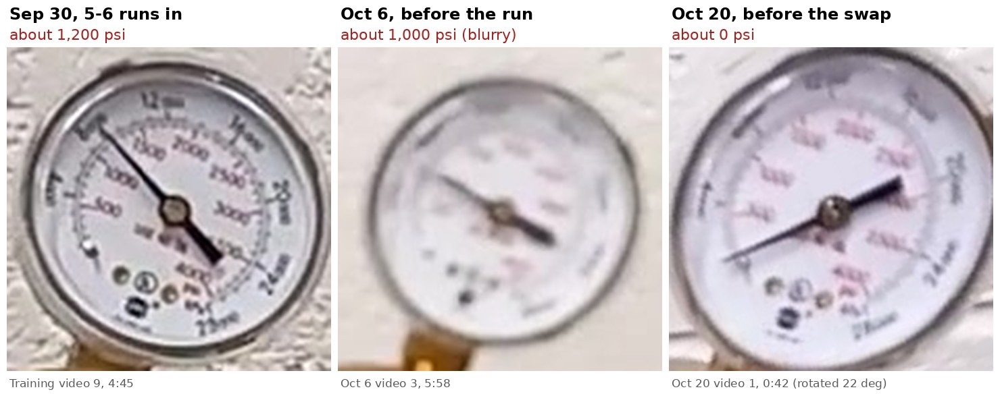

# Was the argon tank empty from use, or from a leak?

Mostly use, but not all of it. The runs used about two thirds of the cylinder. The last
third went during the 12 idle days after Oct 8. The cylinder gauge is visible in three
videos, read here at 720p:

| When | Cylinder gauge | Runs since the previous reading | Used | Per run |
| --- | --- | --- | --- | --- |
| Mon Sep 28 | 2,000 psi, spoken: *"we started at 2000 on Monday"* ([training video 9, 4:28](https://www.youtube.com/watch?v=9kn-HhXCr1o&t=268s)) | | | |
| Wed Sep 30, start of the day's last run | about 1,200 psi ([4:45](https://www.youtube.com/watch?v=9kn-HhXCr1o&t=285s)). The needle sits on the 8 MPa mark, which fits *"just over halfway after five or six atomizer runs"* | 5–6, including commissioning | about 800 psi | 130–160 psi |
| Tue Oct 6, start of the gas wash | about 1,000 psi, ±150 because the frame is blurry ([Oct 6 video 3, 5:58](https://www.youtube.com/watch?v=DWH1CEygsTI&t=358s)) | 2 (the rest of the Sep 30 run, Oct 2) | about 200 psi | about 100 psi |
| Tue Oct 20 | about 0 psi, needle at the stop ([Oct 20 video 1, 0:42](https://youtu.be/7c8iHQInI_A?t=42)). *"Might be out of argon"* (1:03), *"I think we're definitely out"* (1:20) | 2 (Oct 6, and Oct 8 with two extra washes at 500 °C) | about 1,000 psi | |

The upload list on the lab channel has no atomizer runs between Oct 8 and the Oct 20
set-up.

**Expected on Oct 20, from the runs alone:** 1,000 psi less two runs at 100–160 psi, less
roughly 60–100 psi for Oct 8's two extra washes, leaves **about 600–750 psi**. That is
30–37 % of the 2,000 psi fill. The tank was empty instead.

That much gas over 12 days averages only about 0.1–0.15 L/min, assuming a 250 ft³
cylinder (the size in the #41 plan). A leak that small can't be heard. Possible causes:

- **The cylinder valve was left open, and a joint downstream leaks.** That could be the
  regulator inlet nut, the outlet fitting, the T, a 6/4 mm push-fit, or a machine valve
  that doesn't seal fully.
- **The machine was left on with the argon open.** The training videos mention three
  small, continuous flows:
  - the bleed through the O₂ sensor;
  - pressure control topping up the chamber's 150 mbar overpressure, through a leaking
    seal (a seal was found leaking on Oct 20);
  - the argon the furnace lets in when its thermocouple is out
    ([training video 1, 38:19](https://www.youtube.com/watch?v=wRc8p2_FnJo&t=2299)). That
    would apply if the machine was on during the Oct 9 nozzle change.
- **Use that wasn't recorded**, such as a test purge.

## Checks

- **Ask:** was the cylinder valve closed after Oct 8, and after the Oct 9 nozzle change?
  Was the machine left on?
- **Leak-down test on the new cylinder, before the next run.**
  - With the machine off, open the cylinder valve to pressurise the regulator, then close
    it and note the gauge.
  - Check the gauge again after an hour, or the next morning. If it has dropped, put
    leak-detection fluid on each joint.
  - Repeat with the machine on and idle, to see whether the machine itself bleeds.
- **Log the cylinder gauge at the start and end of every run.** Write down the new
  cylinder's starting pressure as the first entry. At 100–160 psi a run, a drop between
  runs stands out.
- **Close the cylinder valve at the end of every run day**, as the SOP's shutdown step
  says.

**For planning:** at 100–160 psi a run, a 2,000 psi cylinder lasts roughly 11–18 runs.
That assumes the regulator can no longer hold 8 bar somewhere below about 200 psi.

The readings are by eye from phone video and are good to about ±100 psi. The per-run
rate rests on only two intervals.
