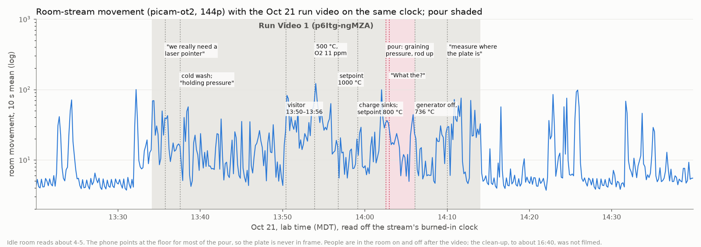
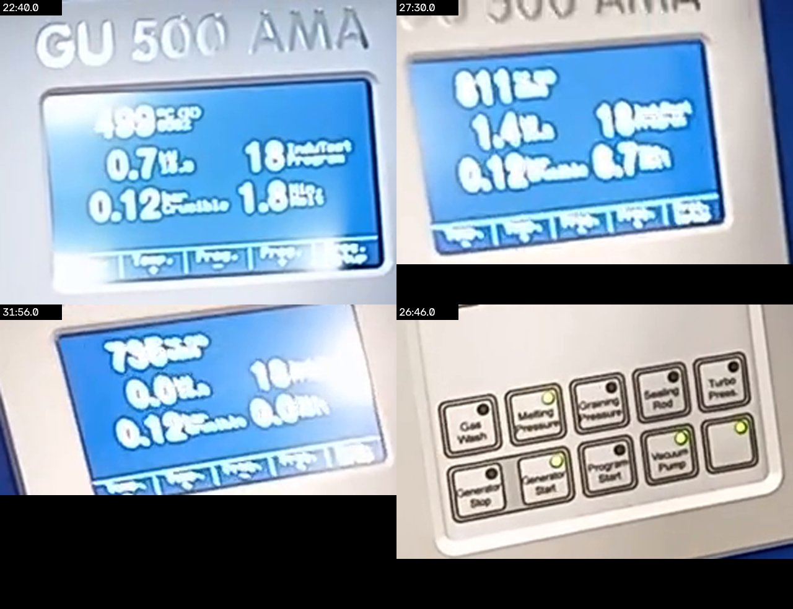
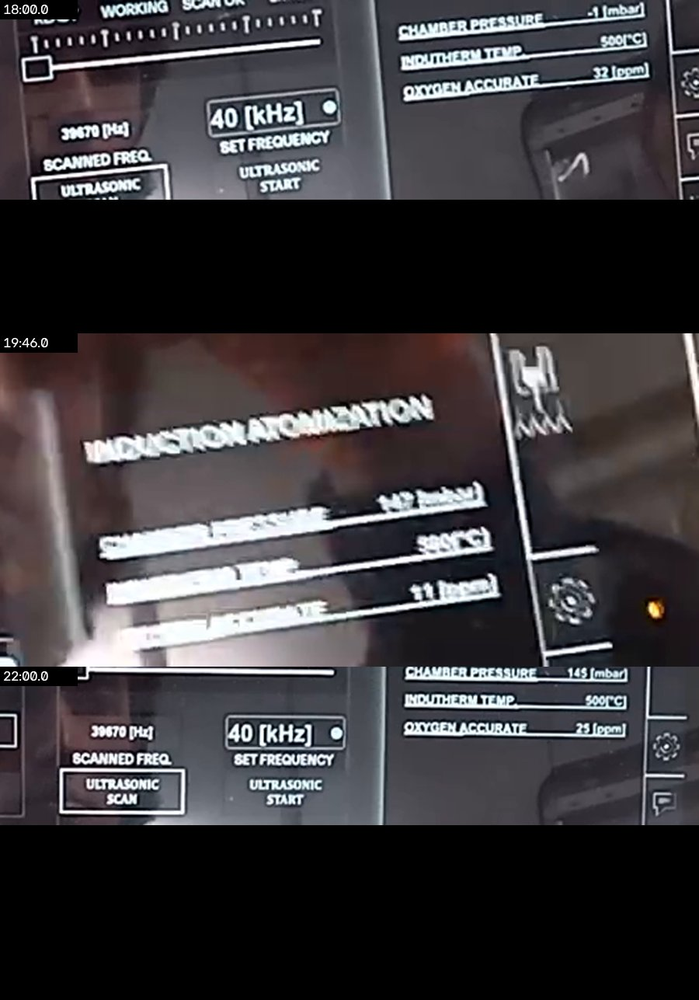
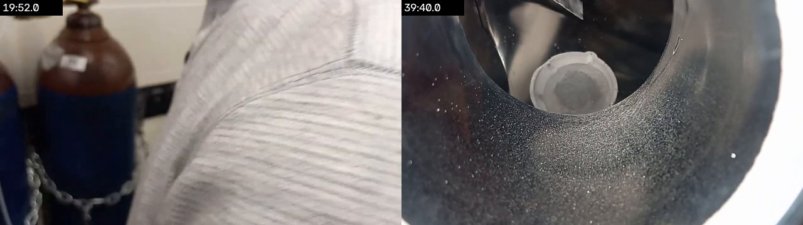

# 2026-10-21: run 1, Al 4047 on the small Mo plate, very little powder

The run that the Oct 20 set-up ([`../2026-10-20/`](../2026-10-20/README.md)) was for. Gage
filmed it on a collar phone in one video,
[*10/21/2026 Atomizer Run Video 1*](https://youtu.be/p6Itg-ngMZA) (39:54, uploaded unlisted at
14:18 MDT, [linked on #261](https://github.com/vertical-cloud-lab/byu-vcl/issues/261#issuecomment-6327463538)).
His notes on [#261](https://github.com/vertical-cloud-lab/byu-vcl/issues/261#issuecomment-6326014905):

> 169g of Al 4047, small Mo plate, 1.5-1 booster, 13 ppm O2 count, Amp = 100, 810 C melt temp,
> graining pressure = 0.19 bar, 2 minute melt time.
> I made some mistakes and too much time to correct everything during the run so we got very
> little yield which is very frustrating. I'm going to open an issue to work on positioning the
> ultrasonic plate the same every time.

That issue is [#293](https://github.com/vertical-cloud-lab/byu-vcl/issues/293). This page places
the video on the room stream's clock, the same way as for Oct 20, and checks the run against the
trainer-derived [`sop.md`](https://github.com/vertical-cloud-lab/byu-vcl/blob/8981f5c/atomizer-training/sop.md),
Gage's [`daily-sop.md`](https://github.com/vertical-cloud-lab/byu-vcl/blob/8981f5c/atomizer-training/daily-sop.md)
(both on PR #276), the training videos and the earlier runs. Times are lab time (MDT), read off
the stream's burned-in clock, to about ±1 s. Video links open YouTube at that second. The
narration, with wall-clock times, is in [`transcript.md`](transcript.md).



## Summary

- **Up to the pour, the run went well.**
  - The chamber held pressure at the cold wash: *"sounds like it's holding pressure, so that's
    good"* ([5:38](https://youtu.be/p6Itg-ngMZA?t=338), 13:39:46). So the Oct 20 leak fix held.
  - O2 read 11–14 ppm after the first 500 °C wash and 13–15 ppm through the melt, with 15 ppm
    at the pour ([28:11](https://youtu.be/p6Itg-ngMZA?t=1691)). An extra wash briefly raised it
    to 25. That is the lowest of any recorded run so far (Oct 6: 19 rising to 140; Oct 8: 25–26).
  - The melt followed the SOP: setpoint 1000 °C at 13:56:45; *"It's starting to sink. I'm going
    to bring this down to 800 degrees"* at 13:59:07; 810–812 °C held for about 2 min.
- **The pour is where it went wrong, and the camera didn't see it.**
  - The pour starts at 14:02:33: *"graining pressure, sealing rod, bring it up a little bit, this
    turbo pressure"* ([28:25](https://youtu.be/p6Itg-ngMZA?t=1705)).
  - 24 s later: *"What the?"* ([28:49](https://youtu.be/p6Itg-ngMZA?t=1729)), then *"Oh, my …"*
    at 14:03:26.
  - For about 1.5 min Gage is bent over at the chamber door on the stream, and in the phone
    frames his hand reaches toward the transducer end of the stack. The collar phone points at
    the floor mat throughout, so neither the plate nor the stream is ever in frame.
  - The generator was off by 14:06:04 (736 °C, both output readings at 0.0). So the pour lasted
    at most 3.5 min, about 1 g/s for 169 g.
- **Gage's verdict, on camera:**
  - *"We gotta figure out a way to measure where the plate is in there because it's ridiculous …
    you're wasting so much material every time"* ([35:54](https://youtu.be/p6Itg-ngMZA?t=2154), 14:10:02).
  - *"I wasn't able to course correct problems quick enough before we ran out of material … We
    only got a little bit of atomization"* ([38:46](https://youtu.be/p6Itg-ngMZA?t=2326)).
  - Then he looked for *"a marker, maybe a knife, something to scratch the back of that
    tungsten"* (14:11:29), the idea he wrote up as #293.
- **The result**, in [Gage's photo](https://github.com/vertical-cloud-lab/byu-vcl/issues/261#issuecomment-6327420581)
  (posted 15:55): a frozen puddle with dripped fringes in the catch bowl, and a little grey
  powder in a jar. Nothing has been weighed yet.
- **This is the fourth pour in a row lost where the melt meets the plate.** Oct 2: too far and
  too fast. Oct 6: on the upper sonotrode. Oct 8: dripped off a carbon-fibre plate at low
  amplitude. Oct 21: Gage says the plate was in the wrong place until corrected.
  - Oct 21 was the combination the Oct 8 debrief pointed to: a Mo plate, the 1.5:1 booster and
    the slow 0.19 bar drip. Bartosz had said the 1.5:1 booster doesn't work with a CF plate, and
    that slow, steady drips are ideal. Ronnie expected the same drip onto Mo *"would've probably
    been perfect"* ([#261](https://github.com/vertical-cloud-lab/byu-vcl/issues/261#issuecomment-6088484430)).
    So the combination isn't ruled out.
  - The one thing nobody set was where the melt lands. The stack had been rebuilt on Oct 20, and
    the height was judged by eye: *"We really need a laser pointer … I'm thinking though, we're
    gonna be okay today, I think that's a good height"* ([1:35](https://youtu.be/p6Itg-ngMZA?t=95)).
- **The charge was small for correcting on the fly.** 169 g against the SOP's 250–300 g, so the
  whole pour fit in about 3 minutes.

## Sources

| | Source | Length | MDT | What it shows |
| --- | --- | --- | --- | --- |
| V1 | [10/21/2026 Atomizer Run Video 1](https://youtu.be/p6Itg-ngMZA) | 39:54 | 13:34:08–14:14:02 | Utilities and PPE; cold wash; heated washes with a visitor (13:50–13:56); melt; the pour (the floor, not the plate); cool-down and Gage's verdict |
| | [`udS2Xt0a7zQ`](https://www.youtube.com/watch?v=udS2Xt0a7zQ), *atomizer stream picam-ot2, 2026-10-21 UTC 19:00* | live until 21:00 | 13:03:23 on | The room from the ceiling, 144p at 2 fps, pixelated ([`docs/stream-cams.md`](../../docs/stream-cams.md)). Pulled every 2 s from 13:03:23 to 17:00 from the live DVR |
| | [Gage's notes](https://github.com/vertical-cloud-lab/byu-vcl/issues/261#issuecomment-6326014905), [photo](https://github.com/vertical-cloud-lab/byu-vcl/issues/261#issuecomment-6327420581), [after-run note](https://github.com/vertical-cloud-lab/byu-vcl/issues/261#issuecomment-6328158566) | | 14:37, 15:55, 16:41 | Parameters and outcome; the bowl and the jar; the clean-up, *"I should have recorded it"* |

## How the time was found

1. **The stream's clock.** The overlay was cropped every 30 s and read with tesseract
   ([`stream_clock.csv`](stream_clock.csv)). 65 of 196 crops are legible, and every one up to
   14:28:53 gives offset 0 = 13:03:23. From 14:31:02 it gives 13:03:32: a 9 s step, after the
   run.
2. **The video.** Phone movement cross-correlated with room movement every 0.5 s
   (`stream_sync.py align` from PR #276; [`alignment.json`](alignment.json)) gives a start of
   13:34:08. The correlation is 0.80 against 0.23 for the next best, and each half of the video
   alone gives the same offset.
3. **Checked two ways.**
   - The phone's own clock is in frame at [32:45](https://youtu.be/p6Itg-ngMZA?t=1965) reading
     2:06, and the fit puts that frame at 14:06:53.
   - Gage says *"2:10"* at [36:33](https://youtu.be/p6Itg-ngMZA?t=2193), which the fit puts at
     14:10:41.

Review sheets put a phone frame every 40 s beside the stream frame of the same instant:
[0:00–19:20](review/v1_a.jpg) and [20:00–39:20](review/v1_b.jpg).
[`review/stream_pour_4s.jpg`](review/stream_pour_4s.jpg) is the stream every 4 s through the pour.

## What the footage shows

**Start-up (13:34–13:42).**
- PPE: orange gloves and the AMAZEMET anti-static lab coat
  ([0:30](https://youtu.be/p6Itg-ngMZA?t=30)).
- Utilities: *"We've got lots of water. Oil I think is good. I guess I'll have to figure out a
  way to know for sure when we need to add water"* ([0:54](https://youtu.be/p6Itg-ngMZA?t=54)).
- Furnace and chamber: *"this is sealed. That's all sealed"* ([1:12](https://youtu.be/p6Itg-ngMZA?t=72)).
- The landing point was not checked. *"We really need a laser pointer so I can take that pin
  out … see if it's on top of the plate or not, and if the other sonotrode [is] in the way or
  not. I'm thinking though, we're gonna be okay today, I think that's a good height"*
  ([1:35](https://youtu.be/p6Itg-ngMZA?t=95)).
- Then power, the HMI login and the SOP on a second phone. The cold wash runs 13:37:32 onwards:
  pressure control, vacuum pump, gas wash, then *"sounds like it's holding pressure, so that's
  good"*, then vacuum to −100 mbar ([3:24–7:26](https://youtu.be/p6Itg-ngMZA?t=204)).

**Heated washes (13:44–13:57).**
- The generator is heating by 13:44 (its temperature digits are in glare) and the furnace is at
  500 °C by 13:50: *"500 degrees Celsius right now"* ([17:14](https://youtu.be/p6Itg-ngMZA?t=1034)).
  A separate 250 °C wash is not said and not legible.
- O2, read on the HMI or said aloud:

  | MDT | Chamber | Furnace | O2 | Source |
  | --- | --- | --- | --- | --- |
  | 13:52:08 | −1 mbar (refilling) | 500 °C | 32 ppm | HMI ([18:00](https://youtu.be/p6Itg-ngMZA?t=1080)); a reading during backfill, not under gas |
  | 13:52:23 | 150 mbar | 500 °C | 14 ppm | said, [18:15](https://youtu.be/p6Itg-ngMZA?t=1095) |
  | 13:53:54 | 147 mbar | 500 °C | 11 ppm | HMI ([19:46](https://youtu.be/p6Itg-ngMZA?t=1186)) |
  | 13:56:08 | 145 mbar | 500 °C | 25 ppm | HMI ([22:00](https://youtu.be/p6Itg-ngMZA?t=1320)), after the extra wash (*"a whole new cycle"*) |
  | 13:59:22 | | 810 °C | 13 ppm | said, [25:14](https://youtu.be/p6Itg-ngMZA?t=1514) |
  | 14:01:03 | | 812 °C | 14 ppm | said, [26:55](https://youtu.be/p6Itg-ngMZA?t=1615) |
  | 14:02:19 | 150 mbar | 811 °C | 15 ppm | said, [28:11](https://youtu.be/p6Itg-ngMZA?t=1691), at the pour |

- The extra wash didn't help: *"the oxygen is slightly higher now … one more cycle didn't really
  help us"* ([22:15](https://youtu.be/p6Itg-ngMZA?t=1335)). This matches the SOP: a fourth wash
  only if O2 is still high.
- The argon line: *"It's 116 PSI"* ([19:50](https://youtu.be/p6Itg-ngMZA?t=1190)), said at the
  cylinder. That is 8.0 bar, the SOP's regulator setting, which the Oct 20 record could not read
  off the gauge. The cylinder pressure itself is not read out.

**Melt (13:56–14:02).**
- Setpoint 1000 °C at 13:56:45 (the generator reads 499 °C at
  [22:40](https://youtu.be/p6Itg-ngMZA?t=1360)).
- *"It's yellow and red. Alright, it's starting to sink. I'm going to bring this down to 800
  degrees"* ([24:59](https://youtu.be/p6Itg-ngMZA?t=1499), 13:59:07).
- 810 °C at 13:59:22, 812 °C at 14:00:54, 811 °C at 14:01:38. The crucible reads 0.12 bar, which
  is melting pressure, below the chamber's 150 mbar.
- *"About 2 minutes for it to mix up"* ([26:41](https://youtu.be/p6Itg-ngMZA?t=1601)), then
  *"20 more seconds, 15 parts per million"* (14:02:19).
- The pour button on the generator keypad is labelled **Graining Pressure**
  ([26:46](https://youtu.be/p6Itg-ngMZA?t=1606), figure below). That answers the SOP's open
  question about the label, which captions had heard as "graining", "grading" and "draining".

**The pour (14:02:33 to about 14:06).**
- 14:02:33: *"graining pressure, sealing rod, bring it up a little bit, this turbo pressure."*
  Whether the ultrasonics were started before the rod is neither said nor visible. The HMI's
  ultrasonic readouts at 14:02:26 are lost in glare.
- 14:02:37–14:04:05: bent over at the chamber door on the stream. The phone sees the floor mat
  and the transducer end of the stack, and Gage's hand reaches toward it at
  [28:34](https://youtu.be/p6Itg-ngMZA?t=1714) and [28:48](https://youtu.be/p6Itg-ngMZA?t=1728).
  *"What the?"* at 14:02:57; *"Oh, my …"* at 14:03:26.
- 14:04:09–14:05:37: standing at the front of the machine (the generator panel and the furnace
  shelf), then at the front viewport again ([30:45–31:40](https://youtu.be/p6Itg-ngMZA?t=1845)).
  At 14:04:08–14:04:48 he is reading the SOP on the phone that lies on the furnace shelf.
- 14:06:04: generator at 736 °C with both output readings at 0.0, so it has been stopped; melting
  pressure back on (0.12 bar)
  ([31:56](https://youtu.be/p6Itg-ngMZA?t=1916)). Sealing rod down and ultrasonics stop are not seen.
- 14:06:55: *"Dude."* Then two minutes of typing on the phone at the machine.

**After (14:09–14:14).**
- At the bench, then at the front viewport and under the door
  ([35:10–35:45](https://youtu.be/p6Itg-ngMZA?t=2110)).
- Then the verdict above, and the plan: *"once it goes down to 400 degrees, I'm going to open
  this up so it can cool faster. And then when it's 100 degrees, I'll turn that off"*
  ([39:16](https://youtu.be/p6Itg-ngMZA?t=2356)). That matches the SOP (open at ≤400 °C; cooling
  water off at about 100 °C).
- The last look through the viewport ([39:40](https://youtu.be/p6Itg-ngMZA?t=2380)) shows a
  light coat of powder on the cone wall.

**Not filmed.** The opening of the chamber, the yield, and the clean-up. The stream shows people
in the room on and off from 14:14 to 16:40, and Gage's note at 16:41 says he *"cleaned out and
prepared the atomizer for tomorrow's run"*.








## The run, minute by minute

| MDT | Video | What |
| --- | --- | --- |
| 13:03–13:31 | stream | Room empty |
| 13:34:08 | [0:00](https://youtu.be/p6Itg-ngMZA?t=0) | Video starts at the argon cylinders; *"pressure is looking good"* (0:15) |
| 13:35:00–13:35:20 | [0:52](https://youtu.be/p6Itg-ngMZA?t=52) | Water and oil checked; *"this is sealed"* |
| 13:35:43–13:36:06 | [1:35](https://youtu.be/p6Itg-ngMZA?t=95) | *"We really need a laser pointer … I think that's a good height"* |
| 13:36:10–13:37:05 | [2:02](https://youtu.be/p6Itg-ngMZA?t=122) | Power on, SOP on the phone, HMI login, *"I'm going to do a test"* |
| 13:37:32–13:41:34 | [3:24](https://youtu.be/p6Itg-ngMZA?t=204) | Cold wash; *"holding pressure"*; vacuum to −100 mbar |
| 13:44:08 | [10:00](https://youtu.be/p6Itg-ngMZA?t=600) | Generator heating (temperature in glare) |
| 13:50:25–13:56:15 | [16:17](https://youtu.be/p6Itg-ngMZA?t=977) · stream | Visitor; Gage explains the washes; second person on the stream 13:51–13:56 |
| 13:52:08–13:53:54 | [18:00](https://youtu.be/p6Itg-ngMZA?t=1080) | 500 °C wash: 32 ppm while refilling, then 14 ppm; an extra furnace wash from 13:52:36; 11 ppm at 13:53:54 |
| 13:56:08–13:56:39 | [22:00](https://youtu.be/p6Itg-ngMZA?t=1320) | 25 ppm after it; *"one more cycle didn't really help us"* |
| 13:56:45 | [22:37](https://youtu.be/p6Itg-ngMZA?t=1357) | Setpoint 1000 °C |
| 13:59:07 | [24:59](https://youtu.be/p6Itg-ngMZA?t=1499) | *"Starting to sink"*; setpoint 800 °C |
| 13:59:22–14:01:38 | [25:14](https://youtu.be/p6Itg-ngMZA?t=1514) | 810–812 °C, O2 13–14 ppm |
| 14:01:54–14:02:04 | [27:46](https://youtu.be/p6Itg-ngMZA?t=1666) | At the front viewport |
| 14:02:19 | [28:11](https://youtu.be/p6Itg-ngMZA?t=1691) | *"20 more seconds, 15 parts per million"* |
| **14:02:33** | [28:25](https://youtu.be/p6Itg-ngMZA?t=1705) | **Pour:** *"graining pressure, sealing rod, bring it up a little bit, this turbo pressure"* |
| 14:02:37–14:04:05 | [28:29](https://youtu.be/p6Itg-ngMZA?t=1709) · stream | Bent over at the door, hand toward the stack's transducer end; phone sees the floor |
| 14:02:57 | [28:49](https://youtu.be/p6Itg-ngMZA?t=1729) | *"What the?"* |
| 14:03:26 | [29:18](https://youtu.be/p6Itg-ngMZA?t=1758) | *"Oh, my …"* |
| 14:04:08–14:04:48 | [30:00](https://youtu.be/p6Itg-ngMZA?t=1800) | At the generator panel; reading the SOP on the phone |
| 14:04:53–14:05:48 | [30:45](https://youtu.be/p6Itg-ngMZA?t=1845) | At the front viewport |
| 14:06:04 | [31:56](https://youtu.be/p6Itg-ngMZA?t=1916) | Generator 736 °C, 0.0: stopped |
| 14:06:55–14:08:48 | [32:47](https://youtu.be/p6Itg-ngMZA?t=1967) | *"Dude."* Typing on the phone |
| 14:09:18–14:09:53 | [35:10](https://youtu.be/p6Itg-ngMZA?t=2110) | Bench; front viewport; under the door |
| 14:10:02 | [35:54](https://youtu.be/p6Itg-ngMZA?t=2154) | *"We gotta figure out a way to measure where the plate is in there"* |
| 14:10:41 | [36:33](https://youtu.be/p6Itg-ngMZA?t=2193) | *"2:10, so that took me about … 35 minutes to do the whole run"* |
| 14:11:29 | [37:21](https://youtu.be/p6Itg-ngMZA?t=2241) | *"Something to scratch the back of that tungsten"* |
| 14:12:54–14:13:44 | [38:46](https://youtu.be/p6Itg-ngMZA?t=2326) | Verdict; open at 400 °C, water off at 100 °C |
| 14:14:02 | | Video ends |
| 14:18 | YouTube | Uploaded |
| 14:37 | [#261](https://github.com/vertical-cloud-lab/byu-vcl/issues/261#issuecomment-6326014905) | Parameters and outcome posted |
| 14:42–16:40 | stream | People in the room on and off: clean-up, not filmed |
| 15:55 | [#261](https://github.com/vertical-cloud-lab/byu-vcl/issues/261#issuecomment-6327420581) | Photo of the bowl and the jar |

## Spot check against the SOPs

✔ seen or said on video · ◐ partly · ✘ not done as written · – not filmed.
Steps are from the [operator checklist](https://github.com/vertical-cloud-lab/byu-vcl/blob/8981f5c/atomizer-training/sop.md#operator-checklist)
and Gage's [daily SOP](https://github.com/vertical-cloud-lab/byu-vcl/blob/8981f5c/atomizer-training/daily-sop.md).

| Step | | Evidence |
| --- | --- | --- |
| Turn on recording cameras | ◐ | One 40-minute video covering start-up to cool-down. The phone points at the floor for most of the pour. Opening the chamber, the yield and the clean-up are not filmed |
| PPE | ◐ | Gloves and the anti-static coat ✔ ([0:30](https://youtu.be/p6Itg-ngMZA?t=30)). Hearing protection and eye protection at the viewport are not seen |
| Water, oil | ◐ | *"Lots of water"*; oil *"I think is good"*; no level check in frame |
| Argon at 8 bar | ✔ | *"It's 116 PSI"* (8.0 bar) at the cylinder ([19:50](https://youtu.be/p6Itg-ngMZA?t=1190)). Cylinder pressure not read |
| Plate positioned so the melt lands high but not over the top ([T5 28:46](https://www.youtube.com/embed/58wJ_Khwgyk?start=1726)) | ✘ | Judged by eye: *"I think that's a good height"*. No laser, no landing check, and the stack was rebuilt on Oct 20 |
| Clean feedstock, 250–300 g ([T4 04:32](https://www.youtube.com/embed/1F9_4ccwhss?start=272)) | ◐ | 169 g of Al 4047 (#261), loaded Oct 20. Under the SOP's range, and not the 6063 of the repeatability plan |
| Cold wash; chamber holds | ✔ | *"Sounds like it's holding pressure"* (13:39:46) |
| 250 °C and 500 °C washes; O2 ≤100 ppm, best 40–50 | ◐ | 500 °C ✔, 11–14 ppm ✔. A 250 °C step is not seen or said |
| Melt setpoint 850–1000 °C; at the melting cues drop to 780–800 °C; 2 min, no longer ([T9 13:30](https://www.youtube.com/embed/9kn-HhXCr1o?start=810)) | ✔ | 1000 °C; *"starting to sink"* → 800 °C setpoint; 810–812 °C held; poured 3.5 min after the drop and about 2 min after it settled |
| Transducer cooling, rescan, amplitude, vibration **on** before draining pressure and the rod | – | Amplitude 100 per #261. Vibration start is neither said nor visible (the HMI is in glare at 14:02:26) |
| Graining pressure, sealing rod up, turbo as needed | ✔ | All three said at 14:02:33 |
| Operator at the window for the whole pour, adjusting amplitude, turbo and plate position ([T5 58:53](https://www.youtube.com/embed/58wJ_Khwgyk?start=3533)) | ◐ | At the door and viewport 14:02:37–14:04:05 and 14:04:53–14:05:48; at the generator panel and the SOP in between |
| End: turbo, rod down, melting pressure, generator stop, ultrasonics stop | ◐ | Generator stopped and melting pressure on by 14:06:04 ✔; the rest is not seen |
| Run log written while fresh | ✔ | Typing on the phone 14:07–14:09; posted on #261 at 14:37 |
| Open at ≤400 °C; water off at about 100 °C | ✔ (plan) | Said at 14:13:24; the opening itself was not filmed |
| Upload videos titled *M/D/YYYY Atomizer Run Video N* | ✔ | *10/21/2026 Atomizer Run Video 1*, 14:18 |
| Powder bagged with a 6-character ID and photographed ([#249](https://github.com/vertical-cloud-lab/byu-vcl/issues/249)) | ◐ | Photographed (jar and bowl). No powder ID or mass posted yet |

### The Oct 20 checklist for this run

| Item from [`../2026-10-20/`](../2026-10-20/README.md#for-the-oct-21-run) | | What happened |
| --- | --- | --- |
| Confirm the loaded rods are 6063; record number and mass | ✘ | They were Al 4047, 169 g. So the *"All 40-47?"* exchange on Oct 20 may have been about the charge after all |
| Nozzle exit and the thing left stuck in the furnace | – | Not mentioned |
| Wet test, then check the landing point | ✘ | Neither done; see above |
| Argon regulator at 8 bar; note the cylinder pressure | ◐ | 116 psi stated; cylinder pressure not read |
| Ultrasonics before the sealing pin | – | Not visible or said |
| Pump down and check the chamber holds before the first wash | ✔ | *"Holding pressure"* |
| Look at whatever was "cracking" | – | Not mentioned |
| O2 after each wash and at pour start and end | ◐ | Seven readings, 11–32 ppm; 15 ppm at the pour; the end of the pour is not recorded |
| Film the ultrasonic panel during the pour | ✘ | The phone points at the floor |
| Weigh powder, lump and cup | – | Photo only so far |

## Compared with earlier runs

From the SOP's [run table](https://github.com/vertical-cloud-lab/byu-vcl/blob/8981f5c/atomizer-training/sop.md#known-runs-so-far)
and the earlier records.

| Run | Charge | Plate | Booster | Amp. | O2 at pour | Melt | Pour pressure | Outcome |
| --- | --- | --- | --- | --- | --- | --- | --- | --- |
| Sep 29, 1 (trainer) | Al 4047 rod | CF | 1:1.5 | – | – | 1000 → 790–800 °C | – | Large, uniform, spherical powder |
| Sep 29, 3 (trainer) | Al 4047 rod | Mo alloy | 1:1 | ~90 | – | 1000 → 780–790 °C | lowered mid-pour | Plate cracked; powder "could be better" |
| Oct 2 | 4047 powder in a 6063 cup | pure Mo | 1.5:1 | ~90 | low 20s | 830 °C | 0.17 bar | Melt shot past; most not atomized |
| Oct 6 | 180 g 6063 | small CF | 1:1 | 50 | 19 → 140 | 900 → 840 °C | 0.2 bar | Stream on the upper sonotrode; little powder |
| Oct 8 | 3 rods 6063 | CF | 1.5:1 | 92–100 | 25–26 | ~850 °C | 0.19 bar | Dripped, hardly atomized |
| **Oct 21** | **169 g 4047** | **small Mo** | **1.5:1** | **100** | **15** | **1000 → 800, 810–812 °C** | **0.19 bar** | **Plate position corrected mid-pour; little powder, puddle in the bowl** |

## Why so little powder

The footage can't show what the stream did, so this rests on Gage's account, the photo, and
what the training says.

- **Where the melt landed.** Gage's account, on camera and on #261, is that the plate was in the
  wrong place and that correcting it took most of the charge. That fits:
  - his work at the door through the first 1.5 min of the pour;
  - the frozen puddle in the bowl, which is what un-atomized melt looks like (Oct 8 left the same);
  - the start-up remark that the height was a guess.

  Bartosz's rule is to put the melt *"as high as possible without going over the top, in the
  middle"*, with a final adjustment at first flow
  ([T5 28:46](https://www.youtube.com/embed/58wJ_Khwgyk?start=1726),
  [T5 60:27](https://www.youtube.com/embed/58wJ_Khwgyk?start=3627)). That last step is meant as a
  trim, not a search.
- **Not the configuration.** Mo plate, 1.5:1 booster and a slow 0.19 bar drip is the set-up the
  Oct 8 debrief expected to work. O2 was the best yet. The melt temperature
  is 10–30 °C above his 780–800 °C. Amplitude 100 is above his ~90, which suits the
  amplitude-starved reverse booster.
- **The small charge left no margin.** At about 1 g/s, 169 g is under 3 minutes of pour. The
  first drops also go to heating the plate
  ([T9 20:24](https://www.youtube.com/embed/9kn-HhXCr1o?start=1224)). The SOP asks for 250–300 g,
  and for little material, manual pressure control with a low draining pressure
  ([RUN1 19:27](https://www.youtube.com/embed/TFpU4uqVF9c?start=1167)).
- **The landing point should be set before the furnace is closed, not found during the pour.**
  [#293](https://github.com/vertical-cloud-lab/byu-vcl/issues/293#issuecomment-6326319107) has
  the options:
  - record the stack's slide and turn on the holder, outside the chamber;
  - shine Bartosz's laser down the empty nozzle and see the dot on the plate
    ([T5 63:28](https://www.youtube.com/embed/58wJ_Khwgyk?start=3808));
  - don't scratch the tungsten sonotrode (a fatigue-crack starter).

  Gage has already started. After the clean-up he cut a retired plate down into a guide that
  rests on the lip of the side port, drew lines on the sonotrode, and set the stack to *"about
  3.9 cm"*, the *"estimated goldilocks zone"*
  ([#293, 16:25–16:29 MDT](https://github.com/vertical-cloud-lab/byu-vcl/issues/293#issuecomment-6327896562)).
  That number is a guess until a run confirms it. The guide reads the slide, not the turn.

## Reusing the Al 4047 waste

Gage asked whether the 4047 left over from these runs could be melted again.

- **Bartosz says yes.**
  - On the catch-bowl metal after training: *"We can just use it all again without an issue"*
    ([TA 04:44](https://www.youtube.com/embed/Pk0K5sBz-sQ?start=284)).
  - The bowl is there to catch un-atomized melt for reuse
    ([T5 05:01](https://www.youtube.com/embed/58wJ_Khwgyk?start=301)).
  - The training leftovers are already jarred as `jz31op`.
- **Sterling's caveat** on #261 is that it *"introduces a new variable"*.
- **A way to have both:**
  - Use the revert for practice pours that set the landing point. That is exactly where material
    has been wasted.
  - Keep virgin rods for the repeatability runs.
  - Log revert as its own powder ID, with its mass and the runs it came from.
  - Clean it the same way as rods, and keep thin splats and powder out, since they carry the most
    oxide.
- **The literature agrees, with a caution about form**
  ([Edison answer](edison/q2-reusing-al-si-atomization-scrap-as-feedstock-answer.md)):
  - Clean, same-alloy, dense returns can be re-melted, but they are not equivalent to bar stock.
  - The oxide comes in on the surface. A 3 nm alumina skin is about 320 ppm O on a 30 µm particle.
    A 0.1 mm splat carries about 100 times the skin per kilogram of a 100 mm bar, and powder about
    3,300 times. So the dense bowl puddle from Oct 21 is the best revert, wall splats are worse,
    and powder should not go back in.
  - No source sets a maximum revert fraction. It has to be qualified by measuring the powder's
    oxygen, the yield and whether the nozzle keeps flowing, against virgin-rod runs.

## For the next run

- [ ] Before closing the furnace, set the stack with the guide to the 3.9 cm line
      ([#293](https://github.com/vertical-cloud-lab/byu-vcl/issues/293)). Write down that reading
      and the turn on the holder. If a laser is available, check the dot on the plate.
- [ ] If the run atomizes well, record the position as the reference. If it had to be moved,
      record where it ended up.
- [ ] Charge 250–300 g; weigh it.
- [ ] Say *"ultrasonic start"* aloud when pressing it, before the graining pressure.
- [ ] Put a camera on the viewport for the pour, not only on the collar. Leaning in points the
      collar phone at the floor. The viewport-camera work for #198
      ([`atomizer-viewport-cameras/`](https://github.com/vertical-cloud-lab/byu-vcl/blob/8562ded/atomizer-viewport-cameras/README.md))
      is one route. A phone held against the viewport for the first 30 s is another.
- [ ] Weigh the Oct 21 powder, the bowl puddle and anything on the plate. Give the powder its ID.
- [ ] Say which way the stack was moved during the pour, and how far, while it is fresh.

## Open questions for Gage

- What did you see at *"What the?"* (14:02:57): stream short of the plate, on the upper
  sonotrode, or on the plate but not atomizing?
- Which way did you move the stack (slide or turn), and how far, before it atomized?
- Were the ultrasonics on before the sealing rod went up?
- What do the powder, the bowl puddle and any plate lump weigh?
- Did the furnace get a 250 °C wash, and was the stuck aluminium and the "cracking" part from
  Oct 20 dealt with?

## Literature search (Edison Scientific)

Three queries were submitted at 02:12 UTC on Oct 22 ([`edison/queries.json`](edison/queries.json);
task IDs in [`edison/_task_ids.json`](edison/_task_ids.json); full trajectories beside the answers).

- **Landing point and plate position**
  ([answer](edison/q1-landing-point-and-plate-position-answer.md)):
  - **Nothing published says where the stream should land, or how precisely.** There is no
    landing tolerance, no flow limit per unit area or per watt, and no mass balance for any
    ultrasonically atomized Al alloy. Those numbers have to come from our own runs, which is
    what weighing everything and logging the stack position give.
  - **Where the melt lands does matter.** High-displacement, antinode-like regions of a horn can
    move about twice as far as the rest, and that is where droplet ejection starts (Prasanna et
    al. 2024, [doi:10.48550/arxiv.2309.15012](https://doi.org/10.48550/arxiv.2309.15012)). So the
    goal is a repeatable landing point in a strong region, which no single rule of thumb pins down.
  - **The 3D Lab ATO sidesteps the problem.** It melts wire directly on the sonotrode. Bałasz et
    al. (2023, [doi:10.5604/01.3001.0016.3393](https://doi.org/10.5604/01.3001.0016.3393)) link
    separate melt-and-pour designs, like the rePowder, with splashing and interrupted atomization.
- **Precedent: AlSi12 on a Mo plate**
  ([answer](edison/q3-precedent-ultrasonic-atomization-alsi12-on-molybdenum-answer.md)):
  - **No report has all of it.** Yankin et al. (2025,
    [doi:10.1038/s41598-025-06086-7](https://doi.org/10.1038/s41598-025-06086-7)) atomized AlSi12
    wire on an ATO Lab+ (35 kHz, 75–80 % amplitude). About 75 % of their powder passed 63 µm.
    That is a size fraction, not a yield.
  - **The only rePowder paper on an Al alloy turned 19–50 % of the feed into powder.** It is
    Jedynak et al. (2024, [doi:10.21741/9781644903131-17](https://doi.org/10.21741/9781644903131-17)),
    on AlSi9Mg with 20 vol % SiC, induction-melted at 1100 °C. Even good runs on this machine
    may convert only about half the charge, so yield has to be weighed every time to be compared.
  - **Their pour pressure was much higher.** They used a 300–500 mbar feed pressure difference.
    Our 0.19 bar against the 150 mbar chamber is about 40 mbar, if the two are read that way.
    Their melt was a stiffer composite, though, so this doesn't transfer directly.
  - **A Mo sonotrode on the rePowder is documented,** for a high-entropy alloy (Goncharov et al.
    2026, [doi:10.3390/met16030318](https://doi.org/10.3390/met16030318)).
- **Reusing Al–Si scrap as feedstock**
  ([answer](edison/q2-reusing-al-si-atomization-scrap-as-feedstock-answer.md)): summarised under
  [Reusing the Al 4047 waste](#reusing-the-al-4047-waste). One more benchmark comes out of it.
  Ingot-fed AlSi10Mg *gas* atomization (Marinucci 2023, a thesis) collected 62–88 % of each charge
  as powder, but only 34–43 % of the charge fell in the usable 20–50 µm band.

## Reproducing

Video: on the CubXL Pi, as for Oct 8 ([`../README.md`](../README.md#getting-the-videos) on PR
#268), into `~/ytframes/atomizer-2026-10-21/` (494 MiB on disk).

Stream: the live broadcast's 144p segments were fetched by media-sequence number on the same Pi
with [`../2026-10-20/tools/live_dvr_fetch.py`](../2026-10-20/tools/live_dvr_fetch.py)
(`udS2Xt0a7zQ 269 0 7200`, kept in `~/ytframes/oct21/live/`, 146 MiB on disk). Segments 0–64 had already
aged out; offset 0 of the joined file is 13:03:23.

```bash
ls udS2Xt0a7zQ_sq*.ts | sort | head -n 2936 | xargs cat > stream.ts   # sq 65-3000, in order
python stream_sync.py clock  stream.ts stream_clock.csv
python stream_sync.py motion stream.ts stream.npy --grid
python stream_sync.py motion p6Itg-ngMZA.f136.mp4 v1.npy
python stream_sync.py align  stream.npy 13:03:23 v1.npy
python timeline.py
```

[`make_figures.sh`](make_figures.sh) rebuilds the frame figures with `../video_tools.py`.
Nothing else on the Pi was changed: no sudo, no services, the existing `~/.venvs/ytframes`.
