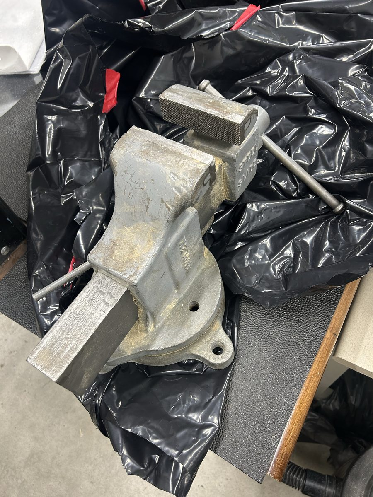
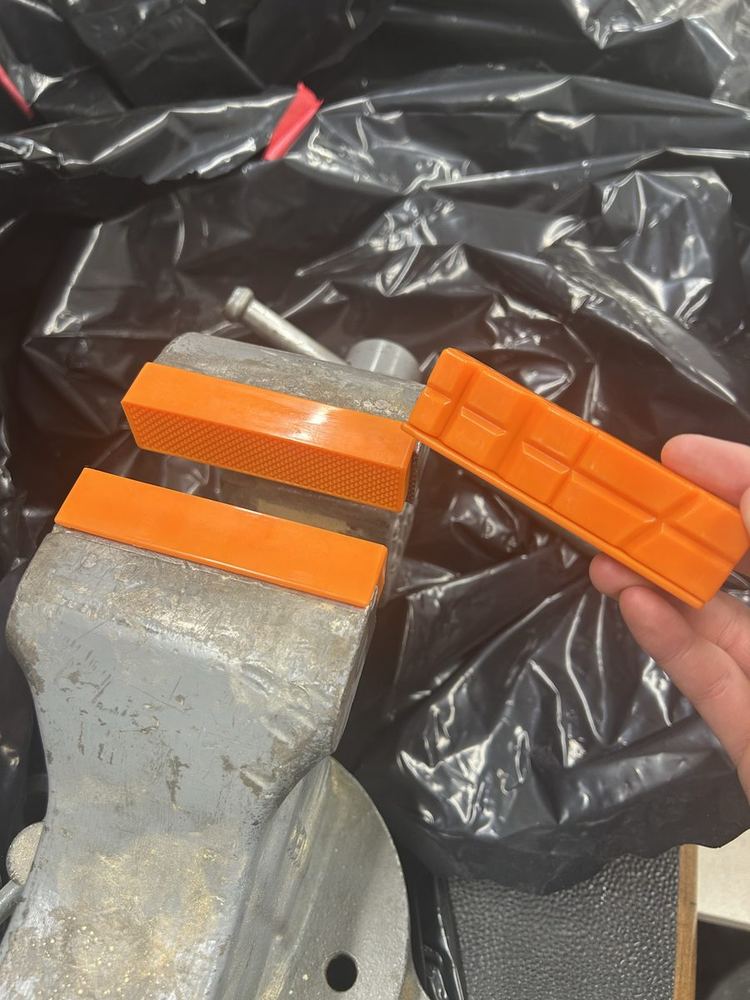
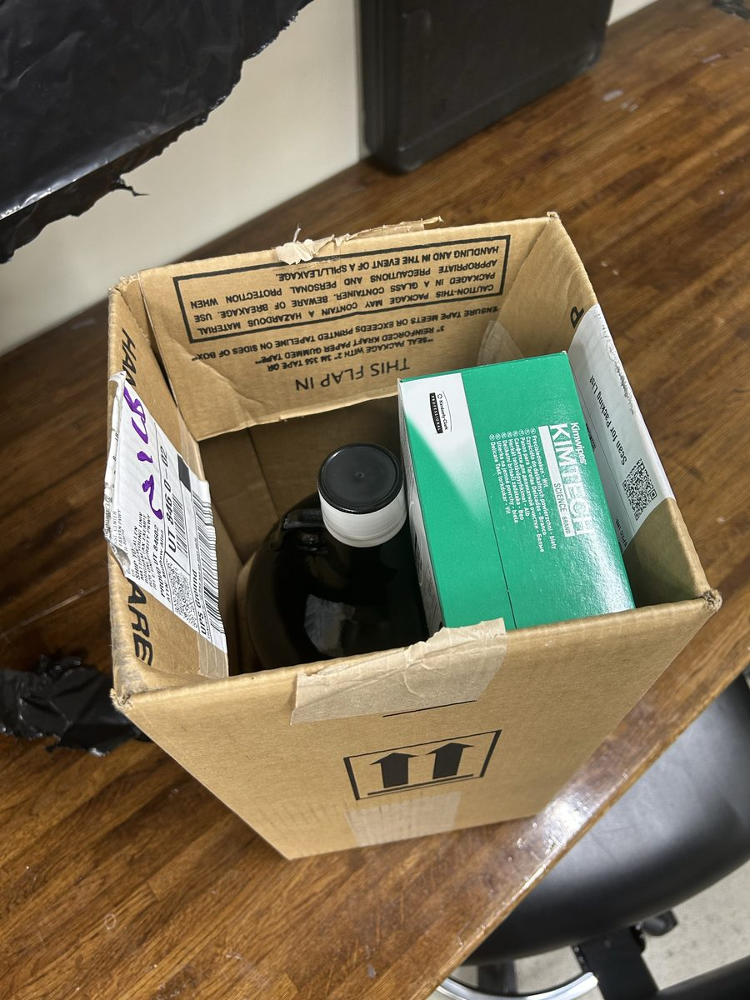
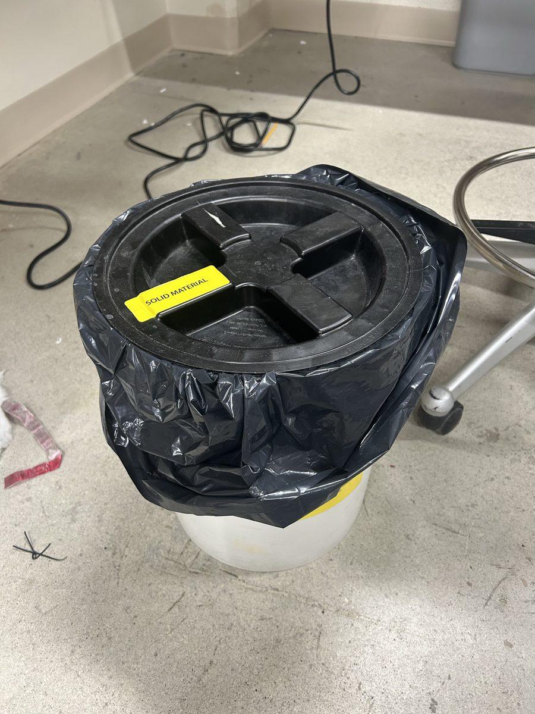

# Tools, consumables, PPE and waste: what the atomizer needs and what the lab has

The inventory behind [`sop.md`](sop.md), as recorded in
[#126](https://github.com/vertical-cloud-lab/byu-vcl/issues/126) between June and August 2026 by Gage Erickson, Ronnie
Guymon and Sterling Baird, with what the training added. What the manual requires and why is in
[`manual.md`](manual.md). The trainer's own list of tools to keep at the machine, from the videos (two 17 mm and one
18 mm wrench, the torque wrench, tweezers, brushes, IPA, scraper, nozzle drills, the hook wrench, the vise, metric Allen
keys, a laser pointer), is under [Utilities and daily pre-checks](sop.md#utilities-and-daily-pre-checks). Tools the lab
does not own can be borrowed from the Project Support Center (PSC); that happened twice on Oct 2, which is why the lesson
from that run is to buy a metric set ([Lessons from Oct 2](sop.md#lessons-from-the-first-unsupervised-run-oct-2)).

## What Bartosz said our module needs

Bartosz Kalicki's email of 2026-06-22 replaced the manual's long workshop list (below) with what our configuration
actually needs. Status as of 2026-07-30, when Gage wrote "Besides the glovebox and the actual powders (waiting for a
quote on those from MSE), we have everything!":

| | Item | Status |
| --- | --- | --- |
| Required | Isopropanol for cleaning | 4 L bought 2026-06-23 |
| Required | Dust-free paper | shipped with the machine; Kimwipes bought 2026-06-23 as well |
| Required | Container for flammable waste | in hand (Gage asked Risk Management about a solid flammable-waste bin on 2026-07-17; see Waste) |
| Required | Set of metric hex keys | in hand |
| Required | Adjustable wrench | in hand |
| Required | Vise with soft jaws | bench vise through Dave L. (2026-07-17); soft jaw covers received 2026-08-19 ([ME orders 13143](https://meorders.byu.edu/order/13143)) |
| Recommended | ATEX vacuum cleaner | in hand: a Nilfisk CFM 118EXP, a different model from the manual's suggestion ([#24](https://github.com/vertical-cloud-lab/byu-vcl/issues/24), [#80](https://github.com/vertical-cloud-lab/byu-vcl/pull/80)) |
| Recommended | Glove box for powder handling | not bought ([#30](https://github.com/vertical-cloud-lab/byu-vcl/issues/30)); on the 9/17 call Bartosz said most of their customers work without one, in a clean handling area, and store powder sealed with silica gel |

Supplied by AMAZEMET for the training: Al 4047 rods, a torque wrench with the correct tip, a flat 17 mm wrench, the
consumables and a starter pack of plates. "The most critical element will be the plates": per-alloy sets, labelled, with
more of one type if one material is run continuously ([plate table](sop.md#ultrasonic-stack)).

| The bench vise, 2026-07-30 | Soft jaw covers on it, 2026-08-19 |
| --- | --- |
|  |  |

## The manual's workshop list against the lab

The manual's "essential and recommended workshop equipment for proper use of the rePowder machine", with Gage's check of
2026-06-12 and what has changed since. Bartosz's reply to that list: for our system, only a small set of hex keys and
metric wrenches is needed; the rest is for other modules or occasional service.

| Item | 2026-06-12 | Since |
| --- | --- | --- |
| Socket wrench set (metric) | no | |
| Basic screwdriver set (flat, Phillips) | yes | |
| Measuring instrument (caliper) | no | measurements to 0.001 in were posted on 2026-10-08 ([#261](https://github.com/vertical-cloud-lab/byu-vcl/issues/261)), so one is available (inferred) |
| IPA (isopropanol) | no | 4 L, 2026-06-23 |
| Cleaning cloths | no | Kimwipes, 2026-06-23 |
| Dust-free paper | no | shipped with the machine |
| Workbench | yes | |
| Vice with aluminium jaws | no | vise plus soft jaw covers, see above |
| Hook wrench 90–155 | no | a view-port hook wrench shipped with the machine ([T4 07:49](https://www.youtube.com/embed/1F9_4ccwhss?start=469)) |
| Hook wrench 155–230 | no | |
| Hex key set, metric | yes | |
| Plastic/rubber hammer | no | |
| Metric spanners | yes | the stack needs two 17 mm and one 18 mm ([T7 48:12](https://www.youtube.com/embed/FDRTt68Vfvo?start=2892)) |
| Adjustable wrench 0–34 mm | no | in hand by 2026-06-22 |
| Metric drill bits set | no | nozzle work uses 0.5–0.7 mm precise drills and needles ([T1 39:18](https://www.youtube.com/embed/wRc8p2_FnJo?start=2358)); a #70 bit was used on 2026-09-30 ([video](https://www.youtube.com/watch?v=LSQmxwmlTkQ)) |
| Metric thread taps set | no | |
| Tap wrench handle | no | |
| Wallpaper cutter | yes | |
| Penetrating oil and screw lubricant | no | |
| Bench grinder with sharpening stone | no | plasma-module electrode work; not needed |
| Electrode sharpener, Φ4 | no | plasma module; not needed |
| Scotch-Brite 3M (medium or high) or similar abrasives | no | plates are never ground or "cleaned" ([T7 17:51](https://www.youtube.com/embed/FDRTt68Vfvo?start=1071)) |
| Voltage converter 110/230 V | no | not needed; the machine runs from the lab's own 32 A feed ([Utilities](sop.md#utilities-and-daily-pre-checks)) |
| Tweezer ESD set | no | tweezers were supplied with the machine ("the tweezers we were given", Ronnie, 2026-10-09 in #261) |
| ATEX vacuum cleaner | yes | Nilfisk CFM 118EXP |
| Extinguisher, Class D | yes | |
| Solvent or flammable waste container, foot-operated bin | no | in hand by 2026-07-30 |
| Vibrating sifter machine | no | hand sieves ([#262](https://github.com/vertical-cloud-lab/byu-vcl/issues/262)) |
| Steel tray for powder | no | a metal tray or basket with sand is what the used HEPA goes into ([T1 08:51](https://www.youtube.com/embed/wRc8p2_FnJo?start=531)) |
| Cabinet for consumables | no | the containment closet holds powders, rods and cups ([daily SOP](daily-sop.md)); the storage cabinet is becoming a desiccant dry box ([T7 10:30](https://www.youtube.com/embed/FDRTt68Vfvo?start=630)) |

## PPE in hand

- **Shipped with the machine** (Bartosz's list of 2026-06-22, and Gage's unpacking of 2026-06-15; the
  [unboxing video](https://www.youtube.com/watch?v=hbaD2ii6f3c)): 2 full-face respirators with P3 filters and integrated
  goggles, 10 visor stickers, 3 pairs of P3 filters (Gage counted 6 filter sets), a pack of rubber gloves, 2 pairs of
  heat-resistant leather gloves, a set of anti-static brushes, 2 anti-static wrist bands, 2 pairs of ear defenders,
  dust-free paper, 2 ESD coats ("anti-static aprons"), 1 or 2 ESD mats. The full table is in
  [`manual.md`](manual.md#what-shipped-with-the-machine).
- **The lab's own** (Gage, 2026-06-12): close-fitting goggles, protective work clothing, nitrile gloves, P3 dust masks,
  powder-impermeable heat- and chemical-resistant gloves, an ESD kit.
- **How it is used**: gloves for everything; a full-face respirator for any powder handling and for post-run cleaning,
  labelled per person; ESD coat and wrist strap for powder handling; hearing protection whenever ultrasonics or
  induction run; the ESD mat in front of the machine; tacky mats at the enclosure exit
  ([Safety and PPE](sop.md#safety-and-ppe)).
- **Not in hand, and why**: anti-static shoes and the flame-resistant suit from the manual's advanced set. Bartosz's
  position on the shoes is in [`manual.md`](manual.md#what-shipped-with-the-machine); the suit is for reactive-powder
  maintenance work the team does not do.

## Consumables

- Isopropanol, 4 L, and Kimwipes, bought 2026-06-23 (Gage).
- Dust-free paper (shipped).
- Desiccant: small silica-gel bags from McMaster (Gage, 9/17 call). Whether silica gel can contaminate the powders it is
  stored with was raised on the same call and is still open.
- Boron-nitride spray for the crucible, graphite nozzles, crucibles, insulation, seals and filters: the spares that
  shipped ([unboxing video](https://www.youtube.com/watch?v=hbaD2ii6f3c), chapters 2–4).
- Plates: the starter pack, kept as per-alloy sets and labelled ([plate table](sop.md#ultrasonic-stack)).
- Feedstock: Al 4047 rods from Bartosz; Al 6063 rods cut to 4 in, three per run day and twelve cut once a week; aluminium
  cups and press-fit plugs for powder charges ([#248](https://github.com/vertical-cloud-lab/byu-vcl/issues/248),
  [daily SOP](daily-sop.md)).
- Powders for custom charges: a quote from MSE was pending on 2026-07-30.

## Waste

What leaves the lab and how. The rule and the contacts are on the
[lab safety page](../SOP/lab-safety.md#metal-powder-waste-risk-management-pickup).

- **Solid Material bucket** (Risk Management, lined, labelled; Gage, 2026-07-17): waste powders, and the sweepings from
  the containment room outside the yellow lines ([daily SOP](daily-sop.md), Paul). When it is full, request a pickup at
  <https://riskapps.byu.edu/apps/pickuprequest/>.
- **Vacuum liners**: Risk Management told Ronnie (2026-07-20) to put full liners from the vacuum into a labelled metal
  bucket until pickup. The lab bought and labelled those buckets itself
  ([#80 comment](https://github.com/vertical-cloud-lab/byu-vcl/pull/80#issuecomment-4896710156)).
- **Flammable-waste container**: the foot-operated bin the manual asks for and Bartosz requires (in hand by
  2026-07-30).
- **Used filters**: into a grounded container, backfilled with sand, closed, wrapped and marked with the waste code
  ([`manual.md`](manual.md#filters)), then the same pickup.
- **Not waste**: un-atomized metal from the catch bowl is reusable feedstock (bag `jz31op`,
  [Known runs](sop.md#known-runs-so-far)), and each run's powder is bagged and labelled per
  [#249](https://github.com/vertical-cloud-lab/byu-vcl/issues/249).

## Photos

All from [#126](https://github.com/vertical-cloud-lab/byu-vcl/issues/126), downscaled to 1200 px:

| File | What | Posted |
| --- | --- | --- |
| [`photos/2026-06-22-safety-gear-supplied-with-the-system.png`](photos/2026-06-22-safety-gear-supplied-with-the-system.png) | The safety-gear table from Bartosz's email | Gage, 2026-06-22 |
| [`photos/2026-06-23-ipa-and-kimwipes.jpg`](photos/2026-06-23-ipa-and-kimwipes.jpg) | 4 L of isopropanol and Kimwipes | Gage, 2026-06-23 |
| [`photos/2026-07-17-solid-material-waste-bucket.jpg`](photos/2026-07-17-solid-material-waste-bucket.jpg) | The Solid Material bucket from Risk Management | Gage, 2026-07-17 |
| [`photos/2026-07-30-bench-vise.jpg`](photos/2026-07-30-bench-vise.jpg) | The bench vise ("we have everything") | Gage, 2026-07-30 |
| [`photos/2026-08-19-soft-jaw-covers.jpg`](photos/2026-08-19-soft-jaw-covers.jpg) | Soft jaw covers on the vise | Gage, 2026-08-19 |
