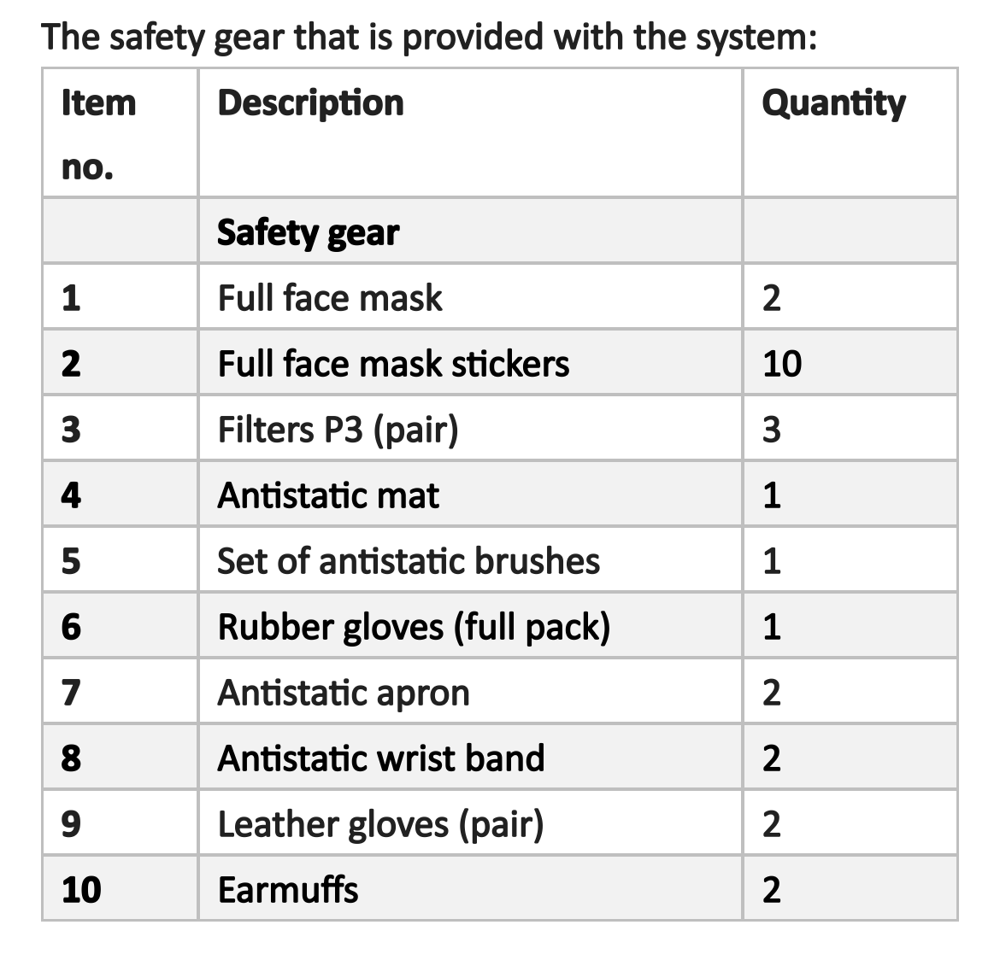

# What the AMAZEMET manual requires: PPE, safety rules, maintenance and procedures

Extracted by Gage Erickson in June 2026 from AMAZEMET's *rePowder Operation and Maintenance Manual*
(`O&MM_rePowder_04_2023.pdf`) and the *Facility Guide* ("rePowder Manual"), and posted to
[#126](https://github.com/vertical-cloud-lab/byu-vcl/issues/126). The manual is AMAZEMET's document and is not in this
public repo: Bartosz Kalicki's refreshed link went to the lab Slack
([private link](https://verticalcloudlabbyu.slack.com/archives/C0ACQ1TMHDE/p1781280709442889), posted 2026-06-12).
Section and page numbers below are the manual's. The manual covers the whole rePowder family (plasma melting, vacuum
casting), so a few items apply to modules we do not have; those are marked.

This page is the manufacturer's written rules. What the trainer actually did at our machine, step by step and with
video, is [`sop.md`](sop.md); what is in the lab is [`equipment.md`](equipment.md); the safety office's rulings are on
the [lab safety page](../SOP/lab-safety.md). Where the manual and the training differ, both are stated, and the manual's
rule is the one to follow when in doubt.

## PPE

### What the manual requires (Facility Guide)

With non-reactive, non-harmful metal powder the *standard* set is enough for most work; the *advanced* set is only for
cleaning or maintenance that can bring you into contact with condensate deposits. With reactive or harmful metal powder,
and with welding-fume deposits, the advanced set is required. Fine aluminium and magnesium powders ignite easily (see
*Why anti-static* below), so plan on the advanced set for cleaning and filter work on our machine.

| Set | Item | In the lab (Gage, 2026-06-12) |
| --- | --- | --- |
| Standard | Close-fitting protective goggles | yes |
| Standard | Protective work clothing | yes |
| Standard | Safety boots (antistatic shoes) | no; see below |
| Standard | Protective gloves made of nitrile | yes |
| Standard | Dust mask (P3 respirator) | yes |
| Advanced | Protective clothing to prevent limited flame propagation (flame-resistant overall with a hood, or flame-resistant suit and balaclava) | no |
| Advanced | Powder-impermeable, heat- and chemical-resistant protective gloves | yes |
| Advanced | Conductive safety shoes | no; see below |
| Advanced | Antistatic protective equipment (ESD kit; antistatic protective clothing) | yes |
| Advanced | Full respirator mask with a P3 particle filter, or respirator half-mask and protective visor | yes |

The operator's clothing per section 8.1, point 2: "stopwatches and protective headphones, anti-static clothing,
protective apron, protective goggles, gloves of heat resistant material, mask with category P3 particle filter,
anti-static wrist band with grounding to the equipment, and anti-static shoes with hardened fronts." ("Stopwatches" is
almost certainly a translation of the Polish *stopery*, earplugs.)

### What shipped with the machine

The crate that arrived on 2026-06-15 ([unboxing video](https://www.youtube.com/watch?v=hbaD2ii6f3c)) carried the
safety gear the manual says AMAZEMET provides. Bartosz's list of what our module ships with, from his email of
2026-06-22:

| Item | Quantity |
| --- | --- |
| Full face mask (full respiratory protection, P3, integrated goggles) | 2 |
| Full face mask stickers (protective films for the visor) | 10 |
| Filters P3 (pair) | 3 |
| Antistatic mat | 1 (Gage counted 2 ESD mats in the crate) |
| Set of antistatic brushes | 1 |
| Rubber gloves (full pack) | 1 |
| Antistatic apron (the ESD coat) | 2 |
| Antistatic wrist band | 2 |
| Leather gloves, heat resistant (pair) | 2 |
| Earmuffs (protective headphones) | 2 |

Gage's own unpacking list of the same day also has dust-free paper. The manual adds: "Personal protective equipment
should be inspected periodically and in case of damage, replaced by the Purchaser." Each mask is labelled for one person;
replace the visor sticker, not the mask ([T5 73:48](https://www.youtube.com/embed/58wJ_Khwgyk?start=4428)).

**Anti-static shoes.** The manual lists them (8.1, point 2), the shipment did not include them, and Gage did not find
them in the crate. On the [2026-09-17 call](../docs/meetings/2026-09-17-repowder-install/transcript.md) Bartosz said
AMAZEMET works in gloves and the ESD coat with the wrist strap, that shoes are advised mainly when handling large
amounts of powder, and that a real discharge event needs visible powder suspended in the air. So: not required for our
work as it stands; revisit if loose-powder handling grows. Bartosz offered to bring an extra wrist band (Sterling,
2026-06-24) and a second coat (the 9/17 call).

### Why anti-static

Gage's note of 2026-06-15: ultrafine metal powders like ours need extremely little energy to ignite, less than gasoline
vapour and less than the static shock you can feel from a fingertip. Every anti-static measure (coat, wrist strap
grounded to the machine, mat, nylon brushes, no compressed air) exists to keep a spark away from suspended powder, and
all powder handling stays inside the plenum. The manual's own words, from the filter section: "Metal powder and
condensate are easily ignited. Metal condensate can spontaneously ignite." The trainer's practical reading (above) is
that a real event needs a visible cloud; the precautions are cheap, so they stay.

## Operating rules

### Before every start

- **Check that the ground wire is properly attached.** The manual's one rule in capitals: "BEFORE EACH START OF THE
  PROCESS, CHECK THAT THE GROUND WIRE IS PROPERLY ATTACHED!"
- Inspect for external damage: leaks, melted wires, corrosion, general uncleanliness.
- Check ambient conditions, the electrical supply, the inert-gas supply and the coolant supply.
- The team leader also checks: the pressure of the inert-gas cylinder; the filling status of the sluice bins; leaks in
  the pneumatic and hydraulic components.
- "It is prohibited to work on a device that is not fully operational" (8.1, point 11).

### While operating

- Gloves whenever you touch the machine, heat-resistant or lab gloves: they protect you and keep skin oils off the
  machine. The grey ring over the lower chamber window absorbs skin oils on contact.
- Respirator and ear protection as the PPE section says.
- Hot surfaces, dangerous electrical components and pressurised chambers. Never open the process chamber above
  atmospheric pressure; the display has a pressure sensor. (Training: the door interlocks whenever the chamber is off
  atmospheric, and you always vent first, [`sop.md`](sop.md#safety-and-ppe).)
- Maximum working temperature 1300 °C.
- **Never use compressed air to clean the atomizer**: the risk is igniting metal powder. (Training: the trainer blew
  paper dust out of a clean, empty chamber with air before the first run,
  [T5 00:54](https://www.youtube.com/embed/58wJ_Khwgyk?start=54). The manual's rule covers any case where powder may be
  present, which after the first run is always.)
- Clean the chamber after a process with an antistatic brush (for example antistatic nylon), and follow the procedural
  and post-trial procedures.
- Load the charge with caution and unload it with special care; transport it to another station with proper
  instrumentation.
- Notify your supervisor at once of any irregularity in the machine's operation.
- Unauthorized persons must not tamper with the control cabinet; no repairs to the cabinet or the unit without first
  disconnecting the supply voltage.

### 8.1 Safety regulations, as written

> Persons assigned to operate the station must be trained in the use of electrical equipment and work with flammable
> substances in terms of operating instructions as well as applicable safety regulations. In addition, the following
> conditions must be observed when operating the system for processing and atomizing rePowder materials:
>
> 1. The device, as well as equipment cooperating with it, may only be operated and maintained by authorized and
>    trained persons. Staying of unauthorized persons is forbidden.
> 2. Personnel operating the equipment shall be provided with protective clothing consisting of: stopwatches and
>    protective headphones, anti-static clothing, protective apron, protective goggles, gloves of heat resistant
>    material, mask with category P3 particle filter, anti-static wrist band with grounding to the equipment, and
>    anti-static shoes with hardened fronts.
> 3. A hand-held fire extinguishing equipment suitable for extinguishing electrical fires and metal fires shall be
>    installed in the vicinity of the workstation and associated equipment.
> 4. The room should be well lit. The light intensity should be at least 500 lux. Light sources should be positioned
>    in such a way that they do not cause glare.
> 5. The room in which the bench is located must be well ventilated to remove heat, chemically inert gases, and
>    airborne contaminants generated during the processes.
> 6. If the work of operating or maintaining the equipment is performed by a group of people, one person should be
>    designated to supervise.
> 7. Work on the workstation and the associated equipment according to the regulations in force. Also observe the
>    procedures in the appendices!
> 8. Operating personnel should observe that: there are no objects in the vicinity of the workstation that are not
>    related to its operation; instrumentation used to operate the station is in good working order and in the
>    designated area; use an antistatic brush (e.g., an antistatic nylon brush) to clean the chamber after the process;
>    follow all procedural and post-trial procedures.
> 9. Operating personnel should exercise caution when loading the charge and special care when unloading it and when
>    transporting it to another station, using proper instrumentation.
> 10. Operating personnel should be familiar with the following regulations: health and safety when working with
>     electrical equipment and flammable materials; first aid.
> 11. It is prohibited to work on a device that is not fully operational.
> 12. Unauthorized persons must not tamper with the control cabinet.
> 13. Do not make any repairs to the control cabinet or the unit without first disconnecting the supply voltage.
> 14. Operators are required to immediately notify their supervisors of any irregularities in the operation of the
>     equipment.
> 15. Based on the above remarks and other recommendations of this OMM, a Workplace Safety Manual shall be prepared and
>     posted in a visible place as obligatory for the operators.

How the lab meets the room-level points: a Class D extinguisher is in the lab (Gage, 2026-06-12; point 3); the
enclosure has exhaust ductwork and a dehumidifier, and the inert gas in it is capped by the
[safety office's ruling](../SOP/lab-safety.md#inert-gas-in-the-booth-no-oxygen-detection-within-limits) (point 5);
Gage's [daily run SOP](daily-sop.md) names who does what on a run day (point 6). Point 15 is this set of pages; a printed
copy of the [operator checklist](sop.md#operator-checklist) and of this page's rules belongs at the machine.

## Installation and commissioning (7.6)

- "On the agreed commissioning date an AMAZEMET Sp. z o.o. employee present at the commissioning site will assist, if
  necessary, with unpacking the shipment, checking completeness and integrity of the delivery. Then an AMAZEMET
  Sp. z o.o. employee installs the device at the indicated installation site." Done: Bartosz installed and commissioned
  the machine on 2026-09-28 ([walk-around](https://www.youtube.com/watch?v=2wMgeI-E7zw)) and trained the team on
  Sep 29–30 ([`sop.md`](sop.md)).
- The antistatic mat that came with the machine goes on the floor in front of it.
- Commissioning is at least 8 hours of operation, and the purchaser prepares 1 kg of feedstock powder for it. Gage's
  open question of 2026-06-15 (which feedstock, "maybe just pure aluminum?") was settled by Bartosz, who brought Al 4047
  rods for the training runs.
- Bartosz also brought a torque wrench with the correct tip (the 17 mm tip; the 18 mm tip was not shipped,
  [T3 06:37](https://www.youtube.com/embed/txH397FGTAU?start=397)), a flat 17 mm wrench, the consumables and a starter
  pack of plates: "if you intend to work with one type of material only, continuously, more plates of one type could be
  required."

## Maintenance schedule

The manual's schedule. The trainer's intervals from the videos are under
[Cleaning and maintenance](sop.md#cleaning-and-maintenance) in the SOP; where the two differ, the shorter interval
wins (the trainer looks at the pump oil before every run, not weekly).

| Interval | Items |
| --- | --- |
| Every 20 h of operation | Safety filter: assess wear, replace if necessary. Seals on the flapper valves: assess wear, replace if necessary. Vacuum pump filter: assess wear, replace if necessary. |
| Daily | Coolant level. Leak check of the cooling system. External visual inspection of the furnace and the control cabinet. Visual inspection of the seals of the joints in use. |
| Weekly | All ISO-KF connectors tight. Oil level in the vacuum pump. Visual check of the electrical equipment in the control cabinet. |
| Monthly | Wipe dust and dirt from internal components. Tightness of all screw connections; tighten any loose screws. Operation of the chamber rotation mechanism. Condition of the test and measurement equipment. |
| Quarterly | Lubricate the hinges in the chamber. |
| Annually | Clean the fans. Replace the coolant. Change the vacuum pump oil. Leak check of the entire system. |

## Filters

The manual's three warnings for the prefilter and the main filter, quoted:

> Metal powder and condensate are easily ignited. Metal condensate can spontaneously ignite as a result of rising. Do
> not disconnect the prefilter equipotential bonding line before inerting the prefilter.

> Before performing the main filter replacement operation, perform the filter cleaning operation according to the main
> filter cleaning procedure via the HMI. This will remove excess powder and condensation accumulated on the filter.

> Before removing the main filter, prepare the container and connect it to earth. After removing the filter from the
> unit, immediately place it in a container and then backfill with sand. The container should be closed, wrapped in
> plastic and marked with the appropriate waste code.

Training said the same in fewer words: a used HEPA goes into a metal tray or basket with sand nearby, because fine dust
(magnesium, overheated evaporate) can self-ignite ([T1 08:51](https://www.youtube.com/embed/wRc8p2_FnJo?start=531)),
and the HEPA is changed about every 2 months ([T1 08:05](https://www.youtube.com/embed/wRc8p2_FnJo?start=485)). The
[filter-cartridge cleaning video](https://www.youtube.com/watch?v=f8KL31PN8bA) shows the brass pre-filter. The sealed
container then leaves through Risk Management, like the rest of the powder waste
([lab safety](../SOP/lab-safety.md#metal-powder-waste-risk-management-pickup)).

## The procedures in the manual (section 15, from page 116)

Gage's pointer: "Look at section 15 starting at page 116 from O&MM_rePowder_04_2023.pdf manual for all procedures."
The seventeen procedures, with where the same thing is covered from the training:

| # | Procedure | On our machine |
| --- | --- | --- |
| 1 | Cleaning and replacing the work table | |
| 2 | Assembling an ultrasound system | [Ultrasonic stack](sop.md#ultrasonic-stack), [T7](https://www.youtube.com/watch?v=FDRTt68Vfvo) |
| 3 | Using the ultrasonic generator | scan, amplitude and vibration in [Pour](sop.md#pour) |
| 4 | Checking coolant leakage of the ultrasound unit | transducer air cooling; the chamber and stack run cold ([Utilities](sop.md#utilities-and-daily-pre-checks)) |
| 5 | Mounting the ultrasound unit | stack into the door, [Ultrasonic stack](sop.md#ultrasonic-stack) steps 8–11 |
| 6 | Cleaning the feedstock | always clean it ([Furnace and charge](sop.md#furnace-and-charge), step 7) |
| 7 | Performing the plasma melting process | plasma (arc) melting module; ours is the induction module |
| 8 | Performing the atomization process | [During a run](sop.md#during-a-run) |
| 9 | Performing the vacuum casting process | casting option; not fitted on our unit (inferred from the induction + ultrasonic configuration) |
| 10 | Cleaning the rePowder device after the process | [Cleaning and maintenance](sop.md#cleaning-and-maintenance) |
| 11 | Cleaning the system for recirculation | |
| 12 | Pulling out the ultrasound system with a blocked sonotrode | the two-nut trick for a seized stud, [T7 30:16](https://www.youtube.com/embed/FDRTt68Vfvo?start=1816) |
| 13 | Procedure in an emergency and after an emergency stop has been pressed | any displayed error stops heating ([Safety and PPE](sop.md#safety-and-ppe)); the manual's procedure is the one to read before it is needed |
| 14 | Cleaning the main filter | via the HMI, see Filters above |
| 15 | Checking the oil level in the vacuum pump and refilling it | [T1 13:14](https://www.youtube.com/embed/wRc8p2_FnJo?start=794) |
| 16 | Removing the ventricular cone | the manual's wording; the cone under the chamber swings out, [T4 08:08](https://www.youtube.com/embed/1F9_4ccwhss?start=488) |
| 17 | Electrode and ceramic replacement | plasma module |

## Cleaning materials after an atomization run

From the manual's cleaning procedure, with Gage's status of 2026-06-15 and what happened since:

- Isopropanol: in the lab; 4 L bought 2026-06-23 ([`equipment.md`](equipment.md#consumables)).
- Getters, to chemically remove trace oxygen inside the vacuum: not acquired. The gas-wash routine reaches about
  20 ppm O₂ without them ([Gas wash and heating schedule](sop.md#gas-wash-and-heating-schedule)).
- Cleaning cloths: Kimwipes bought 2026-06-23; the dust-free paper the manual asks for shipped with the machine.

## Related reading

- Yankin et al. 2025, *Scientific Reports*, on ultrasonic atomization of AlSi12 across settings
  (<https://www.nature.com/articles/s41598-025-06086-7>): Sterling's pointer of 2026-06-29 for parameter selection; it
  is also one of the sources of the repeatability check in
  [#261](https://github.com/vertical-cloud-lab/byu-vcl/issues/261).
