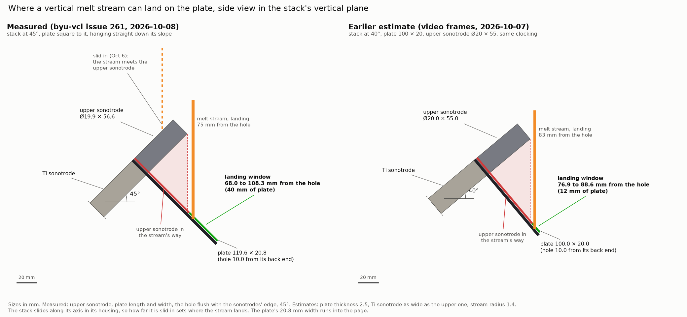
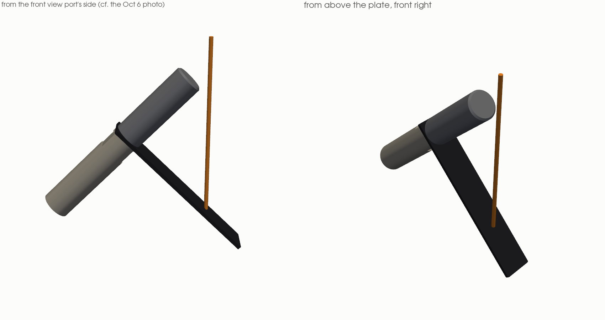

# rePowder ultrasonic stack, with the measured dimensions (2026-10-08)

A CadQuery model of the ultrasonic stack on BYU's AMAZEMET rePowder (induction module): Ti sonotrode, M8
connector, plate and tungsten-alloy upper sonotrode, plus the booster, transducer and cover behind them. It uses the
sizes measured on the machine on 2026-10-08
([byu-vcl issue 261](https://github.com/vertical-cloud-lab/byu-vcl/issues/261#issuecomment-6069616664)) in place
of the estimates read off the training videos. A patch brings byu-vcl's viz3d animation model in line with it.





## What was measured, and what changed

| | Measured | In mm | Earlier estimate |
|---|---|---|---|
| Upper sonotrode (W-Ni-Fe) diameter | 0.785 in | 19.94 | 20 |
| Upper sonotrode length | 2.23 in | 56.64 | 55 |
| CF and Mo plates, length × width | 4.71 × 0.82 in | 119.63 × 20.83 | 100 × 20 |
| Hole's centre to the plate's back end | back end flush with the sonotrodes' edge, "no overhang" | 9.97 (one sonotrode radius) | 10 |
| Stack angle | the plate "comes off perpendicular to the stack ... at a 45 degree angle" | 45° | 40° |
| Plate clocking about the axis | (see below) | straight down the stack's slope | level, towards the chamber's front |
| Stack position | "The whole stack's position is adjustable" | slides along its axis in its housing | |

**Reading "45 degrees".** The plate is square to the stack, so if it comes off at 45°, the stack rises at 45° too,
and the plate hangs straight down the stack's slope. A 45° clocking about the axis is the other possible reading.
The Oct 6 photo through the front view port (issue 261, first post) separates the two. Seen from the front, the
upper sonotrode rises at about 46° and the plate falls at about 38°, which add up to 84°. The camera's roll doesn't
change that sum. A plate straight down the slope gives about 86°, and a plate clocked 45° towards the front gives
about 97°. The model therefore uses the plate straight down the slope, with the stack at 45°. It is still worth
confirming with a photo along the axis.

**What follows for where the stream lands.** With the plate straight down the slope, the upper sonotrode sits
directly above the first part of the plate. It is as wide as the plate (19.9 against 20.8 mm), so a vertical stream
aimed at the first 68 mm from the hole meets the sonotrode first. That is what happened on Oct 6. The stream can
land on the plate **68.0 to 108.3 mm from the hole**, which is 40 mm of plate. With the earlier estimates (40°, a
100 mm plate) it was 77 to 89 mm, only 12 mm. The 68 mm is the upper sonotrode's length × cot 45°, plus its radius
and the stream's 1.4 mm radius, so a longer upper sonotrode or a shallower stack pushes it further out.

The stack slides along a fixed line in its housing, so pulling it back moves the landing point away from the hole
and lowers it at the same time. Landing *t* mm from the hole puts the stream *t* / cos 45° below the point where the
axis passes under the nozzle. The model's run set-up lands it 75 mm from the hole. That is 7 mm past the edge of
the sonotrode's shadow, leaves 33 mm of plate below, and keeps the stream 4.5 mm clear of the upper sonotrode. The
Oct 8 run, which dripped onto a lump at the plate's tip, fits the window's outer end.

## Files

| File | What |
|---|---|
| [`stack_model.py`](stack_model.py) | The model: one `Dims` dataclass (measured values first, then the estimates), a builder for each part, `landing_window()`, and the exports |
| [`dims.json`](dims.json) | Every dimension, where it came from, and the landing window |
| [`exports/repowder_stack_tip_cf.step`](exports/repowder_stack_tip_cf.step) | Assembly with named, coloured parts: CF plate, upper sonotrode, M8 connector, Ti sonotrode |
| [`exports/repowder_stack_full_cf.step`](exports/repowder_stack_full_cf.step), [`.glb`](exports/repowder_stack_full_cf.glb) | The same plus the booster, transducer and cover (estimated sizes) |
| `exports/<part>.step`, `.stl` | Each part alone: `plate_cf`, `upper_sonotrode`, `connector_m8`, `ti_sonotrode` |
| [`renders.py`](renders.py) | The two figures above |
| [`byu-vcl-viz3d/model-measured.patch`](byu-vcl-viz3d/model-measured.patch) | Puts the same numbers into byu-vcl's `atomizer-training/viz3d/model.py` (see below) |

**Frame.** Every export uses the stack's own frame, the same one byu-vcl viz3d's `stack_parts()` uses:

- **z** runs along the axis, out of the door into the chamber, with z = 0 at the Ti sonotrode's tip face (the plate's back face);
- **x** runs along the plate, from its hole towards its free end;
- **y** = z × x.

All dimensions are in mm. To place the stack in the chamber, rotate z to (cos 45°, 0, sin 45°) and x to
(sin 45°, 0, −cos 45°), in a frame with x running into the chamber from the door and z up.

**Into Onshape.** Import `repowder_stack_tip_cf.step` (or `_full_`) into a Part Studio or an Assembly. The parts
arrive named and coloured, and the origin is the axis at the Ti sonotrode's tip face, so a mate connector at the
origin with its z along the axis places it.

**Mo plates** have the same outline, but their thickness hasn't been measured, so there's no separate Mo export.
`stack_model.plate(thickness=...)` makes one.

**Rebuild.** You need `cadquery`, `numpy`, and `matplotlib` and `pyvista` for the figures:

```
python stack_model.py                 # exports/, dims.json, and prints the landing window
xvfb-run -a python renders.py         # renders/
```

The STEP files carry a time stamp in their header, so they differ byte-for-byte on each rebuild.

## The patch for byu-vcl's viz3d

[`model-measured.patch`](byu-vcl-viz3d/model-measured.patch) applies to `atomizer-training/viz3d/model.py` on
byu-vcl's `claude/issue-124-20261003-0335` (PR 255) at `88eeace`. It was checked there with `git apply`, and it
reproduces the tested file exactly.

**What it changes:**

- `STACK_ANGLE` from 40 to 45;
- the plate to 119.6 × 20.8;
- `HOLE_E` to the sonotrode's radius;
- the upper sonotrode to 19.9 × 56.6;
- the Ti sonotrode to the same diameter;
- a new `measured` set-up, `StackSetup(clock=90, slide=-75, behind=0)`, made the default for `VIZ3D_STACK`. Its
  clocking is viz3d's 90, which is straight down the slope.

**What `landing()` gives with the patch:**

| Set-up | Lands on | Where | Fall from the nozzle |
|---|---|---|---|
| `measured` (default) | plate | 75.0 mm from the hole, z = 875.4 | 232.6 mm |
| `training` | plate | 40 mm from the hole, z = 981.5 | 126.5 mm |
| `oct6` | upper sonotrode | z = 997.6 | |

With `measured`, the stream lands on the upper sonotrode for slides from 0 to −40. It lands on the plate from −68
to −108, and misses the plate beyond that.

**Interference.** byu-vcl's `collide.py` finds the same 12 overlaps in the assembled machine with the patch as
without it. They are intended nestings, such as the furnace body and its O-ring, and none involves the stack.
Replaying `06_pour` and `02_stack` (building, mounting and scanning the stack, then closing the door) with the
`measured` set-up finds no interference.

**Things the patch leaves for byu-vcl:**

- `06b_oct6` says that pulling back 40 mm "lands near the plate's free end". With the measured plate it lands 71 mm
  from the hole, 39 mm from the tip.
- The README's set-up section describes the training set-up as the default.
- The animations haven't been re-rendered.

## Still not measured

- **Where the axis passes under the nozzle**, which sets how far the stream falls. It is the biggest unknown. The
  model keeps viz3d's frame estimate (981.5, 126.5 mm under the nozzle), so the run set-up has the stream falling
  233 mm. A nozzle-tip-to-plate distance from the machine would fix it.
- **How far the stack can slide** in its housing.
- **The plates' thickness:** CF is 2.5 here, from video frames, and Mo is unknown.
- **The Ti sonotrode's diameter**, taken equal to the upper sonotrode's.
- **The hole's diameter:** 8 mm, which passes the M8 connector.
- **The booster, transducer and cover**, which keep viz3d's estimates.
- **A photo along the axis**, to confirm the clocking.
