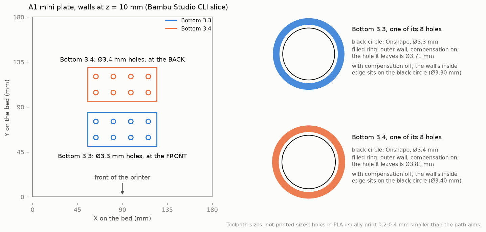

# Stub holder Bottoms with Ø3.3 and Ø3.4 mm pin holes, prepared for the A1 mini (2026-11-09)

@ronnie-guymon asked on [PR #257](https://github.com/vertical-cloud-lab/byu-vcl/pull/257) for
"Bottom 3.3" and "Bottom 3.4" from the Onshape document
[*stub holder*](https://cad.onshape.com/documents/bfba88d428bcc884c26d492d/w/2a20dc7be49f7a68f2619dcb/e/85711971e7865921f953f342),
on the A1 mini, in black. They are two trial versions of the SEM stub holder's Bottom. The
Bottom printed on 2026-11-02 had Ø3.5 mm pin holes
([its record](https://github.com/vertical-cloud-lab/byu-vcl/blob/c424eaa/bambu/evidence/2026-11-02/stub-holder-studio/README.md),
and the design notes in
[digital-alloy-lab PR #174](https://github.com/vertical-cloud-lab/digital-alloy-lab/blob/9566ee1/stub-holder/README.md)).
These two have Ø3.3 and Ø3.4 mm holes and are otherwise the same part.

**Not printed yet.** A plain `@claude` run has no Bambu login, so this run only exported,
pre-flighted and sliced. The send needs `@claude-print` (see [Sending it](#sending-it)).



## The "Bottom 3.4" tab still has Ø3.3 mm holes

Onshape's history (all times UTC, 2026-11-09):

| Time | Edit | Hole diameter in the Bottom's Sketch 2 |
|---|---|---|
| 2026-10-30 21:38 | *Bottom :: Edit : Sketch 2* | 3.5 mm (the 11-02 print) |
| 21:42:50 | *Bottom :: Edit : Sketch 2*, microversion `ef36349` | **3.4 mm** |
| 21:47:26 | *Bottom :: Edit : Sketch 2*, microversion `106d74f` | **3.3 mm** |
| 21:49:41 | tab renamed *Bottom 3.3* | 3.3 mm |
| 21:49:49 | tab copied (*Bottom 3.3 Copy 1*) | 3.3 mm |
| 21:49:57 | the copy renamed *Bottom 3.4*, microversion `ae7ab9b` (current) | **still 3.3 mm** |

- The *Bottom 3.4* tab's feature list is identical to *Bottom 3.3*'s, and Onshape's STL
  exports of the two are byte-identical (sha256 `58fdb39a…`). Printed as it stands, it would
  be a second Ø3.3 mm part.
- **So `stub_holder_bottom_3.4.stl` is exported from microversion `ef36349`,** the moment
  the Bottom had Ø3.4 mm holes. Its feature list differs from the *Bottom 3.3* tab's in one
  dimension: Sketch 2's diameter, 3.3 mm → 3.4 mm, and with it the radii of the eight circles
  ([`onshape/`](onshape/)). Its volume is 63.1 mm³ smaller, which is what widening eight
  15 mm deep holes by 0.1 mm removes.
- If the *Bottom 3.4* tab is set to 3.4 mm later, its export should match this STL.

## The parts

| | Bottom 3.3 | Bottom 3.4 |
|---|---|---|
| Source | *Bottom 3.3* tab, microversion `ae7ab9b` | the Bottom at microversion `ef36349` (21:42:50) |
| Size | 70 × 35 × 18 mm | the same |
| Volume (Onshape) | 42,394.3 mm³ | 42,331.2 mm³ |
| Pin holes | eight, Ø3.3 mm, 15 mm deep, at x = −26.5, −9, 8.5, 26 mm and y = ±8 mm | the same, Ø3.4 mm |

Both are single watertight solids, in millimetres and Onshape's frame (Z up, the holes'
open ends at Z = 18 mm). They were exported by the lab's Onshape API key (this document
gives it STL access) with a 0.06 mm chord tolerance and 2.5° angle tolerance, the "Fine"
setting the 11-02 files used.

## Pre-flight (read-only, over LAN through the CubXL Pi)

From [`preflight/`](preflight/) at 21:54:16 UTC:
- **State:** `FINISH` after `spacers_d15_x2` (23 of 23 layers). `print_error` 0, no HMS alert.
  Heaters off, nozzle and bed at 21.8 °C.
- **Nozzle:** 0.4 mm, stainless steel. The slice is for 0.4 mm.
- **AMS Lite:** A1 dark-blue PLA Basic; A2 empty; **A3 black PLA Basic (`GFA00`), 100 %**; A4
  white PETG Basic.
- **Other:** SD card in, Wi-Fi −52 dBm, chamber light on, firmware 01.08.01.00.
- **Camera: no frame.** The camera port accepted the connection, but no image arrived within the
  timeout, through the CubXL Pi at 21:54 and 21:55 and through the RPI stream-cam Pi at 22:01.
  That points at the printer, as on 2026-11-02, when Studio's live view of this printer
  failed for a whole session. Someone with the camera open in Bambu Handy can block it. If it
  stays down, a power-cycle may bring it back.

The script's verdict is `NO-GO` only because the camera check failed. Every printer check
passed.

## Slice

[`slice_a1mini.py`](slice_a1mini.py) is digital-alloy-lab's `stub-holder/slice_a1mini.py`
(the 11-02 plate) with only the parts and their places changed. So the hole diameter in
Onshape is the only difference from the 11-02 print.

- **Presets:** `Bambu Lab A1 mini 0.4 nozzle`, `0.20mm Standard @BBL A1M`, `Bambu PLA Basic
  @BBL A1M`. **One change: *Auto circle contour-hole compensation* on**, as on 11-02. The rest
  is stock: 2 walls, 15 % grid infill, supports off. Textured PEI Plate.
- **Layout:** both parts stand as designed, holes up, centred on X and 10 mm apart.
  **Bottom 3.3 at the front** (Y 50–85 mm) and **Bottom 3.4 at the back** (Y 95–130 mm). Y = 0 is
  the front edge of the plate in Studio's view. The start G-code brushes the nozzle at
  Y 175–185, which is behind the plate.
  Once off the plate the two look the same, so **mark them as they come off**.
- **Result** ([`report.json`](report.json)), Bambu Studio 02.08.02.61 CLI: 90 layers to 18.0 mm,
  **34.17 g (11.28 m)** of black PLA Basic. Bambu's estimate is **1 h 1 min 44 s**, of which
  55 min 45 s is printing. Bed 65 °C, nozzle 220 °C. No slicer warnings, nothing outside the
  bed, no supports. The only G-code warning is the A1 mini's usual
  `not_support_traditional_timelapse`, so send with timelapse off. The plate G-code has
  `M620 S0A` and `M412 S1`, and its MD5 matches the stored one.

### The pin holes in the toolpaths

[`hole_paths.py`](hole_paths.py) fits a circle to every wall loop around the 16 holes, at
3.2, 6, 10, 14.8 and 17.8 mm ([`hole_toolpaths.json`](hole_toolpaths.json)). All eight holes of
a part agree within 0.002 mm at every height.

| | Hole in Onshape | Outer wall's path radius | Hole the wall leaves (path − 0.21 mm, ×2) |
|---|---|---|---|
| **Bottom 3.3, compensation on (this plate)** | Ø3.3 mm | 2.066 mm | **Ø3.71 mm** |
| **Bottom 3.4, compensation on (this plate)** | Ø3.4 mm | 2.115 mm | **Ø3.81 mm** |
| Bottom 3.3, stock (compensation off) | Ø3.3 mm | 1.858 mm | Ø3.30 mm |
| Bottom 3.4, stock (compensation off) | Ø3.4 mm | 1.908 mm | Ø3.40 mm |

- **The compensation moves each hole's walls 0.21 mm further out,** as it did for the 11-02
  Ø3.5 mm holes (an aim of about Ø3.9 mm there). PLA holes usually print smaller than their
  toolpath, by 0.2–0.4 mm on this printer according to byu-vcl's Bambu notes. With the same
  setting on all three, the 3.3, 3.4 and 3.5 mm parts differ only in their CAD diameter.
- **A stock slice aims at the CAD size exactly.** That would make the Ø3.3 mm holes about 0.4 mm
  tighter than this plate's, and likely too tight for a Ø3.2 mm (⅛ in) stub pin. The stock
  slice's numbers are in [`report_stock.json`](report_stock.json): 33.98 g, 1 h 1 min 17 s.

## Sending it

Only an `@claude-print` run can send. It holds the Bambu login and needs approval from a
member of `bambu-print-approvers`.

- **File:** `bambu/evidence/2026-11-09/stub-holder-bottoms/stub_holder_bottoms_A1mini_blackPLA.gcode.3mf`
  on the branch `claude/pr-257-20261109-2152`. **Printer:** the A1 mini. **Filament:** black PLA
  Basic in AMS slot A3. **Plate:** Textured PEI. **Timelapse:** off.
- **Studio re-slices a CLI file, and resets circle compensation to off when it does.** That
  happened on 2026-11-02. After opening the file, turn *Auto circle contour-hole compensation*
  back on (*Quality → Precision*, with *Advanced* on), then slice. Check that the slice's
  `CONFIG_BLOCK` has `enable_circle_compensation = 1`, or run `hole_paths.py` on it and look for
  outer-wall path radii of 2.066 mm (Ø3.3) and 2.115 mm (Ø3.4).
- **The plate:** Ronnie wrote that the plate is clear and to **ignore the pink box**. The print
  run still takes and reads its own frame before Send. If the camera is still down, it needs a
  person's in-person check, as on 2026-11-02.

## Files

| File | What |
|---|---|
| [`stub_holder_bottoms_A1mini_blackPLA.gcode.3mf`](stub_holder_bottoms_A1mini_blackPLA.gcode.3mf) | **The plate to send:** both Bottoms, black PLA Basic, circle compensation on. A Bambu Studio project with the plate G-code inside |
| [`stub_holder_bottom_3.3.stl`](stub_holder_bottom_3.3.stl), [`stub_holder_bottom_3.4.stl`](stub_holder_bottom_3.4.stl) | Onshape's STL exports (mm, Onshape's frame) |
| [`report.json`](report.json), [`report_stock.json`](report_stock.json) | What the slice came to, with compensation on, and stock |
| [`slice_a1mini.py`](slice_a1mini.py) | Remakes the 3MF from the STLs in about 7 s |
| [`hole_paths.py`](hole_paths.py), [`hole_toolpaths.json`](hole_toolpaths.json) | The wall-loop fit around every hole, and its results |
| [`plate_figure.py`](plate_figure.py), [`plate_and_holes.png`](plate_and_holes.png) | The figure above, drawn from the plate G-code |
| [`onshape/`](onshape/) | Feature lists: the *Bottom 3.3* tab and the *Bottom 3.4* tab at `ae7ab9b`, and the Bottom at `ef36349` |
| [`preflight/`](preflight/) | The redacted pre-flight (21:54) and the two later camera tries (21:55 through the CubXL Pi, 22:01 through the RPI stream-cam Pi). The IP, access code, serial and Pi hostnames are not in them |

### Re-running

```bash
# Bambu Studio 02.08.02.61's AppImage, extracted to ~/bambu/squashfs-root (bambu/studio/setup_runner.sh on main does this)
sudo apt-get install weston libosmesa6 gcc     # optional, for the thumbnails
export XDG_RUNTIME_DIR=/tmp/xdg && mkdir -p -m 700 $XDG_RUNTIME_DIR
weston --backend=headless --socket=wayland-bambu --idle-time=0 &
export WAYLAND_DISPLAY=wayland-bambu
python slice_a1mini.py --bambu ~/bambu/squashfs-root --build /tmp/slice_build           # the plate and report.json
python slice_a1mini.py --bambu ~/bambu/squashfs-root --build /tmp/slice_build --stock   # report_stock.json and a *_stock 3MF
python hole_paths.py stub_holder_bottoms_A1mini_blackPLA.gcode.3mf
```
