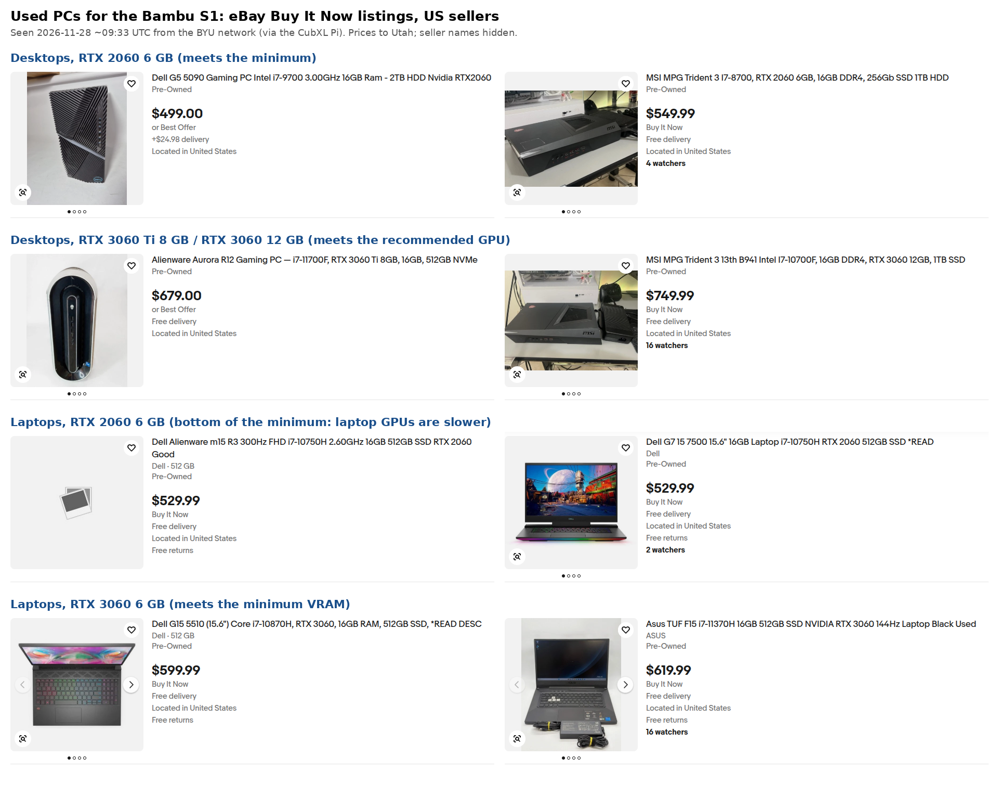

# A PC for the Bambu Lab S1 scanner: used options and prices (2026-11-28)

The S1 ([issue #285](https://github.com/vertical-cloud-lab/byu-vcl/issues/285)) needs a PC
running Bambu Scan. Bambu Scan is Windows-only for now; macOS is "coming soon". The prices
below are asking prices seen on 2026-11-28, about 09:20–09:36 UTC, delivered to Utah.

## What the PC needs

From [Bambu's launch post](https://blog.bambulab.com/easy-in-hand-pro-in-every-scan-bambu-lab-introduces-the-s1-3d-scanner/):

| | Minimum | Recommended |
| --- | --- | --- |
| CPU | Intel i7 7th gen or AMD Ryzen 7 | Intel i7 13th gen or AMD Ryzen 9 |
| OS | 64-bit Windows 10/11 | 64-bit Windows 10/11 |
| RAM | 16 GB | 32 GB |
| GPU | Nvidia 2060 or better, ≥ 6 GB VRAM | Nvidia 3060 or better, ≥ 8 GB VRAM |

To connect, the PC needs Wi-Fi 6 or a Wi-Fi 6 adapter. Bambu will sell its own adapter
"soon". A cable also works.

The searches below used a stricter floor than Bambu's minimum:

- **An Intel 8th gen or newer CPU (or Ryzen 2000 or newer).** That is Windows 11's floor.
  Windows 10 stopped getting security updates in October 2025, and the consumer
  extended-support year ended in October 2026, so a 7th-gen machine would be stuck on an
  unpatched OS.
- **An SSD.**
- **For a laptop, an RTX 3060.** Laptop GPUs run at lower power than the desktop card with
  the same name. A laptop RTX 2060 is slower than the desktop 2060 that Bambu's minimum
  presumably means, and a laptop RTX 3060 is roughly a desktop 2060. Every laptop RTX 3060
  has 6 GB of VRAM: enough for the minimum, but not the recommended 8 GB.

## Options

| | Listing | Delivered | Notes |
| --- | --- | --- | --- |
| **Cheapest complete PC that meets the minimum** | [MSI Trident 3: i7-8700, RTX 2060 6 GB, 16 GB, 256 GB SSD + 1 TB HDD](https://www.ebay.com/itm/366779698656) | **$549.99** | Free shipping. Compact, console-sized case. Seller: 1.7K feedback, 99.5%. |
| Same tier, no SSD | [Dell G5 5090: i7-9700, RTX 2060, 16 GB, 2 TB HDD](https://www.ebay.com/itm/860126737002) | $523.98 | The title lists only a hard drive, so it would need an SSD added. |
| More headroom (meets the recommended GPU) | [Alienware Aurora R12: i7-11700F, RTX 3060 Ti 8 GB, 16 GB, 512 GB NVMe + 1 TB HDD](https://www.ebay.com/itm/336910955873) | $679, or best offer | **No returns.** Tower only. Ships with Windows 10 Home; the CPU qualifies for the free upgrade to 11. |
| | [MSI Trident 3: i7-10700F, RTX 3060 12 GB, 16 GB, 1 TB SSD](https://www.ebay.com/itm/366779713222) | $749.99 | Same seller as the first row. The title says both "Trident 3 13th" and i7-10700F, which can't go together, so confirm the CPU before buying. |
| **Laptop** | [Asus TUF F15: i7-11370H, RTX 3060 6 GB, 16 GB, 512 GB SSD](https://www.ebay.com/itm/377648602713) | **$619.99** | "Used – Good", charger included, 30-day free returns. |
| | [Dell G15 5510: i7-10870H, RTX 3060, 16 GB, 512 GB SSD](https://www.ebay.com/itm/227570528159) | $599.99 | No charger included; battery at 52%. |
| Upgrade a PC we already have | Used [RTX 2060 6 GB](https://www.ebay.com/itm/137969351973) / [RTX 3060 12 GB](https://www.ebay.com/itm/407393990102) | $168.95 / $344.99 | Only if the PC is a full tower with an 8th-gen+ i7, 16 GB and a power supply with an 8-pin PCIe plug. Office small-form-factor PCs usually can't power or fit these cards. |
| New, for comparison | Prebuilt RTX 5060 desktops on Newegg, e.g. [i5-14400F](https://www.newegg.com/stormcraft-sirius-gaming-desktop-pc-geforce-rtx-5060-intel-core-i5-14400f-16gb-ddr4-1tb-ssd-si1440fbb-560n2/p/N82E16883420040) or [Ryzen 7 5700X](https://www.newegg.com/ningmei-gaming-desktop-pcs-geforce-rtx-5060-amd-ryzen-7-5700x-16gb-ddr4-1tb-pcie-ssd-black/p/3D5-005R-00079) | $1,049.99–1,199.99 | An i7-14700F version is $1,599.99. |

**Wi-Fi 6.** The desktops above are 2018–2021 models, and their listings don't mention Wi-Fi
6. Plan on the cable or a Wi-Fi 6 card. On
[Newegg](https://www.newegg.com/p/pl?d=tp-link+archer+tx20u), a TP-Link Archer TX20E (PCIe)
is $18.89 on sale ($43.49 list), and an Archer TX20U Nano (USB) is $46.19. Bambu doesn't say whether
third-party adapters work with the S1.

**Desktop or laptop.** The S1 has its own batteries and touchscreen and talks to the PC over
Wi-Fi, so the PC can stay on a bench. A laptop only matters if things get scanned
somewhere else in the building.

## Other places checked

- **eBay, wider view.** Used desktops with an i7 (8th gen or newer), an RTX 2060 and 16 GB
  ask $475–580 delivered. With an RTX 3060 or 3060 Ti they ask $680–790 delivered, though
  some local-pickup listings ask $600–650. Laptops with an RTX
  2060 ask $470–570, and with an RTX 3060, $600–700. Many cheap "i7" listings are 4th- to
  6th-gen machines (HP Z230, Dell XPS 8910 and similar), and many listings that show a range
  such as "$310 to $875" let you pick the GPU, so the low price comes with a lesser card.
  eBay now needs a login to show sold prices, so these are asking prices.
- **KSL Classifieds (Utah).** RTX 3060 desktops ask $680–850, for example
  [an Alienware with an i7, RTX 3060 and 32 GB for $690](https://classifieds.ksl.com/listing/82572853).
  RTX 3060 laptops ask $650–750. The bot check blocked my second KSL search, so I stopped
  there.
- **Craigslist (Salt Lake City, Provo).** Two RTX 3070 machines at $1,000 each, and nothing
  cheaper.
- **Amazon Renewed.** The cheap "gaming" desktops there have GT 1030 or RX 550 cards and 6th-
  or 7th-gen CPUs. None of them meet the minimum.
- **Facebook Marketplace.** Not checked, because it needs a login.

## How this was gathered

Headed Chrome ran on the Actions runner, on a virtual display. Its traffic went out through
the CubXL Pi over an SSH SOCKS tunnel, using the pinned `rig.sh` that the Onshape section of
`CLAUDE.md` describes, so sites saw BYU's network (AS6510) instead of a datacenter. Nothing
was installed or written on the Pi. About 35 page loads took about 15 minutes. Pointer moves
and scrolling went through `xdotool` on the virtual display. The scripts are in
[`pc-shopping/`](pc-shopping/):

- `shop.py URL NAME` loads a page, saves a screenshot and the page text.
- `ebayitems.py` lists the eBay results on the current page with item links.
- `itempage.py ITEMID` prints a listing's condition, item specifics and description.
- `cardshot.py PREFIX ITEMID...` screenshots result cards with the seller row hidden.
- `montage.py` builds the image above.

The image hides eBay seller names.
