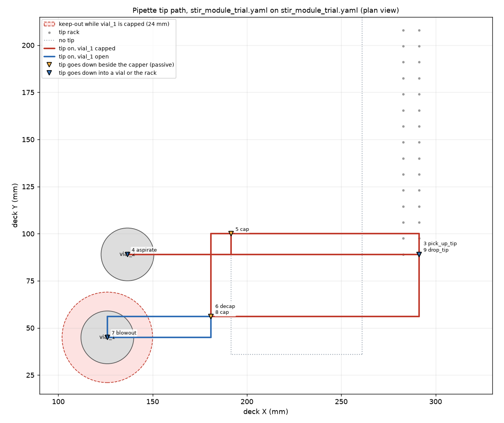
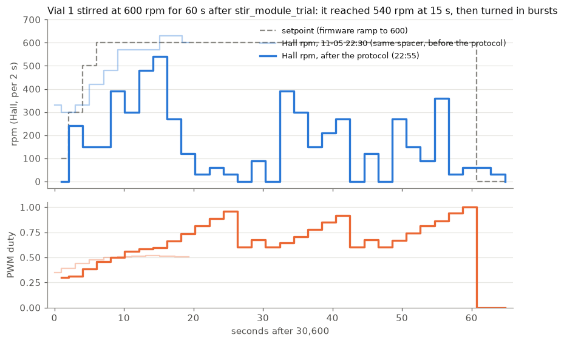

# stir_module_trial_20261105: 11/11 on the CubXL, then the stir

The first protocol with the stir module on the deck, asked for by @benwhitney5463 on PR #269
on 2026-11-05: uncap vial 2, pick up a tip, aspirate from vial 2, recap vial 2, uncap
vial 1, dispense into vial 1, recap vial 1, then stir vial 1. **The tip must never pass over
vial 1 while it is capped**: on the stir module vial 1 is too tall for a tipped pipette to
clear its cap.

- Protocol: [`stir_module_trial.yaml`](../../configs/protocol/vcl/stir_module_trial.yaml)
- Deck: [`stir_module_trial.yaml`](../../configs/deck/stir_module_trial.yaml), Ben's, verbatim
- Gantry: [`cub_xl_ben_3_instrument.yaml`](../../configs/gantry/cub_xl_ben_3_instrument.yaml)
- Check: [`capped_vial_keepout.py`](../../tools/capped_vial_keepout.py)

## Offline checks (runner, CubOS `496819c` + the CubXL's four patches)

| check | result |
|---|---|
| `validate_setup` | PASS ([log](checks/gate_validate.log)) |
| `run_protocol --mock` | 11/11 steps ([log](checks/gate_mock.log)) |
| `passive_shadow`, nominal and `--tip-stuck` | no interference ([nominal](checks/gate_shadow.log), [tip-stuck](checks/gate_shadow_tipstuck.log)) |
| `capped_vial_keepout.py` | closest the tip's axis comes to vial 1's axis while vial 1 is capped and a tip is or may be on: **45.3 mm** (step 4). Keep-out 24 mm: PASS ([output](checks/keepout.txt)) |
| `tip_clearance.py --tip-stuck` | every sideways move with the tip on at gantry Z 122 (tool Z 87) ([output](checks/tip_clearance_tipstuck.txt)) |

The deck file models only the two vials and the tip rack, so the spots where the tip goes
down beside the capper were checked by eye against the deck camera
([frame](frames/224414Z_deckcam_before.jpg), 22:44 UTC):

| step | tip end over deck | lowest tip-end Z |
|---|---|---|
| 5 cap vial_2 | (191.668, 100) | 20, 36 mm below vial 2's rim |
| 6 decap vial_1, 8 cap vial_1 | (181, 56) | 30, 36 mm below vial 1's rim |

## The run (2026-11-05)

Ben gave the go at 22:51:28 UTC on the PR, confirming that the mix is the stir module, the
20 mm dispense depth and the tip going back into A1. `cubxl_run.py` ran it from a sparse
checkout of this branch at `d28c733` on the CubXL Pi; its record is in [`run/`](run/)
([`SUMMARY.md`](run/SUMMARY.md)).

- **Protocol: 11/11 steps, 22:52:46 → 22:55:09 UTC (142 s).** No alarms, 0 USB kernel lines.
  Stage 1 checks and the four gates passed on the Pi first. It was the first capper and
  pipette run on the Uno's stirrer image (flashed 11-03), and the Uno answered as before.
- **Plunger:** `ASPIRATE 20` in vial 2 returned `v:[20.00,1.20]`; the blowout in vial 1 moved
  it to 32.5 mm; `drop_tip` to 46.5 and back to 28.0. The post-run `HOME` check took
  12.678 s, which puts the plunger at 28.00 mm (-0.00 mm), so no steps were lost.
- **After the run:** magnet off, cap sensor 0, both vials capped, tip back in A1.
- `HOLD` was set at 22:52:24 and removed at 22:57:01.
- **New on the Pi:** `~/byu-vcl-stirtrial`, a sparse, shallow checkout of this branch (only
  `cubos/configs`, `cubos/tools`, `cubos/patches` and `cubos/docs/tic_p20.txt`, 848 kB). A
  fast-forward of `~/byu-vcl-pipette` (still at `ed84bba`) would have pulled 72 MB of
  blobs over the Pi's Wi-Fi. Also `~/stir_trial_20261105` (stir script, logs, frames) and the
  run's own `~/cubxl_runs/stir_module_trial_20261105`.

### The stir (22:55:38 UTC)

[`stir/stir_trial.py`](stir/stir_trial.py) (11-04's `spin_frames.py` plus a `STOP` file) sent
`30,600,60` once the run had released the Uno, and read `31` every second
([log](stir/stir_console.log), [data](stir/trial_stir.jsonl)). The firmware ramps the setpoint
from 100 to 600 rpm in about 5 s.

- It started from rest on the first kick and climbed to **540 rpm at 14-16 s** (duty 0.60), a
  little behind the 11-05 22:30 run on the same spacer stack.
- **It never reached 600.** From 16 s it fell to 30-120 rpm while the duty rose to 0.96, and for
  the rest of the minute it turned in bursts, between 0 and 390 rpm. Three times the duty
  dropped back to 0.60, which is the firmware's own stall recovery. The `stalled` flag never
  set, and the fan stopped on time at 60 s. After the stop the reading went 60, 30, 0, so it
  was turning slowly by then, not misreading a fast turn as on 11-04.
- On 11-05 at 22:30, before the protocol, the same stack held 600-630 rpm at duty 0.51. What
  changed in between is not known. The decap and recap pull on and press down on vial 1, which
  could have shifted the spacer or washers under it. The deck camera
  ([start](frames/stir/225536Z_deckcam_stir_start.jpg), [24 s](frames/stir/225602Z_deckcam_stir_24s.jpg))
  is too far away to show the bar.

The bottom of each `cam0` frame (the bench, below the deck) is blurred, because a person sat
there during the run.
