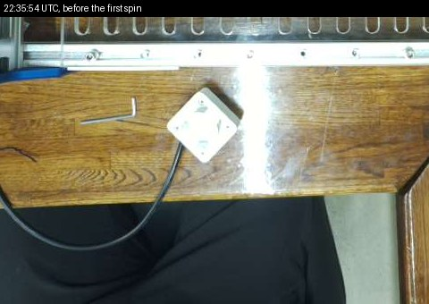
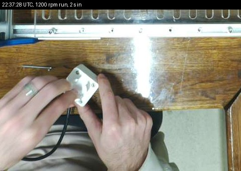
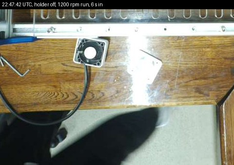

# Stirrer image flashed on the CubXL's Uno, and the first spins (2026-11-03)

Asked for by Ben on [PR #269](https://github.com/vertical-cloud-lab/byu-vcl/pull/269): the
compact stirrer was plugged into the Uno (PWM on D10, Hall on D2) and its Hall sensor
re-glued in the holder. This run flashed the stirrer image and ran
[`BUILD.md`](../../../hardware/vial-stirrer-cubxl/BUILD.md) stage 8's first, no-vial spins.
All times UTC. `~/cubxl_runs/HOLD` was set from 22:34:14.

## The flash: done, verified before and after

[`flash_stirrer.sh`](flash_stirrer.sh) ([log](flash_stirrer.log)) is BUILD.md stage 7's
three `avrdude` calls with checks between them: nothing is written unless the board reads
back as the 10-07 image.

| UTC | |
|---|---|
| 22:34:47 | Nothing had the port open. Both images' sha256 match the repo's |
| 22:34:4x | Flash read back as [`flash_before_stirrer_20261103.hex`](flash_before_stirrer_20261103.hex) (sha256 `d99a7699…`) |
| | Verify against `panda_vcl_p20gen2_tic796_fastmove_spread_20261007.hex`: **match**. Against the stirrer image: mismatch |
| 22:35:00 | Wrote `panda_vcl_p20gen2_tic796_fastmove_spread_stir_20261019.hex`: 20,340 bytes, verified |
| 22:35:07 | Verify against the stirrer image: **match**. Against 10-07: mismatch |

The board answered afterwards ([`check_board.py`](check_board.py), [log](check_board.log)):

| Command | Reply |
|---|---|
| `31` stirrer status | `{"target":0,"setpoint":0,"rpm":0.0,"duty":0.000,"stalled":0,"left_s":-1}` |
| `14` pipette `STATUS` | `{"homed":0,"pos":0.00,"max_vol":20.00}`, as after any reset |
| `29` driver status | `[0.00,0.00,-1.00]`, the same as in every record since September (reads have never worked) |

`pipette_test` was **not** rerun after the flash. The deck wasn't set up for it, and Ben
was at the bench with the stirrer.

## No-vial spins: the fan didn't turn

[`spin.py`](spin.py) sends `30,<rpm>,<seconds>` and polls `31` every second
([log](novial.log), [data](novial.jsonl)). The stirrer sat on the bench in front of the
deck, then in Ben's hands.

| Start | Asked | What `31` showed |
|---|---|---|
| 22:36:51 | 300 rpm, 30 s | `rpm` 0.0 throughout. Duty 0.300 → 0.315 as the stall logic paused and kicked every 2 s. At 12 s: stopped, `stalled` 1 |
| 22:37:26 | 1200 rpm, 30 s | One Hall pulse in the first 2 s window (`rpm` 30.0), then none. At 14 s: stopped, `stalled` 1 |

**Ben, watching it (22:43):** the fan did not turn at all during either run. Turned by hand
it moves jerkily, as if the magnets were catching on something.

 

*Deck camera, cropped to the bench in front of the deck.*

## Hand-turn Hall check: the sensor works

With the fan off, [`hall_watch.py`](hall_watch.py) polled `31` once a second from 22:40:07
to 22:43:06 ([data](hallwatch.jsonl)); [`watch_both.py`](watch_both.py) ran it from the
runner while watching the PR thread. While Ben turned the fan by hand, **pulses were counted
from 22:42:06 to 22:42:41: about 11 in 35 s,** one or none per 2 s window. Before and after,
`rpm` stayed 0.0, so the line picks up no noise with the fan still. The US1881, its wiring,
the pull-up and D2's interrupt all work.

## Holder off: it spins and the speed loop works

So the fault was on the drive side or in the mechanics. Ben took the vial holder off, leaving
everything else plugged in, and at 22:47:36 the same script asked for 1200 rpm for 16 s
([log](holderoff.log), [data](holderoff.jsonl)). The fan started on the first kick, Hall
pulses came through, and the loop followed the setpoint's 100 rpm/s ramp:

| s | 2 | 4 | 6 | 8 | 10 | 12 | 14 | 16 (end of run) | 18 | 20 |
|---|---|---|---|---|---|---|---|---|---|---|
| setpoint | 300 | 500 | 700 | 900 | 1100 | 1200 | 1200 | off | | |
| `rpm` | 510 | 390 | 330 | 480 | 630 | 810 | 990 | 1110 | 360 | 0 |
| duty | 0.258 | 0.280 | 0.354 | 0.429 | 0.504 | 0.579 | 0.621 | 0 | | |

*22:47:42, 6 s in: the base with the fan and the white carrier on the bench, the holder set
aside to the right. The sensor was still counting, so it sits in the base, not in the holder.*

**So the wiring, the gate drive, the Hall sensor and the firmware all work.** With the holder
on, something catches the carrier hard enough that the fan can't start at 5 V: the holder's
floor or the sensor and its leads, pushed into the carrier's path. The design leaves 1.1 mm
between the carrier and the floor with 0.5 mm washers. The checks sent to Ben were: turn it by
hand with the holder resting on, then with each screw snugged; look for scuffs; add a second
washer at each corner (+0.5 mm, leaving 5.5 mm of the M3 × 20 in the 5.7 mm insert) or sand
the carrier's top.

The duty the loop settled toward, about 0.6 for 1000 rpm, says the fan has headroom at 5 V
with no bar to drag. The rpm reading moves in the expected 30 rpm steps, one pulse a turn
over 2 s.

## The way back

Write the 10-07 image, or the backup above, with BUILD.md stage 7's `flash:w` line. The
stirrer image only adds commands 30 and 31 and Timer1 on D10, so the capper and the pipette
should be unaffected, but `pipette_test` hasn't confirmed that yet.
