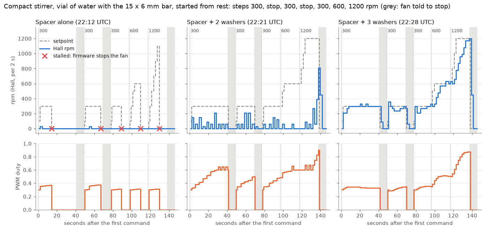
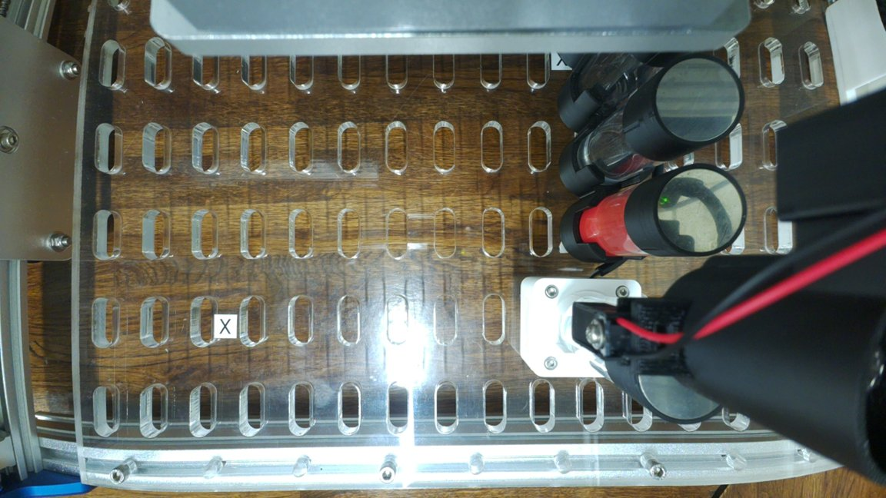
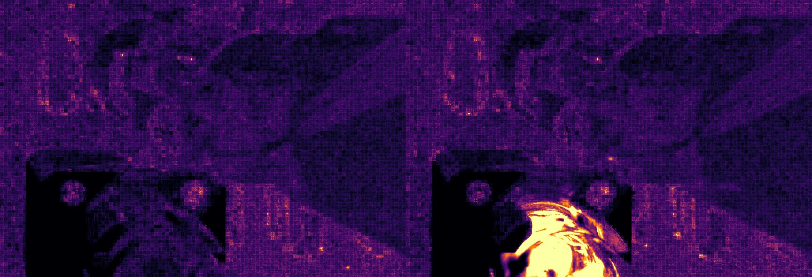

# Stir test with a spacer under the vial (2026-11-05): with the spacer and 3 washers, it starts from rest every time and holds 300 to 1200 rpm

Asked for by Ben on [PR #269](https://github.com/vertical-cloud-lab/byu-vcl/pull/269) (22:08 UTC):
he had put a spacer under the vial of water on the compact stirrer and asked for a stir,
and whether the Hall sensor picked anything up. On 11-04 the same vial, with the 15 × 6 mm
bar in it, stalled the fan when fully seated
([`stirrer_water_20261104`](../stirrer_water_20261104/README.md)). Ben then raised the vial
in two more steps, and each height got the same sequence. **With the spacer alone, the fan
didn't start: in 5 starts from rest the Hall sensor counted 2 single pulses, and the firmware
stopped the fan as stalled every time. With 2 washers added, it never stalled but turned
in bursts until the duty passed about 0.8. With 3 washers it started on the first kick all
three times, held 300 rpm at a duty of 0.33–0.35, followed the ramps to 600 and 1200 rpm,
and coasted to rest in about 3 s.** Ben measured the spacer plus 3 washers afterwards at
4.6 mm, and saw the bar stay with the magnets at 1200 rpm. All times UTC (the lab is on MST, UTC−7).

*[`plot_runs.py`](plot_runs.py). `rpm` is Hall pulses counted over 2 s, so it moves in 30 rpm
steps.*

## How it ran

[`stir_spacer.py`](stir_spacer.py) ran on the CubXL Pi and [`watch_run.py`](watch_run.py) on
the runner, which also read the thread every 15 s for a request to stop. It is 11-04's
`stir_video.py` plus one change: a step with rpm 0 sends `30,0` and keeps reading. So one
connection to the Uno (opening the port resets it) could start the fan from rest three
times. Each sequence:

| Step | Command | Read `31` every second for |
|---|---|---|
| 300 rpm, from rest | `30,300,55` | 40 s |
| stop | `30,0` | 8 s |
| 300 rpm, from rest | `30,300,35` | 20 s |
| stop | `30,0` | 8 s |
| 300 rpm, from rest | `30,300,35` | 20 s |
| 600 rpm | `30,600,35` | 20 s |
| 1200 rpm | `30,1200,35` | 20 s |
| stop | `30,0` | 8 s |

The extra 15 s on each timed command is a safety timer: if the script dies, the fan still
stops by itself. Camera 1 filmed each sequence.

`~/cubxl_runs/HOLD` was set at 22:10:17 and removed at the end (see [On the Pi](#on-the-pi)).
The Uno answered every command. The Pi logged no over-current. Its only USB events were the
gantry controller's link (the CH340) dropping at 22:08:29 and coming back at 22:30:03, during
the third run, and this session didn't touch it. `get_throttled` stayed 0x0, with 5.12–5.13 V in.

## Spacer alone (22:12:37–22:15:03): no start

[Log](spacer_1105.log), [data](spacer_1105.jsonl).

| UTC | Asked for | Hall | Result |
|---|---|---|---|
| 22:12:37 | 300 rpm | 1 pulse, in the window ending 2 s in | stalled at 14 s |
| 22:13:26 | 300 rpm | 1 pulse, in the window ending 6 s in | stalled at 18 s |
| 22:13:54 | 300 rpm | none | stalled at 12 s |
| 22:14:14 | 600 rpm | none | stalled at 12 s |
| 22:14:35 | 1200 rpm | none | stalled at 12 s |

The firmware had stopped the fan before the 600 and 1200 rpm steps, so those were starts
from rest too. Each start is a 0.5 s kick at full power, then 30 % duty. After each empty 2 s
window, the firmware turns the fan off for 0.75 s and kicks it again, with the duty capped
at 0.60. The sixth empty window in a row stops it, with `stalled` set
([`panda-arduino-stirrer.patch`](../../firmware/panda-arduino-stirrer.patch), `updateStirrer`).
The duty never got past 0.38. A single pulse means a kick carried one magnet's pole past
the sensor, and then the rotor stopped.

**Ben, at the bench (22:20):** *"While you were trying to spin, the magnet would spin in
bursts."*

## Spacer + 2 washers (22:21:28–22:23:55): no stall, but it turns in bursts

[Log](washers_1105.log), [data](washers_1105.jsonl).

| UTC | Asked for | Hall, per 2 s window | Duty |
|---|---|---|---|
| 22:21:28 | 300 rpm, from rest | 150, 0, 60, 0, 150, 0, 30, 0, 90, 0, 60, 0, 210, 0, 60, 0, 60, 0, 60, 0 | 0.30 → 0.60–0.65 |
| 22:22:17 | 300 rpm, from rest | 60, 0, 60, 0, 210, 0, 210, 0, 60, 0 | 0.30 → 0.50 |
| 22:22:45 | 300 rpm, from rest | 60, 0, 0, 60, 0, 150, 0, 120, 0 | 0.30 → 0.49 |
| 22:23:06 | 600 rpm | 60, then 0 except one 60 | 0.49 → 0.56–0.66 |
| 22:23:26 | 1200 rpm | 0, 0, 90, 0, 60, 0, **270, 60, 390, 810** | 0.60 → **0.90** |
| 22:23:46 | stop | **810, 450**, then 0 | 0 |

At 300 and 600 rpm the windows alternate, some pulses and then none. That's the firmware's
stall handling at work: an empty window gets a pause, a kick and the 0.60 cap. The kick turns
the fan for a while, giving the next window some pulses, and at 0.60–0.65 duty it then runs
down again. Pulses kept coming, so `stalled` never got set. Only in the 1200 rpm step did
pulses arrive in four windows in a row. That let the P loop add its maximum 0.075 each
time, and at 0.83–0.90 the fan ran at 390–810 rpm. The coast after the stop, reading 810
and then 450, shows it really was turning that fast.

## Spacer + 3 washers (22:28:28–22:30:54): it works

[Log](washers3_1105.log), [data](washers3_1105.jsonl).

| UTC | Asked for | Hall, per 2 s window | Duty |
|---|---|---|---|
| 22:28:28 | 300 rpm, from rest | 210, 210, 270, then **300–330 for 32 s** | 0.30 → 0.33–0.34 |
| 22:29:17 | 300 rpm, from rest | 360, 300, 270, 240, 240, 240, 270, 270, 300, 270 | 0.29 → 0.35 |
| 22:29:45 | 300 rpm, from rest | 300, 210, 210, 270, 270, 270, 300, 300, 330 | 0.30 → 0.35 |
| 22:30:05 | 600 rpm | 300, 330, 420, 480, 570, 570, 570, then **600–630** | 0.39 → 0.51 |
| 22:30:25 | 1200 rpm | 630, 600, 660, 780, 870, 960, 990, 1080, 1170, 1170, **1200** | 0.50 → 0.88 |
| 22:30:46 | stop | 1200, 450, then 0 | 0 |

- **It started on the first kick every time,** and no 2 s window was empty while it was
  driven, so the firmware never had to re-kick it.
- **The Hall reading behaves.** It tracks the setpoint, and each stop's coast starts from
  the last reading: 300 → 90, 270 → 60, 1200 → 450. On 11-04, with the vial lowered in by
  hand, it had read 30 rpm just before a stop and 600 rpm just after.
- **The duty at 300 rpm, 0.33–0.35, is close to the no-vial run of 11-04** (0.28–0.31,
  [`stirrer_spin_20261104`](../stirrer_spin_20261104/README.md)). At 1200 rpm it reached
  0.88 and was still rising slowly. That run held 1200 at 0.62–0.68, so the bar and the
  water are a real load at that speed.
- **Not known from here:** whether the bar followed the magnets at 1200 rpm or broke loose.
  Camera 1 can't see the bar (next section).

## What camera 1 shows

*Camera 1 at 22:10:17, before the first run. The compact stirrer is the white square to the
right of centre.*

**Camera 1 moves with the black part in the lower right of its view, so it rides on the
gantry head.** The head was moved between the runs and during runs 1 and 3, at 22:14:11,
22:14:59 and around 22:30. This session sent the gantry nothing, and its USB serial link
(the CH340) was unplugged from 22:08:29 to 22:30:03, so it was presumably moved by hand. So each run
has its own crop: `stir_spacer.py`'s default for run 1, and `--roi 0.4774,0.3704,0.3038,0.3704`
for runs 2 and 3. [`motion.py`](motion.py) measures the frame-to-frame change over the
stirrer, and over a patch that doesn't move, for the camera's own noise
([run 1](spacer_1105_motion.csv), [run 2](washers_1105_motion.csv)).

- **Run 1, spacer alone:** the vial was open, and from above the camera looks through the
  water to the cup's floor. **During every start attempt the water moved:** the change over
  the cup was 2.0–2.1 grey levels a frame, against 0.50 at rest. The deck patch stayed at
  1.3 throughout. It dipped every 2 s, in step with the firmware's 0.75 s pauses, and fell
  back to the rest level within about 0.5 s of each stall. Water swirled by a turning bar
  would take seconds to settle, so this is the bar and fan jerking on the kicks, as Ben saw.

  

  *Mean frame-to-frame change over 30 frames. Left: at rest, 22:13:10. Right: during the
  first start, 22:12:42. The bright region is the water in the cup.*
  [Frames from the first start](frames/spacer_1105_cup_frames_start1.jpg).
- **Run 2, spacer + 2 washers:** the vial was capped as the run started, so only the cap and
  the flange show. They change more while the fan is driven (1.1–1.4) than at rest or
  coasting (0.8), which is vibration. The frames from the first 2 s, while the cap went on,
  aren't committed.
- **Run 3, spacer + 3 washers:** the vial is under the head's black part for most of the
  run, and the head was moved away during the 600 and 1200 rpm steps
  ([frames at 3, 30 and 120 s](frames/washers3_1105_frames_3s_30s_120s.jpg)). Its video wasn't
  analysed.

## What this says

1. **There is a height at which this fan starts the 15 × 6 mm bar from rest at 5 V, and it
   is above the spacer plus 2 washers.** With 3 washers it starts reliably (3 of 3) and holds
   its speed. The 11-04 model ([`coupling_vs_height.py`](../../../hardware/vial-stirrer-cubxl/analysis/coupling_vs_height.py))
   put the edge for a turning fan at about 3 mm. It aimed for about 5 mm, for twice the
   margin, so that the fan would start from rest. **Ben measured the stack at 4.6 mm**, a pull
   of 0.62–0.63× that edge on the model's curve. If the washers are 0.5 mm each (not measured),
   the two lower steps were 3.1 mm (0.97–0.98×) and 4.1 mm (0.72–0.73×). So the fan starts the
   bar from rest once the pull is under about 0.7× the edge.
2. **The Hall readings didn't jump at this height.** They tracked the setpoint at every
   speed, and each coast started from the last reading, though the sensor hasn't moved. The
   11-04 field check gave only about 0.6 mT less cancelling field per mm of height. So the
   bigger change is likely that the bar now keeps up with the magnets: on 11-04, how much it
   cancelled depended on how far the bar lagged them.
3. **At heights in between, the firmware's stall handling makes the fan stutter.** The
   0.60 cap after an empty window is the Pioreactor's guard against a runaway duty. Here it
   keeps a fan that only keeps turning above about 0.8 in a kick-and-stop cycle. Raising the
   vial is the better fix: a stirrer that needs 0.8 duty at 300 rpm has no headroom left.

## Next

- **The stack is 4.6 mm** (Ben, after this run).
  - The spacer to replace it is Ø10 × 4.6 mm. Ben is drawing it in Onshape
    ([`Stir module spacer`](https://cad.onshape.com/documents/793acc919f1bebafa8462ee6)).
  - Add 4.6 mm to the vial's `location.z`: about 67.6, from the model's seated 63. The
    stir-module trial's deck file has vial_1 at 66, from Ben. Teach it on the rim.
  - Check the tip's clearance over the raised vial. **Ben (22:34): on the stir module, the
    pipette with a tip on does not clear a capped vial. It clears an uncapped vial at
    maximum height by about 8 mm.** On 11-04, [`tip_clearance.py`](../../tools/tip_clearance.py)
    gave 8 mm over a capped vial raised 3 mm. It took the cap as 13 mm above the rim, so its
    cap height (or the tip's) needs measuring before it can be trusted for this deck. Ben's
    protocol request in the same comment went to the run that comment started.
- **The bar at 1200 rpm stayed with the magnets** and didn't break loose (Ben, after this
  run). Camera 1 can't see it.
- **Not done:** no firmware change, and the Uno wasn't reflashed. `pipette_test` still
  hasn't been run on the stirrer image.

## On the Pi

`~/stir_20261105/` has `stir_spacer.py`, the logs, two camera 1 stills and the three
recordings with their frame times. The recordings aren't committed: `spacer_1105.mjpeg`
(217 MB, 4575 frames), `washers_1105.mjpeg` (249 MB, 4588 frames) and `washers3_1105.mjpeg`
(246 MB, 4553 frames). It also has a `deckcam.py` snapshot from 22:11, and 682 MB in all.
`HOLD` was set at 22:10:17 and removed at 22:34:39, after the third run and Ben's 22:34
comment. Nothing else on the Pi changed. `deckcam.py`, on camera 0, was left alone.
