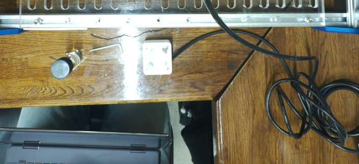
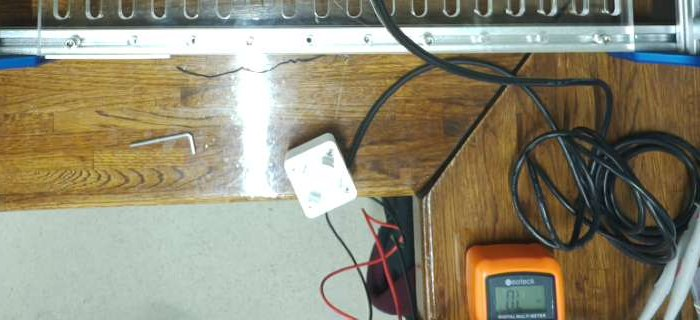

# Stir test on the compact stirrer, after Ben's fix (2026-11-04): not run, the stirrer's 5V lead shorts the Uno

Asked for by Ben on [PR #269](https://github.com/vertical-cloud-lab/byu-vcl/pull/269)
(22:29 UTC): he thought he had fixed what stopped the fan with the holder on
([11-03 record](../stirrer_first_spins_20261103/README.md)), and wanted to know what the Hall
sensor sees in a stir test. **The test didn't run.** The Uno was off the CubXL Pi's USB when
the session started, and each time the stirrer's 5V lead went into the Uno, the Uno turned
off. All times UTC (the lab is on MST, UTC−7). `~/cubxl_runs/HOLD` was set from 22:43:54.

## What the Pi saw

The Pi's journal is kept in RAM only, so the log from before the 22:37 reboot is gone. The
rows up to 22:37 come from what this session read before the reboot. From 22:37:43 on, the
lines are in [`kernel_usb_this_boot.log`](kernel_usb_this_boot.log).

| UTC | |
|---|---|
| 11-03 22:51:36–22:53 | During the 11-03 session, holder off, Ben handling the stirrer: the Uno dropped off USB and came back 8 times, with 117 over-current events across all the Pi's USB ports. These were the first over-current events since the Pi booted on 10-20 |
| 11-04 18:23 | 6 more over-current events |
| 11-04 22:28:04 | The Uno and the CH340 drop off USB at the same instant, come back at 22:28:05, drop again at 22:28:08 |
| 22:28:32–34 | **600 over-current events**. Only the CH340 comes back |
| 22:29:04 | Ben's request |
| 22:37:1x | The Uno tries to come up on one port and fails (`can't set config #1, error -71`), then comes up on another as `ttyACM0`. 24 more over-current events |
| 22:37:43 | **The Pi reboots.** Not known whether by hand |
| 22:43:17 | The Uno comes up on bus 1 port 2, cleanly |
| 22:43:58 | It answers `31`, `14` and `29` (below) |
| 22:49:50–58 | It drops off USB, comes back for 7 s, drops again. Ben (22:50): *"The Uno turned off right when I plugged the 5V lead into it."* No over-current this time |
| 22:50:31 | The Uno comes back, with the 5V lead out |

The Pi was otherwise healthy throughout: `get_throttled` 0x0 and 5.12–5.13 V in, before and
after the reboot.

Both devices dropping at once, with over-current flagged on every port, is the Pi cutting
power to its USB ports. On a Pi 5 that happens when the ports together draw more than their
limit (1.6 A with `usb_max_current_enable=1`), which is a short, not a fan. The Uno's own
500 mA resettable fuse trips on the same short, which is what keeps it off afterwards and
lets it come back once the short is gone.

## The Uno is fine

[`check_board.py`](../stirrer_first_spins_20261103/check_board.py) at 22:43:54
([log](check_board_224354Z.log)), the same replies as straight after the 11-03 flash:

| Command | Reply |
|---|---|
| `31` stirrer status | `{"target":0,"setpoint":0,"rpm":0.0,"duty":0.000,"stalled":0,"left_s":-1}` |
| `14` pipette `STATUS` | `{"homed":0,"pos":0.00,"max_vol":20.00}` |
| `29` driver status | `[0.00,0.00,-1.00]`, as in every record since September |

## Where the short probably is

Ben measured **360 Ω** across the stirrer's leads (22:41). That isn't a short: at 5 V it
is 14 mA. So the short most likely appears where the leads meet the Uno. The likeliest
cause is **5V and GND swapped** between the Uno and the junction board. `BUILD.md` says the
two JST-XH halves' colours need not match. Swapped, the Uno's 5V goes into the board's GND
rail, then through the IRLZ44N's body diode (source to drain) and the 1N5819 (anode to
cathode) into the 5V rail and back to the Uno's GND. That is a short through two diodes, and
it appears only when the lead goes in. Wired the right way round, both diodes are reverse
biased.

Sent to Ben as one check: meter in diode mode on the Uno half's leads, nothing plugged into
the Uno.

| Probes | Wired right | 5V and GND swapped |
|---|---|---|
| Red on the lead for the Uno's GND, black on the one for 5V | about 0.5–0.9 V, the two diodes | higher, or OL |
| Red on the 5V lead, black on the GND lead | higher, or OL | about 0.5–0.9 V |

If it is wired right, the other suspects are the 5V lead's pin, or a strand at its splice,
touching the GND socket next to 5V on the Uno's power header. `BUILD.md`'s powered bench
check (5.0 V, 0.3 A limit, on the stirrer half's pins 1 and 2) shows whether the short is in
the stirrer.

 

*Deck camera, cropped to the bench in front of the deck. Left, 22:32:44: the stirrer, holder
on, its cable running up to the Uno. Right, 22:43:03: the meter out.*

## On the Pi

`~/stir_20261104/` holds copies of `check_board.py` and `spin.py`. While the session ran, a
`journalctl -k -f` copied the kernel log into it, so that another reboot wouldn't lose it.
`HOLD` is removed at the end. Nothing else on the Pi changed.
