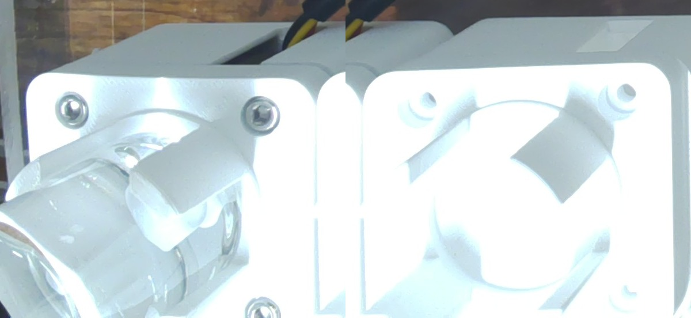
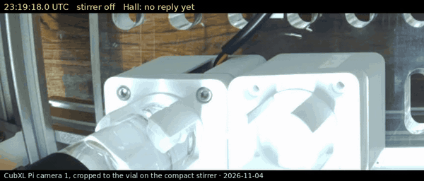
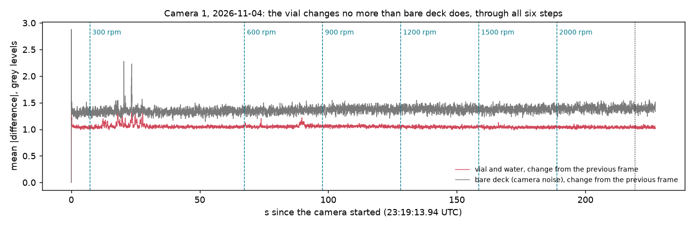
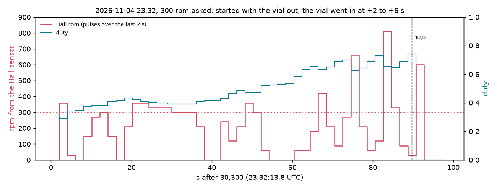
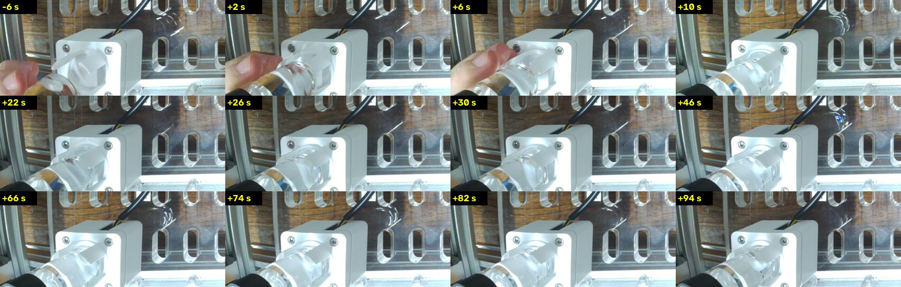
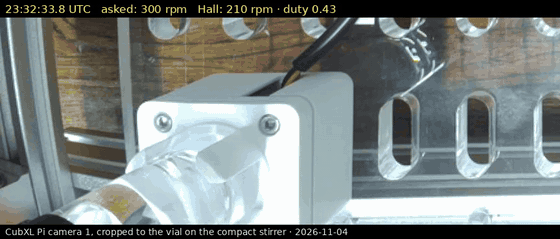

# Stir test with water and the stir bar (2026-11-04): it won't start with the vial on, but started first it stirs, and the Hall reading goes wrong

Asked for by Ben on [PR #269](https://github.com/vertical-cloud-lab/byu-vcl/pull/269)
(23:12 UTC): he had put a vial filled with water, with the stir bar in it, on the compact
stirrer, and asked for a stir, filmed if the cameras could see it. An hour earlier, with the
holder on and no vial, the same stirrer spun and counted every turn
([`stirrer_spin_20261104`](../stirrer_spin_20261104/README.md)). **With the vial and bar in,
the fan did not start at any speed from 300 to 2000 rpm. The Hall sensor gave no pulses, the
firmware stopped each step after 12 s with `stalled` set, and nothing in camera 1's view of
the vial moved. Then (23:32) the fan was started with the vial out and Ben lowered the vial in: it kept
turning, the water moved on camera, and for about 15 s the Hall sensor read 300–360 rpm. After
that the reading jumped between 0 and 810 rpm while the firmware raised the duty to 0.74.**
All times UTC (the lab is on MST, UTC−7). `~/cubxl_runs/HOLD` was set from 23:14:15.

## What the cameras see

The CubXL Pi has two cameras. Camera 0 (`deckcam.py`'s, overhead) sees the vial's black cap
from above and the bench around it. **Camera 1 sees the vial from the side**, above the
stirrer's cup, next to the second compact stirrer, which is empty
([full frame](frames/231423Z_camera1_full.jpg)). Through the glass there is a white block
that looks like the bar, but it is one of the cup's fingers: the empty cup shows the same
block in the same place relative to its screws ([side by side](frames/231423Z_camera1_cups_compared.jpg)).
The bar itself lies on the vial's floor, down inside the cup, and can't be made out. So
camera 1 can show the water moving, but not the bar.

*Camera 1, 23:14:23, full resolution. Left: the vial in its cup. Right: the empty stirrer's
cup, with the same white block.*

## Run 1, vial on from the start (23:19:13–23:23:01)

[`stir_video.py`](stir_video.py) ran on the Pi, started by [`watch_run.py`](watch_run.py) on
the runner, which also read the thread every 15 s for a request to stop. It filmed camera 1,
cropped to the vial (`--roi 0,0.716,0.375,0.284`, 864 × 368, 30 fps MJPEG, 20 ms shutter,
focus fixed at 1.16 dioptres), from 4 s before the first command to 8 s after the last. On
one connection to the Uno it then sent each step as `30,<rpm>,<seconds + 15>` and read `31`
every second ([log](water_1104.log), [data](water_1104.jsonl)).

| UTC | Asked | What `31` said |
|---|---|---|
| 23:19:21 | 300 rpm, 60 s | `rpm` 0.0 throughout; duty 0.300 → 0.315 as the stall kicks repeated; at 12.1 s `target` 0 and `stalled` 1 |
| 23:20:21 | 600 rpm, 30 s | the same, stalled at 12.1 s |
| 23:20:51 | 900 rpm, 30 s | the same |
| 23:21:22 | 1200 rpm, 30 s | the same |
| 23:21:52 | 1500 rpm, 30 s | the same |
| 23:22:22 | 2000 rpm, 30 s | the same |
| 23:22:53 | stop (`30,0`) | `rpm` 0.0 |

Each step is one full-power kick of 0.5 s, then five more after 0.75 s pauses as the
firmware found no pulses, so the fan got 36 kicks at 100 % duty in all. The speed asked for
makes no difference to that: the setpoint only ramps once pulses arrive. The Uno answered
every command, the Pi logged no USB event or over-current, and `get_throttled` stayed 0x0
with 5.11 V in.

## Did anything move?

*The first step, 23:19:18–23:19:34.5, with the Uno's replies burned in
([MP4](stir_water_300rpm.mp4), made by [`make_clip.py`](make_clip.py)). The kick starts at
23:19:21.1; the firmware gives up at 23:19:33.*

[`motion.py`](motion.py) measures how much each frame differs from the one before, over all
of the vial camera 1 sees, and over a patch of bare deck for the camera's own noise
([output](motion_output.txt), [per frame](water_1104_motion.csv)).

- **The vial changes less from frame to frame than bare deck does:** median 1.05 grey
  levels (99th percentile 1.17) against 1.37 (1.50). Water swirling, or a bar turning
  through the water, would change it far more than that.
- **No spike at the kicks.** The only local change is a highlight on the glass flickering at
  18 s and 23 s into the recording, during the first step's kicks: a few dozen pixels, which
  may be the water trembling. The larger bumps are in the deck patch too, so they are the
  light or the exposure, not the vial.

With no Hall pulses through 36 kicks and nothing moving in the vial, **the fan most likely
didn't turn at all.** Turning with the bar left behind, it would still have toggled the
sensor. Turning with the bar following, it would have moved the water.

## Run 2, started with the vial out, then the vial lowered in (23:32:06–23:33:52)

I suggested the test in the thread, and Ben replied `vial out` at 23:31:43. Same scripts, one
step: `30,300,105`, read for 90 s ([log](lower_1104.log), [data](lower_1104.jsonl)). **Camera 1
had been moved between the runs**, so the view is closer and shows one stirrer.
[`plot_lower.py`](plot_lower.py) plots the readings.

*Camera 1 through run 2, seconds after `30,300`. The vial goes in at +2 to +6 s; a hand is
on it again at about +14, +18, +34 to +42 and +50 to +58 s.*

| s after `30,300` | Hall `rpm` | duty | On camera |
|---|---|---|---|
| 0–2 | 360 | 0.29 | Vial out; the fan starts on the kick |
| 2–8 | 30, then 0 | 0.34 | The vial is lowered in |
| 8–14 | 150 → 300 | 0.38 | Vial in, then a hand on it |
| 14–18 | 150, 0 | 0.41 | Hand on the vial |
| 18–36 | 210, then **300–360 for 16 s** | 0.43 → 0.39 | **Vial in, hands off: the water moves** |
| 36–42 | 210, then 0 | 0.41 | Hand on the vial |
| 42–90 | 0 to 810, never steady | 0.43 → 0.74 | Vial in, hands on it at times |
| after `30,0` | **600 for 2 s**, then 0 | 0 | |

[`motion_lower.py`](motion_lower.py) ([output](motion_lower_output.txt)) gives the vial's
frame-to-frame change against bare deck's. **From +22 to +33 s it is 5.4 grey levels
against 1.3**, four times the camera's noise. In run 1 it was 1.05 against 1.37. Later on, a
reflection moving in the acrylic deck makes the bare-deck patch too noisy to compare.

*+20 to +36 s, the stretch with the vial in and hands off, with the Uno's replies burned in
([MP4](stir_vial_lowered_300rpm.mp4)).*

**What this says:**
- **The fan can turn with the vial in, once it is going.** Run 1's problem was starting
  from rest.
- **The Hall reading with the vial in can't be trusted.** It read 30 rpm just before
  `30,0`, then 600 rpm over the 2 s after it, with the fan unpowered and coasting down.
  Nobody touched the vial then (frames from +86 to +94 s). A coasting fan only slows, so
  before the stop it was turning far faster than the 30 rpm reported: while it was driven,
  the sensor missed most of the turns, and the firmware, seeing too few pulses, kept raising
  the duty. That is the
  failure `BUILD.md` names in its troubleshooting table: the coupled bar's field cancelling
  part of the magnets' field at the sensor, which sits beside the magnets
  ([field check](../../../hardware/vial-stirrer-cubxl/analysis/field_check_output.txt)).
  How much is cancelled depends on how far the bar lags the magnets, which changes with
  speed and drag, so the reading comes and goes.
- **Ben's hands moved the vial several times,** so not every drop to 0 is the stirrer's.

## Why

Without the vial, the fan started on the first kick an hour earlier. With the vial and bar
on, it doesn't start, so the bar is what stops it. `BUILD.md` stage 8 expected the coupling
might be too strong (README [risk 1](../../../hardware/vial-stirrer-cubxl/README.md#risks-and-open-questions)):
the magnets are 2.4 mm from the vial, against about 7 mm on the Pioreactor. Two ways that
stops a 40 mm fan at 5 V:

1. **Breakaway.** The magnets pull the bar down onto the vial's floor. To start, the fan
   has to drag the bar round against that friction, and a fan at 5 V has little starting
   torque.
2. **The rotor is pulled up.** The bar also pulls the magnets, and the fan's rotor with
   them, up toward the vial. The carrier's top is 1.10 mm below the holder's ceiling
   ([MuJoCo check](../../../hardware/vial-stirrer-cubxl/README.md#interference-check-in-mujoco-2026-11-04)).
   If the fan's sleeve bearing lets the rotor rise that far, the carrier rubs the ceiling.
   Nobody has measured the rotor's end play.

Run 2 points to the first: started with the vial out, the fan kept turning with the vial
in. The fix `BUILD.md` names is a spacer disc under the vial (1, 2 or 3 mm; none has been
printed yet), which weakens the pull. Starting the fan before the vial goes in also works,
but a CubOS run can't do that yet.

The Hall reading is a separate problem, and a spacer barely helps it (about 0.6 mT for 1 mm,
by `BUILD.md`). What does help: the sensor closer to the carrier, keeping 0.5 mm clear (about
4 mT for each 0.5 mm); or the sensor between the magnets and the bar, as on the Pioreactor,
where the bar's field adds to the magnets' instead of cancelling it.

## On the Pi

`~/stir_20261104b/` has `stir_video.py`, the logs, and both full recordings with their
frame times: `water_1104.mjpeg` (236 MB, 6809 frames) and `lower_1104.mjpeg` (120 MB, 3150
frames). They are not committed; run 2's has a person's hair in frame at about 23:32:12.
`HOLD` was set at 23:14:15. Nothing else on the Pi changed; `deckcam.py` was left as it was.
