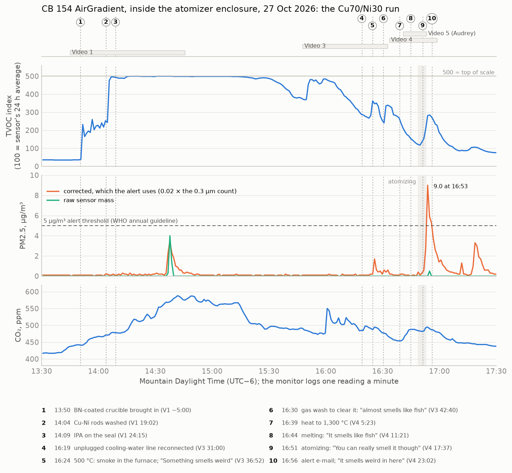
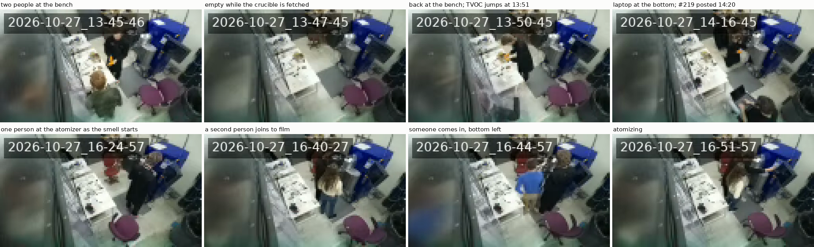

# The 27 Oct 2026 AirGradient alert and the Cu70/Ni30 atomizer run

Issue [#305](https://github.com/vertical-cloud-lab/byu-vcl/issues/305). The CB 154 AirGradient,
the lab's only monitor, has sat inside the atomizer enclosure since 29 Sep. At 16:56 MDT on 27 Oct it
sent a "Fine particle concentration warning": PM2.5 5.3 µg/m³ against a 5 µg/m³ threshold. That
afternoon Gage ran the first copper alloy on the rePOWDER: 1,079.9 g of Cu70/Ni30 at 1,300 °C in a
graphite crucible newly sprayed with boron nitride, onto a W-dipped carbon-fibre plate
([digital-alloy-lab#219](https://github.com/vertical-cloud-lab/digital-alloy-lab/issues/219#issuecomment-6457884447)).
People smelled fish in the enclosure and in the lab outside it.

This lines the monitor's per-minute readings up with Gage's five run videos and the enclosure's
livestream.

## What the record shows

- **The smell started in the furnace at 500 °C, before anything melted.** Just before 16:24 Gage
  took the furnace from 250 to 500 °C and "cloudy white" smoke filled it: "I can't see into the
  furnace." He said "Something smells weird" within the same minute that the monitor's TVOC index
  jumped from 282 to 363. He then ran a gas wash to clear the smoke, and said of the purge: "I can smell, almost
  smells like fish" (16:30). The TVOC index jumped again a minute later. The smell went on through
  melting at 1,300 °C ("Is that what the smell is?" "It smells like fish", 16:45) and atomizing
  ("You can really smell it though, holy cow", 16:51).
- **The particle alert came at the end of atomizing.** Particle counts started rising at 16:51,
  two minutes into the pour, and peaked at 16:53:45, when the collection cup had just filled. Corrected
  PM2.5 was then 9.0 µg/m³. The alert fired at 16:56, and Gage read it off the monitor on video at
  16:56:30 ("it smells weird in here … CO2 is 486"). The API logged 486 ppm at 16:56:45, which is
  what pins Video 4's clock.
- **In absolute terms the alert is small, but this enclosure has never logged one like it.** The raw
  sensor's PM2.5 was 0.5 µg/m³ at most at the time. AirGradient's *corrected* PM2.5, which is the
  value the alert uses, is 0.02 × the count of particles over 0.3 µm in every reading here. So these
  were many very fine particles with almost no mass, as smoke or fume would be. Even so, the
  peak count was 4× that of any minute from 20 to 26 Oct, and the highest 5-minute count was 2× that
  of any day since the monitor went into the enclosure. Before this, no minute since 20 Oct had passed
  2.1 µg/m³, and no 5-minute average since 29 Sep had passed 1.7. The logged value was at or above 5
  for three readings, 16:53:45 to 16:55:45, though the e-mail says "Duration met: 15 minutes".
- **The TVOC index at its 500 ceiling from 14:05 to 15:10 was alcohol, not the smell.** It began
  with washing the rods and wiping the seal with IPA (Video 1, 19:02 and 24:15), and the set-up and
  run days on 20, 21 and 22 Oct pinned it the same way. The fishy smell only moved the index by 80–170,
  and not at all when it came up again during melting. Amines, the usual cause of a fishy smell, are
  noticeable at a part per billion or less, so a strong smell needn't move a general VOC sensor much.
  The TVOC trace can't measure the smell. At best it times it.

CO₂ tracks people in the enclosure: up from 416 ppm as the set-up began at about 13:40, and highest
(588 ppm) during the cleaning.

## Timeline

Video clocks are fixed as described under [Method](#method): Video 4 to about ±45 s, Video 3 to
about ±1 min, Video 1 to about ±2 min.

| MDT | Source | What happened | Monitor |
| --- | --- | --- | --- |
| ~13:40 | | People enter the enclosure | CO₂ starts rising from 416 ppm |
| 13:46–13:50 | [V1 0:07–5:13](https://youtu.be/Ha7lIHP9X9g?t=7) | The BN-coated crucible is fetched from the other lab's fume hood: "looks way better than it did yesterday … I kept spraying it and it just wasn't looking solid". The livestream shows the enclosure empty from 13:46:45 to 13:49:45 and someone back at the bench at 13:50:45 | TVOC index 39 → 232 at 13:51:42 |
| 14:04 | [V1 19:02](https://youtu.be/Ha7lIHP9X9g?t=1142) | "I need to wash these": the 1.1 kg of rods, cut on the band saw that day | TVOC index 243 → 476 at 14:05 |
| 14:09 | [V1 24:15](https://youtu.be/Ha7lIHP9X9g?t=1455) | "I'm using some isopropyl alcohol to clean the seal" | TVOC index pinned at 499–500 from 14:15 to about 15:10 |
| 14:37 | | During cleaning of the chamber parts (V1 46:37–51:27) | Raw PM2.5 4.0, PM10 7.7 µg/m³: the one coarse, dust-like puff of the day |
| ~15:40–16:19 | [V3 29:29–33:26](https://youtu.be/rM3yT03IIwo?t=1769) | "the heat exchanger was not working for about 40 minutes … finally found a water line that was completely unplugged" | |
| ~16:20–16:24 | [V3 39:16](https://youtu.be/rM3yT03IIwo?t=2356) | Furnace taken from 250 to 500 °C. Gage, on a call at 16:27: "I took the temperature from 250 up to 500 after purging it, and I don't know if it's the boron nitride or something completely vaporized like inside the furnace, so I can't see into the furnace. It's just like cloudy white." The reply: "The boron nitride coating." Gage: "when I was touching it, it seemed perfectly dry" | |
| 16:24:37 | [V3 36:52](https://youtu.be/rM3yT03IIwo?t=2212) | "Something smells weird." "I wonder if the different smells from the copper and nickel? … it's not warm enough [for] melting it" | TVOC index 282 → 363 at 16:24:44; 0.3 µm count 84 at 16:25:44 |
| 16:30:25 | [V3 42:40](https://youtu.be/rM3yT03IIwo?t=2560) | "… gas washing to remove the cloudy gas that filled the chamber once I brought it up to 500 degrees, so I can see what's in there again … in this purge, I can smell, almost smells like fish" | TVOC index 241 → 336 at 16:31:45 |
| 16:33:40 | [V4 0:08](https://youtu.be/rJB22OSwkl4?t=8) | "Do one more gas wash" (O₂ 24 ppm) | |
| 16:39 | [V4 5:23](https://youtu.be/rJB22OSwkl4?t=323) | Setpoint to 1,300 °C: "See if this chamber starts filling up with smoke again from the boron nitride" | |
| 16:44:50 | [V4 11:18](https://youtu.be/rJB22OSwkl4?t=678) | Charge melting. "Is that what the smell is?" "It smells like fish." Someone comes in through the door at 16:44:57 on the livestream, and then: "I walked out, and then you ran things, and I came back in like, woah, what the heck?" | |
| 16:48 | [V4 14:36](https://youtu.be/rJB22OSwkl4?t=876) | Ultrasonics on (40 kHz, 90 %), graining pressure, turbo pressure held | TVOC index rising from 118 at 16:49:45 |
| 16:51:07 | [V4 17:37](https://youtu.be/rJB22OSwkl4?t=1057) | Atomizing: "You can really smell it though, holy cow." O₂ 245 ppm | 0.3 µm count rising at 16:51:45 |
| 16:52:56 | [V4 19:26](https://youtu.be/rJB22OSwkl4?t=1166) | "It's completely full!" Setpoint back to 250 °C | 0.3 µm count 449 (9.0 µg/m³) at 16:53:45; TVOC index 285 at 16:54:45 |
| 16:56:00 | alert e-mail | "Above 5 ug/(m³) … Current value: 5.3" | 5.3 µg/m³ at 16:55:45 |
| 16:56:32 | [V4 23:02](https://youtu.be/rJB22OSwkl4?t=1382) | Gage reads the alert: "it smells weird in here … CO2 is 486, is that high?" | CO₂ 486 ppm at 16:56:45 |
| 17:18 | | (after the videos end) | A second, smaller puff, 3.3 µg/m³ |

Audrey's phone recording, Video 5 ([`2brsz-90seg`](https://youtu.be/2brsz-90seg)), covers 16:41–16:53
and has the same lines, which is how it is placed. Video 2
([`oF_gteb_Pi0`](https://youtu.be/oF_gteb_Pi0)) is fitting the W-dipped plate, some time between
Videos 1 and 3. The BN coat itself was sprayed the day before, in the other lab's fume hood
([`GF2Bo60-4z4`](https://youtu.be/GF2Bo60-4z4)), in several passes. Some went on before the last
could be judged dry ("I can't really like visually tell if it's dry or not so I'm
going to just spray some more"). The next day, in Video 1: "I kept spraying it and it just wasn't
looking solid".

## Against the other run days

The monitor's per-minute record goes back only a week (to 20 Oct), so earlier days are compared on
the 5-minute averages. 06:00–21:00 MDT each day. Made with [`compare_days.py`](compare_days.py).

| Date | What | 0.3 µm count, max 5-min | 0.3 µm count, max 1-min | Corrected PM2.5, max 1-min (µg/m³) | Raw PM2.5, max 1-min | Minutes ≥ 5 µg/m³ | TVOC index ≥ 400 (min) |
| --- | --- | ---: | ---: | ---: | ---: | ---: | ---: |
| 2 Oct | Al run (first unsupervised) | 43 | | | | | 65 |
| 6 Oct | Al 6067 run, 840 °C | 30 | | | | | 115 |
| 8 Oct | Al run, CF plate | 84 | | | | | 20 |
| 20 Oct | set-up only, no melt | 25 | 69 | 1.4 | 0 | 0 | 95 |
| 21 Oct | Al 4047 run, 810 °C | 79 | 103 | 2.1 | 0 | 0 | 255 |
| 22 Oct | Al 4047 run, 810 °C | 51 | 106 | 2.1 | 0 | 0 | 30 |
| 26 Oct | BN coat sprayed, in another lab's hood | 17 | 59 | 1.2 | 0 | 0 | 175 |
| **27 Oct** | **Cu70/Ni30 run, 1,300 °C** | **185** | **449** | **9.0** | **4.0** | **3** | **240** |

So particles separate this run from the aluminium runs, and the TVOC index doesn't. The index also
passed 400 between 04:00 and 07:00 on 6 of the last 28 mornings, so a high index on its own means
little here.

## What made the smell

| Candidate | For | Against |
| --- | --- | --- |
| **Binder in the fresh BN coat burning off** (most likely) | New today. The smoke appeared at 500 °C, while the charge was still solid, and when Gage asked on a call what it might be, the answer was "The boron nitride coating". The run plan already expected the binder to burn off on first heating ([digital-alloy-lab#220](https://github.com/vertical-cloud-lab/digital-alloy-lab/pull/220)). The coat was heavy. Momentive's 2015 SDS for this spray ([BN Spray Paint II](https://assets.omega.com/sds/SDS-0039.pdf), sold by Tempco) lists 1–5 % of a quaternary ammonium clay, benzyl(hydrogenated tallow alkyl)dimethylammonium bentonite, to keep the BN suspended. Clays like that break down mainly between about 200 and 500 °C, giving off amines and alkenes ([Xie et al. 2001](https://doi.org/10.1021/cm010305s)), and amines smell of fish | The current SDS that McMaster ships doesn't name the binder ([as read in digital-alloy-lab](https://github.com/vertical-cloud-lab/digital-alloy-lab/blob/23a14ca/near-term-submissions/onr-yip/README.md)). It lists the same solvents, ethanol and acetone, plus a little methanol and MIBK, which are common ethanol denaturants. Under Prop 65 it lists 0.034 % quartz, which fits a clay but doesn't prove it's the same one |
| **Band-saw coolant left on the rods** | Also new today: Gage had just cut the rods ("So I just cut that", V1 0:45). Water-mix metalworking fluids usually contain alkanolamines, which have an ammonia-like, fishy smell | The rods were washed first (V1 19:02). Nobody has said what coolant that saw uses, or whether it used any |
| W-dipped carbon-fibre plate | New today. Could add to the smell during the pour | It sits below the nozzle and isn't heated until melt lands on it, at 16:49. The smell started 25 min earlier |
| Running at 1,300 °C | New today | The smell started at 500 °C |
| Dehumidifier | | It has run since 29 Sep, and no smell had been reported before. The smell started when the furnace was heated, and Gage saw the smoke inside the furnace |
| IPA | Pinned the TVOC index | IPA doesn't smell of fish, and the cleaning was done by 15:10 |

How it got out: the smell was in the enclosure air within a few minutes of the smoke appearing at
500 °C, and the gas wash and the pour each added to it. So some of the gas that left the furnace and
chamber came into the enclosure rather than going up the duct. Where the vacuum
pump's exhaust and the chamber's vent actually discharge is the first thing to check. With one monitor,
and that one inside the enclosure, there is no reading for the room. That is the case for the second
monitor, outside the enclosure, and a third in another room.

## The livestream

The enclosure's camera ([`sDPzso4-tP0`](https://www.youtube.com/watch?v=sDPzso4-tP0), 144p and
pixelated on purpose) can't see into the furnace, and at this resolution it shows no haze in the
room. What it does confirm is who was where, and when, on the clock it burns into every frame,
which runs 12 s behind the archive's nominal time. That matches the videos and the monitor:

- **13:46:45–13:49:45:** the enclosure is empty while the crucible is fetched. Someone is back at
  the bench at 13:50:45, a minute before the TVOC index jumps.
- **14:14–14:19:** someone sits with a laptop at the bottom of the frame, just before
  digital-alloy-lab#219 is posted at 14:20:01, which fits Video 1's clock.
- **16:18–16:19:** someone crouched at the bottom right gets up and goes to the machine, while
  Video 3 has the water line found and reconnected. From 16:20 to 16:36, through the first smell and
  the gas wash, there is mostly one person at the atomizer.
- **16:40:** a second person joins and stays by the machine to film. Video 5 starts at 16:40:50.
- **16:44:57:** someone comes in through the door at the bottom left. The door was opened while the
  smell was in the enclosure, which is one way it could have reached the lab.

The frames came from the archive's 2 s fragments, fetched by sequence number on the stream-cam Pi
with [`livestream_frames_pi.py`](livestream_frames_pi.py), because YouTube won't serve the player
to a CI runner and the archive offered only DASH right after the broadcast ended.

## Suggestions

- **Bake out a new coat before loading the charge.** Heat the coated crucible empty to 500–600 °C
  under argon and gas-wash until the smoke and smell are gone, with the purge going to the duct. Or
  cure it in a furnace in a fume hood. The run plan already asks AMAZEMET whether to gas-wash hotter
  than 500 °C to clear a fresh coat's binder. This run suggests yes.
- **Spray thin coats and let each one dry.** The can says "successive light coats rather than one
  heavy coat … allow sufficient drying between coats". In the coating video at least one pass went
  onto a wet coat: "when I'm trying to put more on, it just gets rid of everything that is already
  there".
- **Ask Momentive or McMaster for the binder** in 10515K35, or heat a coated coupon by itself in a hood.
- **Find out what coolant the band saw uses.** Degrease cut rods with detergent and water, then
  alcohol, or saw them dry.
- **Check where the pump exhaust and the chamber vent go**, and connect them to the duct if they
  discharge into the enclosure.
- **Add the cooling-water hoses to the pre-run checklist.** One was found unplugged after about
  40 minutes of troubleshooting (V3 33:14).
- **Watch the next new coat's first heat.** With a second monitor in the room, it would show whether
  the bake-out works and whether the enclosure is holding.

## Method

- **Monitor data** come from the AirGradient public API, location 184200, read with
  [`fetch_airgradient.py`](fetch_airgradient.py): per-minute uploads from 20 to 28 Oct, and 5-minute
  averages from 29 Sep. The serial number, which is the monitor's MAC address, and its coordinates
  were dropped before saving. The figure is [`plot_oct27.py`](plot_oct27.py).
- **Corrected PM2.5.** In every per-minute reading, `pm02_corrected` equals 0.02 × `pm003Count`
  to within 0.06 µg/m³. The alert's 5.3 µg/m³ is the 16:55:45 reading.
- **Video clocks.** Gage's videos are on the BYU Vertical Cloud Lab channel. The narration was
  transcribed with Whisper (`base.en`, with `medium.en` for the lines quoted), and only the lines
  quoted here are kept.
  - **Video 4** (25:15, uploaded 17:01:41) is fixed by Gage reading the monitor at 23:11: "CO2 is 486".
    The API logged 486 ppm at 16:56:45. He reads the alert at 23:02, and the alert e-mail went out
    at 16:56:00, so Video 4 began at 16:33:30 ± 0:45.
  - **Video 3** (44:57) ends where Video 4 picks up ("continue where we left off"), so it began at
    about 15:47:45. That puts "we're not going to make the 4:30 SEM time" at 16:21, and the first two
    smell remarks each about a minute before a TVOC rise.
  - **Video 1** (1:00:38) began no later than 13:46. Ronnie's
    [digital-alloy-lab#219](https://github.com/vertical-cloud-lab/digital-alloy-lab/issues/219), posted at
    14:20:01, quotes what was said at 33:07 (the Mo-dipped plate, Edison) and 34:03 (0.19 bar).
- **The livestream** is the atomizer stream, picam-ot2, broadcast
  [`sDPzso4-tP0`](https://www.youtube.com/watch?v=sDPzso4-tP0) (13:01–21:00 MDT): one frame a minute
  from 13:30 to 17:30, and one every 10 s from 16:18 to 16:36 and 16:38 to 16:59.
