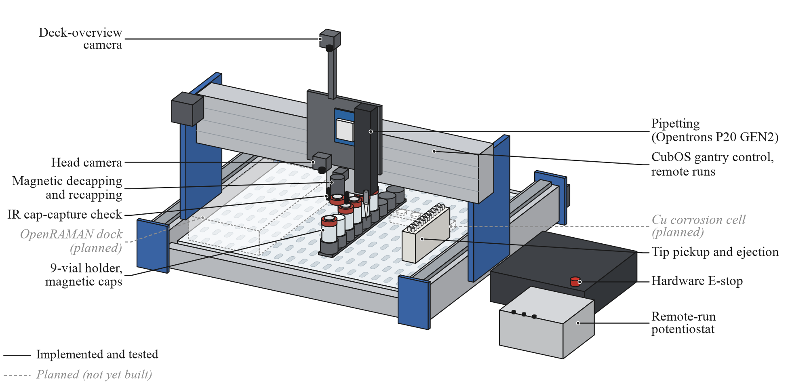

# CubXL schematic for the ONR YIP Equipment attachment

An annotated schematic of the CubXL as it stood on 2026-10-28, for the Equipment attachment of the
ONR YIP copper/DED proposal ([#307](https://github.com/vertical-cloud-lab/byu-vcl/issues/307)).

| File | What it is |
| --- | --- |
| [`cubxl_schematic.pdf`](cubxl_schematic.pdf) | Vector, 6.5 × 3.2 in, Times New Roman embedded (TrueType) |
| [`cubxl_schematic.png`](cubxl_schematic.png) | 1950 × 960 px, 300 dpi |
| [`draw_cubxl_schematic.py`](draw_cubxl_schematic.py) | Draws both: `python docs/cubxl-schematic/draw_cubxl_schematic.py` (matplotlib, numpy; Times New Roman must be installed, e.g. `ttf-mscorefonts-installer`) |

## Caption

> **Figure X.** The CubXL, a Genmitsu PROVerXL 4030 V2 gantry driven by the open-source CubOS
> software from a Raspberry Pi 5 on its tool head. Solid callouts mark capabilities already run on
> the hardware: electromagnetic decapping and recapping with an IR capture check, pipetting with
> an Opentrons P20 including tip pickup and ejection, two head-mounted cameras, a hardware E-stop,
> and a potentiostat beside the deck that is operated remotely and so far validated on dummy
> cells. Dashed grey callouts mark planned additions, a copper corrosion cell and an OpenRAMAN
> Raman dock; every run is launched remotely.

## Style

**Solid black leader, black label:** implemented and tested on the CubXL.

**Dashed grey leader, grey italic label "(planned)":** planned and not yet built, drawn as a
dashed grey ghost where its design puts it. Only the two planned items that bear on copper are
drawn; the rest are left off (see the end of this page).

## Evidence for each callout

Comment links are to the comment that reports the result. Records on open PR branches are cited
by commit hash.

| Callout | What has run on the CubXL | Evidence |
| --- | --- | --- |
| **Magnetic decapping and recapping** | 2026-08-03: Claude ran Ben's protocol over Tailscale, 27/27 steps, and decapped and recapped vials 2–7 in turn (a screwdriver stood in for the pipette). Ben: "the capper_decapper worked really well"; one tight cap on a wider vial was missed. Every pipette run since decaps and recaps two vials, most recently 2026-10-20 (12/12). | [PR #171 run report](https://github.com/vertical-cloud-lab/byu-vcl/pull/171#issuecomment-5171519875) · [Ben's report](https://github.com/vertical-cloud-lab/byu-vcl/pull/171#issuecomment-5171653616) · video [`2hO6YA_nxx8`](https://www.youtube.com/watch?v=2hO6YA_nxx8) "CubXL capper decapper Tests with Claude" (2026-08-03) · [2026-10-20 run](https://github.com/vertical-cloud-lab/byu-vcl/pull/171#issuecomment-6302742576) (`471584d`) · build: [#147](https://github.com/vertical-cloud-lab/byu-vcl/issues/147), [`modules/electromagnetic-capper/`](../../modules/electromagnetic-capper/) |
| **IR cap-capture check** | An IR break-beam at the magnet's mouth confirms each capture and release; CubOS retries up to `capture_retries: 2`. Wired and bench-tested 2026-07-22; on 2026-08-27 (campaign 25) the gantry "decapped vial_1 (cap captured first try, no retries)". | [#147, 2026-07-22](https://github.com/vertical-cloud-lab/byu-vcl/issues/147#issuecomment-5050101471) · [PR #171, 2026-08-27](https://github.com/vertical-cloud-lab/byu-vcl/pull/171#issuecomment-5446494084) · `capture_retries` in [`cub_xl_ben_3_instrument.yaml`](../../cubos/results/pipette_test_20261007/configs/cub_xl_ben_3_instrument.yaml) |
| **Pipetting (Opentrons P20 GEN2)** | First observed liquid transfer 2026-09-30 (campaign 68): "It aspirated (enough to almost completely fill the pipette tip below the foam filter), it dispensed, and it dropped the tip." First video 2026-10-02. The plunger has run on a TMC2209 driver since 2026-10-07; latest run 2026-10-20, 12/12. The volume has not been checked on a balance yet, so 20 µL is nominal. | [PR #228, 2026-09-30](https://github.com/vertical-cloud-lab/byu-vcl/pull/228#issuecomment-5920817851) · [`cubos/results/pipette_test_20260930b/`](../../cubos/results/pipette_test_20260930b/README.md) · video [`wlEIIyHLlxs`](https://www.youtube.com/watch?v=wlEIIyHLlxs) "First successful pipette test run" (2026-10-02) · [#169 run report](https://github.com/vertical-cloud-lab/byu-vcl/issues/169#issuecomment-5960336695) · [PR #260](https://github.com/vertical-cloud-lab/byu-vcl/pull/260) (`b00e137`) · [`pipette_test_20261007/SUMMARY.md`](../../cubos/results/pipette_test_20261007/SUMMARY.md) |
| **Tip pickup and ejection** | Part of every pipette run above: a tip is pressed on at A1 of the 2 × 15 rack and ejected back into A1. | As for pipetting · rack position in [`ben_2vials_tiprack.yaml`](../../cubos/results/pipette_test_20261007/configs/ben_2vials_tiprack.yaml) |
| **CubOS gantry control, remote runs** | First protocol on the CubXL 2026-07-23. First run by Claude over Tailscale SSH 2026-07-27. Capper and a stand-in pipette calibrated together 2026-08-01, and calibration in the CubOS web UI working 2026-08-06. The current calibration is Ben's of 2026-10-02 (capper, pipette and camera offsets). Hardware runs go through [`cubxl_run.py`](../../cubos/tools/cubxl_run.py), which validates the setup, runs a mock and a collision sweep, and takes a lock. | video [`vPCfPpj7zpE`](https://www.youtube.com/watch?v=vPCfPpj7zpE) "First Test Protocol Run on CubXL" (2026-07-23) · [#165, first remote run](https://github.com/vertical-cloud-lab/byu-vcl/issues/165#issuecomment-5096643505) · [#133, 2026-08-01](https://github.com/vertical-cloud-lab/byu-vcl/issues/133#issuecomment-5148579798) · [#133, 2026-08-06](https://github.com/vertical-cloud-lab/byu-vcl/issues/133#issuecomment-5209008324) · [`cub_xl_ben_3_instrument.yaml`](../../cubos/results/pipette_test_20261007/configs/cub_xl_ben_3_instrument.yaml) |
| **Deck-overview camera**, **Head camera** | Two Raspberry Pi Camera Module 3 Wide units on the head-mounted Pi 5: cam0 on a mast for the deck overview, cam1 beside the capper. Runs have saved frames at named protocol steps since 2026-09-15. Neither camera sees the pipette nozzle, and cam0 sees the whole deck only with the head at home. | [#165, 2026-10-02](https://github.com/vertical-cloud-lab/byu-vcl/issues/165#issuecomment-5961889577) · [#165, live view](https://github.com/vertical-cloud-lab/byu-vcl/issues/165#issuecomment-5941065655) · [`pipette_test_20261007/frames/`](../../cubos/results/pipette_test_20261007/frames/) · [`run_with_camera_capture.py`](../../cubos/tools/run_with_camera_capture.py) |
| **Hardware E-stop** | Tested during a protocol (2026-08-25), and during a jog and homing (2026-08-26). Ben used it to stop a run on 2026-10-02. | [#182, 2026-08-25](https://github.com/vertical-cloud-lab/byu-vcl/issues/182#issuecomment-5418600872) · [#182, 2026-08-26](https://github.com/vertical-cloud-lab/byu-vcl/issues/182#issuecomment-5432413901) · video [`KR_h3ghReJw`](https://www.youtube.com/watch?v=KR_h3ghReJw) "E-stop testing" · [#169, 2026-10-02](https://github.com/vertical-cloud-lab/byu-vcl/issues/169#issuecomment-5960425984) |
| **Remote-run potentiostat** | A borrowed EZstat Pro on the bench beside the controller box. EZware runs on a Windows 7 PC, which the CubXL Pi drives over Remote Desktop. It has run a CV on a 10 kΩ resistor (2026-10-22); OCP, LPR and a potentiostatic hold (2026-10-26); and LPR on 100 kΩ to 10 MΩ (2026-10-27). **Dummy loads only:** no electrolyte or electrode has been connected yet. It is not on the gantry, not driven by CubOS, and this model has no EIS. | [PR #291, CV](https://github.com/vertical-cloud-lab/byu-vcl/pull/291#issuecomment-6351698251) · [C1](https://github.com/vertical-cloud-lab/byu-vcl/pull/291#issuecomment-6425732470) · [C2](https://github.com/vertical-cloud-lab/byu-vcl/pull/291#issuecomment-6453951031) · [run log at `4825943`](https://github.com/vertical-cloud-lab/byu-vcl/blob/4825943/potentiostat/ezstat-pro/run-log.csv) · [#231](https://github.com/vertical-cloud-lab/byu-vcl/issues/231) |
| **9-vial holder, magnetic caps** | A black printed 9-position 20 mL holder, one front-to-back column at deck x 137. Six vials with steel-disc magnetic caps were loaded on 2026-10-20. | [2026-10-20 deck frame at `471584d`](https://github.com/vertical-cloud-lab/byu-vcl/blob/471584d/cubos/results/pipette_test_20261020/frames/pre_run_2209Z__deckcam.jpg) · [`ben_2vials_tiprack.yaml`](../../cubos/results/pipette_test_20261007/configs/ben_2vials_tiprack.yaml) · cap design: [`modules/electromagnetic-capper/`](../../modules/electromagnetic-capper/) |
| *Cu corrosion cell (planned)* | Design only: a printed O-ring well lid over a polished coupon, a 4-station coupon tray at the back of the deck, and an electrode cap that the capper carries. Its README: "Nothing here has been bought, built or run." | [DAL PR #180](https://github.com/vertical-cloud-lab/digital-alloy-lab/pull/180) · [`alloy-corrosion/copper/README.md` at `dbb8da6`](https://github.com/vertical-cloud-lab/digital-alloy-lab/blob/dbb8da6/alloy-corrosion/copper/README.md#L13-L15) · [PR #180, 2026-10-26](https://github.com/vertical-cloud-lab/digital-alloy-lab/pull/180#issuecomment-6425563227) |
| *OpenRAMAN dock (planned)* | A priced BOM ($2,915), CAD and a layout study, 2026-10-10; nothing bought. The ghost's footprint is approximate, because the layout study used an estimated slot-to-CubOS mapping. | [DAL #148](https://github.com/vertical-cloud-lab/digital-alloy-lab/issues/148#issuecomment-6353381897) · [`modules/openraman-cubxl/` at `41c02d6`](https://github.com/vertical-cloud-lab/byu-vcl/tree/41c02d6/modules/openraman-cubxl) |

## What checking changed

Some of the candidates in #307 turned out differently when checked:

- **The potentiostat is not on the gantry.** It sits on the bench beside the controller box and has
  only measured resistors ([PR #291](https://github.com/vertical-cloud-lab/byu-vcl/pull/291#issuecomment-6351447805)).
  So its callout is "Remote-run potentiostat", and the caption says "validated on dummy cells".
- **The 2026-08-31 pipette test doesn't show pipetting.** A dummy was on the gantry and Ben held
  the real P20 (video [`lmQbUWNqTmM`](https://www.youtube.com/watch?v=lmQbUWNqTmM), "Pipette test
  on CubXL (pipette handheld)";
  [PR #171](https://github.com/vertical-cloud-lab/byu-vcl/pull/171#issuecomment-5482357822)). The
  pipetting callout cites 2026-09-30 and 2026-10-02 instead. The headline of
  [`pipette_test_20260831/README.md`](../../cubos/results/pipette_test_20260831/README.md) ("executed")
  reads as more than happened; see
  [`pipette_diagnosis_20260831/`](../../cubos/results/pipette_diagnosis_20260831/README.md).
- **"Cap Pouring Test CubXL"** ([`L-van69pUTc`](https://www.youtube.com/watch?v=L-van69pUTc),
  2026-08-14) shows PDMS being poured into a printed cap by hand. That is how caps are made, not
  something the capper does, so it is not cited for a callout.
- **"Aug 6":** [`Gi3pt3BvIug`](https://www.youtube.com/watch?v=Gi3pt3BvIug), "Calibration bug
  fixes on CubXL using web interface from CubOS" (published 2026-08-06 UTC), records the failed
  calibration of 2026-08-05
  ([#133](https://github.com/vertical-cloud-lab/byu-vcl/issues/133#issuecomment-5198247075)). The
  calibration that worked is reported in the
  [2026-08-06 comment](https://github.com/vertical-cloud-lab/byu-vcl/issues/133#issuecomment-5209008324),
  which has no video.
- **The vial stirrer** is in [PR #269](https://github.com/vertical-cloud-lab/byu-vcl/pull/269),
  not #169. It is designed and printed but not built or run, so it is left off.
- **Both cameras ride on the head.** Neither is a fixed deck camera, and the CubXL is not
  streamed to YouTube; its live view stays on the Pi.

## Left off the figure

These items are planned or concepts only. They are left off to keep the figure readable:

- the vial stirrer ([PR #269](https://github.com/vertical-cloud-lab/byu-vcl/pull/269)), designed and printed;
- a head-mounted powder doser ([PR #297](https://github.com/vertical-cloud-lab/byu-vcl/pull/297)) and a miniature powder-doser module ([PR #274](https://github.com/vertical-cloud-lab/byu-vcl/pull/274)); see also [DAL #222](https://github.com/vertical-cloud-lab/digital-alloy-lab/issues/222). The doser itself exists, but not on the CubXL;
- the vertical lift module ([#303](https://github.com/vertical-cloud-lab/byu-vcl/issues/303)), which so far is an animation;
- Dr. Porter's four-point probe, which is lent and unused.

## Where the geometry comes from

- **Head and labware:** Ben's 2026-10-02 calibration, which every run since has used. Copies are on
  main in [`cubos/results/pipette_test_20261007/configs/`](../../cubos/results/pipette_test_20261007/configs/):
  - the capper is the reference tool at (0, 0);
  - the P20 is at (+55.0, +11.0) mm and the head camera mount at (−40.0, +10.0) mm;
  - vials are 28 mm, 33 mm apart at x 136.668;
  - the tip rack's A1 is at (291.332, 89), with 8.5 mm pitch.
- **Deck:** Cubware's 480 × 490 mm slotted plate, with CubOS (0, 0) 142 mm in from its left edge
  and 38 mm from its front.
- **What's mounted, and where:** the 2026-09-25 three-quarter photo
  ([#133](https://github.com/vertical-cloud-lab/byu-vcl/issues/133#issuecomment-5836841107)), the
  2026-10-08 head close-up
  ([#133](https://github.com/vertical-cloud-lab/byu-vcl/issues/133#issuecomment-6069780374)), and
  the 2026-10-22 deck-camera still
  ([PR #291](https://github.com/vertical-cloud-lab/byu-vcl/blob/d48a6f7/potentiostat/ezstat-pro/images/2026-10-22-deckcam-ezstat-corner.jpg)).
  - The X beam is at the back, with the X motor on the left.
  - The P20 is on the right edge of the black tool plate, with the capper just to its left.
  - cam0 is on a mast at the top of the plate and cam1 at its foot.
  - The Arduino Uno that drives the capper and the pipette is mid-plate.
  - The controller box and the potentiostat are on the bench to the right.
- **Frame members** (extrusions, gantry side plates, motors, end plates) are sized to look right,
  not measured. The drawing shows vial 2 decapped, with its cap held on the magnet.
