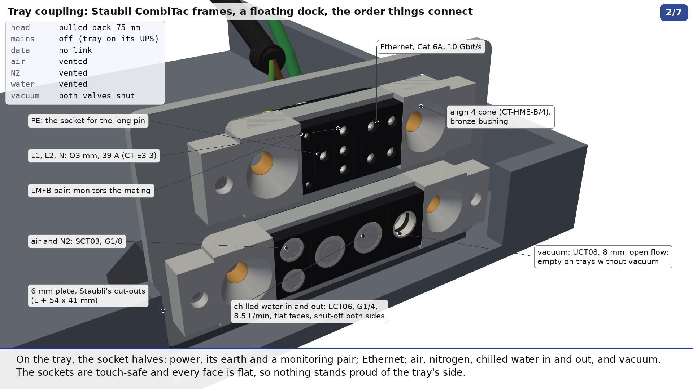

# Digital-twin findings: design gaps caught before any equipment was bought

*From the staged draft of Nov 25, 2026 (written from PR 318 at e3667f8). The rows are checked against the branch
as of this PR, with the rows the branch has moved past brought up to date and the catches the draft missed added.*

**What this shows.** The planned self-driving metals lab in `vertical-lab/` is a dimensioned 3-D model built from
makers' published sizes and ratings. Every robot step is animated, the animations are checked for collisions, and the
workflow runs in a simulation (the digital twin, `vertical-lab/notes/twin_round2.md`). Those checks found the gaps
below while the lab was still on paper. The last column says what a gap would have caused only where a source says
so.

In this design, instruments sit on trays in a vertical lift module (a tall automated storage tower, here a Kardex
Shuttle) that brings each tray to an opening, where a robot arm on a mobile base (a Universal Robots UR12e, the renamed
UR10e, on a MiR250) works on it.

| Gap | How it was caught | Fix | If it had been missed |
|---|---|---|---|
| Powder doser 3.5 mm too tall for the tower's opening (731 mm on its feet; limit 727.5 mm) | Model checked against the tower maker's order sheet for this unit (Oct 27) [1] | Lower its levelling feet 4 mm; a later, taller doser got a taller tray slot [1, 2]. The model has since moved to a 996 mm opening (about 856.5 mm of product height, an estimate from a used unit's listing), where powder-doser's v5 (854 mm as rigged on tray B) clears by 2.5 mm [13, 14] | Fails the maker's height check [2] |
| A small arm (UR3e) reaches only 2 of 4 workflow positions and 3% of a tray | Each candidate arm's reach solved with its inverse kinematics (Oct 27) [1] | A UR10e (since renamed UR12e): 4 of 4 positions, 83% of a tray [1] | Not stated |
| The mobile base can tip under the arm's worst-case loads (955 N·m against about 554 N·m), and its 480 W top-module supply can't power the arm | Stability and power check of the UR10e on a MiR250 (Nov 3) [15] | Lower acceleration limits, then a 131 kg steel ballast plate under each cabinet: the latch pull tips a unit at 829 N, against 466 N without [15, 16] | It can tip [15] |
| The 5 kN tensile tester that fits a tray pulls only a thinned bar (3.7 kN); the 6 × 6 mm test bar needs 14.8 kN. No single-column frame fits a tray (shortest 1,020 mm tall) | Instrument fit and load checks (model rounds 3, 4 and 7) [2, 3] | Full-size bars go to a 100 kN floor-standing frame beside the tower [2] | A 2 kN frame tops out at 56 MPa, below yield [2] |
| The arm's two-finger gripper can't hold a broken tensile half: each half has 20 mm free beside its grip, and the fingertips are 27 mm tall | Collision audit of the tensile chapter (round 11, Nov 13) [17] | Specimen fingers (caps over the fingertips ending in 4 × 8 mm blades) fitted from a stand on the mobile base, jawed grips, and the crosshead backing off 60 mm after the break so each half comes out straight [17] | Not stated |
| The lab's 0.1 mg balance holds 102 g; a copper charge cup weighs 135.7 g | Charge-weighing step of the animation (Nov 6) [4] | A 220 g balance with the same 0.1 mg resolution [2, 4] | Over capacity [4] |
| The vial for the corrosion screen's powder sat on its side under the doser's outlet | Sterling's review of the animation: asked at round 3 (Nov 3), and still on its side in round 8's video (Nov 5) [18, 19] | The vial stands upright on a pedestal on the balance, under the outlet of powder-doser's chain carousel v5 (round 9; 0 of 574 checked frames in collision) [4] | Not stated |
| The gripper can't reach the doser's balance pan: its knuckles span 127–138 mm, and v5's frame posts leave 117 mm | Reach and collision checks when v5 replaced the old doser (round 9, Nov 6) [4] | A fork shuttle carries the vessel through a port in the side panel and the balance's side door onto a pedestal on the pan [4] | Not stated |
| The dose falls 153 mm into a 12.7 mm cup bore, 2.35 mm of margin each side, 124 mm of it outside any draft shield | Sterling's review (Nov 20), then v5's own meshes measured for the room over the pan (Nov 7, Nov 20) [14, 20] | A dose post on the pan, a nest that holds the vessel, and a draft shield up to the docked module: a 45 mm fall, none of it outside the shield; drift in a 0.1 m/s draft, by a Stokes estimate, from 108 to 13 mm (AlSi10Mg d50) [20] | A miss lands on the rim or the pedestal, both on the pan, so it is weighed as dosed without being in the cup [14] |
| Trays carry power, not plumbing; the polisher needs water, air and a drain, the particle sizer air, the SEM its pump | Services check of each instrument (round 3), then a physics-engine (MuJoCo) run of the new dock (Nov 18) [2, 5] | A docking coupling for power, Ethernet, air, nitrogen and chilled water on a motor-driven dock. The physics run found four faults in the dock (a rod 2 mm into the back plate, the crank's hub in the rod's path, a chain hanger where the tubes drop, a cable at a slot's edge), all fixed [2, 5] | Not stated |
| The coupling's vacuum line is rated only to 14 mbar; the powder press die needs under 1 mbar | Maker's rating checked against the press cycle (Nov 20) [6] | Open: needs the maker's leak rate or a helium leak test (fine for the glovebox antechamber) [6] | Air sealed into compacted powder can throw molten metal out of the cup [2] |
| The furnace needs 208 V (at 120 V, its 2.8 kW would draw 23 A); the mounting press is sold only at 230 V | Per-machine voltage survey from makers' documents (Nov 20) [6] | Buy the 208 V build; its wiring is still to design [6] | Not stated |
| One tray would load one leg of its circuit to 24 to 28 A, nothing on the other (its 30 A breaker's continuous limit is 24 A); a placeholder 1,440 W backup-power unit (UPS) carried 3.7 kW on another | Sizing real UPS units tray by tray (Nov 18), voltage survey (Nov 20) [2, 6] | Split the load across both legs or feed at 208 V; each tray gets a battery-backed and an unbacked branch, with a UPS sized to it [2, 6] | Not stated |
| Powder carry-over between alloys: shared funnels, residue in the press die and punch | Design review of the animations (Nov 4, Nov 20) [7, 8] | One funnel per powder; die and punch brushed and vacuumed after every press, solvent swab at each alloy change; target at most 10 ppm of the next charge (0.43 mg Al, 1.46 mg Cu), to be proven by swabs and ICP-MS [2, 9] | Not stated (10 ppm is the whole impurity budget of 99.999% aluminum) [9] |
| No way to clean the sieve stack between alloys | Sterling's question on the sieving chapter (Nov 5) [19] | A wash module beside the sieve tipper (round 9): each sieve vibrated dry over the funnel, rinsed in an ultrasonic IPA bath that sonicates indirectly, through a closed vessel in a water jacket, then dried by a warm-air knife below 80 °C (Retsch's limit); about 12–15 min a sieve, an estimate. A sieve set per alloy family may be cheaper [4] | Not stated (DAL #234: IPA shouldn't go in an ordinary ultrasonic cleaner) [4] |
| The atomizer's anti-static brush would carry powder from one alloy to the next | Sterling's review of the turnaround clips (Nov 20) [8] | One disposable head per run, fed from a spring magazine on the brush's rest; after brushing, a stripper bar over a grounded can takes the dusty head off. Cleaning heads in ultrasonic IPA was rejected: reactive Al fines in a solvent bath, a new solvent waste, drying time, and no way to check the bristles' roots are clean [21] | Not stated |
| No metal-fire (Class D) extinguishers for the metal powder; then the first spot tried on each robot (its back) blocked docking | Safety-asset round (Nov 20), then turning-circle and collision checks [10] | A Class D unit within a 4.0 m walk of every powder station (codes allow 75 ft) and one on every mobile robot, on its aisle side, hose stowed low [10] | On the robot's back: turning circle 494 to 619 mm, six docks lose their pivot room; the hose as drawn was hit by the arm in 17 audit frames [10] |
| Archimedes density alone read porous parts as dense: 0.3% high on average; 17% of test cubes read at least 99.5% dense when they were not | Digital twin round 2, simulated instruments (Nov 25) [11] | Check every part by Archimedes and a polished SEM section, report the lower density. Bias gone; about 12% of cubes still land on the wrong side of the gate each way (99.4% against 99.6% is hard to tell) [11] | 17% of cubes falsely pass the 99.5% gate [11] |
| Ordering each charge's metal only when needed, as the lab buys today | Digital twin round 2 (Nov 25) [11] | Stock consumables and all feedstock except scandium and erbium at the start, with reorders [11] | STOCK_RESULT [11] |

*From the 3-D model: the tray half of the docking coupling designed after the model showed that trays carry power but
no plumbing. Power, Ethernet, air, nitrogen, chilled water and vacuum connect when a tray docks [5, 12].*

**Limits.** The model is built from makers' published sizes and ratings; where none are published it uses estimates
(two instruments are scaled from photos), and some inner details are drawn, not measured (such as the coupling's pin
lengths) [2]. Several fixes are designs not yet built or tested, and three items are open (the vacuum leak rate, the
208 V wiring, the balanced tray circuit). Consequences appear only where a source states them; no costs are
estimated. The last two rows come from the simulated digital twin, not measurements, and many catches came from a
person reviewing the animations rather than an automatic check. This is a selection: many robot-path collisions fixed
in the animations are not listed.

**Sources**

1. Model round 2 report on issue 303 (doser height, arm reach), Oct 27: https://github.com/vertical-cloud-lab/byu-vcl/issues/303#issuecomment-6450445641
2. `vertical-lab/README.md` at e3667f8, L271-292, L365-371, L834, L868-870, L1404-1406, L2068-2072, L2473-2484, L2786-2787, L2932-2940, L3312-3313, L3331-3333: https://github.com/vertical-cloud-lab/byu-vcl/blob/e3667f8/vertical-lab/README.md?plain=1
3. Model round 7 report on PR 318 (the 5 kN tester), Nov 4: https://github.com/vertical-cloud-lab/byu-vcl/pull/318#issuecomment-6638666913
4. Model round 9 report on PR 318 (the balance, the upright vial, the fork shuttle, the sieve wash), Nov 6: https://github.com/vertical-cloud-lab/byu-vcl/pull/318#issuecomment-6675859595
5. Tray coupling report on PR 318 (four faults), Nov 18: https://github.com/vertical-cloud-lab/byu-vcl/pull/318#issuecomment-6991988622
6. Lab and services report on PR 318 (208 V, tray overload, vacuum rating), Nov 20: https://github.com/vertical-cloud-lab/byu-vcl/pull/318#issuecomment-7047025219
7. Design review on PR 318 (one funnel per material), Nov 4: https://github.com/vertical-cloud-lab/byu-vcl/pull/318#issuecomment-6622599733
8. Design review on PR 318 (cleaning the die and punch; the anti-static brush; the dose's fall), Nov 20: https://github.com/vertical-cloud-lab/byu-vcl/pull/318#issuecomment-7046840630
9. Charge chapter report on PR 318 (10 ppm carry-over target), Nov 20: https://github.com/vertical-cloud-lab/byu-vcl/pull/318#issuecomment-7047026535
10. Safety assets, PR 379 (merged into PR 318's branch Nov 23): https://github.com/vertical-cloud-lab/byu-vcl/pull/379
11. Digital twin round 2 write-up, `vertical-lab/notes/twin_round2.md` (section 1, and section 5's stocking result)
12. Figure, `vertical-lab/out/vlm_coupling_still.png`
13. Model round 7 report on PR 318 (the 996 mm opening), Nov 4: https://github.com/vertical-cloud-lab/byu-vcl/pull/318#issuecomment-6638666913
14. Model round 10 report on PR 318 (the doser's fall; v5 at 854 mm on tray B), Nov 7: https://github.com/vertical-cloud-lab/byu-vcl/pull/318#issuecomment-6713647315
15. Model round 4 report on PR 318 (the UR10e on a MiR250: tipping, power), Nov 3: https://github.com/vertical-cloud-lab/byu-vcl/pull/318#issuecomment-6613814597
16. Model round 9 report on PR 318 (the ballast plates, the stability margins), Nov 6: https://github.com/vertical-cloud-lab/byu-vcl/pull/318#issuecomment-6675859595
17. Model round 11 report on PR 318 (specimen fingers), Nov 13: https://github.com/vertical-cloud-lab/byu-vcl/pull/318#issuecomment-6867643108
18. Sterling on issue 303 ("Is that vial oriented the correct way for the multi-doser?"), Nov 3: https://github.com/vertical-cloud-lab/byu-vcl/issues/303#issuecomment-6610848755
19. Sterling on PR 318 (the vial still on its side at 8:37; cleaning the sieve stack), Nov 5: https://github.com/vertical-cloud-lab/byu-vcl/pull/318#issuecomment-6671706461
20. Charge chapter report on PR 318 (the dose post and draft shield, 153 to 45 mm), Nov 20: https://github.com/vertical-cloud-lab/byu-vcl/pull/318#issuecomment-7047026535
21. Atomizer chapters report on PR 318 (the brush's disposable heads), Nov 20: https://github.com/vertical-cloud-lab/byu-vcl/pull/318#issuecomment-7047027146
