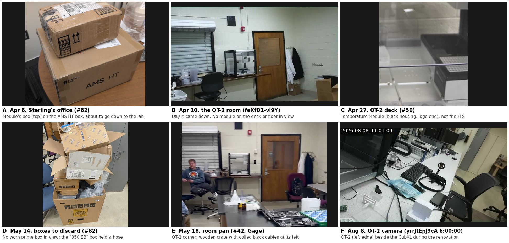

# Looking for the heater/shaker in lab footage (2026-10-12)

[#81](https://github.com/vertical-cloud-lab/byu-vcl/issues/81): the Opentrons Heater-Shaker
(GEN1, serial `HSV012024073110`) came to the lab around 2026-04-10 and has not been seen
since. This records what footage was searched for it, so the search is not repeated, and
how to re-run it on footage added later.

**Result: it does not appear anywhere in the footage.** Neither does its power brick or its
shipping box, a worn reused Amazon box with *prime* tape and a "UPS 2ND DAY AIR A.M. / 2A"
label. The module was probably put away somewhere no camera looks: a drawer, a closed
cabinet or a box.

## The written trail

| When | What | Source |
| --- | --- | --- |
| Apr 2 | Delivered to Sterling's office | [#81](https://github.com/vertical-cloud-lab/byu-vcl/issues/81) |
| Apr 8 | "There's an extra item (heater/shaker) that needs to go down, too", sent with the H2D printer parts from Jeff Hill's office. The photo shows its box on top of the AMS HT box (panel A) | [#82](https://github.com/vertical-cloud-lab/byu-vcl/issues/82#issuecomment-4210490521) |
| Apr 10 | "Marcus brought over to the lab" | [#81](https://github.com/vertical-cloud-lab/byu-vcl/issues/81) |
| May 14 | A pile of boxes set out to be thrown away, "assuming everything we need is emptied out". No box like the module's is visible in it (panel D) | [#82](https://github.com/vertical-cloud-lab/byu-vcl/issues/82) |
| Jun 18 | CB154 under renovation, so deliveries go to the SMASH Lab (CB 152A) | [#133](https://github.com/vertical-cloud-lab/byu-vcl/issues/133) |
| Aug 8 | The OT-2 camera shows the OT-2 on the same white bench as the CubXL gantry, so the OT-2 probably spent the renovation in the SMASH Lab too (panel F) | livestream `yrrJtEpj9cA` at 6:00:00 |
| Sep 22 | CubXL moved from the SMASH Lab back to CB154 | [#133](https://github.com/vertical-cloud-lab/byu-vcl/issues/133#issuecomment-5769300117) |

"350 EB" and "UT 846 0-02" on a box look like the department mailroom's routing marks.
The hose box in the May 14 pile carries both, so they do not identify the module's box.

## What was searched

| Source | Amount | How |
| --- | --- | --- |
| *BYU Vertical Cloud Lab* channel, listed | 166 of 201 videos | Storyboard thumbnails, about one every 4 s. Skipped: uploads from before April, and screen recordings |
| Same channel, unlisted (linked from issues and branches), plus *Vertical Cloud Lab - SOPs* | 25 videos | Same |
| Clips too short for storyboards | 8 of 23 | YouTube's own thumbnails, for the 8 that show more than a printer or test rig |
| *VCL Hardware Streams* livestreams | 418 archives | One frame every 15 min, kept only when the scene changed: 246 frames from the OT-2 camera (Jul 31 – Oct 1), 1,137 from the powder-doser camera (Jul 30 – Oct 12). The 37 `atomizer` archives were skipped, because that camera has been 144p and pixelated since Oct 1 |
| Photos and videos attached to issues since Mar 25 | 323 photos, 18 videos | All photos; up to 24 frames from each video |
| Images on every branch | 285 of 1,864 | The photos and camera frames; renders, plots and screenshots skipped |

About 25 leads were pulled at full resolution and ruled out. They included a module on the
OT-2 deck on Apr 27 (the Temperature Module, panel C), an Amazon box on the CubXL deck on
Aug 14 (a newer Amazon delivery), and a ceramic-top hotplate in the fume hood.

Not searched: Slack (no access), `digital-wetlab-private` (no access), and anything never
uploaded. `digital-wetlab` has no photos, and its issues predate the module.

## Where to look in person

- **SMASH Lab (CB 152A)**: where things were staged during the renovation. The OT-2 seems
  to have sat there beside the CubXL, so its accessories may have gone too. Look in the
  tall built-in beige cabinets behind that bench (panel F, right), in the multi-drawer
  cabinet under the drop-tower workbench ([`W2-wyqP9DH8` at 1:38](https://youtu.be/W2-wyqP9DH8?t=98)),
  and for boxes left behind.
- **CB154's closed storage**: the tall grey two-door cabinet, which is closed in every view
  before the renovation; the blue cabinets over the tool chest; and the rolling wooden cubby
  carts.
- **The small wooden crate with coiled black cables** left of the OT-2 on May 18 (panel E).
  It is too small in that video to identify, but it could hold the power brick or cable.

## Re-running it

`tools/` holds the scripts. YouTube refuses player extraction from CI runners, so the two
that call it run on a stream-cam Pi; the rest run anywhere.

1. `sbinfo.py IDS_FILE OUT.jsonl` (Pi): storyboard URLs and formats for each video. It takes
   about 2 s per video and sleeps 2 s between requests.
2. `fetch_sb.py OUT.jsonl SB_DIR`: downloads the storyboard sheets. `i.ytimg.com` serves
   them to any IP.
3. `tiles.py` packs uploads into time-stamped review sheets. `DEDUP=12 timelapse.py` does the
   same for livestream archives, keeping only frames where the scene changed.
4. `hsgrab.py` (Pi): full-resolution frames by video and offset. It fetches only the one
   ~5 s HLS segment that holds each frame, which keeps load on the Pi's Wi-Fi low.

Everything on the Pi goes under `/tmp/hs81`; delete that directory afterwards. The
search left nothing on the Pi.
