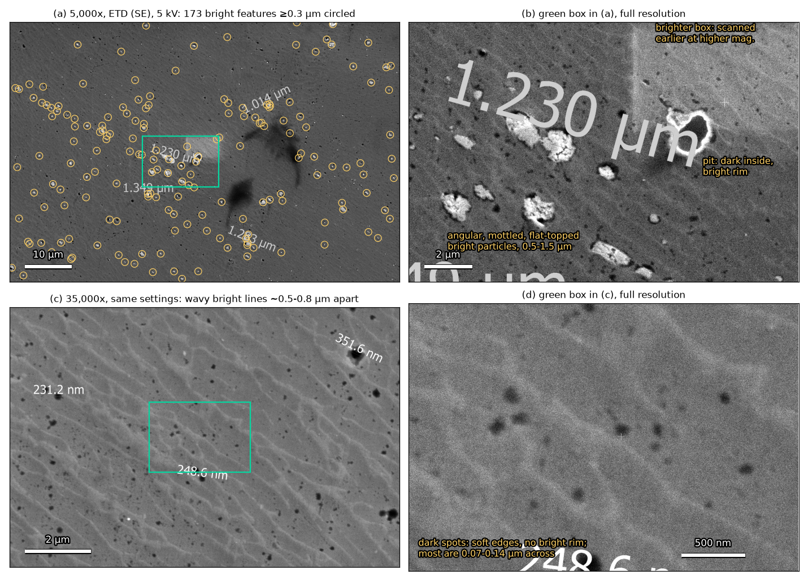
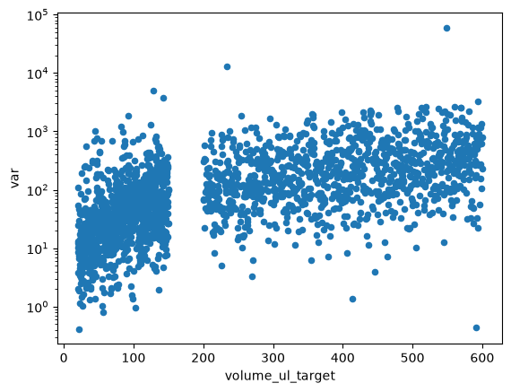

# Lab meeting, 2026-11-12

Presentation plans posted on [#322](https://github.com/vertical-cloud-lab/byu-vcl/issues/322), with the
text, images, clips and links behind each bullet. Presenters' own words are quoted; everything else was
gathered from the lab's repos and links to its source.

## Atomizer (gage-erickson)

[Comment](https://github.com/vertical-cloud-lab/byu-vcl/issues/322#issuecomment-6831663483)

> - Atomized more 630 bronze.
> - Some of them were rough and others were great.
> - We got 91% yield in our first run and ~75% yield in our most recent run.
> - Working on SOP for the atomizer.
> - Met with Bartosz to discuss compressing powder and other options for homogenization of the powder in the melting crucible.

All four 630 bronze (C63000) runs are logged in
[digital-alloy-lab#219](https://github.com/vertical-cloud-lab/digital-alloy-lab/issues/219), each on a
tungsten-dipped carbon-fiber plate at 1300 °C.

| Run | Charge | How it went | Source |
| --- | --- | --- | --- |
| Oct 27 | 1,079.886 g | The 91% run: 91.17% under 250 µm, worked out from the pooled sieve of the two October runs | [charge](https://github.com/vertical-cloud-lab/digital-alloy-lab/issues/219#issuecomment-6457884447), [yield](https://github.com/vertical-cloud-lab/digital-alloy-lab/issues/219#issuecomment-6509485831), [spot-check](https://github.com/vertical-cloud-lab/digital-alloy-lab/issues/219#issuecomment-6517044293) |
| Oct 28 | 858.421 g | Rough: reused plate and nozzle barely atomized, about 3% usable, tungsten eaten off the plate | [charge](https://github.com/vertical-cloud-lab/digital-alloy-lab/issues/219#issuecomment-6483417674), [result](https://github.com/vertical-cloud-lab/digital-alloy-lab/issues/219#issuecomment-6509252104), [analysis](https://github.com/vertical-cloud-lab/digital-alloy-lab/issues/219#issuecomment-6485749381), [video](https://youtu.be/NZWmk5PqQhg) |
| Nov 5 | 952.459 g, 22 ppm O2 | Rough: induction generator shut off mid-run, crucible fell to 1100 °C, nozzle clogged, BN coating peeling | [run](https://github.com/vertical-cloud-lab/digital-alloy-lab/issues/219#issuecomment-6670680314), [teardown](https://github.com/vertical-cloud-lab/digital-alloy-lab/issues/219#issuecomment-6782571216) |
| Nov 10 | 816.319 g, 20 ppm O2 | Good: about 75% by eye, not sieved yet | [run](https://github.com/vertical-cloud-lab/digital-alloy-lab/issues/219#issuecomment-6782720747), [output](https://github.com/vertical-cloud-lab/digital-alloy-lab/issues/219#issuecomment-6808493954) |

| | |
| --- | --- |
|  October powder, sieved: under 63 µm, 64–250 µm, coarse flakes |  Plate after Oct 28: tungsten coating eroded, bronze stuck at the tip |
|  Nov 5: looking down into the hot crucible |  Nov 5, cold: BN coating peeling off the crucible wall |
|  Nov 10 through the viewport: plate above the catch crucible |  Nov 10 output (`834try`): powder jar, plus the catch-crucible puck and scrap |

- **SOP:** Gage's notes are in [digital-alloy-lab#251](https://github.com/vertical-cloud-lab/digital-alloy-lab/issues/251);
  the draft checklist is [PR 253](https://github.com/vertical-cloud-lab/digital-alloy-lab/pull/253)
  ([`SOP/atomizer-sop.md`](https://github.com/vertical-cloud-lab/digital-alloy-lab/blob/66b9e55/SOP/atomizer-sop.md)), not yet checked at the machine.
- **Run analysis:** [PR 252](https://github.com/vertical-cloud-lab/digital-alloy-lab/pull/252) for Nov 5 and Nov 10 (not started).
- **BN recoat:** videos [1](https://youtu.be/gZdjcXo7nx0) and [2](https://youtube.com/shorts/Sh-nYiggiek) from Ronnie, and
  [why it cracked](https://github.com/vertical-cloud-lab/digital-alloy-lab/issues/219#issuecomment-6534367857).
- **Slack:** Gage followed up with a [Slack post](https://verticalcloudlabbyu.slack.com/archives/C0C5L8UERFH/p1794506926241009)
  ([comment](https://github.com/vertical-cloud-lab/byu-vcl/issues/322#issuecomment-6832069644)); it needs a workspace login, so its
  contents are not copied here.
- **Bartosz meeting:** no notes on GitHub yet. Related threads: compressing powder plugs to a set tonnage
  ([byu-vcl PR 318](https://github.com/vertical-cloud-lab/byu-vcl/pull/318#issuecomment-6623032979)) and feedstock
  alternatives ([digital-alloy-lab#250](https://github.com/vertical-cloud-lab/digital-alloy-lab/issues/250#issuecomment-6778615370)).

## Powder doser (swcharles)

[Comment](https://github.com/vertical-cloud-lab/byu-vcl/issues/322#issuecomment-6831830271)

> - help on manuscript! Figures first
> - more versions of the multi Doser, getting into the nitty gritty, hoping to start building before semester ends
> - mockups of 2-3 multi-dosers for the U, end of semester deadline as well

- **Manuscript, figures first:** Sterling's [whiteboard figure plan](https://github.com/vertical-cloud-lab/powder-doser/pull/97#issuecomment-6777827194) became
  [PR 209](https://github.com/vertical-cloud-lab/powder-doser/pull/209) (title, abstract, Figs. 1–7, S1–S3), revised after his
  [video review](https://youtu.be/jVrScVe-4QI) ([changes](https://github.com/vertical-cloud-lab/powder-doser/pull/209#issuecomment-6808490241)). Where help is
  needed: no new dosing data, but [photos and CAD of the new stand](https://github.com/vertical-cloud-lab/powder-doser/pull/209#issuecomment-6811183263) (SI Fig. S4).
- **Multi-doser versions:** the chain carousel on [PR 185](https://github.com/vertical-cloud-lab/powder-doser/pull/185) went
  [v5](https://github.com/vertical-cloud-lab/powder-doser/pull/185#issuecomment-6775381432) → [v6](https://github.com/vertical-cloud-lab/powder-doser/pull/185#issuecomment-6777063651) →
  [v7](https://github.com/vertical-cloud-lab/powder-doser/pull/185#issuecomment-6780397130) on Nov 10 (ladder-rung frame, one P16-150 actuator under the station,
  90° tilt). [v8](https://github.com/vertical-cloud-lab/powder-doser/pull/185#issuecomment-6831123907), asked for today, brings the auger closer to the scale
  (v7 drops 154 mm against about 85 mm now). Actuator choice: [#202](https://github.com/vertical-cloud-lab/powder-doser/issues/202).
  [v7 in Onshape](https://cad.onshape.com/documents/291664f38c67a4672a86f025/w/e67d1b706aa4b873fa8c68e8/e/4802634f69ef3323004d7bf6).
- **Mockups of 2–3 augers on one base:** [#204](https://github.com/vertical-cloud-lab/powder-doser/issues/204#issuecomment-6713779015) has servo-tilted
  nose-to-nose pairs (A1/A2) and actuator-tilted modules (B1/B2), including a three-auger tri-star;
  [use case and clearance question](https://github.com/vertical-cloud-lab/powder-doser/issues/204#issuecomment-6756895160).

| | |
| --- | --- |
|  v7 dosing station with its single actuator |  Manuscript Fig. 1 |
|  Three-auger tri-star (B2) |  Two dosers nose-to-nose over one beaker (A1) |
|  Whiteboard figure plan | |

## Powder doser assemblies (brandonmunk)

[Comment](https://github.com/vertical-cloud-lab/byu-vcl/issues/322#issuecomment-6831889587)

> - First assembly attempt (with video)
> - Claude created new assembly diagram and inventory list
> - Design review of hinge bolts
> - New iteration of Doser with detached solenoid
> - New A1 mini (location?)
> - Will finished video of electronic assembly

- **First assembly attempt:** [notes from Nov 5](https://github.com/vertical-cloud-lab/powder-doser/pull/181#issuecomment-6671271179). The Base was printed on the
  H2D on Nov 4 ([print](https://github.com/vertical-cloud-lab/powder-doser/pull/200#issuecomment-6642168123), [timelapse review](https://github.com/vertical-cloud-lab/powder-doser/pull/200#issuecomment-6755957188)).
  The assembly video itself is not on GitHub; a
  [Slack link](https://verticalcloudlabbyu.slack.com/archives/C0B3CGGV4VC/p1794268326828819) was posted
  [here](https://github.com/vertical-cloud-lab/powder-doser/pull/181#issuecomment-6755707070).
- **Assembly diagram and inventory list:** [exploded diagram and a 43-row `inventory-checklist.csv`](https://github.com/vertical-cloud-lab/powder-doser/pull/181#issuecomment-6774592107),
  then a [hardware-placement diagram](https://github.com/vertical-cloud-lab/powder-doser/pull/181#issuecomment-6775345197) (66 fasteners per doser).
  [Assembly in Onshape](https://cad.onshape.com/documents/f866631c78fbefd61e6856e4/w/043fe020d0194e41cea13bc2/e/3156bac055c13d8160e229b4).
- **Hinge bolts:** the M5 × 40 bolts have [no room for nuts](https://github.com/vertical-cloud-lab/powder-doser/issues/191#issuecomment-6775216505) between the arms
  and the auger; the CAD check found 2.2 mm of thread through and the tube 3.7 mm away. Plan: an inset hole on the
  auger side of the arms.
- **Detached solenoid:** [#203](https://github.com/vertical-cloud-lab/powder-doser/issues/203#issuecomment-6713576689) moves the tapper onto the mounting plate so
  augers lift out without removing the collar (four concepts);
  [Ethan's first bracket](https://github.com/vertical-cloud-lab/powder-doser/issues/203#issuecomment-6714762206) in
  [Onshape](https://cad.onshape.com/documents/3db901b123bbee05f5c196f3/w/71800ea0548acad53e21d816/e/68af1a083e7d90e44c40f87c).
- **New A1 mini:** nothing on GitHub about it yet.
- **Electronics assembly video (William):** https://youtu.be/hfnQBAeRIg0
  ([comment](https://github.com/vertical-cloud-lab/powder-doser/pull/181#issuecomment-6782068704)); a software setup video is planned.

| | |
| --- | --- |
|  Exploded view with every part and fastener named |  Where the hardware goes; panel 2 is the hinge bolt |
|  Current tap collar against four plate-mounted solenoid concepts |  Base print keyframes |

## OT-2 (timothy-commins)

[Comment](https://github.com/vertical-cloud-lab/byu-vcl/issues/322#issuecomment-6832033627)

> - with the ot-2 not currently having a project, it needs new direction.
> - looking for potential grant opportunities

- **Why it has no project:** the ACS PRF petroleum/sulfide-scale proposal was declined and the panel did not recommend
  resubmission ([digital-wetlab PR 82](https://github.com/vertical-cloud-lab/digital-wetlab/pull/82#issuecomment-6508258222)).
- **No network or camera:** the lid-camera Pi left for the Borys lab on 2026-11-10. The rebuild is
  [digital-wetlab#92](https://github.com/vertical-cloud-lab/digital-wetlab/issues/92), with the kit in
  [PR 91](https://github.com/vertical-cloud-lab/digital-wetlab/pull/91).
- **Candidate directions:** [digital-wetlab PR 83](https://github.com/vertical-cloud-lab/digital-wetlab/pull/83) ranks six:
  Ni/high-entropy electrocatalyst films, Li/Mg/B from Great Salt Lake brines, co-precipitated oxide/hydroxide
  libraries, nucleation statistics, corrosion sample prep for the CubXL, and qualitative analysis for teaching.
- **Grants looked at so far:** Scialog: Sustainable Minerals, Metals & Materials came out with the best odds
  (about 1 in 3 Fellows funded, $60K, due 2027-03-15), BYU's IDR Origination Award second
  ([comparison](https://github.com/vertical-cloud-lab/digital-wetlab/pull/83#issuecomment-6527123274)); an ONR corrosion
  white paper by 2026-12-31 ([comment](https://github.com/vertical-cloud-lab/digital-wetlab/pull/83#issuecomment-6588496469));
  DOE BES by 2027-02-01 ([comment](https://github.com/vertical-cloud-lab/digital-wetlab/pull/83#issuecomment-6588529778)),
  with [four one-page white papers drafted](https://github.com/vertical-cloud-lab/digital-wetlab/pull/83#issuecomment-6589716351);
  and the [dated short list](https://github.com/vertical-cloud-lab/digital-wetlab/issues/81#issuecomment-6388556801).
- **Work in hand:** a BaSO4 plate run with a 3-D animated SOP in 42 step clips
  ([digital-wetlab#80](https://github.com/vertical-cloud-lab/digital-wetlab/issues/80#issuecomment-6669649348),
  [PR 84](https://github.com/vertical-cloud-lab/digital-wetlab/pull/84)). Its 20 mL vial holder is designed but
  [not printed yet](https://github.com/vertical-cloud-lab/digital-wetlab/pull/84#issuecomment-6805057536).

| | |
| --- | --- |
|  3-D SOP render: plate on the heater-shaker, vial holders, tip rack |  Six-pocket 20 mL vial holder |
|  BES white paper: nucleation statistics for gypsum |  Contact sheet of the 42 SOP step clips |

## Microprobe standards and samples (ronnie-guymon)

[Comment](https://github.com/vertical-cloud-lab/byu-vcl/issues/322#issuecomment-6832034472)

> - standards are collected for MgO and Si,  but still waiting for polishing pads to ship in before the aluminum to get polished
> - sample is polished, Sobol samples have been collected
> - almost ready to send in proposal for MSA strategic initiatives proposal

- **Standards:** [MgO and Si data](https://github.com/vertical-cloud-lab/caliber/issues/12#issuecomment-6803490926) at 3.2 nA and 5–25 kV, with dead time and
  count rates (Si at 25 kV reached 98.7% dead time). For the pure Al standard, the diamond slurry has arrived and
  the [pads have not](https://github.com/vertical-cloud-lab/byu-vcl/pull/258#issuecomment-6591385396); open question on
  [1 µm alumina as the final polish](https://github.com/vertical-cloud-lab/byu-vcl/pull/258#issuecomment-6806787364). Published pure-Al spectra
  [cannot stand in](https://github.com/vertical-cloud-lab/caliber/pull/20#issuecomment-6781131087) for ones measured on our SEM.
- **Sample and Sobol set:** AlSi10Mg polished Nov 3–5 with 0.1 µm diamond ([notes](https://github.com/vertical-cloud-lab/byu-vcl/pull/258#issuecomment-6646523213)).
  [First EDS](https://github.com/vertical-cloud-lab/caliber/pull/6#issuecomment-6693202365) on Nov 6: C and O peaks visible at 5 kV, nearly gone at 20 kV;
  [carbon deposition even at 0.1 nA](https://github.com/vertical-cloud-lab/caliber/pull/6#issuecomment-6694708228).
  [Sobol-sample spectra](https://github.com/vertical-cloud-lab/caliber/pull/6#issuecomment-6750568812) posted Nov 9; the sampling script is Xavier's
  ([#21](https://github.com/vertical-cloud-lab/caliber/issues/21), [PR 24](https://github.com/vertical-cloud-lab/caliber/pull/24)).
- **MSA proposal:** [caliber PR 14](https://github.com/vertical-cloud-lab/caliber/pull/14), "Testing Physics-Based Rules for Accurate SEM-EDS of Magnesium in
  Additively Manufactured AlSi10Mg", $3,000, due Dec 1. Left to do:
  [join MSA and get the letter of support](https://github.com/vertical-cloud-lab/caliber/pull/14#issuecomment-6752560694)
  ([what the letter needs](https://github.com/vertical-cloud-lab/caliber/pull/14#issuecomment-6756012604)).
- **Clip:** https://youtu.be/Y2Li2uXmxlg, posted with the [test puck note](https://github.com/vertical-cloud-lab/byu-vcl/pull/258#issuecomment-6620570016).

| | |
| --- | --- |
|  Polished AlSi10Mg at 5,000x (5 kV, 0.10 nA) ([source](https://github.com/vertical-cloud-lab/byu-vcl/pull/258#issuecomment-6750386449)) |  Same sample at 35,000x: cell boundaries and dark spots |
|  Annotated bright and dark features |  Proposal, page 1 |

## Variance across pipetting volumes (XZaitzeff)

[Comment](https://github.com/vertical-cloud-lab/byu-vcl/issues/322#issuecomment-6832038271)

Posted as an image only: `var` on a log axis against `volume_ul_target`, with a dense cluster at 20–150 µL
(variance rising from about 10 to 100), a sparser one at 200–600 µL (about 100–1000), and nothing between 150 and
200 µL. The dataset and code behind it are not in the lab's repos yet, so there is nothing further to link.

Xavier's other threads this week: powder-doser time series for a data assimilation project
([powder-doser#210](https://github.com/vertical-cloud-lab/powder-doser/issues/210)) and Eagar–Tsai melt-pool Sobol
sampling for AlSi10Mg ([digital-alloy-lab#235](https://github.com/vertical-cloud-lab/digital-alloy-lab/issues/235#issuecomment-6648091493)).

| | |
| --- | --- |
|  Five replicate 0.5 g salt doses ([source](https://github.com/vertical-cloud-lab/powder-doser/issues/210#issuecomment-6808893557)) |  Every powder on the new controller ([source](https://github.com/vertical-cloud-lab/powder-doser/issues/210#issuecomment-6811815236)) |

## Tensegrity-inspired prints (me-madsen)

[Comment](https://github.com/vertical-cloud-lab/byu-vcl/issues/322#issuecomment-6832042678)

> - Collaboration set-up with Dr. Dobromir Dotov at University of Nebraska Omaha
> - Paper journal check-in with Sterling
> - SOP for drop tower - initial draft in review.

- **Dotov collaboration:** [#135](https://github.com/vertical-cloud-lab/tensegrity-optimization/issues/135), opened today, with the
  [Nov 6 meeting transcript](https://github.com/vertical-cloud-lab/tensegrity-optimization/issues/135#issuecomment-6830092359) and
  [action items](https://github.com/vertical-cloud-lab/tensegrity-optimization/blob/0f9c794/docs/collaborations/uno-crutch-tip/action-items.md): BYU designs and prints
  screw-on tensegrity tips for a walking stick in high and low stiffness; UNO sends its CAD, the stick's make and
  model and constraints, and sets up spring 2027 data collection.
- **Paper:** [PR 76](https://github.com/vertical-cloud-lab/tensegrity-optimization/pull/76), aimed at the ASME Journal of Mechanical Design. The
  [Nov 5 group review](https://github.com/vertical-cloud-lab/tensegrity-optimization/pull/76#issuecomment-6670196820) was
  [applied in full](https://github.com/vertical-cloud-lab/tensegrity-optimization/pull/76#issuecomment-6670205548) (23 comments, 15 tracked changes, 18 pages). Open
  question from Sterling: ["Are we close to submission?"](https://github.com/vertical-cloud-lab/tensegrity-optimization/pull/76#issuecomment-6755761876)
- **Drop tower SOP:** [29-page draft](https://github.com/vertical-cloud-lab/tensegrity-optimization/issues/115#issuecomment-6511043024)
  ([`.docx`](https://github.com/vertical-cloud-lab/tensegrity-optimization/blob/77fe81f/docs/drop-tower-sop/drop-tower-sop-template.docx)), checklists first, with a register
  of 14 past incidents. The tower has been halted since the
  [accelerometer broke on Oct 19](https://github.com/vertical-cloud-lab/tensegrity-optimization/issues/115#issuecomment-6277017048).

| | |
| --- | --- |
|  Three pages of the draft SOP |  The sheared accelerometer cable |
|  Group review: seat gauge for all 54 drop sessions |  Replicate specimens |

## LPBF (carl-robison)

[Comment](https://github.com/vertical-cloud-lab/byu-vcl/issues/322#issuecomment-6832081970)

> - BYU LPBF system up and running,
> - Start printing at U of U soon

- **BYU system (Concept Laser M2):** the plan for it is [digital-alloy-lab PR 243](https://github.com/vertical-cloud-lab/digital-alloy-lab/pull/243): single-track
  sweeps in stainless steel on a four-insert plate, cross-sectioned for SEM and compared with the Thermo-Calc AM
  Module, with a pilot for Carl and Josh before mid-December. Parameters come from Sobol sampling and batch BO, not
  a grid ([track length and spacing](https://github.com/vertical-cloud-lab/digital-alloy-lab/pull/243#issuecomment-6759462338)). Carl's
  [photos of the machine's parameter screens](https://github.com/vertical-cloud-lab/digital-alloy-lab/pull/243#issuecomment-6779725937) are from Nov 10. Started from
  [#100](https://github.com/vertical-cloud-lab/digital-alloy-lab/issues/100#issuecomment-6752725734), the TMS abstract on LPBF parameter optimization.
- **University of Utah (Aconity MIDI, Spear collaboration):** [digital-alloy-lab#138](https://github.com/vertical-cloud-lab/digital-alloy-lab/issues/138). One build
  needs [about 440 g of powder](https://github.com/vertical-cloud-lab/digital-alloy-lab/issues/138#issuecomment-6353376533); the sieve cut for it (No. 60 scalp, then
  20–63 µm) is [PR 175](https://github.com/vertical-cloud-lab/digital-alloy-lab/pull/175).
- **Longer term:** a survey of desktop LPBF systems for small Al batches, [PR 245](https://github.com/vertical-cloud-lab/digital-alloy-lab/pull/245), from
  [#133](https://github.com/vertical-cloud-lab/digital-alloy-lab/issues/133).

| | |
| --- | --- |
|  Cutting a section from an insert |  Cross-sections in the SEM |
|  Pilot design |  Provisional schedule |
