# ME Christmas service project: 3D-printed toys for children in foster care

BYU Mechanical Engineering is collecting 3D-printed toys for children in foster care this
Christmas. Students, faculty and staff print a toy, tag it and leave it at the **ME office
(350 EB)** by **December 18, 2026**. The first delivery goes out on **December 10**.

Sterling plans to offer the project as extra credit in his machine design class, and maybe to
open some of the lab's printers to it. This page brings together the organizers' rules, a
shortlist of toys the lab can print, and a [proposal](proposal.md) for how students could use
the printers.

| | |
| --- | --- |
| 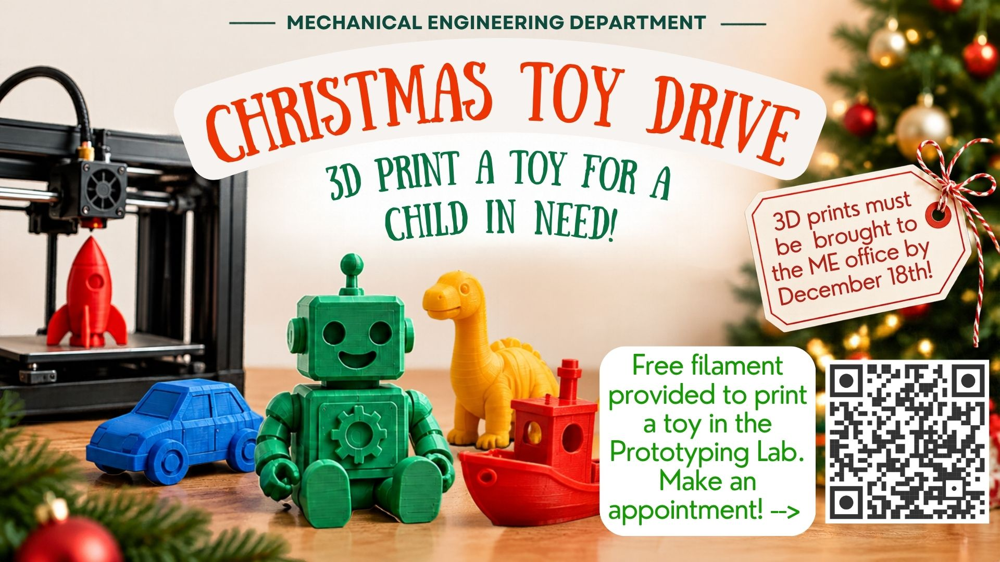 | 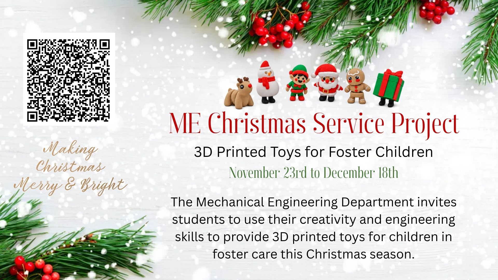 |

The department's two-slide flyer. Faculty were asked to show it at the start of lectures and in
research group meetings. The QR code on slide 1 opens the Prototyping Lab's booking page. The
one on slide 2 opens the organizers' details sheet, copied here as [`details.md`](details.md).
Slide 1's art is marked as made with Canva AI, so the toys in it are illustrations, not prints.

## Key dates

| Date | What happens |
| --- | --- |
| Thu Nov 19 | John Salmon announces the project to the ME faculty |
| Mon Nov 23 | Toy drop-off and display in the ME office begins |
| **Thu Dec 10** | **First delivery**, to the Orem foster care office. These toys then go on to the Richfield office. To make this delivery, a toy has to be on the shelf before December 10 |
| **Fri Dec 18** | **Final delivery**, to the Orem office. Last day to drop off |

## Limits

The organizers' recommended limits, per toy:

| Limit | Value |
| --- | --- |
| Material | PLA or PLA+ only |
| Filament | at most 250 g |
| Filament cost | at most $4 (target $2–4) |
| Print time | at most 8 hours |

**At our price, the $4 cap binds first.** The lab's printers run Bambu PLA Basic: on
2026-11-26 the A1 mini's AMS Lite held dark blue and black PLA Basic. Bambu's US store lists a
1 kg PLA Basic refill at a typical **$18.99** (1.9¢ a gram). At that price $4 buys **210 g**, so
210 g is the working ceiling, not 250 g. On 2026-11-26 the store had it on sale at $14.99
($17.99 with a spool), where $4 buys 267 g and the 250 g cap binds instead. Everything on the
shortlist is under 75 g, so it passes at any price up to $53 a kilogram.

## Items to avoid

From the organizers' sheet, for child safety and foster-care appropriateness:

- Weapons of any kind
- Political or controversial items
- Sharp-edged models
- Choking hazards
- Models containing magnets
- Multi-part assemblies with loose small pieces

How the shortlist applies them:

- **One piece.** Every toy prints in one piece or prints in place, so there's nothing to
  assemble and no part meant to come off. The marble maze's marble is printed inside the cube
  and can't get out. The four tabs that hold it during the print are cut off and thrown away.
- **Nothing sharp.** The infinity cube is the rounded version. The shark is the designer's
  child version, with a friendly face and a fixed jaw: the designer says the teeth on the
  movable-jaw versions are quite sharp. Spiky dragons were left out.
- **Nothing small when whole.** Every toy is bigger than the cylinder used to test toys for small
  parts (31.7 mm wide, 57.1 mm deep). The most compact, the gear-shift fidget, is 33 mm across and
  40 mm tall. Articulated toys are made of
  small segments, though, and a segment that snaps off is a small part. So flex every joint
  before the toy leaves the lab, and set aside any toy that breaks. A suggestion, not an
  organizers' rule: write "ages 3 and up" on the back of the tag.
- **No magnets, weapons or political themes.** None of the toys has any.

## Dropping a toy off

From the organizers' sheet:

1. Bring your 3D-printed toy to the ME office (350 EB).
2. Attach a gift tag to your toy with ribbon ("Made with love by BYU Mechanical Engineering
   Students").
3. Leave your name and a note on the back of the tag.
4. Place your toy on the toy shelf and get a Christmas sticker for the toy-tracking Christmas
   tree poster.

Questions go to office 360S in the EB.

## What the department offers

From John Salmon's announcement to the ME faculty (2026-11-19) and the flyer:

- **Everyone in ME can take part**, students and faculty: design a toy or download one, print it
  and leave it at the ME office. The toys go to children in foster care the week before
  Christmas.
- **Filament is free.** The department pays for filament for toys printed in the Prototyping
  Lab, by appointment: <https://byuprojectslab.simplybook.me/v2/book-service/> (the QR code on
  slide 1). The TAs in the Project Realization Lab can help.
- **Faculty are asked to spread the word:** show the slides at the start of lectures and in
  research group meetings.

Sterling replied the same day that he plans to offer the project as extra credit in his machine
design class, and maybe to offer some of the lab's printers. John welcomed it.

## Toys we can print here

Thirteen toys (fourteen plates, counting the dragon's two sizes), all sliced for the **A1 mini, 0.4 mm nozzle, Bambu PLA Basic**, one toy per plate. They use 8–72 g of filament, cost $0.15–$1.36 at $18.99/kg and print in 31 min to 4 h 55 min, so every one is well inside all three limits. Small toys can share a plate when printing several. Click a toy's name for its model page, or **3MF** for the sliced plate, ready to open in Bambu Studio.

| | Toy | Type | Designer | License | Filament | Cost | Print time | Plates | Sliced plate |
| --- | --- | --- | --- | --- | ---: | ---: | ---: | ---: | --- |
| 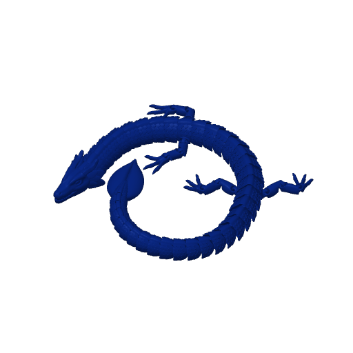 | [Flexi Leaf Dragon, large](https://www.printables.com/model/733515-flexi-leaf-dragonprint-in-place) | Flexi dragon | [3D_Flexseeds](https://www.printables.com/@desusame_1293905) | [CC BY-NC-ND](https://creativecommons.org/licenses/by-nc-nd/4.0/) | 72 g | $1.36 | 4 h 37 min | 1 | [3MF](toys/3mf/flexi-leaf-dragon-large_A1mini_PLA.gcode.3mf) |
| 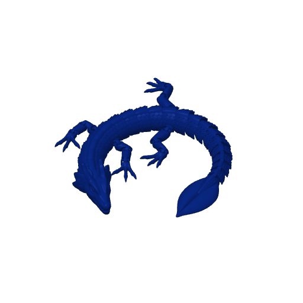 | [Flexi Leaf Dragon, medium](https://www.printables.com/model/733515-flexi-leaf-dragonprint-in-place) | Flexi dragon | [3D_Flexseeds](https://www.printables.com/@desusame_1293905) | [CC BY-NC-ND](https://creativecommons.org/licenses/by-nc-nd/4.0/) | 46 g | $0.88 | 2 h 58 min | 1 | [3MF](toys/3mf/flexi-leaf-dragon-medium_A1mini_PLA.gcode.3mf) |
| 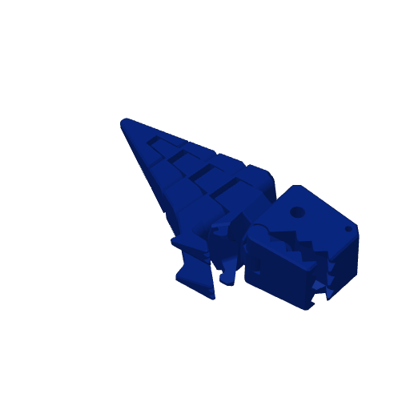 | [Tessa the flexi T-Rex](https://www.printables.com/model/566894-flexidinos-tessa-the-flexi-t-rex-print-in-place-ar) | Flexi dinosaur | [AndreasJoskaSutanto](https://www.printables.com/@AndreasJoskaSutanto) | [CC BY-NC-SA](https://creativecommons.org/licenses/by-nc-sa/4.0/) | 37 g | $0.71 | 1 h 39 min | 1 | [3MF](toys/3mf/tessa-t-rex_A1mini_PLA.gcode.3mf) |
| 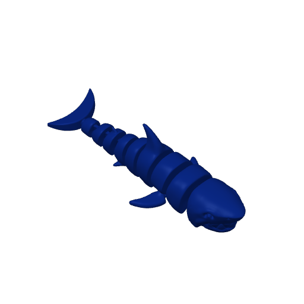 | [Articulated Shark (v4 D)](https://www.printables.com/model/178032-articulated-shark) | Articulated shark | [McGybeer](https://www.printables.com/@McGybeer) | [CC BY-NC-SA](https://creativecommons.org/licenses/by-nc-sa/4.0/) | 22 g | $0.42 | 1 h 18 min | 1 | [3MF](toys/3mf/articulated-shark_A1mini_PLA.gcode.3mf) |
| 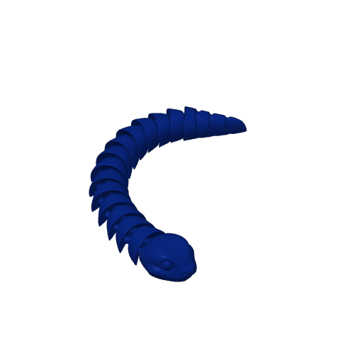 | [Flexi Snake, spiral](https://www.printables.com/model/1519494-flexi-snake-print-in-place-articulated-snake-no-su) | Articulated snake | [FlexiMania](https://www.printables.com/@FlexiMania) | [CC BY-NC](https://creativecommons.org/licenses/by-nc/4.0/) | 39 g | $0.74 | 1 h 48 min | 1 | [3MF](toys/3mf/flexi-snake-spiral_A1mini_PLA.gcode.3mf) |
| 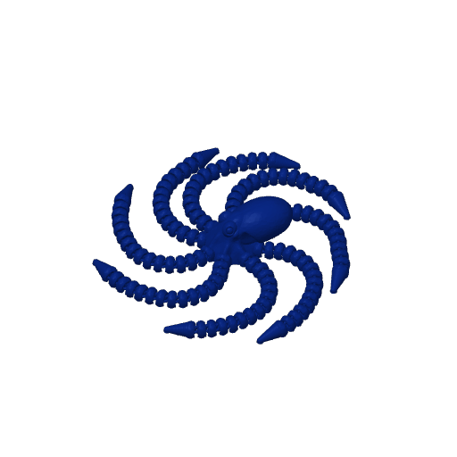 | [Articulated Octopus](https://www.printables.com/model/1521675-articulated-octopus-print-in-place) | Animal figure | [Flexi-Maker](https://www.printables.com/@FlexiMaker) | [CC BY-NC](https://creativecommons.org/licenses/by-nc/4.0/) | 63 g | $1.19 | 4 h 55 min | 1 | [3MF](toys/3mf/articulated-octopus_A1mini_PLA.gcode.3mf) |
| 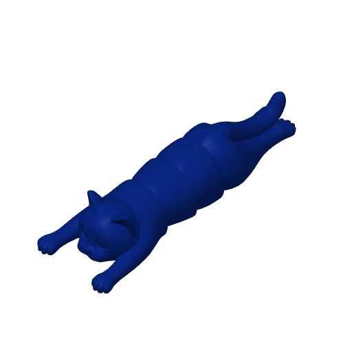 | [Flexi Holding Cat](https://www.printables.com/model/972232-flexi-holding-cat-print-in-place) | Animal figure | [3D_Flexseeds](https://www.printables.com/@desusame_1293905) | [CC BY-NC-ND](https://creativecommons.org/licenses/by-nc-nd/4.0/) | 10 g | $0.20 | 0 h 37 min | 1 | [3MF](toys/3mf/flexi-holding-cat_A1mini_PLA.gcode.3mf) |
| 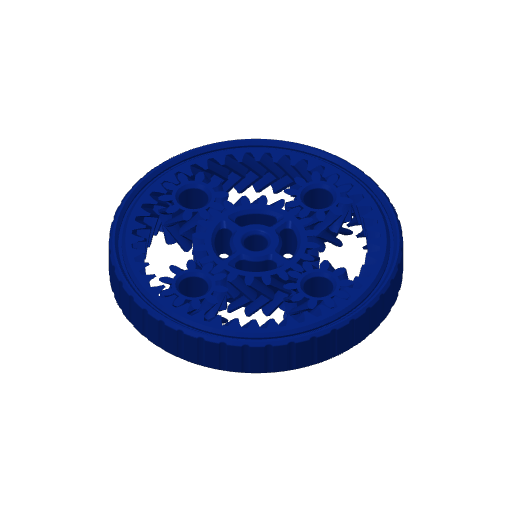 | [Planetary Gear Fidget Toy](https://www.printables.com/model/744660-planetary-gear-fidget-toy-100-print-in-place) | Gear puzzle | [GrazWorks](https://www.printables.com/@GrazWorks3D) | [CC BY-NC-SA](https://creativecommons.org/licenses/by-nc-sa/4.0/) | 50 g | $0.95 | 2 h 42 min | 1 | [3MF](toys/3mf/planetary-gear-fidget_A1mini_PLA.gcode.3mf) |
| 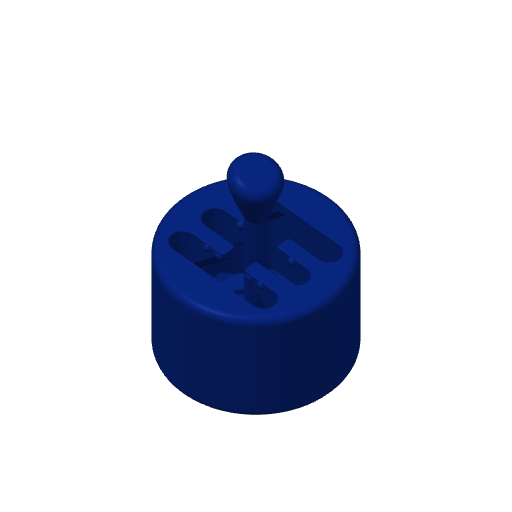 | [Gear Shift Fidget](https://www.printables.com/model/1340477-print-in-place-gear-shift-fidget-toy) | Gear puzzle / fidget | [Jerryie](https://www.printables.com/@Jerryie) | [CC BY](https://creativecommons.org/licenses/by/4.0/) | 8 g | $0.15 | 0 h 32 min | 1 | [3MF](toys/3mf/gear-shift-fidget_A1mini_PLA.gcode.3mf) |
| 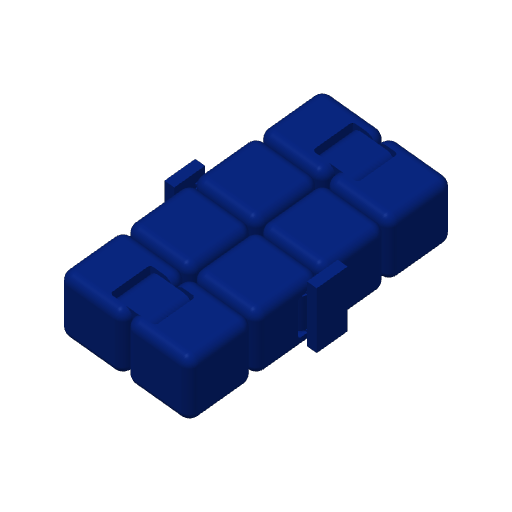 | [Infinity Cube, rounded](https://www.printables.com/model/652108-infinity-cube-print-in-place) | Infinity cube | [diademiemi](https://www.printables.com/@x8639) | [CC0](https://creativecommons.org/publicdomain/zero/1.0/) | 32 g | $0.61 | 1 h 18 min | 1 | [3MF](toys/3mf/infinity-cube_A1mini_PLA.gcode.3mf) |
| 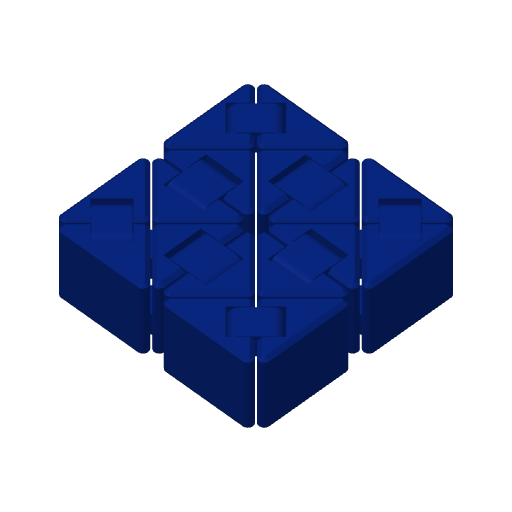 | [Ultimate Fidget Cube, flat](https://www.printables.com/model/1169121-print-in-place-ultimate-fidget-cube) | Fidget cube | [mygadgetlife](https://www.printables.com/@mygadgetlife_424867) | [CC BY-NC-ND](https://creativecommons.org/licenses/by-nc-nd/4.0/) | 39 g | $0.73 | 1 h 43 min | 1 | [3MF](toys/3mf/ultimate-fidget-cube_A1mini_PLA.gcode.3mf) |
| 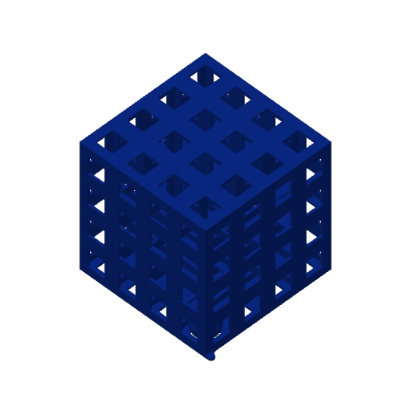 | [Cubic 3D Marble Maze](https://www.printables.com/model/270365-cubic-3d-marble-maze-with-print-in-place-marble) | Marble maze | [LoboCNC](https://www.printables.com/@LoboCNC) | [CC BY-SA](https://creativecommons.org/licenses/by-sa/4.0/) | 30 g | $0.57 | 1 h 21 min | 1 | [3MF](toys/3mf/cubic-marble-maze_A1mini_PLA.gcode.3mf) |
| 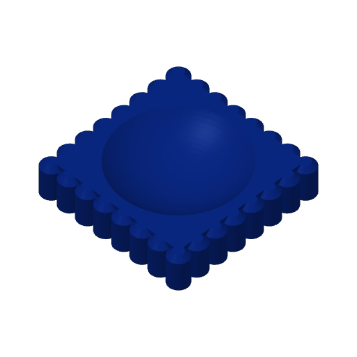 | [Worry Stone](https://www.printables.com/model/1040626-worry-stone) | Worry stone | [Carlos Luna](https://www.printables.com/@CarlosLuna) | [CC BY](https://creativecommons.org/licenses/by/4.0/) | 8 g | $0.15 | 0 h 31 min | 1 | [3MF](toys/3mf/worry-stone_A1mini_PLA.gcode.3mf) |
| 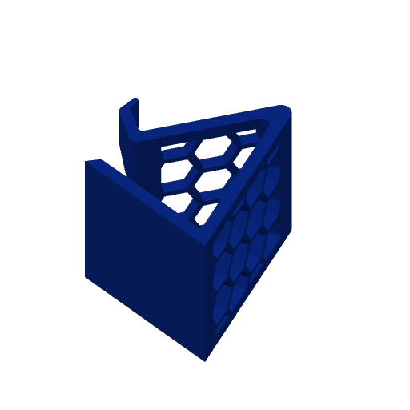 | [Phone Stand, thicker](https://www.printables.com/model/187125-phone-stand) | Phone stand | [PlatinumStars](https://www.printables.com/@PlatinumStars) | [CC BY-NC](https://creativecommons.org/licenses/by-nc/4.0/) | 28 g | $0.54 | 1 h 17 min | 1 | [3MF](toys/3mf/phone-stand_A1mini_PLA.gcode.3mf) |

Notes:

- **Flexi Leaf Dragon, large:** Leaf-shaped scales and bendable wrists. Bambu Studio warns of floating regions at the joints. The designer's own Bambu 3MF uses the same settings (no supports, no brim, 0.2 mm, 15 % infill).
- **Flexi Leaf Dragon, medium:** The same dragon in a lizard pose, from the same listing. About a third less filament and time.
- **Tessa the flexi T-Rex:** Hinged jaw with blocky teeth. The listing's separate saddle is left out, since it's a loose part.
- **Articulated Shark (v4 D):** The designer's version for children: friendly face, fixed jaw. 0.16 mm layers, as recommended. The tail joint frees with a little force.
- **Flexi Snake, spiral:** The designer's uncoloured 3MF, sliced in one colour. Bambu Studio warns of a floating cantilever. The designer's 3MF also prints it without supports.
- **Articulated Octopus:** Turned 59° so its legs fit the bed (169 × 169 mm).
- **Flexi Holding Cat:** Standard length. A long version is in the same listing.
- **Planetary Gear Fidget Toy:** The version with a centre grip. Turn the gears to free them after printing.
- **Gear Shift Fidget:** Smooth gears. Flex the plate to take it off, since pulling hard can break the spring.
- **Infinity Cube, rounded:** Built-in supports: snap off the side ones, then fold it as the designer describes to free the inside ones. Check for nubs.
- **Ultimate Fidget Cube, flat:** The higher-tolerance version, so the joints don't fuse. Loosen the bottom joints by hand.
- **Cubic 3D Marble Maze:** The 12 mm marble prints inside the 59 mm cube. Cut its 4 holding tabs. 0.5 mm lines, as recommended. Hard: for older children.
- **Worry Stone:** Smooth thumb dip, gridded back, bumpy edge. The quickest toy here.
- **Phone Stand, thicker:** Printed on its side, as the designer advises. For older children.

## Considered and left out

Nothing on the shortlist came near a limit, so nothing was dropped for grams, cost or time.
These models were left out for other reasons:

| Model | Designer | Why it's not on the list |
| --- | --- | --- |
| [Hammerhead Shark](https://www.printables.com/model/1685859) | FlexiMania | 232 mm long: too big for the A1 mini. It would need the H2D, whose nozzles couldn't be read |
| [Articulated Axolotl](https://www.printables.com/model/218171) | sunset3d | 228 × 200 mm: the same problem. The designer warns that scaling it down can fuse the joints |
| [Articulated Shark](https://www.printables.com/model/178032), versions A and B | McGybeer | Movable jaw, with teeth the designer calls quite sharp. Version D, the designer's version for children, is on the list instead |
| [Shark Articulated Print-in-Place](https://www.printables.com/model/1009448) | MFactory33 | Its page says the files are for personal use only, which contradicts the CC license it shows. Left out as unclear |
| [Flexi Fidget Dragon](https://www.printables.com/model/406757) | Plaground3d | Described as "spiky": a sharp-edge risk |
| [Snap-Together Marble Maze](https://www.printables.com/model/72384) | ericman314 | Assembled from parts, with a loose marble |
| [Print in Place Fully Articulated Flexi Dragon](https://www.printables.com/model/1440950), [Flexi Dragon](https://www.printables.com/model/1293886), [Articulated Flexy Snake](https://www.printables.com/model/1402594) | KOGI3D, 3DToyZone | *Standard Digital File License*, which doesn't clearly allow giving prints away |
| Keychain-sized flexi toys | various | Small enough to be choking hazards |
| [Articulated Skeleton Shark](https://www.printables.com/model/1855592) | Kuba Zw | A Halloween skeleton, not a Christmas present for a child |

## How these were chosen and sliced

**Models.** All come from [Printables](https://www.printables.com), whose API and file server
answered the runner directly, so no traffic went through a Pi. Each toy is one of the organizers'
suggested types. It is one piece or print-in-place with no supports, and it fits the A1 mini's
180 × 180 mm bed. It also had to be popular enough on Printables to show that it prints
well. Its license allows printing copies to give away: Creative Commons BY, BY-SA, BY-NC,
BY-NC-SA, BY-NC-ND, or CC0. Giving toys away for free is non-commercial, so the NC licenses
allow it. The ND licenses allow copies of the unmodified model, and nothing here is modified.
Models under Printables' *Standard Digital File License* were left out, because it doesn't
clearly allow giving prints away.

**Nozzles.** Read off the printers, as `CLAUDE.md` requires, before slicing:

- **A1 mini: 0.4 mm**, stainless steel. Read at 18:43 UTC on 2026-11-26 over LAN, through the
  CubXL Pi (`bambu_lan.py status` from the `plate-check-no-reply` branch). The printer was idle,
  with no HMS alerts. AMS Lite: A1 dark blue PLA Basic, A2 empty, A3 black PLA Basic, A4 white
  PETG Basic.
- **H2D: not read.** Its LAN MQTT login was refused ("Not authorized"), and a plain `@claude` run
  can't log in to Studio to read the Device page. So everything is sliced for the A1 mini, and
  nothing here goes to the H2D until someone reads its nozzles.

**Slicing.** [`toys/slice_toys.py`](toys/slice_toys.py) fetches each model from Printables,
checks it against the sha256 in [`toys/toys.json`](toys/toys.json) and slices it with the
Bambu Studio 02.08.02.61 CLI. It uses Bambu's own presets: *Bambu Lab A1 mini 0.4 nozzle*,
*Bambu PLA Basic @BBL A1M* and *0.20mm Standard @BBL A1M* (the shark uses *0.16mm Optimal*, as
its designer recommends). The plate is Textured PEI and there is no brim, because a brim can
fuse print-in-place joints. Supports are off. Only two meshes were turned, and nothing was
scaled: the octopus 59° so that its legs fit the bed, and the phone stand onto its side, as its
designer advises. The slicer's numbers for every toy are in
[`toys/report.json`](toys/report.json), and each toy's plate is in `toys/3mf/`.

To slice them again:

```bash
bash bambu/studio/setup_runner.sh            # or just extract the AppImage it checks
pip install trimesh numpy lxml networkx
weston --backend=headless --socket=wayland-bambu &   # optional: plate thumbnails
WAYLAND_DISPLAY=wayland-bambu python docs/service/2026-christmas-toy-drive/toys/slice_toys.py \
    --bambu ~/bambu/squashfs-root
```

**Before printing any of them,** the lab's printing rules apply as usual (`CLAUDE.md`, *Printing
on the lab's Bambu Lab printers*). Read the nozzle diameter again, check that the plate is clear
in a fresh camera frame, and make sure someone is near the printer. Nothing was printed for this
page.

## Licenses and credit

Each sliced 3MF in `toys/3mf/` contains the designer's model and is shared under that model's
own license, listed in the table above and in `toys/toys.json`. The changes are the slicing
itself, plus the turns noted above. Credit for each design goes to its designer, linked in the
table. If there is room, the designer's name on the back of the gift tag is a nice touch.

## Files

| File | What it is |
| --- | --- |
| [`details.md`](details.md) | The organizers' details sheet (limits, suggested toys, avoid list, dates, drop-off) |
| [`flyer-1.jpg`](flyer-1.jpg), [`flyer-2.jpg`](flyer-2.jpg) | The department's flyer, as sent to the ME faculty |
| [`proposal.md`](proposal.md) | How students could use the lab's printers, for Sterling to decide |
| [`toys/toys.json`](toys/toys.json) | Every shortlisted model: page, designer, license, file and sha256, slicer settings |
| [`toys/slice_toys.py`](toys/slice_toys.py) | Fetches, checks and slices them; writes `report.json`, `3mf/` and `thumbs/` |
| [`toys/report.json`](toys/report.json) | The slicer's grams, time, layers and size for each toy |
| `toys/3mf/` | The sliced A1 mini plates |
| `toys/thumbs/` | Each plate's thumbnail, as Bambu Studio rendered it |
