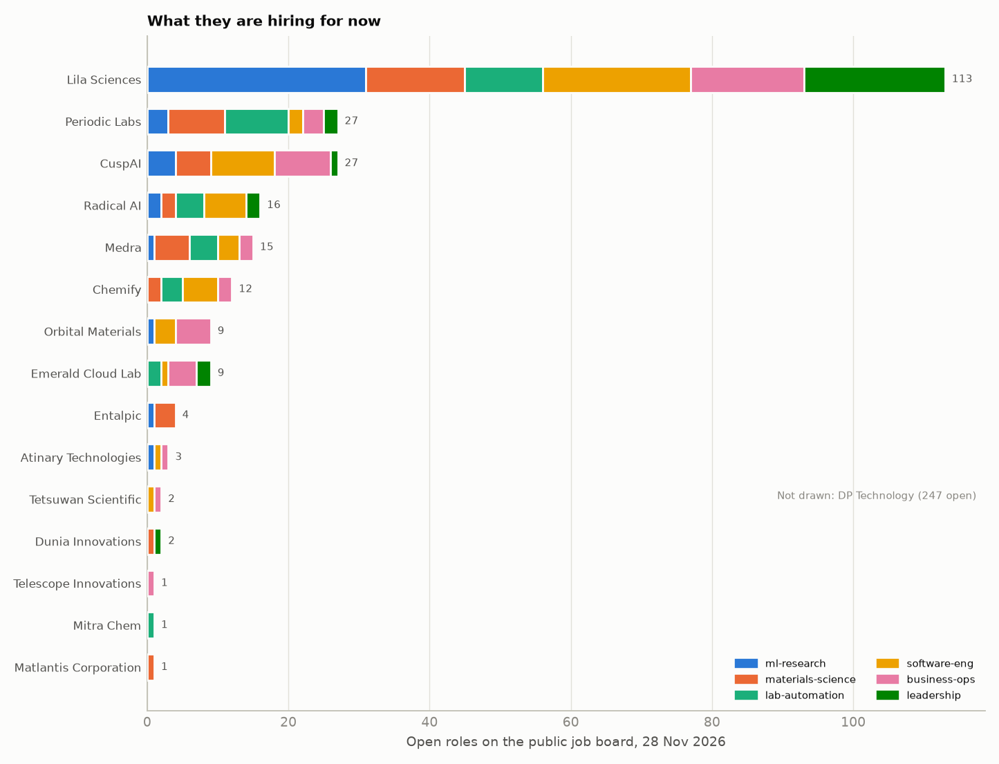
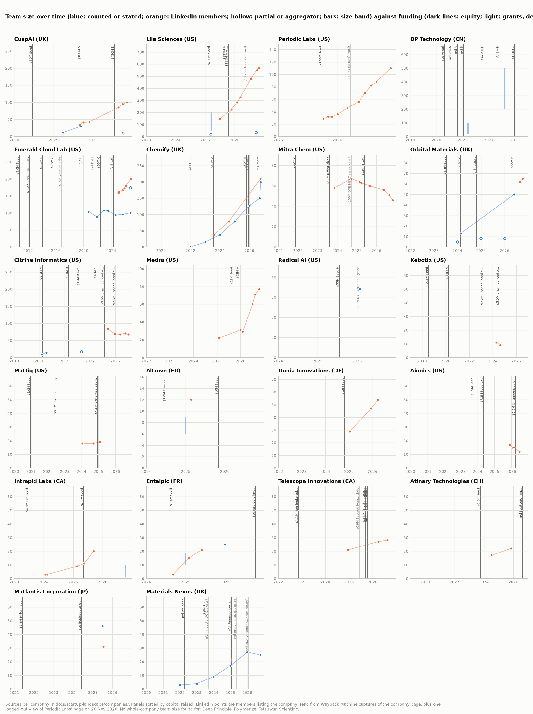
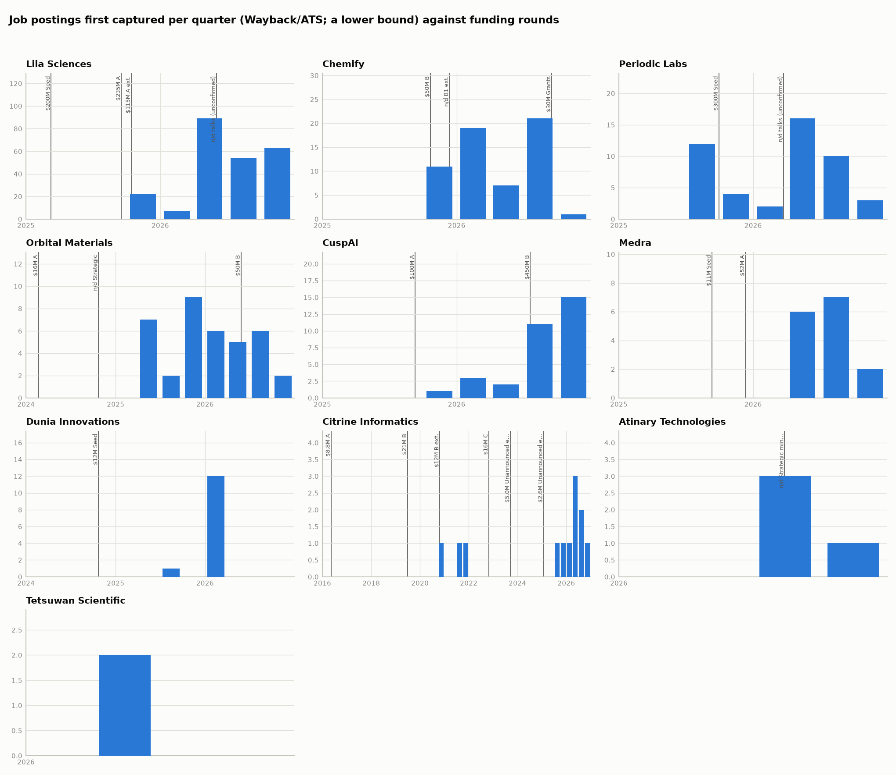
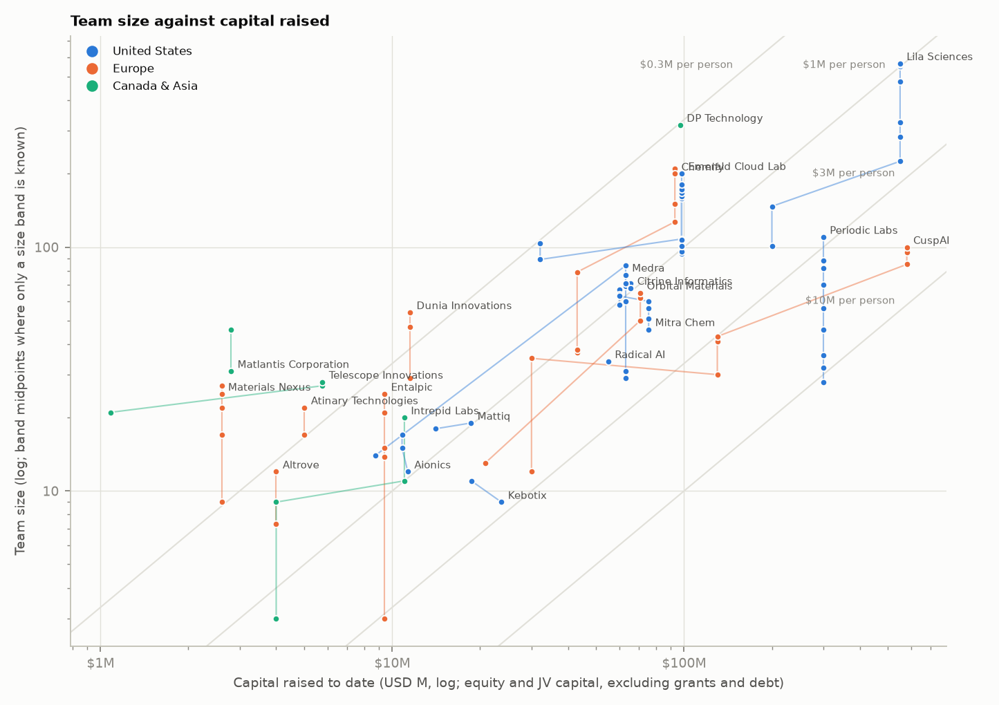
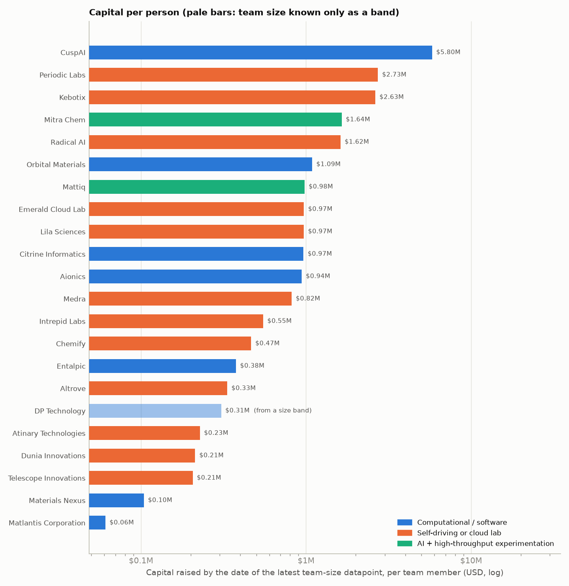
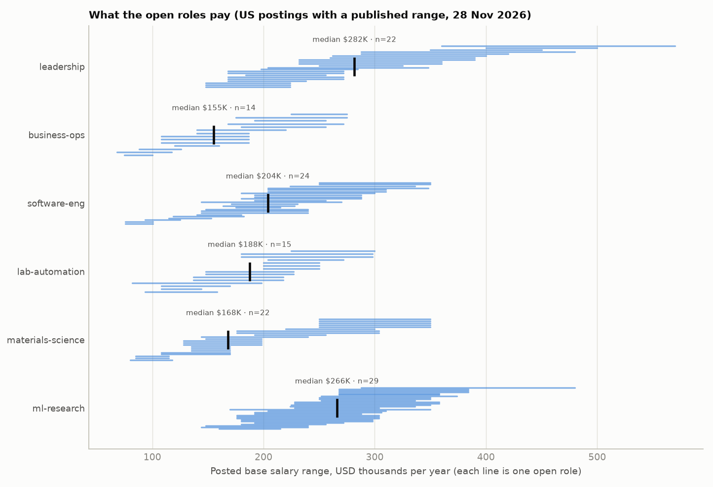

# AI-for-materials and self-driving-lab startups: who they hire, when, and how it tracks funding

A survey of 25 startups in the US, Europe, Canada and Asia. For each one: who holds which role, when they joined and what they did before; what jobs the company posts and how often its people leave; how big the team is; and how hiring moves against the funding timeline. It continues the enterprise/academic precedent work in [#155](https://github.com/vertical-cloud-lab/byu-vcl/issues/155). Data snapshot: **9 October 2026**, refreshed **28 November 2026** ([what changed](#update-2026-11-28)).

**25 companies** are covered:
- **US:** Periodic Labs, Lila Sciences, Radical AI, Medra, Tetsuwan Scientific, Citrine Informatics, Kebotix, Mitra Chem, Aionics, Mattiq, Emerald Cloud Lab.
- **UK:** Orbital Materials (now Orbital Industries), CuspAI, Chemify, Materials Nexus.
- **Continental Europe:** Entalpic, Altrove, Dunia Innovations, Atinary.
- **Canada:** Telescope Innovations, Intrepid Labs.
- **Asia:** DP Technology, Deep Principle, Matlantis, Polymerize.

The one-row-per-company table is in [`summary.md`](summary.md), and each company has a sourced profile in [`companies/`](companies/).

## Update, 2026-11-28

Seven weeks after the first snapshot, the survey was refreshed with the tool the request asked for. Headed Chrome ran on a virtual display, its traffic left through the CubXL Pi, and it was driven with mouse moves, scrolls and clicks. [LinkedIn: what was driven, and where it stopped](#linkedin-what-was-driven-and-where-it-stopped) covers what LinkedIn allowed. In short, it served one logged-out company page and then its sign-in wall, but its public job search kept loading.

**What the refresh added:**
- **LinkedIn member counts for 20 companies,** from Wayback captures of their LinkedIn pages read through the Pi, plus one live view.
  - Seven had no team-size series before: Medra, Mitra Chem, Aionics, Kebotix, Mattiq, Intrepid Labs and Telescope.
  - Emerald Cloud Lab, Orbital and Chemify gain a LinkedIn series beside their team-page or registry counts.
  - Radical AI, Tetsuwan and Deep Principle still have none.
  - All are in [`data/linkedin_company_pages.json`](data/linkedin_company_pages.json).
- **Live job boards, read again and compared with 10 October.** The postings folder now holds 968 postings, 903 with full descriptions, up from 811 and 757.
- **LinkedIn's public job search for 24 companies,** by company ID ([`data/linkedin_jobs.json`](data/linkedin_jobs.json)).
  - Where a company runs its own board, LinkedIn lists the same roles.
  - It added postings only for Matlantis and Telescope, which have none of their own.
- **Client-side careers pages, rendered in the browser:**
  - **Atinary:** three Zoho Recruit postings, with full descriptions.
  - **Entalpic:** a Notion board showing four roles. Eleven untitled drafts in its database are hidden from visitors and are no longer counted.
  - **Polymerize:** the careers page is now a 404.
  - **MatNex:** no vacancies.
  - **Matlantis:** a closed BizReach recruiting feature.
  - **Telescope:** a bot check that did not clear. It was left alone.
- **Leadership pages and Companies House officer lists,** diffed against the names on record.
- **A news search, 1 October–28 November, and SEC EDGAR for new Form Ds.** No new Form D was found for any of the 25 companies.

**1. The 2025 cohort keeps compounding; three older companies are shrinking.** LinkedIn members (people listing the company, so a trend rather than a headcount):

| Company | LinkedIn members | Reading |
|---|---|---|
| [Lila Sciences](companies/lila-sciences.md) | 326 (Mar 2026) → 477 (Jul) → 550 (1 Oct) → 567 (27 Oct) | still growing, more slowly |
| [Periodic Labs](companies/periodic-labs.md) | 36 (Jan 2026) → 56 (May) → 88 (Aug) → **110 (28 Nov, live)** | +25% since August |
| [Medra](companies/medra.md) | 22 (Feb 2025) → 31 (Jan 2026) → 60 (Jul) → 77 (Oct) | more than doubled in the ten months after its Dec 2025 Series A |
| [CuspAI](companies/cuspai.md) | 43 (Nov 2025) → 85 (Aug 2026) → 95 (Oct) → 100 (13 Nov) | more than doubled in a year that included its $450M Series B |
| [Chemify](companies/chemify.md) | 37 (Aug 2023) → 79 (Aug 2024) → 210 (Oct 2026) | matches its own "200+" |
| [Intrepid Labs](companies/intrepid-labs.md) | 3 (Jan 2024) → 9 (Feb 2025) → 20 (Sep 2025) | first series for it |
| [Telescope](companies/telescope-innovations.md) | 21 (Dec 2024) → 27 (Apr 2026) → 28 (Aug) | first series for it |
| [Emerald Cloud Lab](companies/emerald-cloud-lab.md) | 159 (Feb 2025) → 180 (Feb 2026) → 201 (Nov) | its team page shows about 100; LinkedIn keeps alumni |
| [Mitra Chem](companies/mitra-chem.md) | **67 (Sep 2024) → 60 (Aug 2025) → 51 (Aug 2026) → 46 (Oct 2026)** | down a third in two years |
| [Aionics](companies/aionics.md) | **17 (Nov 2025) → 15 (Jan 2026) → 12 (Jun 2026)** | shrinking as the CEO changed (below) |
| [Kebotix](companies/kebotix.md) | 11 (Apr 2024) → 9 (Aug 2024); band only since | consistent with its thin public footprint |
| [Mattiq](companies/mattiq.md) | 18 (Jan 2024) → 19 (Jan 2025) | flat |

**2. Openings, 10 October → 28 November.** These are counted per posting on each company's own board, with general applications left out. The October snapshot was recounted the same way.

| Company | 10 Oct | 28 Nov | What changed |
|---|---|---|---|
| [CuspAI](job-postings/cuspai.md) | 14 | 27 | 18 new. They cover AI Materials Foundry ecosystem and programme roles, scientific product managers (one in Singapore), platform, performance and security engineers, and research engineers for generative and materials foundation models. There is also a lab-integration software engineer. LinkedIn lists the roles 66 times across London, Cambridge, Berlin and Amsterdam. |
| [Radical AI](job-postings/radical-ai.md) | 9 | 16 | A thin-film materials scientist, a laboratory technician, ML, robotics and perception engineers, two technical product managers, and an applied scientist for experiment selection. |
| [Lila Sciences](job-postings/lila-sciences.md) | 107 | 113 | 50 first seen since 10 October, 21 of them co-op roles. Also director-level roles for AI-lab integration, lab platform engineering, IP and inference engineering, and a set of AI-safety research roles. |
| [Emerald Cloud Lab](job-postings/emerald-cloud-lab.md) | 7 | 9 | A construction project director, a compliance and quality director, an alliance manager and an FP&A manager. |
| [Orbital](job-postings/orbital-materials.md) | 7 | 9 | Two "Founding Sales (Science)" roles and a supply-chain manager. |
| [Periodic Labs](job-postings/periodic-labs.md) | 33 | 27 | Nothing new. Six closed, among them condensed-matter theory, ML systems, forward-deployed physics, an electrical technician and an equipment engineer. |
| [Chemify](job-postings/chemify.md) | 32 | 12 | Nothing new; 20 closed. Nine links on its careers page now open "This vacancy has now been closed". |
| [Dunia](job-postings/dunia-innovations.md) | 13 | 2 | The February batch (ML, lab technicians, chemists, engineers) has all closed. |
| [Citrine](job-postings/citrine-informatics.md) | 4 | 0 | Only a general application is left. |
| [DP Technology](job-postings/dp-technology.md) | 275 | 247 | 24 new. They include a head of an autonomous drug-discovery lab, an automated-lab operations engineer, and delivery engineers for "large facilities" in its electrolyte line. |
| Unchanged or nearly so | | | Medra 15, Entalpic 4, Tetsuwan 2, Mitra Chem 1, Atinary 4 → 3 |
| LinkedIn only | | | Matlantis: a Senior Solutions Scientist in Cambridge, MA. Telescope: a Product Manager in Vancouver. Nothing for Intrepid, Kebotix, Mattiq, MatNex, Polymerize, Altrove, Aionics or Deep Principle. |



**3. Leadership, funding and status since 10 October.** Every item is sourced in the company's profile and in [`data/news_2026-11-28.json`](data/news_2026-11-28.json).

**Leadership:**
- **[Aionics](companies/aionics.md)'s CEO is now co-founder Venkat Viswanathan.** Austin Sendek was CEO on the December 2025 capture of the leadership page. By March 2026 he is no longer listed. No announcement was found.
- **[Lila](companies/lila-sciences.md)** dropped two leaders from its team page: Jack Milwid (Office of the CEO) and Chris O'Donnell (Chief Government Affairs Officer). Chris Fussell became Vice Chair.
- **[Citrine](companies/citrine-informatics.md):** its head of strategy and operations is off the leadership page.
- **[MatNex](companies/materials-nexus.md),** the new trading name of Materials Nexus, lost its non-executive director on 6 November.
- **[Chemify](companies/chemify.md)** announced an ex-IonQ CRO as an independent director.
- **[CuspAI](companies/cuspai.md)** added Nobel laureate Susumu Kitagawa to its advisory board.
- **[Polymerize](companies/polymerize.md)** appointed a new Japan country manager.

**Funding:**
- **[Entalpic](companies/entalpic.md):** NVIDIA announced a planned strategic investment on 12 October, amount undisclosed.
- **CuspAI** now says it has raised "over $725M", about $145M more than the announced rounds. It is setting up in Tokyo and Singapore.
- **[Mitra Chem](companies/mitra-chem.md):** a 2025 Form D, missed in October, shows $15.6M sold of a $50M offering under its legal name. It settles the conflicting reports of a Series B extension.
- **Still unconfirmed:** Periodic's and Lila's reported 2026 rounds. Only a private-market aggregator lists them, and neither company has announced them.

**Status:**
- **[Tetsuwan](companies/tetsuwan-scientific.md)'s website is down.** It fails at the TLS handshake, after a normal capture on 12 October. Search snippets point to a late-October LinkedIn post about closing, which was not opened. Treat it as unconfirmed.
- **[Mattiq](companies/mattiq.md)'s new site** sells experimental materials data for AI.
- **[Atinary](companies/atinary.md)'s job ads** now give Menlo Park as headquarters.

**4. Posted pay, 28 November.** There are 126 US postings with a published range: Lila 91, Periodic 19, Medra 14, Tetsuwan 2. Median midpoints, with 10 October in brackets:

| Function | 28 Nov | 10 Oct |
|---|---|---|
| ML research | $266K | $288K |
| Software | $204K | $217K |
| Lab automation | $188K | $166K |
| Materials science | $168K | $178K |
| Business and operations | $155K | $156K |
| Leadership | $282K | $255K |

The 10 October medians differ from finding 5 below because the title classifier was corrected. It had filed Lila's new "AI Safety" scientist and engineer roles under lab automation, because their titles contain "safety". It also filed an equipment-accounting manager there. Both now go where they belong, for both dates.

## Findings

**1. Two funding eras.** The 2010–2021 cohort raised $11–100M each, mostly in $5–20M increments spread over years:
- [Citrine](companies/citrine-informatics.md): ~$66M across six Form Ds.
- [Kebotix](companies/kebotix.md): ~$24M.
- [Mattiq](companies/mattiq.md): ~$19M.
- [Aionics](companies/aionics.md): ~$11M.

The 2024–25 cohort raises that much in a single round:
- [Periodic Labs](companies/periodic-labs.md): a $300M seed (Sep 2025), with talks at a ~$7B valuation reported but unconfirmed.
- [Lila Sciences](companies/lila-sciences.md): $550M in seven months.
- [CuspAI](companies/cuspai.md): $580M in 25 months, including a $450M Series B at a $2.6B valuation (Jul 2026).
- [Medra](companies/medra.md): $63M in three months.

**2. Hiring follows a round by two to three quarters, then compounds.**



| Company | Team size over time | Hiring after the round |
|---|---|---|
| Periodic Labs | LinkedIn members 28 (Oct 2025) → 46 → 56 → 88 (Aug 2026) | Captured postings ran 2–4 a quarter over the winter after the $300M seed, then 16 in 2026Q2 |
| Lila Sciences | A 51–200 LinkedIn band at launch → 326 members (Mar 2026) → 550 (Oct 2026) | 22 postings the quarter after its Series A, then 89 in 2026Q2 |
| CuspAI | ~12 (registry, to Mar 2025) → ~30 (Sep 2025) → 85 (Aug 2026) | — |
| [Chemify](companies/chemify.md) | UK accounts give 15 → 38 → 79 → 127 average employees (2022–25), and the site now says 200+ | — |

Smaller rounds buy slower, steadier growth:
- [Materials Nexus](companies/materials-nexus.md): 3 → 27 over 2021–25 on a £2M seed plus grants.
- [Entalpic](companies/entalpic.md): 3 → 25 in 16 months on €8.5M.
- [Dunia](companies/dunia-innovations.md): 29 → 54 on $11.5M.



Hiring and funding do not always line up. Dunia posted 12 of its 13 open roles in a single week of February 2026 with no matching funding announcement. Citrine has posted only a trickle of roles since 2023, alongside small unannounced raises.

**3. Capital per person spans two orders of magnitude.** Each figure is capital raised by the date of the team-size count, per person:

| Group | Capital per person | Companies |
|---|---|---|
| Computational and software, small rounds | $0.1–0.4M | Materials Nexus, Entalpic, Dunia, Atinary |
| Physical-lab and older platform companies | ~$0.5–1M | Chemify $0.47M, Citrine and Emerald Cloud Lab ~$0.97M, Lila $1.0M |
| 2025 mega-rounds | $3–7M, still in the bank | Periodic $3.4M, CuspAI $6.8M |

 

**4. Physical-lab companies hire lab people; computational ones hire go-to-market.**
- Of Periodic's 33 open roles, ML research is only 5. Materials science has 10 and lab automation 6 (technicians, equipment, process and safety engineers). Its Head of People and Head of EHS seats are still open, which is what a lab build-out looks like.
- Lila's 106 openings split 17 ML, 18 materials science, 18 lab automation, 25 software and 28 business.
- CuspAI is computational. Nine of its 14 openings are partnerships, developer relations, programme or talent roles.
- [Orbital](companies/orbital-materials.md) rebranded as Orbital Industries around its May 2026 Series B. It now sells data-centre cooling fluids and compute hardware and hires forward-deployed and test engineers.


**5. What the roles pay.** 142 US postings publish a base range (Lila 105, Periodic 29, Medra 6, Tetsuwan 2). Median range midpoints by function:

| Function | Median midpoint |
|---|---|
| ML research | $290K |
| Leadership | $255K |
| Software | $217K |
| Materials science | $178K |
| Lab automation | $177K |
| Business and operations | $156K |

Periodic pays at the top of the market across the board:

| Periodic Labs role | Posted range |
|---|---|
| Research scientist | $250–350K |
| Automation engineer | $200–250K |
| Research associate | $180–225K |
| Laboratory technician | $100–130K |

Lila's comparable lab roles are much lower: senior research associate (automated chemistry) $80–118K and lab operations specialist $68–103K. These are useful benchmarks when hiring an automation engineer or lab technician for an academic self-driving lab. See `data/posted_pay.csv` and the [posted-pay table](summary.md#posted-pay).



**6. Who founds and leads.**
- **The 2025 cohort comes out of frontier AI labs and big-tech research.**
  - Periodic was founded by OpenAI's former VP of post-training research and a Google DeepMind materials research lead.
  - Orbital's CEO spent five years at DeepMind.
  - CuspAI pairs a University of Amsterdam ML professor and former Microsoft Research and Qualcomm VP with a PhD chemist from Google and Quantinuum.
- **The earlier cohort is faculty spinouts:**
  - Aspuru-Guzik (Kebotix)
  - Cronin (Chemify)
  - Mirkin (Mattiq)
  - Chueh (Mitra Chem)
  - Hein (Telescope)
  - Allen and Aspuru-Guzik (Intrepid)
  - Weinan E as DP Technology's chief scientific adviser
- **The faculty-founder route has raised $5–100M per company; the frontier-lab route $300–580M.** DP Technology, whose co-founder trained under Weinan E, is the exception at $200M+.
- **Lila builds out its executive layer.** It is a Flagship company and now lists 33 VP-and-above leaders, up from 15 at launch.

**7. Turnover and failure modes.** These are visible in team-page diffs, registry filings and Form D officer lists:
- **Citrine:** the co-founder and Chief Science Officer left in 2022. Five of the seven functional heads on the 2019 leadership page, plus the CTO, were gone by December 2023. LinkedIn members fell from 84 to 68 between Feb 2024 and Jul 2026, while the company raised only small unannounced amounts.
- **Kebotix:** the founder-CEO and two directors are absent from the 2023 Form D, and co-founder Aspuru-Guzik from the 2024 one. The website lists no team or openings, so the company's status is unclear.
- **Emerald Cloud Lab:**
  - Its team page has held at about 90–108 people for six years.
  - A WARN notice covered 30 jobs when it moved from South San Francisco to Austin (2023).
  - Laboratory-operations staff fell from 40 to 6 between 2020 and 2026, while scientific development held at about 30.
- **CEO changes:** Mattiq's CEO changed. Aionics's CEO is absent from its 2026 Form D, with no announcement found.
- **Chemify:** it has gone through two CTOs since 2024.
- **Lila:** five of the 15 leaders on its launch team page are missing from the current one (including its Chief Scientist). Some may have changed roles rather than left.
- **Pivots:** Orbital (to data-centre hardware) and Tetsuwan (to a browser-accessible biology cloud lab).

**8. What this means for the VCL** (the question behind #155).
- **Industry money reaches labs through strategic stakes and consortia more than through early VC.** Examples:
  - Bruker took a minority stake in Atinary (Aug 2026), which opened its own autonomous lab in Boston in early 2026.
  - NVIDIA's NVentures invested in Orbital and Lila.
  - CuspAI launched an "AI Materials Foundry" with 45+ founding partners (NVIDIA, Meta, Samsung, Hyundai and others) as consortium members rather than investors ([Dealroom](https://dealroom.co/news/139818-cuspai-closes-450m-series-b-at-2-6b-valuation-backed-by-bezos-and-uk-sov/), [Sifted](https://sifted.eu/articles/cuspai-lands-450m-round-to-accelerate-ai-materials-discovery)).

  Those consortium and strategic-partner models are the ones an academic facility can copy.
- **The cloud-lab precedent shows stable staffing.** Emerald Cloud Lab held ~100 people for six years, and its lab-operations group shrank from 40 to 6. Its funding is ~$100M from primary sources, or $150–180M per aggregators.

## Contents

- [`related.md`](related.md): issues and pull requests in byu-vcl and digital-alloy-lab that this survey builds on, overlaps with or could feed.
- [`summary.md`](summary.md): the one-row-per-company table, generated from the data.
- [`companies/`](companies/): one profile per company, with every row linked to its source:
  - funding rounds,
  - team size over time,
  - leadership with start dates and backgrounds,
  - staff roles,
  - current and historical job postings,
  - turnover.
- [`data/`](data/): the same facts as JSON (schema below), plus `funding_response.csv`, which pairs each round with hiring before and after it.
- [`figures/`](figures/): the plots, regenerated by `python scripts/startup_landscape/analyze.py`.
- [`job-postings/`](job-postings/): every job posting recovered, current and archived, with its full description and what it asks for. Start with its [README](job-postings/README.md). The text is in `data/job_postings.jsonl`, regenerated by `python scripts/startup_landscape/jobs.py build`.

## Method

Each fact comes from a public source that is meant to be read. Every one is cited in the company profile.

| Question | Sources |
|---|---|
| Funding amount and timing | Company press releases and news. [SEC Form D](https://www.sec.gov/edgar/search/) for US companies (date of first sale, amount sold, officers and directors). UK [Companies House](https://find-and-update.company-information.service.gov.uk/) share allotments (SH01). Public-company filings where they exist. |
| Team size over time | People counted on the company's own team page, captured roughly yearly by the [Wayback Machine](https://web.archive.org/). LinkedIn *company* pages as captured by the Wayback Machine (size band and member count), read from archive.org and never from LinkedIn. "Average number of employees" in UK statutory accounts. French registry employee bands ([recherche-entreprises](https://recherche-entreprises.api.gouv.fr/)). Headcounts stated in press. Distinct authors per year with the company affiliation in [OpenAlex](https://openalex.org/), which is a lower bound on publishing research staff. |
| Titles, roles, start dates, backgrounds | Team pages, now and in Wayback captures (first capture listing a person ≈ start date). Hire announcements. Registry director appointments. Form D related persons. Published bios. OpenAlex affiliation histories. |
| Job postings | Today's openings from the public job-board APIs of the companies' applicant-tracking systems (Ashby, Greenhouse, Lever, Rippling, Personio, BambooHR, Feishu, Nodi and others). These serve the same JSON the careers pages render. Closed postings that investors' and universities' job boards (Getro) still serve fill in where a company's own board has dropped them. Posting history comes from Wayback Machine captures of job-board URLs: each posting's first and last capture, counted by quarter. The archived pages also carry each posting's full description; those are in [`job-postings/`](job-postings/README.md), with how they were read. |
| Turnover | People who drop off successive team-page captures. Registry resignations. News of departures, layoffs and shutdowns. |

The fetching is done by [`scripts/startup_landscape/fetch.py`](../../scripts/startup_landscape/fetch.py). It caches every response, sends a declared User-Agent, and throttles each host through a shared lock so that parallel workers stay polite. Figures and tables are built by [`scripts/startup_landscape/analyze.py`](../../scripts/startup_landscape/analyze.py).

### Whose names appear

This repository is public, so the profiles name **leadership only**:
- founders and C-suite,
- VP, Head-of and Director-level leaders,
- statutory directors and officers,
- board members and named advisors.

These are people whose role and bio the company or a public register already publishes. Everyone else is recorded by title, function, first- and last-seen dates and background category, without names, and linked to the team-page capture rather than to a personal profile. Birth dates, nationality and contact details are never recorded, even where a register shows them.

### LinkedIn: what was driven, and where it stopped

The first two passes did not drive LinkedIn. The 28 November 2026 refresh did, as #155 and this PR asked:
- **The browser.** Headed Chrome ran on a virtual display, with its traffic sent out through the CubXL Pi over an SSH SOCKS tunnel. LinkedIn therefore saw BYU's network (AS6510) rather than a datacenter.
- **The mouse.** It moved, scrolled and clicked: it dismissed the sign-in modal, opened filters, pressed "See more jobs" and clicked into postings.
- **No typing, no account.** Nothing was typed and no account was used; none is provisioned.

The code is [`scripts/startup_landscape/browser.py`](../../scripts/startup_landscape/browser.py). It kept to rules set before it started:
- **Logged out only.** No account, real or made up.
- **Human pace.** 25–50 s between companies and several seconds between clicks: about 60 LinkedIn page loads in all, spread over an hour.
- **At the first sign-in wall or checkpoint, stop.** Never clear cookies, start a new profile, change exit address or solve a challenge to get past one. That would be bypassing an access control, which LinkedIn's User Agreement §8.2 forbids. It would also put the BYU address at risk of being flagged.
- **Company-level data only.** Member counts, size bands and job postings. LinkedIn's "Employees at …" card on a company page was cut from the saved text before storage, and the page text itself is not committed.

What LinkedIn served:
- **Company pages: one, then the wall.** LinkedIn served Periodic Labs' page: 110 members, an 11–50 band and 23,700 followers. The next company page redirected to `/authwall`, so that pass ended there.
- **Member counts for the other companies** come from Wayback Machine captures of the same pages, read from archive.org through the Pi. These are in [`data/linkedin_company_pages.json`](data/linkedin_company_pages.json), with each company's LinkedIn ID.
- **Public job search: it kept loading.** Each company was searched by its LinkedIn company ID (`f_C`, read from the archived pages), or by name through the Company filter where no ID was known.
- **Postings at companies without their own board.** For these, each posting was clicked open and its detail pane read: seniority, employment type, applicant count and description. The results are in [`data/linkedin_jobs.json`](data/linkedin_jobs.json).

**The legal and privacy position, for anyone repeating this:**
- **Logging in changes the contract question.** LinkedIn's User Agreement §8.2 forbids using "software, devices, scripts, robots or any other means or processes … to scrape or copy the Services", and forbids bypassing "any access controls or use limits" ([LinkedIn help](https://www.linkedin.com/help/linkedin/answer/a1341387)).
  - *hiQ Labs v. LinkedIn* ended in a breach-of-contract ruling against hiQ, which had held accounts, plus a $500k consent judgment ([National Law Review](https://www.natlawreview.com/article/linkedin-s-data-scraping-battle-hiq-labs-ends-proposed-judgment)).
  - In *Meta v. Bright Data* (N.D. Cal., January 2024), by contrast, Meta's terms were held not to cover logged-off scraping of public data ([TechCrunch](https://techcrunch.com/2024/01/24/court-rules-in-favor-of-a-web-scraper-bright-data-which-meta-had-used-and-then-sued); [Farella Braun + Martel](https://www.fbm.com/technology/publications/major-decision-affects-law-of-scraping-and-online-data-collection-meta-platforms-v-bright-data/)).
  - So staying logged out matters. So does stopping at the wall rather than defeating it.
- **Per-person histories are a privacy matter, not a technical one.** Who joined and left each company, person by person, would need people search, which LinkedIn shows only to signed-in members. Publishing such histories raises GDPR questions for EU and UK staff. The survey still names leadership only.

If per-person LinkedIn data is wanted, the legitimate routes are:
- a person reading profiles by hand, or LinkedIn's Talent Insights or Sales Navigator;
- LinkedIn's [Economic Graph Research Program](https://engineering.linkedin.com/blog/2017/03/announcing-the-economic-graph-research-program);
- a licensed workforce dataset (Revelio Labs, Live Data Technologies, Coresignal);
- a PitchBook or Crunchbase licence through the university.

### Data schema

`data/<slug>.json`:

```json
{
  "company": "", "slug": "", "hq": "", "country": "US", "founded": "YYYY",
  "category": "AI-for-materials (computational)|self-driving lab|AI + high-throughput experimentation|cloud lab|materials informatics software",
  "focus": "", "status": "active|acquired|defunct|pivoted", "website": "",
  "funding":   [{"date", "round", "amount_usd_m", "original_amount", "type": "equity|grant|debt|ipo|jv-capital|other", "lead_investors", "source"}],
  "headcount": [{"date", "value", "low", "high", "method": "team-page|linkedin-band|registry|press|job-ad|openalex|other", "note", "source"}],
  "postings":  [{"period": "YYYYQn", "new_postings", "method", "source"}],
  "current_openings": {"date", "count", "by_function", "titles", "source"},
  "people":      [{"name", "title", "function", "seniority", "start", "start_basis", "end", "background", "source"}],
  "staff_roles": [{"title", "function", "first_seen", "last_seen", "background", "source"}],
  "departures":  [{"who", "title", "date", "basis", "source"}],
  "notes": []
}
```

Functions use one vocabulary throughout: `leadership`, `ml-research`, `materials-science`, `lab-automation`, `software-eng`, `business-ops`.

Some headcount entries carry `"partial": true`. These count only part of the company (one subsidiary, a leadership-only team page, the R&D group, publishing authors). They are drawn hollow in the timeline and never used as the company's team size. Points from archived LinkedIn pages use the member count ("View all N employees") as `value` and the self-reported band as `low`/`high`.

### Caveats

- **Wayback coverage is uneven.** Posting counts and team-page counts are lower bounds, and a quiet quarter can mean the crawler didn't visit. The trends are more trustworthy than the levels.
- **Team pages lag and select.** They lag hiring by weeks to months, and they often omit contractors, interns or whole functions. Some companies stop listing staff once they pass ~30 people.
- **LinkedIn size bands are self-reported** and coarse (11-50, 51-200 and so on). Member counts include alumni who never updated their profile.
- **OpenAlex affiliations are noisy.** Disambiguation errors and academic collaborators inflate them; obvious collaborators were filtered out by hand.
- **Funding figures mix sources.** Press amounts include tranches and extensions inconsistently. Form D reports the amount sold at filing. Non-USD amounts are converted at the rate of the time.
- **This is a snapshot.** Openings and team pages change weekly.

## Reproducing

```bash
pip install pypdf matplotlib
python scripts/startup_landscape/fetch.py ats periodic-labs                   # today's openings
python scripts/startup_landscape/fetch.py cdx-urls 'jobs.ashbyhq.com/periodic-labs/*'  # posting history
python scripts/startup_landscape/analyze.py                                    # figures + summary.md
```
