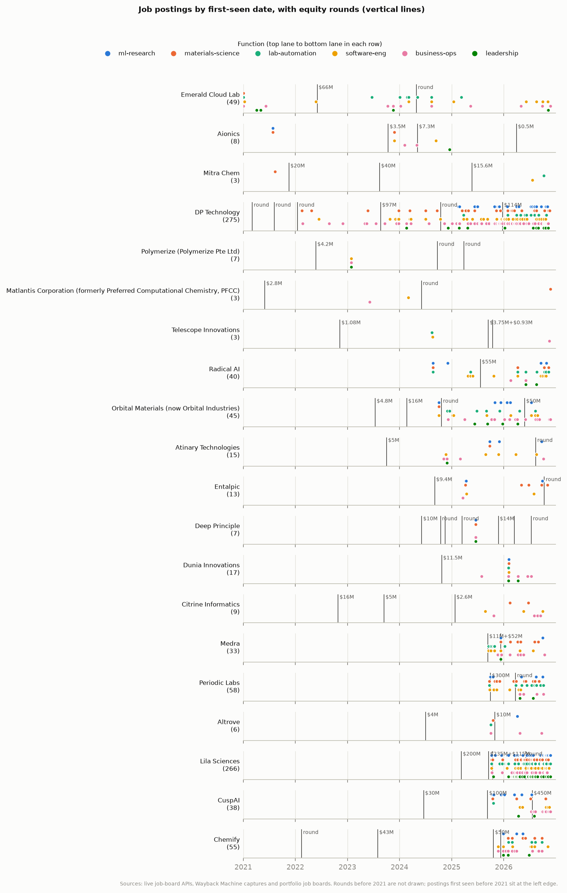

# Job postings: generated tables

Generated by `python scripts/startup_landscape/jobs.py build` from `data/job_postings.jsonl`. The findings are in [README.md](README.md); each company's postings and descriptions are on its own page.

## Coverage

| Company | Postings | With description | Open on 2026-11-28 | First seen | Last first-seen | Evidence |
|---|---|---|---|---|---|---|
| [DP Technology (深势科技, Beijing DP Technology Co., Ltd.)](dp-technology.md) | 275 | 275 | 231 | 2022-02-15 | 2026-11-18 | live 275 |
| [Lila Sciences](lila-sciences.md) | 266 | 255 | 112 | 2025-10-06 | 2026-11-25 | live 157, wayback 167 |
| [Periodic Labs](periodic-labs.md) | 58 | 55 | 27 | 2025-09-18 | 2026-10-07 | live 33, wayback 58 |
| [Chemify](chemify.md) | 55 | 55 | 12 | 2025-11-22 | 2026-11-05 | live 31, wayback 36 |
| [Emerald Cloud Lab](emerald-cloud-lab.md) | 49 | 34 | 9 | 2014-03-26 | 2026-11-25 | live 13, wayback 37 |
| [Orbital Materials (now Orbital Industries)](orbital-materials.md) | 45 | 30 | 8 | 2024-10-02 | 2026-11-25 | live 9, wayback 38 |
| [Radical AI](radical-ai.md) | 40 | 40 | 16 | 2024-08-22 | 2026-11-12 | live 18, wayback 24 |
| [CuspAI](cuspai.md) | 38 | 33 | 24 | 2025-10-14 | 2026-11-24 | live 28, wayback 33 |
| [Medra](medra.md) | 33 | 28 | 15 | 2025-09-17 | 2026-10-13 | live 18, wayback 33 |
| [Dunia Innovations](dunia-innovations.md) | 17 | 17 | 2 | 2025-07-29 | 2026-07-13 | live 13, wayback 15 |
| [Atinary Technologies](atinary.md) | 15 | 15 | 3 | 2024-11-06 | 2026-10-05 | live 3, wayback 12 |
| [Entalpic](entalpic.md) | 13 | 10 | 4 | 2025-03-21 | 2026-11-04 | live 6, wayback 7 |
| [Citrine Informatics](citrine-informatics.md) | 9 | 9 | 0 | 2025-08-25 | 2026-10-01 | live 4, wayback 7 |
| [Aionics](aionics.md) | 8 | 8 | 0 | 2021-07-27 | 2024-12-18 | wayback 8 |
| [Deep Principle (深度原理, Hangzhou Deep Principle Technology Co., Ltd.)](deep-principle.md) | 7 | 7 | 0 | 2025-06-17 | 2025-06-17 | wayback 7 |
| [Polymerize (Polymerize Pte Ltd)](polymerize.md) | 7 | 0 | 0 | 2023-01-27 | 2023-01-27 | wayback 7 |
| [Altrove](altrove.md) | 6 | 6 | 0 | 2025-10-03 | 2026-09-24 | live 1, wayback 6 |
| [Mitra Chem](mitra-chem.md) | 3 | 3 | 1 | 2021-08-11 | 2026-10-10 | live 1, wayback 2 |
| [Matlantis Corporation (formerly Preferred Computational Chemistry, PFCC)](matlantis.md) | 3 | 3 | 1 | 2023-06-07 | 2026-11-25 | live 1, wayback 2 |
| [Telescope Innovations](telescope-innovations.md) | 3 | 3 | 1 | 2024-08-16 | 2026-11-16 | live 1, wayback 2 |
| [Kebotix](kebotix.md) | 2 | 2 | 0 | 2018-11-07 | 2019-08-20 | wayback 2 |
| [Materials Nexus (MatNex)](materials-nexus.md) | 2 | 2 | 0 | 2022-07-13 | 2022-10-13 | wayback 2 |
| [Tetsuwan Scientific](tetsuwan-scientific.md) | 2 | 2 | 2 | 2026-06-03 | 2026-06-03 | live 2 |
| [Intrepid Labs](intrepid-labs.md) | careers-page captures only | | | | | wayback |
| [Mattiq (formerly Stoicheia)](mattiq.md) | careers-page captures only | | | | | wayback |

**Total:** 956 postings, 892 with a description.

## The first roles each company posted

Postings first seen within 60 days of the company's earliest posting on record. For companies whose board was archived from the start, this is the founding hiring plan; for older companies it is only where the record begins.

| Company | Earliest posting | Roles in the first 60 days |
|---|---|---|
| Emerald Cloud Lab | 2014-03-26 | Laboratory Operator |
| Kebotix | 2018-11-07 | Intern - Machine Learning Scientist |
| Aionics | 2021-07-27 | Materials Informatics (Data Science) Intern, Undergraduate Level; Materials Informatics Intern, Ph.D. Level |
| Mitra Chem | 2021-08-11 | Battery Materials Scientist |
| DP Technology (深势科技, Beijing DP Technology Co., Ltd.) | 2022-02-15 | Compliance Manager; Medicinal Chemist |
| Materials Nexus (MatNex) | 2022-07-13 | Scientific Software Developer |
| Polymerize (Polymerize Pte Ltd) | 2023-01-27 | Content Writer; Director Product Marketing; Director VP Engineering; Frontend Developer; Key Account Manager; Product Designer; QA Engineer |
| Matlantis Corporation (formerly Preferred Computational Chemistry, PFCC) | 2023-06-07 | MATLANTIS |
| Telescope Innovations | 2024-08-16 | Mechatronics Engineer: Automated Chemistry Technology; Software Engineer: Automated Chemistry Technology |
| Radical AI | 2024-08-22 | AI Research Scientist - GNN / Foundation Models; AI Research Scientist - Generative Models; Material Scientist; Mechanical Engineer; Mechatronics Engineer |
| Orbital Materials (now Orbital Industries) | 2024-10-02 | Full Stack Software Engineer; Researcher (Generative Models & Simulation); Researcher (LLMs) |
| Atinary Technologies | 2024-11-06 | Full Stack Developer; Head of lab; Sales Account Executive (East Coast, USA); Sales Account Executive (Lausanne, Switzerland) |
| Entalpic | 2025-03-21 | Computational Chemist; Computational Chemist Liquid Molecular Systems (CDI); DevOps Software Engineering Intern (Internship); ML Scientist for Chemisty Intern (Internship); Material & ML Scientist Intern (Internship); Senior ML Engineer (CDI); Strategy & Operations Intern (Internship) |
| Deep Principle (深度原理, Hangzhou Deep Principle Technology Co., Ltd.) | 2025-06-17 | Business Development Manager; Computational Chemistry Research Scientist; Government and Public Relations; Head of Artificial Intellgence; Head of Laboratory, HTE; Machine Learning Research Scientist; Technical Product Manager |
| Dunia Innovations | 2025-07-29 | Business Development Manager |
| Citrine Informatics | 2025-08-25 | Customer Success Manager L3; Research Engineering Manager |
| Medra | 2025-09-17 | Forward Deployed Robotics Engineer; Full Stack Software Engineer; Full Stack Software Engineer - Summer 2026 Internship; Full Stack Software Engineer - Winter 2026 Internship; Mechanical Engineer; Mechanical Engineer - Winter 2026 Internship; Robotics Software Engineer; Robotics Software Engineer - Summer 2026 Internship; Robotics Software Engineer - Winter 2026 Internship |
| Periodic Labs | 2025-09-18 | Automation Engineer; CUDA Kernel Engineer; Controls Engineer; Distributed Training Engineer; Facilities Manager; LLM Inference Engineer; Lead IT Engineer; Mechanical Engineer; Product Engineer; Reliability Engineer; Research Engineer - Midtraining; Research Engineer - Posttraining; Research Engineer, Lab Automation; Research Scientist, Condensed Matter Theory; Research Scientist, Materials Characterization; Research Scientist, Thin Films; Robotics Engineer; Supercompute Infrastructure Engineer; Systems Engineer |
| Altrove | 2025-10-03 | Business Development Associate - Strategic Materials; Inorganic Materials Engineer - Manufacturing and Process Design; Laboratory Technician - Advanced Materials |
| Lila Sciences | 2025-10-06 | AI Residency Program, Material Science (2026 Cohort); Co-Op/Intern, Characterization, Electron Microscopy; Director of Product, Life Sciences (Chemistry); Intern, IT & Security; Intern, Physical Sciences Team - Electroanalytical; Intern, Security & Cloud Engineering; ML Research Scientist I/II, Multimodal Data Extraction; Machine Learning Engineer, Distributed & Scalable Training; Machine Learning Scientist, Interatomic Potentials; Machine Learning Scientist, Scientific Reasoning; Mechatronics Engineer (Controls Focus); Principal Software Engineer, Applied AI; Product Designer (Senior/Lead); Product Lead, Applied AI; Product Strategy Intern, Life Sciences; Product Strategy Intern, Physical Sciences; Research Scientist I/II, Statistical Mechanics and Dynamics; Research Scientist, Frontier Capabilities; Research Scientist, In Silico Materials Discovery; Research Scientist, Porous Materials; Scientist / Senior Scientist, Flow Chemistry; Senior / Engineer II, AI Lab Research Engineer; Senior / Principal Robotics Engineer, Systems Architecture; Senior / Principal Scientist, Functional Materials; Senior Data Scientist, Life Sciences; Senior Manager, Research Operations; Senior Program Manager, Machine Learning; Senior Research Associate, Assay Development; Senior Software Engineer, Backend; Software Engineer, AI Platform; Staff Forward Deployed Engineer, Life Sciences; Staff Forward Deployed Engineer, Physical Sciences (Level Flexible) |
| CuspAI | 2025-10-14 | Application Scientist (Lab Automation & Informatics); Applied AI/ML Engineer (Agents); ML Infrastructure Engineer (ML Platform); Research Engineer (Materials Foundation Models) |
| Chemify | 2025-11-22 | Computer-Aided Drug Design (CADD) Software Developer; Director of IT; Inventory Associate; Project Manager; Senior Computer-Aided Drug Design (CADD) Software Developer; Senior Data Scientist - AI/ML (CADD); Senior DevOps Engineer; Senior Full Stack Software Engineer; Senior Scientific Data Engineer; Senior/Staff Scientist – Full Stack Cheminformatics Developer; Talent and Acquisition Specialist |
| Tetsuwan Scientific | 2026-06-03 | Product Designer; Software Engineer |

## What the descriptions ask for, by function

Share of postings with a description that name each degree anywhere in the text ("PhD or equivalent experience" counts as naming a PhD), the median of the smallest "N+ years" figure in each description, and the skills most often named. Python is left out of the skills column because nearly every technical posting names it. Postings written in Chinese (DP Technology's) are left out, because the skill keywords are English.

| Function | Postings with text | Name a PhD | Name a master's | Name a bachelor's | Median min. years | Median US pay, range midpoint (n) | Most-named skills |
|---|---|---|---|---|---|---|---|
| ml-research | 96 | 57% | 30% | 20% | 4.0 | $266K (47) | LLMs (45%), PyTorch (34%), publications (32%), Bayesian opt./active learning (25%), RL (24%), JAX (21%) |
| materials-science | 94 | 67% | 43% | 30% | 3.0 | $152K (51) | synthesis (34%), robotics (28%), thin films/vacuum (22%), publications (19%), EHS/safety (18%), XRD (16%) |
| lab-automation | 109 | 14% | 17% | 39% | 3.5 | $177K (51) | robotics (59%), EHS/safety (43%), PLC/controls (28%), CAD/mechanical design (27%), synthesis (19%), thin films/vacuum (17%) |
| software-eng | 117 | 10% | 21% | 32% | 5.0 | $222K (47) | Kubernetes/cloud (47%), robotics (40%), SQL/databases (32%), TypeScript/React (30%), LLMs (14%), EHS/safety (14%) |
| business-ops | 134 | 16% | 22% | 36% | 5.0 | $163K (45) | robotics (12%), synthesis (10%), EHS/safety (8%), publications (8%), LLMs (7%), SQL/databases (7%) |
| leadership | 60 | 35% | 18% | 18% | 8.0 | $263K (43) | robotics (30%), LLMs (23%), synthesis (22%), EHS/safety (15%), Kubernetes/cloud (12%), publications (7%) |

## Functions over time

Postings by the half-year they were first seen.

| Half-year | ml-research | materials-science | lab-automation | software-eng | business-ops | leadership | total |
|---|---|---|---|---|---|---|---|
| 2014H1 | 0 | 0 | 1 | 0 | 0 | 0 | 1 |
| 2015H1 | 0 | 0 | 0 | 2 | 1 | 0 | 3 |
| 2015H2 | 0 | 2 | 0 | 1 | 2 | 0 | 5 |
| 2018H2 | 1 | 0 | 0 | 0 | 0 | 0 | 1 |
| 2019H2 | 1 | 0 | 1 | 4 | 0 | 0 | 6 |
| 2021H1 | 0 | 0 | 0 | 1 | 1 | 2 | 4 |
| 2021H2 | 1 | 2 | 0 | 0 | 0 | 0 | 3 |
| 2022H1 | 0 | 2 | 0 | 2 | 1 | 0 | 5 |
| 2022H2 | 0 | 1 | 0 | 1 | 3 | 0 | 5 |
| 2023H1 | 0 | 1 | 1 | 2 | 6 | 2 | 12 |
| 2023H2 | 0 | 2 | 0 | 6 | 6 | 1 | 15 |
| 2024H1 | 0 | 6 | 4 | 7 | 5 | 2 | 24 |
| 2024H2 | 5 | 5 | 8 | 9 | 11 | 3 | 41 |
| 2025H1 | 8 | 10 | 4 | 11 | 24 | 5 | 62 |
| 2025H2 | 31 | 21 | 22 | 39 | 45 | 6 | 164 |
| 2026H1 | 34 | 46 | 37 | 51 | 80 | 29 | 277 |
| 2026H2 | 48 | 49 | 58 | 54 | 89 | 30 | 328 |
