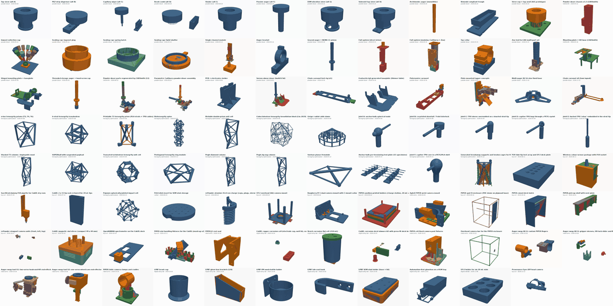

# Generative CAD across the lab

For point 1 of the [outline](../outline.md), "agents now reach across the whole research stack":
every distinct CAD design that an AI agent produced for the lab, rendered as rotating GIFs. Made
for [#350](https://github.com/vertical-cloud-lab/byu-vcl/issues/350).



**111 distinct designs from 24 April to 12 November 2026:**

| Section | Designs | Repos |
| --- | --- | --- |
| Powder doser | 36 | powder-doser (33) and CADSmith (3) |
| Other lab hardware | 61 | tensegrity-optimization (23), byu-vcl (17), digital-alloy-lab (10), robot-arms (9), caliber (1), digital-wetlab (1) |
| Models of equipment the lab already has | 14 | byu-vcl: printers, glove boxes, the CubXL, the rePowder atomizer, CB154 and so on |

That's **97 designs the lab built or proposed**, plus 14 models of equipment it already has.

- **Agents.** All 111 were added by `claude[bot]` (Claude Code) or `copilot-swe-agent[bot]`
  (GitHub Copilot's coding agent, often running a Claude model), roughly half each.
- **Assemblies.** 64 designs are assemblies; 55 have an exploded view (`renders/*-exploded.gif`
  and a larger still, `*-exploded.png`). The others ship as one fused mesh.
- **Tools.** The geometry came from CadQuery, build123d, OpenSCAD, Onshape FeatureScript,
  Zoo's text-to-CAD and CADSmith.
- **Small revisions count once.** For example, chain carousel v2–v7 are folded into v1 and v8.
  `designs.json` records how many versions each design went through, the commit the files
  came from, the generating script, and the thread it came out of.

## For the slide

- **The whole body of work in one picture:** [`grid.gif`](grid.gif) or [`grid.mp4`](grid.mp4)
  (1920 × 960, 95 lab designs turning at once), or the still [`contact-sheet.png`](contact-sheet.png)
  with titles. Say *"95 designs in seven months"* and let the picture carry it.
- **One design up close:** the exploded powder-doser
  [full system (direct drive)](renders/powder-doser--full-system-direct-drive-exploded.gif), or the
  [CubXL magnetic vial stirrer](renders/byu-vcl--cubxl-vial-stirrer-exploded.gif), which is the
  cleanest exploded view.

## Pages

- [`gallery.md`](gallery.md): every design with its turntable GIF, exploded view, files, generating
  script and thread. It's a long page and loads about 45 MB of GIFs.
- [`designs.json`](designs.json): the inventory, one record per design.
- [`renders/`](renders/): `<id>.gif` (turntable), `<id>.png` (still), and for assemblies
  `<id>-exploded.gif` and `<id>-exploded.png`.

## How it was made

1. **Inventory.** Two search agents cloned 13 org repos (all branches, since most agent CAD lives
   on unmerged `claude/…` and `copilot/…` branches). They listed every STL, STEP, 3MF, GLB and
   OpenSCAD file and every CadQuery/build123d script. Then they grouped the files into distinct
   systems and kept the latest version of each. Human-drawn parts, vendor models and print
   plates were left out: about 40 designs in all.
2. **Rendering.** [`scripts/prep_cad_manifest.py`](../../../../scripts/prep_cad_manifest.py) merges
   the manifests and tessellates STEP files with [`scripts/step_to_stl.py`](../../../../scripts/step_to_stl.py).
   [`scripts/render_cad.py`](../../../../scripts/render_cad.py) renders each design with PyVista: a
   36-frame turntable at 25° elevation. For assemblies, a second loop moves the parts apart and
   back while turning. Each part moves away from the assembly's centre, and parts that share a
   centre are also spread vertically by height. [`scripts/cad_gallery.py`](../../../../scripts/cad_gallery.py)
   builds the gallery, contact sheet and grids.

   ```bash
   # CadQuery and PyVista need separate environments (OCP bundles an older VTK)
   python -I scripts/prep_cad_manifest.py merged.json a.json b.json --cq-python <cadquery-env>/bin/python
   xvfb-run -a python -I scripts/render_cad.py merged.json renders/
   python -I scripts/cad_gallery.py merged.json renders/ . --cols 12
   ```

## Limits

- **Four designs aren't rendered.** They exist only as scripts that need other repos' files or a
  CadQuery and PyVista environment together: the miniature powder doser, the M2 build-plate
  scene, the sieving bench and the vertical-lift module. They're listed at the end of the gallery.
- **Some exploded views are only rough.** Exploding along each part's offset from the centre
  suits stacked assemblies like the doser modules. It suits less well part sets that were
  exported unpositioned (the corrosion cell, the auger-swap concepts) or that carry a large
  context frame (the PiPER enclosure, the overhead camera bar).
- **The grouping is a judgement call.** Merging near-duplicates strictly would take the count a
  little lower. The 8 A–H dosing alternatives would become one design, for example, and
  CADSmith's 12-part regeneration would join the CadQuery assembly it was made from.
