# Generative CAD across the Vertical Cloud Lab

Every distinct design an AI agent (Claude Code or GitHub Copilot's coding agent) produced for the lab, found across all branches of 13 repos, for the [research lunch and learn](../outline.md) ([#350](https://github.com/vertical-cloud-lab/byu-vcl/issues/350)). Small revisions of the same part count once. How the list was built and rendered is in [README.md](README.md).

107 designs rendered, oldest first within each section. Each links to the files it was rendered from and to the issue or PR it came out of. Assemblies also get an exploded view.

## Powder doser (36)

### 1. Tap sieve (alt A)

**powder-doser** · first seen 2026-04-24 · 2 versions

Tapped sieve cup that sifts powder when struck; concept A of 8 alternative dosing mechanisms.

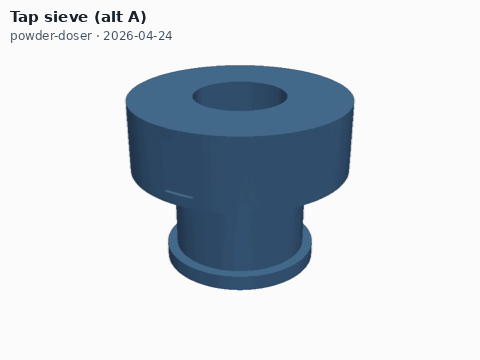

- Files: [`A-tap-sieve.stl`](https://github.com/vertical-cloud-lab/powder-doser/blob/ccdabf3/cad/alternatives/A-tap-sieve.stl)
- Generated by: [`cad/alternatives/A_tap_sieve.scad`](https://github.com/vertical-cloud-lab/powder-doser/blob/ccdabf3/cad/alternatives/A_tap_sieve.scad)
- Provenance: files added by copilot-swe-agent[bot]; last touched e454c65 by copilot-swe-agent[bot] on branch copilot/consider-alternative-powder-dosing
- Thread: [cad alternatives](https://github.com/vertical-cloud-lab/powder-doser/tree/ccdabf3/cad/alternatives)

### 2. PEZ strip dispenser (alt B)

**powder-doser** · first seen 2026-04-24 · 2 versions

Strip/cassette of pre-filled pockets advanced like a PEZ dispenser; concept B.

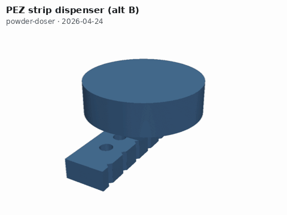

- Files: [`B-pez-strip.stl`](https://github.com/vertical-cloud-lab/powder-doser/blob/ccdabf3/cad/alternatives/B-pez-strip.stl)
- Generated by: [`cad/alternatives/B_pez_strip.scad`](https://github.com/vertical-cloud-lab/powder-doser/blob/ccdabf3/cad/alternatives/B_pez_strip.scad)
- Provenance: files added by copilot-swe-agent[bot]; last touched e454c65 by copilot-swe-agent[bot] on branch copilot/consider-alternative-powder-dosing
- Thread: [cad alternatives](https://github.com/vertical-cloud-lab/powder-doser/tree/ccdabf3/cad/alternatives)

### 3. Capillary wiper (alt C)

**powder-doser** · first seen 2026-04-24 · 2 versions

Capillary/tube with wiper metering small powder volumes; concept C.

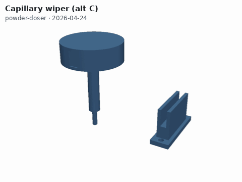

- Files: [`C-capillary-wiper.stl`](https://github.com/vertical-cloud-lab/powder-doser/blob/ccdabf3/cad/alternatives/C-capillary-wiper.stl)
- Generated by: [`cad/alternatives/C_capillary_wiper.scad`](https://github.com/vertical-cloud-lab/powder-doser/blob/ccdabf3/cad/alternatives/C_capillary_wiper.scad)
- Provenance: files added by copilot-swe-agent[bot]; last touched e454c65 by copilot-swe-agent[bot] on branch copilot/consider-alternative-powder-dosing
- Thread: [cad alternatives](https://github.com/vertical-cloud-lab/powder-doser/tree/ccdabf3/cad/alternatives)

### 4. Brush comb (alt D)

**powder-doser** · first seen 2026-04-24 · 2 versions

Rotating brush/comb that sweeps powder through a slot; concept D.

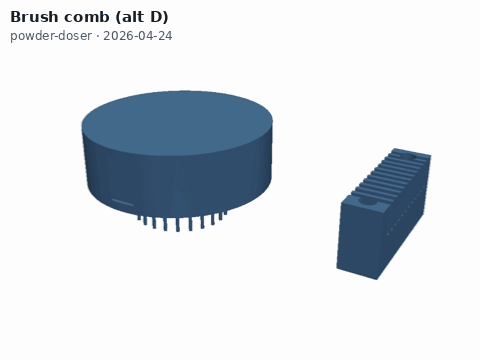

- Files: [`D-brush-comb.stl`](https://github.com/vertical-cloud-lab/powder-doser/blob/ccdabf3/cad/alternatives/D-brush-comb.stl)
- Generated by: [`cad/alternatives/D_brush_comb.scad`](https://github.com/vertical-cloud-lab/powder-doser/blob/ccdabf3/cad/alternatives/D_brush_comb.scad)
- Provenance: files added by copilot-swe-agent[bot]; last touched e454c65 by copilot-swe-agent[bot] on branch copilot/consider-alternative-powder-dosing
- Thread: [cad alternatives](https://github.com/vertical-cloud-lab/powder-doser/tree/ccdabf3/cad/alternatives)

### 5. Shaker (alt E)

**powder-doser** · first seen 2026-04-24 · 2 versions

Salt-shaker style perforated vessel shaken to dose; concept E.

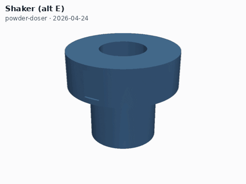

- Files: [`E-shaker.stl`](https://github.com/vertical-cloud-lab/powder-doser/blob/ccdabf3/cad/alternatives/E-shaker.stl)
- Generated by: [`cad/alternatives/E_shaker.scad`](https://github.com/vertical-cloud-lab/powder-doser/blob/ccdabf3/cad/alternatives/E_shaker.scad)
- Provenance: files added by copilot-swe-agent[bot]; last touched e454c65 by copilot-swe-agent[bot] on branch copilot/consider-alternative-powder-dosing
- Thread: [cad alternatives](https://github.com/vertical-cloud-lab/powder-doser/tree/ccdabf3/cad/alternatives)

### 6. Passive auger (alt F)

**powder-doser** · first seen 2026-04-24 · 2 versions

Passive (tilt/gravity-driven) auger concept F.

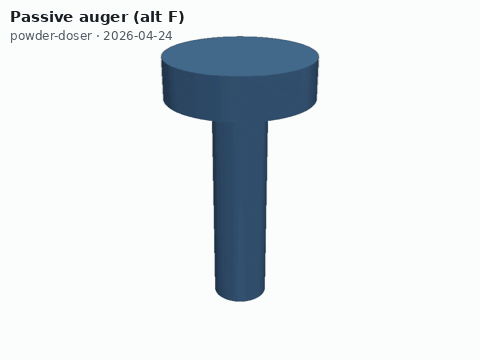

- Files: [`F-passive-auger.stl`](https://github.com/vertical-cloud-lab/powder-doser/blob/ccdabf3/cad/alternatives/F-passive-auger.stl)
- Generated by: [`cad/alternatives/F_passive_auger.scad`](https://github.com/vertical-cloud-lab/powder-doser/blob/ccdabf3/cad/alternatives/F_passive_auger.scad)
- Provenance: files added by copilot-swe-agent[bot]; last touched e454c65 by copilot-swe-agent[bot] on branch copilot/consider-alternative-powder-dosing
- Thread: [cad alternatives](https://github.com/vertical-cloud-lab/powder-doser/tree/ccdabf3/cad/alternatives)

### 7. ERM vibration sieve (alt G)

**powder-doser** · first seen 2026-04-24 · 2 versions

Sieve cup driven by an eccentric-rotating-mass vibration motor; concept G.

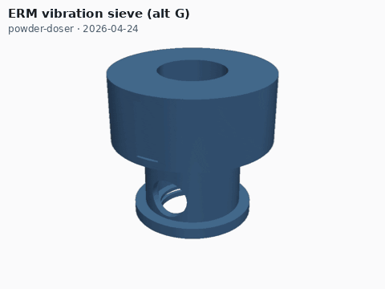

- Files: [`G-erm-sieve.stl`](https://github.com/vertical-cloud-lab/powder-doser/blob/ccdabf3/cad/alternatives/G-erm-sieve.stl)
- Generated by: [`cad/alternatives/G_erm_sieve.scad`](https://github.com/vertical-cloud-lab/powder-doser/blob/ccdabf3/cad/alternatives/G_erm_sieve.scad)
- Provenance: files added by copilot-swe-agent[bot]; last touched e454c65 by copilot-swe-agent[bot] on branch copilot/consider-alternative-powder-dosing
- Thread: [cad alternatives](https://github.com/vertical-cloud-lab/powder-doser/tree/ccdabf3/cad/alternatives)

### 8. Solenoid tap sieve (alt H)

**powder-doser** · first seen 2026-04-24 · 2 versions

Sieve struck by a solenoid plunger; concept H.

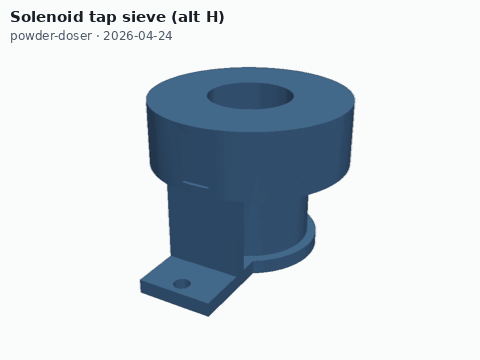

- Files: [`H-solenoid-sieve.stl`](https://github.com/vertical-cloud-lab/powder-doser/blob/ccdabf3/cad/alternatives/H-solenoid-sieve.stl)
- Generated by: [`cad/alternatives/H_solenoid_sieve.scad`](https://github.com/vertical-cloud-lab/powder-doser/blob/ccdabf3/cad/alternatives/H_solenoid_sieve.scad)
- Provenance: files added by copilot-swe-agent[bot]; last touched e454c65 by copilot-swe-agent[bot] on branch copilot/consider-alternative-powder-dosing
- Thread: [cad alternatives](https://github.com/vertical-cloud-lab/powder-doser/tree/ccdabf3/cad/alternatives)

### 9. Archimedes auger (monolithic)

**powder-doser** · first seen 2026-04-24 · 4 versions

Integrated monolithic Archimedes screw auger with housing, 250x25 mm (v4), the lab doser's core part.

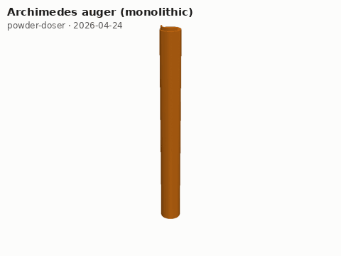

- Files: [`archimedes-auger.3mf`](https://github.com/vertical-cloud-lab/powder-doser/blob/6110210/cad/auger/archimedes-auger.3mf), [`archimedes-auger.stl`](https://github.com/vertical-cloud-lab/powder-doser/blob/6110210/cad/auger/archimedes-auger.stl)
- Generated by: [`cad/auger/archimedes-auger.scad`](https://github.com/vertical-cloud-lab/powder-doser/blob/6110210/cad/auger/archimedes-auger.scad)
- Provenance: files added by copilot-swe-agent[bot]; last touched 3c4b80f by copilot-swe-agent[bot] on branch main
- Thread: [cad auger](https://github.com/vertical-cloud-lab/powder-doser/tree/6110210/cad/auger)

### 10. Bimodal compliant trough

**powder-doser** · first seen 2026-04-24 · 1 versions

3D-printable compliant-mechanism trough with two dosing modes (coarse/fine).

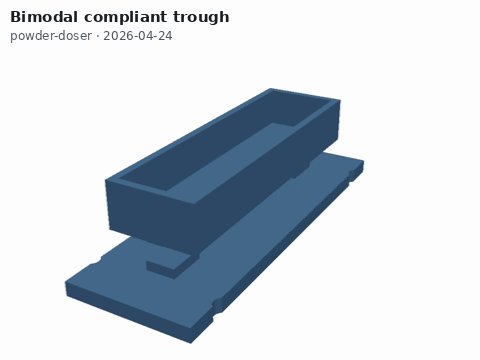

- Files: [`bimodal-trough.stl`](https://github.com/vertical-cloud-lab/powder-doser/blob/d1eb3ce/cad/bimodal-trough.stl)
- Generated by: [`cad/bimodal_trough.scad`](https://github.com/vertical-cloud-lab/powder-doser/blob/d1eb3ce/cad/bimodal_trough.scad)
- Provenance: files added by copilot-swe-agent[bot]; last touched c668ab7 by copilot-swe-agent[bot] on branch copilot/design-bimodal-compliant-mechanism
- Thread: [d1eb3ce cad](https://github.com/vertical-cloud-lab/powder-doser/tree/d1eb3ce/cad)

### 11. Sieve cup + tap anvil (A/G prototype)

**powder-doser** · first seen 2026-04-24 · 1 versions · 3 parts

Preliminary sieve cup (plain and ERM-motor versions) with a tap anvil, for the top-ranked sieve concepts A and G.

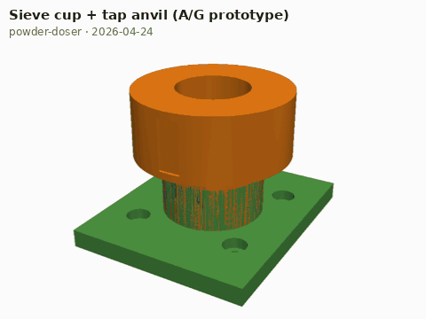 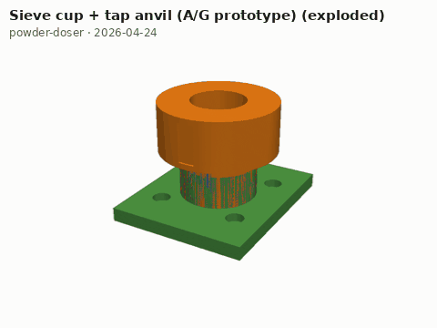

- Files: [`sieve-cup-erm.stl`](https://github.com/vertical-cloud-lab/powder-doser/blob/ccdabf3/cad/sieve-cup-erm.stl), [`sieve-cup.stl`](https://github.com/vertical-cloud-lab/powder-doser/blob/ccdabf3/cad/sieve-cup.stl), [`tap-anvil.stl`](https://github.com/vertical-cloud-lab/powder-doser/blob/ccdabf3/cad/tap-anvil.stl)
- Generated by: [`cad/sieve_cup.scad`](https://github.com/vertical-cloud-lab/powder-doser/blob/ccdabf3/cad/sieve_cup.scad)
- Provenance: files added by copilot-swe-agent[bot]; last touched 360d9c2 by copilot-swe-agent[bot] on branch copilot/consider-alternative-powder-dosing
- Thread: [ccdabf3 cad](https://github.com/vertical-cloud-lab/powder-doser/tree/ccdabf3/cad)

### 12. Powder doser chassis v3.2 (CADSmith)

**CADSmith** · first seen 2026-05-12 · 5 versions · 11 parts

Integrated doser chassis with auger, bonnet, coupler and vendor-envelope parts (stepper, servo, solenoid, ERM, Pi, drivers); v1-v3.2 iterated by the Copilot agent.

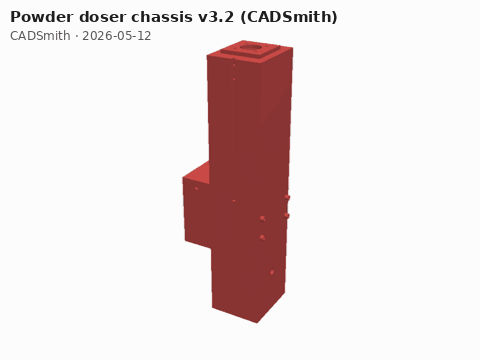 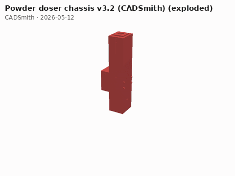

- Files: [`powder_doser_auger.step`](https://github.com/vertical-cloud-lab/CADSmith/blob/5097a57/assets/powder_doser_parts/powder_doser_auger.step), [`powder_doser_bonnet.step`](https://github.com/vertical-cloud-lab/CADSmith/blob/5097a57/assets/powder_doser_parts/powder_doser_bonnet.step), [`powder_doser_chassis.step`](https://github.com/vertical-cloud-lab/CADSmith/blob/5097a57/assets/powder_doser_parts/powder_doser_chassis.step), [`powder_doser_coupler.step`](https://github.com/vertical-cloud-lab/CADSmith/blob/5097a57/assets/powder_doser_parts/powder_doser_coupler.step) and 7 more
- Provenance: Copilot agent PR #2; commit authors: copilot-swe-agent[bot]
- Thread: [pull 2](https://github.com/vertical-cloud-lab/CADSmith/pull/2)

### 13. Inward collection cup

**powder-doser** · first seen 2026-05-12 · 1 versions

Collection cup with inward-sloped walls for the dispensed powder (manuscript section 2.2 visual).

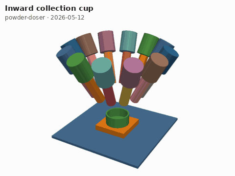

- Files: [`inward_collection_cup.step`](https://github.com/vertical-cloud-lab/powder-doser/blob/6110210/design/cad/inward-collection-cup/inward_collection_cup.step)
- Generated by: [`design/cad/inward-collection-cup`](https://github.com/vertical-cloud-lab/powder-doser/blob/6110210/design/cad/inward-collection-cup)
- Provenance: files added by copilot-swe-agent[bot]; last touched 459e0f5 by copilot-swe-agent[bot] on branch main
- Thread: [cad inward-collection-cup](https://github.com/vertical-cloud-lab/powder-doser/tree/6110210/design/cad/inward-collection-cup)

### 14. Sealing cap: bayonet plug

**powder-doser** · first seen 2026-05-12 · 1 versions · 3 parts

Channel sealing cap that locks with a bayonet plug.

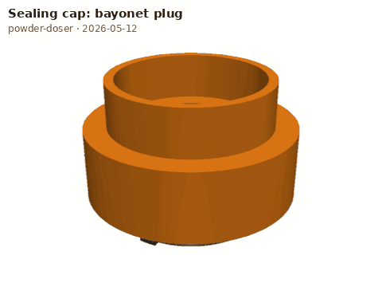 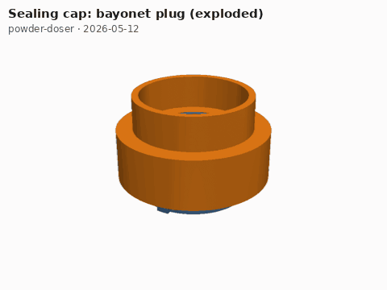

- Files: [`sealing_cap_bayonet_plug.step`](https://github.com/vertical-cloud-lab/powder-doser/blob/16aff56/design/cad/sealing-cap-bayonet-plug/sealing_cap_bayonet_plug.step), [`plug.stl`](https://github.com/vertical-cloud-lab/powder-doser/blob/16aff56/design/cad/sealing-cap-bayonet-plug/stl/plug.stl), [`receiver.stl`](https://github.com/vertical-cloud-lab/powder-doser/blob/16aff56/design/cad/sealing-cap-bayonet-plug/stl/receiver.stl)
- Generated by: [`design/cad/sealing-cap-bayonet-plug`](https://github.com/vertical-cloud-lab/powder-doser/blob/16aff56/design/cad/sealing-cap-bayonet-plug)
- Provenance: files added by copilot-swe-agent[bot]; last touched 16aff56 by copilot-swe-agent[bot] on branch copilot/design-channel-sealing-cap
- Thread: [cad sealing-cap-bayonet-plug](https://github.com/vertical-cloud-lab/powder-doser/tree/16aff56/design/cad/sealing-cap-bayonet-plug)

### 15. Sealing cap: spring hatch

**powder-doser** · first seen 2026-05-12 · 2 versions · 6 parts

Channel sealing cap with a spring-loaded hatch.

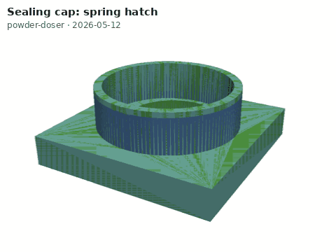 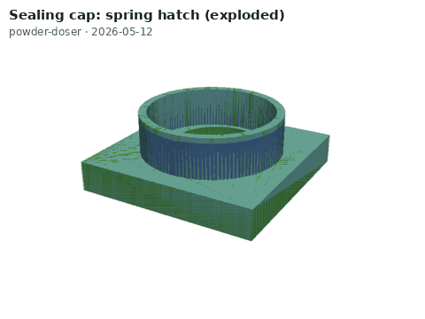

- Files: [`sealing_cap_spring_hatch.step`](https://github.com/vertical-cloud-lab/powder-doser/blob/16aff56/design/cad/sealing-cap-spring-hatch/sealing_cap_spring_hatch.step), [`cap_base.stl`](https://github.com/vertical-cloud-lab/powder-doser/blob/16aff56/design/cad/sealing-cap-spring-hatch/stl/cap_base.stl), [`flap.stl`](https://github.com/vertical-cloud-lab/powder-doser/blob/16aff56/design/cad/sealing-cap-spring-hatch/stl/flap.stl), [`reference_cap_base.stl`](https://github.com/vertical-cloud-lab/powder-doser/blob/16aff56/design/cad/sealing-cap-spring-hatch/stl/reference_cap_base.stl) and 2 more
- Generated by: [`design/cad/sealing-cap-spring-hatch`](https://github.com/vertical-cloud-lab/powder-doser/blob/16aff56/design/cad/sealing-cap-spring-hatch)
- Provenance: files added by copilot-swe-agent[bot]; last touched 16aff56 by copilot-swe-agent[bot] on branch copilot/design-channel-sealing-cap
- Thread: [cad sealing-cap-spring-hatch](https://github.com/vertical-cloud-lab/powder-doser/tree/16aff56/design/cad/sealing-cap-spring-hatch)

### 16. Sealing cap: twist shutter

**powder-doser** · first seen 2026-05-12 · 1 versions · 3 parts

Channel sealing cap that closes by twisting a shutter.

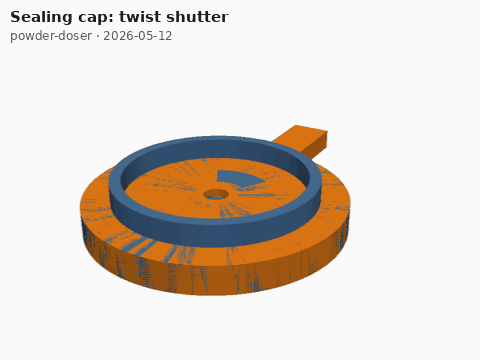 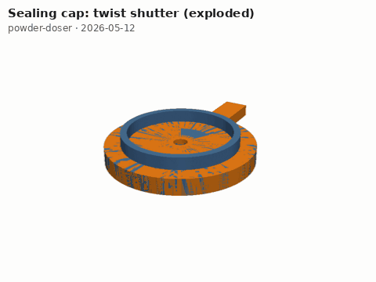

- Files: [`sealing_cap_twist_shutter.step`](https://github.com/vertical-cloud-lab/powder-doser/blob/16aff56/design/cad/sealing-cap-twist-shutter/sealing_cap_twist_shutter.step), [`channel_disc.stl`](https://github.com/vertical-cloud-lab/powder-doser/blob/16aff56/design/cad/sealing-cap-twist-shutter/stl/channel_disc.stl), [`driver_disc.stl`](https://github.com/vertical-cloud-lab/powder-doser/blob/16aff56/design/cad/sealing-cap-twist-shutter/stl/driver_disc.stl)
- Generated by: [`design/cad/sealing-cap-twist-shutter`](https://github.com/vertical-cloud-lab/powder-doser/blob/16aff56/design/cad/sealing-cap-twist-shutter)
- Provenance: files added by copilot-swe-agent[bot]; last touched 16aff56 by copilot-swe-agent[bot] on branch copilot/design-channel-sealing-cap
- Thread: [cad sealing-cap-twist-shutter](https://github.com/vertical-cloud-lab/powder-doser/tree/16aff56/design/cad/sealing-cap-twist-shutter)

### 17. Single-channel module

**powder-doser** · first seen 2026-05-12 · 4 versions · 10 parts

Single-channel dosing module (Idea B archetype): spine, bearing collar, belt drive, cartridge and cradle.

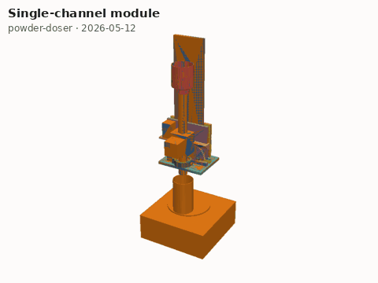 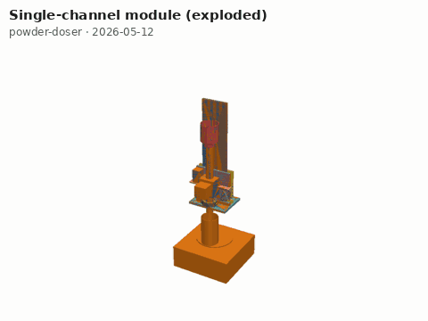

- Files: [`single_channel_module.step`](https://github.com/vertical-cloud-lab/powder-doser/blob/2ddc679/design/cad/single-channel-module/single_channel_module.step), [`ASSEMBLY_full_module.stl`](https://github.com/vertical-cloud-lab/powder-doser/blob/2ddc679/design/cad/single-channel-module/stl/ASSEMBLY_full_module.stl), [`ASSEMBLY_full_module_with_scale_and_cup.stl`](https://github.com/vertical-cloud-lab/powder-doser/blob/2ddc679/design/cad/single-channel-module/stl/ASSEMBLY_full_module_with_scale_and_cup.stl), [`bearing_collar.stl`](https://github.com/vertical-cloud-lab/powder-doser/blob/2ddc679/design/cad/single-channel-module/stl/bearing_collar.stl) and 6 more
- Generated by: [`design/cad/single-channel-module`](https://github.com/vertical-cloud-lab/powder-doser/blob/2ddc679/design/cad/single-channel-module)
- Provenance: files added by copilot-swe-agent[bot]; last touched 2ddc679 by copilot-swe-agent[bot] on branch copilot/modular-single-channel-powder-doser-design
- Thread: [cad single-channel-module](https://github.com/vertical-cloud-lab/powder-doser/tree/2ddc679/design/cad/single-channel-module)

### 18. Auger bracket

**powder-doser** · first seen 2026-05-14 · 3 versions

Parametric bracket holding the auger to the mounting plate.

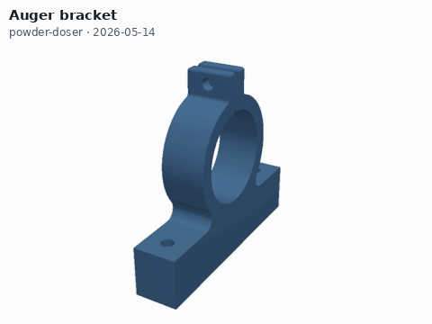

- Files: [`auger_bracket.step`](https://github.com/vertical-cloud-lab/powder-doser/blob/2e5060d/design/cad/auger-bracket/auger_bracket.step), [`auger_bracket.stl`](https://github.com/vertical-cloud-lab/powder-doser/blob/2e5060d/design/cad/auger-bracket/stl/auger_bracket.stl)
- Generated by: [`design/cad/auger-bracket`](https://github.com/vertical-cloud-lab/powder-doser/blob/2e5060d/design/cad/auger-bracket)
- Provenance: files added by copilot-swe-agent[bot]; last touched 2e5060d by copilot-swe-agent[bot] on branch copilot/part-by-part-powder-doser
- Thread: [cad auger-bracket](https://github.com/vertical-cloud-lab/powder-doser/tree/2e5060d/design/cad/auger-bracket)

### 19. Geared auger + NEMA 11 pinion

**powder-doser** · first seen 2026-05-14 · 7 versions · 2 parts

Archimedes auger with an integral ring gear driven by a NEMA 11 stepper pinion.

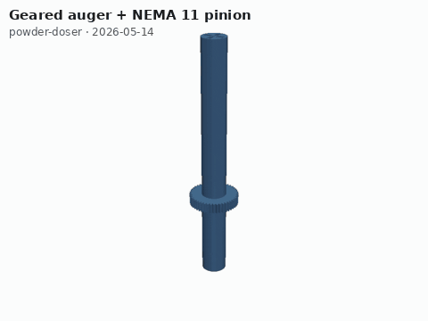 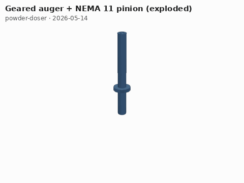

- Files: [`archimedes-auger-geared.stl`](https://github.com/vertical-cloud-lab/powder-doser/blob/6961d92/cad/auger-geared/archimedes-auger-geared.stl), [`stepper-pinion.stl`](https://github.com/vertical-cloud-lab/powder-doser/blob/6961d92/cad/auger-geared/stepper-pinion.stl)
- Generated by: [`cad/auger-geared/archimedes-auger-geared.scad`](https://github.com/vertical-cloud-lab/powder-doser/blob/6961d92/cad/auger-geared/archimedes-auger-geared.scad)
- Provenance: files added by copilot-swe-agent[bot]; last touched 926879a by copilot-swe-agent[bot] on branch copilot/add-new-auger-design
- Thread: [cad auger-geared](https://github.com/vertical-cloud-lab/powder-doser/tree/6961d92/cad/auger-geared)

### 20. Full system (direct drive)

**powder-doser** · first seen 2026-05-15 · 1 versions · 5 parts

Direct-drive full doser: auger, housing, coupler stub and deflector (CadQuery).

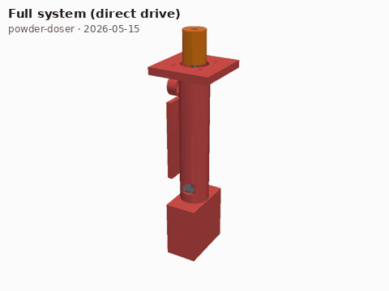 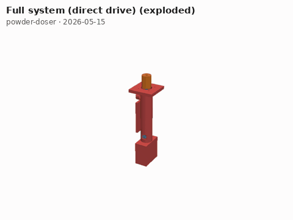

- Files: [`full_system.step`](https://github.com/vertical-cloud-lab/powder-doser/blob/4ef9f6c/design/cad/full-system-direct-drive/full_system.step), [`auger.stl`](https://github.com/vertical-cloud-lab/powder-doser/blob/4ef9f6c/design/cad/full-system-direct-drive/stl/auger.stl), [`coupler_stub.stl`](https://github.com/vertical-cloud-lab/powder-doser/blob/4ef9f6c/design/cad/full-system-direct-drive/stl/coupler_stub.stl), [`deflector.stl`](https://github.com/vertical-cloud-lab/powder-doser/blob/4ef9f6c/design/cad/full-system-direct-drive/stl/deflector.stl) and 1 more
- Generated by: [`design/cad/full-system-direct-drive`](https://github.com/vertical-cloud-lab/powder-doser/blob/4ef9f6c/design/cad/full-system-direct-drive)
- Provenance: files added by copilot-swe-agent[bot]; last touched c48a9d0 by copilot-swe-agent[bot] on branch copilot/explore-meta-tools-for-cad
- Thread: [cad full-system-direct-drive](https://github.com/vertical-cloud-lab/powder-doser/tree/4ef9f6c/design/cad/full-system-direct-drive)

### 21. Full system (modular, CadQuery + Zoo)

**powder-doser** · first seen 2026-05-15 · 1 versions · 3 parts

Modular full-system powder doser assembly built in CadQuery with a ground-truth auger, as a Zoo cross-check.

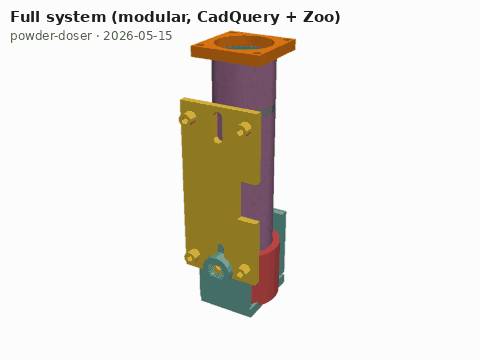 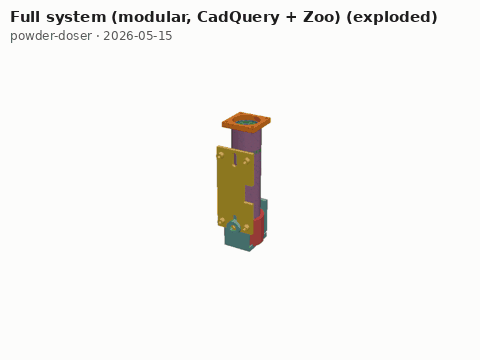

- Files: [`full_system_assembly.step`](https://github.com/vertical-cloud-lab/powder-doser/blob/4ef9f6c/design/cad/full-system-modular/full_system_assembly.step), [`ground_truth_auger.step`](https://github.com/vertical-cloud-lab/powder-doser/blob/4ef9f6c/design/cad/full-system-modular/ground_truth_auger.step), [`ground_truth_auger.stl`](https://github.com/vertical-cloud-lab/powder-doser/blob/4ef9f6c/design/cad/full-system-modular/ground_truth_auger.stl)
- Generated by: [`design/cad/full-system-modular`](https://github.com/vertical-cloud-lab/powder-doser/blob/4ef9f6c/design/cad/full-system-modular)
- Provenance: files added by copilot-swe-agent[bot]; last touched ed1886c by copilot-swe-agent[bot] on branch copilot/explore-meta-tools-for-cad
- Thread: [cad full-system-modular](https://github.com/vertical-cloud-lab/powder-doser/tree/4ef9f6c/design/cad/full-system-modular)

### 22. Tap collar

**powder-doser** · first seen 2026-05-15 · 1 versions · 4 parts

Mount plate plus split collar that carries a tapping motor/solenoid on the auger.

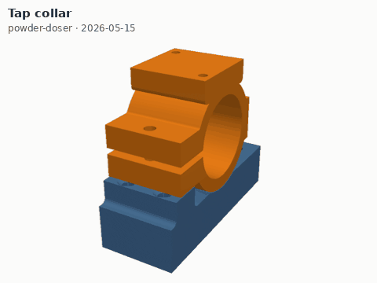 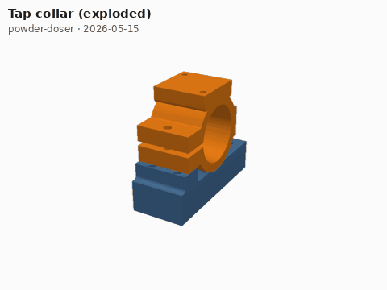

- Files: [`mount_plate.step`](https://github.com/vertical-cloud-lab/powder-doser/blob/d443319/design/cad/tap-collar/mount_plate.step), [`mount_plate.stl`](https://github.com/vertical-cloud-lab/powder-doser/blob/d443319/design/cad/tap-collar/stl/mount_plate.stl), [`tap_collar.stl`](https://github.com/vertical-cloud-lab/powder-doser/blob/d443319/design/cad/tap-collar/stl/tap_collar.stl), [`tap_collar.step`](https://github.com/vertical-cloud-lab/powder-doser/blob/d443319/design/cad/tap-collar/tap_collar.step)
- Generated by: [`design/cad/tap-collar`](https://github.com/vertical-cloud-lab/powder-doser/blob/d443319/design/cad/tap-collar)
- Provenance: files added by copilot-swe-agent[bot]; last touched d443319 by copilot-swe-agent[bot] on branch copilot/design-tap-collar
- Thread: [cad tap-collar](https://github.com/vertical-cloud-lab/powder-doser/tree/d443319/design/cad/tap-collar)

### 23. Zoo text-to-CAD multi-part set

**powder-doser** · first seen 2026-05-15 · 2 versions · 5 parts

Five doser parts generated by Zoo (KittyCAD ML-ephant) text-to-CAD: solid auger, embed-pocket sleeve, Pi mount bracket, servo yoke, stepper mount collar.

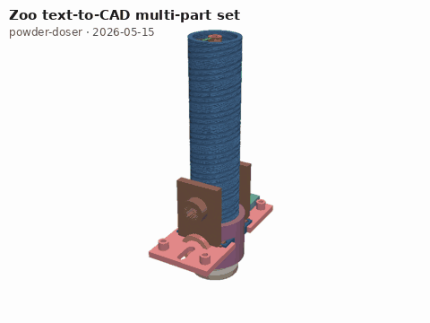 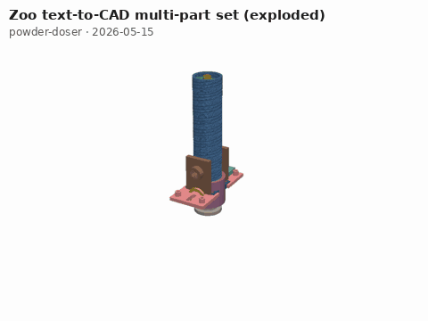

- Files: [`auger_solid.step`](https://github.com/vertical-cloud-lab/powder-doser/blob/4ef9f6c/cad/meta-tools/zoo-output/multi-part/auger_solid/auger_solid.step), [`embed_pocket_sleeve.step`](https://github.com/vertical-cloud-lab/powder-doser/blob/4ef9f6c/cad/meta-tools/zoo-output/multi-part/embed_pocket_sleeve/embed_pocket_sleeve.step), [`pi_mount_bracket.step`](https://github.com/vertical-cloud-lab/powder-doser/blob/4ef9f6c/cad/meta-tools/zoo-output/multi-part/pi_mount_bracket/pi_mount_bracket.step), [`servo_yoke.step`](https://github.com/vertical-cloud-lab/powder-doser/blob/4ef9f6c/cad/meta-tools/zoo-output/multi-part/servo_yoke/servo_yoke.step) and 1 more
- Provenance: files added by copilot-swe-agent[bot]; last touched 9b0b3ba by copilot-swe-agent[bot] on branch copilot/explore-meta-tools-for-cad
- Thread: [multi-part auger_solid](https://github.com/vertical-cloud-lab/powder-doser/tree/4ef9f6c/cad/meta-tools/zoo-output/multi-part/auger_solid)

### 24. Mounting plate + tilt base (CADSmith)

**CADSmith** · first seen 2026-05-18 · 1 versions · 6 parts

Mounting plate on a tilting base plate for the powder doser, generated with CADSmith.

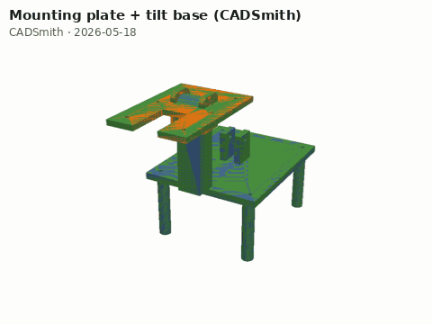 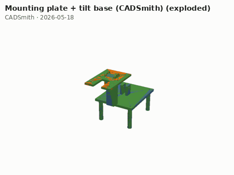

- Files: [`base_plate.step`](https://github.com/vertical-cloud-lab/CADSmith/blob/d956d5f/assets/powder_doser/step/base_plate.step), [`mounting_plate.step`](https://github.com/vertical-cloud-lab/CADSmith/blob/d956d5f/assets/powder_doser/step/mounting_plate.step), [`powder_doser_assembly.step`](https://github.com/vertical-cloud-lab/CADSmith/blob/d956d5f/assets/powder_doser/step/powder_doser_assembly.step), [`base_plate.stl`](https://github.com/vertical-cloud-lab/CADSmith/blob/d956d5f/assets/powder_doser/stl/base_plate.stl) and 2 more
- Provenance: Copilot agent PR #4; commit authors: copilot-swe-agent[bot]
- Thread: [pull 4](https://github.com/vertical-cloud-lab/CADSmith/pull/4)

### 25. Hinged mounting plate + baseplate

**powder-doser** · first seen 2026-05-18 · 4 versions · 4 parts

Tilting mounting plate on a baseplate with a hinge on the dispense axis and a servo pinion.

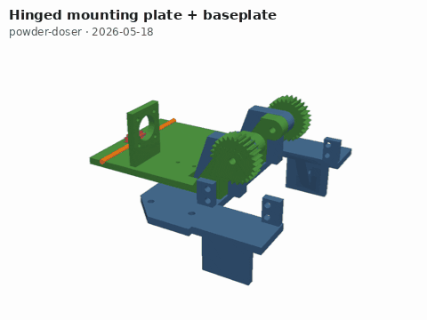 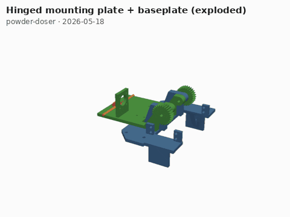

- Files: [`baseplate.stl`](https://github.com/vertical-cloud-lab/powder-doser/blob/97521d2/cad/mounting-plate-assembly/stl/baseplate.stl), [`hinge_pin.stl`](https://github.com/vertical-cloud-lab/powder-doser/blob/97521d2/cad/mounting-plate-assembly/stl/hinge_pin.stl), [`mounting_plate.stl`](https://github.com/vertical-cloud-lab/powder-doser/blob/97521d2/cad/mounting-plate-assembly/stl/mounting_plate.stl), [`servo_pinion.stl`](https://github.com/vertical-cloud-lab/powder-doser/blob/97521d2/cad/mounting-plate-assembly/stl/servo_pinion.stl)
- Generated by: [`cad/mounting-plate-assembly`](https://github.com/vertical-cloud-lab/powder-doser/blob/97521d2/cad/mounting-plate-assembly)
- Provenance: files added by copilot-swe-agent[bot]; last touched e0946d0 by copilot-swe-agent[bot] on branch copilot/add-servo-angle-control
- Thread: [mounting-plate-assembly stl](https://github.com/vertical-cloud-lab/powder-doser/tree/97521d2/cad/mounting-plate-assembly/stl)

### 26. Threaded storage auger + hand-screw cap

**powder-doser** · first seen 2026-06-16 · 3 versions · 2 parts

Geared storage auger with an external top thread and a hand-screw cap to seal stored powder.

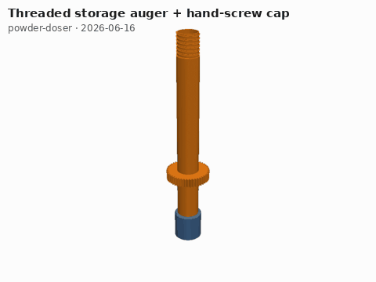 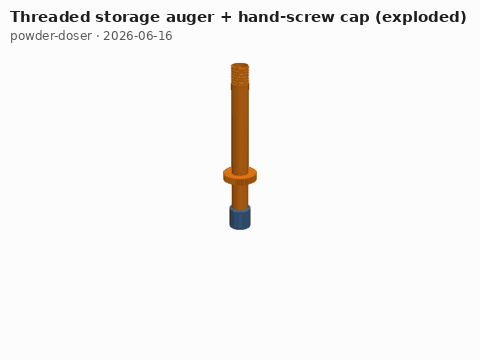

- Files: [`threaded-storage-cap.stl`](https://github.com/vertical-cloud-lab/powder-doser/blob/6961d92/cad/auger-geared/threaded-storage-cap.stl), [`threaded_archimedes-auger-storage.stl`](https://github.com/vertical-cloud-lab/powder-doser/blob/6961d92/cad/auger-geared/threaded_archimedes-auger-storage.stl)
- Generated by: [`cad/auger-geared/threaded-storage-auger-core.scad`](https://github.com/vertical-cloud-lab/powder-doser/blob/6961d92/cad/auger-geared/threaded-storage-auger-core.scad)
- Provenance: files added by copilot-swe-agent[bot]; last touched 361314e by copilot-swe-agent[bot] on branch copilot/add-new-auger-design
- Thread: [cad auger-geared](https://github.com/vertical-cloud-lab/powder-doser/tree/6961d92/cad/auger-geared)

### 27. Powder-doser parts regenerated by CADSmith (12)

**CADSmith** · first seen 2026-06-22 · 1 versions · 12 parts

The 12 lab powder-doser parts (augers, cap, pinions, plates, bracket, tap collar) regenerated by the CADSmith agent loop, plus an assembly.

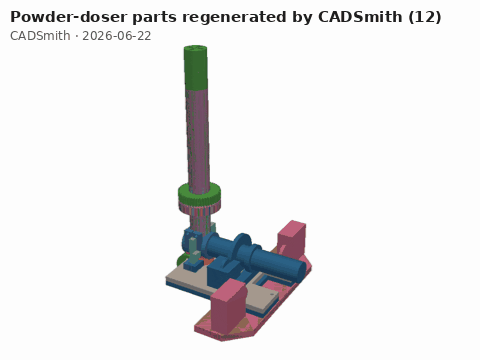 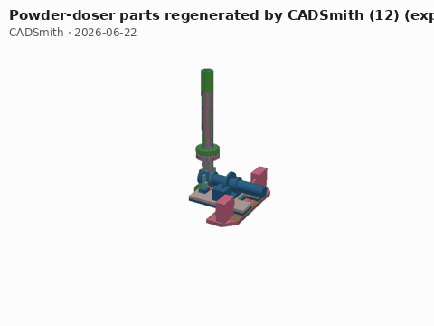

- Files: [`part.step`](https://github.com/vertical-cloud-lab/CADSmith/blob/44c12c6/cad/powder-doser/auger_bracket/part.step), [`part.step`](https://github.com/vertical-cloud-lab/CADSmith/blob/44c12c6/cad/powder-doser/auger_cap/part.step), [`part.step`](https://github.com/vertical-cloud-lab/CADSmith/blob/44c12c6/cad/powder-doser/auger_storage_full/part.step), [`part.step`](https://github.com/vertical-cloud-lab/CADSmith/blob/44c12c6/cad/powder-doser/auger_storage_short/part.step) and 8 more
- Provenance: Copilot agent PR #6; commit authors: copilot-swe-agent[bot]
- Thread: [pull 6](https://github.com/vertical-cloud-lab/CADSmith/pull/6)

### 28. Parametric CadQuery powder-doser assembly

**powder-doser** · first seen 2026-06-22 · 3 versions · 13 parts

Full parametric CadQuery doser: storage augers, threaded auger + cap, pinions, mounting plate, baseplate, hinge pin, bracket, tap collar (issue #111).

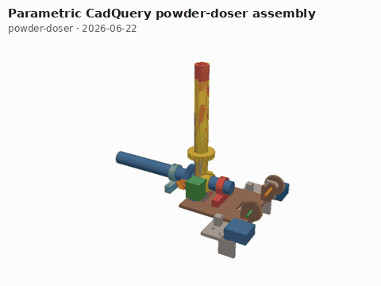 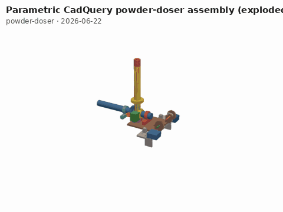

- Files: [`00_assembly.step`](https://github.com/vertical-cloud-lab/powder-doser/blob/5b3b53c/cad/powder-doser-assembly/exports/step/00_assembly.step), [`01_auger_storage_full.step`](https://github.com/vertical-cloud-lab/powder-doser/blob/5b3b53c/cad/powder-doser-assembly/exports/step/01_auger_storage_full.step), [`01b_auger_storage_short.step`](https://github.com/vertical-cloud-lab/powder-doser/blob/5b3b53c/cad/powder-doser-assembly/exports/step/01b_auger_storage_short.step), [`02_auger_threaded.step`](https://github.com/vertical-cloud-lab/powder-doser/blob/5b3b53c/cad/powder-doser-assembly/exports/step/02_auger_threaded.step) and 9 more
- Generated by: [`cad/powder-doser-assembly`](https://github.com/vertical-cloud-lab/powder-doser/blob/5b3b53c/cad/powder-doser-assembly)
- Provenance: files added by copilot-swe-agent[bot]; last touched 10bd4c9 by copilot-swe-agent[bot] on branch copilot/design-powder-dispensing-system
- Thread: [issues 111](https://github.com/vertical-cloud-lab/powder-doser/issues/111) · [exports step](https://github.com/vertical-cloud-lab/powder-doser/tree/5b3b53c/cad/powder-doser-assembly/exports/step)

### 29. PCB + electronics holder

**powder-doser** · first seen 2026-10-03 · 1 versions · 2 parts

PCB modeled from the V2 Gerbers with electronics on a printed holder/mount.

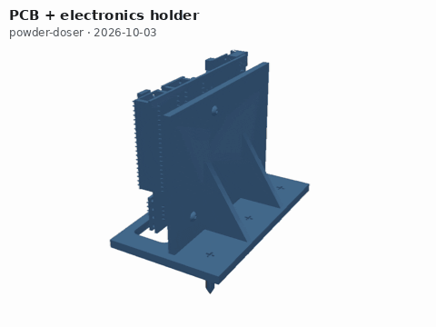

- Files: [`pcb_holder_assembly.step`](https://github.com/vertical-cloud-lab/powder-doser/blob/3702c94/cad/text-to-cad/STEP/electronics/pcb_holder_assembly.step), [`pcb_mount.stl`](https://github.com/vertical-cloud-lab/powder-doser/blob/3702c94/cad/text-to-cad/STL/electronics/pcb_mount.stl)
- Provenance: files added by claude[bot]; last touched 3702c94 by claude[bot] on branch claude/issue-172-20261003-1830
- Thread: [issues 172](https://github.com/vertical-cloud-lab/powder-doser/issues/172) · [STEP electronics](https://github.com/vertical-cloud-lab/powder-doser/tree/3702c94/cad/text-to-cad/STEP/electronics)

### 30. Servos-above doser (build123d)

**powder-doser** · first seen 2026-10-03 · 2 versions · 12 parts

build123d text-to-CAD re-model of the doser plus a servos-above variant: baseplate, mounting plate, auger, cap, bracket, pinions, tap collar.

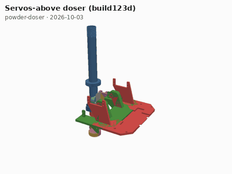 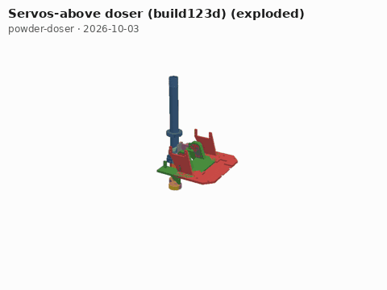

- Files: [`assembly_servos_above.step`](https://github.com/vertical-cloud-lab/powder-doser/blob/61717c7/cad/text-to-cad/STEP/assembly_servos_above.step), [`auger.stl`](https://github.com/vertical-cloud-lab/powder-doser/blob/61717c7/cad/text-to-cad/STL/parts/auger.stl), [`auger_cap.stl`](https://github.com/vertical-cloud-lab/powder-doser/blob/61717c7/cad/text-to-cad/STL/parts/auger_cap.stl), [`baseplate.stl`](https://github.com/vertical-cloud-lab/powder-doser/blob/61717c7/cad/text-to-cad/STL/parts/baseplate.stl) and 8 more
- Generated by: [`cad/text-to-cad/src`](https://github.com/vertical-cloud-lab/powder-doser/blob/61717c7/cad/text-to-cad/src)
- Provenance: files added by claude[bot]; last touched 509a0bf by claude[bot] on branch claude/issue-172-20261003-2216
- Thread: [issues 172](https://github.com/vertical-cloud-lab/powder-doser/issues/172) · [text-to-cad STEP](https://github.com/vertical-cloud-lab/powder-doser/tree/61717c7/cad/text-to-cad/STEP)

### 31. Chain carousel test rig (v1)

**powder-doser** · first seen 2026-10-10 · 4 versions · 7 parts

Vertical twin-chain carousel carrying many augers past a dosing station.

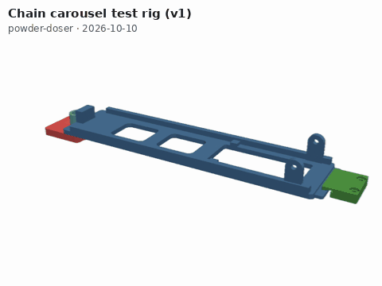 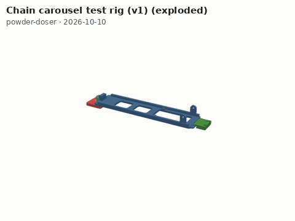

- Files: [`chain_carousel_rig.step`](https://github.com/vertical-cloud-lab/powder-doser/blob/6513ee2/cad/chain-carousel/step/chain_carousel_rig.step), [`carriage.stl`](https://github.com/vertical-cloud-lab/powder-doser/blob/6513ee2/cad/chain-carousel/stl/carriage.stl), [`hall_holder.stl`](https://github.com/vertical-cloud-lab/powder-doser/blob/6513ee2/cad/chain-carousel/stl/hall_holder.stl), [`hold_down.stl`](https://github.com/vertical-cloud-lab/powder-doser/blob/6513ee2/cad/chain-carousel/stl/hold_down.stl) and 3 more
- Generated by: [`cad/chain-carousel/build.py`](https://github.com/vertical-cloud-lab/powder-doser/blob/6513ee2/cad/chain-carousel/build.py)
- Provenance: files added by claude[bot]; last touched 9e715c3 by claude[bot] on branch claude/issue-128-20261013-2050
- Thread: [issues 128](https://github.com/vertical-cloud-lab/powder-doser/issues/128) · [chain-carousel step](https://github.com/vertical-cloud-lab/powder-doser/tree/6513ee2/cad/chain-carousel/step)

### 32. FeatureScript-generated baseplate (thinner table)

**powder-doser** · first seen 2026-10-10 · 4 versions

Servos-above baseplate generated as a native Onshape feature tree (FeatureScript), thinner-table variant.

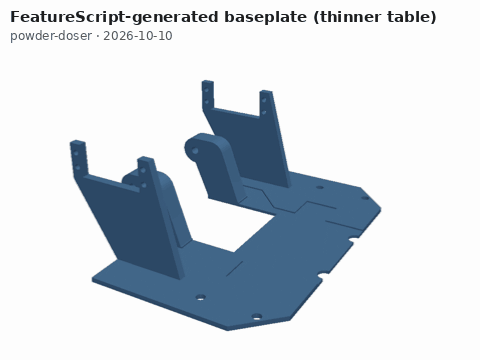

- Files: [`baseplate_thinner_table.step`](https://github.com/vertical-cloud-lab/powder-doser/blob/68f71a2/cad/fsgen/v0.2.0/out/baseplate_thinner_table/baseplate_thinner_table.step), [`baseplate_thinner_table.stl`](https://github.com/vertical-cloud-lab/powder-doser/blob/68f71a2/cad/fsgen/v0.2.0/out/baseplate_thinner_table/baseplate_thinner_table.stl)
- Generated by: [`cad/fsgen`](https://github.com/vertical-cloud-lab/powder-doser/blob/68f71a2/cad/fsgen)
- Provenance: files added by claude[bot]; last touched b02a0bb by claude[bot] on branch claude/issue-171-20261008-1123
- Thread: [issues 171](https://github.com/vertical-cloud-lab/powder-doser/issues/171) · [out baseplate_thinner_table](https://github.com/vertical-cloud-lab/powder-doser/tree/68f71a2/cad/fsgen/v0.2.0/out/baseplate_thinner_table)

### 33. Paternoster carousel

**powder-doser** · first seen 2026-10-16 · 3 versions · 14 parts

Paternoster (gondola) carousel moving vials/augers on chains with forks, yokes and a station.

 

- Files: [`paternoster_carousel.step`](https://github.com/vertical-cloud-lab/powder-doser/blob/6513ee2/cad/paternoster/step/paternoster_carousel.step), [`clevis_bracket.stl`](https://github.com/vertical-cloud-lab/powder-doser/blob/6513ee2/cad/paternoster/stl/clevis_bracket.stl), [`fork.stl`](https://github.com/vertical-cloud-lab/powder-doser/blob/6513ee2/cad/paternoster/stl/fork.stl), [`fork_arm.stl`](https://github.com/vertical-cloud-lab/powder-doser/blob/6513ee2/cad/paternoster/stl/fork_arm.stl) and 10 more
- Generated by: [`cad/paternoster/build.py`](https://github.com/vertical-cloud-lab/powder-doser/blob/6513ee2/cad/paternoster/build.py)
- Provenance: files added by claude[bot]; last touched 7990802 by claude[bot] on branch claude/issue-128-20261013-2050
- Thread: [issues 128](https://github.com/vertical-cloud-lab/powder-doser/issues/128) · [paternoster step](https://github.com/vertical-cloud-lab/powder-doser/tree/6513ee2/cad/paternoster/step)

### 34. Plate-mounted tapper concepts

**powder-doser** · first seen 2026-11-07 · 1 versions · 7 parts

Tapper concepts that mount on the plate instead of the auger (issue #203).

 

- Files: [`concept1-tap-tower.step`](https://github.com/vertical-cloud-lab/powder-doser/blob/8312d30/design/cad/tap-mount-concepts/step/concept1-tap-tower.step), [`concept2-tap-bracket.step`](https://github.com/vertical-cloud-lab/powder-doser/blob/8312d30/design/cad/tap-mount-concepts/step/concept2-tap-bracket.step), [`concept3-hammer-arm.step`](https://github.com/vertical-cloud-lab/powder-doser/blob/8312d30/design/cad/tap-mount-concepts/step/concept3-hammer-arm.step), [`concept3-hammer-frame.step`](https://github.com/vertical-cloud-lab/powder-doser/blob/8312d30/design/cad/tap-mount-concepts/step/concept3-hammer-frame.step) and 3 more
- Generated by: [`design/cad/tap-mount-concepts`](https://github.com/vertical-cloud-lab/powder-doser/blob/8312d30/design/cad/tap-mount-concepts)
- Provenance: files added by claude[bot]; last touched 8312d30 by claude[bot] on branch claude/issue-203-20261107-2200
- Thread: [issues 203](https://github.com/vertical-cloud-lab/powder-doser/issues/203) · [tap-mount-concepts step](https://github.com/vertical-cloud-lab/powder-doser/tree/8312d30/design/cad/tap-mount-concepts/step)

### 35. Multi-auger B2 tri-star fixed base

**powder-doser** · first seen 2026-11-10 · 8 versions · 7 parts

Fixed base holding three augers (tri-star) with hinge towers, tap bracket and clevis block (issue #204).

 

- Files: [`base.step`](https://github.com/vertical-cloud-lab/powder-doser/blob/4d2177e/design/multi-auger-fixed-base/base/base.step), [`base.stl`](https://github.com/vertical-cloud-lab/powder-doser/blob/4d2177e/design/multi-auger-fixed-base/base/base.stl), [`clevis_block.step`](https://github.com/vertical-cloud-lab/powder-doser/blob/4d2177e/design/multi-auger-fixed-base/clevis/clevis_block.step), [`clevis_block_print.stl`](https://github.com/vertical-cloud-lab/powder-doser/blob/4d2177e/design/multi-auger-fixed-base/clevis/clevis_block_print.stl) and 3 more
- Generated by: [`design/multi-auger-fixed-base`](https://github.com/vertical-cloud-lab/powder-doser/blob/4d2177e/design/multi-auger-fixed-base)
- Provenance: files added by claude[bot]; last touched 4d2177e by claude[bot] on branch claude/issue-204-20261117-0508
- Thread: [issues 204](https://github.com/vertical-cloud-lab/powder-doser/issues/204) · [multi-auger-fixed-base base](https://github.com/vertical-cloud-lab/powder-doser/tree/4d2177e/design/multi-auger-fixed-base/base)

### 36. Chain carousel v8 (Sam layout)

**powder-doser** · first seen 2026-11-12 · 4 versions · 17 parts

Late chain-carousel redesign on Sam's Aug 27 layout behind the balance, with door, latch, carriage and electronics carriage.

 

- Files: [`chain_carousel_rig_v8.step`](https://github.com/vertical-cloud-lab/powder-doser/blob/6513ee2/cad/chain-carousel-v8/step/chain_carousel_rig_v8.step), [`beaker_riser.stl`](https://github.com/vertical-cloud-lab/powder-doser/blob/6513ee2/cad/chain-carousel-v8/stl/beaker_riser.stl), [`carriage.stl`](https://github.com/vertical-cloud-lab/powder-doser/blob/6513ee2/cad/chain-carousel-v8/stl/carriage.stl), [`catch.stl`](https://github.com/vertical-cloud-lab/powder-doser/blob/6513ee2/cad/chain-carousel-v8/stl/catch.stl) and 13 more
- Generated by: [`cad/chain-carousel-v8/build.py`](https://github.com/vertical-cloud-lab/powder-doser/blob/6513ee2/cad/chain-carousel-v8/build.py)
- Provenance: files added by claude[bot]; last touched 744a6c1 by claude[bot] on branch claude/issue-128-20261013-2050
- Thread: [issues 128](https://github.com/vertical-cloud-lab/powder-doser/issues/128) · [chain-carousel-v8 step](https://github.com/vertical-cloud-lab/powder-doser/tree/6513ee2/cad/chain-carousel-v8/step)

## Other lab hardware (59)

### 37. n-bar tensegrity prisms (T3, T4, T6)

**tensegrity-optimization** · first seen 2026-05-08 · 6 versions

Class-1 twisted n-strut tensegrity prisms (struts as 5 mm rods, TPU cables as 2.4 mm rods), the canonical reference family. Reference model generated from code (struts and cables as cylinders).

- Files: [`4bar_prism.stl`](https://github.com/vertical-cloud-lab/tensegrity-optimization/blob/e05d443/models/stl/4bar_prism.stl)
- Generated by: [`models/generate_stl.py`](https://github.com/vertical-cloud-lab/tensegrity-optimization/blob/e05d443/models/generate_stl.py)
- Provenance: added by copilot-swe-agent[bot] (3ffd5e6) on copilot/fetch-designs-for-tensegrity-structures (PR #22, issue #21); last regenerated by copilot-swe-agent[bot] (7cc4533)
- Thread: [pull 22](https://github.com/vertical-cloud-lab/tensegrity-optimization/pull/22) · [issues 21](https://github.com/vertical-cloud-lab/tensegrity-optimization/issues/21)

### 38. 6-strut tensegrity icosahedron

**tensegrity-optimization** · first seen 2026-05-08 · 2 versions

Jessen's orthogonal icosahedron ('expanded octahedron', 6 struts, 24 cables), the basis of NASA SUPERball and most tensegrity balls. Reference model generated from code (struts and cables as cylinders).

- Files: [`icosahedron.stl`](https://github.com/vertical-cloud-lab/tensegrity-optimization/blob/e05d443/models/stl/icosahedron.stl)
- Generated by: [`models/generate_stl.py`](https://github.com/vertical-cloud-lab/tensegrity-optimization/blob/e05d443/models/generate_stl.py)
- Provenance: added by copilot-swe-agent[bot] (3ffd5e6) on copilot/fetch-designs-for-tensegrity-structures (PR #22, issue #21); last regenerated by copilot-swe-agent[bot] (7cc4533)
- Thread: [pull 22](https://github.com/vertical-cloud-lab/tensegrity-optimization/pull/22) · [issues 21](https://github.com/vertical-cloud-lab/tensegrity-optimization/issues/21)

### 39. Printable T3 tensegrity prism (PLA struts + TPU cables)

**tensegrity-optimization** · first seen 2026-05-08 · 36 versions · 2 parts

3-strut, 9-cable tensegrity prism printed in one multi-material job (PLA/PETG struts, TPU cables) with accelerometer pockets, the specimen of the lab's drop-test Bayesian-optimization campaign.

 

- Files: [`t3-prism-struts.stl`](https://github.com/vertical-cloud-lab/tensegrity-optimization/blob/dbb5011/cad/t3-prism/t3-prism-struts.stl), [`t3-prism-cables.stl`](https://github.com/vertical-cloud-lab/tensegrity-optimization/blob/dbb5011/cad/t3-prism/t3-prism-cables.stl)
- Generated by: [`cad/t3-prism/t3-prism.scad`](https://github.com/vertical-cloud-lab/tensegrity-optimization/blob/dbb5011/cad/t3-prism/t3-prism.scad)
- Provenance: added by copilot-swe-agent[bot] in PR #35 (7551146, 2026-05-08); revised by copilot-swe-agent[bot] and claude[bot] (Co-Authored-By: Claude Fable 5 / Opus 5 trailers); every revision bot-committed
- Thread: [pull 35](https://github.com/vertical-cloud-lab/tensegrity-optimization/pull/35) · [pull 48](https://github.com/vertical-cloud-lab/tensegrity-optimization/pull/48) · [pull 102](https://github.com/vertical-cloud-lab/tensegrity-optimization/pull/102) · [issues 95](https://github.com/vertical-cloud-lab/tensegrity-optimization/issues/95)

### 40. Biotensegrity spine

**tensegrity-optimization** · first seen 2026-05-09 · 1 versions

Levin/Flemons spinal column of 4 stacked tensegrity-icosahedron vertebrae (basis of Berkeley ULTRA-Spine). Reference model generated from code (struts and cables as cylinders).

- Files: [`biotensegrity_spine.stl`](https://github.com/vertical-cloud-lab/tensegrity-optimization/blob/e05d443/models/stl/biotensegrity_spine.stl)
- Generated by: [`models/generate_stl.py`](https://github.com/vertical-cloud-lab/tensegrity-optimization/blob/e05d443/models/generate_stl.py)
- Provenance: added by copilot-swe-agent[bot] (7f69ce5) on copilot/fetch-designs-for-tensegrity-structures (PR #22, issue #21)
- Thread: [pull 22](https://github.com/vertical-cloud-lab/tensegrity-optimization/pull/22) · [issues 21](https://github.com/vertical-cloud-lab/tensegrity-optimization/issues/21)

### 41. Bistable double-prism unit cell

**tensegrity-optimization** · first seen 2026-05-09 · 1 versions

Two T3 prisms joined at a shared compliant hinge ring (Intrigila et al. 2022), a bistable unit cell. Reference model generated from code (struts and cables as cylinders).

- Files: [`bistable_double_prism.stl`](https://github.com/vertical-cloud-lab/tensegrity-optimization/blob/e05d443/models/stl/bistable_double_prism.stl)
- Generated by: [`models/generate_stl.py`](https://github.com/vertical-cloud-lab/tensegrity-optimization/blob/e05d443/models/generate_stl.py)
- Provenance: added by copilot-swe-agent[bot] (7f69ce5) on copilot/fetch-designs-for-tensegrity-structures (PR #22, issue #21)
- Thread: [pull 22](https://github.com/vertical-cloud-lab/tensegrity-optimization/pull/22) · [issues 21](https://github.com/vertical-cloud-lab/tensegrity-optimization/issues/21)

### 42. Cuboctahedron tensegrity tessellation block (Liu 2019)

**tensegrity-optimization** · first seen 2026-05-09 · 2 versions

Class-1 cuboctahedron tensegrity tessellation block built from Liu et al. (2019)'s published node/connectivity/prestress data, tiling a 120 mm cubic cell. Reference model generated from code (struts and cables as cylinders).

- Files: [`cuboctahedron_tessellation.stl`](https://github.com/vertical-cloud-lab/tensegrity-optimization/blob/e05d443/models/stl/cuboctahedron_tessellation.stl)
- Generated by: [`models/generate_stl.py`](https://github.com/vertical-cloud-lab/tensegrity-optimization/blob/e05d443/models/generate_stl.py)
- Provenance: added by copilot-swe-agent[bot] (7f69ce5) on copilot/fetch-designs-for-tensegrity-structures (PR #22, issue #21); last regenerated by claude[bot] (a374107)
- Thread: [pull 22](https://github.com/vertical-cloud-lab/tensegrity-optimization/pull/22) · [issues 21](https://github.com/vertical-cloud-lab/tensegrity-optimization/issues/21)

### 43. Geiger radial cable dome

**tensegrity-optimization** · first seen 2026-05-09 · 1 versions

Geiger-type radial cable dome (Seoul Olympic Hall topology): 3 concentric rings x 12 radial ribs plus an apex hub. Reference model generated from code (struts and cables as cylinders).

- Files: [`geiger_cable_dome.stl`](https://github.com/vertical-cloud-lab/tensegrity-optimization/blob/e05d443/models/stl/geiger_cable_dome.stl)
- Generated by: [`models/generate_stl.py`](https://github.com/vertical-cloud-lab/tensegrity-optimization/blob/e05d443/models/generate_stl.py)
- Provenance: added by copilot-swe-agent[bot] (7f69ce5) on copilot/fetch-designs-for-tensegrity-structures (PR #22, issue #21)
- Thread: [pull 22](https://github.com/vertical-cloud-lab/tensegrity-optimization/pull/22) · [issues 21](https://github.com/vertical-cloud-lab/tensegrity-optimization/issues/21)

### 44. Joint A: anchor-bulb spherical node

**tensegrity-optimization** · first seen 2026-05-09 · 9 versions

PETG sphere at each tensegrity vertex with through-holes; the TPU cable threads through and ends in a printed-in-place TPU bulb on the far side. Candidate joint for printing the tensegrity in one multi-material job.

- Files: [`A_anchor_bulb.stl`](https://github.com/vertical-cloud-lab/tensegrity-optimization/blob/2a644f5/cad/joint-design/renders/A_anchor_bulb.stl)
- Generated by: [`cad/joint-design/A_anchor_bulb.scad`](https://github.com/vertical-cloud-lab/tensegrity-optimization/blob/2a644f5/cad/joint-design/A_anchor_bulb.scad)
- Provenance: added by copilot-swe-agent[bot] in PR #39 (e188430)
- Thread: [pull 39](https://github.com/vertical-cloud-lab/tensegrity-optimization/pull/39)

### 45. Joint B: co-printed dovetail / T-slot interlock

**tensegrity-optimization** · first seen 2026-05-09 · 3 versions

PETG strut tip ends in a captive dovetail/T-slot socket and the TPU cable ends in a matching T-head co-printed inside it. Candidate joint for printing the tensegrity in one multi-material job.

- Files: [`B_dovetail.stl`](https://github.com/vertical-cloud-lab/tensegrity-optimization/blob/2a644f5/cad/joint-design/renders/B_dovetail.stl)
- Generated by: [`cad/joint-design/B_dovetail.scad`](https://github.com/vertical-cloud-lab/tensegrity-optimization/blob/2a644f5/cad/joint-design/B_dovetail.scad)
- Provenance: added by copilot-swe-agent[bot] in PR #39 (e188430)
- Thread: [pull 39](https://github.com/vertical-cloud-lab/tensegrity-optimization/pull/39)

### 46. Joint C: TPU sleeve overmolded on a knurled strut tip

**tensegrity-optimization** · first seen 2026-05-09 · 3 versions

The TPU cable continues over a knurled PETG strut tip as a hoop-tensioned sleeve (~8 mm overlap). Candidate joint for printing the tensegrity in one multi-material job.

- Files: [`C_tpu_sleeve_overmold.stl`](https://github.com/vertical-cloud-lab/tensegrity-optimization/blob/2a644f5/cad/joint-design/renders/C_tpu_sleeve_overmold.stl)
- Generated by: [`cad/joint-design/C_tpu_sleeve_overmold.scad`](https://github.com/vertical-cloud-lab/tensegrity-optimization/blob/2a644f5/cad/joint-design/C_tpu_sleeve_overmold.scad)
- Provenance: added by copilot-swe-agent[bot] in PR #39 (e188430)
- Thread: [pull 39](https://github.com/vertical-cloud-lab/tensegrity-optimization/pull/39)

### 47. Joint D: captive TPU loop through a PETG eyelet

**tensegrity-optimization** · first seen 2026-05-09 · 2 versions

Chain-link joint: the PETG strut ends in an eyelet ring and the TPU cable is printed in place as a closed loop through it. Candidate joint for printing the tensegrity in one multi-material job.

- Files: [`D_eyelet_loop.stl`](https://github.com/vertical-cloud-lab/tensegrity-optimization/blob/2a644f5/cad/joint-design/renders/D_eyelet_loop.stl)
- Generated by: [`cad/joint-design/D_eyelet_loop.scad`](https://github.com/vertical-cloud-lab/tensegrity-optimization/blob/2a644f5/cad/joint-design/D_eyelet_loop.scad)
- Provenance: added by copilot-swe-agent[bot] in PR #39 (e188430)
- Thread: [pull 39](https://github.com/vertical-cloud-lab/tensegrity-optimization/pull/39)

### 48. Joint E: barbed TPU 'rebar' embedded in the strut tip

**tensegrity-optimization** · first seen 2026-05-09 · 3 versions

The TPU cable runs several mm into the PETG strut tip, PETG printed around it, with barbs resisting pull-out like rebar in concrete. Candidate joint for printing the tensegrity in one multi-material job.

- Files: [`E_tpu_rebar.stl`](https://github.com/vertical-cloud-lab/tensegrity-optimization/blob/2a644f5/cad/joint-design/renders/E_tpu_rebar.stl)
- Generated by: [`cad/joint-design/E_tpu_rebar.scad`](https://github.com/vertical-cloud-lab/tensegrity-optimization/blob/2a644f5/cad/joint-design/E_tpu_rebar.scad)
- Provenance: added by copilot-swe-agent[bot] in PR #39 (e188430)
- Thread: [pull 39](https://github.com/vertical-cloud-lab/tensegrity-optimization/pull/39)

### 49. Stacked T3 column / deployable mast

**tensegrity-optimization** · first seen 2026-05-09 · 2 versions

Stacked T3 bays with alternating chirality (Snelson Needle Tower / mast topology). Reference model generated from code (struts and cables as cylinders).

- Files: [`stacked_t3_column.stl`](https://github.com/vertical-cloud-lab/tensegrity-optimization/blob/e05d443/models/stl/stacked_t3_column.stl)
- Generated by: [`models/generate_stl.py`](https://github.com/vertical-cloud-lab/tensegrity-optimization/blob/e05d443/models/generate_stl.py)
- Provenance: added by copilot-swe-agent[bot] (df60ac4) on copilot/fetch-designs-for-tensegrity-structures (PR #22, issue #21)
- Thread: [pull 22](https://github.com/vertical-cloud-lab/tensegrity-optimization/pull/22) · [issues 21](https://github.com/vertical-cloud-lab/tensegrity-optimization/issues/21)

### 50. SUPERball with suspended payload

**tensegrity-optimization** · first seen 2026-05-09 · 1 versions

NASA SUPERball-style 6-strut icosahedron with an inner payload icosahedron hung on 12 suspension cables. Reference model generated from code (struts and cables as cylinders).

- Files: [`superball_with_payload.stl`](https://github.com/vertical-cloud-lab/tensegrity-optimization/blob/e05d443/models/stl/superball_with_payload.stl)
- Generated by: [`models/generate_stl.py`](https://github.com/vertical-cloud-lab/tensegrity-optimization/blob/e05d443/models/generate_stl.py)
- Provenance: added by copilot-swe-agent[bot] (7f69ce5) on copilot/fetch-designs-for-tensegrity-structures (PR #22, issue #21)
- Thread: [pull 22](https://github.com/vertical-cloud-lab/tensegrity-optimization/pull/22) · [issues 21](https://github.com/vertical-cloud-lab/tensegrity-optimization/issues/21)

### 51. Truncated-octahedron tensegrity unit cell

**tensegrity-optimization** · first seen 2026-05-09 · 1 versions

12-strut, 36-cable truncated-octahedron tensegrity (Rimoli/Pajunen), a space-tileable energy-absorbing metamaterial cell. Reference model generated from code (struts and cables as cylinders).

- Files: [`truncated_octahedron.stl`](https://github.com/vertical-cloud-lab/tensegrity-optimization/blob/e05d443/models/stl/truncated_octahedron.stl)
- Generated by: [`models/generate_stl.py`](https://github.com/vertical-cloud-lab/tensegrity-optimization/blob/e05d443/models/generate_stl.py)
- Provenance: added by copilot-swe-agent[bot] (df60ac4) on copilot/fetch-designs-for-tensegrity-structures (PR #22, issue #21)
- Thread: [pull 22](https://github.com/vertical-cloud-lab/tensegrity-optimization/pull/22) · [issues 21](https://github.com/vertical-cloud-lab/tensegrity-optimization/issues/21)

### 52. Pentagonal tensegrity ring module

**tensegrity-optimization** · first seen 2026-05-12 · 1 versions

Rhode-Barbarigos (2010) closed 'hollow-rope' pentagonal ring module, the basis of EPFL's deployable tensegrity footbridge (simplified). Reference model generated from code (struts and cables as cylinders).

- Files: [`pentagonal_tensegrity_ring.stl`](https://github.com/vertical-cloud-lab/tensegrity-optimization/blob/e05d443/models/stl/pentagonal_tensegrity_ring.stl)
- Generated by: [`models/generate_stl.py`](https://github.com/vertical-cloud-lab/tensegrity-optimization/blob/e05d443/models/generate_stl.py)
- Provenance: added by copilot-swe-agent[bot] (81732cf) on copilot/fetch-designs-for-tensegrity-structures (PR #22, issue #21)
- Thread: [pull 22](https://github.com/vertical-cloud-lab/tensegrity-optimization/pull/22) · [issues 21](https://github.com/vertical-cloud-lab/tensegrity-optimization/issues/21)

### 53. Pugh diamond column

**tensegrity-optimization** · first seen 2026-05-12 · 1 versions

Pugh's 'diamond' 3-bay stacked T3 column with two saddle cables per strut, giving diamond side panels. Reference model generated from code (struts and cables as cylinders).

- Files: [`pugh_diamond_column.stl`](https://github.com/vertical-cloud-lab/tensegrity-optimization/blob/e05d443/models/stl/pugh_diamond_column.stl)
- Generated by: [`models/generate_stl.py`](https://github.com/vertical-cloud-lab/tensegrity-optimization/blob/e05d443/models/generate_stl.py)
- Provenance: added by copilot-swe-agent[bot] (81732cf) on copilot/fetch-designs-for-tensegrity-structures (PR #22, issue #21)
- Thread: [pull 22](https://github.com/vertical-cloud-lab/tensegrity-optimization/pull/22) · [issues 21](https://github.com/vertical-cloud-lab/tensegrity-optimization/issues/21)

### 54. Pugh zig-zag column

**tensegrity-optimization** · first seen 2026-05-12 · 1 versions

Pugh's 'zig-zag' 3-bay stacked T3 column with a single skip-one saddle per strut, giving Z-fold side panels. Reference model generated from code (struts and cables as cylinders).

- Files: [`pugh_zigzag_column.stl`](https://github.com/vertical-cloud-lab/tensegrity-optimization/blob/e05d443/models/stl/pugh_zigzag_column.stl)
- Generated by: [`models/generate_stl.py`](https://github.com/vertical-cloud-lab/tensegrity-optimization/blob/e05d443/models/generate_stl.py)
- Provenance: added by copilot-swe-agent[bot] (81732cf) on copilot/fetch-designs-for-tensegrity-structures (PR #22, issue #21)
- Thread: [pull 22](https://github.com/vertical-cloud-lab/tensegrity-optimization/pull/22) · [issues 21](https://github.com/vertical-cloud-lab/tensegrity-optimization/issues/21)

### 55. Snelson planar X-module

**tensegrity-optimization** · first seen 2026-05-12 · 1 versions

Snelson's planar X-piece (2 struts, 4 cables), the seed of his X-column weaves. Reference model generated from code (struts and cables as cylinders).

- Files: [`snelson_x_module.stl`](https://github.com/vertical-cloud-lab/tensegrity-optimization/blob/e05d443/models/stl/snelson_x_module.stl)
- Generated by: [`models/generate_stl.py`](https://github.com/vertical-cloud-lab/tensegrity-optimization/blob/e05d443/models/generate_stl.py)
- Provenance: added by copilot-swe-agent[bot] (81732cf) on copilot/fetch-designs-for-tensegrity-structures (PR #22, issue #21)
- Thread: [pull 22](https://github.com/vertical-cloud-lab/tensegrity-optimization/pull/22) · [issues 21](https://github.com/vertical-cloud-lab/tensegrity-optimization/issues/21)

### 56. Anchor-bulb pre-tensioning test plate (15 specimens)

**tensegrity-optimization** · first seen 2026-05-15 · 2 versions

A design-of-experiments print plate of 15 strut-cable specimens (air gap x joint size, A3 countersunk anchor bulb, horizontal cable) for measuring how printed TPU cables pre-tension.

- Files: [`tensioning_array.stl`](https://github.com/vertical-cloud-lab/tensegrity-optimization/blob/d7be0e5/cad/anchor-bulb-tensioning-array/renders/tensioning_array.stl)
- Generated by: [`cad/anchor-bulb-tensioning-array/tensioning_array.scad`](https://github.com/vertical-cloud-lab/tensegrity-optimization/blob/d7be0e5/cad/anchor-bulb-tensioning-array/tensioning_array.scad)
- Provenance: added by copilot-swe-agent[bot] in PR #52 (8a86c4c, d7be0e5)
- Thread: [pull 52](https://github.com/vertical-cloud-lab/tensegrity-optimization/pull/52)

### 57. Joint F: captive TPU core in a PETG/PLA shell

**tensegrity-optimization** · first seen 2026-05-15 · 1 versions

TPU core captured inside a PETG/PLA outer shell, with a teardrop strut fillet and layer-interlock teeth instead of a feed-through anchor. Candidate joint for printing the tensegrity in one multi-material job.

- Files: [`F_captive_core.stl`](https://github.com/vertical-cloud-lab/tensegrity-optimization/blob/2a644f5/cad/joint-design/renders/F_captive_core.stl)
- Generated by: [`cad/joint-design/F_captive_core.scad`](https://github.com/vertical-cloud-lab/tensegrity-optimization/blob/2a644f5/cad/joint-design/F_captive_core.scad)
- Provenance: added by copilot-swe-agent[bot] in PR #39 (9d20e5e)
- Thread: [pull 39](https://github.com/vertical-cloud-lab/tensegrity-optimization/pull/39)

### 58. Generated breakaway supports and tendon cages for the T3 prism

**tensegrity-optimization** · first seen 2026-05-22 · 14 versions

Script-generated tree-style breakaway support pillars and TPU-tendon cages, ray-cast from the T3 prism mesh's underside, so the multi-material tensegrity prints without slicer supports.

- Files: [`t3-prism-pr35-with-pillars.stl`](https://github.com/vertical-cloud-lab/tensegrity-optimization/blob/15f8961/cad/print-supports/verification/t3-prism-pr35-with-pillars.stl), [`t3-prism-pr35-pillars.stl`](https://github.com/vertical-cloud-lab/tensegrity-optimization/blob/15f8961/cad/print-supports/verification/t3-prism-pr35-pillars.stl), [`t3-prism-pr35-cages.stl`](https://github.com/vertical-cloud-lab/tensegrity-optimization/blob/15f8961/cad/print-supports/verification/t3-prism-pr35-cages.stl)
- Generated by: [`cad/print-supports/generate_support_pillars.py`](https://github.com/vertical-cloud-lab/tensegrity-optimization/blob/15f8961/cad/print-supports/generate_support_pillars.py)
- Provenance: added by copilot-swe-agent[bot] (dc18bd1 onward) in PR #66; tendon cages by claude[bot] (83aa3f3, 2026-07-23)
- Thread: [pull 66](https://github.com/vertical-cloud-lab/tensegrity-optimization/pull/66)

### 59. P20 fake-tip test array and OT-2 deck plate

**byu-vcl** · first seen 2026-06-11 · 6 versions · 6 parts

Press-fit "fake tip" sockets for an OT-2 P20 pipette nozzle: 10-tip graded-bore test arrays (straight, slitted, small slitted) that drop into an SLAS-footprint deck plate, plus the final modular insert.

 

- Files: [`deck_plate_base.stl`](https://github.com/vertical-cloud-lab/byu-vcl/blob/9fb951a/wireless-color-sensor/cad/stl/deck_plate_base.stl), [`fake_tip_test_array_slit_small.stl`](https://github.com/vertical-cloud-lab/byu-vcl/blob/9fb951a/wireless-color-sensor/cad/stl/fake_tip_test_array_slit_small.stl), [`fake_tip_test_array_slit.stl`](https://github.com/vertical-cloud-lab/byu-vcl/blob/9fb951a/wireless-color-sensor/cad/stl/fake_tip_test_array_slit.stl), [`fake_tip_test_array.stl`](https://github.com/vertical-cloud-lab/byu-vcl/blob/9fb951a/wireless-color-sensor/cad/stl/fake_tip_test_array.stl) and 2 more
- Generated by: [`wireless-color-sensor/cad/cad_model.py`](https://github.com/vertical-cloud-lab/byu-vcl/blob/9fb951a/wireless-color-sensor/cad/cad_model.py)
- Provenance: build123d model written by copilot-swe-agent[bot] (2026-06-11), extended by claude[bot]; PR #60
- Thread: [pull 60](https://github.com/vertical-cloud-lab/byu-vcl/pull/60) · [issues 33](https://github.com/vertical-cloud-lab/byu-vcl/issues/33)

### 60. Wireless colour-sensor package with P20 socket

**byu-vcl** · first seen 2026-06-11 · 4 versions

Recreation of the Acceleration Consortium wireless colour-sensor enclosure (84 mm tall, 40 x 60 mm) with a concentric slitted P20 pipette socket, plus a lightweight mock package and the real enclosure with its tip swapped.

- Files: [`real_sensor_package_p20.stl`](https://github.com/vertical-cloud-lab/byu-vcl/blob/9fb951a/wireless-color-sensor/cad/stl/real_sensor_package_p20.stl), [`mock_sensor_package.stl`](https://github.com/vertical-cloud-lab/byu-vcl/blob/9fb951a/wireless-color-sensor/cad/stl/mock_sensor_package.stl), [`real_enclosure_p20_tip.stl`](https://github.com/vertical-cloud-lab/byu-vcl/blob/9fb951a/wireless-color-sensor/cad/stl/real_enclosure_p20_tip.stl), [`real_sensor_package_p20.step`](https://github.com/vertical-cloud-lab/byu-vcl/blob/9fb951a/wireless-color-sensor/cad/step/real_sensor_package_p20.step)
- Generated by: [`wireless-color-sensor/cad/cad_model.py`](https://github.com/vertical-cloud-lab/byu-vcl/blob/9fb951a/wireless-color-sensor/cad/cad_model.py)
- Provenance: build123d model by copilot-swe-agent[bot]/claude[bot] on PR #60
- Thread: [pull 60](https://github.com/vertical-cloud-lab/byu-vcl/pull/60) · [issues 33](https://github.com/vertical-cloud-lab/byu-vcl/issues/33)

### 61. Sacrificial dummy P20 pipette for CubXL dry runs

**byu-vcl** · first seen 2026-07-29 · 2 versions · 3 parts

Printable stand-in for an Opentrons P20 GEN2 that bolts onto the Cubware PAW-V2 backboard, with a snap-off nozzle as a designed weak point so gantry crashes break a 10-cent part.

 

- Files: [`dummy_pipette_p20_assembly.stl`](https://github.com/vertical-cloud-lab/byu-vcl/blob/a7a85b0/hardware/dummy-pipette-p20/stl/dummy_pipette_p20_assembly.stl), [`dummy_pipette_p20_body.stl`](https://github.com/vertical-cloud-lab/byu-vcl/blob/a7a85b0/hardware/dummy-pipette-p20/stl/dummy_pipette_p20_body.stl), [`dummy_pipette_p20_nozzle.stl`](https://github.com/vertical-cloud-lab/byu-vcl/blob/a7a85b0/hardware/dummy-pipette-p20/stl/dummy_pipette_p20_nozzle.stl), [`dummy_pipette_p20_nozzle_with_tip.stl`](https://github.com/vertical-cloud-lab/byu-vcl/blob/a7a85b0/hardware/dummy-pipette-p20/stl/dummy_pipette_p20_nozzle_with_tip.stl) and 1 more
- Generated by: [`hardware/dummy-pipette-p20/dummy_pipette_p20.scad`](https://github.com/vertical-cloud-lab/byu-vcl/blob/a7a85b0/hardware/dummy-pipette-p20/dummy_pipette_p20.scad)
- Provenance: OpenSCAD written by claude[bot] (issue #169), rev 1 2026-07-29 and rev 2 same day
- Thread: [issues 169](https://github.com/vertical-cloud-lab/byu-vcl/issues/169) · [hardware dummy-pipette-p20](https://github.com/vertical-cloud-lab/byu-vcl/tree/claude/issue-169-20260729-1809/hardware/dummy-pipette-p20)

### 62. CubXL 2 x 15 tip rack re-bored for 20 uL tips

**byu-vcl** · first seen 2026-07-31 · 3 versions

The Ursa/Cubware 2 x 15 Cub-XL tip rack with every bore re-cut by a script to a 20 uL tip profile (D5.0 -> D4.6 taper, D3.1 exit).

- Files: [`TipRack20uL.stl`](https://github.com/vertical-cloud-lab/byu-vcl/blob/f25e2ed/hardware/cubxl/ursa_tip_rack_20ul/TipRack20uL.stl)
- Generated by: [`hardware/cubxl/ursa_tip_rack_20ul/make_tip_rack_20ul.py`](https://github.com/vertical-cloud-lab/byu-vcl/blob/f25e2ed/hardware/cubxl/ursa_tip_rack_20ul/make_tip_rack_20ul.py)
- Provenance: claude[bot] commits on claude/issue-151-* branches; mesh produced by its make_tip_rack_20ul.py
- Thread: [issues 151](https://github.com/vertical-cloud-lab/byu-vcl/issues/151) · [cubxl ursa_tip_rack_20ul](https://github.com/vertical-cloud-lab/byu-vcl/tree/claude/issue-151-20260801-0017/hardware/cubxl/ursa_tip_rack_20ul)

### 63. Pajunen spherically-jointed impact cell

**tensegrity-optimization** · first seen 2026-08-22 · 1 versions

Single-material 3D-printable truncated-octahedron tensegrity impact absorber with 8.72 mm ball joints at the published 72.45 mm cell height (Pajunen et al. 2019, Geometry #3). Reference model generated from code (struts and cables as cylinders).

- Files: [`pajunen_spherically_jointed.stl`](https://github.com/vertical-cloud-lab/tensegrity-optimization/blob/e05d443/models/stl/pajunen_spherically_jointed.stl)
- Generated by: [`models/generate_stl.py`](https://github.com/vertical-cloud-lab/tensegrity-optimization/blob/e05d443/models/generate_stl.py)
- Provenance: added by claude[bot] (e05d443) on copilot/fetch-designs-for-tensegrity-structures (PR #22, issue #21)
- Thread: [pull 22](https://github.com/vertical-cloud-lab/tensegrity-optimization/pull/22) · [issues 21](https://github.com/vertical-cloud-lab/tensegrity-optimization/issues/21)

### 64. Petri-dish insert for SEM stub storage

**caliber** · first seen 2026-09-23 · 1 versions

3D-printable insert that drops into a standard 100 mm Petri dish and holds SEM pin stubs upright for storage.

- Files: [`stub_storage_insert.stl`](https://github.com/vertical-cloud-lab/caliber/blob/1e55acf/cad/stub_storage_insert.stl), [`stub_storage_insert.step`](https://github.com/vertical-cloud-lab/caliber/blob/1e55acf/cad/stub_storage_insert.step)
- Generated by: [`cad/stub_storage_insert.py`](https://github.com/vertical-cloud-lab/caliber/blob/1e55acf/cad/stub_storage_insert.py)
- Provenance: Added by claude[bot] (1e55acf, 2026-09-23), Co-Authored-By Claude; PR #17
- Thread: [pull 17](https://github.com/vertical-cloud-lab/caliber/pull/17)

### 65. rePowder atomizer first-run charge (cups, plugs, sleeve)

**byu-vcl** · first seen 2026-09-24 · 5 versions · 8 parts

Machined aluminium charge for the AMAZEMET rePowder atomizer crucible: standard/thin/ring cups with press-fit plugs, a solid slug and a support sleeve, shown 4-up in the crucible.

 

- Files: [`crucible_cutaway_4x_std_cup.stl`](https://github.com/vertical-cloud-lab/byu-vcl/blob/2a608d6/atomizer-charge/cad/stl/crucible_cutaway_4x_std_cup.stl), [`std_cup.stl`](https://github.com/vertical-cloud-lab/byu-vcl/blob/2a608d6/atomizer-charge/cad/stl/std_cup.stl), [`std_plug.stl`](https://github.com/vertical-cloud-lab/byu-vcl/blob/2a608d6/atomizer-charge/cad/stl/std_plug.stl), [`thin_cup.stl`](https://github.com/vertical-cloud-lab/byu-vcl/blob/2a608d6/atomizer-charge/cad/stl/thin_cup.stl) and 6 more
- Generated by: [`atomizer-charge/cad/charge_cad.py`](https://github.com/vertical-cloud-lab/byu-vcl/blob/2a608d6/atomizer-charge/cad/charge_cad.py)
- Provenance: CadQuery by claude[bot], PR #232 (issue #222); copied to digital-alloy-lab PR #172
- Thread: [pull 232](https://github.com/vertical-cloud-lab/byu-vcl/pull/232) · [pull 172](https://github.com/vertical-cloud-lab/digital-alloy-lab/pull/172)

### 66. OT-2 overhead (lid) camera mount

**byu-vcl** · first seen 2026-09-25 · 20 versions · 6 parts

Pi HQ camera mount bolted through the OT-2 lid: base, camera deck, standoffs/shims, a drill template and a fit coupon, modelled in CadQuery and pushed to Onshape by script.

 

- Files: [`assembly.step`](https://github.com/vertical-cloud-lab/byu-vcl/blob/49677cf/ot2-overhead-camera/lid-mount/exports/assembly.step), [`base.stl`](https://github.com/vertical-cloud-lab/byu-vcl/blob/49677cf/ot2-overhead-camera/lid-mount/exports/base.stl), [`deck.stl`](https://github.com/vertical-cloud-lab/byu-vcl/blob/49677cf/ot2-overhead-camera/lid-mount/exports/deck.stl), [`spacers.stl`](https://github.com/vertical-cloud-lab/byu-vcl/blob/49677cf/ot2-overhead-camera/lid-mount/exports/spacers.stl) and 3 more
- Generated by: [`ot2-overhead-camera/lid-mount/cad/lid_mount.py`](https://github.com/vertical-cloud-lab/byu-vcl/blob/49677cf/ot2-overhead-camera/lid-mount/cad/lid_mount.py)
- Provenance: claude[bot] on PR #234; Onshape scripts in lid-mount/onshape/
- Thread: [pull 234](https://github.com/vertical-cloud-lab/byu-vcl/pull/234)

### 67. Raspberry Pi 5 dual-camera mount with C-mount collar

**byu-vcl** · first seen 2026-09-26 · 4 versions · 2 parts

One printed upright that carries a Pi 5 plus an HQ Camera and a Camera Module 3 (or two Module 3s), with a C-mount collar for the HQ lens.

 

- Files: [`mount.stl`](https://github.com/vertical-cloud-lab/byu-vcl/blob/c7aa2ca/pi5-dual-camera-mount/exports/mount.stl), [`collar.stl`](https://github.com/vertical-cloud-lab/byu-vcl/blob/c7aa2ca/pi5-dual-camera-mount/exports/collar.stl), [`assembly_hq_cm3.step`](https://github.com/vertical-cloud-lab/byu-vcl/blob/c7aa2ca/pi5-dual-camera-mount/exports/assembly_hq_cm3.step), [`assembly_2x_cm3.step`](https://github.com/vertical-cloud-lab/byu-vcl/blob/c7aa2ca/pi5-dual-camera-mount/exports/assembly_2x_cm3.step)
- Generated by: [`pi5-dual-camera-mount/cad/mount.py`](https://github.com/vertical-cloud-lab/byu-vcl/blob/c7aa2ca/pi5-dual-camera-mount/cad/mount.py)
- Provenance: CadQuery by claude[bot] on PR #241 (issue #238), also rebuilt in Onshape via pi5-dual-camera-mount/onshape/features.py
- Thread: [pull 241](https://github.com/vertical-cloud-lab/byu-vcl/pull/241) · [issues 238](https://github.com/vertical-cloud-lab/byu-vcl/issues/238)

### 68. PiPER sandbox printed holders (charge station, 20 mL vial rack, SEM stub tray, OT-2 slot nest)

**byu-vcl** · first seen 2026-09-26 · 1 versions

Parametric 3D-printable SBS-footprint fixtures for robot-arm pick-and-place: a charge station (3 cups, 3 plugs, press-sleeve socket), a 6 x 20 mL vial rack with finger slots, a 15-seat tapered SEM stub tray and an OT-2 slot replica nest, with lead-in chamfers and AprilTag recesses.

- Files: [`holder_charge.stl`](https://github.com/vertical-cloud-lab/byu-vcl/blob/afa3803/lab-models/exports/labware/holder_charge.stl), [`holder_charge.step`](https://github.com/vertical-cloud-lab/byu-vcl/blob/afa3803/lab-models/exports/labware/holder_charge.step), [`holder_vial_20ml.stl`](https://github.com/vertical-cloud-lab/byu-vcl/blob/afa3803/lab-models/exports/labware/holder_vial_20ml.stl), [`holder_vial_20ml.step`](https://github.com/vertical-cloud-lab/byu-vcl/blob/afa3803/lab-models/exports/labware/holder_vial_20ml.step) and 4 more
- Generated by: [`lab-models/cad/labware.py (holder_* functions, via build.py)`](https://github.com/vertical-cloud-lab/byu-vcl/blob/afa3803/lab-models/cad/labware.py (holder_* functions, via build.py))
- Provenance: Added by claude[bot] on branch claude/issue-199-20260915-0846 (PR #240, 'Gripper/end-effector design, generative CAD, and org survey'), commits afa3803 (2026-09-26) .. 7fc56b6 (2026-10-03); built by lab-models/cad/*.py (CadQuery) written by the agent.
- Thread: [pull 240](https://github.com/vertical-cloud-lab/byu-vcl/pull/240) · [issues 199](https://github.com/vertical-cloud-lab/byu-vcl/issues/199)

### 69. AgileX PiPER wrist camera mount

**robot-arms** · first seen 2026-09-26 · 20 versions · 5 parts

Wrist mount for the AgileX PiPER arm carrying a Pi 5, an HQ Camera (with lens cradle) and a Camera Module 3 Wide in a pod aimed at the gripper fingers.

 

- Files: [`assembly.step`](https://github.com/vertical-cloud-lab/robot-arms/blob/1b7acd5/piper-camera-mount/exports/assembly.step), [`bracket.stl`](https://github.com/vertical-cloud-lab/robot-arms/blob/1b7acd5/piper-camera-mount/exports/bracket.stl), [`carrier.stl`](https://github.com/vertical-cloud-lab/robot-arms/blob/1b7acd5/piper-camera-mount/exports/carrier.stl), [`pod.stl`](https://github.com/vertical-cloud-lab/robot-arms/blob/1b7acd5/piper-camera-mount/exports/pod.stl) and 2 more
- Generated by: [`piper-camera-mount/cad/piper_mount.py`](https://github.com/vertical-cloud-lab/robot-arms/blob/1b7acd5/piper-camera-mount/cad/piper_mount.py)
- Provenance: CadQuery by claude[bot]: byu-vcl PR #245 (2026-09-26), moved to robot-arms PR #10 and revised there (bored-out O43 lens cradle, CM3 Wide hole); Onshape document updated by script
- Thread: [pull 10](https://github.com/vertical-cloud-lab/robot-arms/pull/10) · [pull 245](https://github.com/vertical-cloud-lab/byu-vcl/pull/245)

### 70. PiPER spot D enclosure (PVC dome on plywood base)

**byu-vcl** · first seen 2026-09-30 · 1 versions · 8 parts

Walk-up enclosure for the PiPER arm at spot D: a 3/4 in PVC pipe dome with Formufit elbows and snap clamps on a 24 x 48 in plywood base, modelled from real parts with a cut list.

 

- Files: [`enclosure.glb`](https://github.com/vertical-cloud-lab/byu-vcl/blob/ef3ef61/robot-arm/enclosure/dome/enclosure.glb), [`enclosure-frame.stl`](https://github.com/vertical-cloud-lab/byu-vcl/blob/ef3ef61/robot-arm/enclosure/dome/models/enclosure-frame.stl), [`plywood-base-24x48in.stl`](https://github.com/vertical-cloud-lab/byu-vcl/blob/ef3ef61/robot-arm/enclosure/dome/models/plywood-base-24x48in.stl), [`pipe-1035mm.stl`](https://github.com/vertical-cloud-lab/byu-vcl/blob/ef3ef61/robot-arm/enclosure/dome/models/pipe-1035mm.stl) and 5 more
- Generated by: [`robot-arm/enclosure/dome/build.py`](https://github.com/vertical-cloud-lab/byu-vcl/blob/ef3ef61/robot-arm/enclosure/dome/build.py)
- Provenance: claude[bot] on byu-vcl PR #254 (issue #229); imported to robot-arms PR #9
- Thread: [pull 254](https://github.com/vertical-cloud-lab/byu-vcl/pull/254) · [pull 9](https://github.com/vertical-cloud-lab/robot-arms/pull/9)

### 71. PiPER raised-deck hutch

**byu-vcl** · first seen 2026-09-30 · 1 versions · 8 parts

Plywood hutch that raises the PiPER and its dome onto a deck at spot D, with spine, cleats and FE-checked deck.

 

- Files: [`hutch.glb`](https://github.com/vertical-cloud-lab/byu-vcl/blob/ef3ef61/robot-arm/enclosure/hutch/hutch.glb), [`hutch.stl`](https://github.com/vertical-cloud-lab/byu-vcl/blob/ef3ef61/robot-arm/enclosure/hutch/models/hutch.stl), [`deck.stl`](https://github.com/vertical-cloud-lab/byu-vcl/blob/ef3ef61/robot-arm/enclosure/hutch/models/deck.stl), [`spine-bottom.stl`](https://github.com/vertical-cloud-lab/byu-vcl/blob/ef3ef61/robot-arm/enclosure/hutch/models/spine-bottom.stl) and 5 more
- Generated by: [`robot-arm/enclosure/hutch/build.py`](https://github.com/vertical-cloud-lab/byu-vcl/blob/ef3ef61/robot-arm/enclosure/hutch/build.py)
- Provenance: claude[bot] on byu-vcl PR #254 (issue #229)
- Thread: [pull 254](https://github.com/vertical-cloud-lab/byu-vcl/pull/254) · [pull 9](https://github.com/vertical-cloud-lab/robot-arms/pull/9)

### 72. PiPER pick-up shelf with nest plate

**byu-vcl** · first seen 2026-10-01 · 3 versions · 4 parts

Pick-up shelf behind the PiPER inside the dome's back rail, with legs, fence and a nest plate whose pockets are checked against the arm's reach map.

 

- Files: [`shelf.glb`](https://github.com/vertical-cloud-lab/byu-vcl/blob/ef3ef61/robot-arm/enclosure/shelf/shelf.glb), [`shelf.stl`](https://github.com/vertical-cloud-lab/byu-vcl/blob/ef3ef61/robot-arm/enclosure/shelf/models/shelf.stl), [`shelf-top.stl`](https://github.com/vertical-cloud-lab/byu-vcl/blob/ef3ef61/robot-arm/enclosure/shelf/models/shelf-top.stl), [`nest-plate.stl`](https://github.com/vertical-cloud-lab/byu-vcl/blob/ef3ef61/robot-arm/enclosure/shelf/models/nest-plate.stl) and 2 more
- Generated by: [`robot-arm/enclosure/shelf/build.py`](https://github.com/vertical-cloud-lab/byu-vcl/blob/ef3ef61/robot-arm/enclosure/shelf/build.py)
- Provenance: claude[bot] on byu-vcl PR #254 (issue #229)
- Thread: [pull 254](https://github.com/vertical-cloud-lab/byu-vcl/pull/254) · [pull 9](https://github.com/vertical-cloud-lab/robot-arms/pull/9)

### 73. rePowder viewport camera units (front, left, top)

**byu-vcl** · first seen 2026-10-07 · 5 versions · 9 parts

Three Pi 5 camera units with displays for the AMAZEMET rePowder viewing windows: a 12-sided push-on socket, a split clamp collar on the door sight glass, and a 2020-arm top pod with detent collar.

 

- Files: [`onshape_partstudio.step`](https://github.com/vertical-cloud-lab/byu-vcl/blob/15bb1dc/atomizer-viewport-cameras/exports/onshape_partstudio.step), [`front_socket_tray.stl`](https://github.com/vertical-cloud-lab/byu-vcl/blob/15bb1dc/atomizer-viewport-cameras/exports/stl/front_socket_tray.stl), [`front_face_plate.stl`](https://github.com/vertical-cloud-lab/byu-vcl/blob/15bb1dc/atomizer-viewport-cameras/exports/stl/front_face_plate.stl), [`left_collar_tray.stl`](https://github.com/vertical-cloud-lab/byu-vcl/blob/15bb1dc/atomizer-viewport-cameras/exports/stl/left_collar_tray.stl) and 6 more
- Generated by: [`atomizer-viewport-cameras/onshape/viewport_mounts.fs`](https://github.com/vertical-cloud-lab/byu-vcl/blob/15bb1dc/atomizer-viewport-cameras/onshape/viewport_mounts.fs)
- Provenance: Parametric Onshape FeatureScript written and built by claude[bot] (PR #296, issue #198); copied to digital-alloy-lab PR #189
- Thread: [pull 296](https://github.com/vertical-cloud-lab/byu-vcl/pull/296) · [pull 189](https://github.com/vertical-cloud-lab/digital-alloy-lab/pull/189) · [issues 198](https://github.com/vertical-cloud-lab/byu-vcl/issues/198)

### 74. CubXL magnetic vial stirrer (compact 49 x 44 mm)

**byu-vcl** · first seen 2026-10-10 · 13 versions · 4 parts

Fan-driven magnetic stirrer module that sits in a CubXL deck slot under a vial: base with Hall sensor, vial holder, magnet carrier and press-fit deck keys; compact version tiles the 50 x 45 mm deck pitch.

 

- Files: [`base_compact.stl`](https://github.com/vertical-cloud-lab/byu-vcl/blob/4d5446c/hardware/vial-stirrer-cubxl/stl/compact/base_compact.stl), [`vial_holder_compact.stl`](https://github.com/vertical-cloud-lab/byu-vcl/blob/4d5446c/hardware/vial-stirrer-cubxl/stl/compact/vial_holder_compact.stl), [`magnet_carrier.stl`](https://github.com/vertical-cloud-lab/byu-vcl/blob/4d5446c/hardware/vial-stirrer-cubxl/stl/magnet_carrier.stl), [`deck_key.stl`](https://github.com/vertical-cloud-lab/byu-vcl/blob/4d5446c/hardware/vial-stirrer-cubxl/stl/deck_key.stl) and 3 more
- Generated by: [`hardware/vial-stirrer-cubxl/compact/build_compact.py`](https://github.com/vertical-cloud-lab/byu-vcl/blob/4d5446c/hardware/vial-stirrer-cubxl/compact/build_compact.py)
- Provenance: First modelled by claude[bot] as Onshape FeatureScript (onshape/vial_stirrer.fs, 2026-10-10), compact version in CadQuery (2026-10-28); merged in PR #269
- Thread: [pull 269](https://github.com/vertical-cloud-lab/byu-vcl/pull/269) · [pull 348](https://github.com/vertical-cloud-lab/byu-vcl/pull/348)

### 75. OpenRAMAN spectrometer on the CubXL deck

**byu-vcl** · first seen 2026-10-10 · 1 versions · 3 parts

Deck adapter and fibre-probe tip dock that place the open-source OpenRAMAN spectrometer on the CubXL (PANDA) deck, shown assembled with the official OpenRAMAN parts.

 

- Files: [`openraman_on_pandadeck.step`](https://github.com/vertical-cloud-lab/byu-vcl/blob/41c02d6/modules/openraman-cubxl/cad/export/openraman_on_pandadeck.step), [`cubxl_deck_adapter.stl`](https://github.com/vertical-cloud-lab/byu-vcl/blob/41c02d6/modules/openraman-cubxl/cad/export/cubxl_deck_adapter.stl), [`cubxl_tip_dock.stl`](https://github.com/vertical-cloud-lab/byu-vcl/blob/41c02d6/modules/openraman-cubxl/cad/export/cubxl_tip_dock.stl)
- Generated by: [`modules/openraman-cubxl/cad/build_cad.py`](https://github.com/vertical-cloud-lab/byu-vcl/blob/41c02d6/modules/openraman-cubxl/cad/build_cad.py)
- Provenance: CadQuery by claude[bot] (issue #213 branch, no PR in byu-vcl; imported to digital-alloy-lab PR #195)
- Thread: [modules openraman-cubxl](https://github.com/vertical-cloud-lab/byu-vcl/tree/claude/issue-213-20261010-1538/modules/openraman-cubxl) · [pull 195](https://github.com/vertical-cloud-lab/digital-alloy-lab/pull/195)

### 76. PiPER vial-handling fixtures for the CubXL (mock-up v2)

**byu-vcl** · first seen 2026-10-11 · 4 versions · 7 parts

Finger inserts for the PiPER gripper plus a two-part vial carrier, dock block, handle post and a set of offset/yaw test plates for handing vials to the CubXL.

 

- Files: [`finger_insert_upper.stl`](https://github.com/vertical-cloud-lab/byu-vcl/blob/ed1098a/robot-arm/cubxl-vial-handling/exports/finger_insert_upper.stl), [`finger_insert_lower.stl`](https://github.com/vertical-cloud-lab/byu-vcl/blob/ed1098a/robot-arm/cubxl-vial-handling/exports/finger_insert_lower.stl), [`carrier_half_a.stl`](https://github.com/vertical-cloud-lab/byu-vcl/blob/ed1098a/robot-arm/cubxl-vial-handling/exports/carrier_half_a.stl), [`carrier_half_b.stl`](https://github.com/vertical-cloud-lab/byu-vcl/blob/ed1098a/robot-arm/cubxl-vial-handling/exports/carrier_half_b.stl) and 3 more
- Generated by: [`robot-arm/cubxl-vial-handling/parts.py`](https://github.com/vertical-cloud-lab/byu-vcl/blob/ed1098a/robot-arm/cubxl-vial-handling/parts.py)
- Provenance: claude[bot] on PR #272 (issue #266)
- Thread: [pull 272](https://github.com/vertical-cloud-lab/byu-vcl/pull/272) · [issues 266](https://github.com/vertical-cloud-lab/byu-vcl/issues/266)

### 77. PiPER J1 rest seat

**robot-arms** · first seen 2026-10-14 · 1 versions

Printed seat behind the AgileX PiPER base that cradles the parked upper arm between two walls so J1 stays on its zero mark while the motors are off.

- Files: [`piper_rest_seat.stl`](https://github.com/vertical-cloud-lab/robot-arms/blob/7ec71c0/docs/issue-24/rest-seat/piper_rest_seat.stl), [`piper_rest_seat.3mf`](https://github.com/vertical-cloud-lab/robot-arms/blob/7ec71c0/docs/issue-24/rest-seat/piper_rest_seat.3mf)
- Generated by: [`scripts/piper_rest_seat.py`](https://github.com/vertical-cloud-lab/robot-arms/blob/7ec71c0/scripts/piper_rest_seat.py)
- Provenance: Added by claude[bot] (commit efd1e78, 2026-10-14) on claude/issue-24-20261014-1635, PR #25
- Thread: [pull 25](https://github.com/vertical-cloud-lab/robot-arms/pull/25) · [issues 24](https://github.com/vertical-cloud-lab/robot-arms/issues/24)

### 78. CubXL copper corrosion cell (electrode cap, well lid, coupon tray)

**digital-alloy-lab** · first seen 2026-10-18 · 4 versions · 17 parts

Electrochemical corrosion cell for 20 x 20 mm alloy coupons on the CubXL: magnet-held well lid with O-ring seal, electrode cap carrying Ag/AgCl reference and Pt coil, pogo-pin contacts and a spring-pin coupon tray station.

 

- Files: [`assembly.step`](https://github.com/vertical-cloud-lab/digital-alloy-lab/blob/01e8ad3/alloy-corrosion/copper/cad/assembly.step), [`electrode_cap.stl`](https://github.com/vertical-cloud-lab/digital-alloy-lab/blob/01e8ad3/alloy-corrosion/copper/cad/electrode_cap.stl), [`electrode_carrier.stl`](https://github.com/vertical-cloud-lab/digital-alloy-lab/blob/01e8ad3/alloy-corrosion/copper/cad/electrode_carrier.stl), [`well_lid.stl`](https://github.com/vertical-cloud-lab/digital-alloy-lab/blob/01e8ad3/alloy-corrosion/copper/cad/well_lid.stl) and 13 more
- Generated by: [`alloy-corrosion/copper/cad/cad_cu_cell.py`](https://github.com/vertical-cloud-lab/digital-alloy-lab/blob/01e8ad3/alloy-corrosion/copper/cad/cad_cu_cell.py)
- Provenance: CadQuery by claude[bot]: byu-vcl PR #278 (2026-10-18), imported to digital-alloy-lab PR #180 and revised there (bent reference electrode, 2026-11-11)
- Thread: [pull 180](https://github.com/vertical-cloud-lab/digital-alloy-lab/pull/180) · [pull 264](https://github.com/vertical-cloud-lab/digital-alloy-lab/pull/264) · [pull 278](https://github.com/vertical-cloud-lab/byu-vcl/pull/278)

### 79. Bench corrosion flat cell (250 mL)

**digital-alloy-lab** · first seen 2026-10-19 · 2 versions · 3 parts

Printed 250 mL flat cell for bench corrosion tests: body with an AS568-013 window in the floor, clamp plate with coupon pocket and working-electrode spring pin, and a loose cover with counter/reference ports.

 

- Files: [`bench_cell_body.stl`](https://github.com/vertical-cloud-lab/digital-alloy-lab/blob/01e8ad3/alloy-corrosion/bom/cad/bench_cell_body.stl), [`bench_cell_clamp.stl`](https://github.com/vertical-cloud-lab/digital-alloy-lab/blob/01e8ad3/alloy-corrosion/bom/cad/bench_cell_clamp.stl), [`bench_cell_cover.stl`](https://github.com/vertical-cloud-lab/digital-alloy-lab/blob/01e8ad3/alloy-corrosion/bom/cad/bench_cell_cover.stl)
- Generated by: [`alloy-corrosion/bom/cad/cad_build_parts.py`](https://github.com/vertical-cloud-lab/digital-alloy-lab/blob/01e8ad3/alloy-corrosion/bom/cad/cad_build_parts.py)
- Provenance: CadQuery by claude[bot]: byu-vcl PR #278 (2026-10-19), imported to digital-alloy-lab PR #180
- Thread: [pull 180](https://github.com/vertical-cloud-lab/digital-alloy-lab/pull/180) · [pull 278](https://github.com/vertical-cloud-lab/byu-vcl/pull/278)

### 80. CubXL corrosion deck labware kit with press-fit deck keys

**digital-alloy-lab** · first seen 2026-10-19 · 3 versions

Printed deck parts for running corrosion tests on the CubXL: 3-cup rinse/park block, 2 x 8 tube rack, 2 x 15 tip rack, tip waste cup, v2 well lids, tube/tip fit-test strips, and press-fit deck keys under every part.

- Files: [`cup_block_3.stl`](https://github.com/vertical-cloud-lab/digital-alloy-lab/blob/01e8ad3/alloy-corrosion/bom/cad/cup_block_3.stl), [`tube_rack_2x8.stl`](https://github.com/vertical-cloud-lab/digital-alloy-lab/blob/01e8ad3/alloy-corrosion/bom/cad/tube_rack_2x8.stl), [`tip_rack_2x15.stl`](https://github.com/vertical-cloud-lab/digital-alloy-lab/blob/01e8ad3/alloy-corrosion/bom/cad/tip_rack_2x15.stl), [`tip_waste_cup.stl`](https://github.com/vertical-cloud-lab/digital-alloy-lab/blob/01e8ad3/alloy-corrosion/bom/cad/tip_waste_cup.stl) and 4 more
- Generated by: [`alloy-corrosion/bom/cad/cad_build_parts.py (+ deck_keys.py)`](https://github.com/vertical-cloud-lab/digital-alloy-lab/blob/01e8ad3/alloy-corrosion/bom/cad/cad_build_parts.py (+ deck_keys.py))
- Provenance: CadQuery by claude[bot]: byu-vcl PR #278 (2026-10-19); deck keys added in digital-alloy-lab PR #180 (2026-11-10)
- Thread: [pull 180](https://github.com/vertical-cloud-lab/digital-alloy-lab/pull/180) · [pull 278](https://github.com/vertical-cloud-lab/byu-vcl/pull/278)

### 81. PiPER cell fixed-camera post fixtures

**robot-arms** · first seen 2026-10-21 · 2 versions · 10 parts

Printed fixtures (camera case, Pi 5 plate, 2020-post feet, aiming wedges, overhead elbow and spacer, ribbon clip) that put three fixed cameras on aluminium posts at the corners of the PiPER table.

 

- Files: [`cam_case.stl`](https://github.com/vertical-cloud-lab/robot-arms/blob/e1e21dd/docs/issue-24/camera-fixtures/cad/cam_case.stl), [`elbow_overhead.stl`](https://github.com/vertical-cloud-lab/robot-arms/blob/e1e21dd/docs/issue-24/camera-fixtures/cad/elbow_overhead.stl), [`foot_back-right.stl`](https://github.com/vertical-cloud-lab/robot-arms/blob/e1e21dd/docs/issue-24/camera-fixtures/cad/foot_back-right.stl), [`foot_front-right.stl`](https://github.com/vertical-cloud-lab/robot-arms/blob/e1e21dd/docs/issue-24/camera-fixtures/cad/foot_front-right.stl) and 16 more
- Generated by: [`scripts/piper_camera_fixtures.py`](https://github.com/vertical-cloud-lab/robot-arms/blob/e1e21dd/scripts/piper_camera_fixtures.py)
- Provenance: Added by claude[bot] (2e8d69d, 2026-10-21, claude/issue-24-20261021-2052) and imported to PR #40 by claude[bot] (37e91f2)
- Thread: [pull 40](https://github.com/vertical-cloud-lab/robot-arms/pull/40) · [issues 24](https://github.com/vertical-cloud-lab/robot-arms/issues/24)

### 82. Overhead camera bar for the PiPER enclosure

**robot-arms** · first seen 2026-10-22 · 1 versions · 3 parts

A corner-to-corner 2020 bar across the top of the as-built PVC enclosure, located by two printed corner saddles, with a printed plate that hangs the overhead camera under its middle.

 

- Files: [`corner-saddle.stl`](https://github.com/vertical-cloud-lab/robot-arms/blob/01e5a3e/robot-arm/enclosure/camera-bar/models/corner-saddle.stl), [`camera-plate.stl`](https://github.com/vertical-cloud-lab/robot-arms/blob/01e5a3e/robot-arm/enclosure/camera-bar/models/camera-plate.stl), [`frame-as-built.stl`](https://github.com/vertical-cloud-lab/robot-arms/blob/01e5a3e/robot-arm/enclosure/camera-bar/models/frame-as-built.stl), [`camera-bar.glb`](https://github.com/vertical-cloud-lab/robot-arms/blob/01e5a3e/robot-arm/enclosure/camera-bar/camera-bar.glb)
- Generated by: [`robot-arm/enclosure/camera-bar/build.py`](https://github.com/vertical-cloud-lab/robot-arms/blob/01e5a3e/robot-arm/enclosure/camera-bar/build.py)
- Provenance: Added by claude[bot] (82586c9, 2026-10-22) on PR #9's branch
- Thread: [pull 9](https://github.com/vertical-cloud-lab/robot-arms/pull/9) · [issues 38](https://github.com/vertical-cloud-lab/robot-arms/issues/38) · [issues 24](https://github.com/vertical-cloud-lab/robot-arms/issues/24)

### 83. Auger-swap Alt A: custom PiPER fingers

**robot-arms** · first seen 2026-10-26 · 3 versions · 7 parts

Replacement minimal fingers that bolt to the PiPER gripper's own MGN7 carriages with the auger-tube cradle built in, used with the same tilt-lock slider.

 

- Files: [`alt_a_custom_fingers_pin.step`](https://github.com/vertical-cloud-lab/robot-arms/blob/2678913/end-effectors/auger-swap/cad/alt_a_custom_fingers_pin.step), [`custom_finger_x2.stl`](https://github.com/vertical-cloud-lab/robot-arms/blob/2678913/end-effectors/auger-swap/cad/stl/custom_finger_x2.stl)
- Generated by: [`end-effectors/auger-swap/geometry.py (+ export_step.py)`](https://github.com/vertical-cloud-lab/robot-arms/blob/2678913/end-effectors/auger-swap/geometry.py (+ export_step.py))
- Provenance: Added by claude[bot] in PR #44 (c7075ee, 2026-10-26)
- Thread: [pull 44](https://github.com/vertical-cloud-lab/robot-arms/pull/44) · [issues 42](https://github.com/vertical-cloud-lab/robot-arms/issues/42)

### 84. Auger-swap Alt A: gripper sleeves, tilt-lock slider and finger fixture

**robot-arms** · first seen 2026-10-26 · 6 versions · 11 parts

Two-shell printed sleeves that clip onto the stock PiPER fingers to wrap an auger tube, a printed T-knob tilt-lock slider and guide on the doser board, and a low tap-collar finger fixture.

 

- Files: [`alt_a_sleeves_pin.step`](https://github.com/vertical-cloud-lab/robot-arms/blob/2678913/end-effectors/auger-swap/cad/alt_a_sleeves_pin.step), [`sleeve_main_shell_x2.stl`](https://github.com/vertical-cloud-lab/robot-arms/blob/2678913/end-effectors/auger-swap/cad/stl/sleeve_main_shell_x2.stl), [`sleeve_fixing_shell_x2.stl`](https://github.com/vertical-cloud-lab/robot-arms/blob/2678913/end-effectors/auger-swap/cad/stl/sleeve_fixing_shell_x2.stl), [`pin_slider.stl`](https://github.com/vertical-cloud-lab/robot-arms/blob/2678913/end-effectors/auger-swap/cad/stl/pin_slider.stl) and 2 more
- Generated by: [`end-effectors/auger-swap/geometry.py (+ export_step.py)`](https://github.com/vertical-cloud-lab/robot-arms/blob/2678913/end-effectors/auger-swap/geometry.py (+ export_step.py))
- Provenance: Added by claude[bot] in PR #44 (c7075ee 2026-10-26 ... 2678913 2026-11-13)
- Thread: [pull 44](https://github.com/vertical-cloud-lab/robot-arms/pull/44) · [issues 42](https://github.com/vertical-cloud-lab/robot-arms/issues/42) · [issues 53](https://github.com/vertical-cloud-lab/robot-arms/issues/53) · [issues 55](https://github.com/vertical-cloud-lab/robot-arms/issues/55)

### 85. Auger-swap tool S1: two-servo hook-and-lift end-effector

**robot-arms** · first seen 2026-10-26 · 6 versions · 32 parts

Custom PiPER J6 tool with a lift carriage on an MGN9 rail (rack and pinion) and a servo-closed hook jaw that pulls a spent auger out of the powder doser while its legs push on the doser.

 

- Files: [`s1_two_servo_tool.step`](https://github.com/vertical-cloud-lab/robot-arms/blob/2678913/end-effectors/auger-swap/cad/s1_two_servo_tool.step), [`finger_fixture.stl`](https://github.com/vertical-cloud-lab/robot-arms/blob/2678913/end-effectors/auger-swap/cad/stl/finger_fixture.stl)
- Generated by: [`end-effectors/auger-swap/geometry.py (+ s1_tool.py, hifi.py, export_step.py)`](https://github.com/vertical-cloud-lab/robot-arms/blob/2678913/end-effectors/auger-swap/geometry.py (+ s1_tool.py, hifi.py, export_step.py))
- Provenance: Added by claude[bot] in PR #44 (6c07d4d, 2026-10-26; rounds to 2678913, 2026-11-13)
- Thread: [pull 44](https://github.com/vertical-cloud-lab/robot-arms/pull/44) · [issues 42](https://github.com/vertical-cloud-lab/robot-arms/issues/42)

### 86. Auger-swap tool S2: one-servo wheel/cam end-effector

**robot-arms** · first seen 2026-10-26 · 1 versions · 10 parts

Lower-fidelity alternative to S1 in which a single servo's wheel crank-pin lifts the carriage and a face cam closes the hook.

 

- Files: [`s2_one_servo_wheel_tool.step`](https://github.com/vertical-cloud-lab/robot-arms/blob/2678913/end-effectors/auger-swap/cad/s2_one_servo_wheel_tool.step)
- Generated by: [`end-effectors/auger-swap/geometry.py (+ export_step.py)`](https://github.com/vertical-cloud-lab/robot-arms/blob/2678913/end-effectors/auger-swap/geometry.py (+ export_step.py))
- Provenance: Added by claude[bot] in PR #44 (6c07d4d, 2026-10-26)
- Thread: [pull 44](https://github.com/vertical-cloud-lab/robot-arms/pull/44) · [issues 42](https://github.com/vertical-cloud-lab/robot-arms/issues/42)

### 87. PiPER table camera clamps and cradles

**robot-arms** · first seen 2026-10-26 · 2 versions · 6 parts

Six printed fixtures (cross clamp and clamp cap for the PVC cube, ground foot, head clamp, vertical and horizontal camera-head cradles) that hold the PiPER table's three fixed cameras in two candidate layouts.

 

- Files: [`clamp-cap.stl`](https://github.com/vertical-cloud-lab/robot-arms/blob/01e5a3e/robot-arm/enclosure/cameras/models/clamp-cap.stl), [`cross-clamp.stl`](https://github.com/vertical-cloud-lab/robot-arms/blob/01e5a3e/robot-arm/enclosure/cameras/models/cross-clamp.stl), [`ground-foot.stl`](https://github.com/vertical-cloud-lab/robot-arms/blob/01e5a3e/robot-arm/enclosure/cameras/models/ground-foot.stl), [`head-clamp.stl`](https://github.com/vertical-cloud-lab/robot-arms/blob/01e5a3e/robot-arm/enclosure/cameras/models/head-clamp.stl) and 2 more
- Generated by: [`robot-arm/enclosure/cameras/build.py`](https://github.com/vertical-cloud-lab/robot-arms/blob/01e5a3e/robot-arm/enclosure/cameras/build.py)
- Provenance: Added by claude[bot] (fe1ed8a 2026-10-26, 01e5a3e 2026-10-28) on PR #9's branch
- Thread: [pull 9](https://github.com/vertical-cloud-lab/robot-arms/pull/9) · [issues 24](https://github.com/vertical-cloud-lab/robot-arms/issues/24) · [issues 38](https://github.com/vertical-cloud-lab/robot-arms/issues/38) · [issues 39](https://github.com/vertical-cloud-lab/robot-arms/issues/39)

### 88. LPBF brush cup

**digital-alloy-lab** · first seen 2026-10-30 · 1 versions

Ø64 x 70 mm cup with a 4-cell divider and an 80 mm foot for brushes inside the atomizer powder enclosure, drawn for LPBF.

- Files: [`brush_cup.stl`](https://github.com/vertical-cloud-lab/digital-alloy-lab/blob/b974f84/atomizer-containment-parts/stl/brush_cup.stl), [`brush_cup.step`](https://github.com/vertical-cloud-lab/digital-alloy-lab/blob/b974f84/atomizer-containment-parts/step/brush_cup.step)
- Generated by: [`atomizer-containment-parts/make_parts.py`](https://github.com/vertical-cloud-lab/digital-alloy-lab/blob/b974f84/atomizer-containment-parts/make_parts.py)
- Provenance: Added by claude[bot] (847ab58, 2026-10-30) in PR #232
- Thread: [pull 232](https://github.com/vertical-cloud-lab/digital-alloy-lab/pull/232) · [issues 231](https://github.com/vertical-cloud-lab/digital-alloy-lab/issues/231)

### 89. LPBF glove-box brackets (L/R)

**digital-alloy-lab** · first seen 2026-10-30 · 1 versions

Mirror pair of brackets that cradle the two ends of a glove box inside the atomizer enclosure, drawn for LPBF.

- Files: [`glove_bracket_left.stl`](https://github.com/vertical-cloud-lab/digital-alloy-lab/blob/b974f84/atomizer-containment-parts/stl/glove_bracket_left.stl), [`glove_bracket_right.stl`](https://github.com/vertical-cloud-lab/digital-alloy-lab/blob/b974f84/atomizer-containment-parts/stl/glove_bracket_right.stl), [`glove_bracket_left.step`](https://github.com/vertical-cloud-lab/digital-alloy-lab/blob/b974f84/atomizer-containment-parts/step/glove_bracket_left.step), [`glove_bracket_right.step`](https://github.com/vertical-cloud-lab/digital-alloy-lab/blob/b974f84/atomizer-containment-parts/step/glove_bracket_right.step)
- Generated by: [`atomizer-containment-parts/make_parts.py`](https://github.com/vertical-cloud-lab/digital-alloy-lab/blob/b974f84/atomizer-containment-parts/make_parts.py)
- Provenance: Added by claude[bot] (847ab58, 2026-10-30) in PR #232
- Thread: [pull 232](https://github.com/vertical-cloud-lab/digital-alloy-lab/pull/232) · [issues 231](https://github.com/vertical-cloud-lab/digital-alloy-lab/issues/231)

### 90. LPBF IPA wash-bottle holder

**digital-alloy-lab** · first seen 2026-10-30 · 1 versions

Wall cup for a 500 mL IPA wash bottle up to 78 mm across inside the atomizer enclosure, drawn for LPBF.

- Files: [`ipa_bottle_holder.stl`](https://github.com/vertical-cloud-lab/digital-alloy-lab/blob/b974f84/atomizer-containment-parts/stl/ipa_bottle_holder.stl), [`ipa_bottle_holder.step`](https://github.com/vertical-cloud-lab/digital-alloy-lab/blob/b974f84/atomizer-containment-parts/step/ipa_bottle_holder.step)
- Generated by: [`atomizer-containment-parts/make_parts.py`](https://github.com/vertical-cloud-lab/digital-alloy-lab/blob/b974f84/atomizer-containment-parts/make_parts.py)
- Provenance: Added by claude[bot] (847ab58, 2026-10-30) in PR #232
- Thread: [pull 232](https://github.com/vertical-cloud-lab/digital-alloy-lab/pull/232) · [issues 231](https://github.com/vertical-cloud-lab/digital-alloy-lab/issues/231)

### 91. LPBF lab-coat hook

**digital-alloy-lab** · first seen 2026-10-30 · 1 versions

Two-screw J hook (26 mm throat, 38 mm reach) for lab coats inside the atomizer powder enclosure, drawn for LPBF.

- Files: [`coat_hook.stl`](https://github.com/vertical-cloud-lab/digital-alloy-lab/blob/b974f84/atomizer-containment-parts/stl/coat_hook.stl), [`coat_hook.step`](https://github.com/vertical-cloud-lab/digital-alloy-lab/blob/b974f84/atomizer-containment-parts/step/coat_hook.step)
- Generated by: [`atomizer-containment-parts/make_parts.py`](https://github.com/vertical-cloud-lab/digital-alloy-lab/blob/b974f84/atomizer-containment-parts/make_parts.py)
- Provenance: Added by claude[bot] (847ab58, 2026-10-30) in PR #232
- Thread: [pull 232](https://github.com/vertical-cloud-lab/digital-alloy-lab/pull/232) · [issues 231](https://github.com/vertical-cloud-lab/digital-alloy-lab/issues/231)

### 92. LPBF SEM stub holder (base + lid)

**digital-alloy-lab** · first seen 2026-10-30 · 1 versions · 2 parts

Metal (AconityMINI LPBF) SEM pin-stub holder for eight stubs with a dust lid that seats on a ledge, for use inside the atomizer's powder enclosure.

 

- Files: [`stub_holder_base.stl`](https://github.com/vertical-cloud-lab/digital-alloy-lab/blob/b974f84/atomizer-containment-parts/stl/stub_holder_base.stl), [`stub_holder_lid.stl`](https://github.com/vertical-cloud-lab/digital-alloy-lab/blob/b974f84/atomizer-containment-parts/stl/stub_holder_lid.stl), [`stub_holder_base.step`](https://github.com/vertical-cloud-lab/digital-alloy-lab/blob/b974f84/atomizer-containment-parts/step/stub_holder_base.step), [`stub_holder_lid.step`](https://github.com/vertical-cloud-lab/digital-alloy-lab/blob/b974f84/atomizer-containment-parts/step/stub_holder_lid.step)
- Generated by: [`atomizer-containment-parts/make_parts.py`](https://github.com/vertical-cloud-lab/digital-alloy-lab/blob/b974f84/atomizer-containment-parts/make_parts.py)
- Provenance: Added by claude[bot] (847ab58, 2026-10-30) in PR #232; geometry adapted from a human Onshape draft
- Thread: [pull 232](https://github.com/vertical-cloud-lab/digital-alloy-lab/pull/232) · [issues 231](https://github.com/vertical-cloud-lab/digital-alloy-lab/issues/231)

### 93. Automation-first glovebox on a VLM tray

**digital-alloy-lab** · first seen 2026-11-03 · 2 versions · 65 parts

Concept inert-gas glovebox sized to ride on one tray of a Kardex Shuttle XP 500 vertical lift module, with a side-exiting automatic antechamber, capped glove ports and an internal gantry.

- Files: [`vlm_glovebox.step`](https://github.com/vertical-cloud-lab/digital-alloy-lab/blob/85b7e7e/vlm-glovebox/exports/vlm_glovebox.step)
- Generated by: [`vlm-glovebox/model.py`](https://github.com/vertical-cloud-lab/digital-alloy-lab/blob/85b7e7e/vlm-glovebox/model.py)
- Provenance: Added by claude[bot] (e1bb4a1, 2026-11-03) on PR #185's branch
- Thread: [pull 185](https://github.com/vertical-cloud-lab/digital-alloy-lab/pull/185) · [issues 303](https://github.com/vertical-cloud-lab/byu-vcl/issues/303)

### 94. OT-2 holder for six 20 mL vials

**digital-wetlab** · first seen 2026-11-06 · 3 versions

Printed OT-2 deck-slot labware that holds six of the lab's 20 mL VOA vials (27 mm OD, calipered) for the barium sulfate precipitation runs, with a matching Opentrons labware definition.

- Files: [`vial_holder_20ml_x6.stl`](https://github.com/vertical-cloud-lab/digital-wetlab/blob/b0e562f/docs/baso4-sop-3d/cad/vial_holder_20ml_x6.stl), [`vial_holder_20ml_x6.step`](https://github.com/vertical-cloud-lab/digital-wetlab/blob/b0e562f/docs/baso4-sop-3d/cad/vial_holder_20ml_x6.step)
- Generated by: [`docs/baso4-sop-3d/vial_holder.py`](https://github.com/vertical-cloud-lab/digital-wetlab/blob/b0e562f/docs/baso4-sop-3d/vial_holder.py)
- Provenance: Added by claude[bot] (6ddcf17, 2026-11-06) in PR #84; rebuilt 3a82993 and 5d9dd9d (2026-11-11)
- Thread: [pull 84](https://github.com/vertical-cloud-lab/digital-wetlab/pull/84) · [issues 80](https://github.com/vertical-cloud-lab/digital-wetlab/issues/80)

### 95. Provenance Eyes DIY head camera

**byu-vcl** · first seen 2026-11-12 · 2 versions · 1 parts

Raspberry Pi head-mounted camera rig for recording lab work from the wearer's point of view (v2 fits over full-face respirators and lab coats).

- Files: [`headset-assembly.stl`](https://github.com/vertical-cloud-lab/byu-vcl/blob/4cb1005/hardware/provenance-eyes/stl/headset-assembly.stl)
- Generated by: [`hardware/provenance-eyes/cad/build_headset.py`](https://github.com/vertical-cloud-lab/byu-vcl/blob/4cb1005/hardware/provenance-eyes/cad/build_headset.py)
- Provenance: Blender-Python model by claude[bot] (issue #342)
- Thread: [issues 342](https://github.com/vertical-cloud-lab/byu-vcl/issues/342) · [hardware provenance-eyes](https://github.com/vertical-cloud-lab/byu-vcl/tree/claude/issue-342-20261113-0257/hardware/provenance-eyes)

## Models of equipment the lab already has (12)

### 96. Bambu Lab A1 mini printer

**byu-vcl** · first seen 2026-09-26 · 2 versions · 18 parts

Rough model of the lab's Bambu Lab A1 mini 3D printer from Bambu's spec and outline drawing (Bambu publishes no CAD).

 

- Files: [`bambu_a1_mini.step`](https://github.com/vertical-cloud-lab/byu-vcl/blob/915d640/lab-models/exports/bambu_a1_mini.step)
- Generated by: [`lab-models/cad/equipment.py (via build.py)`](https://github.com/vertical-cloud-lab/byu-vcl/blob/915d640/lab-models/cad/equipment.py (via build.py))
- Provenance: Added by claude[bot] on branch claude/issue-199-20260915-0846 (PR #240, 'Gripper/end-effector design, generative CAD, and org survey'), commits afa3803 (2026-09-26) .. 7fc56b6 (2026-10-03); built by lab-models/cad/*.py (CadQuery) written by the agent.
- Thread: [pull 240](https://github.com/vertical-cloud-lab/byu-vcl/pull/240) · [issues 199](https://github.com/vertical-cloud-lab/byu-vcl/issues/199)

### 97. Bambu Lab H2D printer

**byu-vcl** · first seen 2026-09-26 · 1 versions · 14 parts

Rough model of the lab's Bambu Lab H2D dual-nozzle 3D printer from Bambu's spec page (Bambu publishes no CAD).

 

- Files: [`bambu_h2d.step`](https://github.com/vertical-cloud-lab/byu-vcl/blob/afa3803/lab-models/exports/bambu_h2d.step)
- Generated by: [`lab-models/cad/equipment.py (via build.py)`](https://github.com/vertical-cloud-lab/byu-vcl/blob/afa3803/lab-models/cad/equipment.py (via build.py))
- Provenance: Added by claude[bot] on branch claude/issue-199-20260915-0846 (PR #240, 'Gripper/end-effector design, generative CAD, and org survey'), commits afa3803 (2026-09-26) .. 7fc56b6 (2026-10-03); built by lab-models/cad/*.py (CadQuery) written by the agent.
- Thread: [pull 240](https://github.com/vertical-cloud-lab/byu-vcl/pull/240) · [issues 199](https://github.com/vertical-cloud-lab/byu-vcl/issues/199)

### 98. CB154 lab room with equipment (rough)

**byu-vcl** · first seen 2026-09-26 · 3 versions · 93 parts

Rough CadQuery model of room CB154 (walls, benches, doors) with the lab's equipment models placed from photos and a cross-checked layout.

- Files: [`cb154_room.step`](https://github.com/vertical-cloud-lab/byu-vcl/blob/968a35d/lab-models/exports/cb154_room.step)
- Generated by: [`lab-models/cad/build.py (equipment.py, labware.py, room.py, common.py)`](https://github.com/vertical-cloud-lab/byu-vcl/blob/968a35d/lab-models/cad/build.py (equipment.py, labware.py, room.py, common.py))
- Provenance: Added by claude[bot] on branch claude/issue-199-20260915-0846 (PR #240, 'Gripper/end-effector design, generative CAD, and org survey'), commits afa3803 (2026-09-26) .. 7fc56b6 (2026-10-03); built by lab-models/cad/*.py (CadQuery) written by the agent.
- Thread: [pull 240](https://github.com/vertical-cloud-lab/byu-vcl/pull/240) · [issues 199](https://github.com/vertical-cloud-lab/byu-vcl/issues/199)

### 99. CubXL liquid-handling gantry

**byu-vcl** · first seen 2026-09-26 · 1 versions · 34 parts

Rough model of the lab's CubXL liquid-handling gantry (Genmitsu PROVerXL 4030 V2 frame from SainSmart's spec; carriage and tools from lab photos).

 

- Files: [`cubxl.step`](https://github.com/vertical-cloud-lab/byu-vcl/blob/afa3803/lab-models/exports/cubxl.step)
- Generated by: [`lab-models/cad/equipment.py (via build.py)`](https://github.com/vertical-cloud-lab/byu-vcl/blob/afa3803/lab-models/cad/equipment.py (via build.py))
- Provenance: Added by claude[bot] on branch claude/issue-199-20260915-0846 (PR #240, 'Gripper/end-effector design, generative CAD, and org survey'), commits afa3803 (2026-09-26) .. 7fc56b6 (2026-10-03); built by lab-models/cad/*.py (CadQuery) written by the agent.
- Thread: [pull 240](https://github.com/vertical-cloud-lab/byu-vcl/pull/240) · [issues 199](https://github.com/vertical-cloud-lab/byu-vcl/issues/199)

### 100. PiPER sandbox labware library (45 objects)

**byu-vcl** · first seen 2026-09-26 · 1 versions

Library of agent-modelled labware for the PiPER sandbox (vials, well plates, tip racks, SEM stubs, crucibles, DSC pans, coupons, beaker, Petri dish, etc.), dimensioned from vendor datasheets with sourced quotes.

- Files: [`al_weigh_dish_57mm.step`](https://github.com/vertical-cloud-lab/byu-vcl/blob/afa3803/lab-models/exports/labware/al_weigh_dish_57mm.step), [`alumina_crucible_10ml.step`](https://github.com/vertical-cloud-lab/byu-vcl/blob/afa3803/lab-models/exports/labware/alumina_crucible_10ml.step), [`arbor_press_1t.step`](https://github.com/vertical-cloud-lab/byu-vcl/blob/afa3803/lab-models/exports/labware/arbor_press_1t.step), [`auger_module.step`](https://github.com/vertical-cloud-lab/byu-vcl/blob/afa3803/lab-models/exports/labware/auger_module.step) and 41 more
- Generated by: [`lab-models/cad/labware.py (via build.py)`](https://github.com/vertical-cloud-lab/byu-vcl/blob/afa3803/lab-models/cad/labware.py (via build.py))
- Provenance: Added by claude[bot] on branch claude/issue-199-20260915-0846 (PR #240, 'Gripper/end-effector design, generative CAD, and org survey'), commits afa3803 (2026-09-26) .. 7fc56b6 (2026-10-03); built by lab-models/cad/*.py (CadQuery) written by the agent.
- Thread: [pull 240](https://github.com/vertical-cloud-lab/byu-vcl/pull/240) · [issues 199](https://github.com/vertical-cloud-lab/byu-vcl/issues/199)

### 101. Lansmont M23 shock test system (drop tower)

**byu-vcl** · first seen 2026-09-26 · 2 versions · 13 parts

Rough model of the Lansmont M23 drop tower from Lansmont's data sheet (envelope, table) and lab photos.

 

- Files: [`lansmont_m23_drop_tower.step`](https://github.com/vertical-cloud-lab/byu-vcl/blob/0a0981e/lab-models/exports/lansmont_m23_drop_tower.step)
- Generated by: [`lab-models/cad/equipment.py (via build.py)`](https://github.com/vertical-cloud-lab/byu-vcl/blob/0a0981e/lab-models/cad/equipment.py (via build.py))
- Provenance: Added by claude[bot] on branch claude/issue-199-20260915-0846 (PR #240, 'Gripper/end-effector design, generative CAD, and org survey'), commits afa3803 (2026-09-26) .. 7fc56b6 (2026-10-03); built by lab-models/cad/*.py (CadQuery) written by the agent.
- Thread: [pull 240](https://github.com/vertical-cloud-lab/byu-vcl/pull/240) · [issues 199](https://github.com/vertical-cloud-lab/byu-vcl/issues/199)

### 102. AMAZEMET rePowder induction atomizer (CadQuery model)

**byu-vcl** · first seen 2026-09-26 · 15 versions · 87 parts

Named-part CadQuery model of BYU's AMAZEMET rePowder ultrasonic/induction atomizer and its utilities (chamber, furnace, crucible, sealing rod, coil, powder container), proportioned from the lab's training-video frames and vendor numbers, used for the training and vertical-lab animations.

 

- Files: [`model.py`](https://github.com/vertical-cloud-lab/byu-vcl/blob/865cc28/vertical-lab/repowder/model.py), [`amazemet_repowder.step`](https://github.com/vertical-cloud-lab/byu-vcl/blob/865cc28/lab-models/exports/amazemet_repowder.step)
- Generated by: [`vertical-lab/repowder/model.py`](https://github.com/vertical-cloud-lab/byu-vcl/blob/865cc28/vertical-lab/repowder/model.py)
- Provenance: Written by claude[bot]: first as atomizer-training/viz3d/model.py on claude/issue-124-20261003-0335 (PR #255, 2026-10-03), refined in vertical-lab/repowder/model.py on claude/issue-303-repowder-model (PR #327) and claude/org-readme-gif-20261106 (PR #329, latest 2026-11-08).
- Thread: [pull 327](https://github.com/vertical-cloud-lab/byu-vcl/pull/327) · [pull 329](https://github.com/vertical-cloud-lab/byu-vcl/pull/329) · [pull 255](https://github.com/vertical-cloud-lab/byu-vcl/pull/255) · [issues 124](https://github.com/vertical-cloud-lab/byu-vcl/issues/124)

### 103. Aconity3D AconityMIDI metal LPBF printer (candidate)

**byu-vcl** · first seen 2026-09-27 · 2 versions · 112 parts

Rough model of the Aconity MIDI laser powder-bed-fusion printer, rebuilt as a physical assembly (build chamber, enclosure, doors, peripherals) from Aconity's specs and configuration.

- Files: [`aconity_midi.step`](https://github.com/vertical-cloud-lab/byu-vcl/blob/b9b1eb0/lab-models/exports/aconity_midi.step)
- Generated by: [`lab-models/cad/equipment.py (via build.py)`](https://github.com/vertical-cloud-lab/byu-vcl/blob/b9b1eb0/lab-models/cad/equipment.py (via build.py))
- Provenance: Added by claude[bot] on branch claude/issue-199-20260915-0846 (PR #240, 'Gripper/end-effector design, generative CAD, and org survey'), commits afa3803 (2026-09-26) .. 7fc56b6 (2026-10-03); built by lab-models/cad/*.py (CadQuery) written by the agent.
- Thread: [pull 240](https://github.com/vertical-cloud-lab/byu-vcl/pull/240) · [issues 199](https://github.com/vertical-cloud-lab/byu-vcl/issues/199)

### 104. A&D HR-100A balance with FXi-10 breeze break and AutoTrickler V4 / stock lids

**byu-vcl** · first seen 2026-09-27 · 2 versions · 29 parts

Model of the powder doser's analytical balance with its small FXi-10 breeze break and both swappable lids (AutoTrickler V4 acrylic panel as run by the lab, and A&D's stock lid).

 

- Files: [`balance_hr100a.step`](https://github.com/vertical-cloud-lab/byu-vcl/blob/b9b1eb0/lab-models/exports/labware/balance_hr100a.step), [`balance_hr100a_stock_lid.step`](https://github.com/vertical-cloud-lab/byu-vcl/blob/b9b1eb0/lab-models/exports/labware/balance_hr100a_stock_lid.step), [`lid_autotrickler_v4.step`](https://github.com/vertical-cloud-lab/byu-vcl/blob/b9b1eb0/lab-models/exports/labware/lid_autotrickler_v4.step), [`lid_fxi10_stock.step`](https://github.com/vertical-cloud-lab/byu-vcl/blob/b9b1eb0/lab-models/exports/labware/lid_fxi10_stock.step)
- Generated by: [`lab-models/cad/labware.py (via build.py)`](https://github.com/vertical-cloud-lab/byu-vcl/blob/b9b1eb0/lab-models/cad/labware.py (via build.py))
- Provenance: Added by claude[bot] on branch claude/issue-199-20260915-0846 (PR #240, 'Gripper/end-effector design, generative CAD, and org survey'), commits afa3803 (2026-09-26) .. 7fc56b6 (2026-10-03); built by lab-models/cad/*.py (CadQuery) written by the agent. The AutoTrickler lid was added in b9b1eb03f6 (2026-10-03).
- Thread: [pull 240](https://github.com/vertical-cloud-lab/byu-vcl/pull/240) · [issues 199](https://github.com/vertical-cloud-lab/byu-vcl/issues/199)

### 105. Labconco Protector glove box (cat. 50701)

**byu-vcl** · first seen 2026-09-27 · 1 versions · 35 parts

Model of the stainless Labconco Protector glove box on its stand (liner, window, ports, transfer chamber from Labconco's drawing; control column and rear from photos).

 

- Files: [`labconco_glovebox.step`](https://github.com/vertical-cloud-lab/byu-vcl/blob/d19d36b/lab-models/exports/labconco_glovebox.step)
- Generated by: [`lab-models/cad/equipment.py (via build.py)`](https://github.com/vertical-cloud-lab/byu-vcl/blob/d19d36b/lab-models/cad/equipment.py (via build.py))
- Provenance: Added by claude[bot] on branch claude/issue-199-20260915-0846 (PR #240, 'Gripper/end-effector design, generative CAD, and org survey'), commits afa3803 (2026-09-26) .. 7fc56b6 (2026-10-03); built by lab-models/cad/*.py (CadQuery) written by the agent.
- Thread: [pull 240](https://github.com/vertical-cloud-lab/byu-vcl/pull/240) · [issues 199](https://github.com/vertical-cloud-lab/byu-vcl/issues/199)

### 106. MSE PRO 378 L acrylic glove box with airlock (candidate)

**byu-vcl** · first seen 2026-10-03 · 1 versions · 36 parts

Rough model of the MSE PRO two-port acrylic glove box with airlock considered for the lab (#30).

 

- Files: [`mse_pro_glovebox.step`](https://github.com/vertical-cloud-lab/byu-vcl/blob/b9b1eb0/lab-models/exports/mse_pro_glovebox.step)
- Generated by: [`lab-models/cad/equipment.py (via build.py)`](https://github.com/vertical-cloud-lab/byu-vcl/blob/b9b1eb0/lab-models/cad/equipment.py (via build.py))
- Provenance: Added by claude[bot] on branch claude/issue-199-20260915-0846 (PR #240, 'Gripper/end-effector design, generative CAD, and org survey'), commits afa3803 (2026-09-26) .. 7fc56b6 (2026-10-03); built by lab-models/cad/*.py (CadQuery) written by the agent.
- Thread: [pull 240](https://github.com/vertical-cloud-lab/byu-vcl/pull/240) · [issues 199](https://github.com/vertical-cloud-lab/byu-vcl/issues/199)

### 107. rePowder ultrasonic atomizer stack (measured model)

**byu-vcl** · first seen 2026-10-21 · 1 versions · 4 parts

CadQuery model of the rePowder ultrasonic stack as measured on 8 Oct: titanium sonotrode, upper sonotrode, carbon-fibre plate and M8 connector.

 

- Files: [`repowder_stack_full_cf.step`](https://github.com/vertical-cloud-lab/byu-vcl/blob/2aa95a6/atomizer-training/stack-model/exports/repowder_stack_full_cf.step), [`repowder_stack_full_cf.glb`](https://github.com/vertical-cloud-lab/byu-vcl/blob/2aa95a6/atomizer-training/stack-model/exports/repowder_stack_full_cf.glb), [`ti_sonotrode.stl`](https://github.com/vertical-cloud-lab/byu-vcl/blob/2aa95a6/atomizer-training/stack-model/exports/ti_sonotrode.stl), [`upper_sonotrode.stl`](https://github.com/vertical-cloud-lab/byu-vcl/blob/2aa95a6/atomizer-training/stack-model/exports/upper_sonotrode.stl) and 2 more
- Generated by: [`atomizer-training/stack-model/stack_model.py`](https://github.com/vertical-cloud-lab/byu-vcl/blob/2aa95a6/atomizer-training/stack-model/stack_model.py)
- Provenance: CadQuery by claude[bot] (PR #255, issue #261 measurements); copied to digital-alloy-lab PR #173
- Thread: [pull 255](https://github.com/vertical-cloud-lab/byu-vcl/pull/255) · [pull 173](https://github.com/vertical-cloud-lab/digital-alloy-lab/pull/173)

## Not rendered (4)

These exist only as generator scripts that need other repos' files or a different environment to build, so they have no render here.

### 108. Miniature powder doser module (80 x 85 x 61 mm) for the CubXL / rePowder chamber

**byu-vcl** · first seen 2026-10-11 · 3 versions · 20 parts

Concept that folds the lab's auger powder doser (powder-doser PR 176's parts) into an 80 x 85 x 61 mm module with a screw-on capillary outlet, a one-servo tilt variant and a CubXL gantry-towed shuttle layout.

- Files: [`doser_cad.py`](https://github.com/vertical-cloud-lab/byu-vcl/blob/abe3af1/modules/miniature-powder-doser/ods-lpbf-gifs/doser_cad.py), [`nose_insets.py`](https://github.com/vertical-cloud-lab/byu-vcl/blob/abe3af1/modules/miniature-powder-doser/ods-lpbf-gifs/nose_insets.py), [`module_views.py`](https://github.com/vertical-cloud-lab/byu-vcl/blob/abe3af1/modules/miniature-powder-doser/miniature-doser/module_views.py), [`tilt_views.py`](https://github.com/vertical-cloud-lab/byu-vcl/blob/abe3af1/modules/miniature-powder-doser/miniature-doser/tilt_views.py) and 2 more
- Generated by: [`modules/miniature-powder-doser/ods-lpbf-gifs/doser_cad.py (compact_meshes(nose=True))`](https://github.com/vertical-cloud-lab/byu-vcl/blob/abe3af1/modules/miniature-powder-doser/ods-lpbf-gifs/doser_cad.py (compact_meshes(nose=True)))
- Provenance: Written by claude[bot] in 975f7d4 (2026-10-11, 'Miniature powder doser: design note, CAD scripts, renders') on claude/issue-150-20261011-0350, merged as PR #274; one-servo tilt variant b8db1c0 (2026-10-13).
- Thread: [pull 274](https://github.com/vertical-cloud-lab/byu-vcl/pull/274) · [issues 150](https://github.com/vertical-cloud-lab/byu-vcl/issues/150) · [pull 297](https://github.com/vertical-cloud-lab/byu-vcl/pull/297)

### 109. Concept Laser M2 single-track pilot: build plate, panels and process scene

**digital-alloy-lab** · first seen 2026-11-10 · 6 versions

Schematic CadQuery model of BYU's Concept Laser M2 (chamber, dose/build wells, recoater) with the 10 in build plate, four removable panels carrying 18 single tracks each, and the bench tools for cutting and mounting, used for the process animation.

- Files: [`model.py`](https://github.com/vertical-cloud-lab/digital-alloy-lab/blob/f971266/lpbf-runs/m2-viz/model.py), [`layout.py`](https://github.com/vertical-cloud-lab/digital-alloy-lab/blob/f971266/lpbf-runs/m2-viz/layout.py), [`scene.py`](https://github.com/vertical-cloud-lab/digital-alloy-lab/blob/f971266/lpbf-runs/m2-viz/scene.py), [`steps.py`](https://github.com/vertical-cloud-lab/digital-alloy-lab/blob/f971266/lpbf-runs/m2-viz/steps.py) and 3 more
- Generated by: [`lpbf-runs/m2-viz/model.py`](https://github.com/vertical-cloud-lab/digital-alloy-lab/blob/f971266/lpbf-runs/m2-viz/model.py)
- Provenance: Added by claude[bot] on PR #243's branch (dcf8956 ... 4097f9b, 2026-11-10 to 2026-11-16)
- Thread: [pull 243](https://github.com/vertical-cloud-lab/digital-alloy-lab/pull/243) · [issues 100](https://github.com/vertical-cloud-lab/digital-alloy-lab/issues/100)

### 110. Powder sieving bench (Gilson sieve stack, pan, cover, jars, funnel, balance)

**byu-vcl** · first seen 2026-10-07 · 2 versions · 23 parts

CadQuery scene of the bench for sieving atomized powder: a nested stack of three Gilson 3 in sieves with pan and cover, the rePowder powder container, jars, funnel, dish, balance and the doser cartridge tube.

- Files: [`model.py`](https://github.com/vertical-cloud-lab/byu-vcl/blob/d301844/sieving/viz3d/model.py)
- Generated by: [`sieving/viz3d/model.py`](https://github.com/vertical-cloud-lab/byu-vcl/blob/d301844/sieving/viz3d/model.py)
- Provenance: Added by claude[bot] in b05c1f6 / d301844 (2026-10-07, 'Sieving bench CAD + animation script'), PR #262 (closed, unmerged).
- Thread: [pull 262](https://github.com/vertical-cloud-lab/byu-vcl/pull/262) · [issues 222](https://github.com/vertical-cloud-lab/byu-vcl/issues/222)

### 111. Kardex Shuttle XP 500 vertical lift module (vertical cloud lab)

**byu-vcl** · first seen 2026-10-27 · 11 versions · 12 parts

CadQuery model of the Kardex Shuttle XP 500 vertical lift module quoted for the 'vertical cloud lab' (housing, storage columns, extractor/lift, belts, access opening, electrified trays), the centrepiece of the #303 animations with a UR10e on a MiR250 serving it.

- Files: [`vlm.py`](https://github.com/vertical-cloud-lab/byu-vcl/blob/063b014/vertical-lab/vlm.py), [`common.py`](https://github.com/vertical-cloud-lab/byu-vcl/blob/063b014/vertical-lab/lab_models/common.py)
- Generated by: [`vertical-lab/vlm.py`](https://github.com/vertical-cloud-lab/byu-vcl/blob/063b014/vertical-lab/vlm.py)
- Provenance: Added by claude[bot] in 269a9e4 (2026-10-27, 'Kardex Shuttle XP 500 VLM model ...') on claude/issue-303-* branches; PR #318 'Vertical lab animated visualizations (#303)', 11 rounds through 2026-11-14.
- Thread: [pull 318](https://github.com/vertical-cloud-lab/byu-vcl/pull/318) · [issues 303](https://github.com/vertical-cloud-lab/byu-vcl/issues/303) · [issues 53](https://github.com/vertical-cloud-lab/byu-vcl/issues/53) · [pull 320](https://github.com/vertical-cloud-lab/byu-vcl/pull/320)
