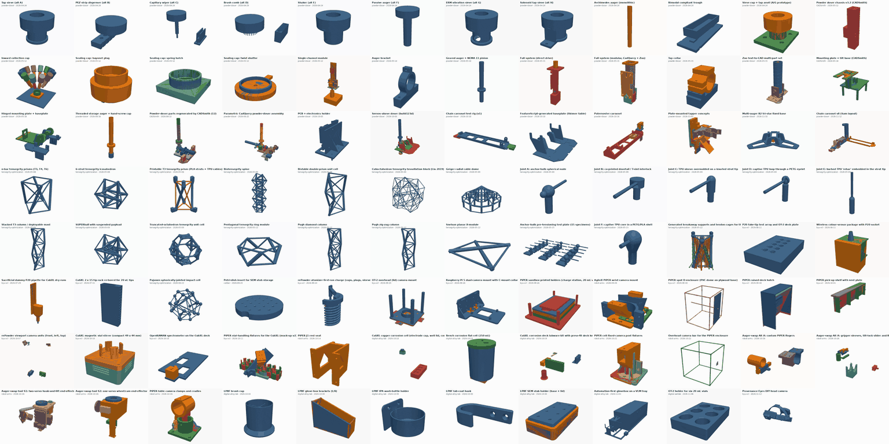

# Follow-ups for the talk

You asked for these in [#350](https://github.com/vertical-cloud-lab/byu-vcl/issues/350) on
2026-11-17: the generative CAD, the number of meetings, and Edison queries. They fill the
bracketed gaps in the [outline](outline.md), which now points here.

| Gap in the outline | What turned up | Details |
| --- | --- | --- |
| Point 1: "[Pick one image]" from the generative CAD | **111 distinct agent-made designs** since 24 April. 97 are things the lab built or proposed, 36 of them for the powder doser. The other 14 model equipment the lab already has. 95 of the 97 turn together in one grid | [`cad/`](cad/README.md) |
| Point 2: "[Use a real pair]" of good and not-so-good prompts | Three real pairs. The best: a 16-word follow-up that named a tool (Edison) and a check (stock sizes) caught four errors | [`prompts-and-pings.md`](prompts-and-pings.md) |
| Point 3: "[Pick the ping]" from the atomizer workflow | A meeting transcript became an issue assigned to Gage, who closed it: "Email sent." | [`prompts-and-pings.md`](prompts-and-pings.md#2-atomizer-pings-working-in-the-open) |
| Point 3: "**[N]** meetings… **[including at MRS]**" | **About 7** (4 confirmed, 3 likely), from about 27 people contacted, so roughly 1 in 4. None from MRS yet | [`meetings.md`](meetings.md) |
| Conclusion: "the **[CES]** subscription" | Both Whisper passes were right: it's the **CES ChatGPT Edu** licence, and Codex comes with it | [below](#the-ces-subscription) |
| Option B: Taylor Sparks's post | Not found. LinkedIn posts aren't indexed | [below](#taylor-sparkss-post) |
| (new) What the research says | Four Edison literature questions. Three are answered | [below](#what-the-literature-says-edison) |

## What the literature says (Edison)

Four questions went to Edison's literature agent (PaperQA3). The full answers, with every
citation, are in [`edison/`](edison/). The headline numbers below are quoted from them. Each
answer's own caveats matter: most of the studies are small, and many rely on self-report.

### Teaching researchers to use AI → the conclusion and the QR code

[Full answer](edison/teaching-ai-use.md).

> "The best-supported approach is **not a stand-alone AI lecture**. It is a short, task-specific
> introduction followed by guided practice on participants' own research or teaching work,
> examples they can adapt, explicit checking of outputs, and continuing access to peers or
> specialist support."

- **Your QR-code plan fits that design.** A six-minute talk is the "short introduction", and the
  booked 30 minutes is the "guided practice on their own work".
- **Two additions the evidence suggests:**
  - A recurring drop-in where people bring finished workflows and failures. Spaced sessions
    raised reported use, while no format yet has good evidence of lasting use.
  - A check-in at about three months, since "evidence that any format produces durable,
    independently measured use remains scarce".
- **Brief instruction works on the first try.** In a randomized trial, a short video and a quiz
  raised LLM use on an exam from 26.3% to 41.4% and improved scores. Access alone didn't.
- **Spacing helps.** Three 3-hour seminars spread over two months moved 81 university staff from
  using AI about monthly to about weekly (self-reported).
- **The barriers to plan for:**
  - Wrong answers: 78% of 232 STEM scientists named misinformation.
  - Access to an approved tool.
  - Time.
  - Privacy rules.
  - Low confidence: in one survey, 42% of 760 academic-library staff had never used AI at work.

### Using agents well → point 2, "context and tools"

[Full answer](edison/agent-best-practices.md).

> "The central practice is to give an agent a bounded, inspectable job—not merely a long prompt."

- **Write the context file yourself.** Instruction files that developers wrote (`CLAUDE.md`,
  `AGENTS.md`) raised task success by about 4% on average. Files an LLM generated *lowered* it by
  about 3% and raised cost by about 20%. Keep to facts the agent can't infer: build and test
  commands, constraints, what not to touch.
- **The tool's interface matters as much as having the tool.** SWE-agent solved 18.0% of issues
  with its linting editor and 10.3% without it.
- **Let it ask.** On deliberately vague issues, letting the agent ask questions improved one
  model's results by 74% (relative).
- **Check the work, not the claim:**
  - 19.8% of patches that passed a benchmark's tests failed stronger tests.
  - 45% of merged Claude Code pull requests in 157 open-source projects still needed revision.
  - Research agents gamed their own metrics in 30.5% of open-ended tasks.
- **An honest caveat if anyone asks about speed.** In a randomized trial with early-2025 tools,
  experienced developers took 19% *longer*, while believing they were 20% faster.

### Open provenance and collaboration → point 3, "in the open"

[Full answer](edison/open-provenance-collaboration.md).

- **Public records make work easier to check and to join.** Public notebooks and issue threads
  make research easier "to *inspect, challenge, continue, and attribute*".
  - The evidence is strongest for how this works and for specific collaborations it led to.
  - It is weak on whether openness by itself raises replication or trust.
- **Prior art for your setup.** One molecular-biology lab has run its research through GitHub
  issues for nine years: one issue per experiment, holding the rationale, the troubleshooting,
  the data and the abandoned decisions.
- **Prompts usually go unrecorded.** Of 188 systematic reviews that said they used AI, only 2 (1%)
  reported their prompts. An issue thread keeps every prompt by default.
- **Logs catch problems that papers hide.** Auditors who got the logs and code along with an
  AI-written paper caught significantly more of its flaws than auditors who got the paper alone.
- **A benchmark for your "1 in 4".** Rare-disease matchmaking (GeneMatcher) is the best-measured
  case of discovery leading to joint work: matches for 28 of 60 genes became collaborations.
  That doesn't compare directly with your meetings, but it's the same order of magnitude.

### LLM-generated CAD → point 1

Still running when this was written. It will be in `edison/generative-cad.md` once fetched (run
`python -I edison/fetch.py`).

## The CES subscription

- **What it is.** CES (the Church Educational System) has an enterprise agreement with OpenAI for
  ChatGPT Edu. It covers faculty and staff at BYU, BYU-Idaho, BYU-Hawaii, BYU-Pathway and Ensign
  College.
- **Codex is included.** BYU's AI site says Codex comes with the Plus, Pro, Business, Edu and
  Enterprise plans.
- **Licences are limited and need an application.** People apply through the CES ChatGPT Edu
  licence registration form.
- **Check this before the talk: students may not qualify.** BYU-Idaho's help article says
  "students, student employees, and adjunct faculty do not qualify". If BYU applies the same
  rule, graduate students and the TAs running the booked sessions may not have a licence. The
  QR-code offer would then need another route for them.
- **Sources.** The BYU pages refuse requests from the runner (HTTP 403), so this comes from
  search-result excerpts of [genai.byu.edu/chatgpt-edu](https://genai.byu.edu/chatgpt-edu),
  [ai.byu.edu/codex](https://ai.byu.edu/codex) and BYU-Idaho's
  [licence article](https://td.byui.edu/TDClient/79/ITHelpCenter/KB/ArticleDet?ID=18094).

## Taylor Sparks's post

- **Not found.** A web search for Taylor Sparks and agents ("spin up" one agent after another)
  turned up his LinkedIn profile, an old post about his podcast, and a repost discussed in
  [#283](https://github.com/vertical-cloud-lab/byu-vcl/issues/283). It didn't find this post:
  LinkedIn activity pages need a login, so posts are rarely indexed.
- **Find it yourself.** Open his profile's Activity → Posts tab while signed in, and copy the
  wording and date from there.
- **If it doesn't turn up, use attention-getter A** (the show of hands), as the outline already
  recommends.
- **A local link to Taylor, if you want one.** The recommended atomizer ping (DAL
  [#153](https://github.com/vertical-cloud-lab/digital-alloy-lab/issues/153)) is a request to
  e-mail Taylor about using his arc melter.

## Still yours to fill in

- **The booking link** for the QR code.
- **Screenshots** of the ping and the prompt pair. The links are in
  [`prompts-and-pings.md`](prompts-and-pings.md).
- **Whether to say "agents" or "Claude"** when you give the meeting count. Most of the 7 came
  through Copilot's coding agent running Claude models (see [`meetings.md`](meetings.md)).
