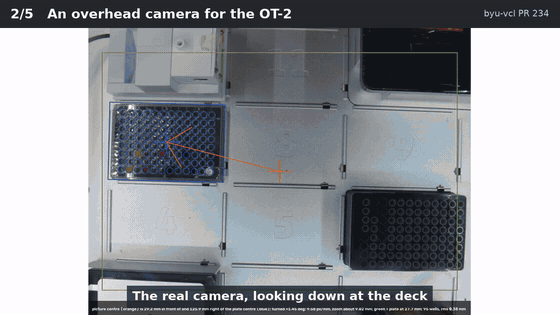

# Five systems the agents designed, animated

For slide 4 of the [outline](../outline.md). These are whole systems: a part, where it goes,
and what it does there. The [111-design grid](../cad/README.md) shows parts one at a time. Agents made
each of these from comments on a GitHub thread, and people steered them over several rounds of review.

| File | What it is |
| --- | --- |
| [`showreel.mp4`](showreel.mp4) | **For the slide.** All five in 74 s, 1280 × 720, H.264, 10.6 MB. Each clip is sped up to fit, with a title band naming the system and its PR. The OT-2 camera and the CubXL each end on a photo of the real thing. |
| [`showreel.gif`](showreel.gif) | The same reel at 560 px and 8 fps, for GitHub (9 MB) |
| [`systems_sheet.png`](systems_sheet.png) | One still from each, plus the real lid camera's view, for a static slide or a handout |
| [`wrist_camera_mount_assembly.mp4`](wrist_camera_mount_assembly.mp4), [`auger_swap_strategy1.mp4`](auger_swap_strategy1.mp4), [`auger_swap_custom_fingers.mp4`](auger_swap_custom_fingers.mp4) | Full-length MP4s of the three clips that exist only as GIFs, since PowerPoint plays MP4 more reliably |
| [`make_showreel.sh`](make_showreel.sh) | Rebuilds everything here from the sources below, fetched at their pinned commits. Needs only ffmpeg. |

The other two clips already have full-length MP4s in their own repos. They're linked in the table below, so they aren't copied here.

## The five, in the reel's order

| # | System | Source (PR, pinned files) | Where it stands in the lab |
| --- | --- | --- | --- |
| 1 | **A wrist camera mount for the PiPER arm:** a Pi 5, an HQ Camera and a Camera Module 3 Wide on the gripper | [robot-arms#10](https://github.com/vertical-cloud-lab/robot-arms/pull/10) (from [byu-vcl#245](https://github.com/vertical-cloud-lab/byu-vcl/pull/245)): [`assembly_steps.gif`](https://github.com/vertical-cloud-lab/robot-arms/blob/1b7acd5/piper-camera-mount/renders/assembly_steps.gif), [`wrist_zoom.gif`](https://github.com/vertical-cloud-lab/robot-arms/blob/1b7acd5/piper-camera-mount/renders/wrist_zoom.gif) (simulated camera views) | **Printed** ([8 and 13 Oct](https://github.com/vertical-cloud-lab/robot-arms/pull/10#issuecomment-6377185227)). On 27 Oct the printed pod's hole for the Camera Module 3 Wide [turned out too small](https://github.com/vertical-cloud-lab/robot-arms/pull/10#issuecomment-6455619153). |
| 2 | **An overhead camera for the OT-2:** a lid mount for the HQ Camera and its zoom lens, and a guided set-up that shows the deck next to what the stream sees | [byu-vcl#234](https://github.com/vertical-cloud-lab/byu-vcl/pull/234): [`setup_steps.mp4`](https://github.com/vertical-cloud-lab/byu-vcl/blob/49677cf/ot2-overhead-camera/lid-mount/renders/setup_steps.mp4), [`assembly_steps.mp4`](https://github.com/vertical-cloud-lab/byu-vcl/blob/49677cf/ot2-overhead-camera/lid-mount/renders/assembly_steps.mp4), [`ot2_context.png`](https://github.com/vertical-cloud-lab/byu-vcl/blob/49677cf/ot2-overhead-camera/lid-mount/renders/ot2_context.png), [real still](https://github.com/vertical-cloud-lab/byu-vcl/blob/49677cf/ot2-overhead-camera/lid-mount/renders/lid_camera_plate.jpg) | **Built and streamed.** The PR opened on 25 Sep. The agent sent the prints itself through Bambu Studio ([29 Sep](https://github.com/vertical-cloud-lab/byu-vcl/pull/234#issuecomment-5896153934), [2 Oct](https://github.com/vertical-cloud-lab/byu-vcl/pull/234#issuecomment-5959050288)). The camera was [streaming on YouTube](https://github.com/vertical-cloud-lab/byu-vcl/pull/234#issuecomment-6245545299) from 18 Oct and [focused on a plate](https://github.com/vertical-cloud-lab/byu-vcl/pull/234#issuecomment-6533386685) by 30 Oct. Its Pi left with the Borys lab on 10 Nov, so the rebuild is tracked in [digital-wetlab#92](https://github.com/vertical-cloud-lab/digital-wetlab/issues/92). |
| 3 | **The PiPER swaps the powder doser's auger:** pulls the spent one, strips its collar in a fixture, bins it, and threads in a fresh one from a rack | [robot-arms#44](https://github.com/vertical-cloud-lab/robot-arms/pull/44) (issue [#42](https://github.com/vertical-cloud-lab/robot-arms/issues/42)): [`s1.gif`](https://github.com/vertical-cloud-lab/robot-arms/blob/2678913/end-effectors/auger-swap/renders/s1.gif) (custom two-servo tool), [`alt_a_cf.gif`](https://github.com/vertical-cloud-lab/robot-arms/blob/2678913/end-effectors/auger-swap/renders/alt_a_cf.gif) (custom fingers on the stock gripper), plus [`alt_a.gif`](https://github.com/vertical-cloud-lab/robot-arms/blob/2678913/end-effectors/auger-swap/renders/alt_a.gif), [`alt_b.gif`](https://github.com/vertical-cloud-lab/robot-arms/blob/2678913/end-effectors/auger-swap/renders/alt_b.gif), [`s2.gif`](https://github.com/vertical-cloud-lab/robot-arms/blob/2678913/end-effectors/auger-swap/renders/s2.gif) | **Designed, six rounds** (26 Oct to 13 Nov), posed by inverse kinematics from AgileX's URDF. It also has an Onshape document. I found no print in the thread. |
| 4 | **A copper corrosion screen on the CubXL:** the deck modules placed one at a time, then one spot: a seawater fill, the electrode cap, OCP, EIS and LPR, a sample for ICP-MS, and a camera image | [digital-alloy-lab#264](https://github.com/vertical-cloud-lab/digital-alloy-lab/pull/264) (stacked on [#180](https://github.com/vertical-cloud-lab/digital-alloy-lab/pull/180)): [`cubxl-cu-spot.mp4`](https://github.com/vertical-cloud-lab/digital-alloy-lab/blob/01e8ad3/alloy-corrosion/copper/cubxl-cu-spot.mp4), [`cubxl-cu-spot.gif`](https://github.com/vertical-cloud-lab/digital-alloy-lab/blob/01e8ad3/alloy-corrosion/copper/cubxl-cu-spot.gif) (the run chapter), [keyframe reel](https://github.com/vertical-cloud-lab/digital-alloy-lab/blob/01e8ad3/alloy-corrosion/copper/keyframes/reel_2rows.png), [build animation](https://github.com/vertical-cloud-lab/digital-alloy-lab/blob/01e8ad3/alloy-corrosion/build-animation/build-cap.gif), [YouTube (unlisted)](https://youtu.be/CTQMzOfOmBI) | **Proposed; parts on order.** The keyframe reel became Fig. 6 of the ONR YIP proposal. Most parts were ordered on 9 and 11 Nov. Nothing is built yet, and the animation's own header says "proposal, not built". |
| 5 | **A vertical lab:** a vertical lift module brings trays of instruments to a mobile arm, which doses a charge cup and takes it to the atomizer | [byu-vcl#329](https://github.com/vertical-cloud-lab/byu-vcl/pull/329) (stacked on [#318](https://github.com/vertical-cloud-lab/byu-vcl/pull/318), issue [#303](https://github.com/vertical-cloud-lab/byu-vcl/issues/303)): [`org_vertical_lab_readme_1280.mp4`](https://github.com/vertical-cloud-lab/byu-vcl/blob/b8b74f5/vertical-lab/out/mp4/org_vertical_lab_readme_1280.mp4), [`org_vertical_lab.gif`](https://github.com/vertical-cloud-lab/byu-vcl/blob/b8b74f5/vertical-lab/out/org_vertical_lab.gif) (49 MB) | **A vision, made for the org page.** It took nine rounds of review. Each round fixed something a person spotted: "way over-simplified", "the repowder is getting even more ridiculous", "that charge cup would fall straight off". |

## For the talk

- **Lead with #2, the one that exists.** It went from a comment on 25 Sep, through prints the agent sent itself, to a live
  stream on 18 Oct, in about three weeks. The reel ends that clip on the real camera's view of the deck.
- **Then the reel says "and the agents didn't stop at one part."** The order runs from a part on the arm, to the arm doing a job,
  to a whole instrument's workflow, to the whole lab.
- **#5 doubles as point 2's evidence.** Its nine rounds, each fixed after a person looked, show that context and review decide
  the quality, not the first try. The [#329 thread](https://github.com/vertical-cloud-lab/byu-vcl/pull/329) has the quotes.
- **Be straight about status.** One is built, one is printed, and three are designs or proposals. The reel's titles don't claim more.

## Not included

- The OT-2's wider deck coverage, lens and window-cutting clips (`lens_rings`, `window_cutting`), the camera mount's
  `h2d_plate_build` and `split_overtighten`, and #318's other vertical-lab tours. They're good, but they show the same systems.
- The CubXL corrosion clip inside the vertical lab (`vertical-lab/out/mp4/instruments/cubxl_corrosion.mp4` on #329). The
  digital-alloy-lab one is newer and the one the proposal uses.
