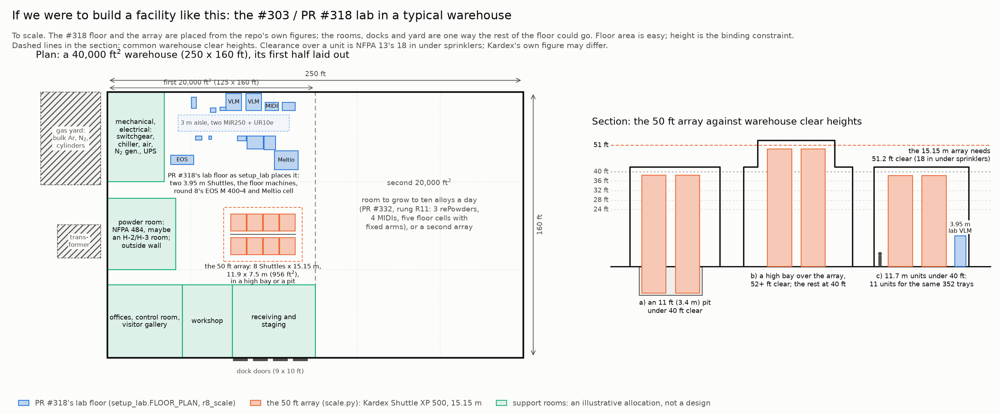

# Facility locations: where could a lab like the #303 visualizations go?

*If we were to build a facility like this* — the vertical cloud lab in the
[#303](https://github.com/vertical-cloud-lab/byu-vcl/issues/303) visualizations
([PR #318](https://github.com/vertical-cloud-lab/byu-vcl/pull/318)) — where could it go, and what would a building need?
This is a first pass for [#343](https://github.com/vertical-cloud-lab/byu-vcl/issues/343), from Sterling and Gage's
conversation on 2026-11-12 ([transcript excerpt](../docs/meetings/2026-11-12-facility-locations/transcript.md),
[what the repos already said](../docs/meetings/2026-11-12-facility-locations/context.md)). Gage will add sites,
contacts and numbers on the issue.

**Nobody has been contacted.** The [contacts](#contacts) are public listings, and the emails in
[`drafts.md`](drafts.md) are drafts for Sterling and Gage. Everything below was read on 2026-11-12 from public pages.
Listings change quickly, so check a site's status before relying on it.

Point people at the visualizations:
[the warehouse version](https://www.youtube.com/watch?v=3IrSB9-meN8) (MiR250 + UR10e units on an open warehouse
floor), [the lab set up from scratch in an empty bay](https://www.youtube.com/watch?v=oMvGIGQOKA4), and
[the 50 ft array](https://www.youtube.com/watch?v=9A9XuBT0BYk) (eight Kardex Shuttles at 15.15 m).

[`out/footprint.png`](out/footprint.png) is drawn by [`footprint.py`](footprint.py) (`python3 facility/footprint.py`;
numbers in [`out/footprint.json`](out/footprint.json)). The #318 floor and the array come from the repo's own layout
code; the support rooms are one illustrative way to use the rest of the floor.

## Summary

*If we were to build a facility like this:*

- **Height is the hard part, not area.**
  - **The 50 ft array** needs about **51-53 ft clear** (depending on the sprinklers), but nothing available near BYU
    is over **36 ft**.
  - **Three ways round it:** an 11 ft (3.4 m) pit in a 40 ft clear building, a high bay in a purpose-built building, or
    more, shorter units (13 units at 10.5 m under 36 ft, or 15 at 9.2 m under 32 ft) for the same 352 trays.
  - **Area is easy:** the #318 floor fits in about 3,500 ft² and the array in under 1,000 ft². 20,000 ft² is enough
    to start, and 40,000 ft² leaves room for ten alloys a day.
- **Candidate sites, Lehi first:**
  - **Holbrook Industrial Park Bldg 5, Lehi:** 32 ft clear, 4,000 A at 480 V, divisible to about 46,000 ft²,
    zoned PC-FLEX, where labs and R&D are permitted.
  - **Leases with 32-36 ft clear** in American Fork, Lindon, Springville, Spanish Fork, Bluffdale and Herriman.
    Four have 2,000-4,000 A at 480 V already: Center Street Industrial, Global Logistics HQ, Mountain Point Bldg 3
    and Axia.
  - **To own:** a 47,733 ft² **flex/lab building for sale in American Fork** ($8.78M), and 1657 N State St in Lehi
    ($7.1M).
  - **For a purpose-built high bay later:** Eagle Mountain industrial land next to a 200 MW substation.
  - **Already handling gas or hazardous materials:** the BlendTec building in Orem (clean rooms, compressed air,
    generator) and TI's Lehi fabs.
- **Renovate first, as Sterling suggested.**
  - **Lease and fit out:** about $124-440/ft² of fit-out on top of $10-14/ft²/yr rent, ready in 6-20 months.
  - **Build new:** about $370-854/ft², 2-3 years.
  - **Electrical gear drives the schedule** (40-80 weeks for switchgear and transformers). So power already in the
    building is worth a lot, and Lehi and Provo run their own power utilities.
- **Radical AI's new lab is 45,000 ft², not 40,000:** Building 20 at the Brooklyn Navy Yard, moved into around
  September 2026, per its CEO. Most peers are 17,000-40,000 ft² (Periodic Labs 37,808, Freeform 35,000, Chemify 21,500 and
  40,000+, CMU 17,500, Mattiq 17,377). A few are over 100,000 ft² (Emerald Cloud Lab, Recursion).

## 1. What the facility needs

### Height

Height, not floor area, is what rules buildings out.

- **The 50 ft array** in [`scale.py`](https://github.com/vertical-cloud-lab/byu-vcl/blob/03801d8/vertical-lab/scale.py)
  is eight Kardex Shuttle XP 500s at 15.15 m (49.7 ft), the tallest height under 50 ft in Kardex's 100 mm steps. With
  NFPA 13's 18 in between sprinkler deflectors and the top of storage, that is **51.2 ft of clear height**. ESFR
  sprinklers need 36 in, making it 52.7 ft. Whatever Kardex itself asks for over a unit comes on top; that is a
  question for Kardex (draft 2).
- **The lab floor's two Shuttles** are 3.95 m (under 13 ft), and PR #331's site table asks for at least 4.0 m. Any
  warehouse clears that.
- **Three ways to fit the array in a 40 ft building** (the section in the figure):
  - **A pit** about 3.4 m (11 ft) deep under the array. It needs a structural engineer, a dry site, a sump and the
    landlord's consent, so it is more realistic in a building we own.
  - **A high bay** of about 52-55 ft over the array's ~12 × 7.5 m (956 ft²), with the rest of the building lower.
    In practice that means a purpose-built building, or an addition.
  - **Shorter units.** Using `scale.py`'s own slot rule, the tallest unit under each common clear height, and how
    many it takes to keep the array's 352 powered trays:

    | Clear height | Tallest Shuttle (18 in under sprinklers) | Trays a unit | Units for 352 trays | Array (two rows) |
    |---|---|---|---|---|
    | 24 ft | 6.8 m | 17 | 21 | 32.8 × 7.4 m, 2,628 ft² |
    | 28 ft | 8.0 m | 20 | 18 | 26.8 × 7.4 m, 2,150 ft² |
    | 32 ft | 9.2 m | 24 | 15 | 23.8 × 7.4 m, 1,911 ft² |
    | 36 ft | 10.5 m | 29 | 13 | 20.9 × 7.4 m, 1,672 ft² |
    | 40 ft | 11.7 m | 32 | 11 | 17.9 × 7.4 m, 1,433 ft² |
    | 51.2 ft (the array as drawn) | 15.15 m | 44 | 8 | 11.9 × 7.5 m, 956 ft² |

    Floor area is cheap next to height, so **in a 36-40 ft building, 11-13 shorter units match the tall array's
    capacity**. The cost is 3-5 more units, each with its own extractor to maintain, and a longer rail. Whether that
    beats a pit or a high bay depends on the price per unit (#53 quoted $97k-118k for one 3.95 m unit) and on upkeep.

### Floor area

- **The conversation's range is 20,000-40,000 ft².** The #318 floor itself is small: as `setup_lab.FLOOR_PLAN`
  places it, the two Shuttles, the floor machines and round 8's EOS M 400-4 and Meltio cell fit in a 23.3 × 14.0 m
  box (**about 3,500 ft²**), and the array adds 956 ft².
- **What fills the rest** is growth and support:
  - ten alloys a day (PR #332's rung R11, [`notes/bottleneck.md`](https://github.com/vertical-cloud-lab/byu-vcl/blob/cc31ddc/vertical-lab/notes/bottleneck.md)):
    3 rePowders, 4 Aconity MIDIs, five floor cells with fixed arms (7 cobots), a second hot frame and a third
    MiR250 + UR10e. PR #332 notes that `FLOOR_PLAN` has no room for these yet;
  - a powder room, mechanical and electrical rooms, receiving and staging by the docks, a workshop, offices, a
    control room and a visitor gallery.
- **The figure's layout** puts the #318 floor, the array and those rooms in the first 20,000 ft² and leaves the
  second 20,000 ft² for ten-a-day growth. So 20,000 ft² is enough to start and 40,000 ft² leaves room to grow.

### Everything else a building has to provide

Height and floor area are above. Specific rows of [PR #331's site and utilities table](https://github.com/vertical-cloud-lab/byu-vcl/blob/685216e/vertical-lab/procurement/lab_answers.md#site-and-utilities)
are cited as "#331", and the CB 154 fit-out ([#31](https://github.com/vertical-cloud-lab/byu-vcl/issues/31)) as "CB 154".
Everything else is from the sources linked.

| Need | What a facility like this needs | Why, and where the number comes from |
|---|---|---|
| **Slab and floor loading** | A heavy, flat slab; new tilt-ups here list 6-7 in, reinforced (310 N Geneva Rd, Axia, Center Street). A thickened slab or a pit under the array, sized by a structural engineer | The heaviest items are a loaded Shuttle and the wire EDM (#331). Kardex gives a maximum load of 67 t per Shuttle 500, and our estimate is about 86-94 kN/m² under each loaded 15 m unit. The FANUC ROBOCUT α-C400iC is about 2,200-2,400 kg and wants at least 400 mm of concrete. The EOS M 400-4 is about 4,835-4,900 kg on 4.2 × 1.6 m (about 720 kg/m² averaged, more under its feet). The Meltio cell is about 4,000 kg. A 15 m Shuttle with 44 instrument trays is far heavier than the 3.95 m unit; ask Kardex for the figure (draft 2) |
| **Electrical service** | **About 2,000-3,000 A at 480Y/277 V** for ten a day (an estimate: roughly 0.8-1.5 MW of process load, plus lab HVAC and exhaust, likely the largest load), plus step-down transformers to 400 V for the European machines and 208Y/120 V panels | The VLMs are 208 V three-phase (#53; a used XP 500 lists 8.6 kVA). The rePowder takes 400 V three-phase and 230 V on 32 A plugs, and its optimizer draws up to about 60 A ([install call](../rePowder-BYU-Installation-Details.txt)). The wire EDM is 13 kVA. The EOS M 400-4 is 3 × 50 A, 45 kW peak and 22 kW typical. The Meltio cell is 400 V, 20 kW peak. Trays are up to 3.5 kW each (PR #318 `out/cabling.json`). Ten a day means 3 rePowders and 4 MIDIs (PR #332). **A building that already has 2,000-4,000 A at 480 V avoids 40-80 weeks of switchgear and transformer lead time.** In Lehi the city's impact fee is $232k for 2,000 A and $464k for 4,000 A ([§3](#3-renovate-or-build)) |
| **Argon** | Microbulk or a bulk liquid tank outside, with a vaporizer and piping. 5N (99.999 %) at up to 8 bar for the atomizers | The rePowder, an ultrasonic atomizer using about 10 L/min of noble gas ([AMAZEMET](https://amazemet.com/repowder/)), needs 5N argon at up to 8 bar (install call). Three atomizers, four MIDIs, the EOS and the Meltio cell's three 50 L bottles are past cylinders; PR #332 flags bulk argon as not modelled. Bulk is worth it above about one liquid cylinder a week (Rocky Mountain Air). Local suppliers are in the sites section |
| **Nitrogen** | An N₂ generator fed by house air (#331), or bulk | Piped to every tray's coupling (PR #318 `notes/services.md`) |
| **Oxygen-depletion monitoring** | O₂ monitors wherever argon or nitrogen can collect: the powder room, near the gloveboxes, any pit | IFC §5307.2.1 accepts an oxygen-depletion alarm in place of ventilation. CB 154 needed an O₂ detector (#31). A pit under the array would be a low point for argon, and nitrogen fire protection in the units adds to the hazard |
| **Chilled water** | A central loop, or one chiller per cluster | The rePowder's heat exchanger and the EOS need it; the trays need it through their couplings. #331 sizes a Thermo ThermoFlex 900-class chiller beside each VLM |
| **Compressed air** | Dry house air at 7 bar or more | The EOS takes 7 bar, 20 m³/h. The rePowder's optimizer takes 6 mm push-fit. The N₂ generator needs 60-125 psig (`out/cabling.json`) |
| **Exhaust and ventilation** | Ducted exhaust for fume hoods and a downdraft sieving enclosure, local exhaust at the atomizers and printers, matching make-up air, dehumidification and HEPA | About 700-4,200 m³/h of ventilation per VLM, for about 7 kW of heat with everything on (#331). On campus, exhaust was the bottleneck: one building had run out ([#29](https://github.com/vertical-cloud-lab/byu-vcl/issues/29)). CB 154 also took a dehumidifier and HEPA filtration (DAL [#131](https://github.com/vertical-cloud-lab/digital-alloy-lab/issues/131), [#127](https://github.com/vertical-cloud-lab/digital-alloy-lab/issues/127)). Warehouse roofs often can't carry heavy rooftop units ([BD+C](https://bdcnetwork.com/3-key-considerations-when-converting-warehouse-laboratory?page=12)) |
| **Combustible metal powders** | A powder room built to NFPA 484 (now part of NFPA 660), separated from the rest of the floor, with Class D extinguishers, housekeeping and a dust hazard analysis. If quantities exceed the code's limits, it becomes a hazardous (Group H) occupancy | Reactive aluminium fines, IPA and fine metal powders are on site (#331). PR #331's `build_our_own_vlm.md` lists NFPA 484 alongside ANSI MH24.2, EN 15095, NFPA 79 and NFPA 13. Class D extinguishers: DAL [#126](https://github.com/vertical-cloud-lab/digital-alloy-lab/issues/126). Details: [Codes](#codes-that-decide-the-building) |
| **Code edition** | The 2024 IBC and IFC with Utah amendments, effective 2026-07-01 | [Utah Code §15A-5-103](https://le.utah.gov/xcode/Title15A/Chapter5/C15A-5-S103_2026050620260701.html) (fire); §15A-2-103 (building) |
| **Seismic** | Seismic Design Category D (Lehi SDS 0.95, SD1 0.70): anchoring and bracing for the tall units, racks and gas tanks | USGS ASCE 7-22 service; see [Codes](#codes-that-decide-the-building) |
| **Delivery access** | Dock-high doors for freight; a **grade-level door of at least 14 × 16 ft** for the big machines; a forklift of 5 t or more, or riggers | The EOS is about 4.8-4.9 t and 2.36-2.63 m tall; the Meltio cell is 4,050 × 2,350 × 3,000 mm. Holbrook Bldg 5 and Mountain Point Bldg 3 list 14 × 16 ft grade-level doors; Millplace's are 14 × 14 ft |
| **Network** | Fibre, wired Ethernet to every tray, remote access | `out/cabling.json`: PoE+ to the cameras, Ethernet through each coupling |
| **Zoning and height** | A zone that permits R&D or labs and allows manufacturing at least as a conditional use, with a height limit that fits a high bay | See [Zoning](#zoning-what-lehi-allows). Lehi's LI zone permits R&D and caps height at 60 ft |

### Codes that decide the building

In force in Utah from 2026-07-01: the **2024 IBC and IFC with state amendments, and the 2023 NEC**
([§15A-2-103](https://le.utah.gov/xcode/Title15A/Chapter2/C15A-2-S103_2026050620260701.html),
[§15A-5-103](https://le.utah.gov/xcode/Title15A/Chapter5/C15A-5-S103_2026050620260701.html)). Quantities and code
sections below are as read on 2026-11-12. A fire-protection engineer and the local fire marshal would settle them for
a real building.

- **Sprinklers set the array's height.**
  - **Clearance under sprinklers:** NFPA 13 (2019) wants 18 in between sprinkler deflectors and the top of storage,
    and 36 in for ESFR sprinklers (§9.5.6.1, §14.2.12). So the 15.15 m array needs **51.2-52.7 ft to the
    deflectors**, about 52-54 ft to the roof structure, or a **3.4-3.9 m pit** under 40 ft clear (3.4 m is the
    figure's 18 in case).
  - **Ceiling-only ESFR** sprinklers are limited to 45 ft ceilings in NFPA 13. UL listings go to 48 ft, and FM
    Global's Data Sheet 8-9 to 55 ft with K28 heads ([RiskLogic](https://risklogic.com/ceiling-only-sprinkler-designs-for-warehouses-with-ceiling-heights-over-45-ft)).
- **So the array would probably carry its own fire protection.**
  - **Kardex** lists fire protection (water or gas) and explosion protection as Shuttle options
    ([brochure](https://www.supplycore.com/wp-content/uploads/2022/01/Shuttle-XP-Vertical-Lift-Module-1108-1.pdf)).
  - **Its ENGEL installation**, a 14.95 m Shuttle 700, uses nitrogen nozzles with air-sampling detection and no
    sprinklers ([case study](https://blog.kardex-remstar.com/case-studies/engel)). Fike sells IG-100 nitrogen systems
    for VLMs with Kardex ([Fike](https://www.fike.com/knowledge-center/the-future-of-fire-protection-for-vertical-lift-modules/)).
  - **Nitrogen suits trays of aluminium powder better than water does,** and it adds an oxygen-depletion hazard at
    the array.
  - **Automated storage rules:** IFC §3209 asks for a manual emergency shutdown, and automatic shutdown on sprinkler
    flow or fire detection ([UpCodes](https://up.codes/viewer/utah/ifc-2024/chapter/32/high-piled-combustible-storage)).
- **What Kardex publishes, and what it doesn't** ([Kardex](https://kardex.com/en/products/shuttle-vertical-lift-modules)):
  - Shuttle 250/500 units go up to 30,050 mm tall.
  - An optional "seismic absorption structure" lets units stand side by side.
  - The 2014 brochure gives a "Maximum load 67/120 t" per unit.
  - A Shuttle 500 draws at most 8.6 kVA (14.2 A at 480 V) ([Kardex](https://info.kardex-remstar.com/knowledge/vlm-and-vcm-power-requirements)).
  - **Not published:** self-weight, floor load, slab, levelness and the clearance over a unit. Draft 2 asks for them.
  - **Our estimate:** a loaded 15 m unit puts about 86-94 kN/m² (1,800-2,000 psf) on its footprint, against
    250 psf for heavy-storage floors. That calls for a mat or a thickened slab under the array.
- **Metal powders: NFPA 484 is now NFPA 660, but Utah enforces 484.**
  - **NFPA 660 (2025 edition, effective 2024-12-06)** replaced NFPA 61, 484, 652, 654, 655 and 664. Its Chapter 22
    covers combustible metals, and §22.15 covers additive manufacturing
    ([Processing](https://www.processingmagazine.com/maintenance-safety/standards-regulations/article/55264719/nfpa-660-what-processors-need-to-know-about-nfpas-new-consolidated-combustible-dust-standard)).
  - **Utah's 2024 IFC Table 2205.1 still names NFPA 484,** so that is what's enforced.
  - **IFC Chapter 22 requires**
    ([UpCodes](https://up.codes/viewer/utah/ifc-2024/chapter/22/combustible-dust-producing-operations)):
    - a permit;
    - housekeeping to at most 1/32 in of dust, and no compressed-air cleaning;
    - dust collectors outside the building, unless listed wet-type;
    - NFPA 70 area classification, bonding and grounding;
    - a dust hazard analysis for a new facility.
  - **Class D extinguishers** per NFPA 10 (IFC §906.3.4).
- **Group H, or not.**
  - **Combustible dust is Group H-2 only where a technical report under IBC §414.1.3 shows a hazard.** It has no
    quantity limit; otherwise the space is F-1 or S-1
    ([ICC](https://www.iccsafe.org/building-safety-journal/bsj-technical/code-corner-2024-international-building-code-table-307-1-1-combustible-dusts/)).
  - **Maximum allowable quantities per control area**
    ([IFC Table 5003.1.1(1)](https://up.codes/viewer/utah/ifc-2024/chapter/50/hazardous-materials-general-provisions)):
    - flammable solids: 125 lb stored or in closed use, 25 lb in open use;
    - water-reactive Class 2: 50 lb; Class 3: 5 lb;
    - IPA: 120 gal.
  - **Each limit doubles** in a sprinklered building, and doubles again in approved cabinets. A ground floor can
    have four control areas behind 1-hour fire barriers.
  - **Which class our aluminium powders fall in** depends on their SDS and testing.
  - **Above the limits, the room becomes H-2 or H-3**
    ([IBC 2024 summary](https://bsd.dli.mt.gov/_docs/Training/2024-IBC-Hazardous-Materials-for-Building-Officials-BC-edits.pdf)):
    - at least 25 % of its perimeter on an exterior wall;
    - H-2 rooms over 1,000 ft² at least 30 ft from lot lines;
    - rated separation;
    - explosion control;
    - standby power for the ventilation;
    - waterproof rooms for water-reactive materials;
    - in an unlimited-area building, no more than 10 % of the floor, on the perimeter.
  - **This is why the figure puts the powder room on an outside wall.**
- **Argon and nitrogen have no quantity limit.** Indoors they need ventilation, or gas detection, or, where approved,
  an oxygen-depletion alarm (IFC §5307.2-5307.2.1,
  [UpCodes](https://up.codes/viewer/utah/ifc-2024/chapter/53/compressed-gases)). Cylinders must be secured against
  earthquakes (§5303.5.3).
  - **Outdoor cryogenic tanks** need 1 ft from buildings, 5 ft from lot lines, 10 ft from air intakes and exits, and
    15 ft from combustibles (IFC Table 5504.3.1.1; NFPA 55; CGA P-18).
  - **A microbulk tank** replaces 25-50 high-pressure cylinders ([Airgas](https://www.airgas.com/microbulk)).
- **Seismic: Design Category D.** USGS's ASCE 7-22 service, queried 2026-11-12 for Site Class D, gives
  ([query](https://earthquake.usgs.gov/ws/building-codes/asce7-22/calculate?latitude=40.3916&longitude=-111.8508&riskCategory=II&siteClass=D&title=screen)):
  - **Lehi:** SDS 0.95, SD1 0.70.
  - **Provo:** SDS 1.00, SD1 0.78.
  - **Wasatch Front:** USGS gives a 43 % chance of an M6.75+ earthquake in the region in 50 years
    ([Fact Sheet 2016-3019](https://pubs.usgs.gov/fs/2016/3019/fs20163019.pdf)).
  - **For the tall units:** they need anchorage and overturning design for the site. Decide whether they stand free
    of the building or are braced to it. A pit or a roof penetration must allow for the movement between them.
- **Machine foundations.**
  - **FANUC α-C400iC wire EDM:** about 2.4 t without dielectric. FANUC recommends at least 400 mm of concrete and
    floor vibration of 2 µm or less at 10-20 Hz
    ([catalogue](https://www.fanuc.co.jp/en/product/catalog/pdf/robocut/RCUT-CiC(E)-07.pdf)).
  - **EOS M 400-4:** about 4.9 t ([EOS](https://www.eos.info/metal-solutions/metal-printers/eos-m-400-4)).

## 2. Candidate sites

Read on 2026-11-12 from public listings. **Nobody was contacted.**
- **Crexi pages** were opened in a browser on the runner whose traffic went out through the CubXL Pi, because Crexi
  doesn't render for the runner.
- **LoopNet** refused both the runner and the Pi (HTTP 403, Akamai), so its listings appear here only as search
  snippets.
- **Listings change weekly:** "available" means listed on that date.

**No available building near BYU is taller than 36 ft clear.** So the 50 ft array needs a pit, a purpose-built high
bay, or the shorter units in the [table above](#height). The last column applies that table.

### Lease (the short-term path), Lehi first

| Site | City | Area: building / available (ft²) | Clear | Power | Docks | Zoning | Status, rate | Listing (brokers) | Array fit |
|---|---|---|---|---|---|---|---|---|---|
| **Holbrook Industrial Park Bldg 5**, 4866 S Hudson Way (Boyer) | **Lehi** | 247,078 / 247,078, **divisible to ±46,368** | 32' | **4,000 A, 277/480 V, 3-ph** | 40 DH (9×10), 8 GL (14×16) | PC-FLEX | complete, ready for occupancy; rate on request; ESFR; columns 56' × 43'3" | [Crexi](https://www.crexi.com/lease/properties/942551/utah-holbrook-industrial-park-building-5) (Colliers SLC: Tom Freeman, Travis Healey, Jeremy Jensen, Jeremy Terry) | 15 × 9.2 m units, or a pit |
| Holbrook Bldg 2, 5025 W Hudson Way | Lehi | 109,572 / 29,724 sublease | 32' | 277/480 V, 3-ph | 6 DH, 3 GL | PC-FLEX | rate on request; ESFR; the C&W flyer is gone (HTTP 410), so status unverified | [IndustrialSpaces](https://industrialspaces.net/lehi-ut/warehouse-for-rent/5025-west-hudson-way/33149) (C&W: Tyson Fowler) | 15 × 9.2 m |
| 4425 N Thanksgiving Way (a sublease) | Lehi | 75,300-80,098 | 26-33' | 2,400 A, 480 V, 3-ph | 3 DH, 2 GL | not stated | NNN sublease; racking included (snippet only) | CityFeet/LoopNet, blocked | 14-19 units |
| Millplace Park, 305 S 850 E | Lehi | 98,000 / 10,753 | 24' | 3-ph | 2 GL (14×14) | not stated | $1.05/ft²/mo; HVAC in the warehouse; first two months free | [Crexi](https://www.crexi.com/lease/properties/836927/utah-millplace-park) (Colliers: Jarrod Hunt, Lana Howell) | too small alone |
| Lewis Landing Bldg A, 4170 W 2100 N (Gardner) | Lehi | 86,916 | 32' | not stated | 18 DH, 4 drive-in | "general industrial" (snippet) | no longer advertised on LoopNet | [Zwick](https://www.zwickconstruction.com/lewis-landing) | 15 × 9.2 m |
| American Fork Industrial Bldg 1, 860 E 930 S | American Fork | 33,020 / 33,020 | 32' | 1,200 A, 277/480 V, 3-ph | 5 DH, 1 GL | not stated | available now; ESFR; 52' × 45' columns | [CommercialCafe](https://www.commercialcafe.com/commercial-property/us/ut/american-fork/american-fork-industrial-building-1/) (Newmark Mountain West: Jeffrey Heaton, Lucas Burbank, Ben Richardson) | 15 × 9.2 m |
| **Catalyst Business Park Ph. 3, Bldg 6**, 68 E 1600 S | American Fork | 122,381 / 22,447-122,381 | 28-32' | not stated | 30 DH, 4 drive-in | not stated | **under construction, pre-leasing**, so utilities could go in during the build; 56' columns, 50' × 60' bays | [Crexi](https://www.crexi.com/lease/properties/1086826/utah-catalyst-business-park-phase-3) (Colliers: Jarrod Hunt, Andy Blunt, Lana Howell) | 15-18 units |
| Price American Fork Bldg 1, 860-864 E 1300 S | American Fork | 271,055, divisible to 33,882 | 32' | not stated | 62 DH, 8 GL | not stated | build-to-suit offered on Bldgs 3-4 | [CommercialCafe](https://www.commercialcafe.com/commercial-property/us/ut/american-fork/price-american-fork-building-1/) (Newmark: Ben Richardson, Kyle Roberts) | 15 × 9.2 m |
| 310 N Geneva Rd, Bldg 1 | Lindon | 140,986, minimum 31,808 | 32' | 480 V, 3-ph | 28 DH, 4 GL | Light Industrial (a steel plant operates in the zone) | new 2026; ESFR; **6" slab**; 56' × 59' columns | [flyer](https://www.commercialsearch.com/pdfs/8D0138B9-3A81-4551-91CA-0A75594B9D17), [city packet](https://www.utah.gov/pmn/files/1294931.pdf) (Colliers: Jarrod Hunt, Andy Blunt) | 15 × 9.2 m |
| Pioneer Crossing Industrial, Lazaret Ave | Saratoga Springs | 48,160 (six 8,000 units) | 28' | 480 V, 3-ph, 4-wire | 6 docks, 6 drive-in | HC (Heavy Commercial) | deliverable summer 2026; 90' deep | [Crexi](https://www.crexi.com/lease/properties/989481/utah-pioneer-crossing-industrial-development) (Legend Commercial: Skyler Peterson, Tre Bourdeaux, Parker Taggart, Connor DeBry) | 18 × 8.0 m |
| Northshore Commerce Center, 593-659 N Saratoga Rd | Saratoga Springs | 339,009 / 66,520, from 12,504 | 28-32' | not stated | not stated | not stated | completed 2024; available now | [CommercialCafe](https://www.commercialcafe.com/commercial-property/us/ut/saratoga-springs/northshore-commerce-center/) (Colliers) | 15-18 units |
| Spring Heights Bldg B (flex/R&D), 2559 N Redwood Rd | Saratoga Springs | 53,640, from 2,760 | 18' | not stated | dock and drive-in | not stated | vacant | [Crexi](https://www.crexi.com/lease/properties/837924/utah-redwood-road-at-hardman), [brochure](https://sjpi.com/wp-content/uploads/2023/05/Spring-Heights_Brochure.pdf) (St. John Properties: Scott Gifford, Daniel Thomas) | 5.0 m units at most (32 of them) |
| **BlendTec Building**, 1206 S 1680 W | Orem | 264,816 / 211,665 | 23' | "heavy power service" | 8 DH, 1 GL | CM | available now; **clean rooms, compressed-air lines, generator**, climate-controlled; turnkey | [CommercialCafe](https://www.commercialcafe.com/commercial-property/us/ut/orem/blendtec-building/) (Colliers: Jarrod Hunt, Lana Howell) | larger than needed |
| **Provo Manufacturing Facility with Yard**, 225 E 900 S | **Provo**, closest to BYU | 155,140 / 107,225, divisible to 25,000 | 15-25' | 1,750 A, 480/277 V, 3-ph | 13 DH, 3 GL | not stated | Class C manufacturing building with a yard | [Crexi](https://www.crexi.com/lease/properties/816137/utah-provo-manufacturing-facility-with-yard) (Newmark Mountain West: Eli Priest, Ben Richardson, Kolby Long) | 20 × 7.1 m under the 25' part, or a pit |
| Vista Heights Industrial, 3500 S Mountain Vista Pkwy | Provo | 219,870, from 43,974 | 30' | 3,000 A, 3-ph | 8 DH, 10 GL | not stated | available now | [CommercialCafe](https://www.commercialcafe.com/commercial-property/us/ut/provo/vista-heights-industrial-1/) (Colliers) | 16 × 8.6 m |
| Hamilton Commerce Center, 2303 W 500 N | Springville | 192,360, bays of ±21,840 | 32' | not stated | 43 DH, 8 GL | not stated | delivery May 2027; ESFR | [flyer](https://www.hamiltonpartners.com/wp-content/uploads/2026/06/Hamilton-Commerce-Center-Springville.pdf) (Colliers) | 15 × 9.2 m |
| **Center Street Industrial**, 168 N 1750 W | Springville | 327,184 build-to-suit, from 81,796 | **36'** | 2,000 A, 277/480 V, 3-ph | 90 DH, 4 GL | not stated | vacant; **7" reinforced slab** | [CommercialCafe](https://www.commercialcafe.com/commercial-property/us/ut/springville/colmeana-springville/) (Newmark) | 13 × 10.5 m |
| **Global Logistics HQ**, 2100 N 700 W | Spanish Fork | 1.9M in 8-13 buildings; Bldg 2 from 26,060 | 32-36' | 4,000 A, 480 V, 3-ph | 83 DH | not stated | pre-leasing; $7.50-8.00/ft²/yr NNN (snippet) | [Crexi](https://www.crexi.com/lease/properties/771339/utah-global-logistics-headquarters-bldgs-1---8), [CommercialCafe](https://www.commercialcafe.com/commercial-property/us/ut/spanish-fork/global-logistics-headquarters-9/) (Colliers) | 13-15 units |
| El Tenedor Logistics Center, 1401 N 300 W | Spanish Fork | 800,766 in 2 buildings | 32-36' | 3,000 A (snippet) | 43 DH, 8 drive-in | not stated | Bldg C at 36' available 2027-01-01 (snippet) | [Crexi](https://www.crexi.com/lease/properties/676904/utah-el-tenedor-logistics-center-phase-1) (Newmark: Ben Richardson, Kyle Roberts, Jeff Heaton, Kolby Long) | 13 × 10.5 m |
| Mountain Point Business Center Bldg 3, 860 W 14600 S | Bluffdale (Point of the Mountain) | 100,534 / 27,081, from 9,158 | **36'** | 2,400 A, 480/277 V, 3-ph | 4 DH, 3 GL | not stated | under construction (2026); 56' × 58' columns | [CommercialCafe](https://www.commercialcafe.com/commercial-property/us/ut/bluffdale/mountain-point-business-center-building-3-for-lease/) (Colliers: Freeman, Healey, Jensen, Terry) | 13 × 10.5 m |
| **Axia Business Park**, 15897 S Axia Dr | Herriman | ~232,000 / 49,942, from 10,234 | **36'** | **4,000 A, 480 V, 3-ph** | 30 DH, 6 drive-in | **M1 Light Industrial** | available now; 6" reinforced slab | [CommercialCafe](https://www.commercialcafe.com/commercial-property/us/ut/herriman/axia-business-park/) (Colliers) | 13 × 10.5 m |
| Lone Peak Business Park "Fuji", 301 W Lifescience Way | Draper | 52,308, from 8,661 | 28' | 1,200 A, 277/480 V, 3-ph | 12 DH, 6 GL | not stated | available 2026-10-01; ESFR | [CommercialCafe](https://www.commercialcafe.com/commercial-property/us/ut/draper/lone-peak-business-park-fuji/) (Newmark) | 18 × 8.0 m |

### For sale (to own, and later build on)

| Site | City | Building | Clear | Power | Price | Notes | Listing |
|---|---|---|---|---|---|---|---|
| **Fluke Industrial**, 799 E 930 S (799 E Utah Valley Dr) | American Fork | 47,733 ft², **"industrial flex/lab"**, two stories, concrete tilt-up, 1995; 3.05 ac with excess ground | not stated | not stated | **$8,782,872** (about $184/ft²) | owner-user; vacant from October 2025; Opportunity Zone; on the market 617 days | [Crexi](https://www.crexi.com/properties/1822442/utah-fluke-industrial) (Colliers SLC: Brandon Fugal, Josh Smith) |
| 1657 N State St | Lehi | 40,426 ft² (about 35,426 warehouse, sprinklered and radiant-heated, plus 5,000 office), 1995, new roof 2022; 2.00 ac | 18' (Crexi) | 1,800 A, 3-ph (LoopNet snippet) | **$7,100,000** (about $176/ft²) | leased to a tenant; sold as an investment or owner-user; 3 DH, 2 docks | [Crexi](https://www.crexi.com/properties/2687872/utah-1657-north-state-street) (McKay Winkel) |

### Land for a purpose-built building with a high bay

- **Eagle Mountain, 1254 N 0 St:** about 290 acres in 20-100 acre sites, "zoned Industrial/tech Campus", with an
  easement to a **200 MW substation**, next to the Meta data center
  ([CommercialCafe](https://www.commercialcafe.com/commercial-property/us/ut/eagle-mountain/1254-n-0-st/); JLL: Culum
  Mills, Wick Udy). Eagle Mountain's industrial zone limits height to five stories. Its Regional Technology & Industry
  overlay allows "approximately 50 feet", or more with the Development Review Committee's approval
  ([Ch. 17.48](https://www.codepublishing.com/UT/EagleMountain/html/EagleMountain17/EagleMountain1748.html)).
- **Tract Pole Canyon Technology Park, Eagle Mountain:** 844 acres, industrial zoning with data centers by right, and
  more than 400 MW of new transmission queued (snippet;
  [Baxtel](https://baxtel.com/data-center/tract-pole-canyon-tech-park)).
- **Provo:** about 33 acres near Tracy Hall Pkwy "zoned for light manufacturing" (Scannell, snippet), and Provo
  Airport industrial land at 3550 W Center St (13.45 acres; the listings disagree on its zoning).
- **Build-to-suit offers:** Price American Fork (Bldgs 3-4) and Center Street Industrial, Springville. A developer
  may build a taller bay into a new building more readily than a landlord would cut a pit into an existing slab.
- **Power is the catch for big loads.** American Battery Factory, of American Fork, "could not find a site in Utah
  with the 25 megawatts of power needed for the first phase" (2023, Salt Lake Tribune, snippet). We need about
  1-2 MW, not 25, but it shows why a site with power already in place is worth paying for.

### Places that already run gases or hazardous materials

Sterling's point in the conversation: a site near such places makes utilities easier and shows there is a precedent,
legal as well as practical.

| Site | City | What it already has | Status | Source |
|---|---|---|---|---|
| **Texas Instruments LFAB1 and LFAB2**, 4000 N Flash Dr | Lehi | 300 mm wafer fabs, 620,000+ ft² of clean room on a 283-acre site | LFAB1 operating, LFAB2 under construction; not for lease. Gage asked BYU's recruiting office to arrange a tour ([#319](https://github.com/vertical-cloud-lab/byu-vcl/issues/319)) | [TI](https://ti.com/about-ti/company/ti-at-a-glance/manufacturing/lehi.html) |
| BlendTec Building (above) | Orem | clean rooms, compressed-air lines, a generator; "over $10 million in in-place capital improvements" | **for lease** | [CommercialCafe](https://www.commercialcafe.com/commercial-property/us/ut/orem/blendtec-building/) |
| Lone Peak Innovation Center Bldg 17, 12158 S Life Science Way | Draper | life-science park; a city memo says the buildings are about 40 ft tall | 47,461 RSF sublease at $0.90/mo NNN, 2026-10 to 2027-09 (Hughes Marino, snippet) | brochure blocked |
| 12162 Business Park Dr | Draper | "Lab / Office Space", power drops | 5,956 ft² sublease to 2028-01-31 | [CommercialCafe](https://www.commercialcafe.com/commercial-property/us/ut/draper/12162-business-park-dr-for-sublease/) |
| Merit Medical campus | South Jordan | injection moulding, electronics and a wafer fab moved from Santa Clara (snippet) | operating | [BioUtah](https://bioutah.org/merit-medical-ribbon-cutting-facility-tour/) |
| Recursion, The Gateway | Salt Lake City | robotics labs built into a former big-box store | operating | [ENR](https://enr.com/articles/47818-award-of-merit-interiortenant-improvement-recursion-pharmaceuticals) |
| A steel manufacturing plant in the Light Industrial zone, west of 377 S 800 W | Lindon | the same zone as 310 N Geneva Rd | operating | [city packet](https://www.utah.gov/pmn/files/1294931.pdf) |
| Flowserve (NAF) | Springville | valve manufacturing with EPA toxics-inventory reporting and a state wastewater permit | operating | [permit notice](https://www.utah.gov/pmn/files/651983.pdf) |
| Gas suppliers | Utah County | Humphries (bulk argon, CO₂, N₂, O₂; Spanish Fork and American Fork), Rocky Mountain Air (Orem), DJB Gas Services (bulk systems, Pleasant Grove), Linde (Provo), Air Liquide (Lindon) | operating | [Humphries](https://hostedresources.districtpublishing.com/Humphries/), [Rocky Mountain Air](https://rockymountainair.com/company/team/) |

**No metal-powder or metal additive-manufacturing operation turned up in the area.** The nearest is IperionX's
titanium-powder pilot in Salt Lake City ([Metal AM](https://www.metal-am.com/iperionx-to-scale-sustainable-titanium-in-response-to-demand/)).
So a building here would set its own NFPA 484 precedent.

### Zoning: what Lehi allows

Read from Lehi's code on 2026-11-12:
- **Uses:** research and development facilities and laboratories are permitted (P) in the Heavy Commercial (C-H),
  Business Park (BP), Light Industrial (LI) and Technology & Manufacturing (T-M) zones. "Manufacturing, Processing,
  and Assembly" is conditional in C-H, LI and T-M, and permitted in the Historical/Industrial zone (HI)
  ([Table 05-030-B](https://media-002-us.cdn.govstack.com/lehi-ut-us/media/hxkiiecy/tbl05030-b-nonresidential-zones.pdf)).
- **R&D** is defined to include "physical, chemical, and biological research"
  ([definitions](https://media-002-us.cdn.govstack.com/lehi-ut-us/media/lqrg3nr2/ch39definitions.pdf)).
- **No row for hazardous materials or metal processing.** So which use a metals lab falls under is a question for the
  city (draft 3).
- **Height:** LI allows **60 ft**, enough for a ~55 ft high bay but close to the limit. The other zones show "N/A"
  ([Table 05-040-B](https://media-002-us.cdn.govstack.com/lehi-ut-us/media/guujiirc/tbl05040-b-bulk-and-intensity-nonresidential-zones-111522.pdf)).
- **Outdoor equipment,** gas tanks included, must be screened behind a fence or wall at least 6 ft high
  ([Ch. 12, §12.080](https://media-002-us.cdn.govstack.com/lehi-ut-us/media/qfvps314/ch12-development-standards-92926.pdf)).
- **Holbrook** is in a Planned Community zone under the Holbrook Farms Area Plan. Its "Commercial, Flex" column
  permits labs and R&D and makes warehousing conditional
  ([2024 amendment](https://media-002-us.cdn.govstack.com/lehi-ut-us/media/03mawupn/amendments-032824.pdf)). That is
  probably the "PC-FLEX" in the listing.

**Other cities:**
- **Lindon:** 310 N Geneva Rd is in the Light Industrial zone.
- **Herriman:** Axia is zoned M1.
- **Orem:** BlendTec is zoned CM.
- **Not checked:** the codes for American Fork, Vineyard, Spanish Fork, Saratoga Springs, Draper and Springville
  returned HTTP 403.

## 3. Renovate or build

Sterling's short-term plan in the conversation: lease a warehouse and put the utilities in, then perhaps build exactly
what we want later. The costs agree that this order is cheaper, and the lead time of the electrical gear matters as
much as the money. Figures below were gathered on 2026-11-12; each has its date and source. **The totals are
estimates for a mix of lab and high-bay space that isn't defined yet, so the ranges are wide.**

| | **A. Lease a warehouse and fit it out (short term)** | **B. A purpose-built building (later)** |
|---|---|---|
| One-time cost per ft² | about **$124-440**, net of a $10-15/ft² TI allowance | about **$370-854**; a new dry lab is about $484-503 |
| 20,000 ft² | $2.5M-8.8M | $7.4M-17.1M (middle about $10M), plus land |
| 40,000 ft² | $5.0M-17.6M | $14.8M-34.2M (middle about $20M), plus land |
| Rent | **$10-14/ft²/yr NNN**: $0.20-0.28M a year at 20,000 ft², $0.40-0.55M at 40,000 ft², plus NNN costs | none |
| Power, if in Lehi | Lehi's one-time impact fee: $139k at 1,200 A, $232k at 2,000 A, $349k at 3,000 A, $464k at 4,000 A (277/480 V) | the same |
| Lead time | **6-12 months** if the building already has the power; **12-20 months** if it needs new switchgear or a transformer | **24-36 months** |
| The 50 ft array | doesn't fit under 32-36 ft; use shorter units or a pit (needs the landlord) | a high bay can be designed in |

**Where the numbers come from:**

- **Rents and vacancy.** Utah County industrial (Cushman & Wakefield, Q2 2026): 7.2 % vacant, $0.98/ft²/month NNN
  (about $11.76/yr). Flex: $1.07/month and 6.5 % vacant
  ([PDF](https://assets.cushmanwakefield.com/-/media/cw/marketbeat-pdfs/2026/q2/us-reports/industrial/utah-county_americas_marketbeat_industrial_2q2026.pdf)).
  Salt Lake County (CBRE, Q3 2026): buildings under 50,000 ft² are 2.6 % vacant at $1.12/month
  ([PDF](https://mktgdocs.cbre.com/2299/c1ef469b-dcb4-4b26-8fed-dc7e2f18a491-1289922170/Salt_Lake_City_Industrial_Figu.pdf)).
  Colliers puts TI allowances at $10-15/ft² for small and mid-bay space
  ([REBusiness, 2025-04-01](https://rebusinessonline.com/utahs-industrial-market-enters-2025-with-steady-demand-evolving-product-mix/)).
  One lab sublease in the University of Utah Research Park asks $20.00/ft²/yr NNN plus $11.84 of operating costs
  ([JLL, 2026-03-23](https://res.cloudinary.com/jll-global-sandbox/image/upload/v1774648792/MyListing/public/prod/property-875989/teva-pharm-sublease-brochure-3-23-2026.pdf)).
- **Fit-out.** Virginia's state cost database (January 2026 medians from public projects): dry-lab renovation
  $139/ft² light, $298 medium, $450 heavy; heavy wet lab $393
  ([PDF](https://dgs.virginia.gov/site-assets/deb/Miscellaneous/R_2%20PUBLISHED%20Virginia%20Building%20Construction%20Cost%20Database%20-%202026.pdf)).
  Coastal life-science fit-outs average $741/ft², an upper bound here
  ([Cushman & Wakefield, 2025-12-16](https://www.cushmanwakefield.com/en/united-states/insights/life-sciences-fit-out-cost-guide)).
  JLL puts mechanical, electrical and plumbing at about half of a lab's cost
  ([2026-03-30](https://www.labdesignnews.com/content/understanding-key-cost-drivers-for-lab-construction-projects-in-2026-and-beyond)).
  Warehouse roofs usually can't carry heavy rooftop equipment, and labs need 6-12 air changes an hour
  ([BD+C](https://bdcnetwork.com/3-key-considerations-when-converting-warehouse-laboratory?page=12)).
- **Building new.** Warehouse shells: $140-225/ft² in Denver and $85-165 in Phoenix
  ([RLB, Q2 2026](https://www.rlb.com/wp-content/uploads/sites/4/2026/06/Q2-2026-QCR_7.7.2026.pdf); RLB doesn't cover
  Salt Lake). New dry labs: $484-503/ft², and $370 for an automotive dry lab of 14,000-31,000 ft² (Virginia database).
  A Texas "Laboratory, General" ceiling is $854/ft²
  ([THECB](https://reportcenter.highered.texas.gov/reports/data/average-construction-costs-fy-2019-2025/)). Salt Lake
  construction costs rose 7.9 % in the year to Q2 2026, against 5.6 % nationally
  ([Mortenson](https://www.mortenson.com/cost-index/salt-lake-city)).
- **Power and lead times.**
  - **Utilities:** Lehi and Provo run their own municipal power utilities. Lehi's impact fees are in its
    [FY2026 fee table](https://www.lehi-ut.gov/media/lpqhekt5/connection-impact-fees-fy-updated-632026doc.pdf).
    Elsewhere, Rocky Mountain Power's [Rule 12](https://www.rockymountainpower.net/content/dam/pcorp/documents/en/rockymountainpower/rates-regulation/utah/rules/12_Line_Extensions.pdf)
    has the customer pay up front for line extensions beyond 16 months of estimated bills.
  - **Equipment:** switchgear averaged 44 weeks in Q2 2025
    ([Wood Mackenzie](https://www.woodmac.com/es/news/opinion/mind-the-gap-tackling-supply-chain-challenges-in-the-electric-td-sector)).
    Medium-voltage switchgear runs 52-80 weeks and pad-mount transformers 40-65 weeks
    ([Terrapin, 2026](https://terrapincg.com/news/switchgear-transformer-generator-lead-times-2026), a contractor's
    figures, also cited by [Foley](https://www.foley.com/insights/publications/2026/09/the-grids-bottleneck-isnt-just-money-its-materials/)).
  - **So a building that already has 2,000-4,000 A at 480 V is worth a lot.**
- **Electricity prices.** Lehi City Power's commercial demand rate is $29/month + 6.97¢/kWh + $9.00/kW
  ([2027 fee schedule](https://www.lehi-ut.gov/media/cringa52/2027-fee-schedule-approved.pdf)). Rocky Mountain Power's
  Schedule 8 (1,000 kW and over) is in [its tariff](https://www.rockymountainpower.net/content/dam/pcorp/documents/en/rockymountainpower/rates-regulation/utah/rates/008_Large_General_Service_1_000_kW_and_Over_Distribution_Voltage.pdf).
  At an 800 kW peak and 300 MWh a month, both come to about 9.4-9.5¢/kWh, or about $28,000 a month.
- **Bulk gas.** Air Products says microbulk can be installed in about four weeks once it is designed. The customer
  does the pad and the permits (from a search excerpt, not the page itself). Rocky Mountain Air suggests bulk above
  about one liquid cylinder a week ([link](https://rockymountainair.com/?p=2193)).

**Not found yet:**
- the cost of a hazardous-occupancy room, deflagration venting or process-gas piping;
- the premium for a 50-60 ft eave, or the cost of a rack-supported (clad-rack) building;
- Provo's power tariff;
- published TI and permitting durations.

Draft 2 asks Kardex for the high-bay figures, and draft 3 asks Lehi about the permits.

## 4. Comparables: what peer self-driving labs occupy

**The Radical AI figure is 45,000 ft², not 40,000.** Radical AI moved into **Building 20 at the Brooklyn Navy Yard**
around September 2026, replacing its Manhattan lab. Its CEO has used the 45,000 figure in two interviews:

- *"We're moving into a 45,000 square foot facility at the Brooklyn Navy Yard this fall"*
  ([SemiWiki, 2026-08-03](https://semiwiki.com/ceo-interviews/371353-ceo-interview-with-joseph-krause-of-radical-ai/));
- *"The new, 45,000-square-foot Brooklyn Navy Yard Lab"*
  ([Investment Reports, 2026-07-24](https://www.investmentreports.co/interview/joseph-krause-2497)).

A newsletter reported the move as done on 2026-10-02
([Space Dirt](https://spacedirt.beehiiv.com/p/september-s-space-dirt-month-end-fd78)). New York State's announcement
gives no floor area. It does give a $4M project, 115 jobs and a target of about 100 AI-driven experiments a day
([Governor's office, 2026-01-27](https://www.governor.ny.gov/news/governor-hochul-celebrates-radical-ai-establishing-new-yorks-first-fully-autonomous-materials)).
**No California site was found.** Every source places the company in New York.

Radical AI is the closest peer: an autonomous **alloy** lab, in leased industrial space, with gas lines. It sits
just above our 20,000-40,000 ft² range. No source gives a clear height for any of these facilities.

| Organisation | Facility | Floor area | What it holds | Status | Source |
|---|---|---|---|---|---|
| **Radical AI** | Building 20, Brooklyn Navy Yard, New York | **45,000 ft²** | HQ and autonomous materials (alloy) lab; gas lines, robotics, a 50 ft material transport system | lease 2025; moved in about 2026-09 | [SemiWiki](https://semiwiki.com/ceo-interviews/371353-ceo-interview-with-joseph-krause-of-radical-ai/), [Space Dirt](https://spacedirt.beehiiv.com/p/september-s-space-dirt-month-end-fd78) |
| Periodic Labs | 4055 Bohannon Dr, Menlo Park CA | 37,808 ft² | robotic powder synthesis (superconductors) | new lease, Q3 2025 | [Transwestern Q3 2025, p. 6](https://transwestern.com/Upload/MarketResearchFactsheet_PDF/638977865742843608.pdf) |
| Freeform | Hawthorne CA | 35,000 ft² (job listing) | AI-driven metal 3D printing, R&D and production | operating | [Built In](https://builtin.com/job/mechanical-engineer-new-grad-january-2026/7054775) |
| Chemify | Chemifarm, Glasgow; HQ in Govan | 21,500 ft²; HQ over 40,000 ft² | "hundreds of robots"; HQ and R&D | opened 2025-06; HQ leased 2025-10 | [Univ. of Glasgow](https://www.gla.ac.uk/news/headline_1190127_en.html), [FutureScot](https://futurescot.com/chemify-relocates-to-new-purpose-built-facility-in-largest-commercial-letting-deal-of-year-for-life-sciences-in-glasgow/) |
| Carnegie Mellon Cloud Lab | Pittsburgh | 17,500 ft² | remote-operated lab, 100+ instrument types | built in a CMU-owned building, 2024 | [CMU LEED list](https://www.cmu.edu/cdfd/leed-projects) |
| Mattiq | Fulton Labs, Chicago | 17,377 ft² | AI-driven chemistry lab and office | lease 2024-01 | [REBusiness](https://rebusinessonline.com/mattiq-signs-17377-sf-lease-at-fulton-labs-in-chicago/) |
| U of T Acceleration Consortium | Lash Miller expansion, Toronto | 1,200 m² of labs plus 565 m² of offices (about 19,000 ft² net) | self-driving labs | opening 2026 | [Governing Council](https://governingcouncil.utoronto.ca/system/files/agenda-items/20230412_PB_06_1.pdf), [ISI](https://isi.utoronto.ca/lash-miller-expansion-breaks-ground-for-ai-driven-materials-research/) |
| Strateos / Eli Lilly | San Diego | 11,500 ft² | robotic cloud lab | opened 2020 | [SelectScience](https://www.selectscience.net/article/eli-lilly-and-strateos-collaborate-to-launch-remote-controlled-robotic-cloud-lab) |
| Berkeley Lab A-Lab | Berkeley CA | about 600 ft² (press) | 3 arms, 8 furnaces, ~200 powder precursors | operating since 2023 | [PopSci](https://www.popsci.com/technology/a-lab-materials-discovery/) |
| Emerald Cloud Lab | 15500 Wells Port Dr, Austin TX | 105,000 ft² | 230+ instrument types, 24/365 | moved from South San Francisco, 2023 | [PR Newswire](https://www.prnewswire.com/news-releases/emerald-cloud-lab-to-relocate-state-of-the-art-facility-from-south-san-francisco-to-austin-301758704.html) |
| Recursion | The Gateway, Salt Lake City | 100,000 ft² (2018) plus 100,000 ft² (2021) | labs with robotics in a former big-box store; 90 structural beams added for vibration-free robots | leased | [Area Development](https://www.areadevelopment.com/newsitems/7-27-2021/recursion-the-gateway-salt_lake-city-utah.shtml), [ENR](https://enr.com/articles/47818-award-of-merit-interiortenant-improvement-recursion-pharmaceuticals) |
| Univ. of Liverpool | Materials Innovation Factory | 11,600 m² (about 125,000 ft²) | one of the densest concentrations of materials robotics | built 2018, £68m | [UoL](https://www.liverpool.ac.uk/redbrick/materials-innovation-factory/facilities/) |
| Dunia Innovations | "GigaLab", Berlin | 6,000 m² (about 65,000 ft²) | €280m autonomous R&D facility | planned, operating from 2028 | [The Next Web](https://thenextweb.com/news/dunia-innovations-berlin-gigalab-280m-ai-materials) |
| Lila Sciences | Alewife Park, Cambridge MA | about 235,500-246,500 ft² leased (sources differ) | "AI Science Factory" | leased 2025-10 | [Boston Globe](https://www.bostonglobe.com/2025/10/17/business/lila-ai-science-lab-space/), [MassEcon](https://massecon.com/project/lila-sciences-signs-235500-square-foot-cambridge-lease/) |
| Velo3D | Forge 1, Livermore CA | about 289,000 ft² campus | 40+ large-format powder-bed printers at opening | opened 2026-07 | [Velo3D](https://ir.velo3d.com/news-events/press-releases/detail/213/velo3d-opens-livermore-production-campus-forge-1-one-of) |
| Hadrian | Torrance CA; Mesa AZ | 100,000 ft²; 290,000 ft² | automated precision machining | Mesa opened 2026-01 | [Hadrian](https://www.hadrian.co/blog/series-c), [GPEC](https://www.gpec.org/news/press-releases/hadrian-ribbon-cutting-mesa/) |

- **In our range:** Periodic Labs (37,808 ft²), Freeform (35,000), Chemify (21,500 and 40,000+), CMU (17,500),
  Mattiq (17,377) and the Acceleration Consortium (about 19,000 net). Radical AI is just above it.
- **Recursion is a local precedent** for robots in a converted big-box store, in Salt Lake City.
- **Not found:** floor areas for Argonne's Polybot, Orbital Materials, CuspAI, Altrove and Seurat.

## Contacts

These are public business contacts only, as printed on listings and flyers or on organisations' own websites on
2026-11-12. **None of them has been contacted.** Phone numbers and e-mail addresses are given only where they were
checked against a flyer; Crexi hides the rest behind a sign-in, which wasn't used. The drafts are in
[`drafts.md`](drafts.md).

| Who | For | Public contact | Draft |
|---|---|---|---|
| **Colliers, Utah County office** (Pleasant Grove): Jarrod Hunt, Andy Blunt, Lana Howell | Catalyst Business Park, 310 N Geneva Rd, Vista Heights, Global Logistics HQ, BlendTec, Millplace, Spanish Springs III, Hamilton Commerce Center, Axia | Jarrod Hunt +1 801 787 8940, jarrod.hunt@colliers.com; Andy Blunt +1 801 870 9648, andy.blunt@colliers.com (both on the [310 N Geneva Rd flyer](https://www.commercialsearch.com/pdfs/8D0138B9-3A81-4551-91CA-0A75594B9D17)); office +1 801 947 8300. | 1 |
| **Colliers, Salt Lake City industrial team**: Tom Freeman, Travis Healey, Jeremy Jensen, Jeremy Terry | **Holbrook Industrial Park Bldg 5 (Lehi)**, Mountain Point Bldg 3 | names on [Crexi](https://www.crexi.com/lease/properties/942551/utah-holbrook-industrial-park-building-5) | 1 |
| Colliers Salt Lake City: Brandon Fugal, Josh Smith | **Fluke Industrial**, the flex/lab building for sale in American Fork | names on [Crexi](https://www.crexi.com/properties/1822442/utah-fluke-industrial) | 1 |
| The Boyer Company | developer of Holbrook Industrial Park | [boyer.com](https://boyer.com/portfolio/holbrook-industrial/) | 1 |
| **Newmark Mountain West**: Ben Richardson, Kyle Roberts, Jeffrey Heaton, Lucas Burbank, Eli Priest, Kolby Long | American Fork Industrial Bldg 1, Price American Fork (build-to-suit), Provo Manufacturing Facility, Center Street Industrial (36'), El Tenedor, Lone Peak "Fuji" | names on the listings linked in [§2](#2-candidate-sites) | 1 |
| Legend Commercial: Skyler Peterson, Tre Bourdeaux, Parker Taggart, Connor DeBry | Pioneer Crossing Industrial, Saratoga Springs | names on [Crexi](https://www.crexi.com/lease/properties/989481/utah-pioneer-crossing-industrial-development) | 1 |
| St. John Properties: Scott Gifford, Daniel Thomas | Spring Heights Bldg B (flex/R&D), Saratoga Springs | on the [brochure](https://sjpi.com/wp-content/uploads/2023/05/Spring-Heights_Brochure.pdf) | 1 |
| McKay Winkel | 1657 N State St, Lehi (for sale) | name on [Crexi](https://www.crexi.com/properties/2687872/utah-1657-north-state-street) | 1 |
| JLL: Culum Mills, Wick Udy | Eagle Mountain industrial land beside a 200 MW substation | names on [CommercialCafe](https://www.commercialcafe.com/commercial-property/us/ut/eagle-mountain/1254-n-0-st/) | 1, 4 |
| **Kardex**, through Hoj Engineering (the dealer that quoted the Shuttle XP 500 in #53) | clear height, floor load, pit and seismic options for a 15 m Shuttle | the #53 thread | 2 |
| Outsource Equipment (the Modula dealer in #53) | the Church's VLM contract and its distribution warehouses | the #53 thread; Sterling asked for a contact on 2026-03-31 | 7 |
| **Lehi City**: Planning & Zoning, Building & Safety, the fire marshal | which zone and use a metals lab is; Group H rooms; pre-submittal meeting | [lehi-ut.gov](https://www.lehi-ut.gov/departments/planning-zoning/) | 3 |
| EDCUtah | site lists for a 20,000-40,000 ft² lab | [edcutah.org](https://edcutah.org/) | 4 |
| Lehi City Power, Provo City Power, Rocky Mountain Power | service capacity and timeline at a given address | their websites; Lehi's fees are in the [FY2026 table](https://www.lehi-ut.gov/media/lpqhekt5/connection-impact-fees-fy-updated-632026doc.pdf) | 5 |
| Gas suppliers: Humphries, Rocky Mountain Air, DJB Gas Services, Linde, Air Liquide, Airgas | microbulk or bulk argon and nitrogen | their websites | 6 |
| Texas Instruments LFAB, Lehi | a tour of a site that already runs process gases and hazardous materials | in progress: Gage asked BYU's recruiting office ([#319](https://github.com/vertical-cloud-lab/byu-vcl/issues/319)) | none |

## Open questions and next steps

1. **Ask Kardex** (draft 2) for the clearance over a unit, its floor load, and its pit and seismic options. That one
   answer decides between a pit, a high bay and shorter units, and what clear height to ask landlords for.
2. **Tour two or three buildings** with docks, 32-36 ft clear and 2,000-4,000 A already in, ideally one in Lehi
   (Holbrook Bldg 5) and one with process utilities (BlendTec, Orem). Bring the figure and the
   [requirements](#1-what-the-facility-needs).
3. **Ask Lehi** (draft 3) whether a metals lab counts as R&D or as manufacturing, how it handles a Group H room in an
   existing building, and whether it offers a pre-submittal meeting.
4. **Size the gases and power properly** from PR #332's ten-a-day ladder: argon per atomizer run and per build, and
   a connected-load list from `out/cabling.json` plus the new machines.
5. **Look at build-to-suit** offers (Price American Fork, Center Street Industrial) and the Eagle Mountain land for
   the later, purpose-built building, which is where a high bay fits naturally.
6. **Fill the gaps:** costs of H rooms and high-bay premiums, Provo's tariff, the codes for American Fork and other
   cities (HTTP 403 here), and the LoopNet listings that refuse both the runner and the Pi.

Add sites, contacts and numbers on [#343](https://github.com/vertical-cloud-lab/byu-vcl/issues/343).
