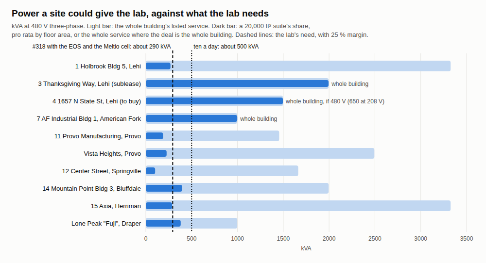

# What the #318 lab needs from a building, added up

Sterling asked on [PR #344](https://github.com/vertical-cloud-lab/byu-vcl/pull/344) (2026-11-17) for totals of the lab
in the latest [PR #318](https://github.com/vertical-cloud-lab/byu-vcl/pull/318): power, water and other liquids, inert
gas, and every other high-level need, floor area and ceiling height included. He then asked what those totals mean for
the sites in this folder.

**The lab** is PR #318 at [`61dbd78`](https://github.com/vertical-cloud-lab/byu-vcl/tree/61dbd78/vertical-lab)
(round 11, 2026-11-14). Every figure comes from #318's own files, linked at that commit, unless it says otherwise.
- #318 labels its figures *published* (read on the maker's page), *snippet* (seen only in a search result) or
  *estimate* (its own), and this page keeps those labels.
- **#318 often has no figure at all.** Where this page fills a gap, or does its own arithmetic, it says *ours*.
- **Nobody was contacted.**

## Short answer

Four versions of the lab, each one building on the one before. The last column of the table is the same as the third, plus PR #332's extra machines.

- **Round 11, as rendered:**
  - two Kardex Shuttle XP 500s holding 15 trays, 12 of them powered;
  - the floor machines;
  - two MiR250 + UR10e units.
- **With the scale-up:** adds round 8's EOS M 400-4 and Meltio robot cell. #318 draws them, captioned "for scaling up".
- **With three each:** adds round 10's plan, never rendered: a third Shuttle and five more instrument trays
  ([`notes/three_each.md`](https://github.com/vertical-cloud-lab/byu-vcl/blob/61dbd78/vertical-lab/notes/three_each.md)).
- **Ten a day:** [PR #332](https://github.com/vertical-cloud-lab/byu-vcl/blob/cc31ddc/vertical-lab/notes/bottleneck.md)'s
  rung R11, on top of the scale-up. That means 3 rePowders, 4 Aconity MIDIs and five floor cells with 7 cobots, among others.

| Need | Round 11, as rendered | + EOS and Meltio cell | + three each | Ten a day (#332) |
|---|---|---|---|---|
| **Electrical, connected** (sum of ratings) | **about 117 kVA** | **about 186 kVA** | about 201 kVA | **about 318 kVA** |
| **Electrical, running** (typical draws, all at once) | about 45 kW | about 76 kW | about 80 kW | about 134 kW |
| **Building total, with cooling, fans, lights, offices** (ours) | about 150 kVA | about 235 kVA | about 250 kVA | about 400 kVA |
| **Service to ask for**, with 25 % margin (ours) | **about 230 A at 480 V** (520 A at 208 V) | **about 350 A at 480 V** | about 380 A at 480 V | **about 600 A at 480 V**; ask for 800 A |
| **400 V for the European machines** | a transformer of about 30 kVA (the rePowder) | about 110 kVA (rePowder, EOS, Meltio) | the same | about 150 kVA |
| **Heat to remove** (ours: the running load) | about 45 kW, 13 tons of cooling | about 76 kW, 22 tons | about 80 kW, 23 tons | about 134 kW, 38 tons |
| **Argon** (ours; #318 gives no consumption) | about 5 m³ a day: one cylinder every two days, so microbulk | about 6-10 m³ a day, plus the EOS's flooding and the Meltio's three 50 L bottles | the same | about 50 m³ a day: bulk, or a 1,500 L microbulk tank refilled every 3-4 weeks |
| **Nitrogen** | a 0.5-1.1 L/min generator for the tray docks; a dewar for a glovebox's first 2.4 m³ purge | the same | the same | the same, more docks |
| **Other gases** | helium for the XRF (one cylinder a year); forming gas for the glovebox purifier (half a 50 L cylinder a year) | the same | the same | about double |
| **Compressed air** (ours) | about 10-15 CFM at 6-7 bar | about 25-30 CFM (the EOS takes 7 bar, 20 m³/h) | the same | about 40-60 CFM |
| **Process cooling water** (ours) | about 25-30 kW, all from packaged chillers beside the machines | about 35-40 kW | the same | about 100 kW: worth a central loop with an outdoor chiller |
| **Water and drains** | an eyewash and safety shower; under 100 L a week of process water (polisher, quench, EDM top-up); no process drain | the same | the same | the same, more |
| **Solvents and liquids on site** | IPA under about 20 L (Form Wash holds most of it), mL-scale electrolytes and HNO₃, pump and hydraulic oils, the EDM's deionised water | the same | the same | more IPA (two sieve-wash modules) |
| **Exhaust** (ours, beyond the hood's 440 CFM) | about 2,000-4,000 CFM, with matching heated make-up air | the same | the same | about 4,000-8,000 CFM |
| **Lab floor** (machines and aisle, #318's own plan) | 2,371 ft² (18.8 × 10.3 m to the aisle's end) | 3,508 ft² (23.3 × 14.0 m) | about 3,900 ft² | about 7,500-9,500 ft² (ours; #332 says the plan has no room yet) |
| **Building, with support rooms** (ours) | **about 13,000 ft²** | **about 14,000-15,000 ft²** | about 15,000 ft² | **about 20,000-25,000 ft²** |
| **Clear height** | **about 16-18 ft**: 3.95 m Shuttles, 18 in under the sprinklers, and the cable tray and gas line #318 draws at 4.15-4.3 m | the same; the EOS needs 3.3 m to install, and the Meltio cell is 3.0-3.16 m | the same | the same, unless the trays go into the 50 ft array (51-53 ft) |
| **Heaviest items** | wire EDM about 2.2-2.4 t, wanting at least 400 mm of concrete; a Shuttle with 15 loaded trays (its own mass not published) | EOS about 4.8-4.9 t; Meltio cell about 4 t | a third Shuttle | the same, more of them |
| **Doors** | a 9 × 10 ft dock door takes the biggest one-piece item (the EDM, 2.12 × 1.97 m) | **a grade-level door about 12 ft tall** for the Meltio cell (3.0 m) and the EOS (up to 2.49 × 2.63 m) | the same | the same |
| **Powder on site** | up to about 80 kg in the 753 jars when full, plus about 164 kg made a year | plus EOS powder "by the 100 kg" | the same | about 8 times the jar traffic |
| **People** | one person on the weekday day shift (31 h a week) | the same | the same | 5-6 FTE, or 2.5-3 with crucible robots |
| **Network** | 26 Raspberry Pi 5 camera units on PoE, 10 Gbit to every dock, about 6 GB of data a day; about 50-100 Mbit/s up for the streams (ours) | the same | more cameras | about 67 GB a day |

**What it means for the sites ([§9](#9-what-the-totals-mean-for-the-sites)):**
- **Power was the wrong filter.** Ten a day needs about 600 A at 480 V, so every building in the list with a stated
  service has two to six times that. What matters is **how much of it the landlord gives our suite**: by floor area, a
  20,000 ft² suite in Holbrook Bldg 5 would get about 320 A. Ask for an allocation of 800 A, plus room for a 400 V
  transformer.
- **Height is not a filter for the lab as #318 draws it.** It needs 16-18 ft, and every candidate has that, so height
  only decides whether the trays can later go into a tall array.
- **Area: about 13,000-15,000 ft² for #318's lab and 20,000-25,000 for ten a day,** less than the README's 20,000-40,000.
  The README is right that 20,000 ft² starts the lab, but 40,000 is only needed for an array or a second line.
- **What does decide between buildings:**
  - a grade-level door for the EOS and the Meltio cell;
  - a slab we may cut, for the EDM's footing;
  - an outside wall for a powder room, since a full jar store passes the code's quantity limits for powder;
  - a pad for an argon tank;
  - zoning.

## 1. What is in the lab

From [`setup_lab.py`](https://github.com/vertical-cloud-lab/byu-vcl/blob/61dbd78/vertical-lab/setup_lab.py) (`FLOOR_PLAN`,
`PASSIVE`) and [`out/tray_plan.json`](https://github.com/vertical-cloud-lab/byu-vcl/blob/61dbd78/vertical-lab/out/tray_plan.json):

- **Two Kardex Shuttle XP 500s**, 3.95 m tall, holding **15 trays**:
  - **12 powered** (A-I, K-M), each with a UPS, a dock plate carrying power, Ethernet, compressed air, N₂ and chilled
    water, and stream cameras;
  - **3 passive since round 11** (J samples, N and O jars): no power, gas or cameras.
- **On the trays:**
  - the OT-2 and CubXL;
  - the multi-doser and vacuum press;
  - the H2D and A1 mini;
  - the SEM and XRD;
  - PIP, iMicro and Mastersizer;
  - polisher, furnace, mount press and quench;
  - two Form 4s, Form Wash and Cure;
  - the PCB line (reflow, stencil, LumenPnP);
  - two SnowPods;
  - the VHX and a tray glovebox;
  - the zwickiLine and HM-220;
  - the S2 PUMA, the Carvera and a ductless hood.
- **On the floor:**
  - the AMAZEMET rePowder and its chiller, and a sieving cell;
  - the Aconity MIDI;
  - the Inert PureLab HE glovebox;
  - the Instron 68FM-100 with a hot chamber, and a 68SC-2;
  - the InssTek MX-Lab DED;
  - the FANUC wire EDM;
  - a ducted fume hood;
  - a packaging bench;
  - two MiR chargers.
  - **The plant** (the N₂ generator, an air compressor and a ThermoFlex 900 chiller) stands in the 800 mm gap between
    the Shuttles.
  - **Argon** comes from a manifold of four cylinders, piped overhead to the glovebox, the rePowder, the Aconity and the
    DED. #318 calls this a "layout choice, not a design".
- **For scaling up** (round 8): the EOS M 400-4 and the Meltio robot cell, south of the rows.
- **Not in the latest #318:**
  - **The 50 ft array** (eight 15.15 m Shuttles): "not started", on an earlier side branch only. This folder's
    [height section](README.md#height) is about that array.
  - **The rail**, which was dropped for the mobile manipulators.

## 2. Electricity

Connected load is the sum of ratings. Running load uses typical draws where #318 or the maker gives them, and is
*ours* elsewhere. Neither is a diversified demand: an electrical engineer would size the service with code demand
factors.

| Item | Connected, kVA | Running, kW | Basis |
|---|---|---|---|
| Two Kardex Shuttle XP 500s | 17.2 | 2 | at most 8.6 kVA each (Kardex, [README](README.md#codes-that-decide-the-building)); 208 V three-phase ([`out/cabling.json`](https://github.com/vertical-cloud-lab/byu-vcl/blob/61dbd78/vertical-lab/out/cabling.json)). Running: the lifts move now and then (*ours*) |
| Trays A-F | 7.0 | 2.3 | #318's own sum ([`out/services.json`](https://github.com/vertical-cloud-lab/byu-vcl/blob/61dbd78/vertical-lab/out/services.json)): 7,015 W with everything on at its rating, 2,277 W with tray C printing and the furnace holding. Tray F alone is 3.65 kW, over its UPS |
| Trays G-M | 7.0 | 3 | #318 has ratings for 2.7 kW of it (the 1.5 kW reflow oven, the VHX's 430 VA, the tubes, lasers and spindles, the Pis). It never adds trays G-M up, and has no ratings for the Form 4s, Form Wash and Cure, SnowPods, LumenPnP, stencil printer, zwickiLine, HM-220, Carvera, tray glovebox or hood: 4 kW for those (*ours*) |
| AMAZEMET rePowder and its chiller | 29.5 | 12 | two 32 A plugs, 400 V three-phase and 230 V ([install call](../rePowder-BYU-Installation-Details.txt)); a 10 kW, 7 kHz coil ([`notes/alloy_atomize.md`](https://github.com/vertical-cloud-lab/byu-vcl/blob/61dbd78/vertical-lab/notes/alloy_atomize.md)) |
| Aconity MIDI and its chiller | 17.5 | 8 | "208 V 3-phase 32 A (US option)", 11.5 kVA, and "a ~15 kW chiller" ([`lab_models/equipment.py`](https://github.com/vertical-cloud-lab/byu-vcl/blob/61dbd78/vertical-lab/lab_models/equipment.py), no source); the chiller's input is not found, 6 kVA here (*ours*) |
| InssTek MX-Lab DED | 4.4 | 1 | 220 V, 15 (20) A; its base cabinet is not found |
| FANUC α-C400iC wire EDM | 13 | 6 | 13 kVA, 200 V three-phase (snippet); running *ours* |
| Instron 68FM-100 and its hot chamber | 7.2 | 3 | 4,200 VA three-phase for the frame ([Instron](https://www.instron.com/en/products/universal-testing-systems/6800-series/floor-models/), snippet); the 3119-608 chamber is not found, 3 kVA here (*ours*) |
| Instron 68SC-2 | 1.4 | 0.5 | 1,400 VA maximum (snippet) |
| Inert PureLab HE glovebox | 2 | 1 | not found (*ours*) |
| Two MiR chargers | 3.8 | 2 | 1.9 kW each (snippet). The UR10es run off the MiRs |
| N₂ generator, air compressor, ThermoFlex 900 | 5.5 | 3 | none rated in #318: 0.3, 3.7 and 1.5 kVA (*ours*) |
| Hood, sieve cell, packaging, network, lift table | 1.5 | 1 | *ours* |
| **Round 11, as rendered** | **117** | **45** | 91 kVA of it has a rating in #318 |
| EOS M 400-4 | 45 | 22 | 3 × 50 A, 45 kW maximum, 22 kW typical ([`notes/scaleup.md`](https://github.com/vertical-cloud-lab/byu-vcl/blob/61dbd78/vertical-lab/notes/scaleup.md)) |
| Meltio robot cell | 20 | 7 | 400 V three-phase, 20 kW peak, 7 kW average |
| A bigger compressor for the EOS | 4 | 2 | *ours* |
| **+ EOS and Meltio cell** | **186** | **76** | |
| Shuttle 3, five trays, a roof fan, a third MiR charger | 15.3 | 4 | `three_each.md` option 1: 4,330 W of trays |
| **+ three each** | **201** | **80** | |
| Two more rePowders, three more MIDIs | 111.5 | 48 | as above |
| Seven cobots in five floor cells | 4.3 | 2.5 | 615 W maximum, 350 W typical each (UR10e) |
| A second furnace, CubXL, sieve-wash and hot frame, a third MiR unit | 12.2 | 6 | as above |
| A bigger compressor | 4 | 2 | *ours* |
| **Ten a day, on top of the scale-up** | **318** | **134** | not counting a bar-fed lathe for #332's 67 charge cups a day |

**The building adds its own loads** (*ours*):
- **Cooling for the running load:** at about 1.3 kW a ton, 17-50 kW.
- **Exhaust and make-up air fans:** 5-10 kW.
- **Lighting:** about 0.6 W/ft², 9-15 kW.
- **Offices and IT:** 5-10 kW.

That makes about 150, 235, 250 and 400 kVA for the four versions. With 25 % margin for the gaps and the continuous-load
rule, that is **about 230, 350, 380 and 600 A at 480 V**.

**This replaces the README's "2,000-3,000 A at 480Y/277 V for ten a day".** That was a top-down guess of 0.8-1.5 MW of
process load, about four times what the machines add up to. Even if every *ours* placeholder above were doubled, ten a
day would stay under 1,000 A.

**Voltages.**
- **400 V, from a 480-400 V transformer:**
  - the rePowder (PR #331's `lab_answers.md`: "the atomizer's 400 V needs a transformer");
  - the EOS;
  - the Meltio cell.
  - That is about 30 kVA for round 11 alone, about 110 kVA with the EOS and the Meltio cell, and about 150 kVA for ten a day.
- **208 V three-phase:**
  - the Shuttles;
  - the Aconity's US option;
  - the EDM;
  - the Instrons;
  - the tray docks, at 208Y/120 V with a 30 A breaker and 5 kVA continuous each.
- **#318 notes** the EDM "needs a three-phase panel of its own".

**Standby power** (*ours*):
- **Each powered tray has its own UPS:** an Eaton 5PX1500, about 1,350 W.
- **A building generator of about 30-60 kW** would cover:
  - the exhaust of a hazardous-materials room, which code requires on standby;
  - the oxygen and gas alarms;
  - the network;
  - parking the robots safely.
  - That is well under the "tens to a few hundred kW" in [`utilities.md`](utilities.md).

## 3. Gases

**#318 gives no gas consumption anywhere: no volume per run, per day or per year, and no choice between cylinders
and bulk.** The argon below is *ours*, from per-run figures:

| User | What #318 or the maker says | Argon a day (*ours*) |
|---|---|---|
| rePowder | 5N, up to 8 bar ([install call](../rePowder-BYU-Installation-Details.txt)). Each run: three cycles of pumping to 0.4 mbar and back-filling with argon, then a pour under 200 mbar of argon over-pressure. About 10 L/min while atomizing ([AMAZEMET](https://amazemet.com/repowder/)). 667 runs a year are modelled | about 1 m³ a run, so about 2 m³ a day |
| Aconity MIDI | argon at 6 bar (`equipment.py`). The MIDI+ uses under 5 L/min while printing and under 30 L/min while purging ([ÖAW ESI](https://www.oeaw.ac.at/esi/facilities/material-synthesis-and-processing/laser-powder-bed-fusion-lpbf), snippet). #318 models 309 screening builds of 5 h and 30 full builds of 8 h a year | about 2.2 m³ a build, so about 2 m³ a day |
| MX-Lab DED | 5N argon, and a powder carrier gas | about 1 m³ a day at an hour of printing |
| Inert glovebox | on the argon manifold; its purifier is regenerated with forming gas | about 0.3 m³ a day |
| **Round 11** | | **about 5 m³ a day**, roughly 15-20 cylinders a month. Air Products suggests microbulk above 10 a month ([`utilities.md`](utilities.md#how-a-supplier-tank-works)) |
| EOS M 400-4 | inert gas at 7 bar and 15-20 m³/h while flooding the chamber (EOS's data sheets disagree on 15 or 20, and one labels it compressed air); use per build not published | add the EOS's flooding |
| Meltio cell | three 50 L argon bottles on the cell | its own bottles |
| **Ten a day** | 16.8 rePowder runs a day and four MIDIs about 80 % busy (#332) | **about 50 m³ a day**: a 1,500 L microbulk tank (about 1,250 m³ of gas) lasts 3-4 weeks; bulk is the other choice |

**Other gases.**
- **Nitrogen:** a Parker Balston UHPN2-1100 generator gives 0.5-1.1 L/min at 99.9999 % to every powered dock. It
  needs 60-125 psig air and has no compressor of its own.
  - **Its only modelled user** is tray K's purge-only glovebox. Its first purge needs about 2.4 m³, which would take
    the generator 36 h or more, so #318 says it needs a dewar or a bigger generator.
  - **The SnowPods make their own N₂.**
  - **No fire-protection nitrogen** is in #318; it would come only with a tall array.
- **Helium:** the S2 PUMA XRF runs loose powder in helium mode, from a cylinder on its tray swapped every 120 h of use,
  about once a year.
- **Forming gas (5 % H₂):** regenerates the PureLab's purifier for up to 12 h every 120 days. One 50 L cylinder covers
  5-6 regenerations, so about half a cylinder a year.
- **No oxygen, CO₂ or fuel gases.**

**Compressed air.**
- **Each dock carries 6 mm air at up to 15 bar.**
- **Users with figures:**
  - the EOS: 7 bar, 20 m³/h;
  - the Aconity: 6 bar;
  - the N₂ generator: 60-125 psig;
  - the Mastersizer: 0-4 bar;
  - the rePowder's optimizer, on 6 mm push-fit;
  - the vacuum press's ejector.
- **Users with no figure:**
  - the polisher;
  - the sieve tipper and its knocker;
  - the quench basket's cylinder;
  - the Carvera's vise;
  - the air knives.
- **#318 doesn't size the compressor** ("our size") and doesn't say whether the air is house air or its own.
- **Estimate (*ours*):**
  - about 10-15 CFM for round 11 and 25-30 CFM with the EOS: a 7.5-10 hp rotary screw with a dryer;
  - about 40-60 CFM for ten a day.

## 4. Water and other liquids

- **Process cooling water.**
  - **In #318,** each machine brings its own packaged chiller and puts its heat into the room:
    - the rePowder's chiller and heat exchanger (a 1 in facility connection);
    - the Aconity's "~15 kW chiller";
    - the ThermoFlex 900 by the Shuttles: 900 W of cooling, 15.1 L/min, piped through the docks;
    - the Meltio's water-cooled head and plate;
    - the DED's laser cooling.
  - **The dock water's only user is the XRD's tube.** It runs through two Stäubli inserts at up to 8.5 L/min.
  - **Rough heat to water (*ours*):**
    - about 25-30 kW for round 11;
    - 35-40 kW with the EOS and the Meltio cell;
    - about 100 kW for ten a day, three rePowders and four MIDIs being most of it. At that size a central loop with an
      outdoor chiller or dry cooler keeps the heat out of the room.
- **Water in.**
  - **Little process water:**
    - weekly tank swaps for the polisher, because "the coupling has no drain or process water";
    - a 7.5 L quench tank;
    - deionised water for the EDM (its tank volume isn't given; the resin is changed every 200 h);
    - DI water and 20 mL electrolyte stocks for the corrosion work.
  - **Under 100 L a week (*ours*).**
  - **The real water need is a plumbed eyewash and safety shower,** tested weekly in #318's upkeep model, plus
    restrooms.
- **Drains.**
  - **No process drain:** the polisher's waste goes to a tank.
  - **Polishing slurry** wants a settling tank.
  - **No powder goes down a drain,** because fine aluminium in water makes hydrogen. The sieves are washed in IPA,
    kept as hazardous waste.
- **Liquids on site.**
  - **IPA:**
    - a few hundred mL for the sieve wash, in a closed vessel under extraction, changed weekly;
    - a 65 mL jar for the EDM rinse;
    - "several litres" in the Form Wash.
  - **Altogether under about 20 L (*ours*),** far under the code's 120 gal per control area.
  - **Resin** for the Form 4s.
  - **Weck's reagent,** in 100 mL batches.
  - **Electrolytes:** 1 M and 2 % HNO₃, and artificial seawater, all in mL.
  - **Oils:** pump and hydraulic.
  - **No HF:** ICP-MS goes out to campus.
- **Vacuum:** every pump is local:
  - the rePowder's;
  - the vacuum press's;
  - the SEM's;
  - the gloveboxes' antechambers;
  - the Aconity's depowdering lance;
  - the Mastersizer's extractor.
  - There is no central vacuum.

## 5. Heat, cooling and exhaust

- **Heat into the room** is about the running load, 45-134 kW (13-38 tons), since #318's chillers sit indoors (*ours*).
  - **A warehouse shell is heated but rarely cooled,** so the cooling is fit-out.
  - **On a roof, the units need a deck that can carry them.**
- **Inside a Shuttle:**
  - **Trays A-F at their ratings give 7.0 kW.** Unventilated that is a 23 K rise; holding it to 5 K takes 4,200 m³/h.
  - **#318 recommends 700-1,400 m³/h of forced ventilation.**
  - **Shuttle 2's trays (G-M) have no heat budget,** though they hold two Form 4s, two SnowPods and a 1.5 kW reflow oven.
  - **Two questions for Kardex:**
    - how much heat a tray may give off;
    - whether a 650 °C furnace may run inside.
- **Exhaust:**
  - the Labconco 4 ft hood: 440 CFM;
  - the sieving cell's downdraft enclosure and the wash module's hood;
  - spraying the crucibles with boron nitride, "under extraction";
  - the DED's exhaust;
  - the Shuttles' ventilation, if ducted out.
  - **#318 gives a flow only for the hood.** About 2,000-4,000 CFM in all for round 11, and 4,000-8,000 for ten a day
    (*ours*), each with matching make-up air, heated by gas in winter.
- **Humidity and cleanliness:**
  - powder kept at about 25 % RH in a dehumidified room;
  - the atomizer's enclosure with its own dehumidifier and ducting, as in CB 154.
- **Vibration:**
  - the SEM and the nanoindenter are vibration-sensitive, and the extractor moves trays past them;
  - FANUC wants 2 µm or less at 10-20 Hz under the EDM.
  - **No other room criterion is given.**

## 6. Floor area

From the plan rectangles `setup_lab.py fit` checks (`out/tray_plan.json`), and the support rooms this folder's
[`footprint.py`](footprint.py) draws (an illustrative allocation, not a design):

| | ft² | Source |
|---|---|---|
| Machine footprints, round 11 (12 items and 2 chargers) | 403 | `out/tray_plan.json` |
| Machine footprints with the EOS and the Meltio cell | 642 | the same |
| The two rows, 18.8 × 10.3 m | 2,093 | the same |
| To the west end of the taped aisle | 2,371 | the same |
| With the EOS and the Meltio cell, 23.3 × 14.0 m | 3,508 | the same; the EOS asks for at least 6.5 × 6.0 m (420 ft²) to install, or 7.5 × 6.0 m (484 ft²) on EOS's US page |
| Three each: a third Shuttle where the Aconity stands, the row 3.6 m longer | about +400 | *ours* from `three_each.md`, which assumes the space exists and was never fit-checked |
| #318's warehouse version, 30 × 21 m | 6,781 | `warehouse.py` |
| Support rooms: mechanical and electrical 1,836; powder room 1,763; offices, control room and gallery 1,980; workshop 1,320; receiving and staging 2,200 | 9,099 | [`footprint.py`](footprint.py) |

So:
- **Round 11:** about **13,000 ft²** (2,371 + 9,099 + about 10 % circulation).
- **With the EOS and the Meltio cell:** about **14,000-15,000 ft²**.
- **Ten a day:** about **20,000-25,000 ft²**. #332 says the plan has no room for three rePowders, four MIDIs and five
  floor cells. Those add about 4,000-6,000 ft² of floor with their aisles, plus a bigger powder room and receiving
  area (*ours*).
- **The aisle rules that set the floor:**
  - a 3.0 m aisle (MiR's figure for two MiR250s passing);
  - a 1,450 mm MiR corridor, a 1,800 mm pivot, and turns only at gaps between machines;
  - 864 mm of clear floor in front of a Shuttle to pull a tray out;
  - the chargers' 550 mm to each side and 2.8 m in front.

## 7. Ceiling height

- **#318 never states a ceiling height.** It draws:
  - the Shuttles at 3.95 m, Kardex's tallest step under #53's 13 ft;
  - the north cable tray at 4.3 m, over the Shuttles' roofs;
  - the argon and dock-supply lines at 4.15 m;
  - hangers up to 6.0 m;
  - the hood's duct "to the roof" at 6.2 m.
- **The tallest floor machines:**
  - the Meltio cell, 3.0 m published and 3.16 m as modelled;
  - the hood, 2.58 m with its collar;
  - the EOS, 2.36-2.63 m, needing at least 3.3 m to install;
  - the Aconity, 2.32 m;
  - the 68FM-100, 2.29 m.
- **So the lab as drawn needs about 16-18 ft clear (*ours*):**
  - the Shuttles' 3.95 m;
  - NFPA 13's 18 in (0.46 m) under the sprinkler deflectors, if the fire marshal treats a Shuttle as storage: 4.41 m (14.5 ft);
  - the cable tray, gas lines and ducts over the Shuttles.
  - 20 ft is comfortable.
- **Two things could change this:**
  - **The 50 ft array** needs 51-53 ft, but it isn't in the latest #318.
  - **Kardex's order sheet** in #318 carries a part number ending "…2450x864x6750", which #318 doesn't explain. If
    6,750 is a height, the unit on the sheet is 6.75 m. Ask Kardex (draft 2).
- **No crane or hoist is specified anywhere.** The UR10e needs two people or a small hoist, the 400 kg propeller of
  the scale-up a forklift or crane, and Kardex offers a factory crane and tray extraction as options.

## 8. Floor, weight, doors and logistics

- **Heaviest items:**
  - **EOS:** about 4.8-4.9 t on 4.2 × 1.6 m, about 720 kg/m² (147 psf) on average.
  - **Meltio cell:** about 4 t.
  - **Wire EDM:** about 2.2-2.4 t. FANUC wants at least 400 mm of concrete, so in a 6-7 in warehouse slab that means a
    cut-in footing.
  - **Aconity:** 1.45 t.
  - **68FM-100:** 0.8 t on 1.6 × 1.1 m, about 890 kg/m² (183 psf).
  - **Each MiR250 + UR10e unit:** about 300 kg with its ballast.
- **A Shuttle's own mass is not in #318.**
  - Its 15 trays are rated 228-500 kg each.
  - The known tray loads are at most 181 kg (tray M), about 0.9 t in all.
  - With every tray at the 500 kg maximum, the goods alone are 3.5-4.0 t a Shuttle, 410-470 kg/m² over its 8.55 m²
    (*ours*).
  - Ask Kardex for the unit's own mass (draft 2).
- **Slab, anchoring and seismic:** nothing in #318. The Shuttle stands on levelling feet, and MiR asks for a floor
  friction of μ 0.6-0.8.
- **Doors** (*ours*; #318 gives none):
  - **The Shuttles** are assembled in place, and the floor machines come in on pallet jacks and skates.
  - **The biggest one-piece items:**
    - the Meltio cell, 4.05 × 2.35 × 3.0 m;
    - the EOS, 4.18 × 1.61 × 2.36 m, or 5.14 × 2.49 × 2.63 m on EOS's US page;
    - the EDM, 2.12 × 1.97 m.
  - **A 9 × 10 ft dock door** takes the EDM.
  - **The Meltio cell and the EOS want a grade-level door about 12 ft tall.** The 14 × 16 ft doors at Holbrook Bldg 5
    and Mountain Point Bldg 3 are ample.
- **Tray loading:** a scissor lift table (2,440 × 915 mm, 1,000 kg, both assumed) at each Shuttle's opening.
- **The MiRs:** 12 docks and 2 chargers.
- **The EOS and the Meltio cell have no MiR dock.** Their materials come by forklift, powder in 100 kg containers.

## 9. What the totals mean for the sites

### Power

Each listed service converted to kVA at 480 V, and shared out by floor area. Shares by area are a way to frame the
question, not how landlords allocate, but a multi-tenant building's 4,000 A is for all its tenants.

| # | Site | Clear | Listed service | That is | A 20,000 ft² suite's share | The space offered, and its share |
|---|---|---|---|---|---|---|
| 1 | Holbrook Bldg 5, Lehi | 32 ft | 4,000 A, 480 V | 3,330 kVA | 270 kVA (320 A) | 31,000-46,368 ft²: up to 620 kVA (750 A) |
| 3 | 4425 N Thanksgiving Way, Lehi (sublease) | 26-33 ft | 2,400 A, 480 V | 2,000 kVA | 500 kVA (600 A) | the whole 75,300-80,098 ft²: all of it |
| 4 | 1657 N State St, Lehi (for sale) | 17-18 ft | 1,800 A, three-phase, voltage not given | 1,500 kVA at 480 V; 650 kVA at 208 V | | the whole building: all of it |
| 7 | American Fork Industrial Bldg 1 | 32 ft | 1,200 A, 480 V | 1,000 kVA | 600 kVA (730 A) | the whole 33,020 ft²: all of it |
| 11 | Provo Manufacturing Facility | 15-25 ft | 1,750 A, 480 V | 1,460 kVA | 190 kVA (230 A) | 25,000 ft²: 230 kVA (280 A) |
| | Vista Heights, Provo | 30 ft | 3,000 A | 2,490 kVA at 480 V | 230 kVA (270 A) | 43,974 ft²: 500 kVA (600 A) |
| 12 | Center Street Industrial, Springville | 36 ft | 2,000 A, 480 V | 1,660 kVA | 100 kVA (120 A) | 81,796 ft²: 420 kVA (500 A); build-to-suit, so it can be specified |
| 14 | Mountain Point Bldg 3, Bluffdale | 36 ft | 2,400 A, 480 V | 2,000 kVA | 400 kVA (480 A) | 27,081 ft²: 540 kVA (650 A) |
| 15 | Axia, Herriman | 36 ft | 4,000 A, 480 V | 3,330 kVA | 290 kVA (350 A) | 49,942 ft²: 720 kVA (860 A) |
| | Lone Peak "Fuji", Draper | 28 ft | 1,200 A, 480 V | 1,000 kVA | 380 kVA (460 A) | |

- **Every building with a stated service has enough for ten a day** (about 500 kVA with margin), so power stops
  being the filter.
- **A suite's share is the catch.** By floor area, a 20,000 ft² suite gets:
  - 270 kVA in Holbrook Bldg 5;
  - 190-230 kVA in the Provo buildings;
  - 100 kVA in Center Street.
  - Holbrook's and the Provo buildings' shares about cover round 11 (about 190 kVA with margin), but not the EOS and
    the Meltio cell (about 290 kVA), and fall well short of ten a day. Center Street's doesn't cover even round 11.
- **Whole-building deals avoid the question:**
  - 1657 N State St, if its 1,800 A is at 480 V;
  - American Fork Industrial Bldg 1;
  - the Thanksgiving Way sublease.
- **For everyone else, ask the landlord for an allocation of about 800 A at 480 V,** and for room for a 150 kVA
  480-400 V transformer.
- **Unstated services:**
  - **Millplace Park** (10,753 ft², "three-phase") needs at least about 520 A at 208 V for round 11. Ask.
  - **Lewis Landing,** **Holbrook Bldg 2**, **Catalyst** and **310 N Geneva Rd** don't state amps.

### Height

The lab as drawn needs about 16-18 ft. Every candidate has that:
- **Most have 24-36 ft.**
- **1657 N State St (17-18 ft)** is the tightest, workable if the cable trays and ducts go between the Shuttles rather
  than over them.
- **Provo Manufacturing** has 25 ft only in part of the building.

So height decides only whether the trays could one day go vertical: the 50 ft array, or 13-15 shorter units in a
32-36 ft building ([height table](README.md#height)). It no longer rules anything out for the lab #318 shows.

### Area

| Version | Building | Sites that hold it in the space offered |
|---|---|---|
| Round 11 | about 13,000 ft² | all but Millplace (10,753 ft², which takes the lab floor and most of the support rooms, not all) |
| + EOS and Meltio cell | about 14,000-15,000 ft² | the same |
| Ten a day | about 20,000-25,000 ft² | Holbrook Bldg 5 (from about 31,000) and Bldg 2 (29,724), Thanksgiving Way, 1657 N State St, AF Industrial 1, Mountain Point 3 (up to 27,081), Axia, 310 N Geneva Rd, Catalyst, Provo Manufacturing, Center Street |

### What decides between them

1. **A grade-level door about 12 ft tall for the EOS and the Meltio cell.**
   - **Have one:**
     - Holbrook Bldg 5 (eight, 14 × 16 ft) and Mountain Point 3 (14 × 16 ft);
     - Millplace (14 × 14 ft);
     - Thanksgiving Way, AF Industrial 1, 310 N Geneva Rd, Provo Manufacturing and Center Street (sizes not given);
     - Axia's drive-ins.
   - **1657 N State St lists dock-high doors only.** As the owner we could cut one.
2. **A slab we may cut,** for the EDM's 400 mm footing and the trenches.
   - **New tilt-ups list 6-7 in:** 310 N Geneva Rd, Axia, Center Street.
   - **Ownership (1657 N State St) settles it.**
3. **An outside wall for a powder room.**
   - **The quantity:** when full, the 753 jars hold about 80 kg (#318 allows up to 500 g in a 500 mL jar). The lab
     makes about 164 kg a year, and the EOS buys powder "by the 100 kg".
   - **The limit:** that is past the code's 125 lb (57 kg) per control area for flammable solids, or 50 lb if the powder
     tests as water-reactive Class 2 ([README](README.md#codes-that-decide-the-building)).
   - **So:** sprinklers and approved cabinets, which double the limit twice, or an H-2/H-3 room on an outside wall.
   - **Best placed for that:** an end unit or a whole building. That means 1657 N State St, AF Industrial 1, the
     Thanksgiving Way sublease, or an end bay at Holbrook, Mountain Point or Axia.
4. **A pad for argon.**
   - **Round 11:** microbulk, a 7 × 7 ft pad for 1,500 L.
   - **Ten a day:** the same tank refilled every 3-4 weeks, or bulk.
   - **Under about 3,240 L of liquid argon** stays out of Tier II reporting ([`zoning-and-safety.md`](zoning-and-safety.md)).
   - **Yards:** Provo Manufacturing has one, and 1657 N State St and Fluke Industrial have land. In a multi-tenant park
     the pad goes in the truck court, with the landlord's consent.
5. **Cooling and exhaust on the roof or the ground.**
   - **Cooling:** 13-38 tons. It goes on the roof or the ground.
   - **Exhaust:** 2,000-8,000 CFM, with matching make-up air units.
   - **The roof:** a steel roof deck that can carry them, or ground space beside the building.
6. **Upload bandwidth.** The 26 stream cameras want about 50-100 Mbit/s up, all the time. Lehi Fiber (city-owned, open
   access) and Provo's Google Fiber are the easy cases ([`utilities.md`](utilities.md#2-who-supplies-the-outside-utilities-by-city)).
7. **Zoning,** as before: R&D permitted outright in Lehi's LI, BP and T-M zones, Holbrook's flex zone, and Provo's
   R&BP and Lindon's LI ([`zoning-and-safety.md`](zoning-and-safety.md#city-by-city)).

### So, Lehi first

- **Holbrook Industrial Park Bldg 5** stays first, if the landlord allocates about 800 A to the suite:
  - a 14 × 16 ft grade-level door;
  - 32 ft clear;
  - PC-FLEX zoning that names labs and R&D;
  - 31,000-46,000 ft², room for ten a day;
  - an end bay would also take a powder room.
- **1657 N State St** moves up:
  - **For it:** height no longer counts against it, and ownership settles the slab, the door and a powder room on an
    outside wall. Its 1,800 A covers ten a day if it is at 480 V; even at 208 V (650 kVA) it covers ten a day with
    little to spare.
  - **Against it:** it lists only dock-high doors, and a tenant is in place.
- **Millplace Park** is more than a pilot cell:
  - **What fits:** its 10,753 ft² holds the round-11 lab floor (2,371 ft²), the powder room and the mechanical room,
    with about 4,800 ft² left for offices and receiving.
  - **What doesn't:** the EOS and the Meltio cell.
  - **To ask:** its power.
- **Thanksgiving Way** has power to spare (2,400 A) but is a sublease of a whole 75,000-80,000 ft² building, far more
  than the lab needs.

## 10. Gaps worth filling, and who to ask

| Gap | Who | Where |
|---|---|---|
| A Shuttle's own mass and floor load; the "6750" on the order sheet; heat allowed per tray; a 650 °C furnace inside | Kardex | draft 2 |
| The Aconity MIDI's supply and its chiller's input; argon per build | Aconity | |
| The rePowder's real draw (the install call's "about 60 A" sits beside "one 32 A plug is easily enough for both") and its argon per run | AMAZEMET | |
| The EOS's argon per build, and whether its 20 m³/h at 7 bar is inert gas or compressed air | EOS | |
| The glovebox's, the ThermoFlex's, the N₂ generator's and the 3119-608 chamber's electrical input | the makers | |
| The amps allocated to a suite, the transformer's size, room for a 400 V transformer | the landlord or broker | drafts 1, 11 |
| Argon at about 5, then 50 m³ a day: cylinders, microbulk or bulk | a gas supplier | draft 6 |

**Two things #318 doesn't cover that a building would:**
- **No oxygen-depletion monitoring** for its argon and nitrogen. #318 mentions room O₂ sensors only for the hot isostatic
  press it rejected.
- **No registration of the X-ray instruments** (the MiniFlex XRD and the S2 PUMA XRF). Utah registers X-ray machines
  through DEQ's Division of Waste Management and Radiation Control. Whether benchtop analytical units need it was not
  checked here.

## How the totals were made, and their limits

- **Read, not re-run.** Python was blocked in this session, so nothing in #318 was re-run. The figures come from:
  - #318's committed JSON (`out/services.json`, `out/cabling.json`, `out/tray_plan.json`);
  - its notes and code, read with `jq`, `grep` and `awk`.
- **The site figures** come from this folder's [README](README.md#2-candidate-sites).
- **Connected and running loads.**
  - **Connected load** is the sum of the ratings.
  - **Running load** uses typical draws where #318 or the maker gives one, and everything at once.
  - **A real service** is sized from connected load with code demand factors, by an electrical engineer.
- **Where #318 has no figure,** this page uses a stated placeholder (*ours*), so the gap stays visible. That covers
  the Aconity's chiller, the hot chamber, the glovebox, the compressor, trays G-M's unrated items and others: about
  22 of round 11's 117 kVA. Another 4.2 kVA, the Instron frame, comes from Instron's page rather than #318.
- **The building's own loads** (cooling, fans, lighting, offices) aren't in #318. They are added here from rules of
  thumb, *ours*.
- **The argon figures are *ours*,** from per-run and per-build figures. #318 has no consumption figures.
- **Sources for the maker figures found this session:** the Instron 68FM-100's 4,200 VA, and the Aconity MIDI+'s argon
  use. Both came from search snippets; the pages returned HTTP 403.
- **Files:**
  - [`needs/loads.tsv`](needs/loads.tsv) is the load table behind §2, one row per item and version;
  - [`needs/site_power.tsv`](needs/site_power.tsv) and [`needs/power_svg.awk`](needs/power_svg.awk) draw the chart.
  - To redraw it:
    `awk -v n1=294 -v l1="..." -v n2=500 -v l2="..." -v xmax=3500 -f needs/power_svg.awk needs/site_power.tsv > out/needs_power.svg`,
    then `google-chrome --headless=new --hide-scrollbars --window-size=1000,542 --screenshot=out/needs_power.png file://$PWD/out/needs_power.svg`.
