# Specific sites, Lehi first, with maps and pictures

*If we were to build a facility like the [#303](https://github.com/vertical-cloud-lab/byu-vcl/issues/303)
visualizations*, these are the specific buildings to look at first, with Lehi in front as Sterling asked on
[PR #344](https://github.com/vertical-cloud-lab/byu-vcl/pull/344). Requirements, the full site table and costs are in
[`README.md`](README.md); utilities in [`utilities.md`](utilities.md); zoning and safety in
[`zoning-and-safety.md`](zoning-and-safety.md). **Nobody was contacted.** Listings were read on 2026-11-12 and
2026-11-13 and change weekly.

## What #343 holds so far

- **The ask (Sterling, 2026-11-12).** If we built a facility like the #303 visualizations
  ([PR #318](https://github.com/vertical-cloud-lab/byu-vcl/pull/318)), where could it go? Requirements, candidate
  sites near BYU (Lehi first), renovate or build, comparables, and a figure. Draft emails rather than contacting
  anyone. Gage adds sites, contacts and numbers on the issue.
- **First pass: PR #344.** [`README.md`](README.md) has the requirements, 23 leases, 2 sales and land, renovate or
  build ($124-440/ft² of fit-out and 6-20 months, against $370-854/ft² and 2-3 years to build), comparables (Radical
  AI's new lab is 45,000 ft², not 40,000), contacts, and the footprint figure. Seven draft emails are in
  [`drafts.md`](drafts.md).
- **Gage: which utilities can we hook into?** Answered on branch `claude/issue-343-20261112-2223`, now merged here as
  [`utilities.md`](utilities.md). Only power, natural gas, water, sewer and telecom come from outside. We would build
  argon, nitrogen, chilled water, compressed air, exhaust and standby power ourselves. **No R&D zone in Utah has argon
  on tap.** It comes as liquid by truck into a tank the supplier rents us. Drafts 8 and 9.
- **Gage: his contact at Newmark Mountain West says 36 ft clear is usually the most these buildings have.** That
  matches what the listings show.
- **Gage: zoning, safety rules, safety systems, and what else to look for.** Answered on branch
  `claude/issue-343-20261112-2241`, now merged here as [`zoning-and-safety.md`](zoning-and-safety.md). R&D is
  permitted outright in Lehi's LI, BP and T-M zones and Holbrook's flex zone, in Provo's R&BP, and in Lindon's LI and
  R&B. The city fire code does most of the work, with UOSH, DEQ and the pressure-vessel inspectors adding the rest.
  The doc has a ten-point checklist for a 20,000 ft², 36 ft building. Drafts 10 and 11.
- **Sterling: continue in PR #344.** Both branches were fast-forwarded into it on 2026-11-13, so this PR now holds
  everything above.

## Height is a variable, not a cut-off

Fifty feet is what the drawn array (eight 15.15 m Shuttles) would need, not a requirement for the building. The same
352 powered trays fit under any common clear height, in more, shorter units. The rows below come from the
[height table](README.md#height), which uses `scale.py`'s slot rule with 18 in kept under the sprinklers. The 18 ft
row is the Spring Heights entry in the [site table](README.md#lease-the-short-term-path-lehi-first).

| Clear height | Units for 352 trays | Lehi sites with that height |
|---|---|---|
| 18 ft | about 32 × 5.0 m | 4 (1657 N State St, 17-18 ft) |
| 24 ft | 21 × 6.8 m | 5 (Millplace Park) |
| 26-33 ft | 15-21 units | 3 (Thanksgiving Way) |
| 32 ft | 15 × 9.2 m | 1 and 2 (Holbrook, Lewis Landing) |
| 36 ft | 13 × 10.5 m | none in Lehi; Springville, Bluffdale, Herriman |
| about 51 ft | 8 × 15.15 m (as drawn) | none; a pit or a purpose-built high bay |

So height trades against the number of units: every step down adds units, extractors to maintain and rail length,
not a hard stop. A 32 ft Lehi building needs 15 units instead of 8. Whether that beats a pit or a high bay depends on
Kardex's price per unit and upkeep, which draft 2 asks for. The lab floor's own two Shuttles are 3.95 m and fit
anywhere.

## Where the sites are

Salt Lake City to Provo. The red box is the Lehi map below; blue numbers are the other shortlisted sites.

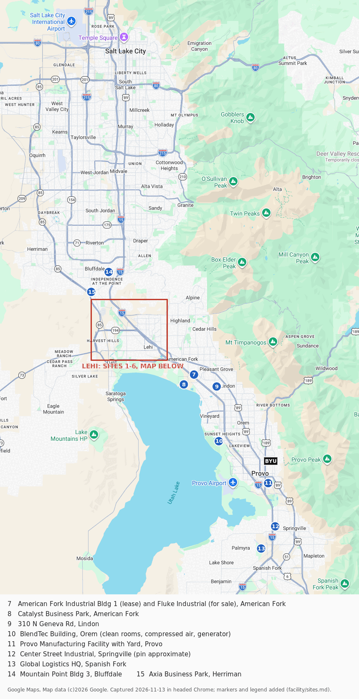

Lehi:

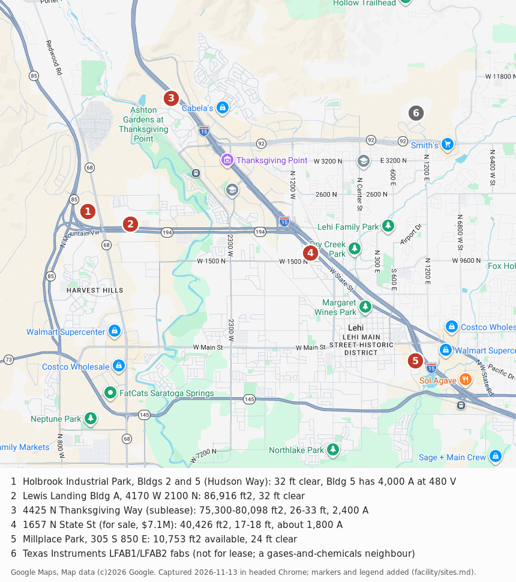

Coordinates are in [`out/sites/sites.tsv`](out/sites/sites.tsv). Site 12's pin is approximate: Google's geocode for
its address landed outside Springville, so the pin uses the street's position instead.

## The Lehi sites

Every picture below was captured from Google Maps in headed Chrome, and each one has its source and date printed on
it.
- **Aerial views** are Google's satellite imagery. **The imagery predates some of these buildings**: Holbrook Bldg 5
  shows as a construction pad, and Lewis Landing's lot is still empty.
- **Street-level views** are Google Street View, or a contributor's 360° photo where Google had none.
- **Interiors:**
  - **No listing gallery was used,** because Crexi and LoopNet block the runner.
  - **The interiors come from Google Maps photos posted by the businesses that rent in these buildings.** They show
    what the shell is like inside: height, joists, columns and lighting.
  - **They are other people's photos, credited on each image.** Say if you'd rather link to them than host them in
    this public repo.

### 1. Holbrook Industrial Park, Bldgs 2 and 5 (Hudson Way, west Lehi)

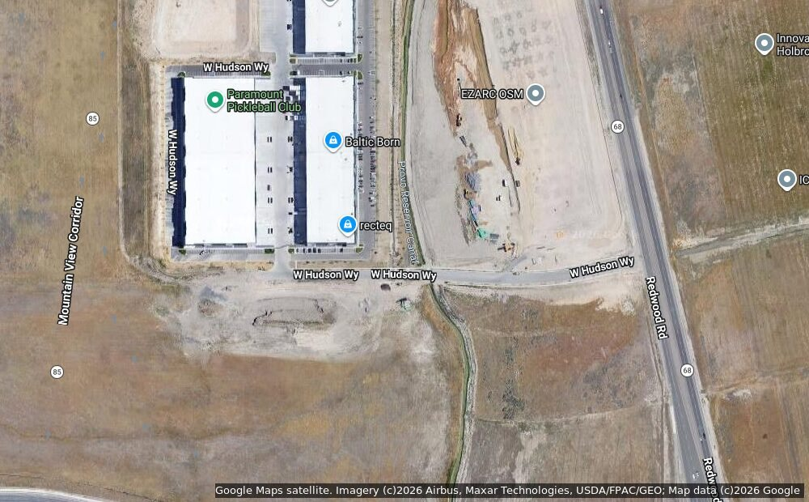

From Redwood Rd, looking west at the park behind Boyer's sign (a contributor's 360° photo, August 2023):

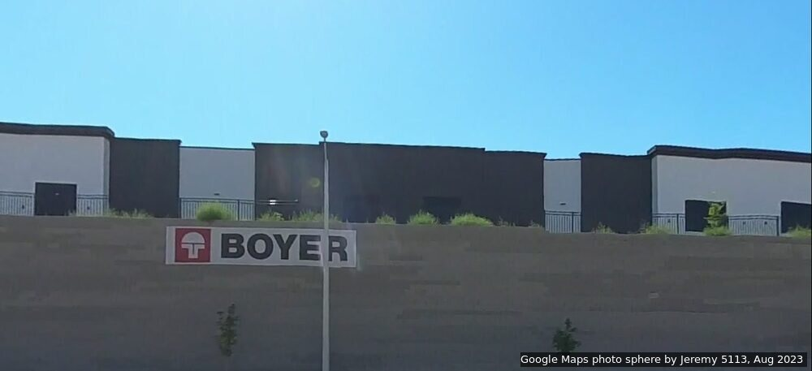

Inside: Paramount Pickleball Club at 5125 W Hudson Way Ste 100, a tenant in the park's western buildings (Google
Maps, March 2025). It shows the bare tilt-up shell: open joists and deck, a racking row along one wall, and big fans.

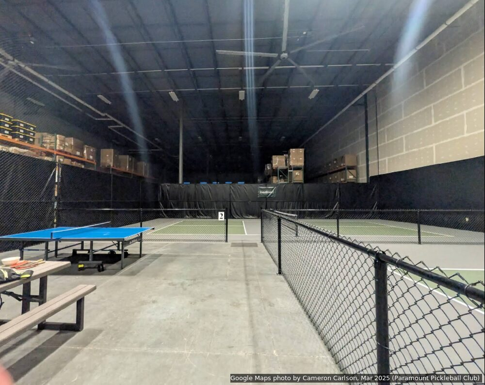

- **Bldg 5, 4866 S Hudson Way:** 247,078 ft², divisible to about 31,000-46,000 ft². 32 ft clear, **4,000 A at
  277/480 V**, ESFR, 40 dock-high doors and 8 grade-level doors (14 × 16 ft), 56 × 43 ft columns. Completed and ready
  to occupy; rate on request.
  [Crexi](https://www.crexi.com/lease/properties/942551/utah-holbrook-industrial-park-building-5),
  [CommercialSearch](https://www.commercialsearch.com/commercial-property/us/ut/lehi/boyer-holbrook-building-5-now-completed-for-lease/).
  Colliers: Tom Freeman, Travis Healey, Jeremy Jensen, Jeremy Terry.
- **Bldg 2, 5025 W Hudson Way:** a sublease of 29,724 ft² (bays 9-11) in a 109,572 ft² building from 2021-22. 32 ft
  clear, 277/480 V three-phase, 6 dock-high and 3 grade-level doors, 56 × 44 ft columns.
  [IndustrialSpaces](https://industrialspaces.net/lehi-ut/warehouse-for-rent/5025-west-hudson-way/33149), and a
  [C&W flyer](https://assets.cushmanwakefield.com/-/pmedia/221433/0/holbrookindustrial_bldg2718.pdf) that may be
  stale. Cushman & Wakefield: Tyson Fowler.
- **Why first:**
  - Zoned PC-FLEX, which permits labs and R&D.
  - Power already in, which saves 40-80 weeks of switchgear lead time.
  - Lehi runs its own power utility.
  - A new tilt-up with room to take 20,000 ft² now and the next bay later.
- **Height:** 15 units of 9.2 m.
- **Watch:** it sits where two segments of the Wasatch fault meet at Point of the Mountain. Check the UGS hazard
  maps (zoning-and-safety.md, item 7).

### 2. Lewis Landing Bldg A, 4170 W 2100 N

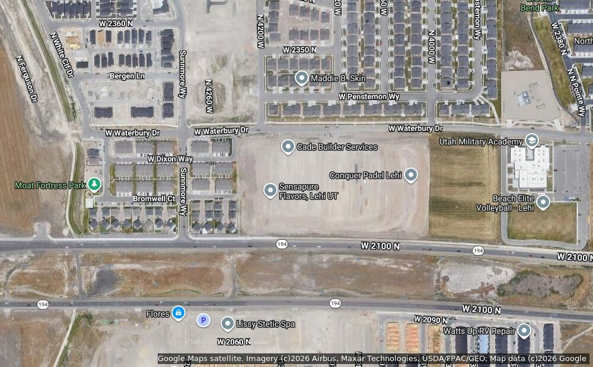

The building as it stands, from W 2100 N (Google Street View, June 2026). The aerial imagery is older than the
building.

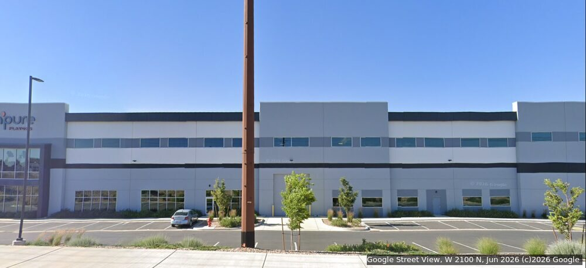

Inside: Conquer Padel Lehi, a tenant about 150 m east of the address pin in the same development (Google Maps,
June 2026). The courts fill a clear-span bay under open joists.

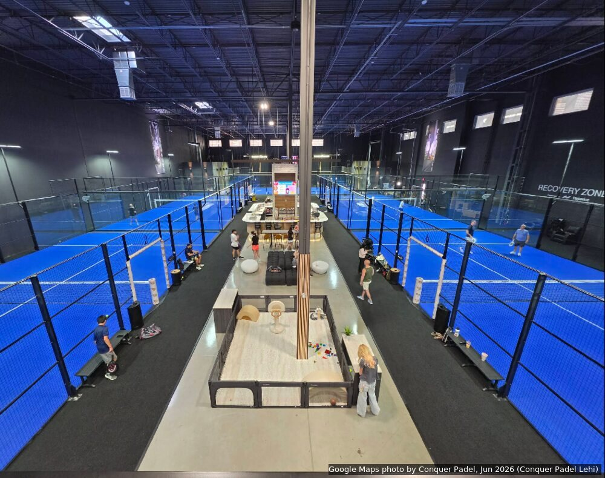

- **The building:** 86,916 ft² of flex and warehouse, 32 ft clear, 1,613 ft² of office, 18 dock-high doors and 4
  drive-in doors. Zoned "general industrial" according to a snippet.
- **Status:** no longer advertised on LoopNet (2026-11-12), so ask whether any of it is still open.
- **Listings:** [Zwick Construction](https://www.zwickconstruction.com/lewis-landing),
  [LoopNet](https://www.loopnet.com/Listing/4170-W-2100-N-Lehi-UT/25155322) (blocks both the runner and the Pi).
- **Height:** 15 units of 9.2 m.

### 3. 4425 N Thanksgiving Way (a sublease, north Lehi by I-15)

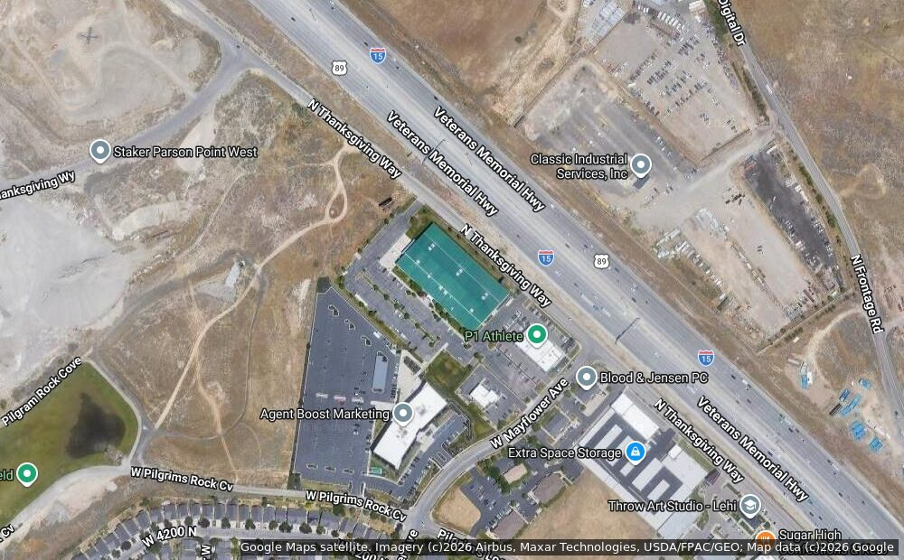

- **The space:** 75,300-80,098 ft², 26-33 ft clear, 2,400 A at 480 V, 3 dock-high and 2 grade-level doors, racking
  included. Seen only in snippets, because CityFeet and LoopNet block the runner.
- **Why it's interesting:** a sublease is usually faster and cheaper than a direct lease, and it is close to
  Thanksgiving Point and TI.
- **Height:** 15-21 units, depending on which part of the building.

### 4. 1657 N State St (for sale, $7.1M)

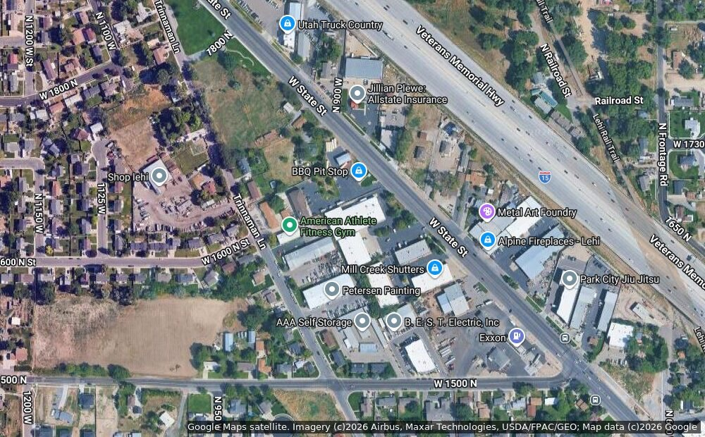

Inside: the gym in Gyvr Hub, which is at 1657 N State St (a contributor's 360° photo, April 2024). Painted steel
beams and a lower roof, as you'd expect at 17-18 ft clear.

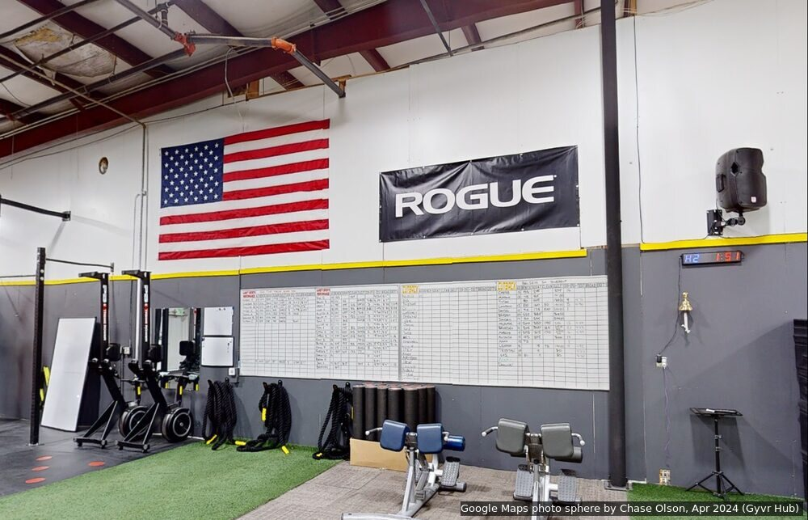

- **The building:** 40,426 ft² (about 35,426 of warehouse plus 5,000 of office) on 2.0 acres, built in 1995 with a
  new roof in 2022. Sprinklered and radiant-heated, 17-18 ft clear, about 1,800 A three-phase, 3 dock-high doors.
- **Status:** leased to a tenant, so sold as an investment or to an owner-user.
  [Crexi](https://www.crexi.com/properties/2687872/utah-1657-north-state-street), McKay Winkel.
- **Why look:** owning lets us cut a pit or add a high bay later, which a landlord might refuse.
- **Height:** about 32 units of 5.0 m, unless we dig a pit.

### 5. Millplace Park, 305 S 850 E (east Lehi, by the I-15 Lehi Main St exit)

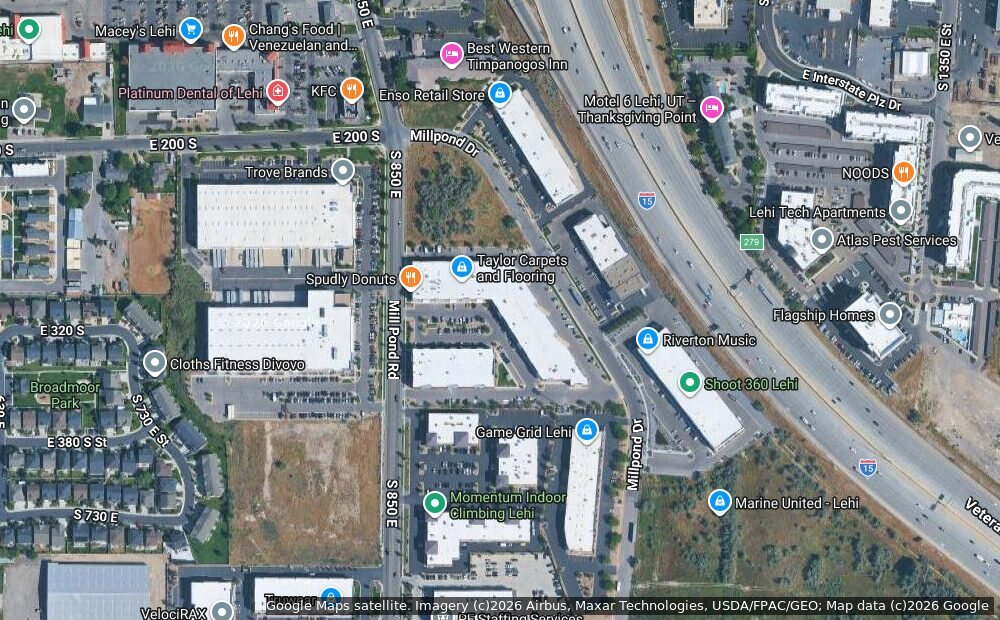

Inside a building on the same street: Momentum Indoor Climbing at 401 S 850 E, a block south of the listing's
address. Whether it is part of Millplace Park wasn't checked. The photo is from February 2015, before fit-out, and
shows the long-span steel trusses of these buildings.

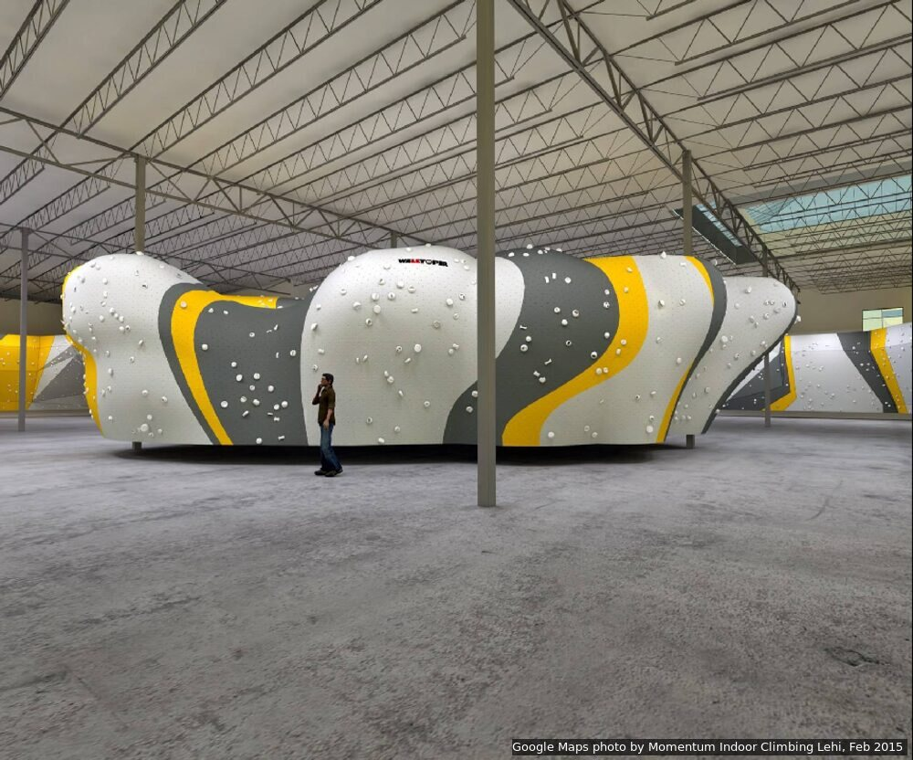

- **The space:** 10,753 ft² available in a 98,000 ft² park, 24 ft clear, three-phase power, two 14 × 14 ft
  grade-level doors, HVAC in the warehouse. $1.05/ft²/month, with the first two months free. Other units at
  520 S 850 E ask about $1.35-1.59/ft²/month.
- **Listing:** [Crexi](https://www.crexi.com/lease/properties/836927/utah-millplace-park). Colliers: Jarrod Hunt,
  Lana Howell.
- **Why look:** too small for the whole lab, but cheap and available now. It could take a pilot cell while a bigger
  building is fitted out.
- **Height:** 21 units of 6.8 m.

### 6. Texas Instruments LFAB1 and LFAB2 (not for lease)

300 mm wafer fabs on 283 acres at 4000 N Flash Dr. They're on the map because they show that bulk gases and hazardous
chemicals already run in Lehi, and the city has permitted them. Gage has asked BYU's recruiting office about a tour
([#319](https://github.com/vertical-cloud-lab/byu-vcl/issues/319)).

## Outside Lehi, in short

Details for each are in the [site table](README.md#2-candidate-sites).

- **36 ft clear with 2,000-4,000 A already in** (13 units of 10.5 m):
  - Center Street Industrial, Springville (12);
  - Mountain Point Bldg 3, Bluffdale (14);
  - Axia Business Park, Herriman (15).
- **Global Logistics HQ, Spanish Fork (13):** 32-36 ft clear, 4,000 A.
- **For sale in American Fork (7):** a 47,733 ft² flex and lab building, $8.78M. American Fork Industrial Bldg 1 is
  next door.
- **BlendTec, Orem (10):** 23 ft clear, but it already has clean rooms, compressed air and a generator.

## How these were made, and what's missing

- **The maps:**
  - Google Maps in headed Chrome on a virtual display on the runner, driven with `xdotool`: mouse drags, scroll
    zoom, right-clicks and keyboard input. Google Maps worked from the runner directly, so the Pi wasn't used.
  - Each map was calibrated by right-clicking known pixels and reading back Google's coordinates. A check point
    landed within 0.1 px.
  - The markers come from Web Mercator maths in `awk`, drawn with ImageMagick.
  - The Lehi pins and Catalyst, Global Logistics and Axia are Google's geocodes. The other regional pins are
    OpenStreetMap Nominatim's.
- **The aerial views** are Google Maps satellite captures at zoom 17, taken the same way. As noted above, the imagery
  is older than some of the buildings.
- **Street View** was opened at a viewpoint in front of each building. Where Google had no car imagery, it returned
  the nearest contributor 360° photo, which is how the Holbrook and Gyvr Hub views were found.
- **The interiors** were found through tenants that Google Maps shows in each building: the place page was opened,
  then a photo without identifiable people was picked from its gallery.
- **Attribution:** "Map data ©2026 Google" is printed on both maps, and each photo carries its source, contributor
  and date.
- **Not done:**
  - Street-level views of sites 3 and 5. At site 3, Google returned a 2016 contributor photo of a car park. At
    site 5 it returned a contributor photo that may not show the park.
  - Interiors for site 3.
  - Any listing's own gallery. Crexi opens only through the Pi's tunnel, and LoopNet not at all.
