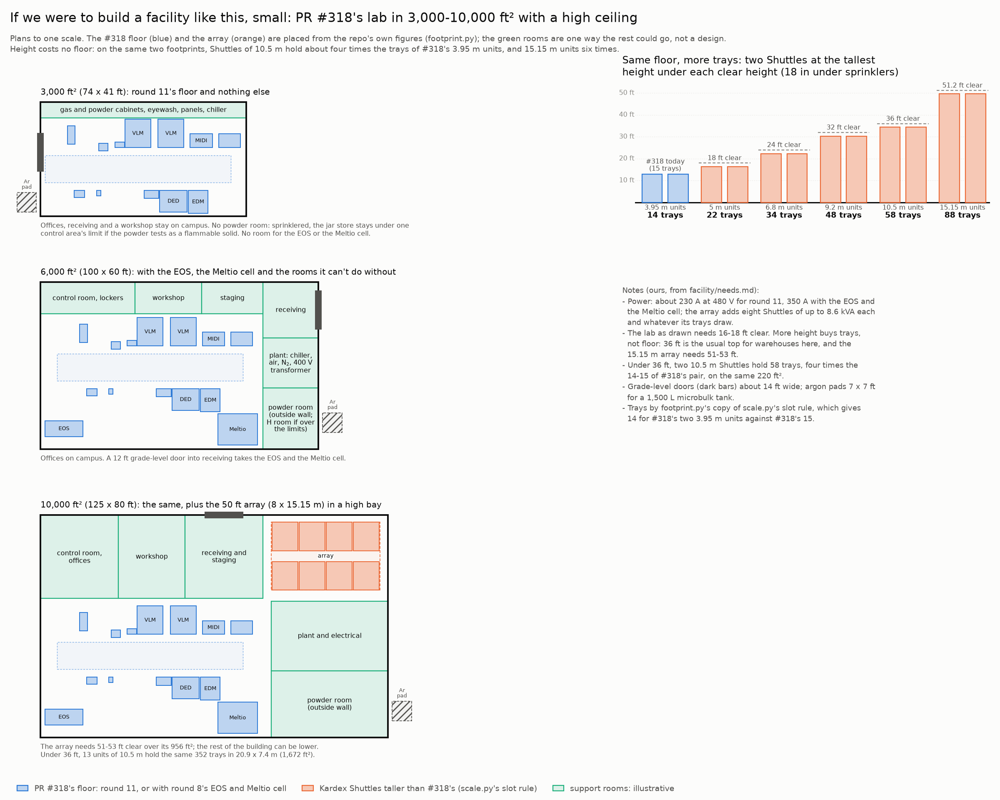
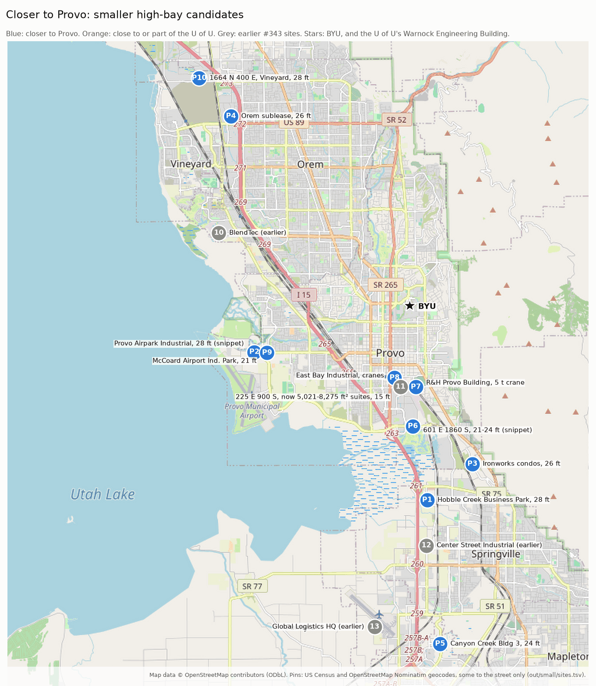
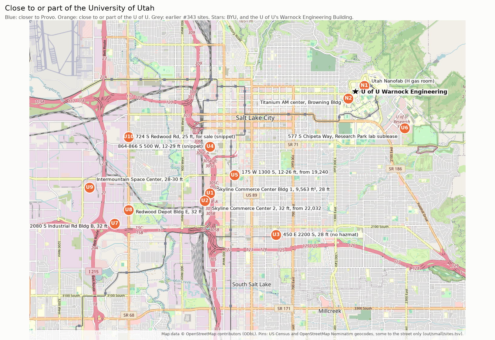

# Smaller buildings with a high ceiling: 3,000-10,000 ft², closer to Provo and near the University of Utah

*If we were to build a facility like the [#303](https://github.com/vertical-cloud-lab/byu-vcl/issues/303)
visualizations*, smaller. Sterling asked on [#343](https://github.com/vertical-cloud-lab/byu-vcl/issues/343)
(2026-11-28) to look at the new estimates and requirements, take another look at locations closer to Provo, consider
options of 3,000-10,000 ft², keep the high ceiling, and look at places close to or part of the University of Utah.

- **The new estimates** are [`needs.md`](needs.md) (2026-11-17): PR #318's lab added up, machine by machine.
- **"Keep the high ceiling"** is read here as: a tall building is still the filter, because in a small building height
  is the only way to add instrument trays without adding floor.
- **Read on 2026-11-28** from public pages. Listings change weekly. **Nobody was contacted.** Draft emails for
  Sterling and Gage are in [`drafts.md`](drafts.md) (drafts 12-14).
- Labels as elsewhere in this folder: *published* (read on the page), *snippet* (seen only in a search result),
  *ours* (our estimate).

## Short answer

- **What fits, from the new estimates.** The lab floor is small (2,371 ft² for round 11, 3,508 ft² with the EOS and
  the Meltio cell); support rooms and growth made the building 13,000-25,000 ft².
  - **3,000 ft²** holds round 11's floor and nothing else.
  - **6,000 ft²** adds the EOS, the Meltio cell, a powder room, a plant room and receiving.
  - **10,000 ft²** adds the 50 ft array as well, if it has a high bay.
  - **Ten a day doesn't fit.** Its lab floor alone is 7,500-9,500 ft².
- **Height is worth more in a small building.** Two Shuttles on the same 220 ft² hold 14 trays at #318's 3.95 m, 40
  at 28 ft clear, 58 at 36 ft and 88 at 51 ft. A small building can't add trays any other way.
- **Halfway between, one suite fits the size and keeps 36 ft:** **Mountain Point Business Center Bldg 3, Bluffdale**,
  from 9,158 ft², 36 ft clear, 2,400 A at 480/277 V, 14 × 16 ft grade-level doors, about 27 road miles from each
  university (28-45 min midday).
- **Otherwise small spaces top out at 28 ft,** near Provo and near the U alike. Every 32-40 ft building is a big one: two
  near Provo list 36-40 ft (Payson Central Tech, published; Spanish Fork Skypark, snippet), the first listings above
  36 ft near BYU in any pass, and both far over 10,000 ft².
- **Power is the catch in small units.** Condos and subleases have 200-400 A at 208 V. Round 11 wants about 520 A at
  208 V (230 A at 480 V); with the EOS and the Meltio cell, about 350 A at 480 V.
- **Closer to Provo, best fits:**
  - **Hobble Creek Business Park, Springville** (4.6 mi): 28 ft, bays of 6,720-8,400 ft², 2,000 A at 480 V in the
    building, grade-level doors.
  - **An Orem sublease** (6.1 mi): 10,573 ft² at 26 ft, available now, but 400 A at 208 V.
  - **Two crane buildings under 2 miles from BYU** (R&H Provo, East Bay Industrial), larger than 10,000 ft²: worth
    asking their bay heights.
- **Hangars are out:** FAA policy keeps them aeronautical. Off the airfield, though, **Provo's Airport Industrial zone
  allows 55 ft buildings**, a possible site for a purpose-built high bay if the city accepts the use.
- **Near the U, best fit:** **Skyline Commerce Center Bldg 1, Ste 600** (3.8 mi from Warnock): 9,563 ft², 28 ft, a
  12 × 14 ft drive-in door, available December 2026. Its MU-11 zoning permits R&D but not manufacturing. Nothing
  within 6 miles is over 32 ft, and the 32 ft spaces are all 19,000 ft² or more.
- **Research Park** is U land with a 45 ft height cap (snippet), office and lab space only, and uses limited to R&D,
  labs and offices.
- **Part of the U:** the U already runs metal powder and laser powder-bed printers (Zak Fang's lab and the Titanium
  Additive Manufacturing Research Center with IperionX), and the Nanofab has an H-occupancy gas room. That makes it a
  precedent and a possible partner, but none of it is a high bay to lease.

## 1. What 3,000-10,000 ft² holds, from the new estimates

Drawn by [`small_footprint.py`](small_footprint.py) (`python3 facility/small_footprint.py`; numbers in
[`out/small_footprint.json`](out/small_footprint.json)). It reuses [`footprint.py`](footprint.py)'s placement of
PR #318's floor and its copy of `scale.py`'s slot rule. The green rooms are one way to use the rest of each building, not
a design.

**The lab floor is small. Support rooms and growth made the building big.** From [`needs.md`](needs.md#6-floor-area):

| | ft² |
|---|---|
| Round 11's lab floor, machines and the MiR aisle | 2,371 |
| With round 8's EOS M 400-4 and Meltio cell | 3,508 |
| Three each (a third Shuttle, five more trays) | about 3,900 |
| Ten a day (PR #332): lab floor alone | about 7,500-9,500 |
| Support rooms in `footprint.py`: mechanical, powder room, offices, workshop, receiving | 9,099 |

So in 3,000-10,000 ft², the support rooms shrink or move to campus, and the floor holds the lab itself:

| Building (ours) | What it holds | What goes elsewhere, or is left out | Service to ask for (from `needs.md`) |
|---|---|---|---|
| **About 3,000 ft²** (74 × 41 ft in the figure) | Round 11's floor, with gas and powder cabinets, an eyewash, panels and the chiller along one wall | The EOS and the Meltio cell. Offices, receiving and the workshop, on campus. A powder room: stock stays in cabinets and the jar store under the code's limits (below) | about 230 A at 480 V (520 A at 208 V) |
| **About 6,000 ft²** (100 × 60 ft) | Adds the EOS and the Meltio cell, a 440 ft² powder room on an outside wall, a plant room (chiller, air, N₂, the 400 V transformer), receiving behind a grade-level door, a control room, a workshop and staging | Offices | about 350 A at 480 V |
| **About 10,000 ft²** (125 × 80 ft) | The same, with bigger powder and plant rooms, a small office, and the 50 ft array: eight 15.15 m Shuttles, 352 trays, 956 ft² under 51-53 ft clear. Under 36 ft, 13 units of 10.5 m hold the same trays in 1,672 ft² | Most offices | about 350 A plus the array. The eight Shuttles alone are up to 69 kVA (8.6 kVA each); the trays' draw isn't in `needs.md`. Ask for 600 A (ours) |
| Ten a day | Doesn't fit. Its lab floor alone is 7,500-9,500 ft², and `needs.md` puts the building at 20,000-25,000 ft² | | about 600 A, ask for 800 A |

### What the high ceiling buys in a small building

**Height costs no floor.** Two Shuttles, as in #318, stand on about 220 ft². By `scale.py`'s slot rule (as
`footprint.py` re-implements it), the tallest Shuttle under each clear height, with NFPA 13's 18 in under the
sprinklers, holds:

| Clear height | Tallest Shuttle | Trays in two Shuttles | Against #318's pair |
|---|---|---|---|
| (#318 as drawn) | 3.95 m | 14 (#318 has 15) | 1 × |
| 18 ft | 5.0 m | 22 | 1.6 × |
| 24 ft | 6.8 m | 34 | 2.4 × |
| 32 ft | 9.2 m | 48 | 3.4 × |
| 36 ft | 10.5 m | 58 | 4.1 × |
| 51.2 ft | 15.15 m (the array's unit) | 88 | 6.3 × |

- **The lab as #318 draws it still needs only 16-18 ft** ([`needs.md`](needs.md#7-ceiling-height)). Height above that
  buys trays, not floor.
- **In a small building that matters more than in a big one.** A 20,000 ft² building can add trays by adding Shuttles
  on the floor; a 3,000-6,000 ft² building can't spare the floor.
- **36 ft is the usual top for warehouses here** (Gage's Newmark contact). The only taller listings found are two big
  buildings at 36-40 ft ([§2](#taller-but-bigger-than-10000-square-feet)). Above that means a pit, a high bay, or a building
  that was never a warehouse.

### What changes when the building is small

- **Power becomes a filter again.** In the big buildings every listed service was several times the lab's need, and
  the question was the suite's share ([`needs.md`](needs.md#power)). Small units are often wired for much less: the
  condos and subleases in [§2](#2-closer-to-provo) have 200-400 A at 208 V (72-144 kVA), against round 11's
  520 A at 208 V.
- **Sprinklers may not be required, which cuts both ways.**
  - **The rule:** the 2024 IBC requires sprinklers in a Group F-1 fire area only over 12,000 ft² (§903.2.4), and has
    no area trigger for Group B, where research labs usually fall
    ([UpCodes](https://up.codes/viewer/utah/ibc-2024/chapter/9/fire-protection-and-life-safety-systems)).
  - **Without sprinklers the powder limits don't double:** 125 lb of flammable solids per control area, 250 lb in
    cabinets; 50 and 100 lb if the powder tests as water-reactive Class 2
    ([README](README.md#codes-that-decide-the-building)).
  - **A full jar store is about 80 kg (176 lb)** ([`needs.md`](needs.md#what-decides-between-them)), and #318 keeps
    it in the Shuttles' jar trays, which aren't hazardous-materials cabinets. Without cabinets, one control area holds
    125 lb of flammable solids unsprinklered or 250 lb sprinklered (50 or 100 lb if water-reactive Class 2).
  - **So a sprinklered building takes the full store** as a flammable solid in one control area. An unsprinklered one,
    or a water-reactive result, means a smaller store, stock moved into cabinets, or an H room. A ground floor may have
    four control areas behind 1-hour fire barriers, but one Shuttle can't be split between them.
  - **The 18 in in the height table assumes sprinklers.** Without them a unit could go a little taller, but the fire
    marshal may treat a tall Shuttle as high-piled storage (IFC Chapter 32), which brings fire protection of its own.
    A question for draft 10.
- **Neighbours.** Most small units are in multi-tenant buildings, sharing walls, a roof and a sprinkler system. The
  landlord's insurance and the other leases may limit hazardous materials. An end unit gives the outside wall a powder
  room needs (25 % of its perimeter) and a place for the argon pad.
- **Doors.** The EOS and the Meltio cell need a grade-level door about 12 ft tall
  ([`needs.md`](needs.md#8-floor-weight-doors-and-logistics)). The 3,000 ft² version has neither; its biggest
  one-piece item is the wire EDM, which a 9 × 10 ft door takes.
- **Argon.** Round 11's roughly 5 m³ a day is 15-20 cylinders a month, past the point where suppliers suggest
  microbulk. A 1,500 L tank sits on a 7 × 7 ft pad, at least 5 ft from lot lines and 10 ft from exits and air intakes
  ([README](README.md#codes-that-decide-the-building)). In a multi-tenant park that means the truck court, with the
  landlord's consent.

## 2. Closer to Provo

Read on 2026-11-28 from public listings. Miles are straight lines from BYU, from US Census or OpenStreetMap geocodes
([`out/small/sites.tsv`](out/small/sites.tsv)); "about" means the pin is only to the street, or the distance is estimated from the address.

**No 3,000-10,000 ft² space near Provo advertises more than 28 ft clear.** Every building near Provo listed at 32-40 ft
is a large distribution building, leased whole or in suites of about 22,000 ft² and more (Hamilton Commerce Center's
bays at 32 ft, Springville). Gage's Newmark contact said 36 ft is usually the most; in small units near Provo the top
is 28 ft. The one suite in the size range at 36 ft is halfway to Salt Lake City ([§4](#4-halfway-between-the-one-36-ft-suite-in-the-size-range)).

### Small-bay industrial and flex, tallest first

"Two Shuttles hold" applies the [tray table](#what-the-high-ceiling-buys-in-a-small-building) at the listing's clear
height.

| Pin | Site | Miles | Space (ft²) | Clear | Two Shuttles hold | Power | Doors | Status, rate | Listing (brokers) |
|---|---|---|---|---|---|---|---|---|---|
| P1 | **Hobble Creek Business Park Bldg 1**, 1156 N 1750 W, Springville | 4.6 | 6,720 of 67,200 (listed twice; maybe one space) | **28 ft** | 40 trays (8.0 m) | **2,000 A, 480 V, 3-ph** for the building | 2 dock-high, 1 grade-level a space (sizes not stated) | available now; built 2023; rate on request | [CommercialCafe](https://www.commercialcafe.com/commercial-property/us/ut/springville/hi-electric-building-1-4/) (Newmark Mountain West: Ben Richardson, Kolby Long, Lucas M. Burbank) |
| P1 | Hobble Creek Bldgs 4 and 5, same street | 4.6 | bays of 8,400 (Bldg 4) and 7,952 (Bldg 5) | 28 ft | 40 | Bldg 4: 2,000 A, 480 V; Bldg 5 not stated | 2-4 dock-high; some bays 1 grade-level | delivery Q2 2027; $11.40/ft²/yr | [Bldg 4](https://www.commercialcafe.com/commercial-property/us/ut/springville/hi-electric-building-4-2/), [Bldg 5](https://www.commercialcafe.com/commercial-property/us/ut/springville/hi-electric-building-5-3/) (same team) |
| P2 | Provo Airpark Industrial Bldg 1, 3550 W Center St, Provo | 3.8 | 97,720, down to 5,740 (snippet) | 28 ft (snippet) | 40 | not stated | 20 dock-high, 13 grade-level (snippet) | planned, three buildings; the land "currently zoned A110" (snippet) | [CommercialCafe](https://www.commercialcafe.com/commercial-property/us/ut/provo/provo-airport-industrial-1/), LoopNet blocked (Newmark: Kolby Long) |
| | Spanish Springs Ph. 3, 2821 N 170 E, Spanish Fork | about 7 | 117,945, from 7,374 | 28 ft in the larger building, 24 ft in the smaller (snippet) | 34-40 | not stated | not stated | completed spring 2026; ESFR; rate on request | [CommercialCafe](https://www.commercialcafe.com/commercial-property/us/ut/spanish-fork/spanish-springs-business-park/) (Colliers: Jarrod Hunt, Andy Blunt, Lana Howell) |
| P3 | Ironworks Bldg 2, 2601 Mountain Vista Pkwy, Provo (Ironton) | about 4 | 2,424, plus 357 of office | 26 ft | 38 (7.4 m) | 200 A, 208 V, 3-ph (72 kVA) | two 12 × 14 ft grade-level | ready; NNN fee $0.22 | [CommercialCafe](https://www.commercialcafe.com/commercial-property/us/ut/provo/ironworks-industrial-condos/) (Colliers: Dan Donaldson) |
| P3 | New Ironworks condos, same street | about 4 | units of 2,879-26,911 | 26 ft | 38 | 200 A, 208 V, 3-ph | 12 × 14 ft grade-level | for sale at $240-270/ft², done April 2027 | [CommercialCafe](https://www.commercialcafe.com/commercial-property/us/ut/provo/new-ironworks-industrial-condos-for-sale-or-lease/) (Dan Donaldson) |
| P4 | Orem industrial warehouse sublease, 1153 N 1430 W | 6.1 | 10,573 (7,285 warehouse, 1,644 office, 1,644 mezzanine) | 26 ft | 38 | 400 A, 208 V, 3-ph (144 kVA) | 12 × 14 ft grade-level, 9 × 10 ft dock | sublease at $1.10/ft²/mo NNN, to 2031-10-31 | [CommercialCafe](https://www.commercialcafe.com/commercial-property/us/ut/orem/orem-industrial-warehouse-sublease/) (Core Utah: Aaron Cook, Kevin Ford) |
| P5 | Canyon Creek Bldg 3, 863 E 1950 N, Spanish Fork | about 8 | from 8,955 of 54,039 (the page also says 8,855 and 17,385) | 24 ft | 34 | not stated | 6 dock-high, 3 grade-level | Light Industrial; built 2023; rate on request | [CommercialCafe](https://www.commercialcafe.com/commercial-property/us/ut/spanish-fork/canyon-creek-business-park-bldg-3-industrial-for-lease/) (Colliers: Hunt, Blunt, Howell) |
| P6 | 601 E 1860 S, Provo (East Bay) | 2.8 | 9 units in 41,669 (snippet) | 21-24 ft (snippet) | 30-34 | three-phase (snippet) | grade-level (snippet) | from August 2026 (snippet) | LoopNet blocked |
| | Spanish Fork Industrial, 258 W 3450 N Ste 105 | about 6.5 | 10,326 sublease | 21-24 ft | 30-34 | 400 A, 120/208 V, 3-ph | two 14 × 14 ft roll-ups, 2 dock-high | $14.16/ft²/yr NNN, to 2029-11-30 | [CommercialCafe](https://www.commercialcafe.com/commercial-property/us/ut/spanish-fork/spanish-fork-industrial/) (John Blatter) |
| P9 | McCoard Airport Industrial Park, 3155 W Center St, Provo | 3.5 | 5,000 units, combinable | 21 ft (snippet) | 30 | 400 A or 200 A a unit (two flyer versions) | 14 × 14 ft grade-level a unit | completed August 2025; $1.00/ft²/mo NNN; listing pages now redirect, so probably leased | [flyer](https://www.commercialsearch.com/pdfs/0958B1C0-0177-4FC4-A88F-4F2B4FF04D97) (Colliers: Eric Larsen) |

**Not tall enough, but closest:** the earlier Provo Manufacturing Facility at 225 E 900 S (pin 11, 1.9 mi) now lists
suites of 5,021, 5,381 and 8,275 ft², at 15 ft clear and $10.20/ft²/yr, in a 1947 building
([CommercialCafe](https://www.commercialcafe.com/commercial-property/us/ut/provo/225-east-900-south/)). Two 4.1 m
Shuttles would hold 16 trays there.

**What the list says:**
- **28 ft is the top,** at Hobble Creek, the Provo Airpark (snippet) and Spanish Springs. Two 8.0 m Shuttles hold 40
  trays there, nearly three times #318's pair.
- **Power is the catch in small units.**
  - **Round 11 wants about 520 A at 208 V** (230 A at 480 V), and the EOS and the Meltio cell take it to about 350 A
    at 480 V ([`needs.md`](needs.md#2-electricity)).
  - **The condos and subleases have 200-400 A at 208 V** (72-144 kVA): Ironworks, the Orem sublease, Spanish Fork
    Industrial and McCoard. That runs the machines (about 45 kW running) but not the cooling and fans on top, so a
    utility upgrade would come first.
  - **The exception is a suite in a big new building.** Hobble Creek Bldg 1 has 2,000 A at 480 V for 67,200 ft². By
    floor area a 6,720 ft² suite's share is about 200 A at 480 V, close to round 11's need. Ask the landlord for 300-400 A
    at 480 V.
- **Hobble Creek is the best fit found:** 28 ft, 480 V power in the building, grade-level doors, bays from 6,720 to
  8,400 ft², 4.6 mi from BYU, and Springville runs its own power utility ([`utilities.md`](utilities.md)). Zoning isn't
  stated; Springville's use tables weren't read ([`zoning-and-safety.md`](zoning-and-safety.md)).
- **The Orem sublease is the quickest:** 10,573 ft² at 26 ft, available, with an office and mezzanine built. Power
  (400 A at 208 V) would need an upgrade for anything past the machines.

### Taller, but bigger than 10,000 square feet

| Site | Miles | Size (ft²) | Clear | Status | Listing (brokers) |
|---|---|---|---|---|---|
| **Payson Central Tech Bldg 1**, 900 N, Payson | about 15 | 102,527, leased whole | **36-40 ft** ("Ideal for Racking") | available now; Light Industrial-Manufacturing; $0.90-1.00/ft² NNN | [CommercialCafe](https://www.commercialcafe.com/commercial-property/us/ut/payson/payson-central-tech-building-1/) (Brandon D. Fugal, Connor Weldon) |
| **Spanish Fork Skypark**, 6000 S 650 W | not placed | from 28,224, three buildings | **40 ft, 36 ft and 32 ft** (snippet) | not stated | [LoopNet](https://loopnet.com/Listing/6000-S-650-W-Spanish-Fork-UT/27805280) (blocked; snippet only) |
| 1664 N 400 E, Vineyard (pin P10) | 7.3 | 27,332 free span, whole building | 28 ft | for sale or lease; built 2010; six 14 × 12 ft grade-level doors; a $6,990,000 asking price appears only on CommercialCafe's Utah County sale list | [CommercialCafe](https://www.commercialcafe.com/commercial-property/us/ut/vineyard/1664-n-400-e-for-lease/) (Colliers: Rusty Bollow, Bobby Stevens, Ethan Wallace) |

- **These are the first listings near BYU above 36 ft.** The README's "nothing available near BYU is over 36 ft"
  needs a footnote: Payson's 36-40 ft is on the listing itself, Skypark's 40 ft only in a snippet.
- **At 40 ft,** 11 units of 11.7 m hold the array's 352 trays ([height table](README.md#height)), or a 3.4 m pit takes
  the 15.15 m array as drawn.

### Crane buildings near BYU

Crane bays are often tall, but none of these gives an eave or hook height. Ask.

| Pin | Site | Miles | Size (ft²) | What it states | Status | Listing (brokers) |
|---|---|---|---|---|---|---|
| P7 | R&H Provo Building, 508 E 900 S, Provo | 1.9 | 17,773 on 2.52 acres | a 5-ton crane; M-2 Heavy Industrial | for sale at $3,200,000, or lease | [CommercialCafe](https://www.commercialcafe.com/commercial-property/us/ut/provo/r-h-provo-building-for-sale-or-lease/) (Colliers: Eric Larsen) |
| P8 | East Bay Industrial Warehouse, 701 S 100 E, Provo | 1.7 | 21,457 | "overhead cranes", 7 grade-level doors, 480 V three-phase | not stated | [CommercialCafe](https://www.commercialcafe.com/commercial-property/us/ut/provo/east-bay-industrial-warehouse/) (Richard Dodge) |
| | 1005 S Main, Lindon | about 8 | 48,500 | an overhead crane (snippet) | not stated | [CommercialCafe](https://www.commercialcafe.com/commercial-property/us/ut/lindon/industrial-flex/) |

- **With 225 E 900 S, the two in Provo are the closest industrial buildings to BYU with any sign of height,** all
  under 2 miles. Both are bigger than 10,000 ft², but R&H's M-2 zoning and a crane bay make it worth a call about the bay's
  height and whether part of it could be leased.

### Airport hangars: not for a lab

- **FAA policy:** hangars at federally obligated airports must be used for aeronautical purposes
  ([81 FR 38906](https://www.govinfo.gov/content/pkg/FR-2016-06-15/html/2016-14133.htm), in force since 2017-07-01).
  - **The exception:** an airport may ask the FAA to approve "an interim use… for non-aeronautical purposes for a
    period of 3 to 5 years", only where hangars stand empty with no aviation demand.
  - **Its terms:** fair-market rent, and the airport able to take the hangar back on 30 days' notice. That rules out a
    lab fit-out.
- **Provo (PVU, about 4 mi):**
  - **Hangars are scarce.** The board's March 2026 minutes say city T-hangars "are for aircraft storage only", note
    "Limited hangar availability vs. high demand", and record the fire marshal's "Hangars without suppression systems
    are limited to storage use" ([minutes](https://www.utah.gov/pmn/files/1448929.docx)). New box hangars and
    T-hangars are going to the waitlist ([June 2026 minutes](https://www.utah.gov/pmn/files/1458111.docx)).
  - **Off the airfield, Provo's Airport Industrial (AI) zone allows buildings up to 55 ft.** It permits
    "miscellaneous manufacturing" and warehouses; research and laboratories aren't in its use table (§14.17D.020 and
    §14.17D.060, read on an unofficial copy, [Zoneomics](https://www.zoneomics.com/code/provo-UT/chapter_27)). So land there could take
    a purpose-built high bay close to the array's 51-53 ft clear, if the city reads the lab as manufacturing or grants
    the use.
  - **For sale:** a 19,885 ft² hangar and office at 3278 W 1150 S, $6,700,000 (Woodley Real Estate;
    [CommercialCafe](https://www.commercialcafe.com/commercial-property/us/ut/provo/provo-airport-hangar-1/)). It
    would carry the same aeronautical-use limits.
- **Spanish Fork-Springville (SPK, about 7 mi):** all hangars are private, on city ground leases at $0.67/ft²/yr
  ([rates](https://www.spanishfork.gov/business-development/airport/rates-and-fees/)). The lease template says
  hangars are "used solely for" aircraft storage and maintenance, with non-aviation storage only as an incidental use
  ([template](https://media-002-us.cdn.govstack.com/spanishfork-us/media/4wlpvrr1/hangar_ground_lease_template.pdf)).

## 3. Close to or part of the University of Utah

Read on 2026-11-28. Miles are straight lines from the Warnock Engineering Building.

**Nothing within about 6 miles of the U is taller than 32 ft, and every 32 ft space there is 19,000 ft² or more.**
The best fit for the brief is a 28 ft suite in Salt Lake City's industrial strip along I-15, 3-4 miles west of
campus. Research Park itself has office and lab space but no high bay, and its rules cap buildings at 45 ft.

### Spaces, tallest first

| Pin | Site | Miles | Space (ft²) | Clear | Power | Zoning | Status, rate | Listing (brokers) |
|---|---|---|---|---|---|---|---|---|
| U7 | 2080 S Industrial Rd, Bldg B | 5.9 | 59,060 sublease (12,521 office) in a 2014 building (snippet) | 32 ft (snippet) | 800 A, 480/277 V (snippet) | M-1 (city GIS) | sublease, rate not stated | [CommercialCafe](https://www.commercialcafe.com/commercial-property/us/ut/salt-lake-city/2080-south-industrial-road/), Crexi blocked (Newmark) |
| U2 | Skyline Commerce Center 2, 570 W 1700 S | 4.0 | 22,032-67,379 | 32 ft; 52-56 ft bays | not stated | MU-11 (city GIS) | available April 2027, NNN | [CBRE](https://www.cbre.com/properties/properties-for-lease/industrial/details/US-SMPL-35060/skyline-commerce-center-2-570-west-1700-south-salt-lake-city-ut-84115) (Tom Dischmann, Jeff Richards, Chris Liddell, Matt McAfee) |
| U8 | Redwood Depot Bldg E, Ste 500/600, 1810 Redwood Depot Ln | about 5.5 | 19,271 | 32 ft | 400 A, 277/480 V | not stated | rate on request; one 12 × 14 ft grade-level door | [CommercialCafe](https://www.commercialcafe.com/commercial-property/us/ut/salt-lake-city/redwood-depot-building-e-suite-500-600/) (Colliers: Tom Freeman and team) |
| U9 | Intermountain Space Center, 2455 W 1500 S | 6.1 | 42,385 or 50,016, yard up to 4.15 acres | 28-30 ft | 800 A, 480 V (Ste A) | M-1 (city GIS) | available now, NNN | [CBRE](https://www.cbre.com/properties/properties-for-lease/industrial/details/US-SMPL-182980/intermountain-space-center-2455-west-1500-south-salt-lake-city-ut-84104) (Matt McAfee and team) |
| **U1** | **Skyline Commerce Center Bldg 1, Ste 600, 1580 S 500 W** | **3.8** | **9,563 (1,201 office)** | **28 ft** | not stated | MU-11 (city GIS) | **available December 2026**, direct NNN, rate on request; one 12 × 14 ft drive-in and one 9 × 10 ft dock door | [CBRE](https://www.cbre.com/properties/properties-for-lease/industrial/details/US-SMPL-213010/skyline-commerce-center-building-1-1580-south-500-west-salt-lake-city-ut-84115) (Tom Dischmann, Jeff Richards, Chris Liddell, Matt McAfee, Heather Lingmann) |
| U3 | 450 E 2200 S, South Salt Lake | 3.5 | unit 6C 5,000-7,500 ("No Longer Available", January 2026); a 30,000 ft² listing now | 28 ft (unit 6C) | not stated | not stated | the current listing says **"No Hazardous Materials"** | [CommercialSearch](https://www.commercialsearch.com/commercial-property/us/ut/south-salt-lake/450-east-2200-south-1/), [CIMLS](https://www.cimls.com/lease-listing/487700/industrial-450-east-2200-south-South-Salt-Lake-UT) |
| U4 | 864-866 S 500 W (Granary) | 3.4 | 20,378 (snippet) | 12-29 ft (snippet) | 600-1,000 A, 480 V (snippet) | MU-11 (city GIS) | $11.40/ft²/yr; tenant in place; has a dust collector with a silo (snippet) | LoopNet, CityFeet and Showcase, all blocked |
| U5 | 175 W 1300 S (Ballpark) | 3.2 | 117,000, from 19,240 | 12-26 ft | not stated | MU-8 (city GIS) | available now | [CommercialCafe](https://www.commercialcafe.com/commercial-property/us/ut/salt-lake-city/175-w-1300-s) (Colliers: Rusty Bollow and team) |
| U10 | 724 S Redwood Rd, **for sale** | 5.0 | about 7,000 on 0.36 acres (snippet) | 25 ft (snippet) | not stated | not stated | $1,750,000; three drive-in doors (snippet) | Crexi, blocked (CBRE: Cole Macadaeg) |
| U6 | 577 S Chipeta Way, **Research Park** lab sublease | 1.3 | 27,136 RSF on two floors (10,638 GMP lab, 7,228 lab) | not stated | not stated | RP | up to 3 years; lab $20.00/ft² NNN, office $15.00 full service; shared dock | [JLL brochure, March 2026](https://res.cloudinary.com/jll-global-sandbox/image/upload/v1774648792/MyListing/public/prod/property-875989/teva-pharm-sublease-brochure-3-23-2026.pdf) (Jami Marsh) |

**Outer ring, by the airport (8-10 miles):** 36 ft in Central Commerce Center Bldg 2 (243,057 ft² and up) and 4951 W
150 S (126,152 ft², snippet), and 28 ft suites of 6,984 ft² at 4752 W California Ave (zoned M1, snippet) and
7,666-15,334 ft² at Mountain View Commerce Center Bldg 2 (snippet).

**What Salt Lake City's zones allow** (the mixed-use ordinance adopted 2025-07-08,
[text](https://www.slcdocs.com/Planning/Projects/MU%20Consolidation/AdoptedLegislation/047A%20of%202025%20-%20Zoning%20Text%20Amendment%20Mixed-Use%20(MU)%20Zoning%20Consolidation.pdf)):
- **MU-8 and MU-11** (Skyline, the Granary, Ballpark) permit a "research and development facility" and a medical
  laboratory, but light manufacturing, industrial assembly and warehouses aren't in their use table.
- **M-1** (2080 S Industrial Rd, Intermountain Space Center) permits all of them.
- **So for Skyline Bldg 1,** atomizing and printing would need the city to read the lab as R&D. Ask for a written use
  determination, as in Lehi (draft 3).

### Research Park

- **Whose land:** the U's. The Interior Department transferred 593 acres in 1968 under the Recreation and Public
  Purposes Act, and the title reverts if the land is used outside its purpose
  ([@theU](https://attheu.utah.edu/facilities/u-looks-to-congress-for-help-securing-future-of-research-park)). The
  Bureau of Land Management has questioned some uses. H.R. 2876, the University of Utah Research Park Act, would
  confirm a research park as a valid use; its status record shows it passed the House and is on the Senate calendar,
  not law ([govinfo](https://www.govinfo.gov/bulkdata/BILLSTATUS/119/hr/BILLSTATUS-119hr2876.xml)).
- **How space is held:** the U leases land to companies, directly or through a nonprofit, and the improvements revert
  to it when the lease ends ([Utah Code 53B-17-504](https://codes.findlaw.com/ut/title-53b-state-system-of-higher-education/ut-code-sect-53b-17-504/)).
  Some buildings belong to the University of Utah Research Foundation, others to developers such as Woodbury, whose
  seven buildings "can accommodate lab as well as office uses" ([Woodbury](https://www.woodburycorp.com/?p=2488)).
- **Rules:** the U isn't subject to city zoning but consults the city
  ([Policy 3-201](https://www.regulations.utah.edu/administration/3-201.php)). The RP zone's text describes a campus for
  high-tech R&D, caps height at **45 ft** and bans outdoor storage (snippet; the city code returned 403). Its use
  table permits R&D and laboratories, not light manufacturing. Protective covenants and an advisory board of review
  also apply.
  - **45 ft is under the array's 51-53 ft,** but over the 36 ft that holds 13 units of 10.5 m.
  - **No outdoor storage** may bear on an argon tank pad. Ask.
- **What's there:** office and lab only. The one lab listing found is the 577 S Chipeta Way sublease above, a GMP
  pharmaceutical lab with no high bay.
- **Plans:** a 2021 "50-year Vision Plan" for the 320-acre core, with a street grid, housing and a possible TRAX
  extension ([REA](https://realestate.utah.edu/research-park/), [BKF](https://www.bkf.com/projects/utah-research-park-master-plan/)).
  No call for developers from 2023-2026 was found.
- **Contact:** the U's Real Estate Administration, 303 Chipeta Way Ste 300, +1 801 587 8750; leasing +1 801 587 8734
  ([REA](https://realestate.utah.edu/real-property-transaction/)). Draft 13.

### Part of the U: facilities that could host or partner

| Pin | Facility | What it has | For outside users | Source |
|---|---|---|---|---|
| N2 | **Titanium Additive Manufacturing Research Center**, William Browning Building | "3D titanium printing machines"; opened April 2024 under a 10-year, $10 million research agreement between Materials Science and Engineering and IperionX. Area not stated | a company partnership, as IperionX's shows | [College of Science](https://science.utah.edu/faculty/u-metallurgical-engineering-iperionx-facility/) |
| | **Powder metallurgy lab** (Zak Fang, Materials Science and Engineering) | a deoxygenation furnace, SLM 125 and 280 laser powder-bed printers, an ExOne binder jet, a high-vacuum sintering furnace, a 2,000 °C hot press, a LECO O/N/H analyzer. Building and area not stated | not stated | [lab page](https://powder.metallurgy.utah.edu/facilities/index.php) |
| N1 | **Utah Nanofab**, Sorenson Molecular Biotechnology Building | about 18,000 ft² of clean facility (7,500 ft² filtered) and 6,000 ft² of microscopy, from 2015. An outdoor liquid-nitrogen tank feeds house N₂. Hazardous gases and chemicals are kept in a storage room "designed as H2,3,4 Occupancy Class", separate from the cleanroom (**an H-occupancy gas room**) | companies can pay for staff-run work, or have their own staff trained and rent tool time | [about](https://nanofab.utah.edu/?p=138), [user guide](https://www.nanofab.utah.edu/documents/2016/02/smbb-user-guide.pdf/), [businesses](https://www.nanofab.utah.edu/businesses) |
| | **High Bay Structures Lab** (Civil and Environmental Engineering) | a "hangar-like ceiling" (snippet); an older faculty page lists a 38 ft loading tower (snippet). Clear height and crane not stated | not stated | [department](https://www.civil.utah.edu/?p=1194565) |
| | **Core facilities** (Health Sciences) | | outside academics pay the internal rate plus the U's overhead; companies pay a higher, market rate | [cores](https://cores.utah.edu/?p=621) |

- **The U already runs metal powder, laser powder-bed printing and an H-occupancy gas room on campus.** That is the
  precedent Sterling looked for near TI's fabs in Lehi ([README](README.md#places-that-already-run-gases-or-hazardous-materials)),
  and it answers the README's line that no metal-powder operation turned up in the area. IperionX's lab is also the
  model for a company and a department sharing space under a long research agreement.
- **But none of it is a high bay we could lease.** A partnership would put trays or a pilot cell in the U's space, not
  the 50 ft array.
- **The Point (Draper):** U of U Health signed a purchase agreement for 45.8 acres for a proposed health campus, in
  "very early planning" ([@theU](https://attheu.utah.edu/facultystaff/university-state-of-utah-sign-agreement-for-proposed-south-valley-health-campus/)).
  No research or lab space there was found.

### Peers near the U

| Who | Where | Floor area | Source |
|---|---|---|---|
| Recursion (automated biology labs) | The Gateway, 3.1 mi | 100,000 ft² leased in 2018 and 100,000 more in 2021; its 10-Ks give 99,172 ft² of office and lab plus 103,634 ft² next door (snippets) | [PR Newswire](https://www.prnewswire.com/news-releases/recursion-signs-lease-with-vestar-for-an-additional-100-000-sf-of-space-at-the-gateway-in-downtown-salt-lake-city-301323893.html), [10-K](https://www.sec.gov/Archives/edgar/data/1601830/000160183025000035/rxrx-20241231.htm) |
| Palladyne AI (formerly Sarcos, robotics) | 650 S 500 W, 3.2 mi | about 61,000 ft², leased to May 2033 | [10-K](https://www.sec.gov/Archives/edgar/data/1826681/000119312526092443/pdyn-20251231.htm) |
| IperionX (titanium powder) | office at 1782 W 2300 S, West Valley City, 5.9 mi; a pilot titanium plant in Utah | not stated | [IperionX](https://iperionx.com/?p=677) |
| BioFire | Research Park | 285,000 ft² building | [KSL](https://www.ksl.com/article/44286776/biofire-opens-new-utah-facility-with-multinational-partner) |
| ARUP Laboratories | Research Park | 750,000 ft² | [ARUP](https://www.aruplab.com/news/03-17-2021/arup-has-long-history-and-largest-presence-research-park) |

## 4. Halfway between: the one 36 ft suite in the size range

| Site | Miles | Space (ft²) | Clear | Power | Doors | Status | Listing (brokers) |
|---|---|---|---|---|---|---|---|
| **Mountain Point Business Center Bldg 3**, 860 W 14600 S, Bluffdale (Point of the Mountain; pin 14 on the [region map](sites.md#where-the-sites-are)) | 21.5 from BYU, 19.8 from Warnock (straight); 26.7 and 27.1 by road | 27,081, **divisible from 9,158** | **36 ft** | **2,400 A, 480/277 V, 3-ph** | three 14 × 16 ft grade-level, four 9 × 10 ft dock-high | "Under Construction", available "Immediate"; rate on request; page updated 2026-11-25 | [CommercialCafe](https://www.commercialcafe.com/commercial-property/us/ut/bluffdale/mountain-point-business-center-building-3-for-lease/) (Colliers: Tom Freeman, Travis Healey, Jeremy Jensen, Jeremy Terry) |

- **It meets the brief on size, height and doors.** At 36 ft, two 10.5 m Shuttles hold 58 trays on the floor #318's
  pair takes, and 13 of them hold the array's 352 trays in 1,672 ft². A 9,158 ft² suite has room for the 6,000 ft²
  version in the figure, plus 3,000 ft² to spare.
- **Power:** by floor area a 9,158 ft² suite's share of the 2,400 A is about 220 A at 480 V, about round 11's need. Ask
  for 350-400 A.
- **Travel** ([`travel-times.md`](travel-times.md)): 28-40 min to the BYU Engineering Building and 30-45 min to the
  U of U's Warnock building at midday, 30-80 min at rush hour. No transit route.
- **Axia Business Park, Herriman,** the other 36 ft building in the README's list, now offers only one 28,177 ft²
  suite (page updated 2026-11-25), so it has left the size range.

## 5. If we were to ask about three (and one more)

1. **Mountain Point Bldg 3, Bluffdale, for the height** (draft 1 to Colliers). Ask:
   - whether a 9,158 ft² bay is still free, ideally an end bay with an exterior wall and room for an argon pad;
   - how many of the 2,400 A the landlord would allocate (350-400 A at 480 V);
   - the zoning, the slab and the roof.
2. **Hobble Creek Business Park, Springville, nearest BYU** (draft 1 to Newmark, or draft 12). Ask:
   - which bays are left;
   - whether the landlord would allocate 300-400 A at 480 V to one;
   - the zoning, door sizes, slab and roof;
   - whether an end bay is free, for the powder room and an argon pad.
3. **Skyline Commerce Center Bldg 1, Ste 600, Salt Lake City, nearest the U** (draft 1 to CBRE). Ask:
   - its power;
   - whether the landlord allows hazardous materials;
   - whether Salt Lake City would read atomizing and printing as R&D in MU-11 (draft 3, adapted).
4. **Also: for speed, the Orem sublease; for a crane bay close to BYU, R&H Provo.**
   - **The sublease** is built and available now, but its 400 A at 208 V needs an upgrade before the cooling and fans.
   - **R&H** is 1.9 miles from BYU, zoned M-2, with a crane bay of unknown height. Ask Colliers for the bay's eave and
     hook height, and whether part could be leased.

**For the purpose-built high bay later,** Provo's Airport Industrial zone (55 ft) joins Eagle Mountain's industrial
land ([README](README.md#land-for-a-purpose-built-building-with-a-high-bay)) as a place where 51-53 ft clear is
allowed. Ask Provo how it would classify the lab there.

**And the U, as a partner rather than a landlord** (draft 13): whether the Materials Science and Engineering powder
labs, or a shared research building, could host a pilot cell while a building is found.

## How this was made, and what's missing

- **Searches:** web searches across CommercialCafe, CommercialSearch, CBRE and broker pages, city and University
  pages, and FAA and airport documents. The listings this page leans on were re-read on their own pages on 2026-11-28:
  Hobble Creek Bldg 1, the Orem sublease, Ironworks Bldg 2, 1664 N 400 E, Payson Central Tech, R&H Provo, Mountain
  Point Bldg 3, Axia, Skyline Bldg 1, the Titanium Additive Manufacturing Research Center, the Research Park article and
  Provo's AI zone.
- **Blocked:**
  - LoopNet, Showcase and CityFeet returned HTTP 403, so their listings appear only as snippets.
  - **Crexi showed a Cloudflare check,** to the runner and this time also through the CubXL Pi's tunnel, so it wasn't
    used. The Pi relayed a few page loads with images off, and nothing was written on it.
  - Salt Lake City's code (amlegal) and Provo's code site returned 403. The RP zone's 45 ft is a snippet, and Provo's
    AI zone was read on an unofficial copy (Zoneomics).
- **Not found:**
  - an eave or hook height for any crane building;
  - power for Skyline Bldg 1, Payson Central Tech and Spanish Fork Skypark;
  - zoning for Hobble Creek;
  - any listing that says its slab may be cut, or that offers a gas pad. One (450 E 2200 S) says "No Hazardous
    Materials".
- **Estimates (*ours*):** the three buildings in the figure and their rooms, the services to ask for, and the
  suites' shares of Hobble Creek's 2,000 A and Mountain Point's 2,400 A.
- **Files:**
  - [`small_footprint.py`](small_footprint.py) draws the figure, reusing [`footprint.py`](footprint.py).
  - [`small_map.py`](small_map.py) draws the maps from [`out/small/sites.tsv`](out/small/sites.tsv), on OpenStreetMap
    tiles. The pins are US Census geocodes, or OpenStreetMap Nominatim's where the Census had no match; the `how`
    column marks the ones that are only to the street.

