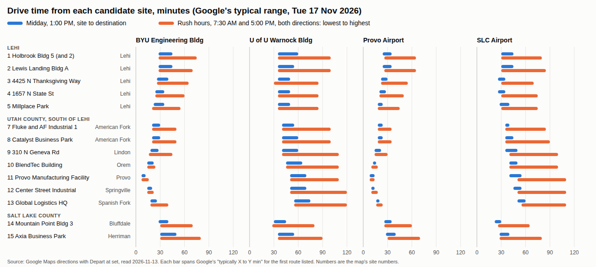
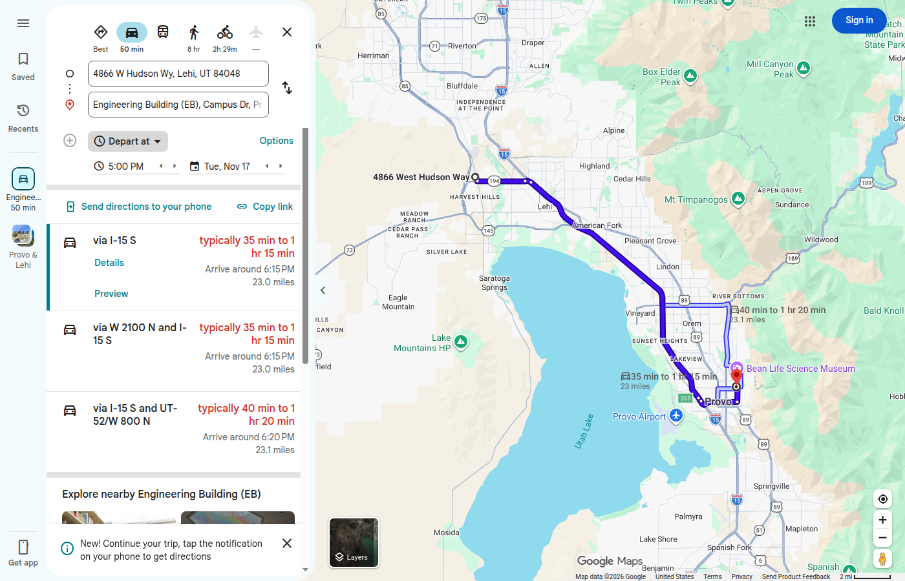

# Travel times from the candidate sites, at rush hour and off-peak

How long it takes to get from each candidate site to the BYU Engineering Building, the U of U Warnock Engineering
Building, Provo Airport (PVU) and Salt Lake City International (SLC), and back. Rush hour and midday are both given,
as Sterling asked on [PR #344](https://github.com/vertical-cloud-lab/byu-vcl/pull/344#issuecomment-6842843414). The
site numbers are the ones on the maps in [`sites.md`](sites.md#where-the-sites-are). Listings, requirements and costs
are in [`README.md`](README.md).

**All times are Google Maps forecasts, read on 2026-11-13 for Tuesday 17 November 2026,** a normal week before
Thanksgiving. Each figure is Google's "typically X–Y min" range for the route it lists first, at:

- **7:30 AM and 5:00 PM** for rush hour, both ways;
- **1:00 PM** for off-peak.

Details and caveats are [at the end](#how-these-were-read).

## Summary

- **Lehi is the middle ground.** At midday the five Lehi sites (1-5) take:
  - **22-45 min** to the BYU Engineering Building;
  - **35-60 min** to the U of U's Warnock building;
  - **18-35 min** to Provo Airport;
  - **26-45 min** to SLC International.
- **East Lehi is 5-10 min closer than west Lehi to BYU and Provo Airport.** Millplace (5) and 1657 N State St (4) sit
  by I-15. Holbrook (1) and Lewis Landing (2) have a cross-town drive to reach it. To the U of U and SLC airport the
  gap is smaller.
- **Rush hour mostly raises the top of Google's range.** The bottom moves 0-10 min; the top can nearly double. From
  Lehi (sites 1-5, typical tops):
  - **Lehi to the U of U at 7:30 AM: up to 80-100 min,** against 50-60 midday. Back from the U at 5:00 PM is the
    same, up to 85-100.
  - **Against the flow it stays near midday:** the U of U to Lehi at 7:30 AM is 30-55 min.
  - **BYU and Lehi at 5:00 PM: up to 55-75 min either way.** At 7:30 AM it's 20-50, about the same as midday.
  - **SLC airport to Lehi at 5:00 PM: up to 70-85 min.** Lehi to the airport at 7:30 AM: up to 55-70.
- **South of Lehi** (sites 7-13, American Fork to Spanish Fork):
  - **BYU and Provo Airport are close at any hour:** 7-30 min at midday, and 50 at the worst.
  - **The U of U is far:** 40-75 min at midday, and up to 100-120 from the U at 5:00 PM.
  - **So is SLC airport:** 35-60 min at midday, up to 85-110 from the airport at 5:00 PM.
- **North of Lehi** (Bluffdale 14 and Herriman 15) is the reverse:
  - **SLC airport and the U of U are nearest:** 22-55 min at midday.
  - **BYU is 28-50 min at midday,** but up to 70-80 min at 5:00 PM.
- **For a lab both campuses use,** east Lehi or Bluffdale splits the difference most evenly at midday:
  - **Millplace (5):** 22-35 min to BYU and 35-50 to the U of U.
  - **1657 N State St (4):** 24-35 and 35-50.
  - **Mountain Point (14):** 28-40 and 30-45.
  - **Rush hour still adds 30-40 min** to the top of the range, on whichever trip runs with the commute.



Blue is midday (1:00 PM, leaving the site). Orange runs from the lowest to the highest rush-hour reading (7:30 AM and
5:00 PM, each way). The chart and the tables below are generated from [`out/travel/drive.tsv`](out/travel/drive.tsv)
by the `awk` scripts in [`travel/`](travel/). The vector version is [`drive_ranges.svg`](out/travel/drive_ranges.svg),
with a tooltip on each bar.

## Drive times at a glance

Each cell is **midday · rush hour** in minutes. Midday is 1:00 PM leaving the site. Rush hour runs from the lowest
to the highest of the four readings: 7:30 AM and 5:00 PM, each way.

| # | Site | City | BYU Engineering Bldg | U of U Warnock Bldg | Provo Airport | SLC Airport |
| --: | --- | --- | --- | --- | --- | --- |
| 1 | Holbrook Industrial Park Bldg 5 | Lehi | 28–45 · 28–75 | 35–60 · 35–100 | 24–35 · 26–65 | 30–45 · 30–80 |
| 2 | Lewis Landing Bldg A | Lehi | 28–45 · 28–70 | 35–55 · 35–100 | 24–35 · 26–65 | 30–45 · 30–85 |
| 3 | 4425 N Thanksgiving Way | Lehi | 26–40 · 26–65 | 35–50 · 30–85 | 22–30 · 22–55 | 26–35 · 30–70 |
| 4 | 1657 N State St | Lehi | 24–35 · 24–60 | 35–50 · 35–85 | 20–28 · 20–50 | 26–35 · 30–75 |
| 5 | Millplace Park | Lehi | 22–35 · 20–55 | 35–50 · 35–85 | 18–24 · 18–45 | 28–40 · 30–75 |
| 7 | Fluke Industrial and AF Industrial Bldg 1 | American Fork | 20–30 · 20–50 | 40–55 · 40–100 | 18–24 · 18–35 | 35–40 · 35–85 |
| 8 | Catalyst Business Park | American Fork | 20–30 · 20–50 | 40–60 · 40–100 | 18–24 · 18–35 | 35–45 · 35–90 |
| 9 | 310 N Geneva Rd | Lindon | 18–28 · 16–45 | 40–60 · 40–110 | 14–22 · 14–30 | 35–50 · 40–100 |
| 10 | BlendTec Building | Orem | 14–22 · 14–24 | 45–65 · 45–110 | 12 · 10–18 | 40–50 · 40–100 |
| 11 | Provo Manufacturing Facility | Provo | 7–12 · 7–16 | 50–70 · 50–110 | 8–14 · 8–14 | 40–55 · 50–110 |
| 12 | Center Street Industrial | Springville | 14–20 · 14–22 | 50–70 · 50–120 | 10–14 · 10–18 | 45–55 · 50–110 |
| 13 | Global Logistics HQ | Spanish Fork | 18–26 · 18–40 | 55–75 · 55–120 | 16–20 · 16–24 | 50–60 · 55–110 |
| 14 | Mountain Point Bldg 3 | Bluffdale | 28–40 · 30–70 | 30–45 · 28–80 | 26–35 · 26–60 | 22–30 · 26–65 |
| 15 | Axia Business Park | Herriman | 30–50 · 30–80 | 35–55 · 35–90 | 28–40 · 30–70 | 28–40 · 28–80 |

## Drive times in full

In minutes, Google's typical range. "site → BYU" leaves the site; "BYU → site" arrives at it. The route and miles
are for 1:00 PM leaving the site.

### BYU Engineering Building

| # | Site | Miles | 1 PM, site → BYU | 1 PM, BYU → site | 7:30 AM, BYU → site | 7:30 AM, site → BYU | 5 PM, site → BYU | 5 PM, BYU → site | Route (1 PM, from site) |
| --: | --- | --: | --: | --: | --: | --: | --: | --: | --- |
| 1 | Holbrook Industrial Park Bldg 5 | 23.0 | 28–45 | 28–45 | 30–50 | 28–50 | 35–75 | 35–75 | I-15 S |
| 2 | Lewis Landing Bldg A | 22.5 | 28–45 | 26–45 | 28–45 | 28–50 | 35–70 | 35–70 | I-15 S |
| 3 | 4425 N Thanksgiving Way | 22.5 | 26–40 | 26–40 | 26–40 | 26–40 | 35–65 | 30–60 | I-15 S |
| 4 | 1657 N State St | 20.7 | 24–35 | 22–35 | 24–35 | 24–35 | 30–60 | 28–55 | I-15 S |
| 5 | Millplace Park | 17.6 | 22–35 | 20–35 | 20–30 | 22–35 | 28–55 | 26–55 | I-15 S |
| 7 | Fluke Industrial and AF Industrial Bldg 1 | 15.0 | 20–30 | 20–30 | 20–28 | 22–35 | 24–40 | 24–50 | I-15 S |
| 8 | Catalyst Business Park | 14.2 | 20–30 | 20–30 | 20–30 | 20–30 | 24–40 | 24–50 | I-15 S |
| 9 | 310 N Geneva Rd | 11.9 | 18–28 | 16–28 | 16–28 | 18–28 | 20–40 | 20–45 | I-15 S |
| 10 | BlendTec Building | 6.1 | 14–22 | 14–20 | 14–20 | 16–20 | 16–24 | 16–24 | UT-114 S/S Geneva Rd |
| 11 | Provo Manufacturing Facility | 2.6 | 7–12 | 8–14 | 7–12 | 7–12 | 8–14 | 9–16 | US-189 N/S University Ave and N 700 E |
| 12 | Center Street Industrial | 7.2 | 14–20 | 14–18 | 14–18 | 14–22 | 14–22 | 14–22 | S 900 E St |
| 13 | Global Logistics HQ | 11.5 | 18–26 | 18–30 | 18–26 | 18–28 | 18–28 | 20–40 | I-15 N |
| 14 | Mountain Point Bldg 3 | 26.7 | 28–40 | 28–45 | 30–50 | 30–45 | 40–70 | 35–65 | I-15 S |
| 15 | Axia Business Park | 27.5 | 30–50 | 30–50 | 30–55 | 35–60 | 40–80 | 40–75 | I-15 S |

### U of U Warnock Engineering Building

| # | Site | Miles | 1 PM, site → Warnock | 1 PM, Warnock → site | 7:30 AM, Warnock → site | 7:30 AM, site → Warnock | 5 PM, site → Warnock | 5 PM, Warnock → site | Route (1 PM, from site) |
| --: | --- | --: | --: | --: | --: | --: | --: | --: | --- |
| 1 | Holbrook Industrial Park Bldg 5 | 34.2 | 35–60 | 35–55 | 35–55 | 45–100 | 40–75 | 50–100 | I-15 N and I-215 E |
| 2 | Lewis Landing Bldg A | 33.7 | 35–55 | 35–55 | 35–55 | 45–90 | 40–75 | 50–100 | I-15 N and I-215 E |
| 3 | 4425 N Thanksgiving Way | 29.7 | 35–50 | 35–50 | 30–50 | 40–80 | 35–60 | 45–85 | I-215 E |
| 4 | 1657 N State St | 32.6 | 35–50 | 35–50 | 35–50 | 40–80 | 35–65 | 45–85 | I-15 N and I-215 E |
| 5 | Millplace Park | 35.1 | 35–50 | 35–55 | 35–50 | 40–85 | 40–65 | 50–85 | I-15 N and I-215 E |
| 7 | Fluke Industrial and AF Industrial Bldg 1 | 38.8 | 40–55 | 40–60 | 40–55 | 45–85 | 45–70 | 55–100 | I-15 N and I-215 E |
| 8 | Catalyst Business Park | 39.4 | 40–60 | 40–60 | 40–60 | 50–85 | 50–75 | 60–100 | I-15 N and I-215 E |
| 9 | 310 N Geneva Rd | 41.2 | 40–60 | 40–65 | 40–60 | 50–90 | 50–80 | 60–110 | I-15 N |
| 10 | BlendTec Building | 46.3 | 45–65 | 45–65 | 45–65 | 55–100 | 55–85 | 65–110 | I-15 N |
| 11 | Provo Manufacturing Facility | 51.8 | 50–70 | 50–70 | 50–70 | 55–110 | 55–90 | 70–110 | I-15 N |
| 12 | Center Street Industrial | 55.0 | 50–70 | 50–75 | 50–70 | 60–110 | 60–90 | 70–120 | I-15 N |
| 13 | Global Logistics HQ | 57.8 | 55–75 | 55–75 | 55–75 | 65–110 | 65–100 | 75–120 | I-15 N |
| 14 | Mountain Point Bldg 3 | 27.1 | 30–45 | 30–45 | 28–45 | 35–75 | 35–60 | 40–80 | I-215 E |
| 15 | Axia Business Park | 29.8 | 35–55 | 35–55 | 35–50 | 40–85 | 40–65 | 50–90 | I-215 E |

### Provo Airport (PVU)

| # | Site | Miles | 1 PM, site → PVU | 1 PM, PVU → site | 7:30 AM, PVU → site | 7:30 AM, site → PVU | 5 PM, site → PVU | 5 PM, PVU → site | Route (1 PM, from site) |
| --: | --- | --: | --: | --: | --: | --: | --: | --: | --- |
| 1 | Holbrook Industrial Park Bldg 5 | 22.7 | 24–35 | 28–45 | 30–50 | 26–40 | 30–65 | 35–65 | I-15 S |
| 2 | Lewis Landing Bldg A | 22.2 | 24–35 | 26–40 | 28–45 | 26–40 | 30–65 | 35–60 | I-15 S |
| 3 | 4425 N Thanksgiving Way | 22.2 | 22–30 | 26–40 | 26–40 | 22–30 | 30–55 | 30–50 | I-15 S |
| 4 | 1657 N State St | 20.4 | 20–28 | 22–35 | 24–35 | 20–28 | 26–50 | 26–45 | I-15 S |
| 5 | Millplace Park | 17.2 | 18–24 | 20–30 | 22–28 | 18–24 | 24–45 | 24–45 | I-15 S |
| 7 | Fluke Industrial and AF Industrial Bldg 1 | 13.7 | 18–24 | 20–26 | 20–26 | 18–24 | 20–30 | 22–35 | I-15 S |
| 8 | Catalyst Business Park | 13.9 | 18–24 | 20–26 | 20–28 | 18–24 | 18–28 | 22–35 | I-15 S |
| 9 | 310 N Geneva Rd | 11.6 | 14–22 | 16–26 | 18–26 | 14–20 | 16–28 | 18–30 | I-15 S |
| 10 | BlendTec Building | 5.5 | 12 | 12–16 | 12–16 | 10–14 | 10–14 | 12–18 | N Lakeview Pkwy |
| 11 | Provo Manufacturing Facility | 4.6 | 8–14 | 9–12 | 9–12 | 8–12 | 12 | 9–14 | Lakeview Pkwy |
| 12 | Center Street Industrial | 7.5 | 10–14 | 12–18 | 12–16 | 10–14 | 10–16 | 12–18 | I-15 N and Lakeview Pkwy |
| 13 | Global Logistics HQ | 10.3 | 16–20 | 16–20 | 16–20 | 16–20 | 16–22 | 16–24 | I-15 N and Lakeview Pkwy |
| 14 | Mountain Point Bldg 3 | 26.4 | 26–35 | 28–40 | 30–45 | 26–40 | 35–60 | 35–55 | I-15 S |
| 15 | Axia Business Park | 27.2 | 28–40 | 30–45 | 30–55 | 30–50 | 35–70 | 40–70 | I-15 S |

### Salt Lake City International (SLC)

| # | Site | Miles | 1 PM, site → SLC | 1 PM, SLC → site | 7:30 AM, SLC → site | 7:30 AM, site → SLC | 5 PM, site → SLC | 5 PM, SLC → site | Route (1 PM, from site) |
| --: | --- | --: | --: | --: | --: | --: | --: | --: | --- |
| 1 | Holbrook Industrial Park Bldg 5 | 32.3 | 30–45 | 30–50 | 30–55 | 35–70 | 30–60 | 45–80 | I-15 N |
| 2 | Lewis Landing Bldg A | 31.8 | 30–45 | 30–45 | 30–45 | 35–70 | 30–60 | 45–85 | I-15 N |
| 3 | 4425 N Thanksgiving Way | 27.8 | 26–35 | 30–40 | 30–40 | 30–55 | 35–55 | 40–70 | I-15 N |
| 4 | 1657 N State St | 30.7 | 26–35 | 30–40 | 30–40 | 30–55 | 35–55 | 40–75 | I-15 N |
| 5 | Millplace Park | 33.1 | 28–40 | 30–40 | 30–40 | 35–55 | 35–60 | 45–75 | I-15 N |
| 7 | Fluke Industrial and AF Industrial Bldg 1 | 36.8 | 35–40 | 35–45 | 35–45 | 40–60 | 40–65 | 50–85 | I-15 N |
| 8 | Catalyst Business Park | 37.5 | 35–45 | 35–50 | 35–50 | 40–65 | 45–65 | 55–90 | I-15 N |
| 9 | 310 N Geneva Rd | 39.3 | 35–50 | 40–50 | 40–55 | 40–65 | 45–75 | 55–100 | I-15 N |
| 10 | BlendTec Building | 44.4 | 40–50 | 40–55 | 40–60 | 45–70 | 50–75 | 60–100 | I-15 N |
| 11 | Provo Manufacturing Facility | 49.8 | 40–55 | 45–60 | 50–60 | 50–75 | 50–80 | 65–110 | I-15 N |
| 12 | Center Street Industrial | 53.1 | 45–55 | 50–65 | 50–65 | 50–75 | 55–80 | 65–110 | I-15 N |
| 13 | Global Logistics HQ | 55.9 | 50–60 | 50–65 | 55–65 | 55–80 | 60–85 | 70–110 | I-15 N |
| 14 | Mountain Point Bldg 3 | 25.2 | 22–30 | 26–35 | 26–35 | 28–50 | 28–50 | 35–65 | I-15 N |
| 15 | Axia Business Park | 27.9 | 28–40 | 30–50 | 30–50 | 35–65 | 28–55 | 40–80 | I-15 N |

## Transit

Public transit (UTA buses, FrontRunner, TRAX and UVX) from Google Maps' transit mode, at the same three times. Each
cell is **7:30 AM · 1:00 PM · 5:00 PM** in hours and minutes:

- **7:30 AM** runs from the destination to the site.
- **1:00 PM and 5:00 PM** run from the site to the destination.
- Each is the trip time of the first option Google lists after that departure time, walking included. It doesn't
  count waiting for that option to leave.
- "none" means Google's planner found no transit route at all. A bike or a short ride to a FrontRunner station
  might still make one.

What it shows:

- **Transit from Lehi takes 1¼-2 hours** (2-4 from Lewis Landing, 2).
- **Five sites have no transit route at any of the three times:** Holbrook (1), Catalyst (8), Global Logistics HQ
  (13), Mountain Point (14) and Axia (15).
- **The best of Lehi by transit:** 1657 N State St (4) and 4425 N Thanksgiving Way (3), 1:15-1:56 to any of the four
  destinations.
  - **From 1657 N State St,** the 850 bus runs down State Street. Change to UVX for BYU, or to FrontRunner, then
    TRAX's Green Line for the airport, or the 2 bus or Red Line for the U.
  - **Thanksgiving Way** is near the Lehi FrontRunner station, so there's no bus at the Lehi end.
- **Only the Provo and Orem sites make BYU or Provo Airport practical without a car.** Provo Manufacturing (11) is
  25-32 min from both. BlendTec (10) is 49-59 min from BYU.

| # | Site | City | BYU Engineering Bldg | U of U Warnock Bldg | Provo Airport | SLC Airport |
| --: | --- | --- | --- | --- | --- | --- |
| 1 | Holbrook Industrial Park Bldg 5 | Lehi | none · none · none | none · none · none | none · none · none | none · none · none |
| 2 | Lewis Landing Bldg A | Lehi | 2:10 · 2:07 · 2:07 | 2:44 · 2:51 · 2:51 | 3:26 · 2:32 · 2:32 | 3:59 · 2:49 · 2:49 |
| 3 | 4425 N Thanksgiving Way | Lehi | 1:37 · 1:32 · 1:35 | 1:48 · 1:52 · 1:56 | 1:31 · 1:40 · 1:40 | 1:40 · 1:54 · 1:54 |
| 4 | 1657 N State St | Lehi | 1:15 · 1:22 · 1:31 | 1:34 · 1:45 · 1:50 | 1:16 · 1:45 · 1:44 | 1:26 · 1:35 · 1:48 |
| 5 | Millplace Park | Lehi | 1:20 · 1:29 · 1:37 | 1:50 · 2:02 · 2:08 | 1:35 · 1:52 · 1:50 | 1:42 · 1:32 · 2:06 |
| 7 | Fluke Industrial and AF Industrial Bldg 1 | American Fork | 1:20 · 1:28 · 1:35 | 2:09 · 2:28 · 2:30 | 1:35 · 1:51 · 1:48 | 2:00 · 2:30 · 2:34 |
| 8 | Catalyst Business Park | American Fork | none · none · none | none · none · none | none · none · none | none · none · none |
| 9 | 310 N Geneva Rd | Lindon | 1:07 · 1:15 · 1:16 | 2:15 · 2:33 · 2:41 | 1:22 · 1:38 · 1:34 | 2:06 · 2:35 · 2:39 |
| 10 | BlendTec Building | Orem | 0:49 · 0:58 · 0:59 | 1:58 · 2:05 · 2:09 | 1:01 · 1:26 · 1:26 | 1:50 · 1:37 · 2:07 |
| 11 | Provo Manufacturing Facility | Provo | 0:27 · 0:26 · 0:25 | 2:02 · 2:08 · 2:06 | 0:32 · 0:32 · 0:32 | 1:54 · 1:18 · 2:10 |
| 12 | Center Street Industrial | Springville | 1:11 · 1:04 · 0:59 | 3:01 · 2:35 · 2:41 | 1:11 · 1:22 · 1:24 | 2:53 · 2:05 · 2:39 |
| 13 | Global Logistics HQ | Spanish Fork | none · none · none | none · none · none | none · none · none | none · none · none |
| 14 | Mountain Point Bldg 3 | Bluffdale | none · none · none | none · none · none | none · none · none | none · none · none |
| 15 | Axia Business Park | Herriman | none · none · none | none · none · none | none · none · none | none · none · none |

## How these were read

- **Source:** Google Maps directions, opened in headless Chrome on the GitHub runner (not through a Pi) on
  2026-11-13, about 500 page loads. Each URL fixes the mode, the origin, the destination and **Depart at** a local
  time:

  ```
  https://www.google.com/maps/dir/<from>/<to>/data=!4m6!4m5!2m3!6e0!7e2!8j<seconds>!3e0
  ```

  - `!3e0` is driving and `!3e3` transit.
  - `<seconds>` is the local wall-clock time written as if it were UTC: 7:30 AM on 17 November 2026 is `1794900600`.
  - A screenshot confirmed that the page shows the intended time. The example below is site 1 to BYU at 5:00 PM.
- **The number in each cell** is the "typically X–Y min" range Google gives for the **first route it lists**, read
  from the page.
  - Google bases that range on past traffic for that weekday and time, so it is a forecast, not a measurement.
  - A crash, snow or construction can push a trip past its upper end.
  - Times are door to door by car. Parking and walking inside campus or the airport are not included.
- **Where each site is:**
  - Each listing's own address, except:
    - Center Street Industrial (12): Google puts 168 N 1750 W in Mapleton, so 1750 W Center St, Springville is used.
    - Sites 9, 11 and 13: the map pins in [`out/sites/sites.tsv`](out/sites/sites.tsv), so the times match the map.
  - Google resolved Holbrook Bldg 5's address as 4866 **W** Hudson Way (the listing says S).
  - Neighbours share a row: Holbrook Bldg 2 is next door to Bldg 5, and American Fork Industrial Bldg 1 to Fluke.
- **The destinations as Google resolved them:**
  - Engineering Building (EB), Campus Dr, Provo.
  - Warnock Engineering Building (WEB), 72 S Central Campus Dr, Salt Lake City.
  - "Provo Airport", 1331 Sky Way, Provo.
  - Salt Lake City International Airport.
- **Every reading is in [`out/travel/drive.tsv`](out/travel/drive.tsv) and [`out/travel/transit.tsv`](out/travel/transit.tsv).**
  Each row gives the departure time and direction, Google's text as shown, the minutes, distance and route, and the
  origin and destination Google resolved.



*Map data ©2026 Google.*
