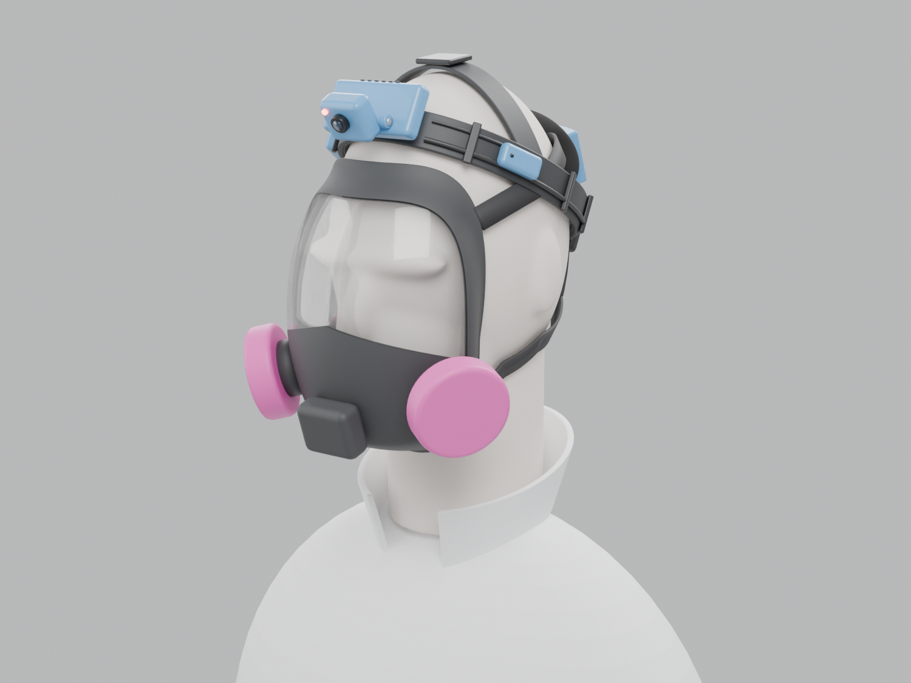
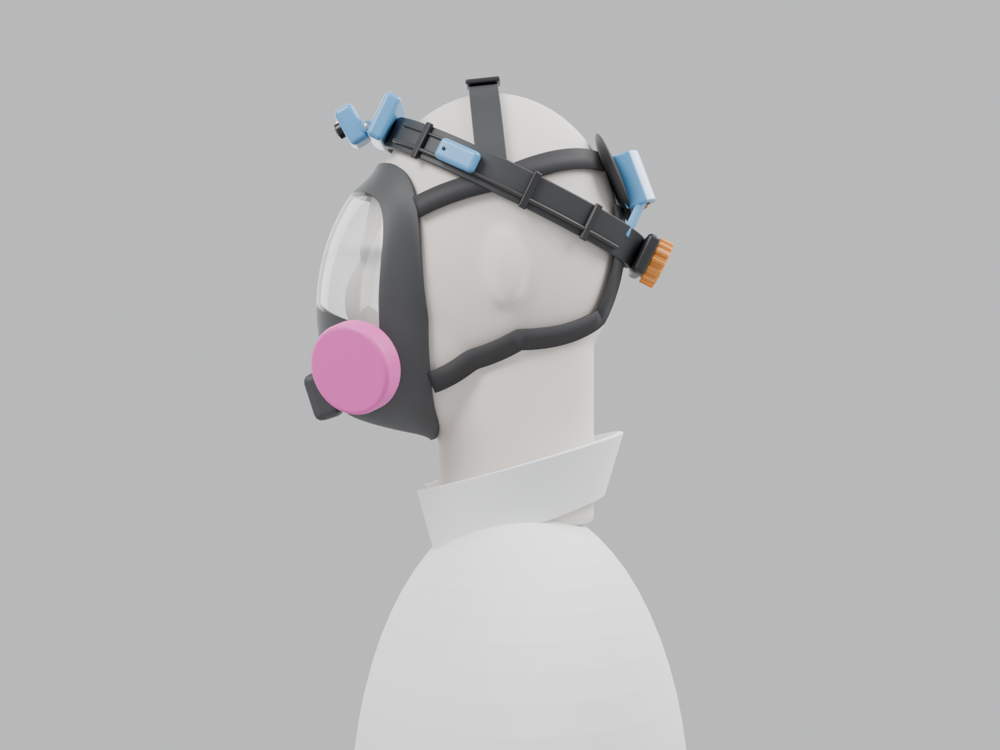
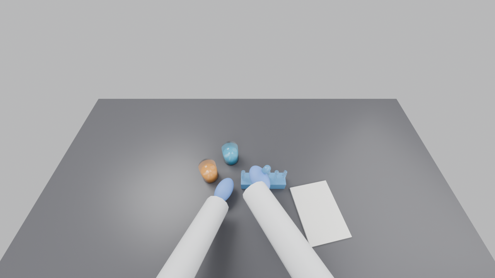
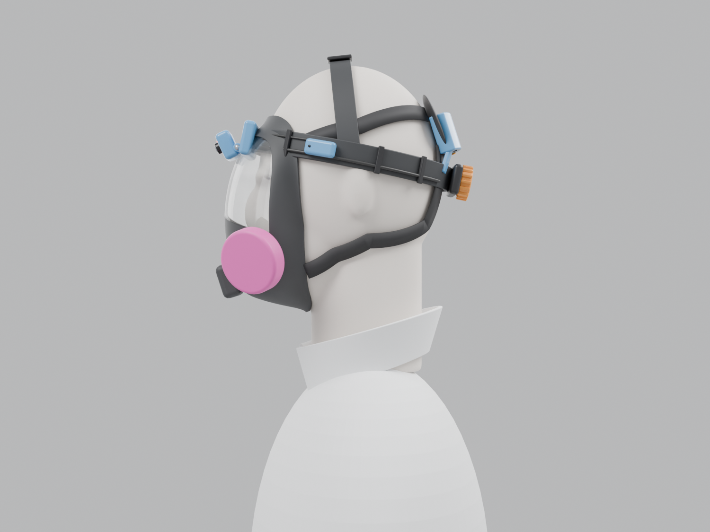
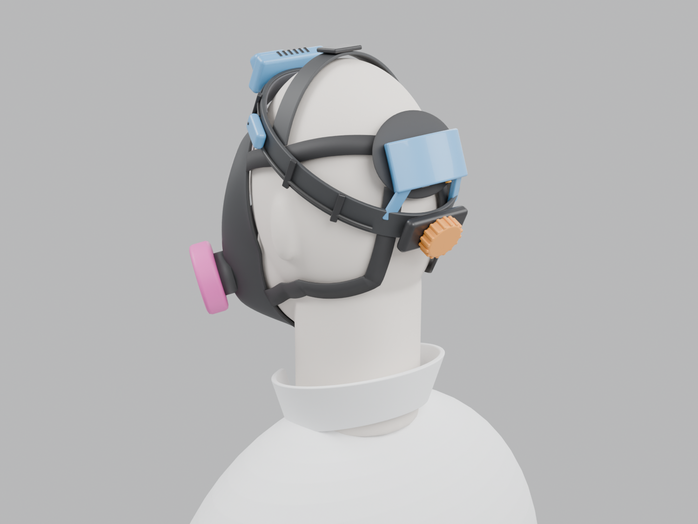

# Provenance Eyes with full-face respirators and lab coats

Sterling added two working conditions on
[#342](https://github.com/vertical-cloud-lab/byu-vcl/issues/342) (2026-11-13): people
sometimes wear **full-face respirators**, and they put on and take off **lab coats** at
various times. This page checks the headset and the commercial survey against both. It led
to **v2** of the headset, which is now the design in the [README](README.md).

**Status: designed, not built or worn.** The respirator and lab coat in the renders are
generic shapes (a medium elastomeric full-face facepiece with two filters and a four-strap
harness, and a coat collar), not any particular product. The clearances below are
measurements of that model. A person still has to check them on a real head, with the lab's
own respirator.

## Short version

- **No glasses-type device can be worn with a full-face respirator.** Their arms would have to
  pass under the facepiece's seal, and nothing they could hang on outside the facepiece would
  fit. That rules out every glasses option in the [survey](../../docs/provenance-eyes.md) on
  respirator days: Meta, Mentra Live, Iristick.G3, Pupil Labs Neon and the Vuzix glasses.
- **The part 2 headset (v1) fails too.** Its band runs across the forehead where the facepiece
  seals, and its camera sits where the top of the facepiece is
  ([render](img/v1-respirator-conflict.png)).
- **v2 fixes that with the same parts and cost (about $177).** The band is worn like a cap,
  with its front at the hairline rather than across the forehead, so the headset goes on
  *over* the respirator's straps and nothing touches the facepiece.
  - Nearest gap to the facepiece in the model: **10 mm**, at the band.
  - The camera's view: **none** of the frame is blocked by the facepiece or filters, at any
    hinge tilt up to 40°. v2 is set to 30°.
- **Lab coats.** The headset has nothing below the back of the head and no cable to the body, so
  a coat goes on and off without touching it. In the model, its lowest point is **107 mm
  above the coat collar**. The "battery in a pocket" option is dropped, because its cable would
  have to come out from under the coat every time.
- **Commercial options shrink to helmet-mounted ones on respirator days:** a GoPro on a helmet
  (scriptable through the Open GoPro API) or a RealWear Navigator 520 on a hard hat (not tried
  with a respirator). See [the table](#the-commercial-options-under-the-same-two-conditions).
- **Two things only people can settle.** Each wearer's respirator **fit test has to be done
  with the headset on**, and BYU EHS should agree to the arrangement before anyone works in a
  respirator with it.

| | |
| --- | --- |
|  |  |
| **v2 over a full-face respirator.** The band rides above the facepiece's top edge and over the straps. | **From the side.** The camera stands clear of the visor, the mics are above the upper straps, and the collar is far below. |
|  |  |
| **What the camera sees** with the head bowed 25° at a bench, respirator on. The facepiece and filters are out of frame. | **Why v1 had to change.** The part 2 band and camera run straight into the facepiece. |

*From behind: the battery pod stands 10 mm off the head so it rides over the harness pad, and
the ratchet sits below the pad.*

## Full-face respirators

### What the rules allow

- **Nothing may get between the facepiece and the face.** OSHA's respirator standard bars
  tight-fitting facepieces for anyone with "any condition that interferes with the
  face-to-facepiece seal or valve function", and says corrective glasses, goggles "or other
  personal protective equipment" must be "worn in a manner that does not interfere with the seal
  of the facepiece to the face of the user"
  ([29 CFR 1910.134(g)(1)(i)(B) and (g)(1)(ii)](https://www.osha.gov/laws-regs/regulations/standardnumber/1910/1910.134)).
  OSHA's earlier wording spelled out "a skull cap that projects under the face piece or temple
  pieces on glasses" ([1995 interpretation](https://www.osha.gov/laws-regs/standardinterpretations/1995-09-20)),
  which covers both a glasses-type camera and a band worn under the facepiece's edge.
  Dräger says "normal spectacles will interfere with the facepiece seal and are not permitted in
  the sealing area" ([FPS 7000 instructions](https://www.draeger.com/Content/Documents/Products/fps-ifu-9031013-en-us-me.pdf)),
  and Honeywell says "you must use a spectacle insert"
  ([North full-facepiece donning guide](https://www.safety.duke.edu/sites/default/files/north-full-facepiece-respirators-donning-and-doffing.pdf)).
- **The fit test includes whatever else is worn.** "The fit test shall be performed while the
  test subject is wearing any applicable safety equipment that may be worn during actual
  respirator use which could interfere with respirator fit"
  ([Appendix A, Part I.A.13](https://www.osha.gov/laws-regs/regulations/standardnumber/1910/1910.134AppA)).
  A headset worn over the straps is exactly that, so it goes into each wearer's fit test.
- **Nothing may be added to the respirator.** NIOSH approves the respirator as a complete
  assembly. It warns that parts or accessories not approved for that respirator can compromise
  the wearer ([NIOSH 2016-107](https://www.cdc.gov/niosh/docs/2016-107/default.html)), and that
  approved respirators should not be modified at all, down to knotting a strap to improve fit
  ([AIHA summary of the 2022 notice](https://www.aiha.org/news/220908-niosh-approved-respirators-cannot-be-altered-to-improve-fit)).
  So no clip, mount or microphone goes on the facepiece, the filters or the straps.
- **The user seal check stays as it is.** It is done "each time they put on the respirator"
  ([(g)(1)(iii)](https://www.osha.gov/laws-regs/regulations/standardnumber/1910/1910.134)), before
  the headset goes on.

### What that leaves for a head camera

- **Nothing between the facepiece and the skin.** That rules out glasses and a band across the
  forehead.
- **Nothing attached to the respirator.** No clips on the facepiece, filters or straps.
- **So the headset goes on over the harness, above the facepiece**, the way a hard hat is worn
  with a full-face respirator.

Respirator harnesses are made to be worn under head protection, and respirator makers say so:

- Honeywell's North full-facepiece guide: "first complete the respirator donning process –
  including seal checks with cartridges. Then, you may put on a hard hat"
  ([Duke OESO copy](https://www.safety.duke.edu/sites/default/files/north-full-facepiece-respirators-donning-and-doffing.pdf)).
- Honeywell's RU6500 harness "can be used under hard hat"
  ([Honeywell](https://automation.honeywell.com/gb/en/products/personal-protective-equipment/respiratory/air-purifying-respirator-apr/ru6500-full-facepiece)),
  and GVS designs its Elipse full face "to be compatible with most safety helmets"
  ([GVS](https://www.gvs.com/en/catalog/elipse-full-face-p100-respirator)).
- 3M's FF-400 harness has six straps and is "compatible with any hardhat"
  ([COS magazine](https://www.thesafetymag.com/ca/products/ppe/lightweight-yet-heavy-duty/189104)).

Helmet makers, on the other hand, say nothing about respirators either way.

A ratchet headgear is a hard hat's suspension without the shell, so v2 keeps the part 2 headgear
(3M H8A) and simply wears it higher: front at the hairline with the crown strap shortened, back
under the bulge at the back of the head.

If the band won't stay at the hairline on a real head, two fallbacks keep the same rule (over
the harness, off the facepiece):

- **A light helmet** worn over the respirator, with the same pods fixed to its shell. That is
  the hard-hat arrangement exactly, at the cost of a warmer, heavier carrier: the Petzl Strato is
  435 g ($149.95) and the Vertex 490 g ($114.95), both with headlamp clips
  ([Strato](https://www.petzl.com/US/en/Professional/Helmets/STRATO),
  [Vertex](https://www.petzl.com/US/en/Professional/Helmets/VERTEX)), against about 145 g for the
  ratchet headgear. Leave the chinstrap off, since it would cross the facepiece's chin; Petzl's
  [instructions](https://products.papertrail.io/downloads/petzl/1936b2a_technical-notice-VERTEX-1.pdf)
  cover removing it. Don't glue mounts on: Petzl forbids adhesives on the shell.
- **A second crown strap**, front to back, so the band hangs from the crown instead of gripping
  the forehead. Some hard-hat suspensions are built this way.

### v2: the same headset, worn like a cap

| | v1 (part 2) | v2 (this page) |
| --- | --- | --- |
| Band, front | across the forehead, 5.0 cm above the ear line | at the hairline, 11.0 cm above the ear line |
| Band, back | 1.2 cm above the ear line | 1.6 cm above the ear line, under the bulge at the back of the head |
| Camera lens | 4.3 cm above the ear line, about 3 cm above the eyes; tilted 25° down | 10.1 cm above the ear line, about 9 cm above the eyes and 3 cm in front of them; tilted 30° down |
| Battery pod | 4 mm off the head | 10 mm off the head, to ride over a harness pad |
| With a full-face respirator | band, sweatband and Pi enclosure touch the facepiece (0–0.1 mm, [`respirator_check_v1.md`](cad/respirator_check_v1.md)) | nearest gap 10 mm; nothing in the camera's view |
| Add-on parts | 108 g, centre of mass 0.4 cm in front of the ear line | 108 g, 0.7 cm behind it |
| With the headgear | 254 g, 1.4 cm behind | 254 g, 2.0 cm behind |

The parts, wiring and software are unchanged. The checks come from the model and are written by
the build script to [`cad/respirator_check.md`](cad/respirator_check.md):

| Check (v2, from the model) | Result |
| --- | --- |
| Nearest device part to the facepiece | the band, **10 mm** clear of the facepiece's top edge (clips 12 mm, Pi enclosure 17 mm, camera head 20 mm) |
| Respirator in the camera's frame (102° × 70°) | **0%** at hinge tilts up to 40° (v2 is set to 30°). Past that, the valve and filters come into the bottom of the frame: 0.7% at 50°, 12% at 60°. A 30 mm brim would hold them out to about 50°. |
| Lowest point vs. a lab coat collar | the ratchet knob, **107 mm** above the collar's top edge at the back |

The facepiece, filters and valve sit below and behind the lens. The build script also aims test
rays at the visor and a filter, to confirm the ray test can see them at all.

**The camera sits higher above the eyes.** About 6 cm higher than in v1, so close work is seen a
little more from above. At a bench this hardly matters: the hands are 40–60 cm away. The hinge
still sets the tilt, and 30° suits a head bowed about 25°, as in the camera-view render.

**Balance with a respirator on.** A full-face facepiece with two filters puts its own weight in
front of the face. Listings for the common 3M 6800 disagree on how much, from 1.2 lb (about
540 g) to 2 lb, even on
[one page](https://www.homelectrical.com/6800-medium-full-facepiece-respirator.mco-6800.1.html),
and we found no figure from 3M. The headset's centre of mass is 2.0 cm *behind* the ear line with
its headgear, so it offsets a little of that pull rather than adding to it.

### How to wear it

1. Put the respirator on and do the user seal check, exactly as without the headset. This is the
   order Honeywell gives for a hard hat.
2. Put the headset on over the harness. Set the band at the hairline, with the ratchet below the
   harness pad, and tighten it only until it stays put. Check that nothing touches the
   facepiece, then do the seal check again.
3. Take the headset off first, then the respirator. It has no buckle: it should lift off
   backwards in one movement, so it doesn't slow down taking the respirator off. Check that on
   the first fitting, with the ratchet as tight as it will be worn.
4. Fit testing: the wearer's annual fit test is done with the headset on (see the rules above).

### Audio through a facepiece

- **Hearing what the wearer hears is unchanged.** A full-face facepiece leaves the ears
  uncovered, and the mics are outside it, beside the ears.
- **The wearer's own voice is the open question.** It reaches the mics through the facepiece and
  its speaking diaphragm, muffled and quieter, with breathing and the exhalation valve close by.
  Every kind of respirator makes the wearer harder to understand, which is why full facepieces
  have a speaking diaphragm. We found no figure for what a facepiece costs a speech-to-text
  model, so phase 0 measures it.
- **Test before building anything for it.** Phase 0 of [`SOFTWARE.md`](SOFTWARE.md) now records
  the same passage with and without the respirator and compares the transcripts. Phase 3 flags
  low-confidence transcript lines instead of dropping them.
- **If the transcripts are too poor**, in order of preference:
  1. A third microphone on a short bendable arm from the right temple pod, ending in front of
     the speaking diaphragm, a few centimetres off the facepiece and never touching it. The Pi
     Zero's I2S input takes two mics, so on respirator days this one takes over one channel
     through a small plug in the temple pod, and the stereo pair becomes "room" and "voice".
     The arm and mic cost about $10 (estimate).
  2. A throat microphone. It picks up speech through the neck, so breathing noise and the
     facepiece matter less, but its strap and cable sit where a lab coat collar goes.
  3. A voice amplifier made for the lab's respirator model, if its maker sells one. It mounts on
     the facepiece, so it is only acceptable if it is approved for that respirator; check
     whether it has an audio output the Pi can record before buying one.

## Lab coats

Today's chest camera has to move every time a coat does. Clipped to the coat, it leaves with the
coat; clipped to a shirt, the coat covers it. The headset avoids both:

- **Nothing below the back of the head.** In the model its lowest point, the ratchet knob, is
  **107 mm above the top of the coat collar** at the back, so a collar flipped up while
  the coat goes on still passes well clear.
- **Nothing cabled to the body.** The battery is on the head, so no cable has to be threaded
  under or over the coat. This is also why the pocket power bank option is
  [dropped](BOM.md#options).
- **The recording carries on.** Putting a coat on or taking it off is part of the record, so the
  recorder never stops by itself ([`SOFTWARE.md`](SOFTWARE.md#phase-1-the-recorder-service)).
- **Contamination.** The record button is pressed with gloved hands, so treat the headset like
  goggles or a face shield. CDC's example order for taking PPE off is gloves, then goggles or face
  shield, removed "from the back by lifting head band", then the gown, then the respirator last
  ([CDC](https://www.cdc.gov/infection-control/media/pdfs/Toolkits-PPE-Sequence-P.pdf); it calls
  this one of "a variety of ways", so follow the lab's own procedure where it differs). So:
  gloves off, lift the headset off by the band at the back, then the coat, then the respirator. Then treat it like shared eyewear: wipe it down
  at the end of each session, and before it leaves a room where it may have been splashed. The enclosures are PETG and the headgear is plastic,
  but nothing is sealed, so wipe rather than spray or soak, and keep liquid away from the
  vents, the mic holes and the USB-C port. RealWear gives the same advice for its headsets:
  "Isopropyl alcohol wipes", and "Never submerge"
  ([RealWear](https://support.realwear.com/knowledge/device-cleaning)). Check the lab's own
  disinfectant against PETG before using anything stronger.

## The commercial options under the same two conditions

From the [survey](../../docs/provenance-eyes.md), re-checked against the two conditions:

| Device | How it is worn | With a full-face respirator | Lab coats on and off |
| --- | --- | --- | --- |
| Iristick.G3 | safety glasses with "No battery necessary", plugged into a phone "by USB-C" ([Iristick](https://iristick.com/tools/Iristick.G3/)) | **no**: glasses arms cross the seal | the phone cable has to be rethreaded |
| Pupil Labs Neon | glasses frame, "Cable: USB-C" to its phone ([specs](https://pupil-labs.com/products/neon/specs)) | **no** | the phone cable has to be rethreaded |
| Mentra Live, Meta glasses, Android XR glasses | glasses, wireless to a phone | **no** | fine |
| Vuzix M400 / LX1 | a display arm on a glasses frame or headband | **no** on glasses; a headband would cross the forehead seal | fine |
| RealWear Arc 3 | standalone Android headset, "Worn like a headband" ([RealWear](https://shop.realwear.com/products/realwear-arc-3)) | **unlikely** as sold: a band round the head meets the top of the facepiece, and no hard-hat mount is listed | fine: nothing is cabled to the body |
| RealWear Navigator 520 | standalone, 270 g, $3,150, "worn around the head or attached to a hard hat" with clips for the hat's accessory slots ([RealWear](https://shop.realwear.com/products/realwear-navigator-520)) | **possibly**, on a hard hat worn over the respirator. RealWear lists helmets, eyewear and hearing protection as compatible, not respirators ([specs](https://shop.realwear.com/pages/realwear-navigator-520-specifications)), and the camera arm has to clear the facepiece | fine |
| GoPro HERO13 Black on a helmet | standalone, 159 g, $429.99, over 2.5 h at 1080p30 ([GoPro](https://gopro.com/en/us/compare)) | **yes**, on a helmet worn over the harness; not on GoPro's head strap, which crosses the forehead | fine |
| Insta360 GO 3S / GO Ultra | 39–53 g magnetic cameras | as the GoPro | fine, but no live streaming, and the SDK is Android-only, so no scripting from a Pi ([Insta360](https://www.insta360.com/developer/home)) |
| Today's chest camera | clipped to the coat or the shirt | fine | **has to move** every time the coat does |
| Provenance Eyes v2 (this build) | cap-like band | **yes**, over the harness; 10 mm clear of the facepiece in the model | fine |

So on respirator days the commercial choice narrows to a Navigator 520 on a hard hat, which nobody
has tried with a respirator yet, or a GoPro on a helmet. The GoPro is the cheap, scriptable one.
The [Open GoPro API](https://gopro.github.io/OpenGoPro/docs) supports the HERO13 Black and
"Users can interact with the camera over BLE, WiFi, or wired USB": it starts and stops capture,
copies files over Wi-Fi or USB, and live-streams over RTMP. The
[FAQ](https://gopro.github.io/OpenGoPro/docs/faq) gives the stream as 480p to 1080p, up to 85
minutes at 720p on a full Enduro battery, and lists HERO13-specific known issues. Its Python
package isn't listed as tested on a Raspberry Pi, and it means wearing a helmet. Glasses are fine on other days, but a lab that sometimes needs
respirators would then run two systems.

**One exception to "nothing in the mask":** 3M's Scott Sight puts a thermal camera and display
inside the facepiece, but only for the AV-3000 HT firefighting (SCBA) mask
([New Atlas](https://newatlas.com/scott-sight-firefighting-thermal-imaging-mask/42947)).

## Still to check

- **The lab's own respirators.** Which models, sizes and harnesses people actually wear. The
  model has a four-strap harness with a pad high on the back of the head; a five-strap harness
  adds a strap over the crown, under the headset's crown strap.
- **On a real head:** the band staying at the hairline through a shift, pressure on the harness
  straps under the band, and whether the facepiece shifts when the head turns.
- **Speech** through the facepiece: see [`SOFTWARE.md`](SOFTWARE.md#phase-0-bench-prototype-a-day-or-two), item 5.
- **EHS sign-off** for wearing the headset with a respirator, and the cleaning routine.
