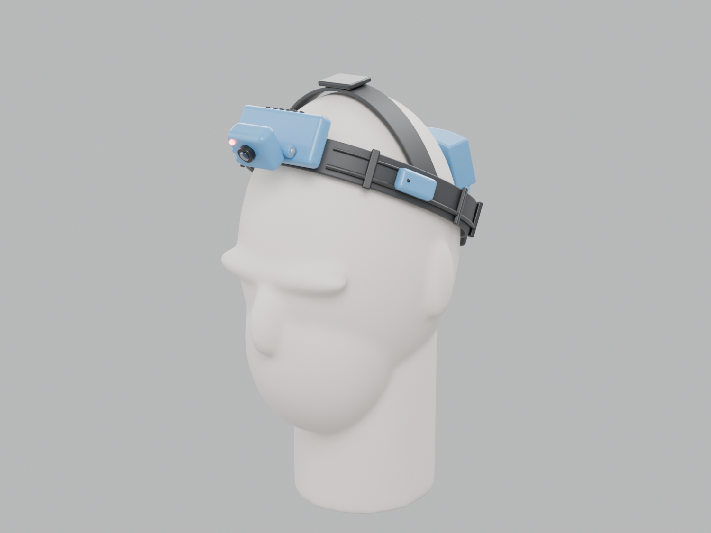
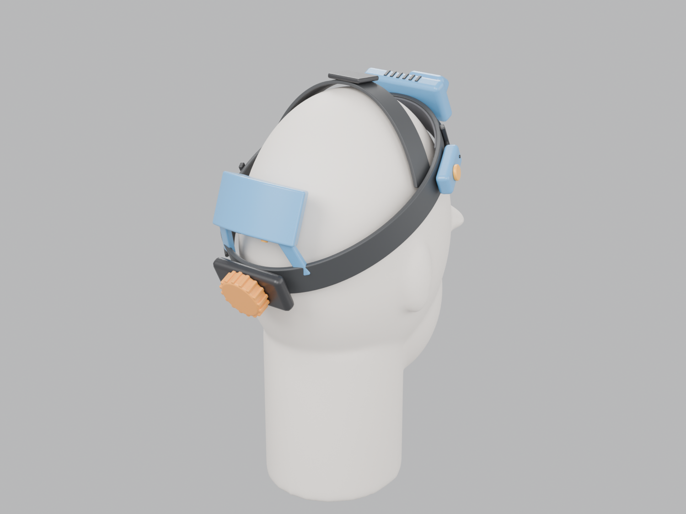
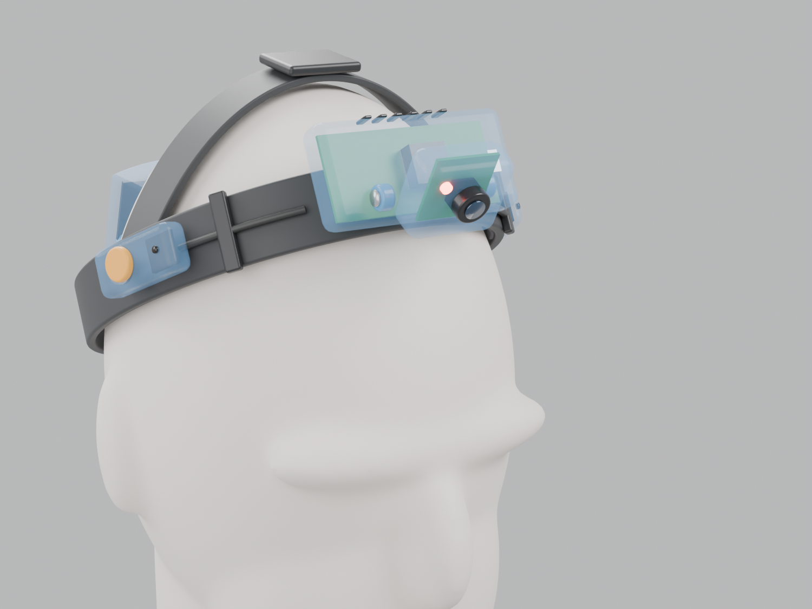
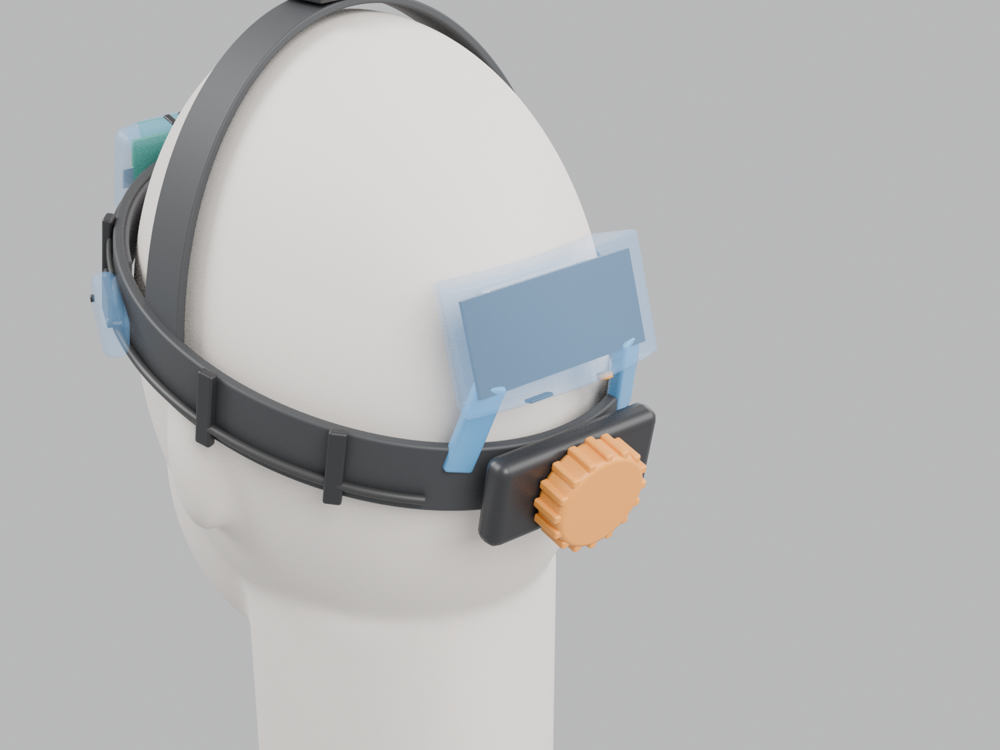
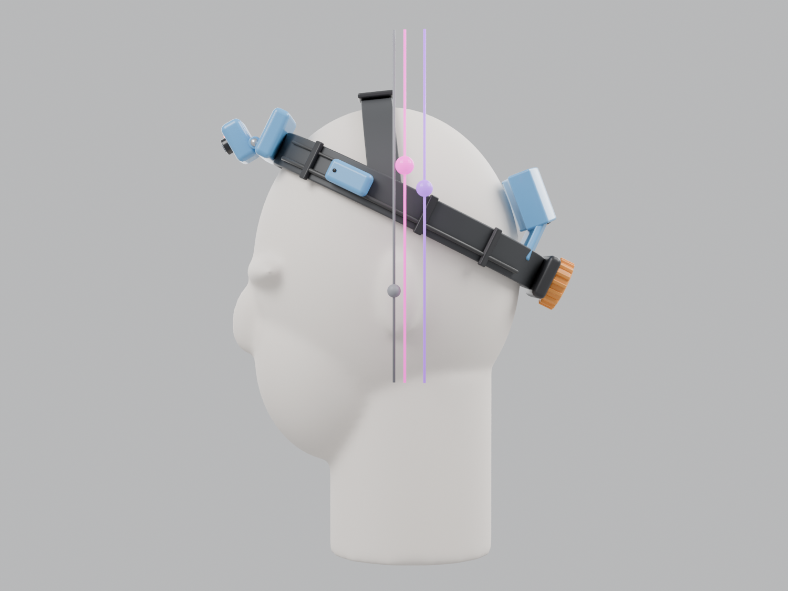

# Provenance Eyes: a Raspberry Pi head camera

A head-worn recorder that sees what the wearer sees and hears what they hear. One button starts a
recording; pressing it again stops it, and the clip goes to YouTube on its own. The transcript, an
analysis of the video and its conclusions then land on GitHub. Asked for by @gage-erickson on
[#342](https://github.com/vertical-cloud-lab/byu-vcl/issues/342), as a replacement for the chest
camera. The first part of that issue, a survey of commercial smart glasses, is
[`docs/provenance-eyes.md`](../../docs/provenance-eyes.md). Its closest off-the-shelf match to
this build is Mentra Live ($449).

**Status: designed, not built.** The model below is a concept: parts are placed at their real
sizes and weights, but the printed enclosures are envelopes, not print-ready parts. Nothing has
been bought, printed, wired or worn. Prices were checked on 2026-11-12.

| | |
| --- | --- |
|  |  |
| **Front.** The camera head (Camera Module 3 Wide) hinges off the Pi enclosure and looks 25° down, at the hands. The red LED shows when it is recording. | **Back.** The battery pod rides on the occiput, above the ratchet knob, as the counterweight. |
|  |  |
| **Inside the front.** Pi Zero 2 W with its heatsink under the vents, camera board in the head. Right temple: the record button (orange), a mic and a vibration motor. | **Inside the back.** PiSugar 3 board and its 1200 mAh cell, in a pod curved to the head. |

The model is [`cad/build_headset.py`](cad/build_headset.py) (Blender, run headless). The whole
device without the head is [`stl/headset-assembly.stl`](stl/headset-assembly.stl), which GitHub
shows in a 3D viewer you can turn.

## The layout: a headlamp with a camera

The device is laid out like a headlamp with its battery at the back (Petzl's NAO RL is 145 g, with
an 80 g battery behind the head
([retailer](https://www.bergzeit.co.uk/p/petzl-r1-battery-nao-rl-headlamp/5049366))):

| Where | What | Why there |
| --- | --- | --- |
| Forehead | Pi Zero 2 W, and a hinged camera head with a Camera Module 3 Wide and a red recording LED | The camera sits about 3 cm above the eyes, so its view is close to the wearer's. The tilt is adjustable; 25° down frames hands on a bench. A Pi beside the camera needs only a short camera cable, so no 50 cm ribbon runs round the head. |
| Temples, just in front of the ears | One I2S MEMS microphone each side, wired as a stereo pair. The right pod also has the **record button** and a coin vibration motor. | The mics are about 15 cm apart and close to the ears, so the recording hears roughly what the wearer hears, in stereo. The button is where a hand finds it without looking, like the capture button on smart glasses. The motor buzzes to confirm start, stop and bookmarks, since the wearer can't see the LED. |
| Back of the head | PiSugar 3: a 1200 mAh LiPo, its charger, a real-time clock and a USB-C charge port, in a pod curved to the head | It is the heaviest part and the counterweight to the front. The clock keeps timestamps right when there is no Wi-Fi. |
| Along the band | One 4-wire cable round the left side (5 V, ground and I2C), and short mic and button runs from the temples to the front | Cable clips hold the runs to the band. |

### Balance

Weights and positions come from [`cad/layout.py`](cad/layout.py). The renders use the same file,
and [`cad/mass_budget.py`](cad/mass_budget.py) prints the full table. The centre of mass is
measured from the **ear line**, the line through both ear canals (the tragion).

| Build | Add-on parts | Their centre of mass | With the headgear |
| --- | ---: | --- | --- |
| **PiSugar 3, 1200 mAh (default)** | **108 g** | **0.4 cm in front of the ear line**, centred left to right | 254 g, 1.5 cm behind |
| Larger 3000 mAh cell | 140 g | 1.9 cm behind | 284 g, 2.4 cm behind |
| Battery in a pocket, cable down the neck | 66 g | 6.6 cm in front (no counterweight) | 212 g, 0.1 cm in front |



*Side view. Grey line: the ear line. Magenta: the add-on parts' centre of mass. Purple: with the
headgear. Both are drawn just outside the head, as projections.*

- **Why this is the target.** Ito et al. tested VR headsets of 470–670 g and found that "if the
  COM lies within 2 cm in front of the tragion notch, the physical load remains almost constant",
  whatever the weight. From 2 to 4 cm in front, the load climbs fast
  ([Applied Sciences 11:6802, 2021](https://doi.org/10.3390/app11156802)). The default build's
  add-on parts sit 0.4 cm in front of the ear line, inside that window.
- **Left to right**, the right temple pod is 3.5 g heavier, because it carries the button and
  motor. The power cable runs down the left side to even that out.
- **The headgear's own centre of mass is a guess.** The table splits its 145 g as 80 g band, 20 g
  crown strap and 45 g ratchet, which puts its centre of mass behind the ear line. A front-heavy
  headgear such as the 3M H8A would bring the total forward. Weigh the real one.
- **This much mass barely loads the neck.** 254 g on a 4.5 kg head moves the combined centre of
  mass by under 0.1 cm. Balance matters most for keeping the band from rotating and slipping, and
  the crown strap carries the vertical load.
- **Battery trade-off.** The 1200 mAh cell gives roughly 2 h of recording (4.4 Wh at about 2 W;
  measure it). A 3000 mAh cell gives about 2.5 times that, but pulls the centre of mass 2 cm back. For a full
  day, the pocket power bank takes the battery off the head entirely. Without the counterweight,
  move the Pi to the back of the band too, or the front will feel heavy.

## The headband

Build on **ratchet suspension headgear**, the kind sold as a replacement for face shields and
welding helmets. It adjusts with a knob, has a crown strap to carry weight, is made to be worn for
whole shifts, and costs under $35. Elastic straps hold by squeezing, which gets uncomfortable over
hours, and pods on them creep.

| Headband | Price (2026-11-12) | Weight | Notes |
| --- | --- | --- | --- |
| **[3M H8A ratchet headgear](https://argo.webstaurantstore.com/3m-82501-00000-h8a-blue-thermoplastic-ratchet-headgear/39982501.html)** (82501-00000) **(pick)** | $18.49 (WebstaurantStore) | not published | Ratchet and a "five position crown strap" ([datasheet](https://media.digikey.com/pdf/Data%20Sheets/3M%20PDFs/82501-00000_Ds.pdf)). The rigid front piece has face-shield attachment points, a stiff place to mount the front pod. Cheap enough to buy two for fitting. Bulky at the front. |
| [Jackson Safety 370 ratchet headgear](https://www.dillonsupply.com/Product/05820696) (20696), runner-up | $32.85 (Dillon Supply) | about 145 g (reseller) | Ratchet, crown strap, and a pivoting rear cradle that resists creep. Lower profile, but the front pod needs its own printed bracket, and the side pivot hubs may sit where the mic pods go. |
| [Lincoln Electric KP4100-1](https://weldingmart.com/products/lincoln-electric-ratchet-style-headgear-w-sweatband-kp4100-1) | $33.88 (WeldingMart) | not found | Ratchet headgear with a sweatband, much like the 370. |
| [GoPro Head Strap 2.0](https://www.bestbuy.com/site/6545389.p) (ACHOM-002), soft option | $26.99 (Best Buy) | 97–135 g (listings disagree) | Elastic, with a top strap. Light and easy to clip onto, but pods can creep and rotate. |

The render shows a generic ratchet headgear of this type, not any one product. Weigh the one you
buy and update `HEADGEAR_G` in `layout.py`.

## Cost

About **$177 for the default build**: about $141 of electronics, $18.49 for the headgear, and
about $17.50 for screws, wire and filament.
The line items, links and options are in [`BOM.md`](BOM.md).
Running costs are close to nothing: YouTube uploads are free, transcription runs on a GitHub
runner, and the Claude analysis uses the lab's existing Claude Code token.

## Software

Press → record → stop → YouTube → transcript, analysis and conclusions on GitHub. The build-out
path, in six phases with the commands for each, is in [`SOFTWARE.md`](SOFTWARE.md). In short:

1. **On the headset:** a `systemd` service watches the button and runs `rpicam-vid` with the
   stereo mics, using the Zero 2 W's hardware H.264 encoder. It writes a crash-safe MKV and a JSON
   sidecar with UTC times, bookmarks and logs.
2. **When the clip ends:** the headset uploads it to YouTube with the lab's upload-only token
   ([`youtube/yt_service.py`](../../youtube/yt_service.py)). It then sends the audio and keyframes,
   a few MB, to a private GitHub repo as a release.
3. **On GitHub Actions:** faster-whisper transcribes the audio and Claude writes the analysis and
   conclusions from the transcript and frames. The workflow commits all of it, with timestamped
   YouTube links, and comments on any issue the wearer names.

## Files

| Path | What |
| --- | --- |
| [`cad/layout.py`](cad/layout.py) | Head form, band geometry, pod positions and part masses (plain Python) |
| [`cad/build_headset.py`](cad/build_headset.py) | Builds the scene in Blender, renders `img/`, exports `stl/` |
| [`cad/mass_budget.py`](cad/mass_budget.py) | Mass table and centre of mass for each battery option |
| [`img/`](img) | The renders |
| [`stl/headset-assembly.stl`](stl/headset-assembly.stl) | Device without the head, in mm, for viewing (not a print file) |
| [`BOM.md`](BOM.md) | Parts, prices, links |
| [`SOFTWARE.md`](SOFTWARE.md) | Software build-out path |

To regenerate (Blender 5.0, about 5 minutes on 4 cores; `--quick` for low-resolution test renders):

```bash
cd hardware/provenance-eyes/cad
blender -b --factory-startup -P build_headset.py --            # all views + STL
python3 mass_budget.py                                          # balance tables
```

## Still to check

- **Weights we estimated:** the PiSugar 3 and its cell, the printed pods and the headgear. None of
  them is published.
- **Heat:** the Zero 2 W sits at the forehead and dissipates about 2 W while encoding, roughly a
  headlamp's worth. Check the enclosure's temperature against the skin during a 30-minute
  recording, and move the Pi to the back if it is uncomfortable.
- **Separating the PiSugar 3 from the Pi.** It normally mounts under the Pi on pogo pins. Here
  it powers the Pi over a cable (5 V and ground, with I2C for the clock, the battery gauge and its
  button). Confirm the board supports this, and a larger cell, before relying on either.
- **Privacy.** The headset records people as well as procedures. Keep the LED visible, upload as
  unlisted or private, keep transcripts in a private repo (this one is public), and ask BYU's IRB
  before using recordings as research data about people.
