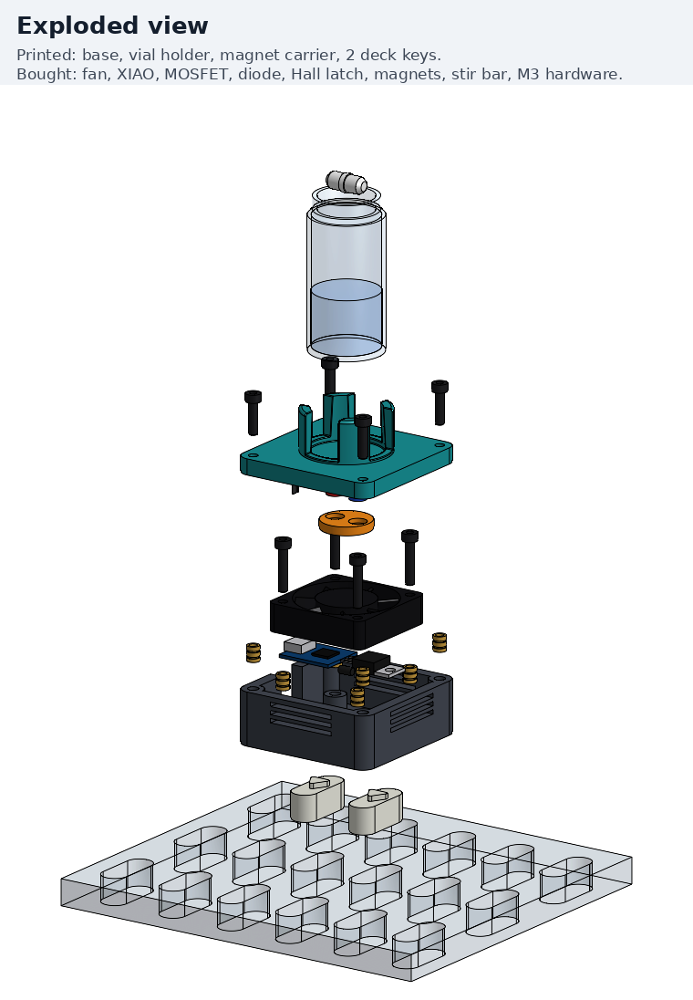
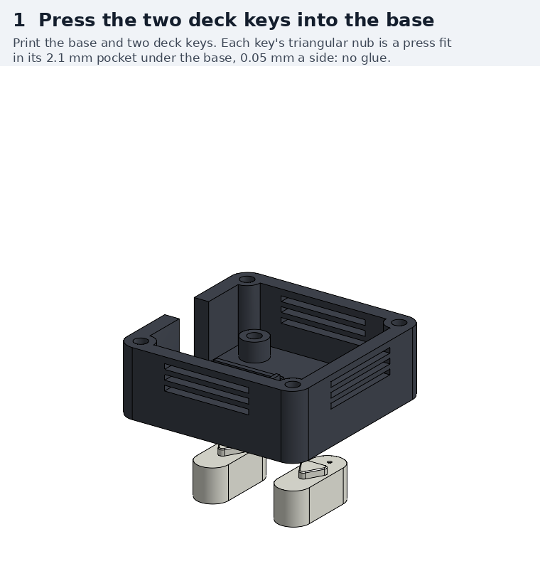
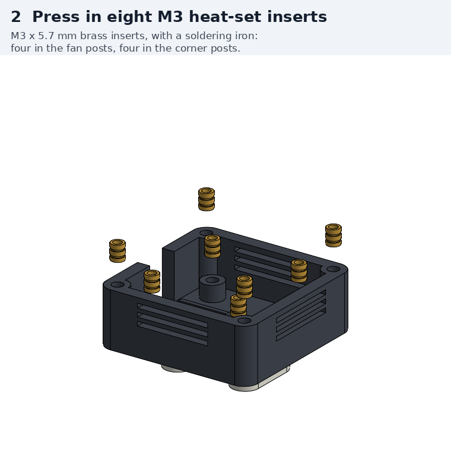
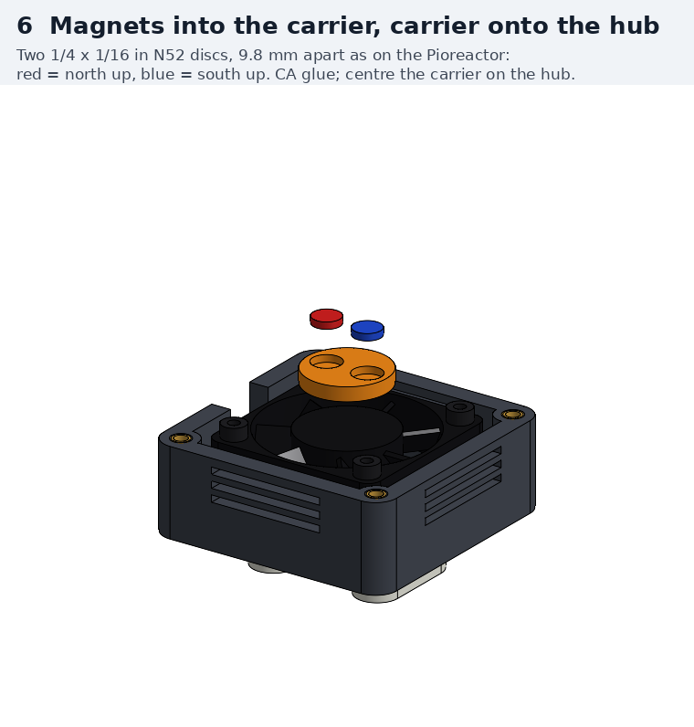
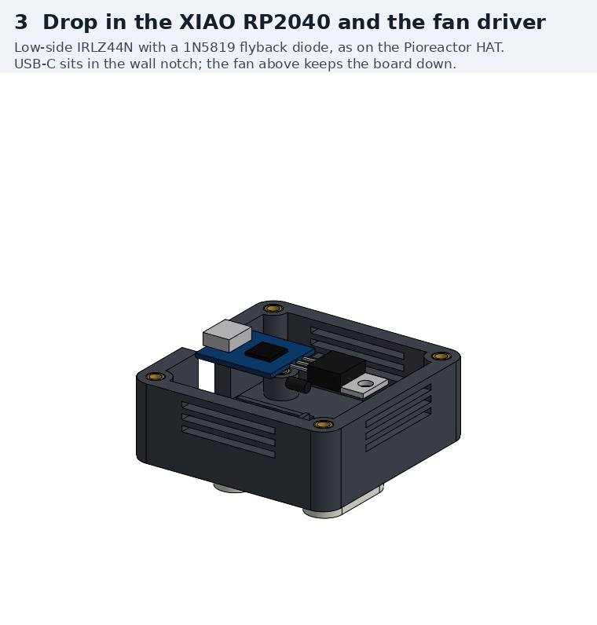
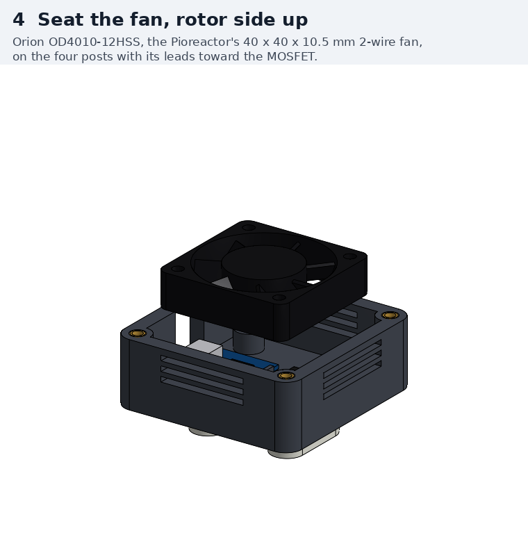
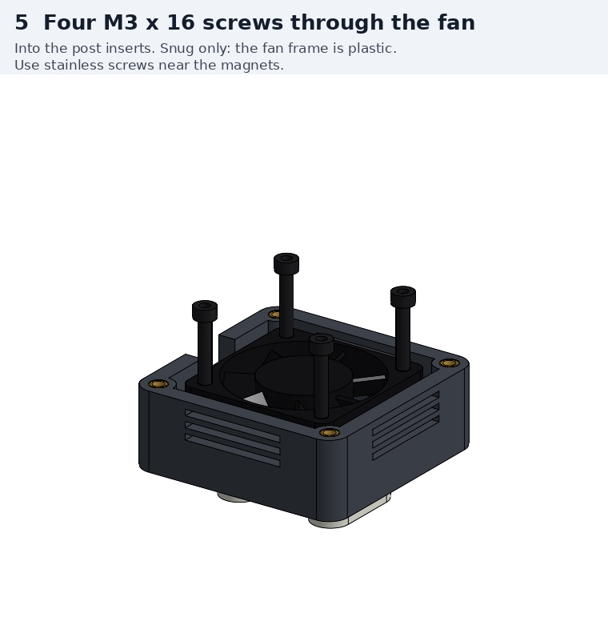
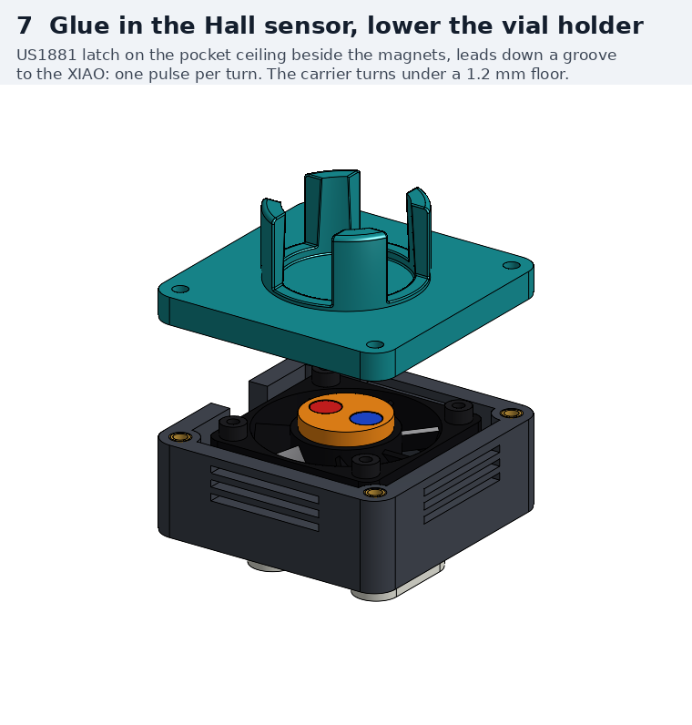
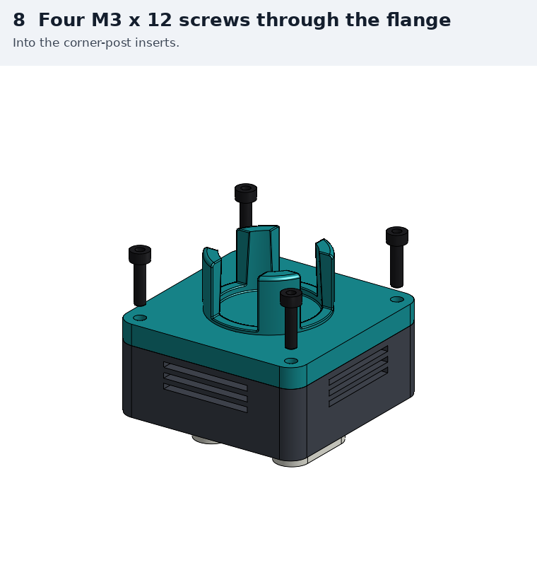

# Build guide: single-vial magnetic stirrer, driven by the CubXL's Uno

Step by step, from the parts in [`BOM.md`](BOM.md) to a stirrer turning a stir bar on the
CubXL deck. The design and the reasons behind it are in [`README.md`](README.md). This guide
covers the version that runs off the CubXL's Arduino Uno, the one that already drives the
capper and the pipette. For the self-contained XIAO RP2040 version, only the controller
and its wiring differ (README, [Wiring, XIAO version](README.md#wiring-xiao-version)).

**No stirrer has been built yet,** so this is the first build. Some of the design's
numbers are estimates, and the steps marked **Check** are where they get tested. Please
write those measurements down and post them on
[PR #269](https://github.com/vertical-cloud-lab/byu-vcl/pull/269) (list at the
[end](#what-to-report-back)). If a step here turns out wrong, say so there too, so the
guide can be fixed.



| Stage | What | Where the time goes |
|---|---|---|
| [0](#0-before-you-start) | Parts, tools, three measurements | |
| [1](#1-print-the-parts) | Print five parts and three spacer discs, check them | Printing |
| [2](#2-glue-the-deck-keys-into-the-base) | Deck keys into the base, glued on the deck | Glue cure |
| [3](#3-press-in-the-heat-set-inserts) | Eight heat-set inserts | |
| [4](#4-glue-the-magnets-into-the-carrier) | Two magnets, opposite poles up | Glue cure |
| [5](#5-wire-the-electronics) | Junction board, Hall sensor, cable, bench check | Soldering |
| [6](#6-assemble) | Board, fan, carrier, sensor, holder | |
| [7](#7-flash-the-uno) | Stirrer firmware onto the shared Uno | Needs the CubXL idle |
| [8](#8-first-spins) | No vial, then water, then the coupling test | |
| [9](#9-add-the-vial-to-the-deck-file) | Vial position and height for CubOS | Teaching |

## 0. Before you start

### Parts

| | Item | Qty | From |
|---|---|---|---|
| Printed | Base, vial holder, magnet carrier | 1 each | [`step/`](step) or [`stl/`](stl), see [stage 1](#1-print-the-parts) |
| Printed | Deck key | 2 | same |
| Printed | Spacer discs, Ø27 × 1, 2 and 3 mm (for the coupling test) | 1 each | a cylinder in any slicer |
| Bought | Orion OD4010-12HSS fan | 1 | BOM item 1 |
| Bought | N52 magnets, 1/4 × 1/16 in | 2, plus 1 spare for checking poles | BOM item 2 |
| Bought | PTFE stir bar, 15 × 6 mm | 1 | BOM item 3 |
| Bought | US1881 Hall latch | 1 | BOM item 4 |
| Bought | IRLZ44N MOSFET | 1 | BOM item 5 |
| Bought | 1N5819 diode | 1 | BOM item 6 |
| Bought | Resistors: 100 Ω, 10 kΩ × 2 | 3 | BOM item 7 |
| Bought | 22 AWG 4-conductor cable | ~1.5 m | BOM item 8 |
| Bought | JST-XH 4-pin plug and socket, with leads | 1 pair | BOM item 9 |
| Bought | Perfboard | 1 | BOM item 10 |
| Bought | M3 × 5.7 mm heat-set inserts | 8 | BOM item 11 |
| Bought | M3 stainless socket head screws | 4 × 16 mm, 4 × 12 mm | BOM item 12 |
| Lab stock | 100 nF ceramic capacitor | 1 | Recommended by Melexis across the sensor's supply ([US1881 datasheet](https://www.melexis.com/-/media/files/documents/datasheets/us1881-datasheet-melexis.pdf), Application Comments). Not in the BOM |
| Lab stock | CA glue (gel), hot glue, heat shrink, 26 AWG hookup wire in three colours, a small zip tie | | |
| Lab stock | 10 nF ceramic capacitor | 1 | Only if needed, see [Troubleshooting](#troubleshooting) |

### Tools

- Soldering iron, solder, flux. A spare or conical tip for the inserts.
- Multimeter with continuity and DC volts.
- Calipers with a depth rod.
- 2.5 mm hex key, for M3 socket heads.
- Flush cutters, wire strippers, hobby knife, 400-grit sandpaper.
- Heat gun or lighter, for the heat shrink.
- Fine marker.
- A bench supply set to 5.0 V with a 0.3 A current limit, for the bench check.

Keep the magnets away from steel tools and from each other until they are glued in. N52
discs this size jump across a few centimetres and chip when they hit.

### Measure first

These three set the gaps in the stack, and the model had to assume them. Measure them
before printing or gluing anything.

1. **The fan's hub height.** Lay the fan rotor side up: that is the side **without** the
   three or four spokes (struts) that hold the motor, and its centre turns when you spin
   the blades. Don't go by the sticker; many fans carry it on the strut side. Measure how
   far the hub's face stands above (+) or below (−) the frame's top face. The model
   assumes 0. The carrier turns 1.1 mm under the vial holder's floor, so a hub that
   stands proud eats into that gap. If it is more than 0.4 mm proud, sand the carrier's
   flat underside down by the amount over 0.4 mm before you glue it on in
   [stage 6](#6-assemble). The carrier has 1.55 mm of plastic under its magnet pockets;
   keep at least 1 mm.
2. **The vial's outside diameter, within 2 mm of its bottom.** The cup's rigid ring is
   Ø27.6 mm at the floor. A vial up to that size sits on the floor; a bigger one stops on
   the ring about 2 mm higher, which also adds 2 mm between the magnets and the bar.
3. **The deck plate's thickness**, at a slot. The model has 10 mm, the STEP's value, and
   the keys are 10 mm long. If the plate is thinner and sits on the machine's bed, the keys
   bottom out on the bed and hold the stirrer up by the difference, and every vial height
   on it moves by the same amount.

## 1. Print the parts

PETG or better, not PLA: the Pioreactor's users report PLA warping when the stirrer runs
warm. Don't scale. The STEP and STL files are both in assembly position, which is also the
print orientation, so a slicer only has to drop them onto the bed.

| Part | Qty | On the bed | Notes |
|---|---|---|---|
| [Base](step/base.step) | 1 | Floor down | The key pockets are in the bed face. Elephant's foot closes them up |
| [Vial holder](step/vial_holder.step) | 1 | Flange down | The fingers print upright, as in the 9-vial holder. The Ø27 mm recess under the floor is a bridge; print it without supports, since support marks would eat into the 1.1 mm gap |
| [Magnet carrier](step/magnet_carrier.step) | 1 | Pockets up | 100 % infill. It has to come out flat |
| [Deck key](step/deck_key.step) | 2 | Nub up | Elephant's foot on the bottom edge makes it bind in the deck slot |
| Spacer discs | 3 | Flat | Ø27 mm, 1, 2 and 3 mm thick. The cup narrows by 3°, to Ø27.3 mm at 3 mm up, so a Ø27.6 mm disc would stop short of the floor |

Settings, as Cubware gives them for its keyed deck parts: at least 4 walls, 30 % infill
or more, and first-layer or XY compensation for elephant's foot before you judge how the
keys fit ([Cubware well plate holder README](https://github.com/Ursa-Laboratories/Cubware/blob/352aa95/cubxl_plus/labware/well_plate_holder/README.md#printing)).
At 4 walls, the 2 mm of plastic round each insert hole is close to solid.

**Check the prints before going on:**

- [ ] **Each key** slides into a deck slot with no force and lifts back out. It has 0.1 mm a
  side. If it binds, take the bottom edge off with a knife or sandpaper.
- [ ] **Each key's nub** drops all the way into its pocket under the base. If not, trim the
  first-layer lip round the pocket.
- [ ] **A vial** pushes down into the holder's cup, and the four fingers spring out and grip
  it.
- [ ] **The holder's recess** (the round pocket under the cup) is 3.8 mm deep at its centre,
  measured from the flange's underside. Each 0.1 mm less is sag in the bridge, and it
  comes off the carrier's 1.1 mm running gap. Hub proud plus sag should stay under about
  0.6 mm.
- [ ] **The eight insert holes** in the base are round and open, Ø4.0 mm.

## 2. Glue the deck keys into the base



The pockets fix where each key sits but leave it a couple of degrees to turn, which is
enough to bind in the slot. So glue them with the base sitting on the deck, and the slots
line them up. Cubware's holders are keyed the same way.

1. Pick **two adjacent slots in one row** (25 mm apart in X), ideally where the stirrer will
   live. Decide which way the cable will leave: it comes out of the base's one wall
   without vents.
2. Drop a key into each slot, nub up. If the slots are open underneath, put tape across
   their undersides first so the keys sit flush with the top. Turn each key so its nub's
   single point faces the same way as the point of the triangular pocket above it.
3. Dry run: lower the base onto the nubs. It should sit flat on the deck. Lift it off.
4. Put a **small** drop of gel CA into each pocket, not onto the nub. Thin CA wicks into the
   0.1 mm gap round the key and can glue it to the deck, and CA fumes leave a white bloom
   on polycarbonate.
5. Lower the base straight down onto the nubs, press it flat for 30 s, wait a few minutes,
   then lift it straight up. Both keys come up with it.
6. Let it cure fully. Cubware says the same for its holders, since the keys are what hold
   it on the deck.

**Check:** the base drops into the two slots and lifts out freely, and sits flat.

## 3. Press in the heat-set inserts



Eight M3 × 5.7 mm inserts: four in the short posts inside the base (the fan posts) and four
in the corner posts.

1. Practise on a scrap PETG print first. Use the iron temperature the insert maker gives
   for PETG; too hot and the insert sinks crooked or too deep.
2. Stand the insert upright on the hole and press it in straight with the iron.
3. Stop when its top is level with the post top, or up to 0.2 mm below. A proud insert
   tilts the fan or the holder. Pressing a flat piece of metal on it while it's warm sets
   it flush and square.
4. Let it cool, then run an M3 screw into each one to check it goes in straight.

## 4. Glue the magnets into the carrier



The two magnets go **opposite poles up**: one north up, one south up. The bar's two ends
then each have a pole to follow, and the Hall latch sees one north and one south a turn.

1. Stack the two magnets; they snap together. Mark a dot on **both outer faces** of the
   stack, then slide them apart. The two dotted faces are opposite poles.
2. Put a small drop of CA in one pocket and press a magnet in, **dot up**, until it is
   flush with the carrier's face or just below. The pocket is 0.085 mm deeper than the
   magnet. Hold it until the glue grabs; the other magnet will pull on it.
3. Do the same with the second magnet, also dot up.
4. **Check:** hold the spare magnet over the carrier the same way up each time. It is pulled
   down over one magnet and pushed away over the other. If both pull or both push, one
   magnet is upside down: lever it out and turn it over.
5. Let it cure while you do the wiring.

## 5. Wire the electronics

### Pinouts

Identify every part before soldering anything.

| Part | Hold it like this | Pins, left to right |
|---|---|---|
| IRLZ44N, TO-220 | Printed face toward you, leads down | 1 gate, 2 drain, 3 source. The metal tab is also drain |
| US1881, TO-92UA | Marked face toward you (the one with bevelled edges, printed `U18` or `1881`), leads down | 1 VDD, 2 GND, 3 OUT ([datasheet](https://www.melexis.com/-/media/files/documents/datasheets/us1881-datasheet-melexis.pdf), table 2) |
| 1N5819 | | The banded end is the cathode |
| Fan | | Red +, black − |
| Cable and JST-XH | | 1 = 5V, 2 = GND, 3 = fan PWM (Uno D10), 4 = Hall (Uno D2) |

### Circuit

The README's Uno wiring:

```
  Uno        cable, 22 AWG x 4        stirrer
  ---        -----------------        -------
  5V   ------ 1 ----------------+---- fan red (+)
                                +---- 1N5819 cathode (banded end)
                                +---- US1881 pin 1 (VDD)
                                +---- 10 k ---+
  D2   ------ 4 ------------------------------+---- US1881 pin 3 (OUT)
  D10  ------ 3 ------ 100 R ---+---- IRLZ44N gate (pin 1)
                                +---- 10 k ---+
  GND  ------ 2 ------------------------------+---- IRLZ44N source (pin 3), US1881 pin 2 (GND)

                     fan black (-) ---- 1N5819 anode ---- IRLZ44N drain (pin 2, tab)
```

plus a 100 nF capacitor from 5V to GND where the sensor's VDD and GND wires land on the
board, as Melexis recommends.

The same circuit as six nodes. Tick each one off as you solder it:

| Node | Everything on it |
|---|---|
| **5V** | cable 1; fan red; 1N5819 cathode; US1881 pin 1; one end of the Hall pull-up; one end of the 100 nF |
| **GND** | cable 2; IRLZ44N pin 3; US1881 pin 2; one end of the gate pull-down; the other end of the 100 nF |
| **PWM** | cable 3; one end of the 100 Ω |
| **Gate** | the other end of the 100 Ω; IRLZ44N pin 1; the other end of the gate pull-down |
| **Drain** | fan black; 1N5819 anode; IRLZ44N pin 2 |
| **Hall** | cable 4; US1881 pin 3; the other end of the Hall pull-up |

Two parts of this protect the hardware rather than make it work:

- **The gate pull-down holds the fan off** whenever nothing drives D10: cable unplugged,
  Uno resetting, old firmware. It belongs on the stirrer, not at the Uno.
- **The diode must point the right way.** Backwards, it shorts 5 V through the MOSFET the
  moment the fan is switched on.

### The junction board



The render shows the XIAO RP2040 of the other version. The junction board goes in the same
place: on the two rails at the −X end of the base, against the small stop, with the cable
leaving through the notch in the −X wall. The MOSFET lies flat on the floor on the other
side of the stop, under the fan, tab toward +X.

1. Cut the perfboard to 8 × 7 holes (about 21 × 17.5 mm): score along a row of holes and
   snap it. Check it sits on the rails.
2. **Keep everything low.** The fan's underside is only about 3.5 mm above the top of a
   1.6 mm perfboard. Lay the resistors, the capacitor and the diode flat, keep the joints
   and wire links underneath short, and keep everything on top under 3 mm.
3. Put the four cable connections at the −X (notch) end and the fan, MOSFET and Hall
   connections at the +X end.
4. Solder the three resistors, the 100 nF and the diode, and join the nodes in the table
   with solder bridges and wire links underneath.
5. The MOSFET's leads have to cross the 3 mm stop to reach the board. Join them with
   short wires, or bend them up over the stop into the board's +X column if they reach.
6. Cut the fan's leads to reach the board with some slack, about 70 mm, and solder red to
   **5V** and black to **Drain**. Dress the leads along a strut, clear of the blades.

### The Hall sensor

The sensor is glued under the vial holder's floor, and its leads run out along a groove
and down the inside of the −X wall to the board, so it needs longer leads.

1. Solder about 60 mm of 26 AWG to each of its three leads, a different colour each, for
   example red to pin 1 (VDD), black to pin 2 (GND) and another colour to pin 3 (OUT).
   Stagger the three joints along the leads so their heat shrink doesn't stack up: the
   groove is 5.2 mm wide.
2. Shrink a sleeve over each joint.
3. Solder the other ends to **5V**, **GND** and **Hall** on the board.

### The cable, the connector and the Uno end

1. Measure the cable route from the stirrer's slots to the Uno, clear of the gantry. About
   1.5 m was assumed.
2. **Stirrer end:** strip about 30 mm of jacket, feed the cable in through the notch, and
   solder the four conductors to the board in the order above. Write down which colour is
   which pin.
3. **Strain relief:** a small zip tie round the jacket just inside the notch, through two
   holes at the board's −X edge, so a tug on the cable pulls on the jacket and not on the
   joints. A dab of hot glue in the notch also works.
4. **Uno end:** splice the cable to the leads of one half of the JST-XH pair, pin 1 to cable 1
   and so on, with heat shrink on each joint. Put the half with recessed contacts (the
   housing) on the Uno side, so its live pins can't be touched when unplugged.
5. **Check the pair through:** mate the two halves and check continuity pin 1 to pin 1, 2 to
   2, and so on, before connecting anything to the Uno. The colours on the two halves need
   not match.
6. The Uno half's four leads go to **5V, GND, D10 and D2.** First look at the Uno: nothing
   in the firmware uses D2 or D10, but nothing records whether anything is soldered to
   them on the board or a shield.
   - With a proto shield fitted, solder the leads to its 5V, GND, D2 and D10 pads.
   - Without one, put a male pin on each lead (half a male–male jumper wire, BOM section 3)
     and plug them into the Uno's headers. 5V is on the power header; GND can be any GND
     pin.

Don't plug it into the Uno until the bench check below passes.

### Bench check

Before the electronics go in the base, with the board, fan and sensor wired and loose on
the bench.

**Unpowered,** with the meter on the stirrer half of the connector:

| Between | Expect | If not |
|---|---|---|
| 5V (1) and GND (2) | Not a short. Under about 10 Ω is one | Find it before powering |
| PWM (3) and GND (2) | About 10.1 kΩ: 100 Ω plus the gate pull-down | A wrong resistor, or a gate wire on the wrong MOSFET pin |
| Hall (4) and 5V (1) | About 10 kΩ: the Hall pull-up | |

**Powered:** bench supply at 5.0 V, 0.3 A limit, + to pin 1, − to pin 2.

1. **PWM (pin 3) left open: the fan must not turn.** If it does, the gate pull-down or the
   MOSFET's pins are wrong. Stop and fix it.
2. **Touch pin 3 to pin 1: the fan runs at full speed.** Write down the current, and the
   peak as it starts. Orion rates the fan at 0.07 A (0.09 A max) at 12 V, so at 5 V the
   stirrer should draw under 0.1 A, the figure the Pioreactor budgets for its fan
   ([README](README.md#current-draw-and-power)). If the supply hits its limit instead, the
   diode is in backwards.
3. **Hall: meter between pin 4 and pin 2.** Bring one face of the spare magnet up to the
   sensor's marked face, then the other face. The reading flips between about 0 V and
   about 5 V, and stays where it is when the magnet goes away: it is a latch. If it never
   moves, check the sensor's pins against the table.

## 6. Assemble

| | |
|---|---|
|  | **Board and fan.** Slide the junction board onto the rails against the stop, cable out through the notch, and put the zip tie on. Lay the MOSFET flat on the floor at +X with a dab of hot glue, its tab touching nothing. Set the fan on the four short posts **rotor side up** (the side without struts), with its leads to the board. |
|  | **Four M3 × 16 through the fan** into the post inserts. Snug only; the frame is plastic. Screwed down, the magnets can't lift the fan, which happened on one Pioreactor. Spin the blades by hand: nothing touches them. |
|  | **Carrier onto the hub.** If [Measure first](#measure-first) found the hub more than 0.4 mm proud, sand the carrier's underside now, before the glue. Peel any sticker off the hub and scuff it with 400 grit. Glue the carrier on, magnets up, with a thin layer of gel CA or 5-minute epoxy, **centred**: measure from the carrier's edge to the frame's round opening at four points 90° apart, and get them within about 0.3 mm. Off centre, the bar walks round the vial, the fan shakes, and the carrier may touch the sensor, which sits only 0.8 mm outside the carrier's edge. **Check:** the carrier's top stands about 3.3 mm above the fan frame's top face. The underside of the holder's floor will be 4.3 mm above that face, so a carrier top over 3.8 mm leaves less than 0.5 mm of gap, before any sag. |
|  | **Hall sensor into the holder.** Turn the holder upside down. The recess ceiling is the underside of the vial floor, and a groove runs from the recess out to one side. Glue the sensor flat on the ceiling at the groove's mouth: marked face toward you (so it faces down once the holder is the right way up), plain back on the ceiling, leads lying in the groove. **Line its lead edge up with the edge of the round recess**, as the circle runs on either side of the groove. The 3 mm body then sits just inside the recess, its inner edge about 0.8 mm outside the carrier's path. There is no wall to push it against at the groove, so don't let it slide out along the groove: the further out, the weaker the signal. Tack the leads into the groove with a dab of glue. |
|  | **Holder on, four M3 × 12 screws.** The holder fits on four ways round, and only one is right: **the groove goes over the cable notch** (the wall without vents). Lower it on and fold the Hall leads down the inside of that wall into the gap between the fan and the wall. Before the screws: the flange sits flat on the walls all round, with no wire trapped under it. Then the screws go through the flange corners into the corner inserts. |

**Check, now that it is closed:**

- [ ] **Spin test.** Turn the fan through a side vent with a toothpick. It turns freely, with no
  tick or scrape as the carrier passes the sensor.
- [ ] **Hall test.** Bench supply on pins 1 and 2 again, meter on pin 4. Turn the fan slowly
  through the vent: the reading drops to about 0 V once and rises to about 5 V once per
  turn. If it stays at one level, the magnets are the same pole up, or the sensor is too
  far from them or not flat.
- [ ] **Fan test.** Pin 3 to pin 1: the fan runs, with no rubbing sound.

## 7. Flash the Uno

The stirrer needs the firmware image with the stir commands. **That image also runs the
capper and the pipette,** so flash it only once the stirrer has passed the checks above,
and with the CubXL idle. Do it from the CubXL Pi, or ask `@claude` on PR #269 to do it.
The stirrer can stay plugged in: until the new firmware runs, D10 is an input and the gate
pull-down holds the fan off.

What is flashed and how to undo it are in
[`cubos/firmware/README.md`](../../cubos/firmware/README.md#2026-10-19-a-stirrer-image-is-built-and-committed-but-not-flashed).
The commands below are the ones that flashed the 10-07 image
([`flash_spreadcycle.sh`](../../cubos/results/tmc2209_spreadcycle_20261007/flash_spreadcycle.sh)):
read the board back first, confirm it is the image you expect, then write.

1. Make sure no CubOS run is going and nothing has the Uno's port open. Opening it resets
   the board. Write `~/cubxl_runs/HOLD` (a name for yourself on the first line, the reason
   underneath), so no agent session starts a run meanwhile.
2. Update a checkout of this branch on the Pi. `~/byu-vcl-pipette` was on it as of 10-12;
   `git pull` it.
3. Run:

```bash
PORT=/dev/serial/by-id/usb-Arduino__www.arduino.cc__0043_03535343335351018130-if00
AVRDUDE=~/.platformio/packages/tool-avrdude/avrdude
CONF=$(find ~/.platformio -name avrdude.conf | head -1)
FW=~/byu-vcl-pipette/cubos/firmware
AVR=("$AVRDUDE" -C "$CONF" -c arduino -p atmega328p -P "$PORT" -b 115200 -D)

# back up the flash, check it is the 10-07 image, and only then write the stirrer image
"${AVR[@]}" -q -q -U flash:r:$HOME/flash_before_stirrer.hex:i &&
"${AVR[@]}" -q -q -U flash:v:$FW/panda_vcl_p20gen2_tic796_fastmove_spread_20261007.hex:i &&
"${AVR[@]}" -U flash:w:$FW/panda_vcl_p20gen2_tic796_fastmove_spread_stir_20261019.hex:i
```

If the second line reports a verification mismatch, the board isn't on the 10-07 image
and nothing was written. Find out what it is running before going further.

4. Check that the board answers, both the stirrer and the pipette:

```bash
PYTHONPATH=$HOME/CubOS/packages/core/src ~/CubOS/.venv/bin/python - <<'EOF'
from cubos.instruments.controllers.pawduino import PawduinoLink
link = PawduinoLink.acquire("/dev/serial/by-id/usb-Arduino__www.arduino.cc__0043_03535343335351018130-if00", 115200)
link.connect()
print(link.send_command(31))   # stirrer status: target 0, rpm 0.0, stalled 0
print(link.send_command(14))   # pipette STATUS, as before the flash
link.disconnect()
EOF
```

5. Run `pipette_test` once, as after every reflash, to check the capper and the pipette.
6. Delete `~/cubxl_runs/HOLD`.

**To go back,** write the 10-07 image, or `~/flash_before_stirrer.hex`, with the same
`flash:w` line.

## 8. First spins

Set the stirrer in its two slots and run the cable clear of the gantry: flat on the deck or
along its edge, taped, never across a path the head or its cables sweep. Plug in the JST.

This script, on the Pi, starts a timed run and prints the status every 2 s. The two numbers
after `-` are the rpm (100–2000; the firmware clamps it) and the seconds. The fan stops by
itself at the end, and when the script exits early the stirrer keeps going until its time
is up.

```bash
PYTHONPATH=$HOME/CubOS/packages/core/src ~/CubOS/.venv/bin/python - 300 30 <<'EOF'
import sys, time
from cubos.instruments.controllers.pawduino import PawduinoLink
rpm, secs = int(sys.argv[1]), int(sys.argv[2])
link = PawduinoLink.acquire("/dev/serial/by-id/usb-Arduino__www.arduino.cc__0043_03535343335351018130-if00", 115200)
link.connect()                      # opening the port resets the Uno
print(link.send_command(30, rpm, secs))
t0 = time.monotonic()
while time.monotonic() - t0 < secs + 4:
    time.sleep(2)
    print(f"{time.monotonic() - t0:5.1f} s  {link.send_command(31)}")
link.disconnect()
EOF
```

The status reply looks like
`OK:{"target":600,"setpoint":600,"rpm":600.0,"duty":0.229,"stalled":0,"left_s":120}`.
`rpm` is measured from the magnets, one pulse a turn over 2 s, so it moves in steps of
30 rpm. It is the fan's speed, not the bar's: **only your eyes tell you whether the bar is
following.** The bar shows through the slots between the fingers, and from above.

1. **No vial, 300 rpm for 30 s.** `rpm` settles near 300 and holds, `stalled` stays 0,
   and there is no ticking. In the [simulation](firmware/uno_sim/sim_output.txt) 600 rpm
   settled in about 12 s; a real fan will differ. Then 1200 rpm for 30 s.
2. **Water.** About 10 mL of water and the stir bar in a vial, pushed down into the cup
   past the fingers. 300 rpm for 60 s: the bar lies flat in the middle and turns smoothly.
   **Check:** `rpm` still settles near 300, and `stalled` stays 0. The bar's own field
   works against the Hall signal, so a sensor that toggled cleanly without a vial can stop
   toggling with one in (README, [Wiring, XIAO version](README.md#wiring-xiao-version)).
3. **Find where the bar lets go.** Go up in steps (600, 900, 1200, 1500, 2000), 30 s each,
   and watch the bar. It is coupled while it turns smoothly in the centre. When it
   chatters, wobbles or stops while the fan keeps going, it has decoupled. Note the
   highest smooth rpm, and work at no more than about 80 % of it.
4. **Coupling test** (README [risk 1](README.md#risks-and-open-questions)). The magnets sit
   2.4 mm from the vial, against about 7 mm on the Pioreactor, so the pull on the bar may
   be too strong rather than too weak. Signs of too strong: the bar won't come up to speed
   smoothly, or it jerks. Repeat step 3 with the 1, 2 and 3 mm spacer discs under the
   vial, and keep the one that gives the widest smooth range. A spacer raises the vial by
   its thickness, so add it to the vial's height in [stage 9](#9-add-the-vial-to-the-deck-file).
5. **Paint.** Ben's mixture, at the working rpm, 30–60 s, then compare with what `mix` did.

Stopping early: `link.send_command(30, 0)`, or let the timer run out. Bear in mind that **any
program that opens the port resets the Uno,** which stops the stirrer. That includes a
CubOS run.

## 9. Add the vial to the deck file

CubOS needs the stirred vial as its own labware entry. Copy a vial from the deck file in
use (for example `vial_2` in
[`ben_2vials_tiprack.yaml`](../../cubos/configs/deck/ben_2vials_tiprack.yaml)) and change
its location.

| Field | Value | Where it comes from |
|---|---|---|
| `location.x` | Midway between the two slot columns the keys are in. Columns are at about X = 136.668 + 25n, so the vial is at about **149.168 + 25n** | Inferred from Ben's deck file, where vial_1 at (136.668, 45) sits over a slot centre. ±1.5 mm; teach it |
| `location.y` | The row's centre, about **45 + 45m** | Same |
| `location.z` | The rim height in the deck frame. Ben's vials in the 9-vial holder are at 56; on the stirrer start from **63** (+7 mm), plus the spacer thickness if you use one | The vial bottom is 25.0 mm above the deck here, against 18.0 in the 9-vial holder |
| `height`, `diameter` | Unchanged. They describe the vial, not where it is | CubOS's `Vial` model |

Then teach it like any new labware: jog the pipette, with a tip, over the vial and check the
centre and the rim height. Run the checks (`cubxl_run.py --checks-only`: `validate_setup`,
the mock and `passive_shadow`, nothing moves) before the first run that visits it.

**Stirring is not a protocol step yet.** CubOS has no stir command, and the run itself
opens the Uno's port, which resets it. So for now, stir from the Pi between runs with the
script in stage 8, then start the run. A `set_stirrer` step modelled on CubOS's
`set_lights` would fix that (README,
[From the host](README.md#from-the-host)).

The first time a vial on the stirrer is decapped, watch it. The cup grips the vial as hard
as the 9-vial holder does, but here nothing else weighs the holder down. If the stirrer
comes up with the cap, see README [risk 3](README.md#risks-and-open-questions).

## Troubleshooting

| Symptom | Likely cause | What to do |
|---|---|---|
| The fan runs in bursts for about 12 s, then stops, and `31` says `"stalled":1` | No Hall pulses reach D2: wiring, a dead sensor, both magnets the same pole up. Or the fan really is jammed | Redo the Hall test in [stage 6](#6-assemble). Spin the fan through a vent |
| As above, but only with a vial and bar in: without one, `rpm` reads fine | The coupled bar's field cancels part of the Hall signal, and what is left is under the sensor's trip point | Re-glue the sensor closer to the carrier, keeping 0.5 mm clear of it: each 0.5 mm is worth about 4 mT. A spacer disc barely helps here (about 0.6 mT for 1 mm). Failing that, the SS49E linear sensor (README) |
| The fan never runs | The gate isn't driven: the PWM lead isn't on D10, the MOSFET's pins are wrong, or the board still has the old firmware | If `31` gets an error reply, the board has the old firmware. Otherwise meter from the gate to GND while `31` shows a duty above 0: a DC meter reads about duty × 5 V |
| The fan runs flat out whatever you send | Drain and source shorted (a damaged MOSFET), or the gate tied to 5V | Bench check, stage 5 |
| The Uno resets, or the Pi loses its port, when the fan starts | The 0.5 s start kick pulls the Uno's 5 V down | Feed the fan from the electromagnet's 5 V supply instead, with the grounds joined |
| Something gets hot as soon as the fan is switched on | The diode is backwards, shorting 5 V through the MOSFET | Banded end to 5V |
| `rpm` is above 0 with the fan stopped | Noise picked up on the Hall line over the cable | 10 nF from D2 to GND at the Uno. Keep the cable away from the stepper wiring |
| A tick or a scrape once a turn | The carrier touches the sensor or the holder's floor | Re-centre the carrier, move the sensor out by up to 0.5 mm, or sand the carrier's underside |
| Grinding | The magnets are pulling on steel: a screw that isn't stainless, or a tool left nearby | Stainless screws only |
| The bar wanders round the vial | Carrier off centre, or too fast | Re-centre; lower the rpm |
| The bar jerks and won't speed up smoothly | Coupling too strong | A spacer disc under the vial |
| The bar decouples at low rpm | Coupling too weak: the vial isn't down on the floor, or a spacer is in | Check the vial seats; take the spacer out |
| The stirrer comes up with the cap | The cup's grip is more than the stirrer weighs | README risk 3: PANDA-BEAR's slide-lock hold-down |

## What to report back

Post these on [PR #269](https://github.com/vertical-cloud-lab/byu-vcl/pull/269), and the
README's estimates can be replaced with measurements:

- The fan's hub height against the frame face, and whether the carrier needed sanding.
- The vial's outside diameter at the bottom, and whether it sits on the floor.
- The deck plate's thickness, and whether the keys bottom out.
- The holder recess depth (sag).
- The fan's current at 5 V, full speed, and its peak when it starts.
- Whether the Hall output toggles cleanly, and whether `rpm` ever reads above 0 with the fan off.
- Whether `rpm` kept reading with a vial and bar in, or stalled only then.
- With 10 mL of water: the highest smooth rpm with no spacer and with each spacer, and which spacer you kept.
- Whether the Uno ever reset when the fan started.
- Whether the stirrer lifted when a cap came off.
- The taught vial location (x, y, z).
- A short video of the bar turning, if you can.
