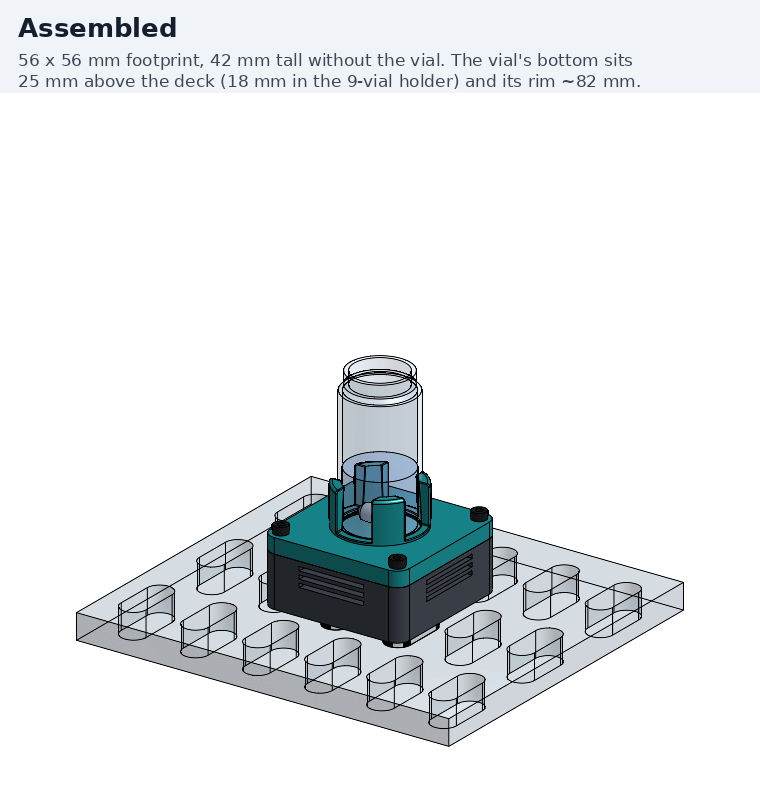
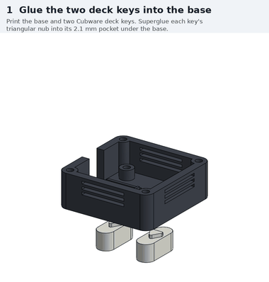
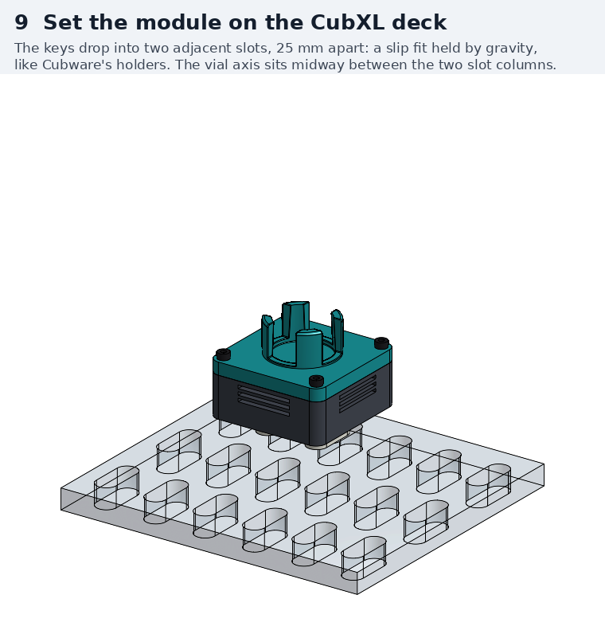
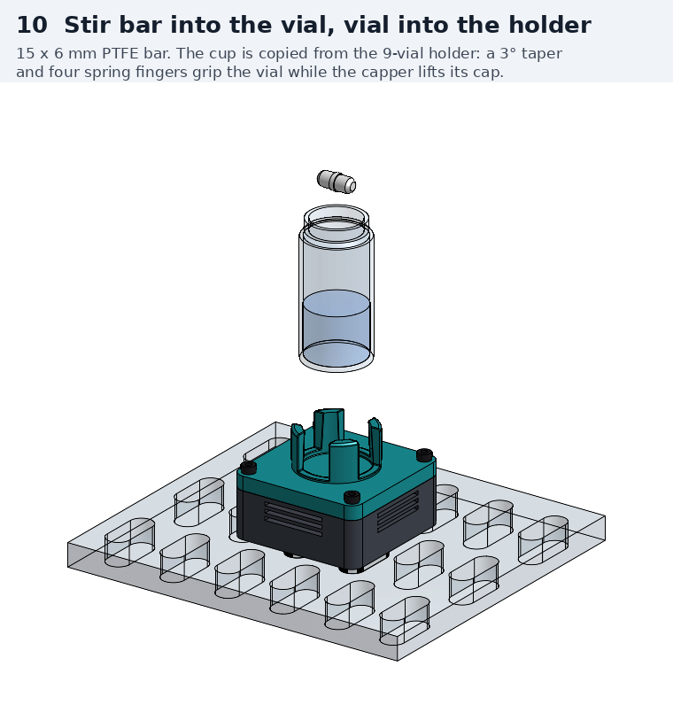
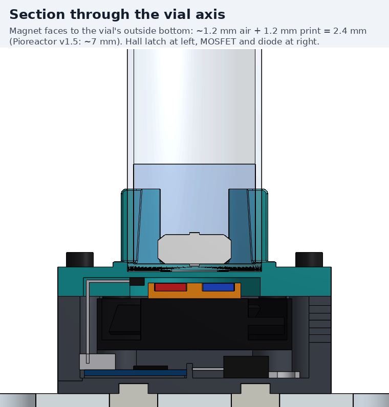

# Single-vial magnetic stirrer for the CubXL (after the Pioreactor)

A stir plate for one 20 mL vial that drops into the CubXL deck like any other
Cubware holder. It is the "stir plate under one vial" option from
[`vial-mixing.md`](../../cubos/docs/vial-mixing.md), built around the Pioreactor's
stirring stack: a 40 mm fan with two opposite-pole magnets on its hub, a PTFE bar in
the vial, a Hall sensor counting turns, and a closed speed loop. Asked for by
@sgbaird on [PR #269](https://github.com/vertical-cloud-lab/byu-vcl/pull/269), after
@benwhitney5463's question on [#169](https://github.com/vertical-cloud-lab/byu-vcl/issues/169).

**Status: designed, not built.** Nothing here has been printed, wired or run. The
numbers that matter most (coupling, the Hall signal) are estimates until a first
build. The vial cup is the exception: it is copied from the 9-vial holder already in
use on the deck.

**To build one:** follow [`BUILD.md`](BUILD.md), the step-by-step build guide. The bill
of materials, with links and prices from 2026-10-19, is [`BOM.md`](BOM.md), and the
printed parts are in [`step/`](step) and [`stl/`](stl). It can be driven by the
[CubXL's Arduino Uno](#driving-it-from-the-cubxls-arduino-uno), the one that already runs
the capper and the pipette, instead of its own XIAO RP2040.



| | |
|---|---|
| Footprint | 56 × 56 mm, two deck keys in adjacent slots |
| Height | 42 mm without the vial; vial bottom 25 mm and rim ~82 mm above the deck |
| Vial | 20 mL VOA (Ben's), in one cup of the 9-vial holder (3° pocket, four spring fingers), on a 1.2 mm printed floor |
| Drive | Orion OD4010-12HSS fan (the Pioreactor's), 5 V, 200 Hz PWM through a low-side MOSFET |
| Magnets | 2 × N52, 1/4 × 1/16 in, opposite poles up, 9.8 mm apart (the Pioreactor's) |
| Speed sensing | US1881 Hall latch beside the magnets, 1 pulse per turn |
| Controller | The CubXL's Arduino Uno (D10 PWM, D2 Hall, a stir command added to its PANDA firmware), or a Seeed XIAO RP2040 on its own USB-C |
| Fasteners | 4 × M3 × 16 and 4 × M3 × 12 socket head screws, 8 × M3 heat-set inserts |
| Parts cost | about $20 per stirrer once the multi-packs are bought; $101–126 for a first order ([`BOM.md`](BOM.md)) |

## Contents

| Path | What |
|---|---|
| [`onshape/vial_stirrer.fs`](onshape/vial_stirrer.fs) | The whole model as one FeatureScript feature. All dimensions are constants at the top |
| [`build_onshape.py`](build_onshape.py) | Pushes the FeatureScript to Onshape, rebuilds, renders every step, exports the STLs and STEP files |
| [`assembly_video.py`](assembly_video.py) | Renders the assembly as a video, a GIF and a contact sheet, one part per step, from the Onshape model's parts |
| [`onshape/render_steps.json`](onshape/render_steps.json) | Camera and caption for each render |
| [`onshape/document.json`](onshape/document.json) | Onshape document ids |
| [`BUILD.md`](BUILD.md) | Build guide for the Uno-driven version: printing, keys, inserts, magnets, wiring, bench checks, assembly, flashing the Uno, first spins, the deck file |
| [`BOM.md`](BOM.md) | Bill of materials for the Uno-driven version: parts to buy with links and prices, parts to print |
| [`step/`](step) | Printed parts as STEP: `base`, `vial_holder`, `magnet_carrier`, `deck_key` (print two), plus `vial_stirrer_assembly.step`, the whole stirrer for fit checks |
| [`stl/`](stl) | The same printed parts as STL. Both sets are in assembly position, which is also each part's print orientation |
| [`img/`](img) | Onshape's renders (steps 1–10 of the XIAO version, assembled, exploded, section, contact sheet), and the assembly video, GIF and contact sheet of the Uno version |
| [`firmware/main.py`](firmware/main.py) | MicroPython speed controller for the XIAO RP2040 (untested) |
| [`../../cubos/firmware/panda-arduino-stirrer.patch`](../../cubos/firmware/panda-arduino-stirrer.patch) | The same controller as two commands in the CubXL Uno's PANDA firmware. Built, image committed, not flashed |
| [`firmware/uno_sim/`](firmware/uno_sim) | Host-side simulation of that patch's control loop against a fan model, and its output |
| [`RESEARCH.md`](RESEARCH.md) | What the Pioreactor does, the AC's and other open-source stirrers, design lessons |
| [`analysis/field_check.py`](analysis/field_check.py) | magpylib check of the field at the Hall sensor (with and without a coupled bar) and at the bar, and its [output](analysis/field_check_output.txt) |
| [`../../outputs/issue-169-magnetic-stirrer/`](../../outputs/issue-169-magnetic-stirrer) | Edison answers and the raw vendor lookups |

The Onshape document is
[`single-vial-stirrer-cubxl (byu-vcl #169)`](https://cad.onshape.com/documents/80ec0345c92398198316197e/w/96eb770a6ced683a7077e0ec/e/033fb4b0b500e5c15762a06c).
It holds the Feature Studio, a Part Studio with the one feature, an Assembly with that
Part Studio inserted, and Onshape's BOM of the assembly. It was made through the API
with the lab's key, so it sits in @sgbaird's Onshape account, unshared. It is
disposable: `build_onshape.py --new` rebuilds it from the FeatureScript in a fresh
document.

## What comes from the Pioreactor, and what changed

The Pioreactor 20 mL holds the same class of vial (27.5 × 57.4 mm) and stirs it the
same way, so its proven choices are kept. Sources are in [`RESEARCH.md`](RESEARCH.md).
The table was rechecked on 2026-10-20 against the v1.5 parts list, `stirring.py` and
`config.example.ini` at
[`89dc54e`](https://github.com/Pioreactor/pioreactor/blob/89dc54ee/core/pioreactor/background_jobs/stirring.py)
(the stirring code is unchanged since the `0ae14c0` cited in RESEARCH, apart from log
text), and the Pioreactor docs.

| | Pioreactor v1.5 | This stirrer | Why |
|---|---|---|---|
| Fan | Orion OD4010-12HSS, 12 V 2-wire, on the HAT's PWM rail, which is the Pi's 5 V unless an external supply is fitted | same, from the Uno's 5 V | Their part. A 12 V fan at 5 V tops out lower, which suits stirring. Orion rates it for 10.8–13.2 V, so both run it below its rated range; the start kick is what gets it going |
| Magnets | 2 × neodymium, 0.250 × 0.060 in, grade not given, opposite poles, 9.8 mm apart | 2 × 1/4 × 1/16 in (0.0625 in) N52, 9.8 mm apart | The same size. N52 is this design's choice |
| Magnet holder | Ø24 × 3.23 mm, pockets Ø6.66 × 1.675 mm open to the vial | Ø19, same thickness and pockets | Smaller, to leave room for the Hall sensor |
| Stir bar | PTFE, 3 × 12 mm | PTFE, 15 × 6 mm ([`BOM.md`](BOM.md) item 3) | **Not the Pioreactor's.** The 9.8 mm magnet spacing suits bars about 12 mm long. The thicker bar's centre sits 1.5 mm higher, in 17.5 mT against 29 mT for a 3 × 12 mm bar (magpylib). Try both in the coupling test |
| Drive | Software PWM at 200 Hz; a low-side MOSFET (BSS316N footprint on the HAT, inferred from its STEP) | 200 Hz hardware PWM, IRLZ44N | IRLZ44Ns are already in the capper BOM |
| Speed sensing | DRV5021A3 Hall switch over the magnets, on the heater board; 1 pulse per turn | US1881 Hall latch beside the magnets; 1 pulse per turn | No heater board here, so nothing sits over the magnets. Beside them, a coupled bar weakens the signal ([Hall signal](#wiring-xiao-version)) |
| Measuring rpm | Mean time between Hall edges, over 1–5 s, so the reading is not quantized | Pulses counted over 2 s, so it moves in 30 rpm steps | Simpler. Timing the edges, as the Pioreactor does, would remove the steps (not done yet) |
| Control | Additive P loop (Kp 0.005 %/rpm, each update clamped to ±7.5 points), updated every 23 s. 100 % for 0.5 s at start. On a stall: 0 % for 0.75 s, 100 % for 0.75 s, then at most 60 %. Never gives up | Same structure, updated every 2 s, plus a setpoint ramp. Both kicks are 0.5 s at 100 %. Stops after five stalls in a row | Self-contained over USB; ramping is the literature's advice |
| Lowest speed | About 125 rpm: "Target RPMs below 125 have a tendency to stall" | Accepts down to 100 rpm | Expect stalls below about 125 rpm here too |
| Magnet face to vial bottom | about 7 mm (estimated from their CAD) | 2.4 mm (1.2 air + 1.2 print) | No heater board. See the coupling note under Risks |
| Mounting | Pi HAT faceplate | Two Cubware deck keys | CubXL deck |

## How it sits on the CubXL deck

The CubXL+ deck is Cubware's `PandaDeck.step`: a 10 mm polycarbonate plate cut with
10 × 25 mm pill-shaped slots (R5 ends), long axis along deck Y, on a **25 mm (X) ×
45 mm (Y)** grid. Holders do not bolt down. Each carries pill-shaped keys,
9.8 × 24.8 × 10 mm, that drop into the slots with 0.1 mm clearance a side and are
held by gravity
([Cubware `9VialHolder-key.step`](https://github.com/Ursa-Laboratories/Cubware/blob/352aa95/cubxl_plus/labware/vial_holder/9VialHolder-key.step),
[deck](https://github.com/Ursa-Laboratories/Cubware/blob/352aa95/cubxl_plus/deck/polycarbonate_deck/PandaDeck.step)).

- **Two keys, 25 mm apart in X**, so they sit in adjacent slot columns of one row. One key
  would already locate the stirrer; two cut its rotational play.
- The keys are Cubware's: same pill, same 2 mm rounded-triangle nub (equilateral,
  3.1 mm circumradius, R1.0 corners, one corner toward −Y), glued into 2.1 mm pockets
  with R1.1 corners. [`stl/deck_key.stl`](stl/deck_key.stl) is that key, and Cubware's
  own `9VialHolder-key.stl` fits the same pockets.
- **Where the vial ends up:** midway between the two slot columns, on a row centre.
  With the slot centres inferred from Ben's deck file (vial_1 at (136.668, 45) sits
  over a slot centre), that is about **X = 149.2 + 25n, Y = 45 + 45m** in deck
  coordinates, ±1.5 mm. Teach it like any new labware; this is only a starting point.
- **Heights:** the vial's bottom is 25.0 mm above the plate. In the 9-vial holder it is
  18.0 mm, so every vial Z (rim, pipette and capper heights) moves up about **7 mm**.
  The XIAO under the fan accounts for most of that. Getting to 18.0 would take moving
  the XIAO and MOSFET beside the fan, setting the fan on a 2 mm floor (keys moved out
  from under it) and clamping it under the holder. The footprint would grow to roughly
  45 × 70 mm.
- The deck plate's real thickness hasn't been measured. The STEP says 10 mm, and the
  keys are 10 mm like Cubware's, which already work on this deck.

## The vial cup, copied from the 9-vial holder

The part that holds the vial is one cup of the 9-vial holder, at @benwhitney5463's
[suggestion](https://github.com/vertical-cloud-lab/byu-vcl/pull/269#issuecomment-6130203392).
Its numbers were measured from the B-rep of Ben's Onshape copy,
[`9_vial_holder`](https://cad.onshape.com/documents/5af67acecd97aa04cf37bc22/w/f00c22fec5665a553ba7f69e/e/6e152734f23403d28543e379).
That model is PANDA-BEAR's `9VialHolder20mL_TightFit` (same 886 faces, same cone to the
micron), which this repo already has as
[`9VialHolder20mL_TightFit.step`](../../modules/electromagnetic-capper/cad/9VialHolder20mL_TightFit.step),
GPL-2.0 per its [`NOTICE.txt`](../../modules/electromagnetic-capper/cad/NOTICE.txt).

| | Copied, measured from the vial floor |
|---|---|
| Pocket | A 3° cone that narrows upward: Ø27.6 mm at the floor, Ø25.8 mm across the finger tips |
| Ring | Full circle for the first 2 mm above the floor |
| Fingers | Four, on the diagonals, from 2 to 17 mm above the floor; Ø33.4 mm outside |
| Slots | 14 mm wide, on the x and y axes, so the bar shows through them |
| Edges | R1 round the outside of each finger tip, R0.3 on the floor edge and the other finger and slot edges; the inside tip edge is sharp |

The pocket narrows upward, so a vial pushes each finger out about 0.8 mm at the tip.
That spring holds the vial while the capper lifts the cap. Only what is under the floor
differs: the 9-vial holder is solid down to the deck, 18.0 mm, while here the floor is
1.2 mm over the magnet carrier. Slicing both meshes at 13 heights from the floor to the
tips, the pocket radius agrees within 0.015 mm and each cross-section within 2.4 mm²
(of 100–290 mm²). The 9-vial holder's necks between cups account for most of the rest.

**Vial size.** The ring under the fingers does not flex and is Ø27.6 mm at the floor,
so it seats vials up to about 27.6 mm. 20 mL VOA vials like these are sold as
28 × 57 mm nominal. A vial that goes all the way down in the 9-vial holder will here
too. One that stops on the ring sits about 2 mm higher, which here also adds 2 mm to
the magnet gap. The model uses 27.5 mm.

## Parts list

Moved to [`BOM.md`](BOM.md), which has the parts to buy with links and the prices
checked from the CubXL Pi on 2026-10-19, the printed parts with their STEP and STL
files and print orientation, and what is already on the CubXL. It lists the
Uno-driven version, which needs a cable, a connector pair and a scrap of perfboard in
place of the XIAO and its USB cable. The 2026-10-10 lookups for the XIAO version are in
[`vendor_lookup_amazon_20261010.json`](../../outputs/issue-169-magnetic-stirrer/vendor_lookup_amazon_20261010.json)
and [`…b.json`](../../outputs/issue-169-magnetic-stirrer/vendor_lookup_amazon_20261010b.json).

## Fasteners

All M3, all from two kits ([`BOM.md`](BOM.md) items 11 and 12). Use **stainless** screws. The
Pioreactor keeps steel away from its magnets: the v1.5 parts list has brass screws
nearest them, and nylon standoffs and nuts. Its grinding fault is mechanical, the
magnets striking the screw heads above them. Its staff put random stalls down to the
magnets sitting too close to the heater board, which carries two steel standoffs.

| Fastener | Qty | Joins | Engagement |
|---|---|---|---|
| M3 × 16 socket head (DIN 912), A2 stainless | 4 | Fan to the base posts (32 mm square) | 5.7 mm (full insert), tip 0.5 mm above the hole floor |
| M3 × 12 socket head, A2 stainless | 4 | Vial-holder flange to the base corner posts (47 mm square) | 5.7 mm, tip 0.5 mm above the hole floor |
| M3 × 5.7 mm brass heat-set insert | 8 | In the base: 4 fan posts, 4 corner posts | Ø4.0 × 6.5 mm holes |

The fan-screw heads sit about 12 mm outside the magnets' path, in pockets under the vial
holder. Glue holds the rest: the deck keys, the magnets, the carrier on the hub and the
Hall sensor.

## Driving it from the CubXL's Arduino Uno

The Uno that runs the capper and the pipette can drive one stirrer as well (PANDA
firmware, see [`cubos/firmware/`](../../cubos/firmware/README.md)). Its firmware uses
D3–D7, D9, D11 and A0–A4. What is left is enough for the stirrer:

| Stirrer signal | Uno pin | Why that pin |
|---|---|---|
| Fan PWM, to the MOSFET gate | **D10** | The only free hardware-PWM pin. It is on Timer1, which nothing else in the firmware uses (the electromagnet is on D11, Timer2), so Timer1 can run at the Pioreactor's 200 Hz. D9, the pipette limit switch, shares Timer1 but stays a plain input |
| Hall sensor | **D2** | INT0, the free external interrupt |
| Supply | **5V** and **GND** | About 0.1 A for the whole stirrer, at most. See [Current draw](#current-draw-and-power) |

D8, D12, D13 and A5 stay free. A second stirrer would need software PWM and a
pin-change interrupt on those, which the patch below does not do.

**Check before wiring:** the firmware leaves D2 and D10 alone, but nothing here records
whether anything is soldered to them on the Uno or its shield. Look first.

### Wiring, Uno version

The circuit is the XIAO version's with the controller moved off the stirrer. The
resistors go on a scrap of perfboard cut to the XIAO's 21 × 17.5 mm, which sits on the
same rails, and the cable leaves through the USB-C notch in the −X wall (13 mm wide).

```
  Uno        cable, 22 AWG x 4        stirrer
  ---        -----------------        -------
  5V   ------ 1 ----------------+---- fan red (+)
                                +---- 1N5819 cathode
                                +---- US1881 pin 1 (VDD)
                                +---- 10 k ---+
  D2   ------ 4 ------------------------------+---- US1881 pin 3 (OUT)
  D10  ------ 3 ------ 100 R ---+---- IRLZ44N gate (pin 1)
                                +---- 10 k ---+
  GND  ------ 2 ------------------------------+---- IRLZ44N source (pin 3), US1881 pin 2 (GND)

                     fan black (-) ---- 1N5819 anode ---- IRLZ44N drain (pin 2, tab)
```

- **The gate pull-down stays on the stirrer,** at the MOSFET, so the fan is held off
  while the cable is unplugged or the Uno is resetting.
- **The Hall pull-up now goes to 5 V.** The Uno is a 5 V part, so the 3.3 V caveat of
  the XIAO version goes away. The firmware also turns on D2's internal pull-up, but over
  1.5 m of cable the 10 kΩ is what counts. If the measured rpm reads high with the fan
  off, the cable is picking up the stepper drives: add 10 nF from D2 to GND at the Uno.
- **The gate sees 5 V,** so the IRLZ44N is fully on, with more margin than at 3.3 V.
- **A JST-XH pair near the Uno** (BOM item 9) lets the stirrer come off the deck.
- **A 100 nF capacitor across the sensor's VDD and GND** is what Melexis recommends
  ([datasheet](https://www.melexis.com/-/media/files/documents/datasheets/us1881-datasheet-melexis.pdf),
  Application Comments). [`BUILD.md`](BUILD.md#circuit) puts one on the junction board,
  from lab stock.
- **Power** comes from the Uno's 5V, which comes from the Pi over USB. There is room for
  it ([Current draw](#current-draw-and-power)). If the Uno resets when the fan kicks,
  feed the fan from the electromagnet's 5 V supply instead, with the grounds joined.

### Firmware, Uno version

[`panda-arduino-stirrer.patch`](../../cubos/firmware/panda-arduino-stirrer.patch) adds
`Stirrer.h` and `Stirrer.cpp` to the PANDA firmware, plus two commands. It applies on
top of the three patches behind the board's current image (2026-10-07), and it ports the
XIAO firmware's control loop:

- 200 Hz PWM;
- one Hall pulse per turn;
- the additive P loop, each update clamped to ±7.5 % duty;
- a kick from rest, and pause-then-kick on a stall, giving up after five.

| Send | Reply |
|---|---|
| `30,600` | `OK:{"msg":"Stirring","v":[600.00]}`. Runs until stopped; rpm is clamped to 100–2000 |
| `30,600,300` | `OK:{"msg":"Stirring","v":[600.00,300.00]}`. Stops itself after 300 s |
| `30,0` | `OK:{"msg":"Stirrer off"}` |
| `31` | `OK:{"target":600,"setpoint":600,"rpm":600.0,"duty":0.229,"stalled":0,"left_s":-1}` |

Two things differ from the XIAO version, because the board is shared:

- **Nothing blocks and nothing is printed unprompted.** Every line on this port answers
  a command, so a stall shows up only as `"stalled":1` in the status reply.
- **A plunger move holds up the loop.** The firmware's pipette moves block for their
  whole duration. The PWM and the pulse count carry on in hardware, so the fan keeps its
  duty. Only the next speed correction, and the end of a kick or a timed run, wait for
  the move to finish.

**What was checked:**

- It builds with PlatformIO on the CubXL Pi, from a copy of the tree the board's
  2026-10-07 image was built from. Flash goes from 17,468 to 20,340 of 32,256 bytes, and
  RAM from 1,429 to 1,510 of 2,048. The image is committed as
  [`panda_vcl_p20gen2_tic796_fastmove_spread_stir_20261019.hex`](../../cubos/firmware/panda_vcl_p20gen2_tic796_fastmove_spread_stir_20261019.hex).
- [`firmware/uno_sim/`](firmware/uno_sim) runs `Stirrer.cpp` on the host against a fan
  model. It settles at 600 and at 1200 rpm, a timed run stops on time, and a jammed fan
  is stopped and flagged as stalled after five kicks
  ([output](firmware/uno_sim/sim_output.txt)).
- Speed resolution is 30 rpm: one pulse per turn, counted over 2 s.

**It has not been flashed.** Flashing replaces the firmware the capper and the pipette
run on. Do it once a stirrer is built, with nothing holding the port, then run
`pipette_test` again. [`cubos/firmware/README.md`](../../cubos/firmware/README.md#2026-10-19-a-stirrer-image-is-built-and-committed-but-not-flashed)
has the flash and restore commands.

### From the host

```python
from cubos.instruments.controllers.pawduino import PawduinoLink
uno = "/dev/serial/by-id/usb-Arduino__www.arduino.cc__0043_03535343335351018130-if00"
link = PawduinoLink.acquire(uno, 115200)
link.connect()
print(link.send_command(30, 600, 300))   # 600 rpm for 5 min
print(link.send_command(31))             # status
print(link.send_command(30, 0))          # stop
```

**Opening the port resets the Uno,** which stops the stirrer along with everything else
on the board. So a script cannot start the stirrer and leave it running into a CubOS run.
Stirring during a protocol has to go over the link CubOS already holds, and CubOS has no
stir command yet. The obvious shape for one is a copy of its `set_lights`:

- a stirrer instrument whose `pawduino` vendor shares `PawduinoLink.acquire()` with the
  capper and the pipette;
- a `set_stirrer` protocol step taking `rpm`, `seconds` or `off`;
- run teardown turning the stirrer off, as it does the lights.

That is not written yet.

## Current draw and power

Worked out on 2026-10-20 from the datasheets, the Pioreactor's docs and a read-only look
at the CubXL Pi. Nothing has been measured on a stirrer yet; the bench check in
[`BUILD.md`](BUILD.md#bench-check) measures the fan.

| Load on the Uno's 5 V | Current | Source |
|---|---|---|
| Fan, running | **Under 0.1 A.** Orion rates the OD4010-12HSS at 0.07 A typical, 0.09 A max, **at 12 V**. At 5 V it draws less. The Pioreactor's power page budgets 0.1 A for its stirring motor | [Orion datasheet](https://assets.testequity.com/te1/Documents/pdf/orion/OrionFans_DCFan_OD4010-05HSS_Datasheet_0125.pdf) (rev. 6/19/2024), [Pioreactor](https://github.com/Pioreactor/docs.pioreactor/blob/1ddc606/user-guide/03-Extending%20your%20Pioreactor/09-external-power.md) |
| Fan, 0.5 s start kick | Not given by Orion | Measure it in the bench check |
| US1881 | 5 mA max | [Datasheet](https://www.melexis.com/-/media/files/documents/datasheets/us1881-datasheet-melexis.pdf), table 3 |
| Hall pull-up, gate pull-down | 0.5 mA each: the pull-up while the output is low, the pull-down while the fan is on | 10 kΩ at 5 V |
| Gate charging, from D10 | About 40 mA peak for under a microsecond, twice per PWM period; under 10 µA on average | 5 V across 100 Ω plus the pin's ~25 Ω; IRLZ44N gate charge |
| **Whole stirrer** | **About 0.1 A at most** | |

Where it comes from, and what else shares it:

- **The Uno's 5 V pin**, from USB through the board's 500 mA resettable fuse. Already on
  that rail: the Uno itself (about 50 mA), the TMC2209's logic supply (`VDD`) and, if
  fitted, the capper's IR line-break sensor (about 20 mA). With the stirrer that is
  about 0.2 A. The electromagnet has its own 5 V supply.
- **The NeoPixel lights are the one load that could overrun it.** PANDA's lights
  schematic powers the 24-pixel RGBW ring from the Uno's 5 V too, and the firmware sets
  brightness 150 of 255. Fully lit in all four colours, the ring alone could draw about
  1 A. The CubXL configs here never turn the lights on, and an unlit pixel draws about
  1 mA. Don't run the lights bright while the stirrer runs off USB.
- **The CubXL Pi has plenty of room.** Read on 2026-10-20: a Pi 5 on a 5 A supply with
  `usb_max_current_enable=1`, which allows 1.6 A across its USB-A ports. Only the Uno
  (it declares 100 mA) and the CH340 (98 mA) are plugged in. `vcgencmd get_throttled`
  is `0x0` after 11 days up, and the 5 V input reads 5.13 V.
- **If the Uno is ever powered from its barrel jack**, its 5 V comes from the onboard
  regulator instead, and at 12 V in, the stirrer's 0.1 A adds 0.7 W of heat there.
  Then take the fan's 5 V from the electromagnet's supply, with the grounds joined.
- **Losses are negligible.** The cable is 0.16 Ω out and back (1.5 m of 22 AWG), so
  16 mV at 0.1 A. The IRLZ44N is 25 mΩ at 5 V on the gate: 0.25 mW. Nothing on the
  junction board gets warm.
- **The gate resistor.** With 100 Ω, the charging peak is about 40 mA, the ATmega328P's
  per-pin limit, though only for a fraction of a microsecond. The capper's 200 Ω halves
  it, and at 200 Hz the slower edges cost nothing. Either works.
- **Below its rated voltage.** Orion rates this fan for 10.8–13.2 V, and it runs here at
  about 5.0 V, as on a Pioreactor without an external supply. So starting from rest
  relies on the 0.5 s kick, as on the Pioreactor. Don't swap in the 5 V version
  (OD4010-05HSS) without rechecking: Orion gives it 0.10 A typical, 0.30 A max, and
  8000 rpm at 5 V.

## Wiring, XIAO version

```
                     USB-C VBUS (5 V)
                          |
          +---------------+----------------------+
          |               |                      |
     fan red (+)     1N5819 cathode         US1881 pin 1 (VDD)
     fan black (-)   1N5819 anode                |
          |               |                 US1881 pin 2 (GND) -- GND
          +-------+-------+                 US1881 pin 3 (OUT) --+-- XIAO D2 (GP28)
                  |                                              |
           IRLZ44N drain (pin 2, tab)                10 k to XIAO 3V3
           IRLZ44N source (pin 3) -- GND
           IRLZ44N gate (pin 1) --- 100 R --- XIAO D1 (GP27)
                                 |
                                10 k to GND
```

- **The fan's ground is switched** (low side), as on the Pioreactor HAT. At 200 Hz,
  rpm comes from the Hall sensor, not a fan tach wire.
- **US1881 runs from 5 V** (its minimum is 3.5 V). Its output is open drain, so the
  10 kΩ pull-up to **3.3 V** keeps 5 V off the RP2040 pin.
- **IRLZ44N at 3.3 V gate drive:** its threshold is 1–2 V, and the fan draws under
  0.1 A, so 3.3 V switches it fully enough. Any logic-level N-MOSFET with a threshold
  well under 3.3 V works.
- **Hall signal, estimated:** with the latch flat on the pocket ceiling, branded face
  down, magpylib gives ±19 mT at its element as the magnets pass (N52 at 1.45 T).
  That is about twice the US1881's worst-case 9.5 mT trip point. If a build misses
  pulses, the SS49E linear sensor has the same pinout and footprint; read it on an
  ADC pin with a software threshold.
- **Two things eat into that margin** (rechecked 2026-10-20 with the CAD's numbers,
  [`analysis/field_check.py`](analysis/field_check.py)):
  - **Placement.** Melexis gives the element 1.40–1.58 mm in from the package's top
    edge and 0.43–0.46 mm under its face, depending on where it was made, which puts
    it at ±18–20 mT. Each 0.5 mm further from the carrier costs about 4 mT: ±16 mT at
    0.5 mm out, ±13 mT at 1 mm.
  - **A coupled stir bar works against it.** Beside the magnets the sensor reads their
    return field. The bar's poles sit over the opposite magnets, so their field at the
    sensor points the other way. Modelling the bar's core as a 3–4 mm × 10–12 mm magnet
    (its size isn't published) gives ±12–18 mT with a vial and bar in place, and ±6–11
    mT with the sensor also 1 mm out, which straddles the 9.5 mT trip point. The
    Pioreactor's sensor sits over the magnets' path, between them and the bar, where the
    bar's field adds instead. So check the rpm with a vial and bar in
    ([`BUILD.md`](BUILD.md#8-first-spins) stage 8), not only on the bench.

## Firmware and the host side, XIAO version

[`firmware/main.py`](firmware/main.py) is MicroPython for the XIAO. It mirrors the
Pioreactor's `stirring.py`:

- 200 Hz PWM on the gate.
- Falling edges from the Hall latch, 1 per turn.
- An additive P loop, each step clamped to ±7.5 % duty.
- A full-power kick from rest, and stall kicks capped at 60 % duty.
- Its own additions: the setpoint ramps at 100 rpm/s, timed runs stop themselves, and a
  watchdog resets the board if the loop hangs. The gate pull-down then holds the fan off.

Commands over USB serial, one per line: `RPM 600`, `RPM 600 300` (stop after 300 s),
`STOP`, `?` (status), `ID`. It is a sketch and has not been run. Expect to tune `KP`,
`DC_START` and `RAMP` on the bench.

On the CubXL Pi, address the board by its USB serial, never by `/dev/ttyACM*`. The PAW
Arduino already owns `ttyACM0`, and the CLAUDE.md notes on enumeration order apply here
too.

```python
import glob, serial
port = next(p for p in glob.glob("/dev/serial/by-id/*") if "MicroPython" in p)  # pin the exact id once known
with serial.Serial(port, 115200, timeout=2) as s:
    s.write(b"RPM 600\n"); print(s.readline().decode().strip())
    # ... stir ...
    s.write(b"STOP\n"); print(s.readline().decode().strip())
```

CubOS has no `stir` command. Until it does, a protocol can stir from a separate script
step. Stop the stirrer before the tip goes in: the vortex lowers the surface at the
centre, and the bar sits where the tip goes.

## Assembly

The steps in brief. [`BUILD.md`](BUILD.md) has them in full, with the checks between them.



**A version to pause on:** [on YouTube](https://www.youtube.com/watch?v=YQJY8HC4F-w) (unlisted), or
[`img/assembly_steps.mp4`](img/assembly_steps.mp4) (1920 × 1080, 3 min 10 s, 30 MB). Both have a
chapter for each step. They show BUILD.md's build of the Uno-driven version in 15 steps, one
part per step:

- Each step holds twice: first with its parts beside their places and a dashed line from each
  to where it goes, then in place.
- The parts a step adds are orange, or amber for a second kind of part. The side panel gives
  the step's instruction from BUILD.md, its tool and its stage.
- The Onshape model has the XIAO RP2040 in the controller pocket, so the junction board, its
  parts and the cable are drawn by the script instead. Where the parts sit on the board is
  only indicative; BUILD.md's netlist is what counts.
- The bar turning at the end is only an illustration. Nothing has been built or run.

[`img/assembly_steps_sheet.png`](img/assembly_steps_sheet.png) shows where each step ends. The
video and the GIF come from [`assembly_video.py`](assembly_video.py), in the lab's style for
assembly videos (the OT-2 lid mount's, on
[PR #234](https://github.com/vertical-cloud-lab/byu-vcl/pull/234)). The renders below are
Onshape's, and show the XIAO version.

| | |
|---|---|
|  | **1. Glue the two deck keys into the base.** Superglue each key's triangular nub into its 2.1 mm pocket under the base. Glue both while the base sits in two deck slots, so the keys end up exactly 25 mm apart. |
|  | **2. Press in eight M3 heat-set inserts.** Use a soldering iron at the insert maker's temperature: four go in the fan posts and four in the corner posts. Keep them square, as the fan screws pull straight down into them. |
|  | **3. Wire the electronics, then drop them in.** Solder per the wiring diagram, leaving about 60 mm of lead for the Hall sensor. The XIAO's USB-C goes into the notch in the −X wall, and the rails and the stop locate the board. In the Uno version the junction board sits in the same place and the cable leaves through the notch; tie it to the board for strain relief. The MOSFET and diode lie flat on the +X side, held with a dab of hot glue. |
|  | **4. Seat the fan, rotor side up.** It goes on the four posts with the side **without** the motor's struts up, so the spinning hub faces the vial. Don't go by the sticker: many fans carry it on the strut side. Run its leads to the MOSFET. |
|  | **5. Four M3 × 16 screws through the fan.** Tighten them snug only, since the fan frame is plastic. Screwed down, the fan can't be lifted by the magnets, which happened on one Pioreactor ([forum 781](https://forum.pioreactor.com/t/self-test-failure-the-fan-stirring-is-spinning-but-no-rpms-were-measured/781/4)). |
|  | **6. Magnets into the carrier, carrier onto the hub.** One magnet goes north up and one south up; check with a third magnet, which one attracts and the other repels. CA the magnets into the pockets and the carrier onto the hub, centred: a misaligned drive makes the bar walk. |
|  | **7. Glue in the Hall sensor, lower the vial holder.** Glue the US1881 flat on the pocket ceiling at −X, branded face down, beside (not over) the magnets' path. Lay its leads in the groove. Spin the fan by hand before closing up: nothing may touch the carrier. |
|  | **8. Four M3 × 12 screws through the flange.** These go into the corner-post inserts. |
|  | **9. Set the stirrer on the deck.** The keys drop into two adjacent slots. Route the USB cable away from the gantry's path. |
|  | **10. Stir bar into the vial, vial into the holder.** Push the vial down past the four fingers. They spring out about 0.8 mm at the tips and grip it, as in the 9-vial holder. |




## The numbers behind the stack

z is measured from the top of the deck plate, in mm.

| z | What |
|---|---|
| −10 → 0 | Deck plate; keys in the slots |
| 0 → 3.2 | Base floor (key pockets 2.1 mm deep, 1.1 mm left above them) |
| 3.7 → 8.2 | XIAO RP2040 with USB-C; the MOSFET lies at 3.2 → 7.7 |
| 9.0 → 19.5 | Fan |
| 19.5 → 22.7 | Magnet carrier; magnet faces at 22.6 |
| 22.7 → 23.8 | Running gap, 1.1 mm (Pioreactor: ~1.1) |
| 22.2 → 23.8 | Hall latch, beside the carrier at r 10.3–13.3 mm |
| 23.8 → 25.0 | Printed floor, 1.2 mm |
| 25.0 | Vial bottom (9-vial holder: 18.0) |
| 27.0 | Top of the cup's full ring; the slots start |
| 42.0 | Finger tips |
| ~82 | Vial rim |

From the magnet faces it is 2.4 mm to the vial's outside bottom, and ~4 mm to its inside
bottom with 1.6 mm glass. magpylib puts the horizontal field at the axis of a
15 × 6 mm bar at **~18 mT**. At the Pioreactor's estimated ~7 mm spacing it is ~4 mT.

## Risks and open questions

1. **Coupling may be too strong rather than too weak.** The field at the bar is about
   4× the Pioreactor's, and its users report trouble when the magnets get too close.
   One user's bar would not speed up until the vial was lifted ~6 mm
   ([forum 262](https://forum.pioreactor.com/t/stirring-calibration-intercept/262)).
   Another's stirring stopped at random at 200–250 rpm, which staff put down to the
   magnets sitting too close to the heater board
   ([forum 789](https://forum.pioreactor.com/t/stirring-randomly-stops/789/4)).
   It is cheap to test: print Ø27 mm spacer discs, 1, 2 and 3 mm thick, to go under
   the vial, and try each. (The cup narrows upward, to Ø27.3 mm at 3 mm, so a Ø27.6 mm
   disc would not reach the floor.)
2. **A fan-side rpm is not the bar's rpm.** The Hall sensor measures the magnets. The
   Edison coupling summary is explicit that drive feedback cannot see the bar slip.
   Confirm coupling by eye or on camera through the slots between the fingers; the
   deck cameras look down into the vial, which shows the bar too.
3. **The vial must not lift out when the capper pulls a cap.** The keys are a gravity
   slip fit. The cup grips the vial as hard as the 9-vial holder does, but here no other
   vials weigh the holder down. If the grip is more than the stirrer weighs (~80–100 g),
   the whole stirrer comes up with it. PANDA-BEAR has a slide-lock that hooks under the
   plate (`Pill_Slider` + `PillRetainingPin`) if that happens.
4. **Hall margin** is an estimate (±19 mT against a ≤ 9.5 mT trip point), and a coupled
   stir bar shrinks it, perhaps to the trip point. See Wiring, XIAO version, for both and
   for the SS49E fallback.
5. **Not measured:** the deck plate (10 mm per the STEP, 9 mm recommended by PANDA-BEAR),
   the Orion hub height (modelled flush with the frame, ±0.5 mm on the fan's 10.5 mm),
   and Ben's vials' actual OD and bottom (see "Vial size" above).
6. **Heating** is unknown. The fan is rated 0.84 W (1.08 W max) at 12 V, and at 5 V it
   uses under 0.5 W. Even if all of that reached 10 mL of water, which it won't, that
   would be about 0.7 °C a minute. If temperature matters, measure the liquid with the
   stirrer on and off.

## Rebuilding the CAD

```bash
pip install requests pillow
export ONSHAPE_ACCESS_KEY=... ONSHAPE_SECRET_KEY=...    # cad.onshape.com key with write access
python hardware/vial-stirrer-cubxl/build_onshape.py           # upload, rebuild, export STLs and STEP, render
python hardware/vial-stirrer-cubxl/build_onshape.py --only section --no-stl --no-step   # one render
python hardware/vial-stirrer-cubxl/build_onshape.py --no-render --no-stl     # STEP files only
python hardware/vial-stirrer-cubxl/build_onshape.py --new     # into a fresh document
```

The assembly video and GIF read the parts from the same document (read-only, so any key
pair that can see it). They also need PyVista, ffmpeg and a virtual display:

```bash
pip install pyvista pillow requests    # and: apt install ffmpeg xvfb
xvfb-run -a -s "-screen 0 1920x1080x24" python hardware/vial-stirrer-cubxl/assembly_video.py --stills   # held frames, to /tmp
xvfb-run -a -s "-screen 0 1920x1080x24" python hardware/vial-stirrer-cubxl/assembly_video.py            # MP4, GIF and sheet
```

The feature has three inputs: `step` (0 = assembled, 1–10 = the assembly steps),
`exploded`, and `section` (cuts away y < 0). Parts that are bought rather than printed
are modelled from their datasheet dimensions, with no vendor CAD:

- the Orion fan from its 40 × 40 × 10.5 mm envelope and 32 mm hole square;
- the XIAO from Seeed's 21 × 17.5 mm outline;
- the TO-220, TO-92UA and DO-41 packages from their package outlines.

The deck section comes from Cubware's `PandaDeck.step`.
