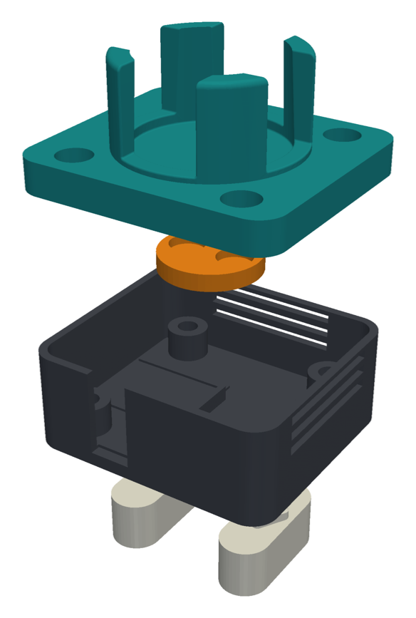

# The compact stirrer (49 × 44 mm)

The stirrer with a smaller base and vial holder, so that stirrers sit side by side on the
CubXL deck at its own 50 × 45 mm slot pitch. The layout was worked out and checked in plan on
2026-10-22 ([README section](../README.md#side-by-side-on-the-deck),
[`analysis/deck_tiling.py`](../analysis/deck_tiling.py)). It was modelled here on 2026-10-28
for @benwhitney5463's `@claude-print` request on
[PR #269](https://github.com/vertical-cloud-lab/byu-vcl/pull/269#issuecomment-6480898247), and
printed the same day ([print record](../print/2026-10-28-a1mini-compact/README.md)).

*The printed parts, exploded: vial holder, magnet carrier, base, two deck keys ([`render_compact.py`](render_compact.py)). The cable notch is in the base's front (−Y) wall.*

Only the base and the holder are new. The deck keys (the 0.05 mm press fit), the magnet
carrier, the cup, the fan, the magnets and the electronics are today's, and so is every
height except the base's wall top.

| File | What |
|---|---|
| [`build_compact.py`](build_compact.py) | Builds both parts in CadQuery and writes the STLs and [`check_output.txt`](check_output.txt) |
| [`render_compact.py`](render_compact.py) | Draws [`../img/compact_parts.png`](../img/compact_parts.png) from the STLs |
| [`../stl/compact/base_compact.stl`](../stl/compact/base_compact.stl) | The base: 49 × 44 × 19 mm. Print floor down |
| [`../stl/compact/vial_holder_compact.stl`](../stl/compact/vial_holder_compact.stl) | The vial holder: 49 × 44 × 22 mm. Print flange down |

## How it was modelled

The Onshape model ([`../onshape/vial_stirrer.fs`](../onshape/vial_stirrer.fs)) has only
today's 56 × 56 mm stirrer, and the print run that modelled this one has no Onshape API keys.
So `build_compact.py` reads the FeatureScript's constants and ports its `makeBase` and
`makeHolder` to CadQuery, with a `compact` switch for the changes.

**The port is checked against Onshape.** The script also builds today's two parts and compares
them with the Onshape STLs:

| | Port | Onshape | Only in the port | Only in Onshape |
|---|---|---|---|---|
| Base | 23751.5 mm³ | 23745.3 mm³ | 9.3 mm³ | 3.1 mm³ |
| Vial holder | 17136.7 mm³ | 17114.8 mm³ | 30.1 mm³ | 8.2 mm³ |

The bounding boxes are equal. The base's differences are tessellation. The holder's
"only in the port" is mostly the cup's edge rounds (R1 round each finger tip, R0.3 on the
slot and finger edges), which OpenCascade would not fillet here. So the compact holder's STL
takes everything within 16.9 mm of the axis from the Onshape STL. That covers the cup, its
floor and the carrier recess, all of which the compact layout leaves unchanged. Only the
flange around them comes from CadQuery. Inside that radius the compact holder and Onshape's
holder are both 4651.181 mm³.

## What modelling it changed from the 10-22 plan

| | Plan (`deck_tiling.py`) | As modelled | Why |
|---|---|---|---|
| Under the holder's flange | 0.5 mm pads on the fan's corners | Flat. **Four M3 flat washers** (0.5 mm) go on the fan's corners instead | The holder prints flange down. Printed pads would be the only thing touching the bed, and the whole flange would start 0.5 mm in the air |
| Base wall top | z 20.0, as today | z 19.0, 1 mm under the flange | The holder sits on the fan, so the walls must not carry it too. 1 mm also covers the fan's ±0.5 mm thickness |
| Insert holes | 6.5 mm deep | 7.5 mm deep | So an M3 × 20 can't bottom out, even if the holder goes on without the washers |
| Vents | ±Y and +X walls | +Y and +X walls | The cable notch is in the −Y wall, and it left the bars between that wall's vents attached at one end. Studio flagged them as a floating cantilever |

The rest is as planned:
- The footprint and the walls: 49 × 44 mm, R5 corners, 1.6 mm walls.
- No corner posts, so 4 inserts, not 8.
- The fan's 4 screws are M3 × 20, through Ø3.4 mm holes and Ø6.5 × 3 mm counterbores in the flange.
- The cable notch is in the −Y wall, at x −11 to −3 mm.
- The junction board's rails and stop moved 0.5 mm toward +X.

The heights, from [`check_output.txt`](check_output.txt): with the washers, an M3 × 20's head
sits at z 23.0 and its tip at z 3.0. That puts its thread 6.0 mm into the 5.7 mm insert, with
the tip 1.5 mm above the hole's floor. Without washers, everything above the fan sits 0.5 mm
lower: the screw tip is 1.0 mm above the floor and the carrier's running gap is 0.6 mm
instead of 1.1.

## Building it

[`BUILD.md`](../BUILD.md) covers this stirrer as well as the 56 × 56 mm one, stage by stage:
its parts list, prints, inserts, cable route and its own assembly steps
([stage 6, compact](../BUILD.md#compact-stirrer)). In short, the differences are:

- **Inserts:** 4, in the fan posts only.
- **Screws:** 4 × M3 × 20, from the top: through the holder's counterbores, the washers and
  the fan, into the inserts. No M3 × 16 or M3 × 12. The BOM's M3 kit has 20 mm screws.
- **Washers:** 4 × M3 flat washers, 0.5 mm thick (DIN 125 or ISO 7089: Ø3.2 × Ø7 × 0.5 mm),
  stainless, for the reason the screws are stainless. The BOM's M3 kit (item 12) has 140 M3
  flat washers, Ø7 mm; its listing gives no thickness, so measure one. One goes on each of
  the fan's top corners, under the flange.
- **Order:** one set of screws holds both the fan and the holder, so the carrier goes on the
  hub first, on the bench. Then the board, the fan on its posts, the Hall sensor into the
  holder, a washer on each of the fan's corners, the holder (groove over the −X wall), and
  the four screws.
- **The cable** leaves through the notch in the −Y wall. Turn the stirrer so that wall faces
  out of a block of stirrers ([why](../README.md#side-by-side-on-the-deck)).
- **The junction board** is wired as in BUILD.md's [wiring diagram](../BUILD.md#circuit), hole
  for hole. Only the cable arrives from another side: through the −Y notch, under the fan, to
  the board's −Y edge below columns E–G. Run its cores flat along that edge's margin, which
  has no holes, to column A, into A6 (5V) and A5 (GND), and up the board's −X edge to A3
  (Hall) and A1 (PWM). Keep them off the parts' bodies, since the fan is only about 3.5 mm
  above the board. Strip about 50 mm of jacket, so that the jacket ends in the notch.
  The Hall sensor's leads still come down the −X wall, as the holder's groove hasn't moved.
- **The fan pocket is 45.8 × 40.8 mm,** so a 40 mm fan has 0.4 mm of play across Y. If a
  fan at the top of its ±0.5 mm tolerance won't drop in, ease the walls' inner faces.

## Not done

- **It isn't in Onshape.** `vial_stirrer.fs` has no compact option, so there are no STEP
  files, renders or assembly video for it.
- **Some docs still describe the 10-22 plan or today's stirrer only:** `deck_tiling.py`'s
  `COMPACT` list (pads, 6.5 mm holes, vents on both Y walls) and the assembly video.
  `BUILD.md` and `BOM.md` cover both sizes since 2026-10-29.
- **Nothing has been assembled.** The fan pocket's fit, the washers' 0.5 mm, and the cable
  path under the fan are still unchecked.
