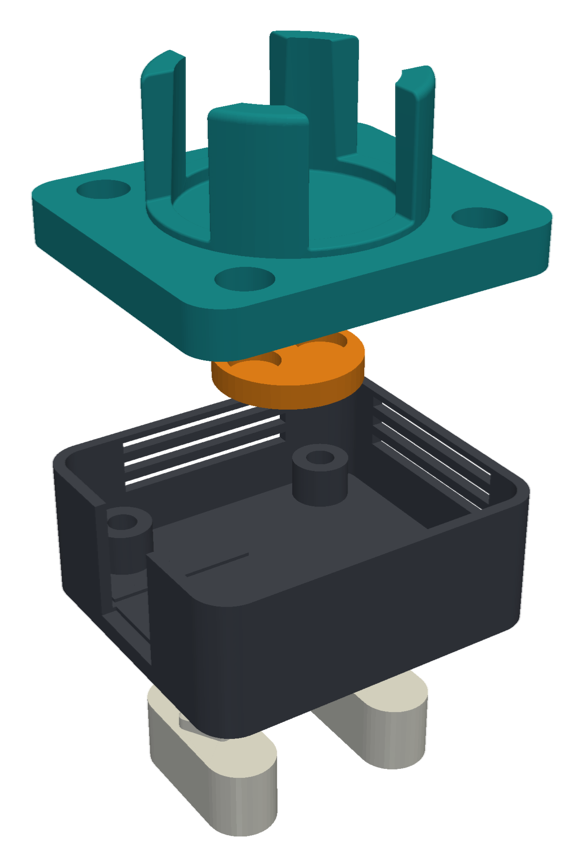
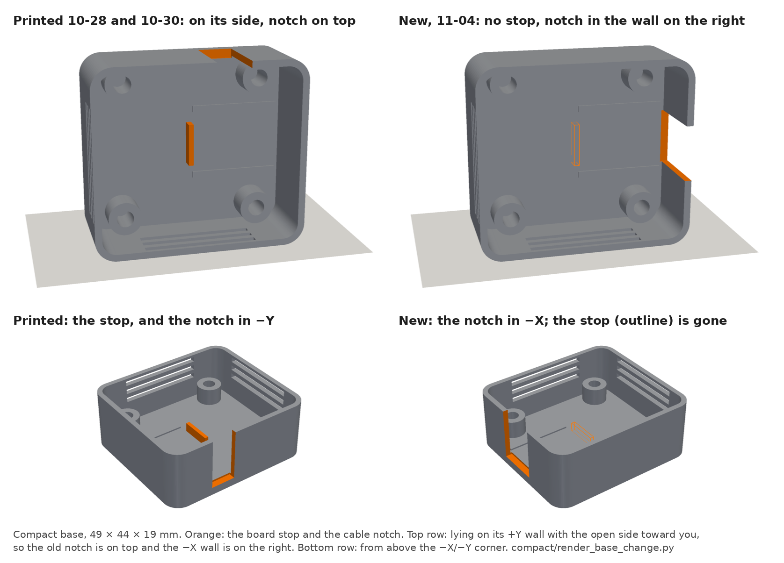

# The compact stirrer (49 × 44 mm)

The stirrer with a smaller base and vial holder, so that stirrers sit side by side on the
CubXL deck at its own 50 × 45 mm slot pitch. The layout was worked out and checked in plan on
2026-10-22 ([README section](../README.md#side-by-side-on-the-deck),
[`analysis/deck_tiling.py`](../analysis/deck_tiling.py)). It was modelled here on 2026-10-28
for @benwhitney5463's `@claude-print` request on
[PR #269](https://github.com/vertical-cloud-lab/byu-vcl/pull/269#issuecomment-6480898247), and
printed the same day ([print record](../print/2026-10-28-a1mini-compact/README.md)). A second
set, from the same file, was printed on 2026-10-30
([print record](../print/2026-10-30-a1mini-compact/README.md)). On 2026-11-04 the base lost
its board stop and its cable notch moved to the −X wall ([below](#the-2026-11-04-changes));
both prints are the earlier base.

*The parts, exploded: vial holder, magnet carrier, base, two deck keys ([`render_compact.py`](render_compact.py)). The cable notch is in the base's −X wall, on the left.*

Only the base and the holder are new. The deck keys (the 0.05 mm press fit), the magnet
carrier, the cup, the fan, the magnets and the electronics are today's, and so is every
height except the base's wall top.

| File | What |
|---|---|
| [`build_compact.py`](build_compact.py) | Builds both parts in CadQuery and writes the STLs and [`check_output.txt`](check_output.txt) |
| [`render_compact.py`](render_compact.py) | Draws [`../img/compact_parts.png`](../img/compact_parts.png) from the STLs |
| [`render_compact_steps.py`](render_compact_steps.py) | Draws [`../img/compact_assembly.png`](../img/compact_assembly.png), four steps of the assembly for BUILD.md stage 6, from these STLs and the Onshape model's bought parts |
| [`render_base_change.py`](render_base_change.py) | Draws [`../img/compact_base_20261104.png`](../img/compact_base_20261104.png), the base before and after the 2026-11-04 changes |
| [`../stl/compact/base_compact.stl`](../stl/compact/base_compact.stl) | The base: 49 × 44 × 19 mm. Print floor down |
| [`../step/compact/base_compact.step`](../step/compact/base_compact.step) | The same base as STEP, from the same CadQuery model (since 2026-11-04). The holder has no STEP: its cup comes from the Onshape STL |
| [`../stl/compact/vial_holder_compact.stl`](../stl/compact/vial_holder_compact.stl) | The vial holder: 49 × 44 × 22 mm. Print flange down |

## How it was modelled

The Onshape model ([`../onshape/vial_stirrer.fs`](../onshape/vial_stirrer.fs)) has only
today's 56 × 56 mm stirrer, and the print run that modelled this one has no Onshape API keys.
So `build_compact.py` reads the FeatureScript's constants and ports its `makeBase` and
`makeHolder` to CadQuery, with a `compact` switch for the changes.

**The port is checked against Onshape.** The script also builds today's two parts and compares
them with the Onshape STLs:

| | Port | Onshape | Only in the port | Only in Onshape |
|---|---|---|---|---|
| Base | 23751.5 mm³ | 23745.3 mm³ | 9.3 mm³ | 3.1 mm³ |
| Vial holder | 17136.7 mm³ | 17114.8 mm³ | 30.1 mm³ | 8.2 mm³ |

The bounding boxes are equal. The base's differences are tessellation. The holder's
"only in the port" is mostly the cup's edge rounds (R1 round each finger tip, R0.3 on the
slot and finger edges), which OpenCascade would not fillet here. So the compact holder's STL
takes everything within 16.9 mm of the axis from the Onshape STL. That covers the cup, its
floor and the carrier recess, all of which the compact layout leaves unchanged. Only the
flange around them comes from CadQuery. Inside that radius the compact holder and Onshape's
holder are both 4651.181 mm³.

## What modelling it changed from the 10-22 plan

| | Plan (`deck_tiling.py`) | As modelled | Why |
|---|---|---|---|
| Under the holder's flange | 0.5 mm pads on the fan's corners | Flat. **Four M3 flat washers** (0.5 mm) go on the fan's corners instead | The holder prints flange down. Printed pads would be the only thing touching the bed, and the whole flange would start 0.5 mm in the air |
| Base wall top | z 20.0, as today | z 19.0, 1 mm under the flange | The holder sits on the fan, so the walls must not carry it too. 1 mm also covers the fan's ±0.5 mm thickness |
| Insert holes | 6.5 mm deep | 7.5 mm deep | So an M3 × 20 can't bottom out, even if the holder goes on without the washers |
| Vents | ±Y and +X walls | +Y and +X walls | The cable notch was in the −Y wall, and it left the bars between that wall's vents attached at one end. Studio flagged them as a floating cantilever. The notch has since moved to −X; the −Y wall still has no vents |

The rest is as planned:
- The footprint and the walls: 49 × 44 mm, R5 corners, 1.6 mm walls.
- No corner posts, so 4 inserts, not 8.
- The fan's 4 screws are M3 × 20, through Ø3.4 mm holes and Ø6.5 × 3 mm counterbores in the flange.
- The cable notch was in the −Y wall, at x −11 to −3 mm, until 2026-11-04.
- The junction board's rails and stop moved 0.5 mm toward +X. The stop went on 2026-11-04.

The heights, from [`check_output.txt`](check_output.txt): with the washers, an M3 × 20's head
sits at z 23.0 and its tip at z 3.0. That puts its thread 6.0 mm into the 5.7 mm insert, with
the tip 1.5 mm above the hole's floor. Without washers, everything above the fan sits 0.5 mm
lower: the screw tip is 1.0 mm above the floor and the carrier's running gap is 0.6 mm
instead of 1.1.

## The 2026-11-04 changes

Asked for by @benwhitney5463 on
[PR #269](https://github.com/vertical-cloud-lab/byu-vcl/pull/269), after building the first
compact stirrer on a 10-28 base:

1. **No board stop.** The 1.2 × 10 mm stop stood 3 mm off the floor between the junction
   board and the MOSFET, so the MOSFET's legs had to be bent up over it, and it got in the
   way of putting the stirrer together.
2. **The cable notch moved to the wall on the right, with the base on its side and the old
   notch on top.** Looking into the open side, that is the −X wall. The notch is now in that
   wall at y −6.5 to 6.5, 13 mm wide and full height, as in the 56 × 56 mm base.

Why −X suits the notch: it is the end of the board with column A, where all four of the
cable's cores land (A1, A3, A5, A6), so they now go straight in from the notch. Before, they
came in from the −Y wall and ran under the fan, about 40 mm to A1, as a 2 × 2 bundle in the
3.5 mm under the fan. The Hall sensor's leads come down the same wall, from the holder's
groove, as in the 56 × 56 mm stirrer. The holder hasn't changed: its STL is byte-identical.

Without the stop, nothing fixes the board along X. It goes where the stop held it, about
1.5 mm from the −X wall, with the rails ending 0.4 mm short of its +X edge. The cable's jacket,
hot-glued in the notch, and the MOSFET, hot-glued to the floor with its legs soldered into
H2–H4, hold it there.

What [`check_output.txt`](check_output.txt) reads back off the new STL: nothing above the
rails' top (z 3.7) anywhere across the cavity at |y| < 10, where the board and the MOSFET lie;
the −X wall open at y −6.5 to 6.5 from z 2.6 up; the −Y wall closed. The base comes to
11,120 mm³, against 11,289 for the printed one.

**On the deck,** the cable now leaves from −X. Stirrers side by side in X sit 1 mm apart with
their X walls facing, so a cable can only get out at the ends of a row. A block of stirrers can
therefore be two stirrers wide in X and any number deep in Y, each turned so its −X wall faces
out (a stirrer can be turned 180°; its keys still drop into the same two slots). Four fit as a
2 × 2 block with the cables leaving left and right, or as a column of four. A row of three or
more in X no longer works. The 10-22 tiling figures in the main README still show the notch
on −Y.

## Building it

[`BUILD.md`](../BUILD.md) covers this stirrer as well as the 56 × 56 mm one, stage by stage:
its parts list, prints, inserts, cable route and its own assembly steps
([stage 6, compact](../BUILD.md#compact-stirrer)). In short, the differences are:

- **Inserts:** 4, in the fan posts only.
- **Screws:** 4 × M3 × 20, from the top: through the holder's counterbores, the washers and
  the fan, into the inserts. No M3 × 16 or M3 × 12. The BOM's M3 kit has 20 mm screws.
- **Washers:** 4 × M3 flat washers, 0.5 mm thick (DIN 125 or ISO 7089: Ø3.2 × Ø7 × 0.5 mm),
  stainless, for the reason the screws are stainless. The BOM's M3 kit (item 12) has 140 M3
  flat washers, Ø7 mm; its listing gives no thickness, so measure one. One goes on each of
  the fan's top corners, under the flange.
- **Order:** one set of screws holds both the fan and the holder, so the carrier goes on the
  hub first, on the bench. Then the board, the fan on its posts, the Hall sensor into the
  holder, a washer on each of the fan's corners, the holder (groove over the −X wall, the one
  with the notch), and the four screws.
- **The cable** leaves through the notch in the −X wall. In a block of stirrers, turn each so
  that wall faces out ([above](#the-2026-11-04-changes)).
- **The junction board** is wired as in BUILD.md's [wiring diagram](../BUILD.md#circuit), hole
  for hole, and goes in as in the 56 × 56 mm base, but with no stop: on the rails, about
  1.5 mm from the −X wall. The cable's cores go from the notch straight into column A, and the
  MOSFET's legs straight into H2–H4. The Hall sensor's leads come down from the holder's
  groove, which ends over the notch, inside the base.
- **On a base printed on 10-28 or 10-30,** with the stop and the −Y notch, follow
  [BUILD.md as it was](https://github.com/vertical-cloud-lab/byu-vcl/blob/bee02b8/hardware/vial-stirrer-cubxl/BUILD.md)
  for the board, the cable and stage 6.
- **The fan pocket is 45.8 × 40.8 mm,** so a 40 mm fan has 0.4 mm of play across Y. If a
  fan at the top of its ±0.5 mm tolerance won't drop in, ease the walls' inner faces.

## Not done

- **It isn't in Onshape.** `vial_stirrer.fs` has no compact option, so there is no assembly
  video for it, and the holder has no STEP file. The four renders in BUILD.md stage 6 are
  drawn by `render_compact_steps.py` instead.
- **Some docs still describe the 10-22 plan or today's stirrer only:** `deck_tiling.py`'s
  `COMPACT` list and figures (pads, 6.5 mm holes, vents on both Y walls, the notch on −Y) and
  the assembly video. `BUILD.md` and `BOM.md` cover both sizes since 2026-10-29.
- **The new base hasn't been printed.** One compact stirrer has been built, on a 10-28 base,
  and spun with the holder on
  ([11-04 record](../../../cubos/results/stirrer_spin_20261104/README.md)).
- **The 56 × 56 mm base still has its stop.** It is in Onshape (`vial_stirrer.fs`); its notch
  was already in the −X wall.
