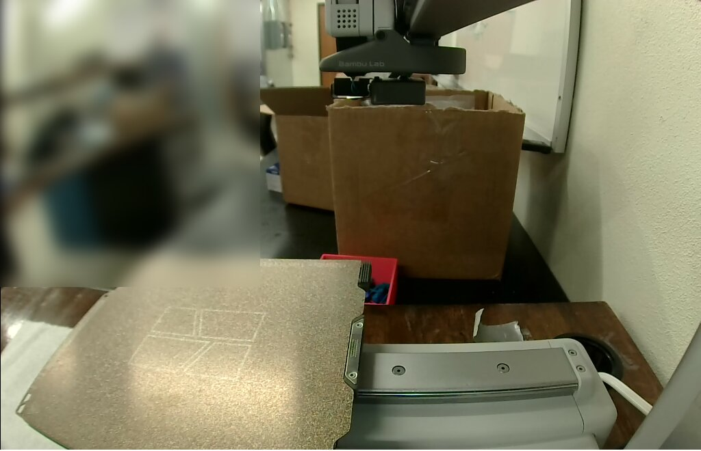
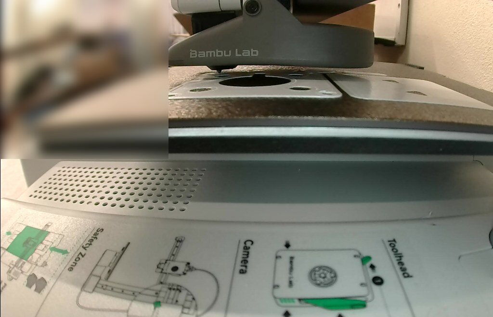

# The stirrer's printed parts on the A1 mini (2026-10-21)

All five printed parts of the [stirrer](../../README.md), on one plate: the base, the vial
holder, the magnet carrier and both deck keys. They were printed in **white Bambu PETG Basic**
(AMS Lite slot A4) on Textured PEI, as [`BUILD.md` stage 1](../../BUILD.md#1-print-the-parts)
asks. @benwhitney5463 asked for it on
[PR #269](https://github.com/vertical-cloud-lab/byu-vcl/pull/269#issuecomment-6327192394) with
`@claude-print`, approved the run himself in the `bambu-print` environment, and gave the go
(`plate clear`) after seeing the camera frame below.

**How it was sent.** Bambu Studio 02.08.02.61 ran on the CI runner, logged in to the lab's
Bambu account with the password and an authenticator code from `bambu-totp`. Studio sent the
job through Bambu's cloud. This is route 3 of the printing runbook, `bambu/README.md` and
`bambu/studio/README.md` on [PR #234](https://github.com/vertical-cloud-lab/byu-vcl/pull/234)'s
branch. `claude-print.yml` doesn't join the tailnet, so there was no LAN pre-flight. The
printer was checked and watched from Studio's Device page instead, as on the H2D on
2026-10-08.

**Outcome: paused at layer 42 of 110 (66 %).** At 23:27 UTC the printer paused itself on an
AMS Lite warning, *AMS lite filament spool or filament may be stuck* [1200-8010 232721].
Until then it had printed cleanly at 245 °C / 70 °C. The run didn't press *Resume*, since a
person has to look at the spool first. It was still paused at the last check in the timeline below.

| | |
|---|---|
| Parts | base, vial holder, magnet carrier, 2 × deck key, from [`stl/`](../../stl) at `ed84bba`, each as it sits in its STL (already its print orientation) |
| Printer | "Thumbelina, the A1 Mini", 0.4 mm nozzle, Textured PEI |
| Filament | Bambu PETG Basic, white (`GFG00`), AMS Lite A4. Nozzle 245 °C, bed 70 °C |
| Process | Bambu's `0.20mm Standard @BBL A1M`, with `BUILD.md`'s changes: 4 walls (from 2), 30 % infill (from 15 %), 0.15 mm elephant-foot compensation (from 0). Magnet carrier alone at 100 % infill, rectilinear |
| Left as Bambu has them | no supports (the holder's recess prints as a bridge); auto brim, which chose none; circle compensation off |
| Studio's estimate | 1 h 40 min 36 s, 110 layers to 22.0 mm, 42.41 g (14.10 m). First layer 5 min 10 s |
| Send options | job `stir_module_parts`, PETG → A4, timelapse off, bed levelling and flow dynamics calibration on |

| Before Send, 22:17:14 UTC | Layer 2, 22:31:51 UTC |
|---|---|
|  |  |

The camera rides on the gantry. Before Send the gantry was parked high, so the frame looks
down on the plate and the room behind it. Once the print homed, it looked across the plate
from its front edge, past the Safety Zone sticker. The room is blurred in every frame here.

## Timeline (UTC)

| | |
|---|---|
| 21:42:08 | Request |
| 21:44 | Run approved; session starts |
| 21:47–21:50 | Studio's first run: certificate prompt, wizard, network plug-in, three beta prompts, configuration update cancelled |
| 21:50:35 | *Log In* pressed. Bambu asked for the authenticator code, typed at 21:50:53; logged in at 21:50:54 |
| 21:52 | Device page: idle, no HMS alerts, heaters off. AMS Lite: A1 dark blue PLA Basic, A2 empty, A3 black PLA Basic, A4 white PETG Basic |
| 21:53–22:02 | *Sync info*, the four STLs imported, a second deck key cloned, auto-arranged, settings changed, sliced |
| 22:04:54 | Frame posted, go asked for |
| 22:16:26 | Go: `plate clear` |
| 22:17:14 | Fresh Device-page check and frame: idle, plate unchanged |
| 22:18:00 | *Send* |
| 22:18:47 | Downloaded; bed preheating |
| 22:19–22:21 | PETG loaded from A4 and flushed at 270 °C |
| 22:21–22:26 | Vibration compensation, nozzle cleaning, bed to 70 °C, bed levelling, flow dynamics calibration |
| 22:26:00 | Layer 1 at 245 °C / 70 °C |
| 22:31:07 | Layer 2 |
| 22:53:47 | Layer 14, 33 % |
| 23:24:07 | Layer 37, 63 % ([frame](20261021T232407Z_L37.jpg)) |
| 23:27:48 | **Paused** on layer 42, 66 %: *AMS lite filament spool or filament may be stuck* [1200-8010 232721] ([warning](20261021T232748Z_ams_warning.png)). Nozzle 245 °C, bed 70 °C |
| 23:29:22 | Thread told: what to check at slot A4, and how to resume or stop |
| 23:40:55 | Still paused. The printer had let the nozzle cool to 42 °C and kept the bed at 70 °C ([job panel](20261021T234055Z_paused_job_panel.png)) |

## Files

| File | What |
|---|---|
| [`stir_module_parts.gcode.3mf`](stir_module_parts.gcode.3mf) | The file Studio uploaded, copied from its `/tmp/bamboo_model/.../Metadata/.<pid>.0.3mf`. Only `DesignerUserId` is blanked. Plate G-code MD5 `9d1850c4405d54b5aa2235d449fbdcba`, the same as Studio's slice and the file's own `.md5` |
| [`print.json`](print.json) | Source files and their MD5s, the part positions, the settings changed in the GUI, the Send options, estimates, the timeline, the go |
| [`plate_layout.png`](plate_layout.png) | Top view of every extrusion move in the slice, shaded by height |
| `*_camera.jpg`, `*_L*.jpg` | Camera frames from Studio's Device page |
| [`20261021T232748Z_ams_warning.png`](20261021T232748Z_ams_warning.png) | Studio's copy of the printer's warning when it paused |
| [`20261021T234055Z_paused_job_panel.png`](20261021T234055Z_paused_job_panel.png) | Studio's job panel while paused: 66 %, layer 42/110, the resume button and the AMS Lite message |

## Things the next print should know

- **PETG's start flushes at 270 °C.** Bambu's A1 mini start G-code loads non-PLA filament at
  its flush temperature, which for PETG Basic is its range high, 270 °C (`M620.1 … T270`,
  `M104 S270`). The H2D-era Device-page watcher stops above 260 °C, which only suits PLA. The
  copy used here allowed 280 °C until layer 1 and 260 °C after it.
- **The Device page's temperatures need a digits-only OCR.** At the watcher's threshold of
  150, the light grey "/" in "67 /70" read as a 1, giving a bed target of 170 °C. A threshold
  of 220 with a digits-and-slash whitelist read it right. The watcher also now needs three
  readings in a row over a limit before it stops.
- **Number keys set filament in Prepare.** With an object selected in the 3D view, pressing
  1–9 assigns that filament to it. Pressing "1" for a top view moved the magnet carrier to
  PLA, and Studio warned "PLA and PETG filaments detected in the mixture". It was set back to
  PETG and re-sliced before Send. In the object list, typed digits go to a search box instead.
- **Grid infill can't do 100 %.** Setting the carrier to 100 % brings up a notice, and the
  object's pattern becomes rectilinear.
- **Elephant-foot compensation is 0 in Bambu's A1 mini processes**, where most other Bambu
  processes have 0.15 mm. `BUILD.md` asks for it, so check it after picking the preset.
