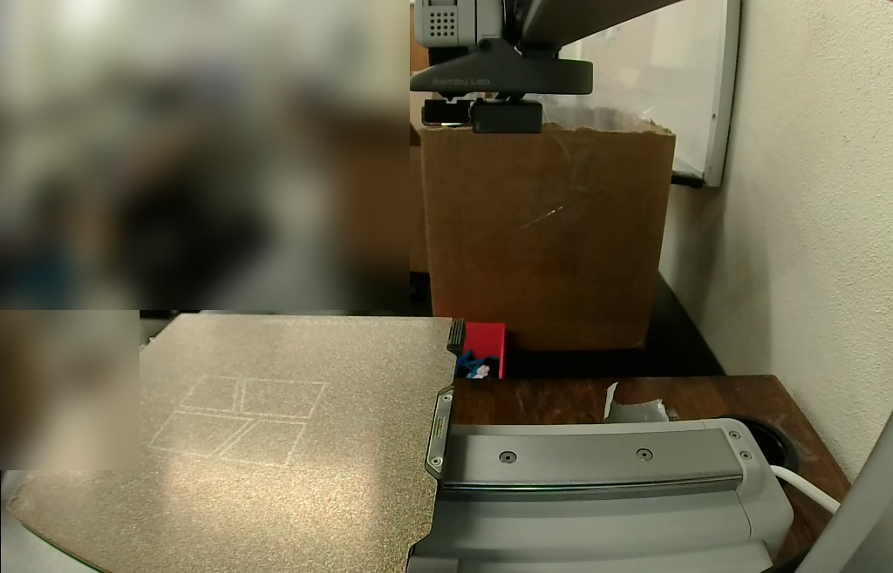
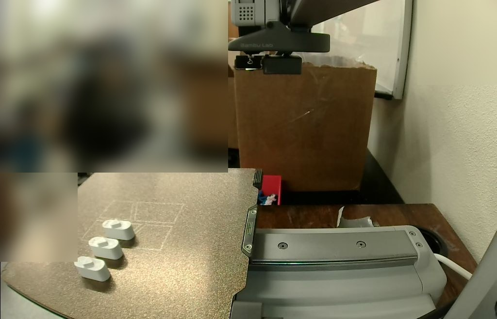
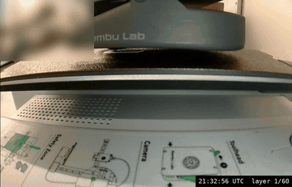

# The deck key fit test on the A1 mini (2026-10-22)

The stirrer's [deck key](../../README.md#the-key-nub-and-pocket) at all three nub
interferences, one of each, on one plate, for the fit test in
[`BUILD.md` stage 2](../../BUILD.md#2-press-the-deck-keys-into-the-base):

| Key | File now | Nub interference, each side | Nub A / B in the model (mm) | Dimples |
|---|---|---|---|---|
| **0.05, fit best** | [`stl/deck_key.stl`](../../stl/deck_key.stl) | 0.05 mm | 6.95 / 7.67 | 1 |
| 0.10 | [`stl/key_fit_test/deck_key_press_0.10.stl`](../../stl/key_fit_test/deck_key_press_0.10.stl) | 0.10 mm | 7.05 / 7.77 | 2 |
| 0.15 | [`stl/key_fit_test/deck_key_press_0.15.stl`](../../stl/key_fit_test/deck_key_press_0.15.stl) | 0.15 mm | 7.15 / 7.87 | 3 |

The files came from `ecde470`, where the 0.10 key was `stl/deck_key.stl` and the 0.05 key
`stl/key_fit_test/deck_key_press_0.05.stl`. After the fit test the 0.05 key became
`stl/deck_key.stl` and the 0.10 key moved to `stl/key_fit_test/`, each byte for byte (the
MD5s in [`print.json`](print.json) still match), so the links above go to where each file is
now.

They were printed in **white Bambu PETG Basic** (AMS Lite slot A4) on Textured PEI, on the
same printer and filament as the base whose pockets they go into
([`../2026-10-21-a1mini/`](../2026-10-21-a1mini/README.md)). @benwhitney5463 asked for it on
[PR #269](https://github.com/vertical-cloud-lab/byu-vcl/pull/269#issuecomment-6351246877) with
`@claude-print`, approved the run himself in the `bambu-print` environment, and gave the go
([`plate clear`](https://github.com/vertical-cloud-lab/byu-vcl/pull/269#issuecomment-6351626889))
after seeing the camera frame below.

**How it was sent.** As on 2026-10-21: Bambu Studio 02.08.02.61 ran on the CI runner, logged
in to the lab's Bambu account with the password and an authenticator code from `bambu-totp`,
and sent the job through Bambu's cloud. This is route 3 of the printing runbook,
`bambu/README.md` and `bambu/studio/README.md` on
[PR #234](https://github.com/vertical-cloud-lab/byu-vcl/pull/234)'s branch. The printer was
checked and watched from Studio's Device page.

**Outcome: finished, with no pause, dialog or HMS alert.** Sent at 21:25:16 UTC, first layer at
21:32:56, layer 60/60 at 21:49:05, and *Finished* at 21:49:16: 24.0 min after Send, against
Studio's 23 min 36 s. The keys were taken off the plate by 21:51:41.

**Result: the 0.05 mm key fit best.** @benwhitney5463
[reported](https://github.com/vertical-cloud-lab/byu-vcl/pull/269#issuecomment-6352266215)
that it was the best fit of the three, and to stick with it for all future stir module
prints. So it is now the default deck key: `keyPress` is 0.05 in the model, and
`stl/deck_key.stl` and `step/deck_key.step` are that key
([README](../../README.md#the-key-nub-and-pocket)).

| Before Send, 21:24:28 UTC | Finished, 21:50:00 UTC |
|---|---|
|  |  |

The camera rides on the gantry. With the gantry parked high it looks down on the plate and
the room behind it; while printing it looks across the plate from its front edge
([layer 1](20261022T213256Z_L1.jpg), [layer 29](20261022T214025Z_L29.jpg),
[layer 57](20261022T214832Z_L57.jpg)). The room is blurred in every frame here. On the plate,
left to right, the keys are 0.15, 0.10 and 0.05.

*Layer 1 to the keys being taken off, one frame about every 11 s ([MP4](timelapse.mp4)).*

| | |
|---|---|
| Parts | the three keys above, from `stl/` at `ecde470`, nub up as in the STLs. Studio placed each turned 180° about Z, which changes nothing for a part symmetric about its long axis ([layout](plate_layout.png)) |
| Printer | "Thumbelina, the A1 Mini", 0.4 mm nozzle, Textured PEI |
| Filament | Bambu PETG Basic, white (`GFG00`), AMS Lite A4. Nozzle 245 °C, bed 70 °C |
| Process | Bambu's `0.20mm Standard @BBL A1M`, with `BUILD.md`'s changes, as on 2026-10-21: 4 walls (from 2), 30 % infill (from 15 %), 0.15 mm elephant-foot compensation (from 0) |
| Left as Bambu has them | no supports; auto brim, which made none; circle compensation off |
| Studio's estimate | 23 min 36 s, 60 layers to 12.0 mm, 5.64 g (1.87 m). First layer 52 s |
| Send options | job `deck_key_fit_test`, PETG → A4, timelapse off, bed levelling and flow dynamics calibration on |

## Checked in the G-code

[`check_slice.py`](check_slice.py) reads the plate G-code in the sent file
([output](check_slice_output.txt)) and draws [`plate_layout.png`](plate_layout.png):

| Key | Nub A / B from the toolpaths (mm) | Model (mm) | Dimples found |
|---|---|---|---|
| 0.05 | 6.94 / 7.66 | 6.95 / 7.67 | 1 |
| 0.10 | 7.04 / 7.76 | 7.05 / 7.77 | 2 |
| 0.15 | 7.14 / 7.86 | 7.15 / 7.87 | 3 |

- **Nub sizes** are the outer-wall toolpaths' spans plus one line width, averaged over the 8
  layers from z 10.2 to 11.6, below the 0.3 mm lead-in.
- **Dimples:** each is a hole in the pill's top two layers (z 9.8 and 10.0), ringed by an
  outer-wall loop. They print, so the keys can be told apart.
- **First layer:** each key's outer wall runs 9.0 × 23.97 mm on its centreline. That is the
  9.8 × 24.77 mm pill less half the 0.5 mm first-layer line width and the 0.15 mm
  elephant-foot compensation on each side.
- **No brim, skirt, support or prime tower.** The start G-code loads filament 3 from the AMS
  (`M620 S2A`) and turns on runout detection (`M412 S1`).

## Timeline (UTC)

| | |
|---|---|
| 21:02:50 | Request; the run was approved at once |
| 21:06–21:08 | Studio's first run: certificate prompt, wizard, network plug-in, beta prompts, configuration update cancelled |
| 21:09:17 | *Log In* pressed. Bambu asked for the authenticator code, typed at 21:09:34; logged in at 21:09:35 |
| 21:10:25 | Device page: idle after the stirrer parts, no HMS alerts, heaters off. AMS Lite: A1 dark blue PLA Basic, A2 empty, A3 black PLA Basic, A4 white PETG Basic |
| 21:11–21:18 | *Sync info* (the empty project had started as an A1), AMS filaments synced, the three STLs imported, arranged, set to PETG, settings changed, sliced |
| 21:23:21 | [Frame](20261022T211049Z_camera.jpg) posted, go asked for |
| 21:23:43 | Go: `plate clear` |
| 21:24:28 | Fresh Device-page check and frame: idle, plate unchanged |
| 21:25:16 | *Send* |
| 21:25:54 | Downloaded. The bed showed a 65 °C target (PLA's) during the download, then the file's 70 °C |
| 21:26–21:28 | PETG loaded from A4 |
| 21:28–21:32 | Vibration compensation, bed to 70 °C, bed levelling, flow dynamics calibration |
| 21:32:56 | Layer 1 at 245 °C / 70 °C |
| 21:37:55 | Layer 19 |
| 21:43:22 | Layer 41 |
| 21:49:05 | Layer 60/60 |
| 21:49:16 | *Finished*; heaters off by 21:49:49 |
| 21:50:00 | The three keys on the plate, gantry parked high |
| 21:51:07–21:51:41 | Keys taken off the plate |

## Files

| File | What |
|---|---|
| [`deck_key_fit_test.gcode.3mf`](deck_key_fit_test.gcode.3mf) | The file Studio uploaded, copied from its `/tmp/bamboo_model/.../Metadata/.<pid>.0.3mf`. Only `DesignerUserId` is blanked. Plate G-code MD5 `1a127d4b3d5777b323a13e0f62563dfb`, the same as Studio's slice and the file's own `.md5` |
| [`print.json`](print.json) | Source files and their MD5s, the part positions, the settings changed in the GUI, the G-code checks, the Send options, estimates, the timeline, the go |
| [`check_slice.py`](check_slice.py), [`check_slice_output.txt`](check_slice_output.txt) | The G-code checks above: `python check_slice.py deck_key_fit_test.gcode.3mf plate_layout.png "158=0.05 key,180=0.10 key,202=0.15 key"`. Needs numpy and matplotlib |
| [`plate_layout.png`](plate_layout.png) | Top view of every extrusion move in the sent file, shaded by height |
| `*_camera.jpg`, `*_L*.jpg`, `*_finished.jpg` | Camera frames from Studio's Device page |
| [`timelapse.mp4`](timelapse.mp4), [`timelapse.gif`](timelapse.gif) | The camera from layer 1 to 21:51:41, one frame about every 11 s, with the UTC time and layer. The MP4 is 1024 × 658 at 8 fps (12 s), the GIF 360 px at 8 fps. Room blurred |

## Things the next print should know

- **A new project starts as the A1, not the A1 mini.** *Sync info* fixed the printer, plate
  and process, but the AMS filaments came across only with the *Synchronize filament list
  from AMS* button next to the filament list.
- **Several files at once ask to become one object.** Studio offers to load them "as a single
  object with multiple parts". Say *No*: the three keys share the same coordinates, so as one
  object they would overlap.
- **Setting each object's filament:** with the object list's filament cell, a click selected
  the row but didn't open the choice. Right-click on the object in the 3D view, then
  *Change Filament*, worked. It changes only the object under the pointer, so do it once per
  object.
- **The bed shows the first project filament's temperature while the file downloads.**
  Here that was PLA's 65 °C. The file's own `M140 S70` took over before the print started.
- **The Device page's OCR reads "Layer." as well as "Layer:"**, and can lose the "%" at 100.
  The A1 mini copy of the watcher now accepts either separator. It didn't see the finish
  through the missing "%", so it ran to its time limit instead. Watch for *Finished* as well
  as 100 %.
