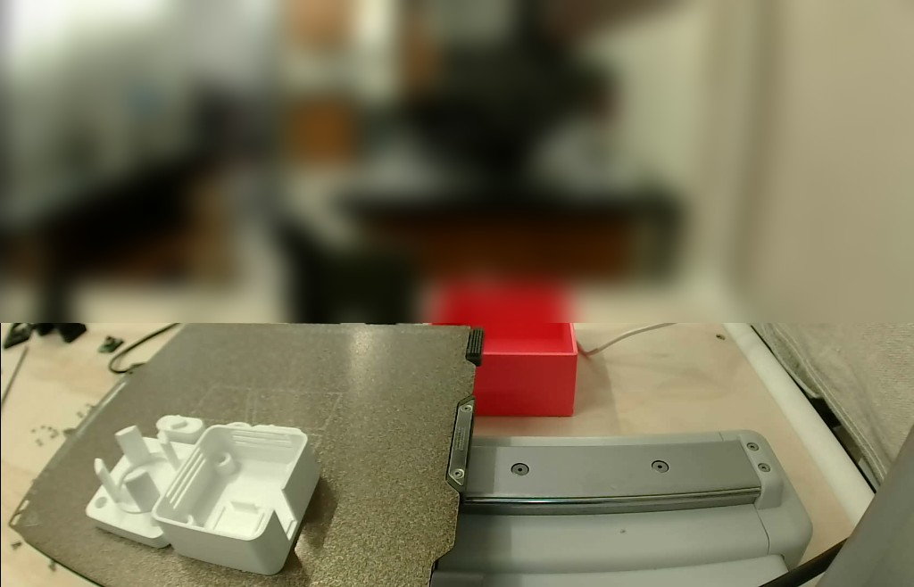
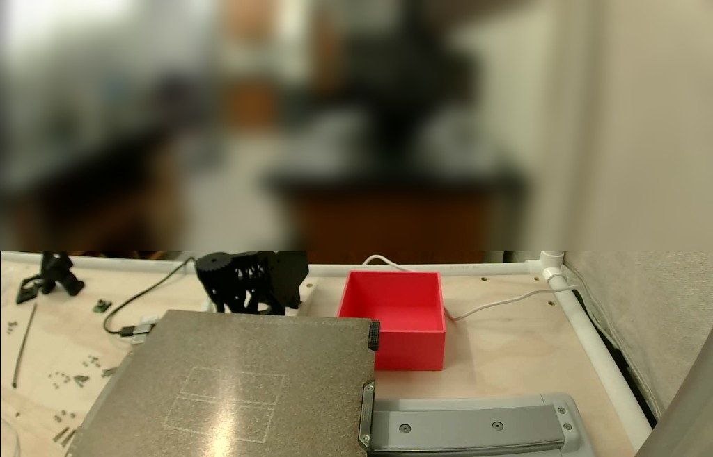
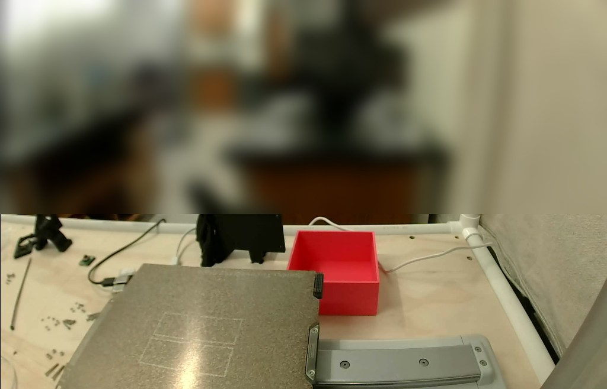

# The compact stirrer's parts on the A1 mini (2026-10-28)

The [compact 49 × 44 mm stirrer](../../compact/README.md)'s printed parts on one A1 mini
plate: its base and vial holder, a magnet carrier and two deck keys (the 0.05 mm press fit).
@benwhitney5463 asked for it on
[PR #269](https://github.com/vertical-cloud-lab/byu-vcl/pull/269#issuecomment-6480898247)
with `@claude-print`, and approved the run himself in the `bambu-print` environment. The
compact base and holder had been checked in plan only (2026-10-22), so this run modelled them
first ([`../../compact/`](../../compact/README.md)).

It was the stirrer's first print under the 2026-10-23 plate rule. A frame went into the
thread before any prep, the run read the plate itself, and nobody had to reply `plate clear`.
The run did hold once, for something behind the bed (below), until Ben said it was clear.

**How it was sent.** As on 2026-10-21 and 10-22: Bambu Studio 02.08.02.61 ran on the CI
runner, logged in to the lab's Bambu account with the password and an authenticator code from
`bambu-totp`, and sent the job through Bambu's cloud. The printer was checked and watched
from Studio's Device page.

**Outcome: finished, with no pause, dialog or HMS alert.** Sent at 21:54:09 UTC, first layer
at 22:02:14, layer 110/110 and *Finished* at 23:06:25: 72.3 min after Send, against Studio's
1 h 11 min 20 s. The parts were still on the plate when the run ended, and nothing has been
assembled yet.

*23:07:09 UTC, the gantry parked high: the vial holder (left) and the base (right). The
carrier and the keys are lower, and out of view from here.*

| First frame, 21:27:01 UTC | Before Send, 21:52:52 UTC |
|---|---|
|  |  |

The printer has moved since 2026-10-22: it now stands on a wooden bench, with the room behind
it. The room is blurred in every frame here.

| | |
|---|---|
| Parts | [`base_compact.stl`](../../stl/compact/base_compact.stl) and [`vial_holder_compact.stl`](../../stl/compact/vial_holder_compact.stl) from `stl/compact/` at `b9f57f5`, [`magnet_carrier.stl`](../../stl/magnet_carrier.stl), and [`deck_key.stl`](../../stl/deck_key.stl) twice (MD5 `fc2bb14d…`, the 0.05 mm key from the fit test). In their STL orientation; Studio's Arrange turned the base 180° about Z ([layout](plate_layout.png)) |
| Printer | "Thumbelina, the A1 Mini", 0.4 mm stainless nozzle, standard flow (read off the printer), Textured PEI |
| Filament | Bambu PETG Basic, white (`GFG00`), AMS Lite A4. Nozzle 245 °C, bed 70 °C |
| Process | Bambu's `0.20mm Standard @BBL A1M`, with `BUILD.md`'s changes, as on 2026-10-21: 4 walls (from 2), 30 % infill (from 15 %), 0.15 mm elephant-foot compensation (from 0). The magnet carrier alone at 100 % infill, rectilinear (Studio: grid can't do 100 %) |
| Left as Bambu has them | no supports; auto brim, which made none; circle compensation off |
| Studio's estimate | 1 h 11 min 20 s, 110 layers to 22.0 mm, 27.11 g (9.02 m) |
| Send options | job `compact_stirrer_parts`, PETG → A4, timelapse off, bed levelling and flow dynamics calibration on |

## The plate check, and the hold

- **21:27:01, the first frame.** The plate was empty: only its texture, the faint outlines
  printed on it and the lamp's glare. Someone's black print ("Mounting Plate", the previous
  job) had been taken off the plate since this morning and stood on the bench just behind
  the bed.
- **21:29:22, posted.** Frame, printer state, nozzle and plan went at the top of the tracking
  comment.
- **21:34:33, held.** From the high view the run couldn't tell whether that print was in the
  bed's travel, and the runbook says to hold in that case. The tracking comment asked someone
  at the printer to check.
- **21:39:23, the go.** Ben: "everything is clear of the build plate for the print". At
  21:43:25 he repeated it under a quote of the tracking comment.
- **21:52:52, the second frame.** The plate matched the first frame (mean difference
  2.6 of 255 over the plate). The black print had been turned round.
- **21:54:09, Send.** No other comment in the thread had asked to wait.

## Checked in the G-code

[`check_slice.py`](check_slice.py) reads the plate G-code in the sent file
([output](check_slice_output.txt)) and draws [`plate_layout.png`](plate_layout.png). Sizes are
outer-wall toolpath spans plus one line width:

| Part | From the toolpaths (mm) | Model (mm) |
|---|---|---|
| Base | 49.0 × 44.0 at z 5, 10 and 18; top layer z 19.0 | 49 × 44 × 19 |
| Vial holder | flange 49.0 × 44.0; cup Ø33.40 at z 12 and 18; top layer z 22.0 | 49 × 44, cup Ø33.4, 22.03 tall |
| Magnet carrier | Ø19.0; top layer z 3.2 | Ø19 × 3.23 |
| Deck keys | nub A 6.94, B 7.66, one dimple each | 6.95 / 7.67, one dimple |

The carrier's infill is solid: its sparse-infill lines are about three times as long, per area,
as the keys' at 30 %. The config block has `wall_loops = 4`, `sparse_infill_density = 30%`,
`elefant_foot_compensation = 0.15`, `enable_support = 0`, `curr_bed_type = Textured PEI Plate`
and `printer_settings_id = Bambu Lab A1 mini 0.4 nozzle`.

## Timeline (UTC)

| | |
|---|---|
| 21:16:54 | Request; the run was approved and started by 21:17:49 |
| 21:21–21:24 | Studio's first run: certificate prompt, wizard, network plug-in, beta prompts, configuration update cancelled |
| 21:24:24 | *Log In* pressed. Bambu asked for the authenticator code, typed at 21:24:41; logged in |
| 21:25:16 | Device page: idle after "Mounting Plate", heaters off. AMS Lite: A1 dark blue PLA Basic, A2 empty, A3 black PLA Basic, A4 white PETG Basic |
| 21:27:01 | First frame; nozzle 0.4 mm at 21:27:13; no HMS alerts at 21:27:36 |
| 21:29:22 | Frame posted at the top of the tracking comment |
| 21:29–21:43 | Compact base and holder modelled; pushed at 21:43:03 |
| 21:34:33 | Hold, for the black print behind the bed |
| 21:39:23 | Go from Ben: "everything is clear of the build plate for the print" |
| 21:43:25 | Ben repeats the go under a quote. The quote queues a second print run, which runs for 14 s and does nothing |
| 21:44–21:51 | *Sync info*, PETG from A4, five STLs, settings, sliced; the floating-cantilever warning; the base rebuilt, reloaded and sliced again |
| 21:52:52 | Second frame: plate unchanged; no HMS alerts |
| 21:54:09 | *Send* |
| 21:55–22:02 | PETG loaded from A4, bed levelling, flow dynamics calibration |
| 22:02:14 | Layer 1 at 246 °C / 70 °C; layer 2 at 22:05:57 |
| 22:31:09 | Layer 20 |
| 22:51:16 | Layer 50 |
| 23:06:14 | Layer 110/110 |
| 23:06:25 | *Finished*; heaters off by 23:06:57, 100 % by 23:07:30 |
| 23:07:09 | The parts on the plate, gantry parked high |
| 23:08:20 | Signed out; Studio closed and its config deleted at 23:08:52 |

## Files

| File | What |
|---|---|
| [`compact_stirrer_parts.gcode.3mf`](compact_stirrer_parts.gcode.3mf) | The file Studio uploaded, copied from its `/tmp/bamboo_model/.../Metadata/.<pid>.0.3mf`. Only `DesignerUserId` is blanked. Plate G-code MD5 `a4a94f0268d8ffbfe13347abf12c7f91`, the same as Studio's slice and the file's own `.md5` |
| [`print.json`](print.json) | Source files and their MD5s, the settings changed in the GUI, the G-code checks, the Send options, estimates, the plate check and the go, the timeline |
| [`check_slice.py`](check_slice.py), [`check_slice_output.txt`](check_slice_output.txt) | The G-code checks above: `python check_slice.py compact_stirrer_parts.gcode.3mf plate_layout.png`. Needs numpy and matplotlib |
| [`plate_layout.png`](plate_layout.png) | Top view of every extrusion move in the sent file, shaded by height |
| `*_camera.jpg`, `*_finished.jpg` | Camera frames from Studio's Device page |
| `*_device_page.jpg`, `*_printer_parts.png`, `*_hms_empty*.png`, `*_job_panel_finished.png` | The Device page, the nozzle read off the printer, and the empty HMS list before any prep and after the print; the job panel at 100 % |
| [`timelapse.mp4`](timelapse.mp4), [`timelapse.gif`](timelapse.gif) | The camera from 21:59:50 to the finish, one frame about a minute, with the UTC time and layer. 1024 × 658 and 360 px wide, 8 fps. Room blurred |
| [`recording/`](recording/) | The session's screen recording, cut by wall-clock time ([`cut_plan.json`](recording/cut_plan.json)), 8.1 min with [chapters](recording/compact_stirrer_parts_A1mini_2026-10-28_chapters.txt). The login and the sign-out are not in it. The room in the camera pane is blurred. Not uploaded: `claude-print.yml` has no YouTube token |

## Things the next print should know

- **Quoting the tracking comment starts a run.** The comment told people to leave the
  trigger phrases out of replies, and so contained them. A quote-reply copied them in, which
  queued a second print run at 21:43:34. Keep the trigger phrases out of the tracking comment
  itself.
- **The high view sees behind the bed.** The camera rides on the gantry, so after a tall
  print it looks down past the plate onto the bench. Anything standing there may be in the
  bed's travel, and from the frame alone the run can't tell. Ask, as here.
- **Model the part before the print run if you can.** This run spent 14 min modelling, from
  21:29 to 21:43, while the frame's wait ran. It worked, but the floating-cantilever fix
  came from Studio's warning, at slicing time.
- **The watcher's OCR read the bed's "56 /70" as "560 /70"** and stopped on a hard limit. Its
  hard limits now ignore readings the heater can't reach, and need two in a row.
