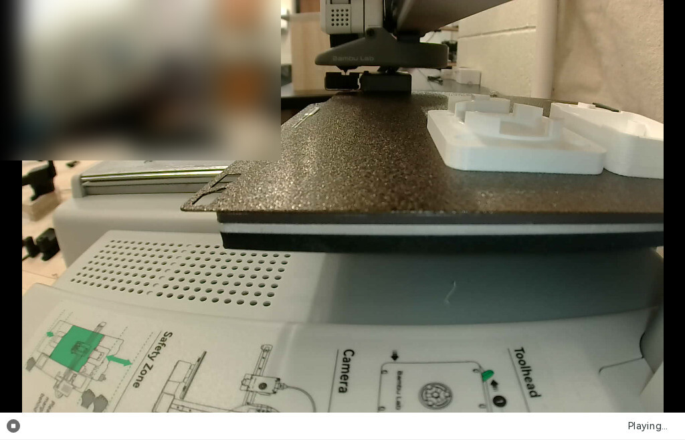
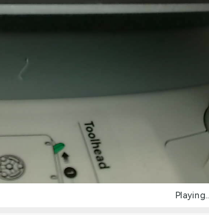
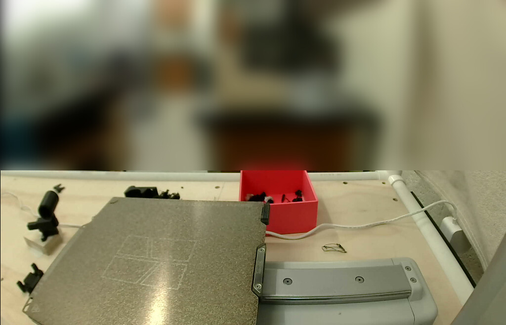
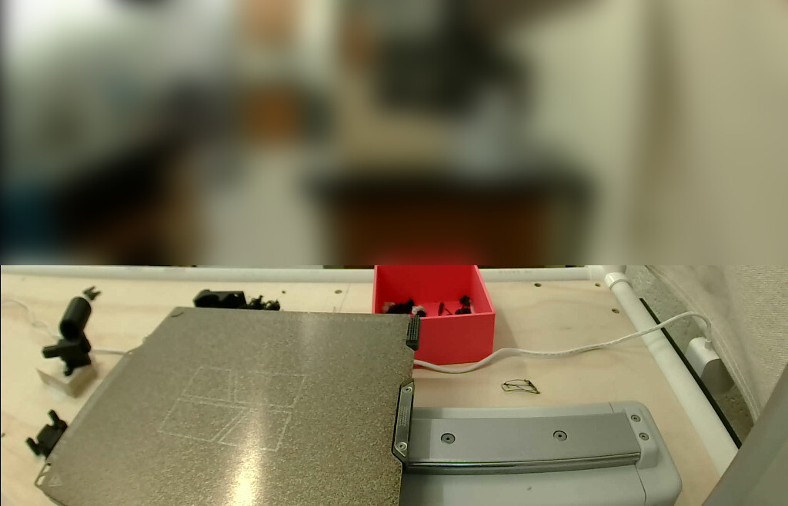

# A second set of compact stirrer parts on the A1 mini (2026-10-30)

The [compact 49 × 44 mm stirrer](../../compact/README.md)'s printed parts again, on one A1 mini
plate: its base and vial holder, a magnet carrier and two 0.05 mm deck keys. @benwhitney5463
asked for "another stir module (the smaller version)" on
[PR #269](https://github.com/vertical-cloud-lab/byu-vcl/pull/269#issuecomment-6532160735)
with `@claude-print`, and approved the run himself in the `bambu-print` environment.

**What was sent.** The same file the printer ran on 2026-10-28,
[`../2026-10-28-a1mini-compact/compact_stirrer_parts.gcode.3mf`](../2026-10-28-a1mini-compact/compact_stirrer_parts.gcode.3mf),
unchanged (MD5 `336c48d6…`, plate G-code MD5 `a4a94f02…`). None of its four STLs has changed
since, and that record's [`check_slice.py`](../2026-10-28-a1mini-compact/check_slice.py) gives
the same output on it. Bambu Studio 02.08.02.61 ran on the CI runner, logged in to the lab's
Bambu account with the password and an authenticator code from `bambu-totp`, opened the file
and sent it through Bambu's cloud. The printer was checked and watched from Studio's Device
page.

**Outcome: paused at layer 57 of 110 (80 %).** Sent at 20:06:13 UTC, first layer at 20:14:03.
At 21:05:30 the A1 mini paused itself on the same AMS Lite warning that stopped the
[2026-10-21 print](../2026-10-21-a1mini/README.md) at 66 %: *AMS lite filament spool or
filament may be stuck* [1200-8010], and in the HMS list *AMS lite slot 4 filament may be
tangled or stuck*. A4 holds the white PETG Basic. Until then it had printed cleanly at
245 °C / 70 °C. The run didn't press *Resume*, because someone has to look at the spool first.
About 3.5 g of the file's 27.1 g was still to print.

| Paused, 21:28:54 UTC | Studio's warning, 21:05:45 UTC |
|---|---|
|  |  |

*The base and the vial holder are the two parts on the right. The room is blurred.*

| First frame, 19:58:49 UTC | Before Send, 20:05:14 UTC |
|---|---|
|  |  |

| | |
|---|---|
| Parts | [`base_compact.stl`](../../stl/compact/base_compact.stl), [`vial_holder_compact.stl`](../../stl/compact/vial_holder_compact.stl), [`magnet_carrier.stl`](../../stl/magnet_carrier.stl) and [`deck_key.stl`](../../stl/deck_key.stl) twice, laid out as on 10-28 ([layout](../2026-10-28-a1mini-compact/plate_layout.png)) |
| Printer | "Thumbelina, the A1 Mini", 0.4 mm stainless nozzle, standard flow (read off the printer), Textured PEI |
| Filament | Bambu PETG Basic, white, AMS Lite A4. Nozzle 245 °C, bed 70 °C |
| Process | As sliced on 10-28: `0.20mm Standard @BBL A1M` with `BUILD.md`'s changes (4 walls, 30 % infill, 0.15 mm elephant-foot compensation), the magnet carrier alone at 100 % |
| Studio's estimate | 1 h 11 min 20 s, 110 layers to 22.0 mm, 27.11 g (9.02 m) |
| Send options | job `compact_stirrer_parts_2`, PETG → A4, timelapse off, bed levelling and flow dynamics calibration on ([dialog](20261030T200601Z_send_dialog.png)) |

## The plate check

Under the 2026-10-23 rule: frame first, the run reads the plate, at least 90 s for objections
while polling the thread, a fresh frame before Send. Nobody had to reply.

- **19:58:49, the first frame.** The plate was empty and bright enough to tell: only its
  texture, the faint outlines printed on it and the lamp's glare. The last job's parts and
  the filament tangle, on it at 17:42 ([prep record](../2026-10-30-a1mini-key/README.md)),
  were gone. The gantry was parked high, so the frame also showed the bench: a black part and
  a clump of filament past the plate's far edge, a black part on a white block to its left,
  a small black part lying flat by its lower-left corner, and the red box at its far right
  corner. The printer was idle with no HMS alerts ([HMS tab](20261030T200222Z_hms_empty.png),
  [Device page](20261030T195849Z_device_page.jpg)), with a 0.4 mm nozzle
  ([Printer Parts](20261030T200209Z_printer_parts.png)).
- **20:03:32, posted** at the top of the tracking comment, with the state, the file, the plate
  type and the read of the plate.
- **20:05:14, the second frame.** The plate matched the first frame: mean difference 2.4 of
  255 over the plate.
- **20:06:13, Send,** 2 min 41 s after the post. The thread was polled at 20:03:45, 20:04:49
  and 20:06:08, and nothing asked to stop, wait or change anything. Ben's 19:55:23 comment,
  on four stirrers sharing the Uno, was a separate request that another run answered.

**What the frames couldn't see.** Once the bed moved, the bench under its left overhang showed
the last job's filament tangle and two black two-post parts, lying flat beyond the end of the
base ([frame](20261030T200745Z_start_bench.jpg)). They had been under the plate in both frames
before Send. The plate went back over them to Y 185 at about 20:09 with no sign of catching
them, and the print ran on normally.

## Timeline (UTC)

| | |
|---|---|
| 19:51:35 | Request; the run was approved and started by 19:52:26 |
| 19:55:05–19:57:05 | Studio's first run: certificate prompt, wizard, network plug-in, configuration update cancelled, Beta prompts |
| 19:57:30 | *Log In*. Bambu asked for the authenticator code, typed at 19:57:49; logged in |
| 19:58:05 | Device page: idle after *issue55_sleeves_A1mini_PLA*, heaters off. AMS Lite: A1 dark blue PLA Basic, A2 empty, A3 black PLA Basic, A4 white PETG Basic |
| 19:58:49 | First frame; nozzle 0.4 mm at 20:02:09; no HMS alerts at 20:02:22 |
| 20:03:32 | Frame posted at the top of the tracking comment |
| 20:04:25 | The 10-28 file opened: Preview, 110 layers, 27.11 g, 1 h 11 min |
| 20:05:14 | Second frame: plate unchanged |
| 20:06:13 | *Send* |
| 20:08–20:14 | PETG loaded from A4, bed levelling (20:11:18), flow dynamics calibration (20:12:35) |
| 20:14:03 | Layer 1 |
| 20:28:17 | Layer 10 |
| 20:42:49 | Layer 20 |
| 20:53:10 | Layer 30 |
| 21:02:48 | Layer 50 |
| 21:05:30 | **Paused** on layer 57, 80 %: AMS Lite slot 4 [1200-8010] ([warning](20261030T210545Z_ams_warning.png), [job panel](20261030T210618Z_paused_job_panel.png), [HMS](20261030T210628Z_hms.png)) |
| 21:06:53 | Thread told: what to check at A4, and how to resume or stop |
| 21:28 | Still paused; the nozzle cooled to about 41 °C, the bed held at 70 °C |

## Files

| File | What |
|---|---|
| [`print.json`](print.json) | The request, the plate check and the wait, the source and sent file with their MD5s, the Send options, the pause, the timeline |
| `*_camera.jpg`, `*_start_bench.jpg`, `*_L14.jpg`, `*_paused.jpg` | Camera frames from Studio's Device page, the room blurred |
| `*_device_page.jpg`, `*_printer_parts.png`, `*_hms_empty.png`, `*_send_dialog.png` | The Device page, the nozzle read off the printer, the empty HMS list before Send, and the Send dialog |
| `*_ams_warning.png`, `*_paused_job_panel.png`, `*_hms.png` | The pause: Studio's warning, the job panel and the HMS list |
| [`timelapse.mp4`](timelapse.mp4), [`timelapse.gif`](timelapse.gif) | The camera from 20:08:10, one frame a minute, with the UTC time and layer, to the pause. 1024 × 658 and 360 px wide, 8 fps. Room blurred |

The file the printer ran is not copied here: it is
[`../2026-10-28-a1mini-compact/compact_stirrer_parts.gcode.3mf`](../2026-10-28-a1mini-compact/compact_stirrer_parts.gcode.3mf),
byte for byte.

## Things the next print should know

- **Slot A4 has now paused two of the stirrer's four PETG prints,** both with
  *slot 4 filament may be tangled or stuck*: 2026-10-21 at 66 % and this one at 80 %. The
  10-22 keys and the 10-28 compact set ran through. The thread never said what was wrong on
  10-21. Before the next PETG print, someone should look at that spool: how much is on it,
  whether it unwinds freely, whether it binds on the rollers. Since 10-21, A4 has fed about
  100 g of print (42, 6, 27 and 24 g) plus the purges.
- **A sliced `.gcode.3mf` can be sent again as it is.** *Open project* (Ctrl+O) loads it straight
  into Preview, sliced, with *Print plate* active and nothing to re-slice, so the GUI can't
  reset its settings. The Send dialog took the job name from the file name,
  `compact_stirrer_parts.gcode`, so rename it. Studio uploaded the opened file and wrote only
  a config-only `.<pid>.0_config.3mf` (no G-code) to `/tmp/bamboo_model`.
- **In the high view the bed moves left and right.** The camera rides on the gantry and looks
  along X, so the bed's Y travel is across the frame, not toward the back. That shows in the
  timelapse. A finished job parks the bed at Y 180, its left end in the frame, and a print's
  start takes it to Y 185. Whatever lies on the bench under its left overhang is hidden from
  a frame taken then. Past the plate's far edge is beside the travel, not in it: that is
  where the print stood that the 2026-10-28 run held for.
- **A comment edit notifies nobody.** The run can only edit its tracking comment, so news of
  the pause reached only people already looking at the thread.
